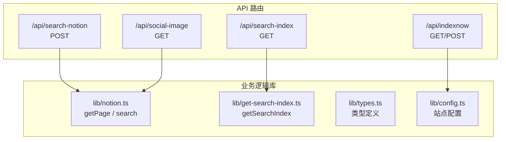
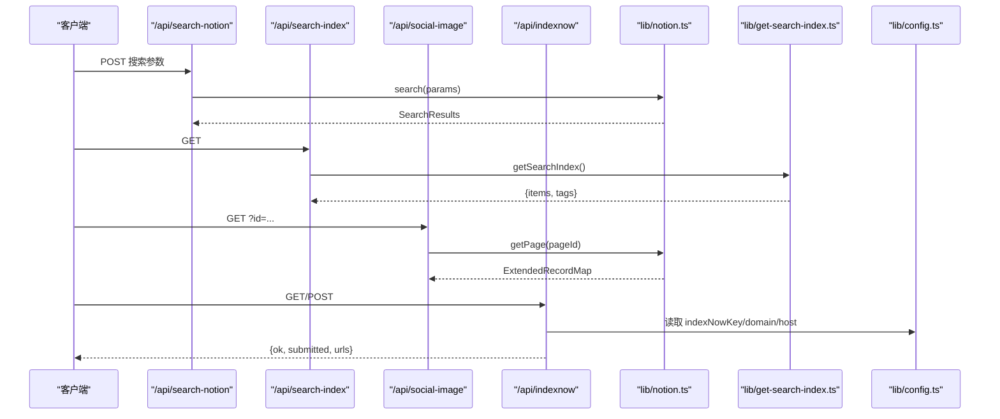
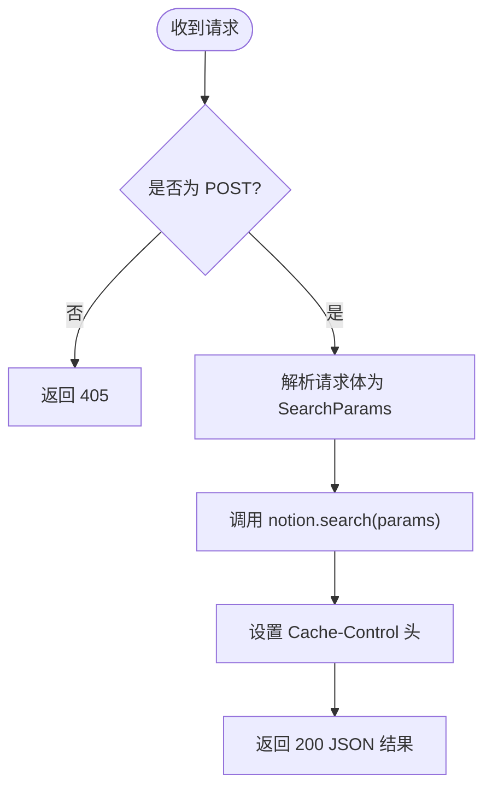
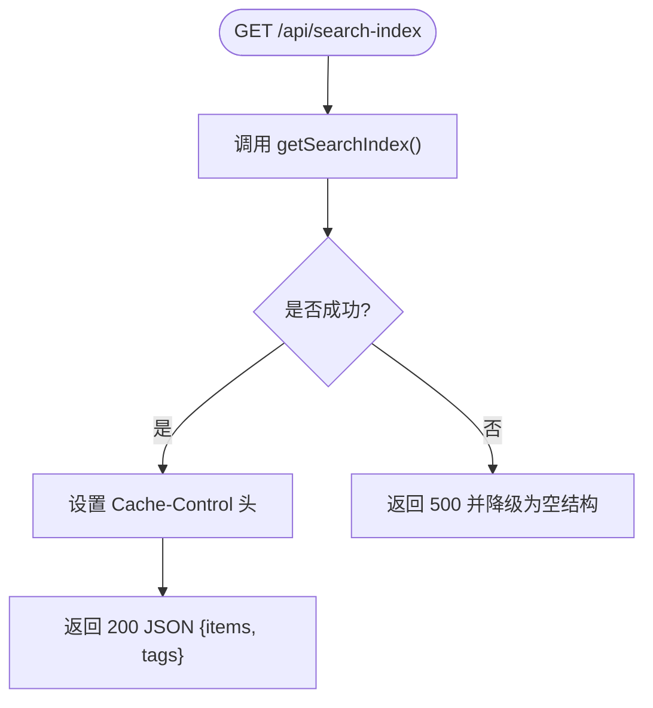
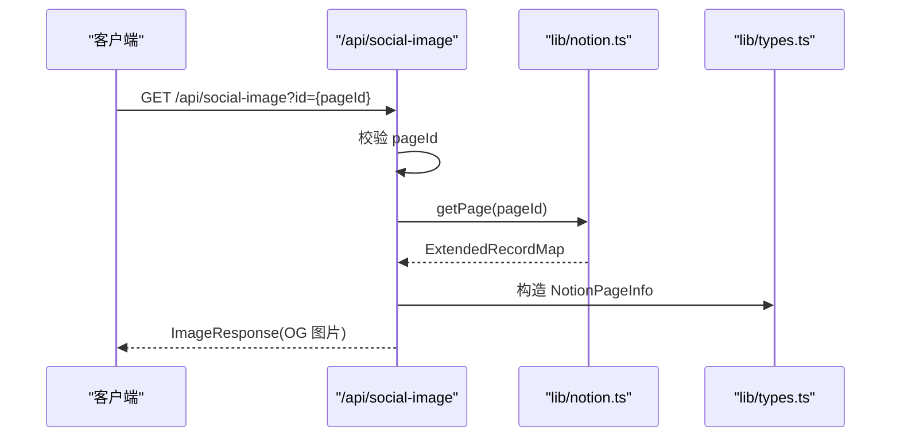
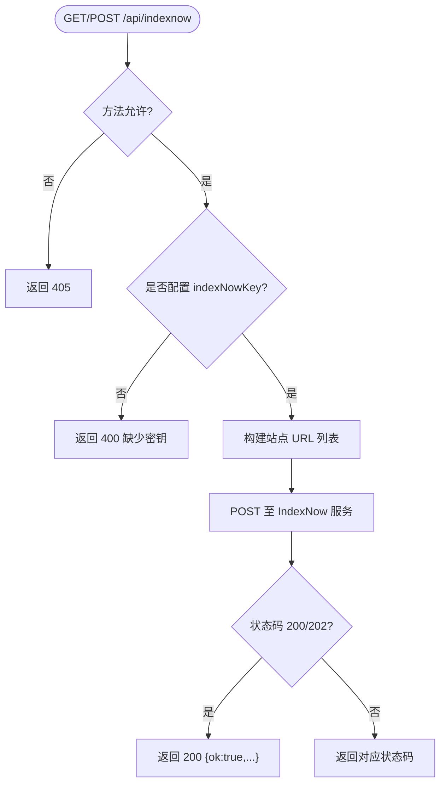
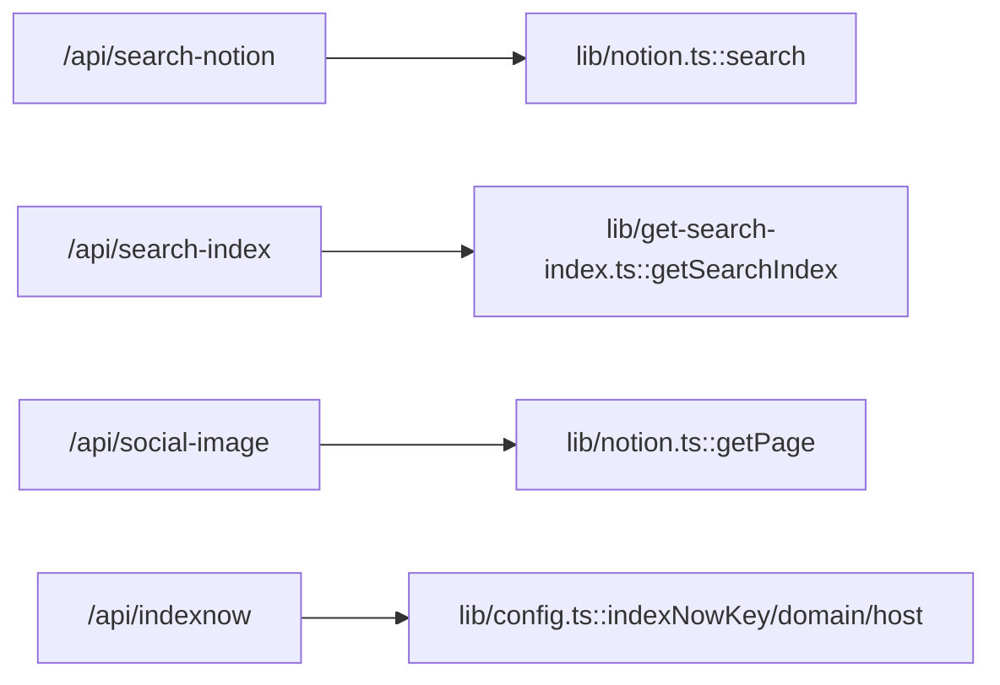

# API 参考

<cite>
**本文引用的文件**   
- [search-notion.ts](file://pages/api/search-notion.ts)
- [search-index.ts](file://pages/api/search-index.ts)
- [social-image.tsx](file://pages/api/social-image.tsx)
- [indexnow.ts](file://pages/api/indexnow.ts)
- [notion.ts](file://lib/notion.ts)
- [get-search-index.ts](file://lib/get-search-index.ts)
- [types.ts](file://lib/types.ts)
- [config.ts](file://lib/config.ts)
</cite>

## 目录
1. [简介](#简介)
2. [项目结构](#项目结构)
3. [核心组件](#核心组件)
4. [架构总览](#架构总览)
5. [详细端点说明](#详细端点说明)
6. [依赖关系分析](#依赖关系分析)
7. [性能与缓存](#性能与缓存)
8. [故障排查指南](#故障排查指南)
9. [结论](#结论)
10. [附录：客户端集成示例](#附录客户端集成示例)

## 简介
本仓库提供一组 Next.js API 路由，用于支撑站点搜索、搜索引擎索引以及社交媒体分享图片生成。所有 API 均位于 pages/api 目录下，遵循 Next.js API Routes 约定。本文档将逐一说明每个内置端点的功能、HTTP 方法、URL 模式、请求参数、响应格式、认证方式、错误处理及客户端集成建议。

## 项目结构
API 相关代码主要分布在以下位置：
- pages/api：Next.js API 路由入口
- lib/notion.ts：Notion 数据获取与搜索封装（含页面缓存）
- lib/get-search-index.ts：构建可缓存的轻量搜索索引
- lib/types.ts：类型定义（如 NotionPageInfo、PageError）
- lib/config.ts：站点配置与 API 基础路径常量

图表来源
- [search-notion.ts:1-26](file://pages/api/search-notion.ts#L1-L26)
- [search-index.ts:1-22](file://pages/api/search-index.ts#L1-L22)
- [social-image.tsx:1-313](file://pages/api/social-image.tsx#L1-L313)
- [indexnow.ts:1-71](file://pages/api/indexnow.ts#L1-L71)
- [notion.ts:161-218](file://lib/notion.ts#L161-L218)
- [get-search-index.ts:1-95](file://lib/get-search-index.ts#L1-L95)
- [types.ts:69-78](file://lib/types.ts#L69-L78)
- [config.ts:145-150](file://lib/config.ts#L145-L150)

章节来源
- [search-notion.ts:1-26](file://pages/api/search-notion.ts#L1-L26)
- [search-index.ts:1-22](file://pages/api/search-index.ts#L1-L22)
- [social-image.tsx:1-313](file://pages/api/social-image.tsx#L1-L313)
- [indexnow.ts:1-71](file://pages/api/indexnow.ts#L1-L71)
- [notion.ts:161-218](file://lib/notion.ts#L161-L218)
- [get-search-index.ts:1-95](file://lib/get-search-index.ts#L1-L95)
- [types.ts:69-78](file://lib/types.ts#L69-L78)
- [config.ts:145-150](file://lib/config.ts#L145-L150)

## 核心组件
- 搜索接口代理：/api/search-notion 接收前端搜索参数并调用后端 Notion 搜索能力。
- 搜索索引接口：/api/search-index 返回预构建的轻量级搜索索引，支持客户端即时搜索与标签过滤。
- 社交图片接口：/api/social-image 根据 Notion 页面信息动态生成 Open Graph 图片。
- IndexNow 提交接口：/api/indexnow 向 IndexNow 服务批量提交站点 URL，加速搜索引擎收录。

章节来源
- [search-notion.ts:1-26](file://pages/api/search-notion.ts#L1-L26)
- [search-index.ts:1-22](file://pages/api/search-index.ts#L1-L22)
- [social-image.tsx:1-313](file://pages/api/social-image.tsx#L1-L313)
- [indexnow.ts:1-71](file://pages/api/indexnow.ts#L1-L71)

## 架构总览
下图展示了从客户端到各 API 路由再到内部库的调用关系。

图表来源
- [search-notion.ts:6-25](file://pages/api/search-notion.ts#L6-L25)
- [notion.ts:216-218](file://lib/notion.ts#L216-L218)
- [search-index.ts:5-21](file://pages/api/search-index.ts#L5-L21)
- [get-search-index.ts:38-94](file://lib/get-search-index.ts#L38-L94)
- [social-image.tsx:21-47](file://pages/api/social-image.tsx#L21-L47)
- [indexnow.ts:15-69](file://pages/api/indexnow.ts#L15-L69)
- [config.ts:125-128](file://lib/config.ts#L125-L128)

## 详细端点说明

### 搜索 Notion 接口
- 方法：POST
- URL：/api/search-notion
- 认证：无（如需限制访问，请在网关或部署平台层鉴权）
- 请求体：JSON，字段与 Notion 搜索参数一致（例如 query、filter、sort 等），由前端传入。
- 成功响应：200 JSON，包含搜索结果对象（SearchResults）。
- 缓存头：Cache-Control: public, s-maxage=60, max-age=60, stale-while-revalidate=60
- 错误处理：
  - 非 POST 方法：405 Method Not Allowed
  - 其他异常：由上层运行时捕获并返回默认错误

图表来源
- [search-notion.ts:6-25](file://pages/api/search-notion.ts#L6-L25)
- [notion.ts:216-218](file://lib/notion.ts#L216-L218)

章节来源
- [search-notion.ts:1-26](file://pages/api/search-notion.ts#L1-L26)
- [notion.ts:216-218](file://lib/notion.ts#L216-L218)

### 搜索索引接口
- 方法：GET
- URL：/api/search-index
- 认证：无
- 成功响应：200 JSON，结构如下：
  - items: 数组，每项包含 pageId、title、url、tags、description、lastUpdated
  - tags: 字符串数组，去重且排序后的标签集合
- 缓存头：Cache-Control: public, s-maxage=300, max-age=300, stale-while-revalidate=3600
- 错误处理：
  - 构建索引失败时返回 500，但会降级返回空结构 { items: [], tags: [] }

图表来源
- [search-index.ts:5-21](file://pages/api/search-index.ts#L5-L21)
- [get-search-index.ts:11-23](file://lib/get-search-index.ts#L11-L23)
- [get-search-index.ts:38-94](file://lib/get-search-index.ts#L38-L94)

章节来源
- [search-index.ts:1-22](file://pages/api/search-index.ts#L1-L22)
- [get-search-index.ts:1-95](file://lib/get-search-index.ts#L1-L95)

### 社交媒体图片接口
- 方法：GET
- URL：/api/social-image
- 查询参数：
  - id: Notion 页面 ID（可选；未提供时使用站点根页面 ID）
- 认证：无
- 成功响应：200，返回一张生成的图片（ImageResponse），尺寸通常为 1200x630，用于 OG 分享图。
- 错误处理：
  - 无效页面 ID：400，返回 { error: "Invalid notion page id" }
  - 页面属于不同工作区：400，返回 { error: "Notion page ... belongs to a different workspace." }
  - 其他异常：由运行时处理

图表来源
- [social-image.tsx:21-47](file://pages/api/social-image.tsx#L21-L47)
- [social-image.tsx:173-276](file://pages/api/social-image.tsx#L173-L276)
- [types.ts:69-78](file://lib/types.ts#L69-L78)
- [notion.ts:161-214](file://lib/notion.ts#L161-L214)

章节来源
- [social-image.tsx:1-313](file://pages/api/social-image.tsx#L1-L313)
- [types.ts:69-78](file://lib/types.ts#L69-L78)
- [notion.ts:161-214](file://lib/notion.ts#L161-L214)

### IndexNow 提交接口
- 方法：GET 或 POST
- URL：/api/indexnow
- 认证：无（需确保已配置 indexNowKey）
- 成功响应：200 JSON，包含：
  - ok: boolean
  - submitted: number（提交的 URL 数量）
  - indexNowStatus: number（IndexNow 服务返回状态码）
  - urls: string[]（实际提交的 URL 列表）
- 错误处理：
  - 未配置 indexNowKey：400，返回 { error: "IndexNow key is not configured (site.config.ts)" }
  - 非 GET/POST：405，返回 { error: "method not allowed" }
  - 其他异常：500，返回 { error: err.message || "unknown error" }

图表来源
- [indexnow.ts:15-69](file://pages/api/indexnow.ts#L15-L69)
- [config.ts:125-128](file://lib/config.ts#L125-L128)

章节来源
- [indexnow.ts:1-71](file://pages/api/indexnow.ts#L1-L71)
- [config.ts:125-128](file://lib/config.ts#L125-L128)

## 依赖关系分析
- /api/search-notion 依赖 lib/notion.ts 的 search 方法，后者直接委托 notion-client 的 search。
- /api/search-index 依赖 lib/get-search-index.ts 的 getSearchIndex，该函数基于站点地图和 Notion 页面元数据构建轻量索引，并使用 p-memoize 进行内存缓存。
- /api/social-image 依赖 lib/notion.ts 的 getPage 以获取页面 recordMap，再结合 lib/types.ts 中的 NotionPageInfo 类型组装 OG 图片所需信息。
- /api/indexnow 依赖 lib/config.ts 中的 indexNowKey、domain、host 等配置项，并通过 getSiteMap 构建待提交的 URL 列表。

图表来源
- [search-notion.ts:6-25](file://pages/api/search-notion.ts#L6-L25)
- [notion.ts:216-218](file://lib/notion.ts#L216-L218)
- [search-index.ts:5-21](file://pages/api/search-index.ts#L5-L21)
- [get-search-index.ts:38-94](file://lib/get-search-index.ts#L38-L94)
- [social-image.tsx:21-47](file://pages/api/social-image.tsx#L21-L47)
- [indexnow.ts:15-69](file://pages/api/indexnow.ts#L15-L69)
- [config.ts:125-128](file://lib/config.ts#L125-L128)

章节来源
- [search-notion.ts:1-26](file://pages/api/search-notion.ts#L1-L26)
- [search-index.ts:1-22](file://pages/api/search-index.ts#L1-L22)
- [social-image.tsx:1-313](file://pages/api/social-image.tsx#L1-L313)
- [indexnow.ts:1-71](file://pages/api/indexnow.ts#L1-L71)
- [notion.ts:161-218](file://lib/notion.ts#L161-L218)
- [get-search-index.ts:1-95](file://lib/get-search-index.ts#L1-L95)
- [config.ts:125-128](file://lib/config.ts#L125-L128)

## 性能与缓存
- 搜索接口：设置短 TTL 缓存（60s），适合高频搜索场景，降低 Notion 压力。
- 搜索索引接口：设置较长 TTL（300s）与较长的 stale-while-revalidate（3600s），适合客户端即时搜索与标签过滤。
- 社交图片接口：Edge Runtime 下生成图片，避免 Node 环境开销；字体在运行时加载以保持体积可控。
- Notion 页面缓存：lib/notion.ts 维护 60s 的内存缓存，并在 Notion 不可用时回退到过期缓存，提升可用性。

章节来源
- [search-notion.ts:20-24](file://pages/api/search-notion.ts#L20-L24)
- [search-index.ts:12-16](file://pages/api/search-index.ts#L12-L16)
- [social-image.tsx:19-39](file://pages/api/social-image.tsx#L19-L39)
- [notion.ts:29-55](file://lib/notion.ts#L29-L55)
- [notion.ts:161-214](file://lib/notion.ts#L161-L214)

## 故障排查指南
- 搜索接口返回 405：确认使用 POST 方法。
- 搜索索引接口返回 500：检查 Notion 数据完整性与站点地图构建逻辑；接口会降级返回空结构。
- 社交图片接口返回 400：
  - 检查传入的 id 是否为有效 Notion 页面 ID。
  - 若提示“属于不同工作区”，请确认 rootNotionSpaceId 配置与目标页面所属空间一致。
- IndexNow 接口返回 400：检查 site.config.ts 或环境变量中是否配置了 indexNowKey，并确保 public/<key>.txt 验证文件存在。
- IndexNow 接口返回 405：仅允许 GET 或 POST 方法。

章节来源
- [search-notion.ts:10-12](file://pages/api/search-notion.ts#L10-L12)
- [search-index.ts:17-20](file://pages/api/search-index.ts#L17-L20)
- [social-image.tsx:30-45](file://pages/api/social-image.tsx#L30-L45)
- [social-image.tsx:192-204](file://pages/api/social-image.tsx#L192-L204)
- [indexnow.ts:19-27](file://pages/api/indexnow.ts#L19-L27)
- [indexnow.ts:66-69](file://pages/api/indexnow.ts#L66-L69)

## 结论
本项目的 API 设计围绕 Notion 内容展开，提供了搜索、索引与社交图片生成等关键能力。通过合理的缓存策略与 Edge 运行环境优化，兼顾了性能与稳定性。建议在网关或部署平台层增加访问控制与限流，以进一步提升安全性与可靠性。

## 附录：客户端集成示例
以下为常见客户端调用示例（不含具体代码内容，仅提供调用方式与预期响应结构）：

- 搜索 Notion
  - 方法：POST
  - URL：/api/search-notion
  - 请求体：{ query, filter, sort }（字段与 Notion 搜索参数一致）
  - 响应：200 JSON，包含搜索结果对象（SearchResults）

- 获取搜索索引
  - 方法：GET
  - URL：/api/search-index
  - 响应：200 JSON，结构为 { items: [...], tags: [...] }

- 生成社交图片
  - 方法：GET
  - URL：/api/social-image?id={pageId}
  - 响应：200 图片（ImageResponse），用于 OG 分享

- 提交 IndexNow
  - 方法：GET 或 POST
  - URL：/api/indexnow
  - 响应：200 JSON，包含 { ok, submitted, indexNowStatus, urls }

章节来源
- [search-notion.ts:6-25](file://pages/api/search-notion.ts#L6-L25)
- [search-index.ts:5-21](file://pages/api/search-index.ts#L5-L21)
- [social-image.tsx:21-47](file://pages/api/social-image.tsx#L21-L47)
- [indexnow.ts:15-69](file://pages/api/indexnow.ts#L15-L69)