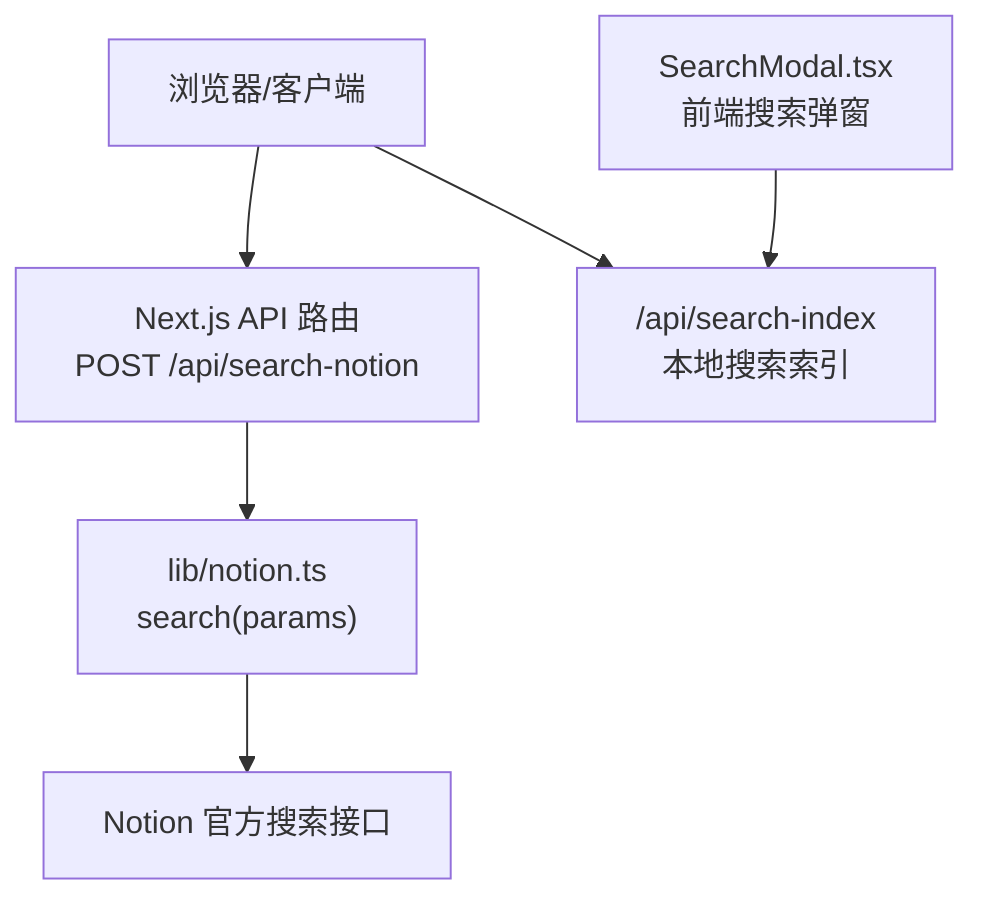
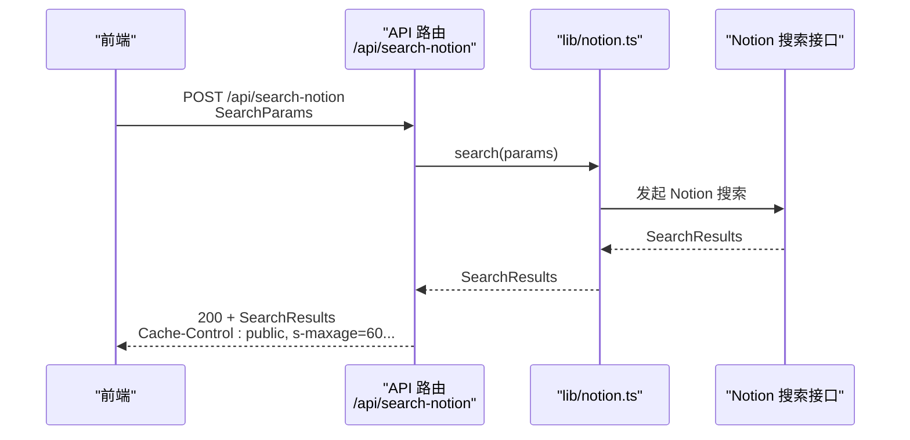
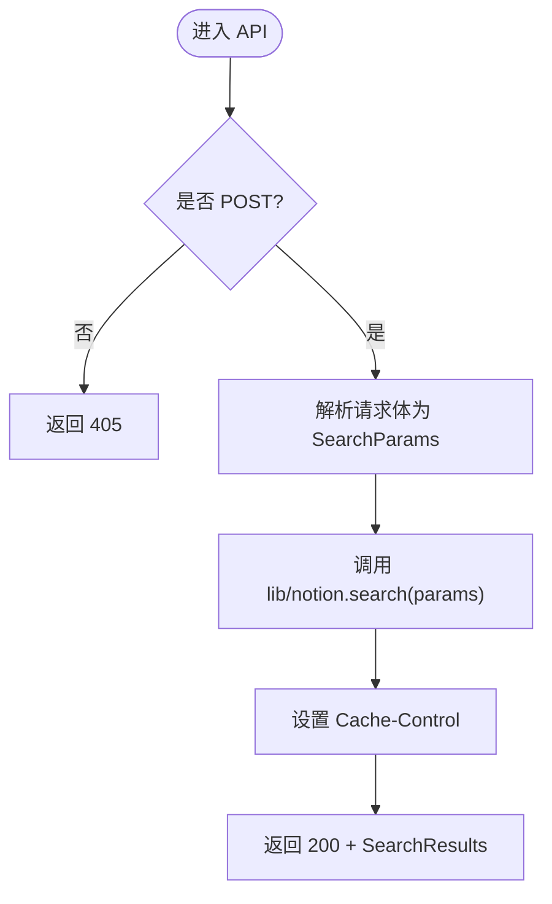
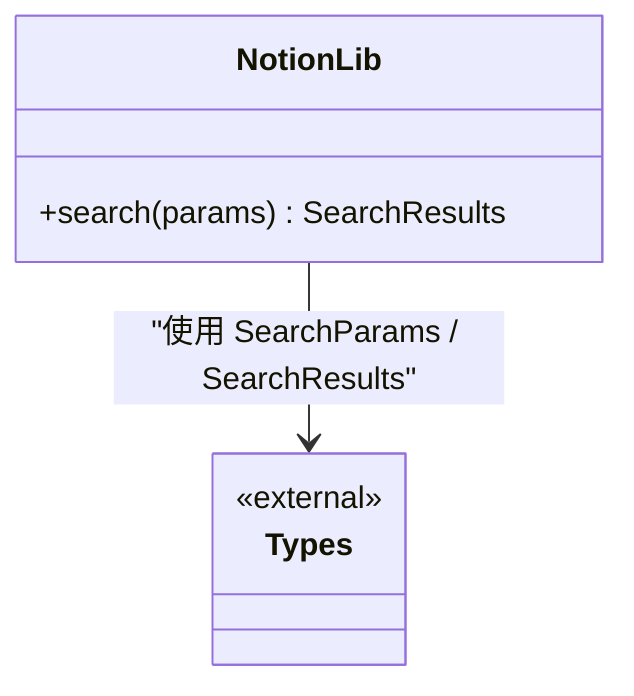
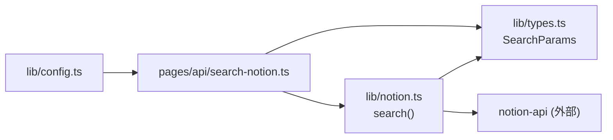

# 搜索 API

<cite>
**本文引用的文件**   
- [pages/api/search-notion.ts](file://pages/api/search-notion.ts)
- [lib/notion.ts](file://lib/notion.ts)
- [lib/config.ts](file://lib/config.ts)
- [lib/types.ts](file://lib/types.ts)
- [components/SearchModal.tsx](file://components/SearchModal.tsx)
</cite>

## 目录
1. [简介](#简介)
2. [项目结构](#项目结构)
3. [核心组件](#核心组件)
4. [架构总览](#架构总览)
5. [详细组件分析](#详细组件分析)
6. [依赖关系分析](#依赖关系分析)
7. [性能与缓存](#性能与缓存)
8. [故障排查指南](#故障排查指南)
9. [结论](#结论)

## 简介
本文档面向开发者，详细说明站点“搜索 Notion”API 的实现与使用方式。重点包括：
- POST /api/search-notion 端点的功能、请求参数结构与响应格式
- 错误处理策略
- 搜索实现原理（全文搜索、标签过滤、排序）
- 客户端集成指南
- 缓存策略与性能优化建议

该 API 是 Next.js API Route，负责接收前端搜索请求，调用后端 Notion 搜索能力并返回结果。同时，项目还包含一个基于本地索引的前端搜索 UI，用于快速体验与演示。

## 项目结构
与本 API 直接相关的代码主要位于以下位置：
- pages/api/search-notion.ts：Next.js API 路由入口
- lib/notion.ts：Notion 搜索封装与服务器端缓存逻辑
- lib/config.ts：API 地址配置
- components/SearchModal.tsx：前端搜索弹窗（使用本地索引进行过滤与展示）

图表来源
- [pages/api/search-notion.ts:6-25](file://pages/api/search-notion.ts#L6-L25)
- [lib/notion.ts:216-218](file://lib/notion.ts#L216-L218)
- [lib/config.ts:145-150](file://lib/config.ts#L145-L150)
- [components/SearchModal.tsx:80-106](file://components/SearchModal.tsx#L80-L106)

章节来源
- [pages/api/search-notion.ts:1-26](file://pages/api/search-notion.ts#L1-L26)
- [lib/config.ts:145-150](file://lib/config.ts#L145-L150)

## 核心组件
- API 路由：接收请求、校验方法、解析参数、调用搜索、设置缓存头并返回 JSON
- Notion 搜索封装：将 SearchParams 透传给 Notion 搜索，返回 SearchResults
- 配置模块：定义 API 基础路径与 searchNotion 端点 URL
- 前端搜索弹窗：加载本地搜索索引，支持关键词与标签过滤，提供交互体验

章节来源
- [pages/api/search-notion.ts:6-25](file://pages/api/search-notion.ts#L6-L25)
- [lib/notion.ts:216-218](file://lib/notion.ts#L216-L218)
- [lib/config.ts:145-150](file://lib/config.ts#L145-L150)
- [components/SearchModal.tsx:29-55](file://components/SearchModal.tsx#L29-L55)

## 架构总览
下图展示了从前端到 Notion 的完整调用链路，以及本地索引搜索的并行流程。

图表来源
- [pages/api/search-notion.ts:6-25](file://pages/api/search-notion.ts#L6-L25)
- [lib/notion.ts:216-218](file://lib/notion.ts#L216-L218)

## 详细组件分析

### API 路由：POST /api/search-notion
- 职责
  - 仅接受 POST 请求，其他方法返回 405
  - 解析请求体为 SearchParams
  - 调用 lib/notion.ts 的 search 函数获取搜索结果
  - 设置 Cache-Control 响应头并返回 JSON

- 请求方法
  - POST

- 请求体结构（SearchParams）
  - 类型来自 notion-types 库，由 lib/notion.ts 导入并使用
  - 字段含义与约束以 notion-types 为准；本仓库未在此处扩展额外字段

- 响应格式（SearchResults）
  - 类型来自 notion-types 库，由 lib/notion.ts 导出
  - 成功时返回 HTTP 200 与 SearchResults JSON

- 错误处理
  - 非 POST 请求：返回 405
  - 其他异常：当前路由未捕获，将由运行时抛出；建议在网关或上层统一处理

- 缓存策略
  - 设置响应头：public, s-maxage=60, max-age=60, stale-while-revalidate=60
  - 表示 CDN/边缘节点可缓存 60 秒，并在过期后允许旧内容继续服务一段时间

图表来源
- [pages/api/search-notion.ts:6-25](file://pages/api/search-notion.ts#L6-L25)

章节来源
- [pages/api/search-notion.ts:1-26](file://pages/api/search-notion.ts#L1-L26)

### Notion 搜索封装：lib/notion.ts
- 职责
  - 暴露 search(params) 函数，直接转发到 Notion 搜索接口
  - 与其他页面数据获取逻辑共享同一 Notion 客户端实例

- 实现要点
  - 不在此层做额外过滤或排序，保持对 Notion 原生搜索能力的透明封装
  - 便于在服务器端复用与测试

图表来源
- [lib/notion.ts:216-218](file://lib/notion.ts#L216-L218)

章节来源
- [lib/notion.ts:1-219](file://lib/notion.ts#L1-L219)

### 配置：lib/config.ts
- 职责
  - 定义 api.searchNotion 等 API 地址
  - 提供站点级开关与运行环境信息

- 相关常量
  - api.searchNotion = /api/search-notion
  - api.searchIndex = /api/search-index

章节来源
- [lib/config.ts:145-150](file://lib/config.ts#L145-L150)

### 前端搜索弹窗：components/SearchModal.tsx
- 职责
  - 加载本地搜索索引（/api/search-index）
  - 支持关键词全文匹配与多标签 AND 过滤
  - 渲染结果列表并提供键盘导航与跳转

- 过滤逻辑
  - 标题、描述、标签拼接后进行小写包含匹配
  - 选中标签需全部命中（AND 语义）

- 与 /api/search-notion 的关系
  - 该弹窗当前使用本地索引进行过滤，不调用 /api/search-notion
  - 可作为未来接入服务端搜索结果的 UI 参考

章节来源
- [components/SearchModal.tsx:29-55](file://components/SearchModal.tsx#L29-L55)
- [components/SearchModal.tsx:80-106](file://components/SearchModal.tsx#L80-L106)

## 依赖关系分析
- API 路由依赖
  - types.SearchParams：来自 notion-types，通过 lib/types.ts 重新导出
  - notion.search：来自 lib/notion.ts

- Notion 搜索封装依赖
  - notion-types：定义 SearchParams 与 SearchResults
  - notion-api：底层 Notion 客户端（由 lib/notion.ts 引入）

- 配置依赖
  - api.searchNotion：由 lib/config.ts 提供

图表来源
- [pages/api/search-notion.ts:3-4](file://pages/api/search-notion.ts#L3-L4)
- [lib/notion.ts:1-5](file://lib/notion.ts#L1-L5)
- [lib/config.ts:145-150](file://lib/config.ts#L145-L150)

章节来源
- [pages/api/search-notion.ts:1-26](file://pages/api/search-notion.ts#L1-L26)
- [lib/notion.ts:1-219](file://lib/notion.ts#L1-L219)
- [lib/config.ts:145-150](file://lib/config.ts#L145-L150)

## 性能与缓存

### 缓存策略
- API 响应缓存
  - 响应头：public, s-maxage=60, max-age=60, stale-while-revalidate=60
  - 效果：CDN/边缘缓存 60 秒，过期后可短暂回退旧内容，降低后端压力

- 服务器内存缓存（页面数据）
  - lib/notion.ts 中对页面数据有 60 秒 TTL 的内存缓存，用于吸收突发流量与 Notion 抖动
  - 注意：该缓存针对 getPage 场景，并非直接作用于 search 调用

- 前端本地索引
  - SearchModal 通过 /api/search-index 拉取本地索引，在客户端完成过滤与展示，减少服务端搜索压力

章节来源
- [pages/api/search-notion.ts:20-24](file://pages/api/search-notion.ts#L20-L24)
- [lib/notion.ts:19-55](file://lib/notion.ts#L19-L55)
- [components/SearchModal.tsx:80-106](file://components/SearchModal.tsx#L80-L106)

### 性能优化建议
- 合理设置 CDN 缓存时间
  - 根据内容更新频率调整 s-maxage/max-age，平衡实时性与性能
- 控制并发与分页
  - 若后续扩展服务端搜索，建议限制单次返回数量，避免大结果集
- 前端去抖与节流
  - 对输入框事件进行去抖，减少频繁请求
- 预取与懒加载
  - 对常用标签或热门搜索词进行预取，提升首屏体验
- 降级与容错
  - 当 Notion 不可用时，优先返回本地索引结果或空结果，保证可用性

[本节为通用指导，不涉及具体文件分析]

## 故障排查指南

### 常见问题与定位
- 405 Method Not Allowed
  - 原因：使用了非 POST 方法访问 /api/search-notion
  - 解决：确保使用 POST 方法

- 网络或权限错误
  - 现象：Notion 搜索失败或返回非 2xx
  - 排查：检查 Notion 集成 Token、Workspace 权限、域名与代理配置

- 结果为空
  - 可能原因：查询条件过严、标签过滤过多、Notion 中无匹配内容
  - 建议：放宽关键词或取消部分标签过滤

- 缓存导致结果不更新
  - 现象：修改 Notion 内容后，搜索结果未及时变化
  - 排查：确认 CDN/浏览器缓存策略，必要时清除缓存或缩短 s-maxage

章节来源
- [pages/api/search-notion.ts:10-12](file://pages/api/search-notion.ts#L10-L12)
- [pages/api/search-notion.ts:20-24](file://pages/api/search-notion.ts#L20-L24)

## 结论
- POST /api/search-notion 是一个简洁的代理型 API，负责将 SearchParams 转发至 Notion 搜索并返回 SearchResults
- 默认启用短时效的公共缓存，适合高频读、低频写的搜索场景
- 前端 SearchModal 当前基于本地索引进行过滤，可作为独立体验或未来对接服务端搜索的参考
- 在生产环境中，建议结合 CDN 缓存、前端去抖与降级策略，以获得更好的性能与稳定性

[本节为总结性内容，不涉及具体文件分析]