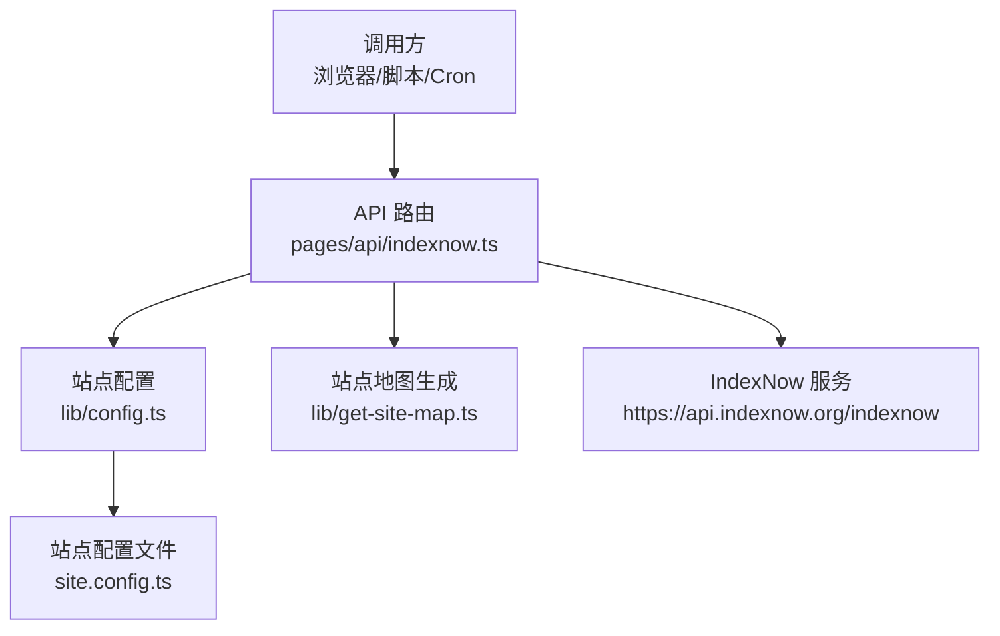
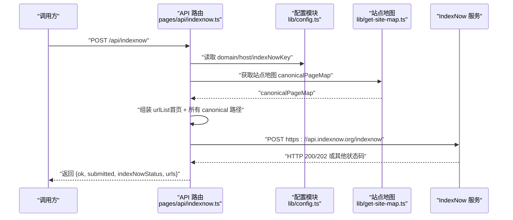
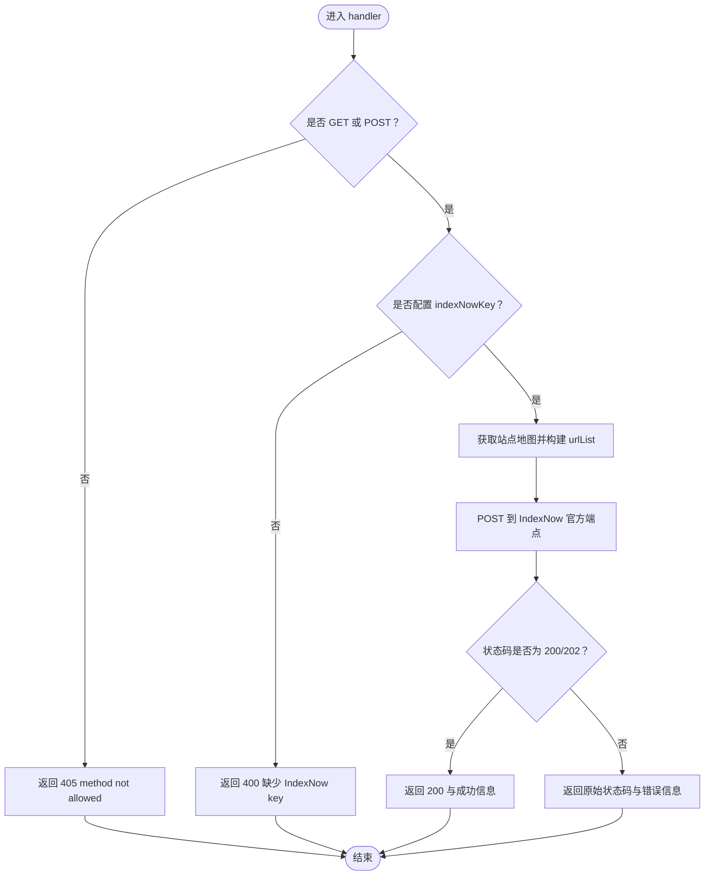
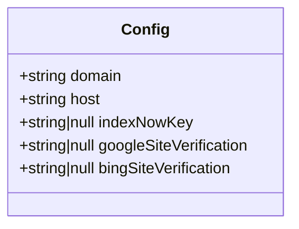
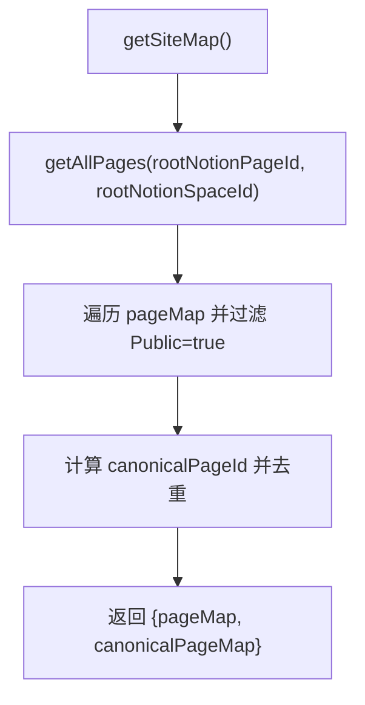
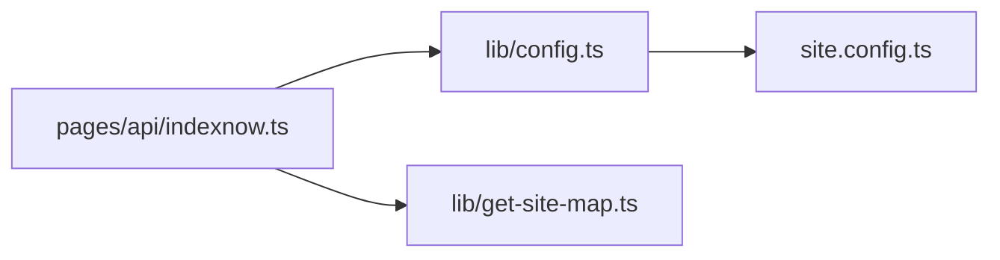

# 搜索引擎提交 API

<cite>
**本文引用的文件**   
- [pages/api/indexnow.ts](file://pages/api/indexnow.ts)
- [lib/config.ts](file://lib/config.ts)
- [site.config.ts](file://site.config.ts)
- [lib/get-site-map.ts](file://lib/get-site-map.ts)
</cite>

## 目录
1. [简介](#简介)
2. [项目结构](#项目结构)
3. [核心组件](#核心组件)
4. [架构总览](#架构总览)
5. [详细组件分析](#详细组件分析)
6. [依赖关系分析](#依赖关系分析)
7. [性能与可靠性](#性能与可靠性)
8. [故障排查指南](#故障排查指南)
9. [结论](#结论)
10. [附录：集成与配置清单](#附录集成与配置清单)

## 简介
本文件面向需要向搜索引擎（Bing、Yandex）提交新页面进行索引的开发者，详细说明本项目中基于 IndexNow 协议的搜索引擎提交 API。重点包括：
- POST /api/indexnow 端点的功能与行为
- IndexNow 协议在本项目的实现方式（站点验证、URL 提交、批量处理）
- 搜索引擎集成的具体示例与配置步骤
- 错误处理与重试机制建议

## 项目结构
与搜索引擎提交相关的代码主要位于以下位置：
- API 路由：pages/api/indexnow.ts
- 站点配置与密钥：lib/config.ts、site.config.ts
- 站点地图生成：lib/get-site-map.ts

**图表来源**
- [pages/api/indexnow.ts:1-71](file://pages/api/indexnow.ts#L1-L71)
- [lib/config.ts:104-128](file://lib/config.ts#L104-L128)
- [site.config.ts:28-36](file://site.config.ts#L28-L36)
- [lib/get-site-map.ts:17-27](file://lib/get-site-map.ts#L17-L27)

**章节来源**
- [pages/api/indexnow.ts:1-71](file://pages/api/indexnow.ts#L1-L71)
- [lib/config.ts:104-128](file://lib/config.ts#L104-L128)
- [site.config.ts:28-36](file://site.config.ts#L28-L36)
- [lib/get-site-map.ts:17-27](file://lib/get-site-map.ts#L17-L27)

## 核心组件
- IndexNow 提交接口：负责接收请求、校验参数、构建 URL 列表并调用 IndexNow 官方 API。
- 站点配置模块：提供域名、主机地址、IndexNow 密钥等关键配置。
- 站点地图模块：从 Notion 数据源生成 canonicalPageMap，用于构造待提交的 URL 列表。

关键点：
- 支持 GET 和 POST 两种方法调用。
- 未配置 indexNowKey 时返回明确的 400 错误。
- 成功时 IndexNow 返回 200 或 202；失败时透传状态码。
- 响应体包含 ok、submitted、indexNowStatus、urls 字段，便于调用方判断结果与调试。

**章节来源**
- [pages/api/indexnow.ts:15-69](file://pages/api/indexnow.ts#L15-L69)
- [lib/config.ts:104-128](file://lib/config.ts#L104-L128)
- [lib/get-site-map.ts:17-27](file://lib/get-site-map.ts#L17-L27)

## 架构总览
下图展示了从调用方到搜索引擎的完整提交流程。

**图表来源**
- [pages/api/indexnow.ts:15-69](file://pages/api/indexnow.ts#L15-L69)
- [lib/config.ts:104-128](file://lib/config.ts#L104-L128)
- [lib/get-site-map.ts:17-27](file://lib/get-site-map.ts#L17-L27)

## 详细组件分析

### IndexNow 提交接口（POST /api/indexnow）
职责与流程：
- 方法校验：仅允许 GET 与 POST，否则返回 405。
- 配置校验：若未设置 indexNowKey，返回 400 并提示在站点配置中设置。
- 数据准备：通过 getSiteMap() 获取 canonicalPageMap，结合 host 构建 urlList（包含首页与所有 canonical 路径）。
- 协议实现：按 IndexNow 规范构造 payload（host、key、keyLocation、urlList），以 application/json 发送到 https://api.indexnow.org/indexnow。
- 结果处理：IndexNow 成功返回 200 或 202；将状态映射为 ok 布尔值，并返回结构化响应体。
- 缓存头：设置 Cache-Control: no-store，避免重复 Cron 对端点造成压力。
- 异常处理：捕获网络或内部错误，记录日志并返回 500。

**图表来源**
- [pages/api/indexnow.ts:15-69](file://pages/api/indexnow.ts#L15-L69)

**章节来源**
- [pages/api/indexnow.ts:15-69](file://pages/api/indexnow.ts#L15-L69)

### 站点配置模块（lib/config.ts）
职责与要点：
- 暴露 domain、host、indexNowKey 等关键变量。
- indexNowKey 可从 site.config.ts 或环境变量 INDEXNOW_KEY 注入。
- 同时提供 Google/Bing 站点验证相关字段，便于 SEO 工具接入。

**图表来源**
- [lib/config.ts:52-55](file://lib/config.ts#L52-L55)
- [lib/config.ts:104-128](file://lib/config.ts#L104-L128)

**章节来源**
- [lib/config.ts:52-55](file://lib/config.ts#L52-L55)
- [lib/config.ts:104-128](file://lib/config.ts#L104-L128)

### 站点地图模块（lib/get-site-map.ts）
职责与要点：
- 从 Notion 空间拉取页面，过滤“Public”属性为 true 的页面。
- 计算 canonicalPageId 并去重，得到 canonicalPageMap。
- 对外暴露 getSiteMap()，供 API 路由使用。

**图表来源**
- [lib/get-site-map.ts:17-27](file://lib/get-site-map.ts#L17-L27)
- [lib/get-site-map.ts:44-104](file://lib/get-site-map.ts#L44-L104)

**章节来源**
- [lib/get-site-map.ts:17-27](file://lib/get-site-map.ts#L17-L27)
- [lib/get-site-map.ts:44-104](file://lib/get-site-map.ts#L44-L104)

### IndexNow 协议在本项目的实现
- 站点验证：
  - 在 site.config.ts 中设置 indexNowKey。
  - 将对应 key 的文本文件放置于 public/<key>.txt，以便 IndexNow 服务可访问。
- URL 提交：
  - 由 API 路由自动收集首页与所有 canonical 路径，组成 urlList 并提交。
- 批量处理：
  - 每次提交均包含全部 URL 列表，适合定时任务（如 Vercel Cron）周期性触发。

注意：
- 当前实现会提交全站 URL 列表，而非增量单条提交。若需增量提交，可在调用方侧自行维护已提交集合并在业务层控制。

**章节来源**
- [site.config.ts:28-36](file://site.config.ts#L28-L36)
- [pages/api/indexnow.ts:29-44](file://pages/api/indexnow.ts#L29-L44)

## 依赖关系分析
- pages/api/indexnow.ts 依赖 lib/config.ts 提供的 domain、host、indexNowKey。
- pages/api/indexnow.ts 依赖 lib/get-site-map.ts 提供的站点地图数据。
- lib/config.ts 依赖 site.config.ts 中的站点配置项。

**图表来源**
- [pages/api/indexnow.ts:1-4](file://pages/api/indexnow.ts#L1-L4)
- [lib/config.ts:104-128](file://lib/config.ts#L104-L128)
- [site.config.ts:28-36](file://site.config.ts#L28-L36)

**章节来源**
- [pages/api/indexnow.ts:1-4](file://pages/api/indexnew.ts#L1-L4)
- [lib/config.ts:104-128](file://lib/config.ts#L104-L128)
- [site.config.ts:28-36](file://site.config.ts#L28-L36)

## 性能与可靠性
- 批量提交：每次提交包含全站 URL，减少外部调用次数，但 payload 体积随站点规模增长。
- 缓存控制：API 返回 Cache-Control: no-store，避免 CDN/边缘缓存导致的状态不一致。
- 外部依赖：IndexNow 官方端点可能超时或不可用，建议在调用方增加重试与退避策略。
- 定时任务：可通过平台 Cron（例如 Vercel Cron）定期触发，降低手动成本。

优化建议：
- 增量提交：在业务层维护已提交 URL 集合，仅在新增/变更时提交差异。
- 并发控制：对大规模站点分批提交，避免单次 payload 过大。
- 监控告警：对 5xx 与 IndexNow 非 200/202 状态进行告警。

[本节为通用指导，不直接分析具体文件]

## 故障排查指南
常见问题与定位步骤：
- 405 方法不允许：确认调用方法为 GET 或 POST。
- 400 缺少 IndexNow key：检查 site.config.ts 或环境变量 INDEXNOW_KEY 是否正确配置。
- 500 服务器错误：查看服务端日志，关注网络请求失败或站点地图生成异常。
- IndexNow 返回非 200/202：检查 keyLocation 对应的验证文件是否可被公开访问（public/<key>.txt）。
- 未生效：确认站点已在 Bing/Yandex 完成 IndexNow 注册与验证。

参考实现中的错误处理与日志输出位置：
- 方法校验与 405 返回
- 配置缺失与 400 返回
- 外部请求异常与 500 返回

**章节来源**
- [pages/api/indexnow.ts:19-27](file://pages/api/indexnow.ts#L19-L27)
- [pages/api/indexnow.ts:66-69](file://pages/api/indexnow.ts#L66-L69)

## 结论
本项目通过 Next.js API 路由实现了 IndexNow 协议的站点 URL 批量提交能力，结合站点地图自动生成与站点配置管理，提供了开箱即用的搜索引擎索引加速方案。配合定时任务与合理的重试策略，可有效提升新页面的收录速度。

[本节为总结性内容，不直接分析具体文件]

## 附录：集成与配置清单
- 启用 IndexNow
  - 在 site.config.ts 中设置 indexNowKey。
  - 将 public/<key>.txt 部署至公网可访问路径。
- 调用 API
  - 使用 POST /api/indexnow 提交全站 URL 列表。
  - 也可使用 GET /api/indexnow 触发相同逻辑。
- 返回值说明
  - ok：是否成功（IndexNow 返回 200 或 202 视为成功）
  - submitted：本次提交的 URL 数量
  - indexNowStatus：IndexNow 返回的 HTTP 状态码
  - urls：本次提交的 URL 列表
- 推荐实践
  - 使用平台 Cron 定时触发
  - 在调用方实现重试与退避
  - 对异常状态进行监控与告警

**章节来源**
- [site.config.ts:28-36](file://site.config.ts#L28-L36)
- [pages/api/indexnow.ts:15-69](file://pages/api/indexnow.ts#L15-L69)