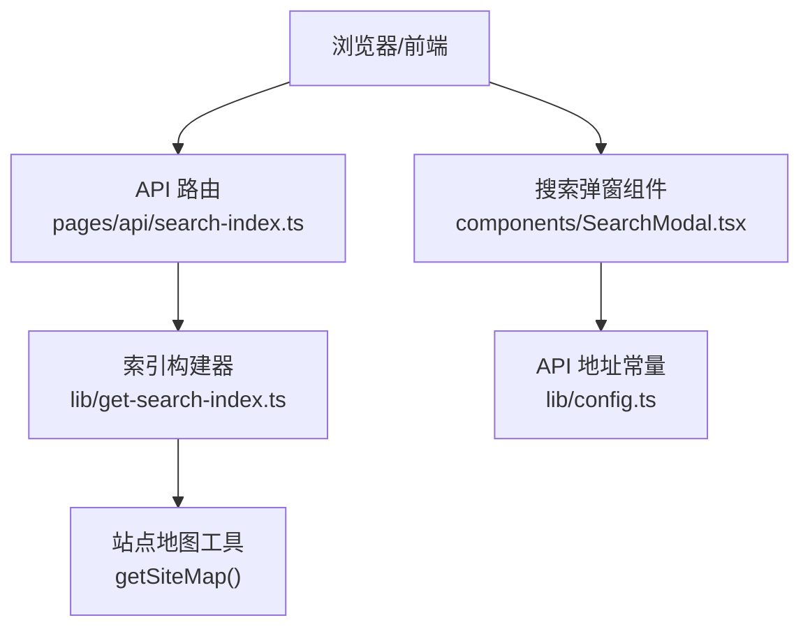
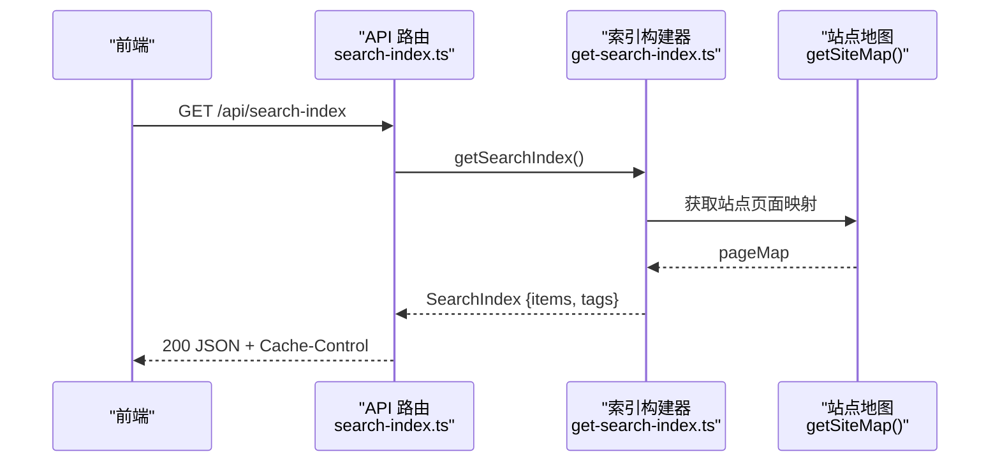
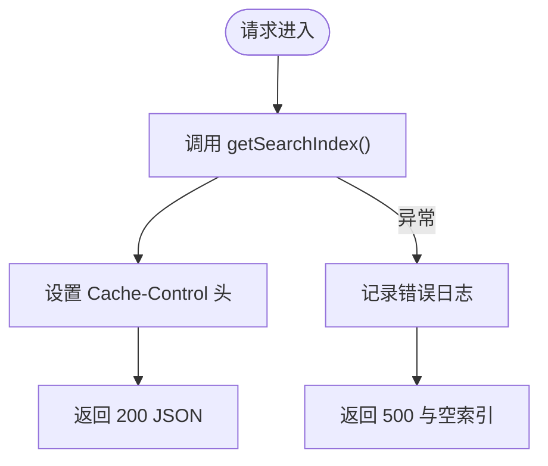
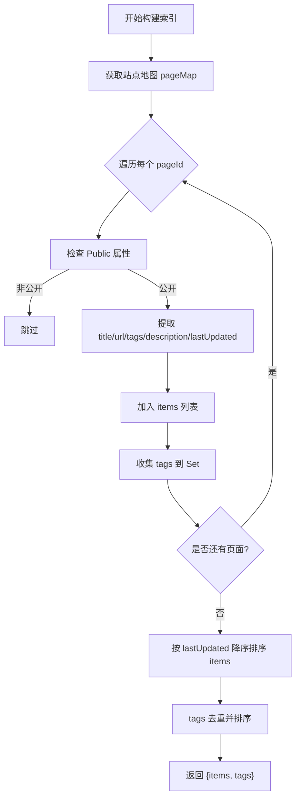
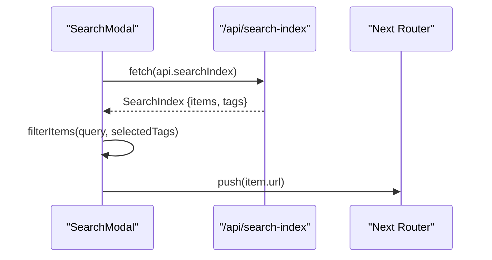
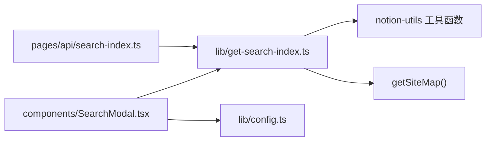

# 搜索索引 API

<cite>
**本文引用的文件**   
- [pages/api/search-index.ts](file://pages/api/search-index.ts)
- [lib/get-search-index.ts](file://lib/get-search-index.ts)
- [components/SearchModal.tsx](file://components/SearchModal.tsx)
- [lib/config.ts](file://lib/config.ts)
- [site.config.ts](file://site.config.ts)
</cite>

## 目录
1. [简介](#简介)
2. [项目结构](#项目结构)
3. [核心组件](#核心组件)
4. [架构总览](#架构总览)
5. [详细组件分析](#详细组件分析)
6. [依赖关系分析](#依赖关系分析)
7. [性能与缓存](#性能与缓存)
8. [故障排查指南](#故障排查指南)
9. [结论](#结论)
10. [附录：字段定义与使用示例](#附录字段定义与使用示例)

## 简介
本章节说明“搜索索引 API”的目标与范围。该 API 提供 GET /api/search-index，用于获取站点所有公开页面的轻量级搜索索引数据，供前端进行即时客户端搜索与标签过滤，避免在每次输入时直接调用 Notion 接口。

- 端点：GET /api/search-index
- 返回：包含 items 与 tags 的 JSON 对象
- 用途：前端搜索弹窗、标签筛选、结果排序等

## 项目结构
与本 API 相关的代码主要分布在以下位置：
- pages/api/search-index.ts：Next.js API 路由，负责暴露 GET /api/search-index
- lib/get-search-index.ts：构建搜索索引的核心逻辑，包括从站点地图读取页面、提取标题/标签/描述、排序与去重
- components/SearchModal.tsx：前端搜索弹窗，调用 /api/search-index 并实现本地过滤与导航
- lib/config.ts：API 基础路径与 searchIndex 地址常量
- site.config.ts：站点配置（如 revalidateSeconds），影响 ISR 与缓存策略

**图表来源**
- [pages/api/search-index.ts:5-16](file://pages/api/search-index.ts#L5-L16)
- [lib/get-search-index.ts:35-94](file://lib/get-search-index.ts#L35-L94)
- [components/SearchModal.tsx:80-106](file://components/SearchModal.tsx#L80-L106)
- [lib/config.ts:145-150](file://lib/config.ts#L145-L150)

**章节来源**
- [pages/api/search-index.ts:1-22](file://pages/api/search-index.ts#L1-L22)
- [lib/get-search-index.ts:1-95](file://lib/get-search-index.ts#L1-L95)
- [components/SearchModal.tsx:1-254](file://components/SearchModal.tsx#L1-L254)
- [lib/config.ts:145-150](file://lib/config.ts#L145-L150)
- [site.config.ts:57-60](file://site.config.ts#L57-L60)

## 核心组件
- API 路由：接收请求，调用索引构建器，设置缓存头并返回 JSON
- 索引构建器：遍历站点地图中的公开页面，提取标题、URL、标签、描述、更新时间，生成 items 列表与 tags 集合
- 前端弹窗：在挂载时拉取索引，支持关键词与标签过滤，点击跳转至对应页面

**章节来源**
- [pages/api/search-index.ts:5-20](file://pages/api/search-index.ts#L5-L20)
- [lib/get-search-index.ts:35-94](file://lib/get-search-index.ts#L35-L94)
- [components/SearchModal.tsx:80-129](file://components/SearchModal.tsx#L80-L129)

## 架构总览
下图展示了从前端到后端再到索引构建的完整流程。

**图表来源**
- [pages/api/search-index.ts:9-16](file://pages/api/search-index.ts#L9-L16)
- [lib/get-search-index.ts:40-94](file://lib/get-search-index.ts#L40-L94)

## 详细组件分析

### API 路由：GET /api/search-index
- 功能：调用 getSearchIndex 获取索引数据，设置响应头并返回 JSON
- 错误处理：捕获异常，记录日志，返回空索引结构 { items: [], tags: [] } 与 500 状态码
- 缓存控制：设置 Cache-Control 为 public，s-maxage=300，max-age=300，stale-while-revalidate=3600

**图表来源**
- [pages/api/search-index.ts:9-20](file://pages/api/search-index.ts#L9-L20)

**章节来源**
- [pages/api/search-index.ts:5-20](file://pages/api/search-index.ts#L5-L20)

### 索引构建器：get-search-index.ts
- 数据结构：
  - SearchIndexItem：pageId、title、url、tags、description、lastUpdated
  - SearchIndex：items 数组、tags 字符串数组
- 关键逻辑：
  - 通过 getSiteMap() 获取 pageMap
  - 跳过非公开页面（Public=false）
  - 提取标题、规范化 URL、解析 Tags 属性、收集 Description 与 last_edited_time
  - 按 lastUpdated 降序排序 items
  - 对 tags 去重并按字典序排序
- 缓存：使用 p-memoize 对 getSearchIndex 进行函数级缓存，减少重复计算

**图表来源**
- [lib/get-search-index.ts:40-94](file://lib/get-search-index.ts#L40-L94)

**章节来源**
- [lib/get-search-index.ts:11-23](file://lib/get-search-index.ts#L11-L23)
- [lib/get-search-index.ts:25-33](file://lib/get-search-index.ts#L25-L33)
- [lib/get-search-index.ts:35-94](file://lib/get-search-index.ts#L35-L94)

### 前端集成：SearchModal.tsx
- 拉取索引：组件挂载时调用 api.searchIndex（即 /api/search-index），将结果存入 state
- 过滤逻辑：
  - 标签过滤：AND 语义，必须包含所有选中标签
  - 关键词过滤：在 title、description、tags 中做子串匹配（不区分大小写）
- 交互：键盘导航（Esc 关闭、上下键切换、Enter 跳转）、鼠标悬停高亮
- 跳转：根据 item.url 使用 Next Router 导航

**图表来源**
- [components/SearchModal.tsx:80-129](file://components/SearchModal.tsx#L80-L129)
- [components/SearchModal.tsx:29-55](file://components/SearchModal.tsx#L29-L55)

**章节来源**
- [components/SearchModal.tsx:29-55](file://components/SearchModal.tsx#L29-L55)
- [components/SearchModal.tsx:80-129](file://components/SearchModal.tsx#L80-L129)

## 依赖关系分析
- API 路由依赖索引构建器
- 索引构建器依赖站点地图工具与 Notion 工具函数（getBlockTitle、getPageProperty 等）
- 前端组件依赖 API 地址常量与类型定义

**图表来源**
- [pages/api/search-index.ts:3-10](file://pages/api/search-index.ts#L3-L10)
- [lib/get-search-index.ts:1-8](file://lib/get-search-index.ts#L1-L8)
- [components/SearchModal.tsx:6-7](file://components/SearchModal.tsx#L6-L7)

**章节来源**
- [pages/api/search-index.ts:1-10](file://pages/api/search-index.ts#L1-L10)
- [lib/get-search-index.ts:1-8](file://lib/get-search-index.ts#L1-L8)
- [components/SearchModal.tsx:1-10](file://components/SearchModal.tsx#L1-L10)
- [lib/config.ts:145-150](file://lib/config.ts#L145-L150)

## 性能与缓存
- 服务端缓存：
  - API 层设置 Cache-Control：public, s-maxage=300, max-age=300, stale-while-revalidate=3600
  - 索引构建器使用 p-memoize 对 getSearchIndex 进行函数级缓存，避免重复扫描站点地图
- 站点级 ISR：
  - site.config.ts 中 revalidateSeconds 默认 3600，可调整为 86400 以降低函数调用频率
- 前端缓存：
  - 搜索弹窗仅在挂载时拉取一次索引，不进行轮询；后续过滤在内存中进行

优化建议：
- 若站点规模较大，可适当增大 s-maxage/max-age，或提高 revalidateSeconds
- 确保 Notion 页面属性（Public、Tags、Description）稳定，以减少无效重建

**章节来源**
- [pages/api/search-index.ts:12-15](file://pages/api/search-index.ts#L12-L15)
- [lib/get-search-index.ts:38-38](file://lib/get-search-index.ts#L38-L38)
- [site.config.ts:57-60](file://site.config.ts#L57-L60)

## 故障排查指南
- 返回空索引且状态码 500：
  - 可能原因：索引构建过程中抛出异常（例如站点地图为空、Notion 属性缺失）
  - 处理：查看服务器日志中的 “search-index error”，确认 Notion 访问权限与页面属性
- 前端加载失败：
  - 现象：弹窗显示 “Failed to load: ...”
  - 处理：检查网络请求是否成功、CORS 与代理配置是否正确
- 搜索结果无变化：
  - 可能原因：缓存未失效或未触发重新构建
  - 处理：调整 revalidateSeconds 或手动触发 ISR 重建

**章节来源**
- [pages/api/search-index.ts:17-20](file://pages/api/search-index.ts#L17-L20)
- [components/SearchModal.tsx:84-98](file://components/SearchModal.tsx#L84-L98)

## 结论
GET /api/search-index 提供了高性能、可缓存的站点搜索索引能力。通过将 Notion 页面元数据预构建为轻量级 JSON，前端可实现即时搜索与标签过滤，显著降低实时查询 Notion 的压力。结合 ISR 与函数级缓存，可在保证数据新鲜度的同时提升整体性能。

## 附录：字段定义与使用示例

### 返回数据结构
- SearchIndex
  - items: SearchIndexItem[]
  - tags: string[]
- SearchIndexItem
  - pageId: string
  - title: string
  - url: string
  - tags: string[]
  - description?: string
  - lastUpdated?: number

字段说明：
- pageId：Notion 页面 ID
- title：页面标题
- url：相对路径 URL（以 / 开头）
- tags：页面标签数组
- description：可选的描述摘要
- lastUpdated：最后编辑时间戳（毫秒），用于排序

**章节来源**
- [lib/get-search-index.ts:11-23](file://lib/get-search-index.ts#L11-L23)
- [lib/get-search-index.ts:64-84](file://lib/get-search-index.ts#L64-L84)

### 获取与使用示例（步骤）
- 前端获取索引：
  - 在组件挂载时发起 GET /api/search-index
  - 将返回的 items 与 tags 存储到状态中
- 本地过滤：
  - 关键词：在 title、description、tags 中做不区分大小写的子串匹配
  - 标签：仅保留包含所有选中标签的项目（AND 语义）
- 导航：
  - 点击结果项，使用 item.url 进行页面跳转

**章节来源**
- [components/SearchModal.tsx:80-129](file://components/SearchModal.tsx#L80-L129)
- [components/SearchModal.tsx:29-55](file://components/SearchModal.tsx#L29-L55)

### 索引更新机制与数据同步策略
- 服务端缓存：
  - API 层设置 Cache-Control，使 CDN/边缘节点可缓存 300 秒，并在 3600 秒内允许陈旧内容再验证
- 函数级缓存：
  - getSearchIndex 使用 p-memoize 缓存，避免重复构建
- ISR 重建：
  - site.config.ts 的 revalidateSeconds 控制页面与函数的重建周期，默认 3600 秒，可调整为 86400 秒
- 数据源：
  - 索引基于站点地图与 Notion 页面属性（Public、Tags、Description、last_edited_time）
  - 当 Notion 页面属性变更时，ISR 会在下次访问时触发重建，从而更新索引

最佳实践：
- 合理设置 revalidateSeconds，平衡数据新鲜度与函数调用成本
- 确保 Notion 页面属性准确无误，尤其是 Public 与 Tags
- 如需立即生效，可通过触发 ISR 重建或等待下一次访问自动刷新

**章节来源**
- [pages/api/search-index.ts:12-15](file://pages/api/search-index.ts#L12-L15)
- [lib/get-search-index.ts:38-38](file://lib/get-search-index.ts#L38-L38)
- [site.config.ts:57-60](file://site.config.ts#L57-L60)