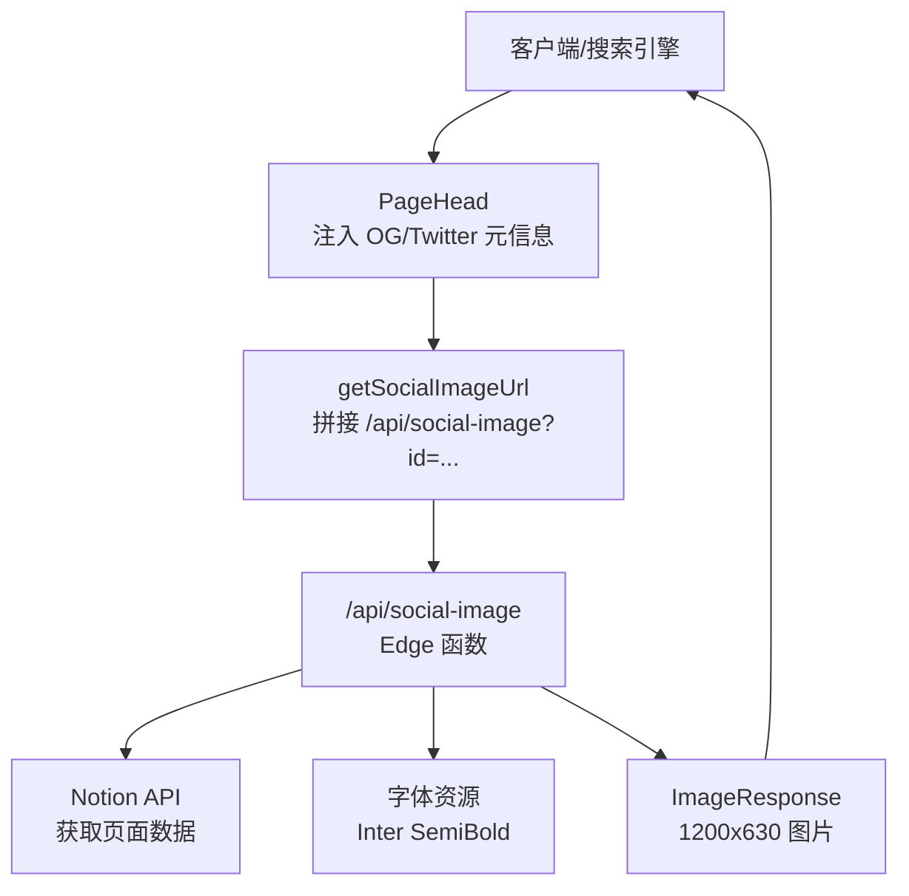
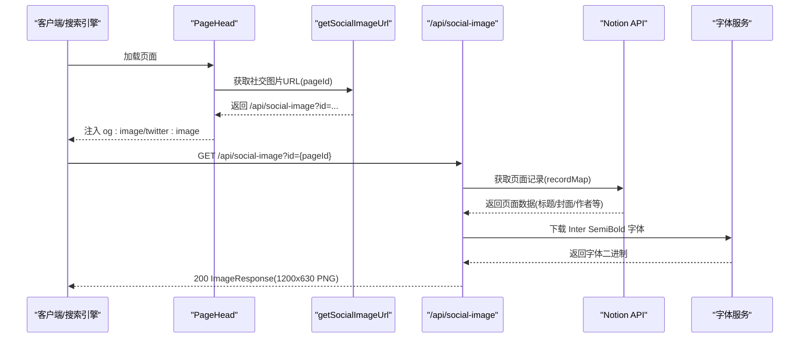
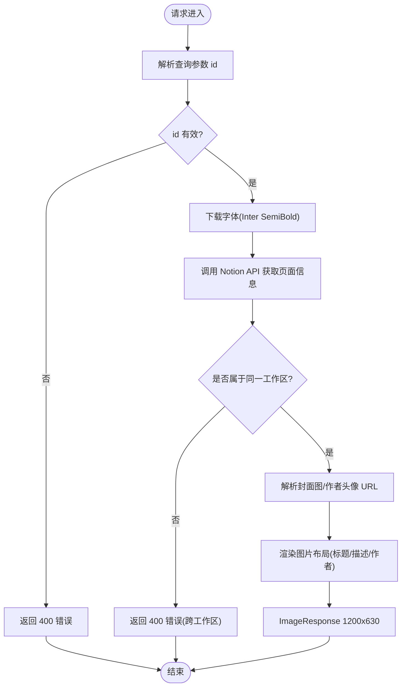
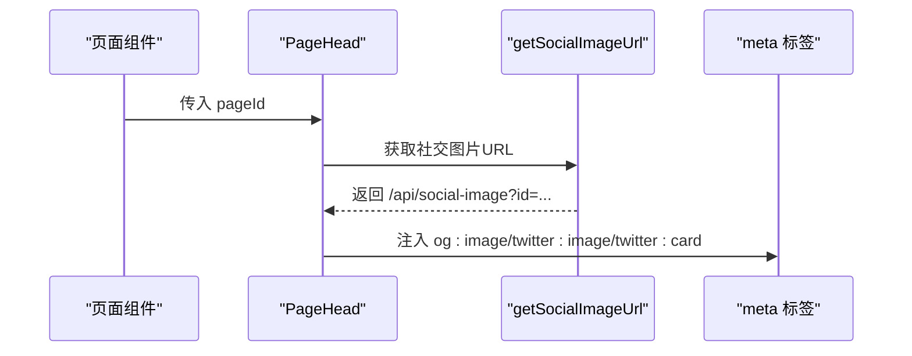
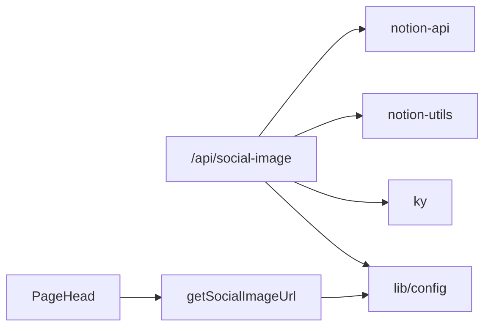

# 社交媒体图片 API

<cite>
**本文引用的文件**   
- [pages/api/social-image.tsx](file://pages/api/social-image.tsx)
- [lib/get-social-image-url.ts](file://lib/get-social-image-url.ts)
- [components/PageHead.tsx](file://components/PageHead.tsx)
- [lib/config.ts](file://lib/config.ts)
- [site.config.ts](file://site.config.ts)
</cite>

## 目录
1. [简介](#简介)
2. [项目结构](#项目结构)
3. [核心组件](#核心组件)
4. [架构总览](#架构总览)
5. [详细组件分析](#详细组件分析)
6. [依赖关系分析](#依赖关系分析)
7. [性能与优化建议](#性能与优化建议)
8. [故障排查指南](#故障排查指南)
9. [结论](#结论)

## 简介
本文件面向“社交媒体图片 API”，重点说明 GET /api/social-image 端点如何根据 Notion 页面内容动态生成 Open Graph 与 Twitter Card 预览图。该端点基于 Next.js Edge Runtime 与 next/og 的 ImageResponse，从 Notion 拉取页面元数据（标题、封面图、作者头像等），渲染为 1200×630 的标准社交分享图尺寸，供前端通过 og:image 与 twitter:image 使用。

## 项目结构
与本 API 直接相关的代码分布如下：
- pages/api/social-image.tsx：API 路由实现，负责解析参数、获取 Notion 数据、渲染图片响应
- lib/get-social-image-url.ts：构建 social-image URL 的工具函数
- components/PageHead.tsx：注入 og:image、twitter:card 等元信息，并调用工具函数生成图片 URL
- lib/config.ts：集中定义 API 基础路径与站点配置
- site.config.ts：站点级默认值（如根 Notion 页面 ID、默认封面图等）

**图表来源**
- [components/PageHead.tsx:30-35](file://components/PageHead.tsx#L30-L35)
- [lib/get-social-image-url.ts:3-10](file://lib/get-social-image-url.ts#L3-L10)
- [pages/api/social-image.tsx:21-49](file://pages/api/social-image.tsx#L21-L49)
- [lib/config.ts:145-150](file://lib/config.ts#L145-L150)

**章节来源**
- [pages/api/social-image.tsx:1-313](file://pages/api/social-image.tsx#L1-L313)
- [lib/get-social-image-url.ts:1-17](file://lib/get-social-image-url.ts#L1-L17)
- [components/PageHead.tsx:1-188](file://components/PageHead.tsx#L1-L188)
- [lib/config.ts:145-150](file://lib/config.ts#L145-L150)
- [site.config.ts:1-77](file://site.config.ts#L1-L77)

## 核心组件
- GET /api/social-image：Edge 运行时 API，接收 id 查询参数，返回一张用于社交分享的 PNG 图片
- getSocialImageUrl：根据 pageId 拼接 /api/social-image 的完整 URL
- PageHead：在页面头部注入 og:image、twitter:card 等元信息，并优先使用生成的社交图片 URL
- lib/config：统一暴露 api.getSocialImage 路径与站点默认值（如 rootNotionPageId、defaultPageCover 等）

**章节来源**
- [pages/api/social-image.tsx:21-49](file://pages/api/social-image.tsx#L21-L49)
- [lib/get-social-image-url.ts:3-10](file://lib/get-social-image-url.ts#L3-L10)
- [components/PageHead.tsx:153-161](file://components/PageHead.tsx#L153-L161)
- [lib/config.ts:145-150](file://lib/config.ts#L145-L150)

## 架构总览
下图展示一次完整的社交图片请求流程：浏览器或搜索引擎抓取页面时，读取 meta 标签中的 og:image/twitter:image，随后请求 /api/social-image；API 从 Notion 拉取页面信息，动态渲染图片并返回。

**图表来源**
- [components/PageHead.tsx:30-35](file://components/PageHead.tsx#L30-L35)
- [lib/get-social-image-url.ts:3-10](file://lib/get-social-image-url.ts#L3-L10)
- [pages/api/social-image.tsx:34-49](file://pages/api/social-image.tsx#L34-L49)
- [pages/api/social-image.tsx:173-276](file://pages/api/social-image.tsx#L173-L276)

## 详细组件分析

### GET /api/social-image 端点
- 运行环境：Edge Runtime
- 输入参数：
  - id：Notion 页面 ID（可选；未提供时使用站点根页面 ID）
- 输出：
  - 成功：HTTP 200，Content-Type 为图片（ImageResponse），尺寸 1200×630
  - 失败：HTTP 400，返回错误对象（例如无效 pageId 或跨工作区）

主要处理逻辑：
1. 解析查询参数 id，若为空则回退到站点配置的根 Notion 页面 ID
2. 校验 pageId 有效性
3. 运行时下载字体（避免打包体积超限）
4. 调用 Notion API 获取页面信息（recordMap、block、属性等）
5. 计算封面图位置与兼容 URL（对特定图床进行尺寸参数补全）
6. 渲染 JSX 布局并通过 ImageResponse 输出图片

**图表来源**
- [pages/api/social-image.tsx:25-49](file://pages/api/social-image.tsx#L25-L49)
- [pages/api/social-image.tsx:173-276](file://pages/api/social-image.tsx#L173-L276)

**章节来源**
- [pages/api/social-image.tsx:19-49](file://pages/api/social-image.tsx#L19-L49)
- [pages/api/social-image.tsx:173-276](file://pages/api/social-image.tsx#L173-L276)

### 参数与行为说明
- id（可选）：Notion 页面 ID。不传时使用站点根页面 ID
- 默认行为：
  - 标题：优先使用 Notion 页面标题，否则回退到站点名称
  - 详情：优先显示发布日期（博客文章）或作者名，否则回退到站点域名
  - 封面图：优先使用 Notion 页面的 Social Image 属性或 page_cover，否则回退到站点默认封面
  - 作者头像：优先使用 Notion 页面图标（若为 URL），否则回退到站点默认图标
- 图片尺寸：1200×630（符合 Open Graph 推荐尺寸）
- 字体：Inter SemiBold（运行时下载，避免打包体积限制）

**章节来源**
- [pages/api/social-image.tsx:25-49](file://pages/api/social-image.tsx#L25-L49)
- [pages/api/social-image.tsx:206-270](file://pages/api/social-image.tsx#L206-L270)
- [pages/api/social-image.tsx:158-169](file://pages/api/social-image.tsx#L158-L169)

### 图片生成与样式
- 背景：深色底色 + 白色内容卡片
- 文本层级：大标题（加粗）、副标题（半透明）
- 作者头像：圆形边框叠加于左上区域
- 封面图：铺满背景，object-fit: cover
- 尺寸：1200×630，适合大多数社交平台预览

注意：当前实现未暴露主题颜色、字体大小等可配置项；如需自定义，可在渲染层扩展样式字段。

**章节来源**
- [pages/api/social-image.tsx:49-170](file://pages/api/social-image.tsx#L49-L170)

### 与前端元信息的集成
- PageHead 会调用 getSocialImageUrl(pageId) 生成社交图片 URL，并将其注入：
  - og:image
  - twitter:image
  - twitter:card 设置为 summary_large_image（当存在图片时）
- 若无法生成图片 URL，则降级为 twitter:card=summary

**图表来源**
- [components/PageHead.tsx:30-35](file://components/PageHead.tsx#L30-L35)
- [components/PageHead.tsx:153-161](file://components/PageHead.tsx#L153-L161)
- [lib/get-social-image-url.ts:3-10](file://lib/get-social-image-url.ts#L3-L10)

**章节来源**
- [components/PageHead.tsx:153-161](file://components/PageHead.tsx#L153-L161)
- [lib/get-social-image-url.ts:3-10](file://lib/get-social-image-url.ts#L3-L10)

### Notion 数据映射与回退策略
- 标题：getBlockTitle(block, recordMap) 或站点 name
- 封面图：
  - 优先：Notion 页面属性 “Social Image”
  - 其次：block.format.page_cover
  - 最后：站点 defaultPageCover
- 作者头像：
  - 优先：block.icon（若为 URL）
  - 其次：站点 defaultPageIcon
- 详情：
  - 博客文章且存在 Published 属性：格式化月份+年份
  - 否则：Author 或站点 domain
- 封面图定位：
  - 使用 page_cover_position 计算 object-position
- 图片兼容性：
  - 对 images.unsplash.com 自动追加 w=1200&fit=max 参数以提升加载质量

**章节来源**
- [pages/api/social-image.tsx:206-270](file://pages/api/social-image.tsx#L206-L270)
- [pages/api/social-image.tsx:293-312](file://pages/api/social-image.tsx#L293-L312)

## 依赖关系分析
- API 路由依赖：
  - next/og 的 ImageResponse（边缘渲染）
  - notion-utils/notion-types（Notion 数据解析）
  - ky（网络请求，用于检测图片可达性）
  - 站点配置（rootNotionPageId、defaultPageCover/defaultPageIcon 等）
- 前端依赖：
  - PageHead 注入 og/twitter 元信息
  - getSocialImageUrl 拼接 API 地址

**图表来源**
- [pages/api/social-image.tsx:1-17](file://pages/api/social-image.tsx#L1-L17)
- [lib/get-social-image-url.ts:1-2](file://lib/get-social-image-url.ts#L1-L2)
- [components/PageHead.tsx:1-5](file://components/PageHead.tsx#L1-L5)
- [lib/config.ts:145-150](file://lib/config.ts#L145-L150)

**章节来源**
- [pages/api/social-image.tsx:1-17](file://pages/api/social-image.tsx#L1-L17)
- [lib/get-social-image-url.ts:1-2](file://lib/get-social-image-url.ts#L1-L2)
- [components/PageHead.tsx:1-5](file://components/PageHead.tsx#L1-L5)
- [lib/config.ts:145-150](file://lib/config.ts#L145-L150)

## 性能与优化建议
- 边缘渲染：API 使用 Edge Runtime，减少冷启动延迟
- 字体按需加载：运行时下载字体，避免包体超过平台限制
- 图片可达性检查：使用 HEAD 请求验证外部图片可用性，失败则回退到默认图
- 图床优化：对 images.unsplash.com 自动添加 w=1200&fit=max，提升大图质量与加载速度
- 缓存建议：
  - CDN 缓存：确保社交图片 URL 可被 CDN 缓存（静态资源）
  - ISR/Revalidate：结合站点 revalidateSeconds 控制 Notion 数据刷新频率，间接影响图片更新
- 尺寸与格式：
  - 输出尺寸固定为 1200×630，符合 Open Graph 推荐
  - 格式由 next/og 决定（通常为 PNG）

[本节为通用指导，不直接分析具体文件]

## 故障排查指南
- 无效 pageId：
  - 现象：返回 400，提示 Invalid notion page id
  - 排查：确认传入的 id 是否为有效 Notion 页面 ID
- 跨工作区：
  - 现象：返回 400，提示页面不属于同一工作区
  - 排查：检查站点 rootNotionSpaceId 与页面所属空间是否一致
- 图片不可达：
  - 现象：封面图或作者头像未显示
  - 排查：确认外部图片 URL 可达；必要时启用回退图（defaultPageCover/defaultPageIcon）
- 字体加载失败：
  - 现象：文字未正确渲染
  - 排查：确认字体资源路径可访问（/fonts/inter-semibold.ttf）

**章节来源**
- [pages/api/social-image.tsx:27-45](file://pages/api/social-image.tsx#L27-L45)
- [pages/api/social-image.tsx:192-204](file://pages/api/social-image.tsx#L192-L204)
- [pages/api/social-image.tsx:278-312](file://pages/api/social-image.tsx#L278-L312)

## 结论
GET /api/social-image 提供了稳定、高性能的社交分享图生成能力。它通过 Edge 运行时与 next/og 将 Notion 页面内容渲染为标准尺寸的预览图，并与前端的 og/twitter 元信息无缝集成。建议在 Notion 中维护好 Social Image、Published、Author 等属性以获得最佳展示效果；同时利用站点默认值作为回退保障。

[本节为总结性内容，不直接分析具体文件]