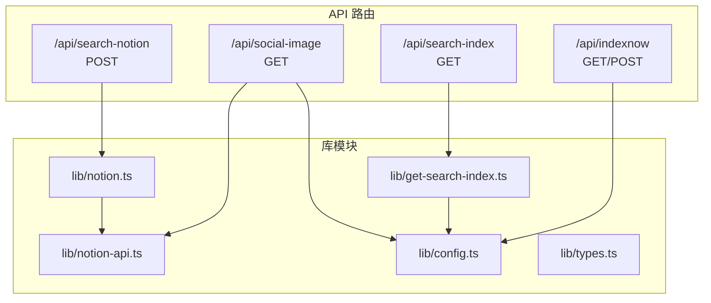
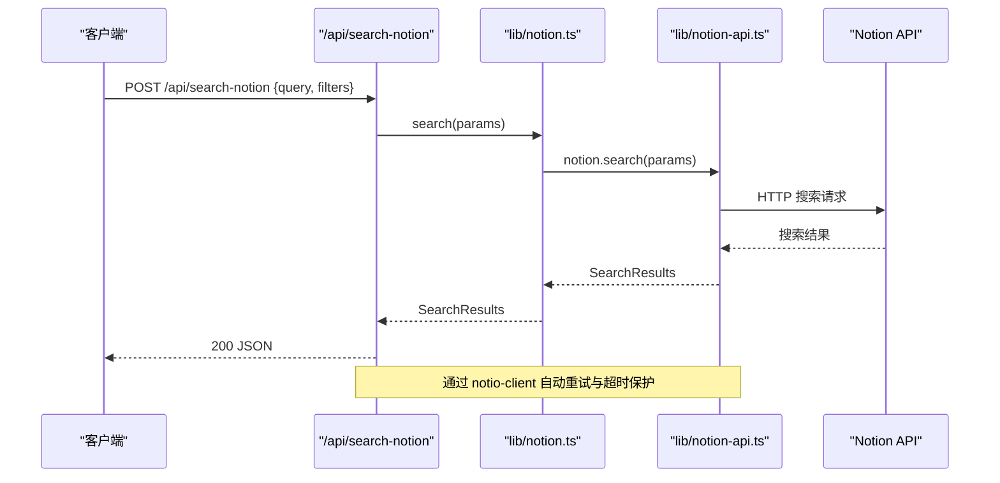
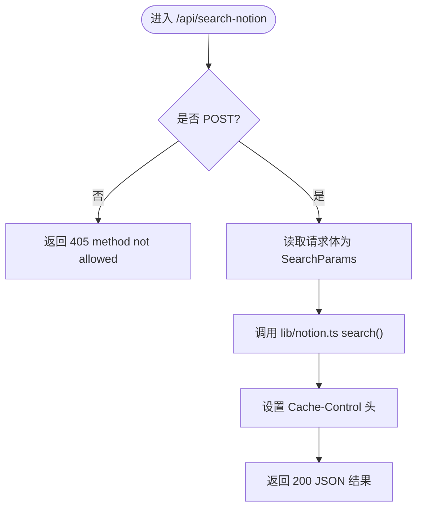
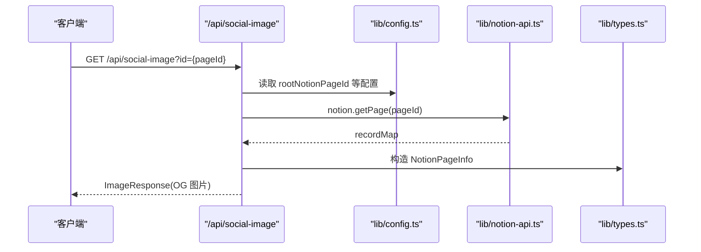
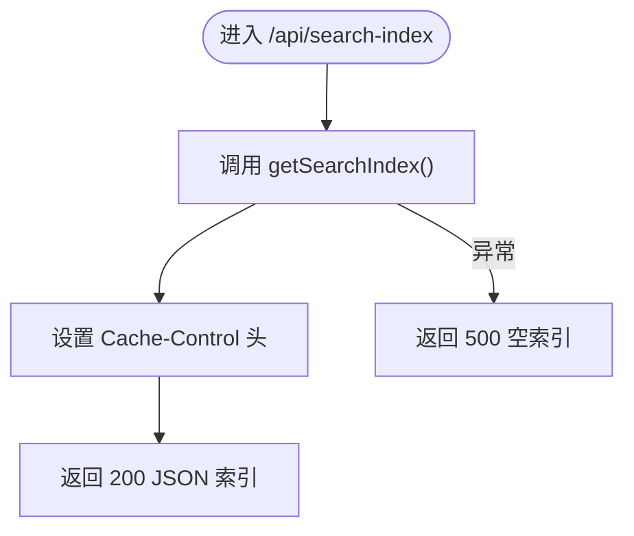
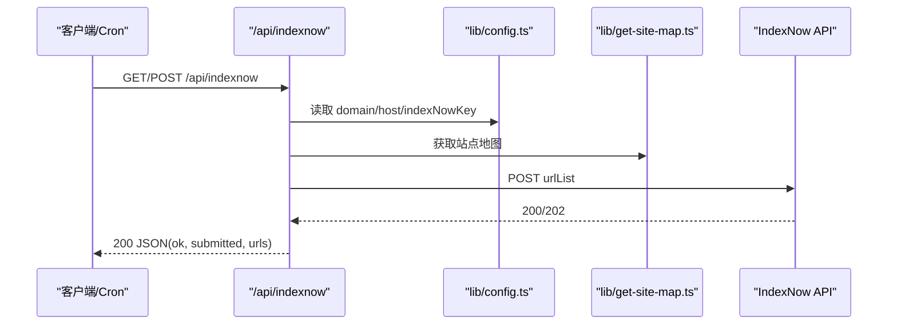
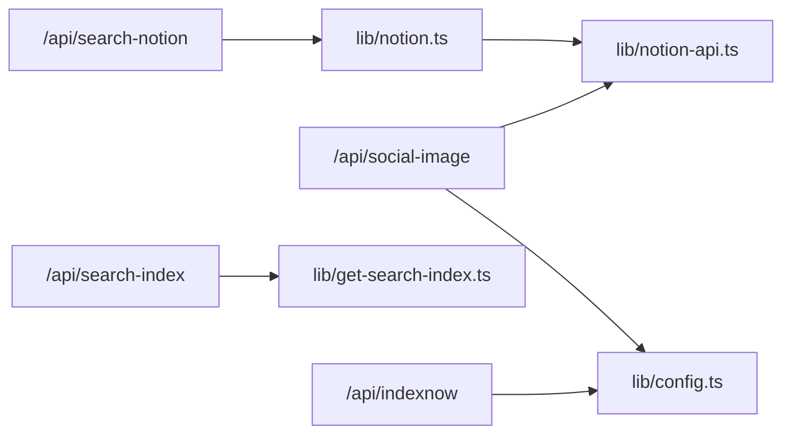

# API 端点

<cite>
**本文引用的文件**   
- [search-notion.ts](file://pages/api/search-notion.ts)
- [social-image.tsx](file://pages/api/social-image.tsx)
- [search-index.ts](file://pages/api/search-index.ts)
- [indexnow.ts](file://pages/api/indexnow.ts)
- [notion-api.ts](file://lib/notion-api.ts)
- [notion.ts](file://lib/notion.ts)
- [get-search-index.ts](file://lib/get-search-index.ts)
- [config.ts](file://lib/config.ts)
- [types.ts](file://lib/types.ts)
- [site.config.ts](file://site.config.ts)
</cite>

## 目录
1. [简介](#简介)
2. [项目结构](#项目结构)
3. [核心组件](#核心组件)
4. [架构总览](#架构总览)
5. [详细组件分析](#详细组件分析)
6. [依赖关系分析](#依赖关系分析)
7. [性能与缓存](#性能与缓存)
8. [错误处理与调试](#错误处理与调试)
9. [安全与速率限制](#安全与速率限制)
10. [客户端实现指南](#客户端实现指南)
11. [版本控制与兼容性](#版本控制与兼容性)
12. [结论](#结论)

## 简介
本仓库提供一组 Next.js API 路由，用于：
- 搜索 Notion 内容（后端代理）
- 生成社交媒体分享图片（Open Graph 图像）
- 获取站点搜索引擎索引数据
- 向 IndexNow 提交站点 URL 以加速 Bing/Yandex 收录

这些接口统一位于 `/api` 下，部分使用 Node.js 运行时，部分使用 Edge 运行时。

## 项目结构
API 路由位于 `pages/api` 目录下，每个文件对应一个 RESTful 端点。业务逻辑主要封装在 `lib` 中，包括 Notion 客户端、配置、搜索索引构建等。

**图表来源**
- [search-notion.ts:6-25](file://pages/api/search-notion.ts#L6-L25)
- [social-image.tsx:21-170](file://pages/api/social-image.tsx#L21-L170)
- [search-index.ts:5-21](file://pages/api/search-index.ts#L5-L21)
- [indexnow.ts:15-70](file://pages/api/indexnow.ts#L15-L70)
- [notion.ts:161-218](file://lib/notion.ts#L161-L218)
- [notion-api.ts:6-19](file://lib/notion-api.ts#L6-L19)
- [get-search-index.ts:44-98](file://lib/get-search-index.ts#L44-L98)
- [config.ts:148-153](file://lib/config.ts#L148-L153)

**章节来源**
- [search-notion.ts:1-26](file://pages/api/search-notion.ts#L1-L26)
- [social-image.tsx:1-313](file://pages/api/social-image.tsx#L1-L313)
- [search-index.ts:1-22](file://pages/api/search-index.ts#L1-L22)
- [indexnow.ts:1-71](file://pages/api/indexnow.ts#L1-L71)
- [notion.ts:1-219](file://lib/notion.ts#L1-L219)
- [notion-api.ts:1-20](file://lib/notion-api.ts#L1-L20)
- [get-search-index.ts:1-99](file://lib/get-search-index.ts#L1-L99)
- [config.ts:1-224](file://lib/config.ts#L1-L224)

## 核心组件
- 搜索 Notion 接口：将前端搜索请求转发到 Notion Search，并返回搜索结果。
- 社交图片接口：根据 Notion 页面元信息动态生成 Open Graph 图片。
- 搜索索引接口：导出轻量级站点索引，供前端本地搜索和标签过滤。
- IndexNow 接口：收集站点 URL 列表并提交给 IndexNow 服务。

**章节来源**
- [search-notion.ts:6-25](file://pages/api/search-notion.ts#L6-L25)
- [social-image.tsx:21-170](file://pages/api/social-image.tsx#L21-L170)
- [search-index.ts:5-21](file://pages/api/search-index.ts#L5-L21)
- [indexnow.ts:15-70](file://pages/api/indexnow.ts#L15-L70)

## 架构总览
下图展示了各 API 路由与其依赖的库模块之间的关系。

**图表来源**
- [search-notion.ts:6-25](file://pages/api/search-notion.ts#L6-L25)
- [notion.ts:216-218](file://lib/notion.ts#L216-L218)
- [notion-api.ts:6-19](file://lib/notion-api.ts#L6-L19)

## 详细组件分析

### 搜索 Notion 接口
- 方法：POST
- URL：/api/search-notion
- 认证：无（由服务端持有 Notion Token）
- 请求体：遵循 Notion SearchParams 类型（如 query、filter、sort 等）
- 响应：SearchResults 对象
- 缓存头：Cache-Control: public, s-maxage=60, max-age=60, stale-while-revalidate=60
- 错误：非 POST 返回 405；其他错误由 Notion 层抛出并由上层捕获

**图表来源**
- [search-notion.ts:6-25](file://pages/api/search-notion.ts#L6-L25)
- [notion.ts:216-218](file://lib/notion.ts#L216-L218)

**章节来源**
- [search-notion.ts:6-25](file://pages/api/search-notion.ts#L6-L25)
- [notion.ts:216-218](file://lib/notion.ts#L216-L218)

### 社交媒体图片生成接口
- 方法：GET
- URL：/api/social-image?id={pageId}
- 运行时：Edge（Next.js ImageResponse）
- 参数：
  - id：Notion 页面 ID（可选，默认使用根页面）
- 响应：Open Graph 图片（ImageResponse），尺寸 1200x630
- 行为：
  - 解析 pageId，校验 workspace 归属
  - 从 Notion 页面提取标题、作者、封面图、图标等
  - 动态渲染 OG 图片，包含字体加载与图片回退策略
- 错误：
  - 无效 pageId：400
  - 不属于配置的 workspace：400
  - 其他错误：按内部错误状态码返回

**图表来源**
- [social-image.tsx:21-170](file://pages/api/social-image.tsx#L21-L170)
- [config.ts:23-34](file://lib/config.ts#L23-L34)
- [types.ts:69-77](file://lib/types.ts#L69-L77)

**章节来源**
- [social-image.tsx:21-170](file://pages/api/social-image.tsx#L21-L170)
- [config.ts:23-34](file://lib/config.ts#L23-L34)
- [types.ts:69-77](file://lib/types.ts#L69-L77)

### 搜索引擎索引接口
- 方法：GET
- URL：/api/search-index
- 响应：SearchIndex 对象，包含 items 与 tags
- 缓存头：Cache-Control: public, s-maxage=300, max-age=300, stale-while-revalidate=3600
- 错误：异常时返回空数组 items 与 tags，状态码 500

**图表来源**
- [search-index.ts:5-21](file://pages/api/search-index.ts#L5-L21)
- [get-search-index.ts:44-98](file://lib/get-search-index.ts#L44-L98)

**章节来源**
- [search-index.ts:5-21](file://pages/api/search-index.ts#L5-L21)
- [get-search-index.ts:44-98](file://lib/get-search-index.ts#L44-L98)

### 搜索引擎索引通知接口（IndexNow）
- 方法：GET、POST
- URL：/api/indexnow
- 功能：收集站点 URL 列表并提交给 IndexNow 服务，加速 Bing/Yandex 收录
- 前置条件：需配置 indexNowKey（来自 site.config.ts 或环境变量）
- 响应：
  - 成功：200，包含 ok、submitted、indexNowStatus、urls
  - 失败：500，包含 error 消息
- 错误：
  - 未配置 key：400
  - 不支持的方法：405

**图表来源**
- [indexnow.ts:15-70](file://pages/api/indexnow.ts#L15-L70)
- [config.ts:128-131](file://lib/config.ts#L128-L131)

**章节来源**
- [indexnow.ts:15-70](file://pages/api/indexnow.ts#L15-L70)
- [config.ts:128-131](file://lib/config.ts#L128-L131)

## 依赖关系分析
- 搜索 Notion 接口依赖 lib/notion.ts 的 search 方法，后者直接委托给 lib/notion-api.ts 中的 NotionAPI 实例。
- 社交图片接口依赖 lib/notion-api.ts 获取页面数据，并使用 lib/config.ts 中的站点配置。
- 搜索索引接口依赖 lib/get-search-index.ts 构建轻量索引，该模块基于站点地图与 Notion 页面属性。
- IndexNow 接口依赖 lib/config.ts 的配置项以及站点地图生成逻辑。

**图表来源**
- [search-notion.ts:6-25](file://pages/api/search-notion.ts#L6-L25)
- [notion.ts:216-218](file://lib/notion.ts#L216-L218)
- [notion-api.ts:6-19](file://lib/notion-api.ts#L6-L19)
- [social-image.tsx:21-170](file://pages/api/social-image.tsx#L21-L170)
- [search-index.ts:5-21](file://pages/api/search-index.ts#L5-L21)
- [get-search-index.ts:44-98](file://lib/get-search-index.ts#L44-L98)
- [indexnow.ts:15-70](file://pages/api/indexnow.ts#L15-L70)
- [config.ts:128-131](file://lib/config.ts#L128-L131)

**章节来源**
- [notion.ts:1-219](file://lib/notion.ts#L1-L219)
- [notion-api.ts:1-20](file://lib/notion-api.ts#L1-L20)
- [get-search-index.ts:1-99](file://lib/get-search-index.ts#L1-L99)
- [config.ts:1-224](file://lib/config.ts#L1-L224)

## 性能与缓存
- 搜索 Notion 接口：
  - 设置短 TTL 缓存（60s），适合高频搜索场景。
  - Notion API 调用具备自动重试与超时保护（见 notion-api.ts）。
- 搜索索引接口：
  - 设置较长 TTL（300s），减少频繁重建索引。
  - 索引构建过程对条目进行排序与去重，提升前端检索效率。
- 社交图片接口：
  - 使用 Edge 运行时，避免 Node 环境开销。
  - 字体与图片资源按需加载，支持回退策略。
- 站点级缓存：
  - lib/notion.ts 维护内存级页面缓存（TTL 60s），降低 Notion 压力。
  - ISR 重验证间隔可通过 site.config.ts 调整。

**章节来源**
- [search-notion.ts:20-24](file://pages/api/search-notion.ts#L20-L24)
- [search-index.ts:12-16](file://pages/api/search-index.ts#L12-L16)
- [notion-api.ts:6-19](file://lib/notion-api.ts#L6-L19)
- [notion.ts:29-55](file://lib/notion.ts#L29-L55)
- [site.config.ts:58-61](file://site.config.ts#L58-L61)

## 错误处理与调试
- 通用错误：
  - 方法不允许：405（search-notion、indexnow）
  - 无效参数：400（social-image 无效 pageId、workspace 不匹配；indexnow 缺少 key）
  - 服务器错误：500（search-index 构建失败；indexnow 提交失败）
- 调试建议：
  - 查看控制台日志（search-notion、indexnow 输出关键步骤）
  - 检查环境变量与 site.config.ts 配置是否正确
  - 对于 social-image，确认字体与图片资源可访问

**章节来源**
- [search-notion.ts:10-12](file://pages/api/search-notion.ts#L10-L12)
- [social-image.tsx:30-45](file://pages/api/social-image.tsx#L30-L45)
- [search-index.ts:17-20](file://pages/api/search-index.ts#L17-L20)
- [indexnow.ts:23-27](file://pages/api/indexnow.ts#L23-L27)

## 安全与速率限制
- 认证：
  - 所有 API 均不对外暴露认证；Notion Token 仅存在于服务端环境变量。
- 速率限制：
  - 未在服务端实现显式限流；依赖平台（Vercel）与 Notion API 的限制。
- 输入校验：
  - social-image 校验 pageId 与 workspace 归属。
  - indexnow 校验 indexNowKey 是否存在。
- 建议：
  - 在生产环境启用平台级限流与 WAF。
  - 对敏感配置使用环境变量管理。

**章节来源**
- [social-image.tsx:27-45](file://pages/api/social-image.tsx#L27-L45)
- [indexnow.ts:23-27](file://pages/api/indexnow.ts#L23-L27)
- [notion-api.ts:6-19](file://lib/notion-api.ts#L6-L19)

## 客户端实现指南
- 搜索 Notion：
  - 发送 POST 请求至 /api/search-notion，携带 Notion SearchParams。
  - 处理 405 与 200 响应，注意缓存头。
- 社交图片：
  - 构造 GET 请求 /api/social-image?id={pageId}。
  - 处理 400 与 200 响应，展示生成的图片。
- 搜索索引：
  - 发送 GET 请求 /api/search-index。
  - 使用返回的 items 与 tags 实现前端搜索与过滤。
- IndexNow：
  - 触发 GET/POST /api/indexnow，监控返回的 ok 与 submitted 字段。
  - 确保 indexNowKey 已配置且验证文件存在。

**章节来源**
- [search-notion.ts:6-25](file://pages/api/search-notion.ts#L6-L25)
- [social-image.tsx:21-170](file://pages/api/social-image.tsx#L21-L170)
- [search-index.ts:5-21](file://pages/api/search-index.ts#L5-L21)
- [indexnow.ts:15-70](file://pages/api/indexnow.ts#L15-L70)

## 版本控制与兼容性
- 运行时：
  - social-image 使用 Edge 运行时，需注意 Edge 环境限制。
- 依赖版本：
  - 使用 notion-types、notion-utils、notion-client 等库，保持与 Notion API 兼容。
- 配置：
  - site.config.ts 定义站点基础信息与 SEO 配置。
  - config.ts 聚合站点配置与环境变量。

**章节来源**
- [social-image.tsx:19](file://pages/api/social-image.tsx#L19)
- [site.config.ts:1-78](file://site.config.ts#L1-L78)
- [config.ts:1-224](file://lib/config.ts#L1-L224)

## 结论
本项目的 API 端点围绕 Notion 内容展开，提供搜索、索引与社交图片生成能力。通过合理的缓存策略与错误处理，能够在高并发场景下保持稳定。生产部署时建议结合平台级限流与安全策略，并确保配置与密钥的正确性。