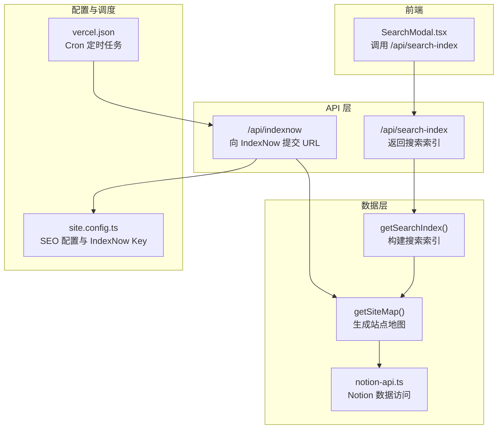
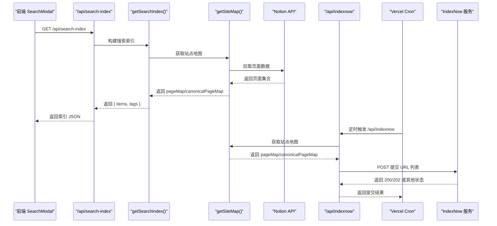
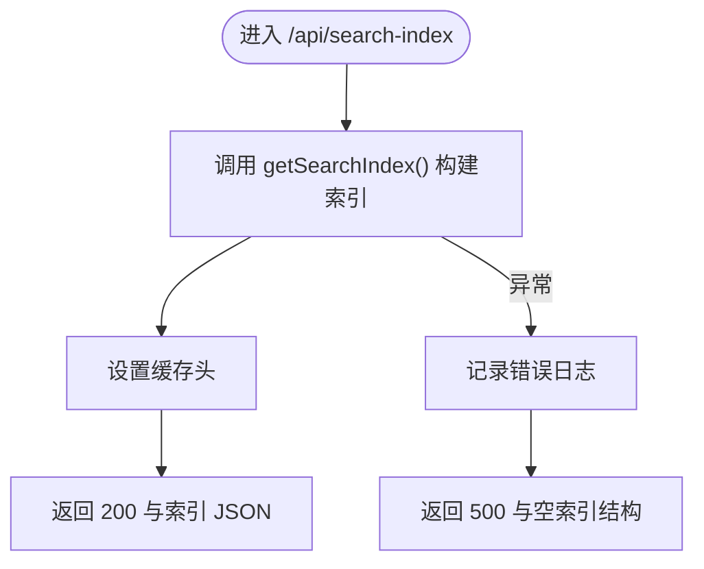
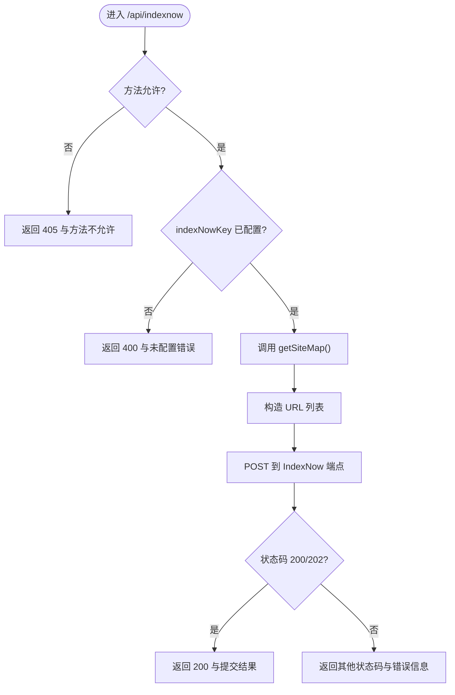
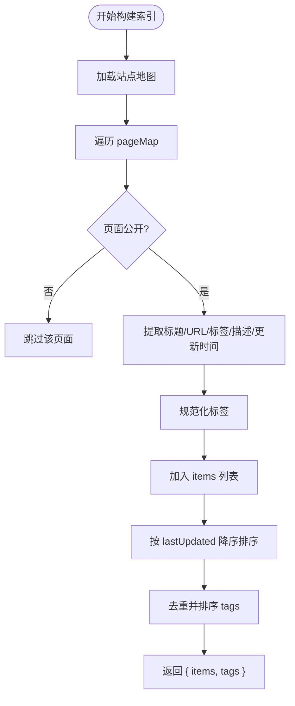
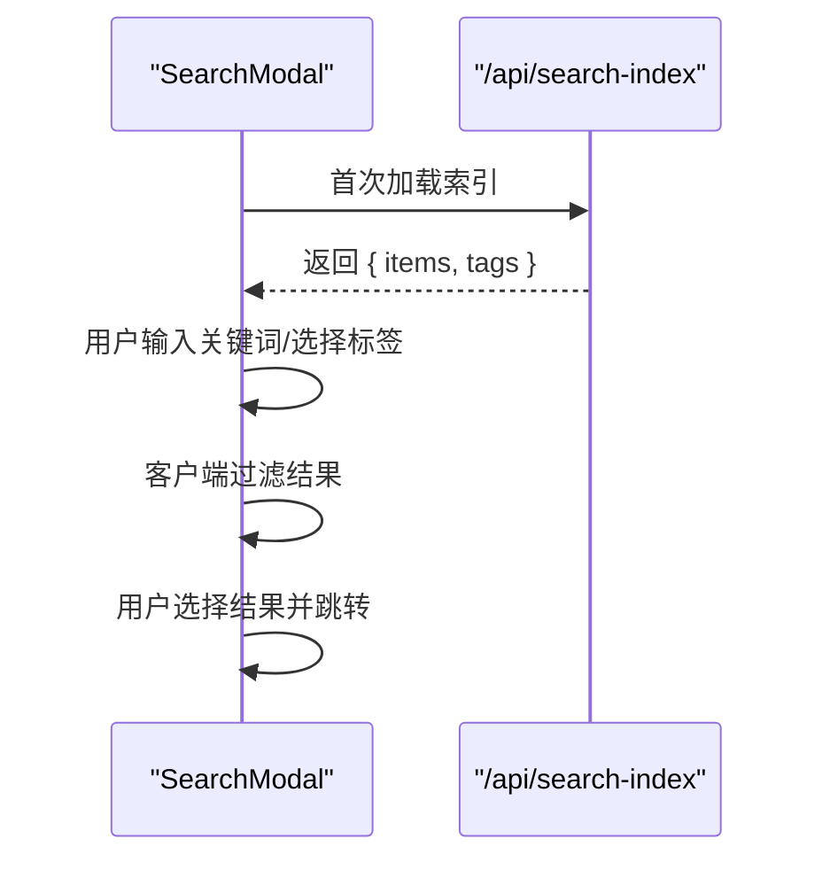
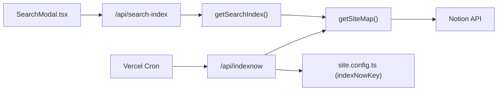

# SEO 相关 API

<cite>
**本文引用的文件**   
- [pages/api/search-index.ts](file://pages/api/search-index.ts)
- [lib/get-search-index.ts](file://lib/get-search-index.ts)
- [components/SearchModal.tsx](file://components/SearchModal.tsx)
- [pages/api/indexnow.ts](file://pages/api/indexnow.ts)
- [lib/get-site-map.ts](file://lib/get-site-map.ts)
- [site.config.ts](file://site.config.ts)
- [vercel.json](file://vercel.json)
- [readme.md](file://readme.md)
</cite>

## 目录
1. [简介](#简介)
2. [项目结构](#项目结构)
3. [核心组件](#核心组件)
4. [架构总览](#架构总览)
5. [详细组件分析](#详细组件分析)
6. [依赖关系分析](#依赖关系分析)
7. [性能与缓存特性](#性能与缓存特性)
8. [搜索引擎集成与配置指南](#搜索引擎集成与配置指南)
9. [监控、调试与排错](#监控调试与排错)
10. [结论](#结论)

## 简介
本文件面向 SEO 相关的两个关键 API：
- 搜索索引获取 API：/api/search-index
- 图片索引通知 API（IndexNow）：/api/indexnow

它们分别服务于两类目标：
- /api/search-index：为前端提供轻量级、可缓存的站点内容索引，用于客户端即时搜索与标签过滤，提升站内检索体验。
- /api/indexnow：将站点 URL 列表提交给 IndexNow 服务，帮助 Bing、Yandex 等搜索引擎快速发现新发布或更新的内容，提高外部搜索引擎可见性。

此外，项目还包含 Google Search Console 与 Bing Webmaster Tools 的站点验证字段，便于在对应平台完成所有权验证与监控。

## 项目结构
与 SEO API 直接相关的代码主要分布在以下位置：
- pages/api：Next.js API 路由入口
- lib：数据层与工具函数（站点地图、Notion 数据访问、索引构建）
- components：前端搜索弹窗，消费 /api/search-index
- site.config.ts：站点级配置（含搜索引擎验证与 IndexNow Key）
- vercel.json：Vercel Cron 定时任务，自动触发 /api/indexnow

图表来源
- [pages/api/search-index.ts:1-22](file://pages/api/search-index.ts#L1-L22)
- [lib/get-search-index.ts:1-99](file://lib/get-search-index.ts#L1-L99)
- [lib/get-site-map.ts:1-107](file://lib/get-site-map.ts#L1-L107)
- [components/SearchModal.tsx:1-253](file://components/SearchModal.tsx#L1-L253)
- [pages/api/indexnow.ts:1-71](file://pages/api/indexnow.ts#L1-L71)
- [site.config.ts:1-78](file://site.config.ts#L1-L78)
- [vercel.json:1-10](file://vercel.json#L1-L10)

章节来源
- [readme.md:81-96](file://readme.md#L81-L96)

## 核心组件
- /api/search-index
  - 职责：对外暴露搜索索引数据，供前端客户端搜索使用。
  - 行为：调用 getSearchIndex() 构建索引，设置缓存头并返回 JSON。
  - 错误处理：捕获异常并返回空索引结构，避免前端崩溃。

- /api/indexnow
  - 职责：收集站点所有公开页面的 URL，并通过 IndexNow 协议提交给搜索引擎。
  - 行为：校验请求方法、检查 indexNowKey 是否配置；从站点地图中构造 URL 列表并提交；根据响应状态码返回结果。
  - 错误处理：记录错误日志并返回 500 与错误信息。

- getSearchIndex
  - 职责：遍历站点页面，提取标题、URL、标签、描述、更新时间等元信息，构建轻量级搜索索引。
  - 优化：对 Notion 数据访问进行 memoize 缓存，减少重复请求。
  - 输出：items 数组与 tags 去重排序后的数组。

- getSiteMap
  - 职责：从 Notion 空间拉取页面，过滤非公开页面，计算 canonicalPageMap 与 pageMap。
  - 优化：使用过期缓存策略定期刷新，避免频繁调用 Notion API。

- SearchModal.tsx
  - 职责：前端搜索弹窗，首次打开时调用 /api/search-index 加载索引，并在客户端进行关键词与标签过滤。
  - 交互：支持键盘导航、标签多选、跳转到结果页。

章节来源
- [pages/api/search-index.ts:1-22](file://pages/api/search-index.ts#L1-L22)
- [pages/api/indexnow.ts:1-71](file://pages/api/indexnow.ts#L1-L71)
- [lib/get-search-index.ts:1-99](file://lib/get-search-index.ts#L1-L99)
- [lib/get-site-map.ts:1-107](file://lib/get-site-map.ts#L1-L107)
- [components/SearchModal.tsx:1-253](file://components/SearchModal.tsx#L1-L253)

## 架构总览
下图展示了 SEO API 的整体流程：前端通过 SearchModal 调用 /api/search-index 获取索引；后台根据 Notion 数据构建索引；同时，/api/indexnow 定时或手动触发，将站点 URL 提交给 IndexNow 以加速搜索引擎收录。

图表来源
- [components/SearchModal.tsx:80-106](file://components/SearchModal.tsx#L80-L106)
- [pages/api/search-index.ts:5-21](file://pages/api/search-index.ts#L5-L21)
- [lib/get-search-index.ts:42-98](file://lib/get-search-index.ts#L42-L98)
- [lib/get-site-map.ts:18-28](file://lib/get-site-map.ts#L18-L28)
- [pages/api/indexnow.ts:15-69](file://pages/api/indexnow.ts#L15-L69)
- [vercel.json:1-10](file://vercel.json#L1-L10)

## 详细组件分析

### /api/search-index：搜索索引获取 API
- 功能概述
  - 对外暴露搜索索引，供前端客户端搜索使用。
  - 设置合适的缓存头，使 CDN/边缘节点可缓存，降低后端压力。
  - 错误时返回空索引结构，保证前端稳定渲染。

- 输入与输出
  - 输入：无必要参数（GET）。
  - 输出：JSON 对象，包含 items 与 tags。
    - items：每项包含 pageId、title、url、tags、description、lastUpdated。
    - tags：去重且按字母顺序排序的标签数组。

- 缓存策略
  - 设置 Cache-Control 公共缓存，短 TTL 配合 stale-while-revalidate，兼顾新鲜度与性能。

- 错误处理
  - 捕获异常并记录错误日志，返回空索引结构，避免前端崩溃。

图表来源
- [pages/api/search-index.ts:5-21](file://pages/api/search-index.ts#L5-L21)
- [lib/get-search-index.ts:42-98](file://lib/get-search-index.ts#L42-L98)

章节来源
- [pages/api/search-index.ts:1-22](file://pages/api/search-index.ts#L1-L22)
- [lib/get-search-index.ts:1-99](file://lib/get-search-index.ts#L1-L99)

### /api/indexnow：IndexNow 通知 API
- 功能概述
  - 将站点的所有公开页面 URL 提交给 IndexNow 服务，帮助 Bing/Yandex 快速发现新内容。
  - 支持手动调用（GET/POST）与 Vercel Cron 定时触发。

- 前置条件
  - 必须在站点配置中设置 indexNowKey。
  - 对应的验证文件需放置在 public/<key>.txt。

- 处理流程
  - 校验请求方法是否为 GET 或 POST。
  - 校验 indexNowKey 是否存在。
  - 从站点地图中提取 canonicalPageMap，构造 URL 列表。
  - 向 IndexNow 端点发送 JSON 负载（host、key、keyLocation、urlList）。
  - 根据响应状态码判断成功与否，返回提交结果。

图表来源
- [pages/api/indexnow.ts:15-69](file://pages/api/indexnow.ts#L15-L69)
- [lib/get-site-map.ts:18-28](file://lib/get-site-map.ts#L18-L28)

章节来源
- [pages/api/indexnow.ts:1-71](file://pages/api/indexnow.ts#L1-L71)
- [lib/get-site-map.ts:1-107](file://lib/get-site-map.ts#L1-L107)
- [site.config.ts:29-37](file://site.config.ts#L29-L37)

### getSearchIndex：搜索索引构建逻辑
- 功能概述
  - 遍历站点页面，提取标题、URL、标签、描述、更新时间等元信息，构建轻量级搜索索引。
  - 过滤非公开页面，确保仅索引对外可见的内容。
  - 对 Notion 数据访问进行 memoize 缓存，减少重复请求。

- 数据结构
  - SearchIndexItem：pageId、title、url、tags、description、lastUpdated。
  - SearchIndex：items 数组与 tags 去重排序后的数组。

- 算法要点
  - 标签规范化：支持逗号分隔字符串或数组，统一清洗为空字符串后过滤。
  - 排序规则：按 lastUpdated 降序排列，最近编辑的页面优先。
  - URL 生成：基于 canonicalPageId 拼接路径。

图表来源
- [lib/get-search-index.ts:25-98](file://lib/get-search-index.ts#L25-L98)

章节来源
- [lib/get-search-index.ts:1-99](file://lib/get-search-index.ts#L1-L99)

### SearchModal.tsx：前端搜索弹窗
- 功能概述
  - 首次打开时调用 /api/search-index 加载索引。
  - 在客户端进行关键词与标签过滤，支持键盘导航与跳转。

- 交互流程
  - 加载索引：异步 fetch api.searchIndex，成功后设置索引数据。
  - 过滤逻辑：AND 语义的标签过滤 + 关键词匹配（标题、描述、标签）。
  - 导航：点击结果项跳转到对应 URL。

图表来源
- [components/SearchModal.tsx:80-129](file://components/SearchModal.tsx#L80-L129)

章节来源
- [components/SearchModal.tsx:1-253](file://components/SearchModal.tsx#L1-L253)

## 依赖关系分析
- /api/search-index 依赖 getSearchIndex，后者依赖 getSiteMap 与 Notion API。
- /api/indexnow 依赖 getSiteMap 与站点配置中的 indexNowKey。
- SearchModal 依赖 /api/search-index 提供的索引数据。
- Vercel Cron 定时触发 /api/indexnow，确保搜索引擎持续获知站点更新。

图表来源
- [pages/api/search-index.ts:1-22](file://pages/api/search-index.ts#L1-L22)
- [lib/get-search-index.ts:1-99](file://lib/get-search-index.ts#L1-L99)
- [lib/get-site-map.ts:1-107](file://lib/get-site-map.ts#L1-L107)
- [pages/api/indexnow.ts:1-71](file://pages/api/indexnow.ts#L1-L71)
- [site.config.ts:29-37](file://site.config.ts#L29-L37)
- [vercel.json:1-10](file://vercel.json#L1-L10)
- [components/SearchModal.tsx:1-253](file://components/SearchModal.tsx#L1-L253)

章节来源
- [pages/api/search-index.ts:1-22](file://pages/api/search-index.ts#L1-L22)
- [pages/api/indexnow.ts:1-71](file://pages/api/indexnow.ts#L1-L71)
- [lib/get-search-index.ts:1-99](file://lib/get-search-index.ts#L1-L99)
- [lib/get-site-map.ts:1-107](file://lib/get-site-map.ts#L1-L107)
- [site.config.ts:29-37](file://site.config.ts#L29-L37)
- [vercel.json:1-10](file://vercel.json#L1-L10)
- [components/SearchModal.tsx:1-253](file://components/SearchModal.tsx#L1-L253)

## 性能与缓存特性
- /api/search-index
  - 使用公共缓存头，CDN/边缘节点可缓存，缩短响应时间。
  - getSearchIndex 内部对 Notion 数据访问进行 memoize，减少重复请求。
  - 适合高频读取场景（如前端搜索弹窗）。

- /api/indexnow
  - 每次调用都会重新构造 URL 列表并提交，不缓存响应体。
  - 通过 Vercel Cron 定时触发，避免频繁手动调用。
  - 适合低频写入场景（搜索引擎收录通知）。

- 站点地图
  - getSiteMap 使用过期缓存策略（5 分钟），平衡新鲜度与性能。
  - 过滤非公开页面，减少不必要的数据传输。

章节来源
- [pages/api/search-index.ts:12-16](file://pages/api/search-index.ts#L12-L16)
- [lib/get-search-index.ts:42-42](file://lib/get-search-index.ts#L42-L42)
- [lib/get-site-map.ts:30-34](file://lib/get-site-map.ts#L30-L34)
- [pages/api/indexnow.ts:57-58](file://pages/api/indexnow.ts#L57-L58)

## 搜索引擎集成与配置指南

### Google Search Console
- 站点验证
  - 在站点配置中设置 googleSiteVerification，用于 HTML tag 验证方式。
  - 部署后在 Google Search Console 中添加站点并完成验证。
- 监控建议
  - 关注“索引覆盖”、“网页指标”等报告，排查抓取问题。
  - 结合 sitemap.xml 与 robots.txt 确保可抓取性。

章节来源
- [site.config.ts:29-34](file://site.config.ts#L29-L34)

### Bing Webmaster Tools
- 站点验证
  - 在站点配置中设置 bingSiteVerification，用于 Bing 验证。
  - 部署后在 Bing Webmaster Tools 中完成验证。
- 监控建议
  - 关注“索引状态”、“搜索表现”等报告。
  - 使用 IndexNow 加速新内容发现。

章节来源
- [site.config.ts:29-31](file://site.config.ts#L29-L31)

### IndexNow（Bing/Yandex）
- 配置步骤
  - 在站点配置中设置 indexNowKey。
  - 将验证文件放置于 public/<key>.txt。
  - 确保 /api/indexnow 可通过 Vercel Cron 定时触发。
- 最佳实践
  - 保持 indexNowKey 与 public 目录下的验证文件一致。
  - 定期检查 /api/indexnow 的返回状态，确保提交成功。
  - 结合站点更新事件（如 Notion 页面变更）触发手动调用。

章节来源
- [site.config.ts:35-37](file://site.config.ts#L35-L37)
- [pages/api/indexnow.ts:23-27](file://pages/api/indexnow.ts#L23-L27)
- [vercel.json:1-10](file://vercel.json#L1-L10)

## 监控、调试与排错

### 常见问题与解决方案
- /api/search-index 返回空索引
  - 可能原因：Notion API 限流或权限不足。
  - 排查步骤：检查 Notion 页面是否公开；查看控制台错误日志；确认 getSearchIndex 的缓存是否生效。
  - 解决建议：提升 Notion 权限；调整 ISR 间隔；检查网络超时设置。

- /api/indexnow 返回未配置错误
  - 可能原因：indexNowKey 未在站点配置中设置。
  - 排查步骤：检查 site.config.ts 中的 indexNowKey；确认 public/<key>.txt 存在。
  - 解决建议：补充 indexNowKey；重新部署；验证 Cron 是否触发。

- 前端搜索弹窗加载失败
  - 可能原因：/api/search-index 不可用或返回非 200。
  - 排查步骤：检查浏览器网络面板；查看控制台错误；确认 API 缓存头是否正确。
  - 解决建议：修复后端错误；检查 CDN 缓存策略；重试机制。

章节来源
- [pages/api/search-index.ts:17-20](file://pages/api/search-index.ts#L17-L20)
- [pages/api/indexnow.ts:23-27](file://pages/api/indexnow.ts#L23-L27)
- [components/SearchModal.tsx:80-106](file://components/SearchModal.tsx#L80-L106)

### 监控建议
- 启用 Vercel 日志与错误追踪，观察 API 调用成功率与延迟。
- 定期运行健康检查脚本，验证 /api/search-index 与 /api/indexnow 的可用性。
- 结合搜索引擎平台（Google Search Console、Bing Webmaster Tools）监控索引覆盖率与抓取问题。

章节来源
- [readme.md:94-96](file://readme.md#L94-L96)

## 结论
- /api/search-index 为前端提供高性能的客户端搜索能力，显著提升用户体验。
- /api/indexnow 通过 IndexNow 协议加速搜索引擎对新内容的发现，提高外部可见性。
- 结合 Google Search Console 与 Bing Webmaster Tools 的站点验证，可实现全面的 SEO 监控与优化。
- 建议在生产环境中启用 Vercel Cron 定时任务，并结合站点更新事件触发手动调用，确保搜索引擎及时索引。