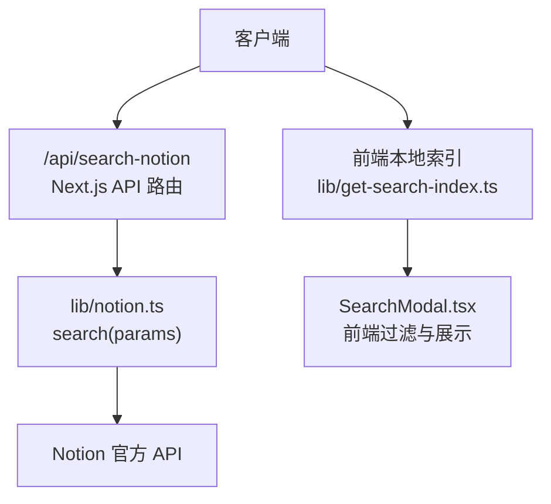
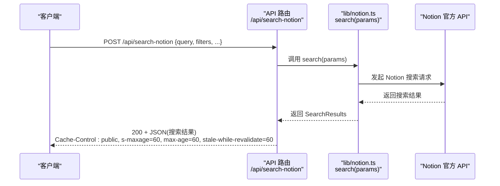
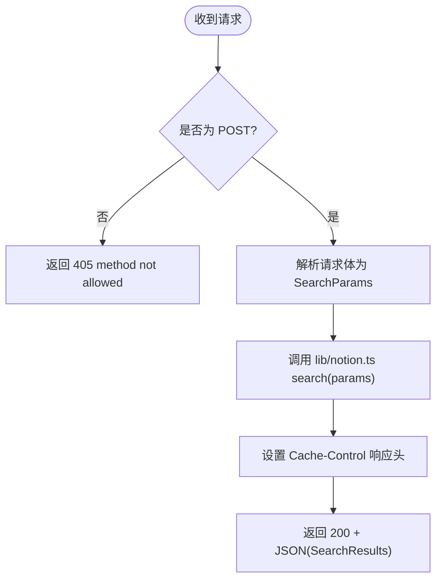
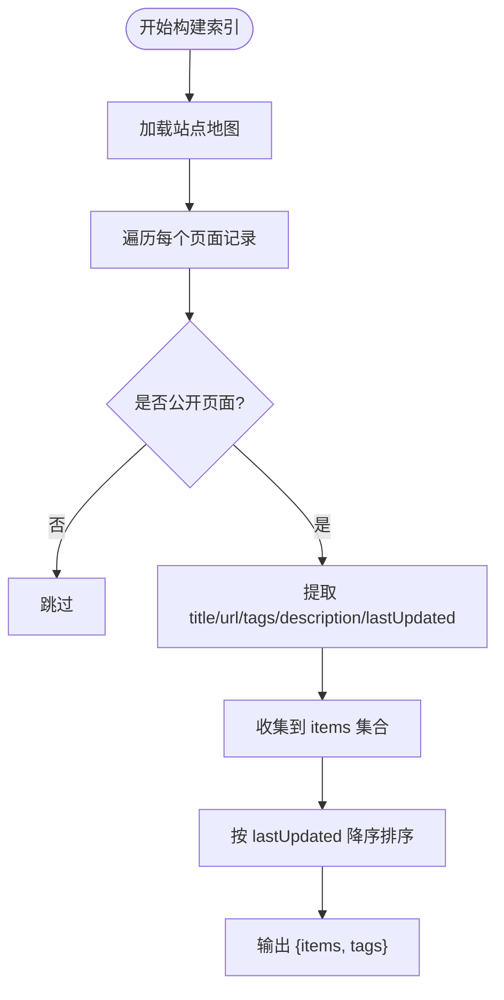
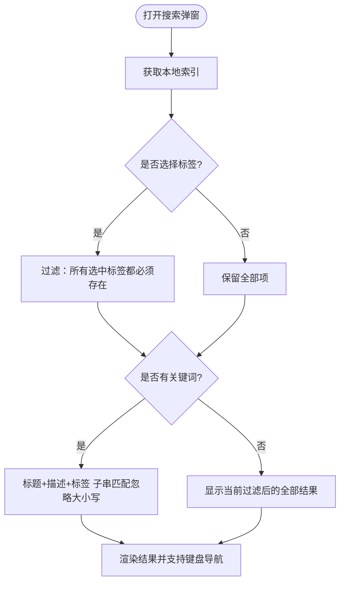
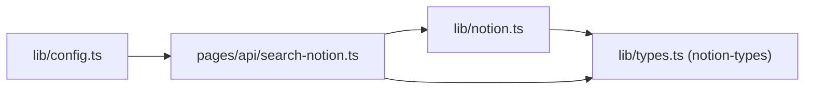
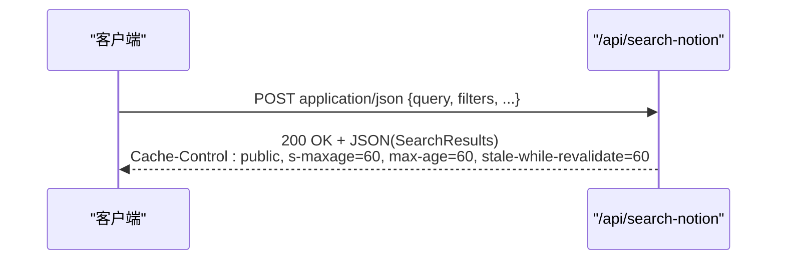

# 搜索 API

<cite>
**本文引用的文件**   
- [pages/api/search-notion.ts](file://pages/api/search-notion.ts)
- [lib/notion.ts](file://lib/notion.ts)
- [lib/config.ts](file://lib/config.ts)
- [lib/types.ts](file://lib/types.ts)
- [lib/get-search-index.ts](file://lib/get-search-index.ts)
- [components/SearchModal.tsx](file://components/SearchModal.tsx)
</cite>

## 目录
1. [简介](#简介)
2. [项目结构](#项目结构)
3. [核心组件](#核心组件)
4. [架构总览](#架构总览)
5. [详细组件分析](#详细组件分析)
6. [依赖关系分析](#依赖关系分析)
7. [性能与缓存](#性能与缓存)
8. [客户端调用示例](#客户端调用示例)
9. [故障排查](#故障排查)
10. [结论](#结论)

## 简介
本文档面向开发者，详细说明站点“搜索 Notion”API 的功能、接口规范、实现原理与使用方式。重点覆盖：
- POST /api/search-notion 端点的请求参数、响应格式与错误处理
- 搜索算法的实现原理（全文搜索、关键词匹配、结果排序）
- 客户端调用示例与结果处理
- 缓存策略（Cache-Control 头）与性能优化建议

该 API 用于在服务器端对 Notion 内容执行搜索，返回结构化搜索结果；同时项目还提供前端本地索引搜索能力，二者互补，分别适用于不同场景。

## 项目结构
与本 API 直接相关的代码分布在以下位置：
- pages/api/search-notion.ts：Next.js API 路由入口，负责接收请求、设置响应头并调用搜索逻辑
- lib/notion.ts：封装 Notion 搜索能力，对外暴露 search(params)
- lib/config.ts：定义 API 基础路径与常量
- lib/types.ts：导出 notion-types 中的类型（如 SearchParams、SearchResults）
- lib/get-search-index.ts：构建前端本地搜索索引（与后端搜索互补）
- components/SearchModal.tsx：前端搜索弹窗，演示如何消费本地索引进行即时过滤

图表来源
- [pages/api/search-notion.ts:6-25](file://pages/api/search-notion.ts#L6-L25)
- [lib/notion.ts:216-218](file://lib/notion.ts#L216-L218)
- [lib/get-search-index.ts:39-98](file://lib/get-search-index.ts#L39-L98)
- [components/SearchModal.tsx:29-55](file://components/SearchModal.tsx#L29-L55)

章节来源
- [pages/api/search-notion.ts:1-26](file://pages/api/search-notion.ts#L1-L26)
- [lib/notion.ts:1-219](file://lib/notion.ts#L1-L219)
- [lib/config.ts:148-153](file://lib/config.ts#L148-L153)
- [lib/types.ts:1-78](file://lib/types.ts#L1-L78)
- [lib/get-search-index.ts:1-99](file://lib/get-search-index.ts#L1-L99)
- [components/SearchModal.tsx:1-254](file://components/SearchModal.tsx#L1-L254)

## 核心组件
- API 路由层：校验 HTTP 方法、解析请求体、设置缓存头、返回 JSON
- 业务逻辑层：将搜索参数透传给 Notion 搜索接口
- 类型系统：复用 notion-types 的 SearchParams 与 SearchResults
- 配置层：统一 API 路径与站点配置
- 前端本地索引：预构建站点公开页面的轻量索引，支持前端即时过滤与标签筛选

章节来源
- [pages/api/search-notion.ts:6-25](file://pages/api/search-notion.ts#L6-L25)
- [lib/notion.ts:216-218](file://lib/notion.ts#L216-L218)
- [lib/types.ts:1-78](file://lib/types.ts#L1-L78)
- [lib/config.ts:148-153](file://lib/config.ts#L148-L153)
- [lib/get-search-index.ts:39-98](file://lib/get-search-index.ts#L39-L98)

## 架构总览
下图展示了从客户端到 Notion 的完整调用链路，以及前后端两种搜索方式的协作关系。

图表来源
- [pages/api/search-notion.ts:6-25](file://pages/api/search-notion.ts#L6-L25)
- [lib/notion.ts:216-218](file://lib/notion.ts#L216-L218)

## 详细组件分析

### API 路由：POST /api/search-notion
- 功能
  - 仅接受 POST 请求，其他方法返回 405
  - 从请求体读取搜索参数
  - 调用 lib/notion.ts 的 search(params)
  - 设置 Cache-Control 响应头后返回 JSON 结果
- 请求体
  - 类型为 types.SearchParams（由 notion-types 提供），包含 query、filters 等字段
- 响应
  - 成功：HTTP 200，JSON 为 SearchResults（由 notion-types 提供）
  - 失败：非 POST 方法返回 405；网络或上游异常时由上层捕获并返回错误
- 缓存
  - 响应头：public, s-maxage=60, max-age=60, stale-while-revalidate=60
  - 含义：CDN/浏览器可缓存 60 秒，过期后可在后台重新验证

图表来源
- [pages/api/search-notion.ts:6-25](file://pages/api/search-notion.ts#L6-L25)

章节来源
- [pages/api/search-notion.ts:6-25](file://pages/api/search-notion.ts#L6-L25)

### 搜索逻辑：lib/notion.ts 的 search
- 功能
  - 将传入的 SearchParams 直接转发给 Notion 官方搜索接口
  - 不在此处做额外过滤或排序，保持与 Notion 一致的语义
- 复杂度
  - 时间复杂度取决于 Notion 侧的搜索实现与数据规模
  - 空间复杂度主要为传输与序列化开销

章节来源
- [lib/notion.ts:216-218](file://lib/notion.ts#L216-L218)

### 类型定义：lib/types.ts
- 行为
  - 通过 export * from 'notion-types' 引入 notion-types 的类型
  - 因此 SearchParams、SearchResults 等类型来自 notion-types
- 意义
  - 保证前后端对搜索参数与结果的结构一致

章节来源
- [lib/types.ts:1-78](file://lib/types.ts#L1-L78)

### 前端本地搜索索引：lib/get-search-index.ts
- 目标
  - 构建一个轻量、可缓存的站点公开页面索引，用于前端即时搜索与标签过滤
- 关键流程
  - 遍历站点地图，跳过标记为非公开的页面
  - 提取标题、URL、标签、描述、最后更新时间
  - 按 lastUpdated 降序排序（最近更新的在前）
  - 输出 items 与 tags 列表
- 适用场景
  - 适合小中型站点的前端即时搜索体验，避免每次按键都请求后端

图表来源
- [lib/get-search-index.ts:44-98](file://lib/get-search-index.ts#L44-L98)

章节来源
- [lib/get-search-index.ts:1-99](file://lib/get-search-index.ts#L1-L99)

### 前端搜索弹窗：components/SearchModal.tsx
- 功能
  - 拉取本地搜索索引（/api/search-index）
  - 支持关键词过滤与标签多选过滤（AND 语义）
  - 渲染结果并导航至对应页面
- 过滤逻辑
  - 若选择多个标签，则必须全部命中（AND）
  - 若输入关键词，则在标题、描述与标签拼接文本中进行子串匹配（不区分大小写）

图表来源
- [components/SearchModal.tsx:29-55](file://components/SearchModal.tsx#L29-L55)
- [components/SearchModal.tsx:80-111](file://components/SearchModal.tsx#L80-L111)

章节来源
- [components/SearchModal.tsx:1-254](file://components/SearchModal.tsx#L1-L254)

## 依赖关系分析
- API 路由依赖
  - Next.js 运行时（NextApiRequest/NextApiResponse）
  - lib/notion.ts 的 search 函数
  - lib/types.ts 导出的 SearchParams 类型
- 业务逻辑依赖
  - notion-types 提供的 SearchParams、SearchResults
  - notion-api 封装（在 lib/notion.ts 中导入 notion）
- 配置依赖
  - api.searchNotion 路径由 lib/config.ts 提供

图表来源
- [pages/api/search-notion.ts:1-5](file://pages/api/search-notion.ts#L1-L5)
- [lib/notion.ts:1-17](file://lib/notion.ts#L1-L17)
- [lib/config.ts:148-153](file://lib/config.ts#L148-L153)

章节来源
- [pages/api/search-notion.ts:1-5](file://pages/api/search-notion.ts#L1-L5)
- [lib/notion.ts:1-17](file://lib/notion.ts#L1-L17)
- [lib/config.ts:148-153](file://lib/config.ts#L148-L153)

## 性能与缓存
- 服务端缓存
  - API 响应头设置：public, s-maxage=60, max-age=60, stale-while-revalidate=60
  - 效果：CDN/浏览器可缓存 60 秒，过期后可后台重新验证，降低重复请求压力
- 前端本地索引
  - 通过 lib/get-search-index.ts 构建轻量索引，避免频繁请求后端
  - 前端过滤逻辑简单高效，适合高频交互
- 并发与批处理
  - 站点数据加载与集合查询采用并发控制，减少阻塞（参考 lib/notion.ts 中的 p-map 用法）
- 建议
  - 合理调整 CDN 缓存 TTL，平衡实时性与性能
  - 对于大站点，优先使用前端本地索引进行即时反馈，再按需触发后端精确搜索
  - 监控 Notion API 限流与超时，必要时增加重试与降级策略

章节来源
- [pages/api/search-notion.ts:20-24](file://pages/api/search-notion.ts#L20-L24)
- [lib/get-search-index.ts:39-98](file://lib/get-search-index.ts#L39-L98)
- [lib/notion.ts:57-81](file://lib/notion.ts#L57-L81)

## 客户端调用示例

### 调用 POST /api/search-notion
- 请求
  - 方法：POST
  - URL：/api/search-notion
  - Content-Type：application/json
  - Body：SearchParams（例如包含 query、filters 等字段）
- 响应
  - 成功：HTTP 200，JSON 为 SearchResults
  - 失败：非 POST 返回 405；其他错误由上层处理
- 缓存
  - 响应头包含 Cache-Control，指示 CDN/浏览器缓存策略

图表来源
- [pages/api/search-notion.ts:6-25](file://pages/api/search-notion.ts#L6-L25)

### 前端本地搜索（可选）
- 步骤
  - 拉取 /api/search-index 获取本地索引
  - 根据用户输入的关键词与选中标签进行前端过滤
  - 渲染结果并跳转至对应页面
- 适用场景
  - 需要即时反馈且数据量适中，避免频繁请求后端

章节来源
- [components/SearchModal.tsx:80-111](file://components/SearchModal.tsx#L80-L111)
- [components/SearchModal.tsx:29-55](file://components/SearchModal.tsx#L29-L55)

## 故障排查
- 405 Method Not Allowed
  - 原因：使用了非 POST 方法访问 /api/search-notion
  - 解决：确保使用 POST 方法
- 网络或上游错误
  - 现象：非 2xx 响应被转换为错误对象
  - 解决：检查 Notion API 可用性与鉴权配置；在客户端捕获并提示用户
- 无结果
  - 可能原因：query/filters 过于严格；Notion 侧未匹配
  - 解决：放宽条件或改用前端本地索引进行模糊匹配
- 缓存导致结果延迟更新
  - 现象：修改 Notion 内容后，搜索结果未及时反映
  - 解决：等待 CDN/浏览器缓存过期或主动清除缓存；适当调整 Cache-Control TTL

章节来源
- [pages/api/search-notion.ts:10-12](file://pages/api/search-notion.ts#L10-L12)
- [lib/search-notion.ts:22-32](file://lib/search-notion.ts#L22-L32)

## 结论
- POST /api/search-notion 提供了基于 Notion 官方搜索能力的服务端搜索接口，具备明确的请求/响应结构与缓存策略
- 搜索逻辑主要由 Notion 侧实现，本仓库负责参数透传与响应缓存
- 前端本地索引可作为补充方案，提供即时、低延迟的搜索体验
- 建议在大规模站点中结合两者：前端即时过滤 + 后端精确搜索，并通过合理的缓存策略提升整体性能