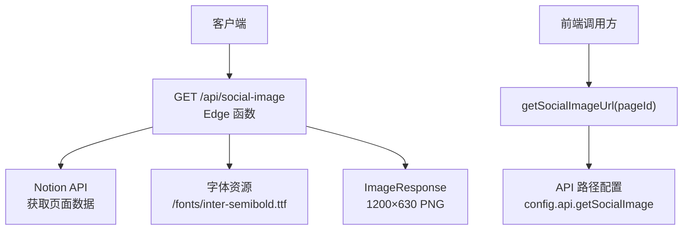
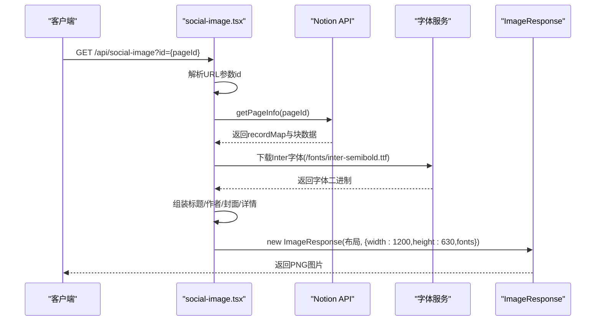
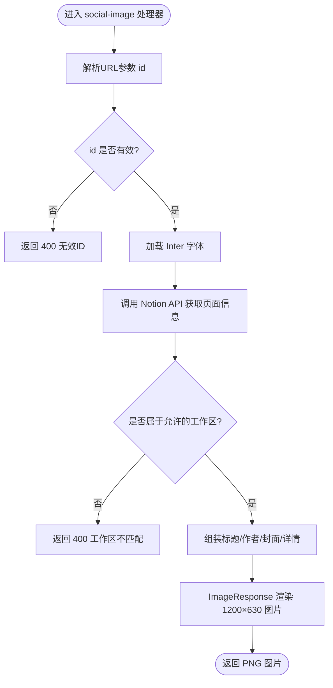
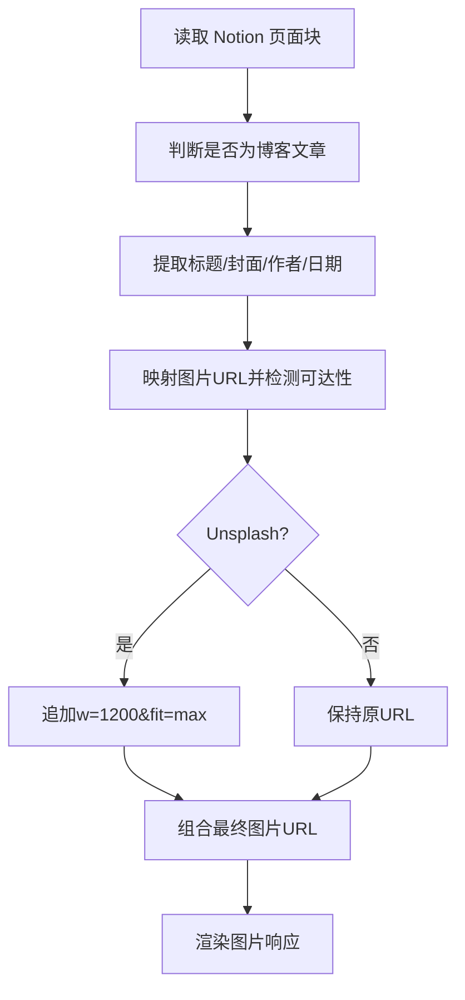
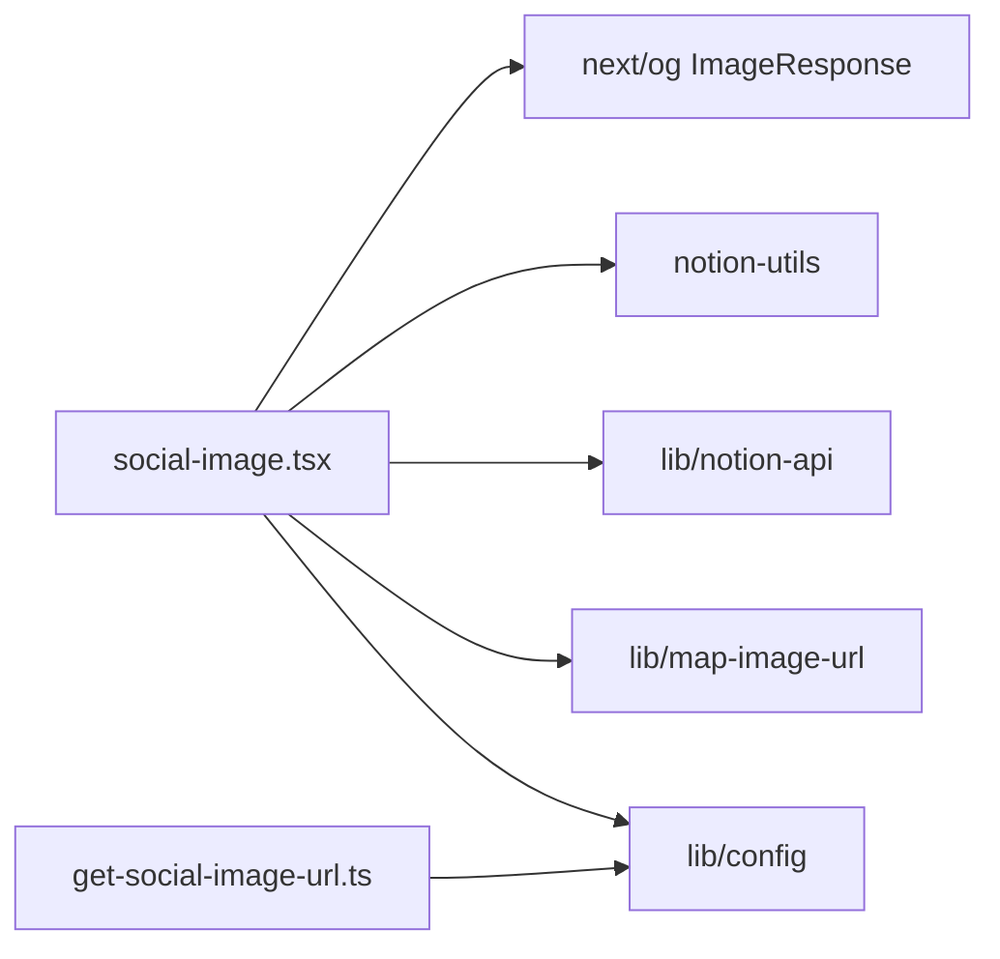

# 社交媒体图片生成 API

<cite>
**本文引用的文件**   
- [pages/api/social-image.tsx](file://pages/api/social-image.tsx)
- [lib/get-social-image-url.ts](file://lib/get-social-image-url.ts)
- [lib/config.ts](file://lib/config.ts)
- [site.config.ts](file://site.config.ts)
- [lib/types.ts](file://lib/types.ts)
</cite>

## 目录
1. [简介](#简介)
2. [项目结构](#项目结构)
3. [核心组件](#核心组件)
4. [架构总览](#架构总览)
5. [详细组件分析](#详细组件分析)
6. [依赖关系分析](#依赖关系分析)
7. [性能与缓存建议](#性能与缓存建议)
8. [故障排查指南](#故障排查指南)
9. [结论](#结论)

## 简介
本 API 提供动态生成社交媒体预览图片的能力，用于在 Twitter Card、Facebook Open Graph 等社交平台分享时展示统一的封面图。该端点基于 Next.js Edge Runtime 和 next/og 的 ImageResponse，从 Notion 页面数据中抽取标题、作者、封面图等元信息，渲染为 1200×630 的标准社交图片尺寸。

## 项目结构
与本 API 直接相关的代码主要分布在以下位置：
- API 路由实现：pages/api/social-image.tsx
- URL 构建工具：lib/get-social-image-url.ts
- 站点配置与 API 路径：lib/config.ts、site.config.ts
- 类型定义：lib/types.ts

图表来源
- [pages/api/social-image.tsx:19-170](file://pages/api/social-image.tsx#L19-L170)
- [lib/get-social-image-url.ts:1-16](file://lib/get-social-image-url.ts#L1-L16)
- [lib/config.ts:148-153](file://lib/config.ts#L148-L153)

章节来源
- [pages/api/social-image.tsx:1-313](file://pages/api/social-image.tsx#L1-L313)
- [lib/get-social-image-url.ts:1-16](file://lib/get-social-image-url.ts#L1-L16)
- [lib/config.ts:148-153](file://lib/config.ts#L148-L153)

## 核心组件
- GET /api/social-image：Edge 运行时下的图片生成接口，接收 pageId 参数，从 Notion 拉取页面信息并渲染图片。
- getSocialImageUrl：前端或后端辅助函数，根据站点 host 与 api.getSocialImage 拼接出完整图片 URL，并附加 id 查询参数。
- Notion 页面信息提取：读取 Notion 页面的标题、封面图、作者头像、作者名、发布时间等属性，组合成最终图片内容。
- 图片兼容处理：对不可达的图片进行回退；对特定图床（如 Unsplash）自动追加尺寸参数以优化加载。

章节来源
- [pages/api/social-image.tsx:21-170](file://pages/api/social-image.tsx#L21-L170)
- [lib/get-social-image-url.ts:3-16](file://lib/get-social-image-url.ts#L3-L16)

## 架构总览
下图展示了请求从发起端到返回图片的完整流程，包括参数解析、Notion 数据获取、字体加载、图片渲染与响应。

图表来源
- [pages/api/social-image.tsx:21-170](file://pages/api/social-image.tsx#L21-L170)
- [lib/get-social-image-url.ts:3-16](file://lib/get-social-image-url.ts#L3-L16)

## 详细组件分析

### API 端点：GET /api/social-image
- 运行环境：Edge Runtime，保证低延迟与高并发。
- 输入参数：
  - id：Notion 页面 ID（必填）。若未提供则回退到站点根页面 ID。
- 输出：
  - 成功：HTTP 200，Content-Type 为 image/png，尺寸为 1200×630。
  - 失败：HTTP 400，返回错误对象，包含 statusCode 与 message。
- 关键行为：
  - 校验 pageId 合法性。
  - 运行时动态加载 Inter 半粗体字体，避免打包体积过大。
  - 从 Notion 获取页面信息，包括标题、封面图、作者头像、作者名、发布日期等。
  - 使用 next/og 的 ImageResponse 渲染 HTML-like 布局为图片。
  - 对图片地址进行可达性检测与回退策略。
  - 对 images.unsplash.com 的图片自动追加 w=1200&fit=max 以提升加载质量。

图表来源
- [pages/api/social-image.tsx:21-170](file://pages/api/social-image.tsx#L21-L170)
- [pages/api/social-image.tsx:173-276](file://pages/api/social-image.tsx#L173-L276)

章节来源
- [pages/api/social-image.tsx:19-170](file://pages/api/social-image.tsx#L19-L170)
- [pages/api/social-image.tsx:173-276](file://pages/api/social-image.tsx#L173-L276)

### URL 构建工具：getSocialImageUrl
- 作用：根据站点 host 与 api.getSocialImage 拼接出完整的图片 URL，并在存在 pageId 时附加 id 查询参数。
- 返回值：字符串 URL 或 null（当传入 pageId 为空或构造失败时）。

章节来源
- [lib/get-social-image-url.ts:1-16](file://lib/get-social-image-url.ts#L1-L16)
- [lib/config.ts:148-153](file://lib/config.ts#L148-L153)

### Notion 页面信息提取与图片选择逻辑
- 数据来源：
  - 标题：优先使用 Notion 页面标题，否则回退到站点名称。
  - 封面图：优先使用 Notion 页面属性 Social Image，其次使用页面 cover，最后回退到站点默认封面。
  - 作者头像：优先使用 Notion 页面图标（需为 URL），否则回退到站点默认图标。
  - 作者名：优先使用 Notion 页面属性 Author，否则回退到站点 author。
  - 详情文本：若是博客文章且设置了 Published，则显示“月份 年份”；否则显示作者名；再否则显示站点域名。
- 图片兼容处理：
  - 通过 HEAD 请求检测图片可达性，不可达则使用回退图。
  - 针对 images.unsplash.com 自动追加 w=1200&fit=max 参数。
- 空间限制：
  - 若 Notion 页面所属 workspace 与配置的 rootNotionSpaceId 不一致，返回 400 错误。

图表来源
- [pages/api/social-image.tsx:173-276](file://pages/api/social-image.tsx#L173-L276)
- [pages/api/social-image.tsx:278-312](file://pages/api/social-image.tsx#L278-L312)

章节来源
- [pages/api/social-image.tsx:173-276](file://pages/api/social-image.tsx#L173-L276)
- [pages/api/social-image.tsx:278-312](file://pages/api/social-image.tsx#L278-L312)

### 数据类型与字段说明
- NotionPageInfo：包含 pageId、title、image、imageObjectPosition、author、authorImage、detail 等字段，用于描述最终图片所需的数据。
- PageError：包含 statusCode 与 message，用于统一错误返回结构。

章节来源
- [lib/types.ts:69-77](file://lib/types.ts#L69-L77)
- [lib/types.ts:9-12](file://lib/types.ts#L9-L12)

## 依赖关系分析
- social-image.tsx 依赖：
  - next/og 的 ImageResponse 用于渲染图片。
  - notion-utils 提供的工具函数解析 Notion 页面数据。
  - lib/notion-api 封装的 Notion 客户端。
  - lib/map-image-url 将 Notion 图片链接转换为可访问地址。
  - lib/config 提供站点级默认值与 API 路径。
- get-social-image-url.ts 依赖：
  - lib/config 中的 api 与 host，用于拼接 URL。

图表来源
- [pages/api/social-image.tsx:1-17](file://pages/api/social-image.tsx#L1-L17)
- [lib/get-social-image-url.ts:1-1](file://lib/get-social-image-url.ts#L1-L1)
- [lib/config.ts:148-153](file://lib/config.ts#L148-L153)

章节来源
- [pages/api/social-image.tsx:1-17](file://pages/api/social-image.tsx#L1-L17)
- [lib/get-social-image-url.ts:1-1](file://lib/get-social-image-url.ts#L1-L1)
- [lib/config.ts:148-153](file://lib/config.ts#L148-L153)

## 性能与缓存建议
- 边缘渲染：API 运行于 Edge Runtime，减少冷启动与网络往返，适合高频调用的社交图片场景。
- 字体按需加载：字体文件在运行时从 /fonts/inter-semibold.ttf 动态获取，避免函数包体超过平台限制。
- 图片优化：
  - 对 images.unsplash.com 自动追加 w=1200&fit=max，提升大图加载效率。
  - 通过 HEAD 请求检测图片可达性，快速回退到备用图，降低失败率。
- 缓存策略建议：
  - CDN 层：为 /api/social-image 开启浏览器与 CDN 缓存，结合 Vary: Accept-Encoding 与合适的 Cache-Control 头。
  - 应用层：可对同一 pageId 的结果做短期内存缓存，减少重复 Notion 查询与图片渲染开销。
  - 增量更新：结合站点 ISR revalidateSeconds 配置，控制页面与图片的刷新频率，平衡新鲜度与成本。
- 尺寸与格式：
  - 固定输出 1200×630 PNG，符合主流社交平台推荐尺寸。
  - 如需其他尺寸或格式，可在 ImageResponse 配置中扩展 width/height 与 MIME 类型。

[本节为通用指导，无需具体文件引用]

## 故障排查指南
- 无效 Notion 页面 ID：
  - 现象：返回 400，消息提示无效 ID。
  - 排查：确认传入的 id 是否为有效的 Notion 页面 UUID。
- 工作区不匹配：
  - 现象：返回 400，消息提示页面属于不同工作区。
  - 排查：检查 site.config.ts 中的 rootNotionSpaceId 是否与目标页面一致。
- 图片不可达：
  - 现象：封面图或作者头像未显示。
  - 排查：确认 Notion 中设置的图片 URL 可被服务端访问；必要时启用回退图。
- 字体加载失败：
  - 现象：文字样式异常或渲染失败。
  - 排查：确保 /fonts/inter-semibold.ttf 已部署并可访问。

章节来源
- [pages/api/social-image.tsx:27-45](file://pages/api/social-image.tsx#L27-L45)
- [pages/api/social-image.tsx:190-204](file://pages/api/social-image.tsx#L190-L204)
- [pages/api/social-image.tsx:278-312](file://pages/api/social-image.tsx#L278-L312)

## 结论
本 API 通过 Edge 运行时与 next/og 的高效渲染能力，结合 Notion 页面元数据，为社交媒体分享提供稳定、高性能的预览图片生成方案。通过合理的 URL 参数控制、图片回退与优化策略，以及 CDN 与应用层缓存，可以在多平台集成场景中保持一致的视觉体验与良好的性能表现。

[本节为总结性内容，无需具体文件引用]