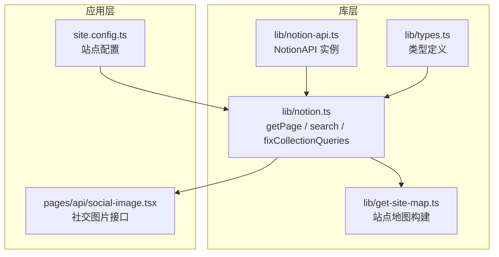
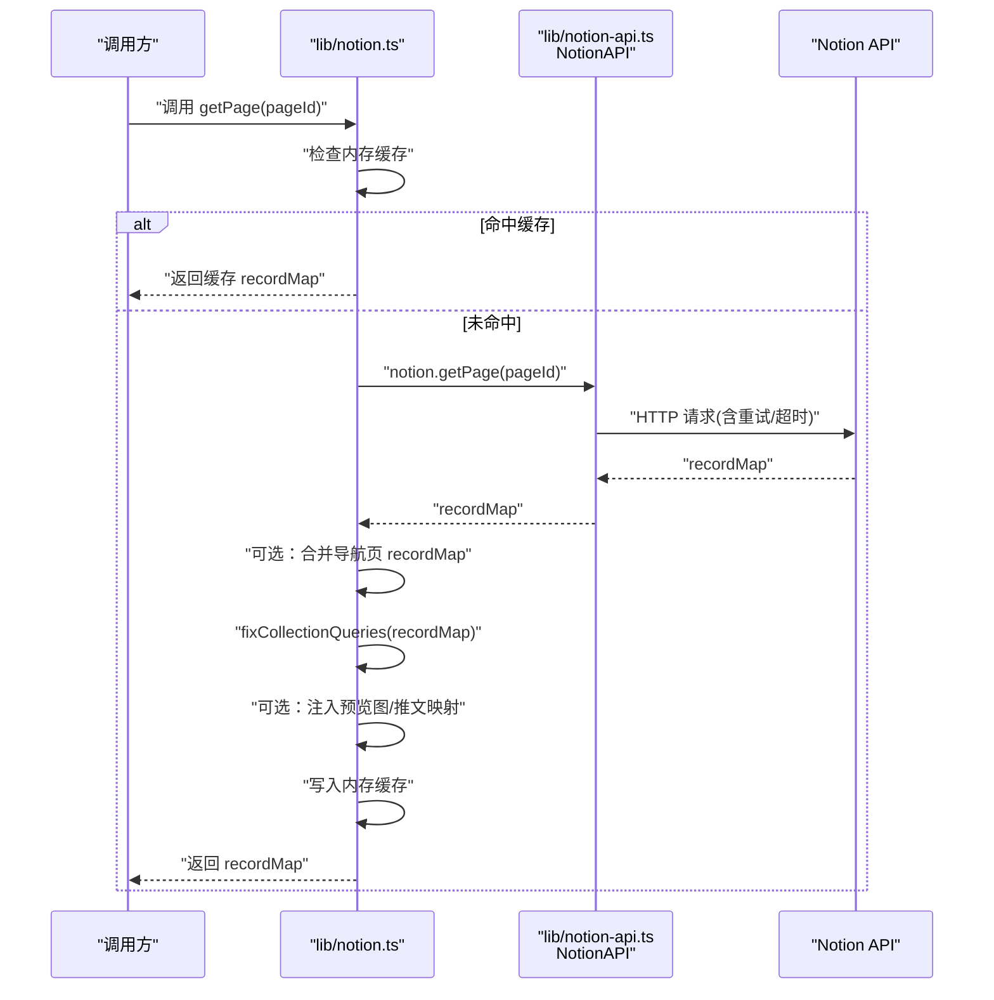
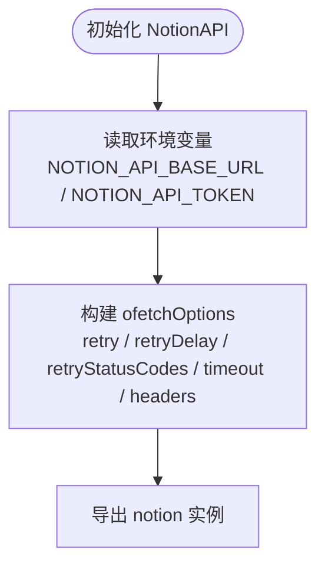
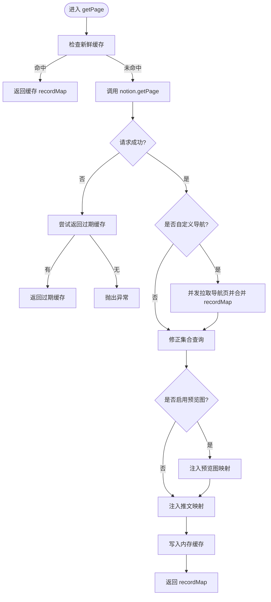
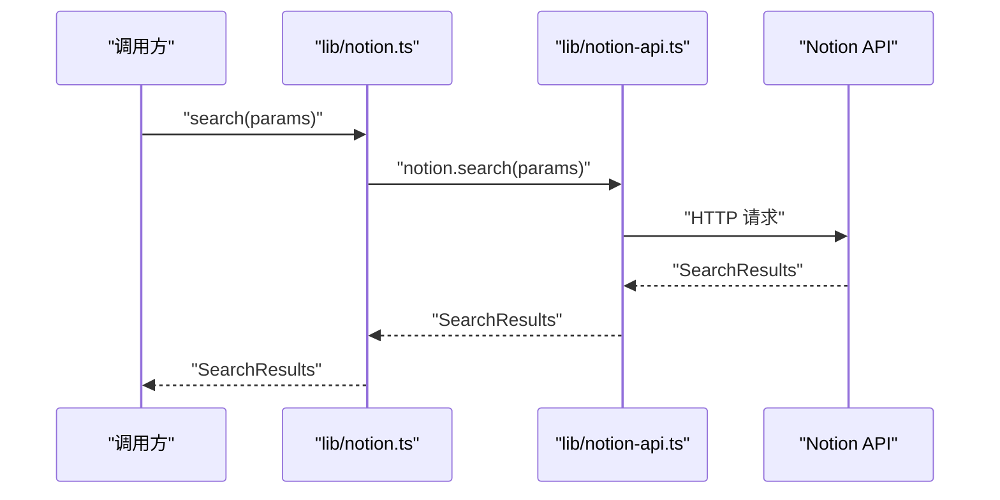
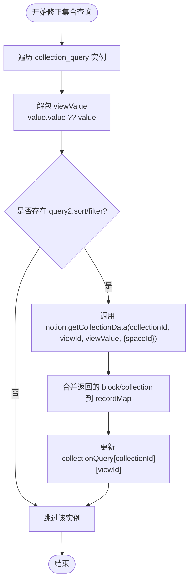
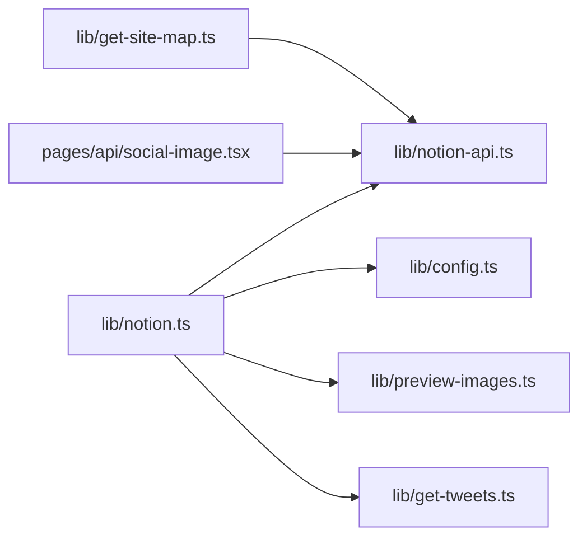

# Notion API 客户端

<cite>
**本文引用的文件**   
- [lib/notion-api.ts](file://lib/notion-api.ts)
- [lib/notion.ts](file://lib/notion.ts)
- [site.config.ts](file://site.config.ts)
- [lib/types.ts](file://lib/types.ts)
- [lib/get-site-map.ts](file://lib/get-site-map.ts)
- [pages/api/social-image.tsx](file://pages/api/social-image.tsx)
</cite>

## 目录
1. [简介](#简介)
2. [项目结构](#项目结构)
3. [核心组件](#核心组件)
4. [架构总览](#架构总览)
5. [详细组件分析](#详细组件分析)
6. [依赖关系分析](#依赖关系分析)
7. [性能与可靠性](#性能与可靠性)
8. [故障排查指南](#故障排查指南)
9. [结论](#结论)

## 简介
本文件面向使用 Next.js + Notion 的站点，系统化说明 Notion API 客户端的初始化、认证、请求封装、响应处理与缓存策略。重点覆盖以下能力：
- 客户端实例初始化与重试、超时配置
- 页面数据获取 getPage
- 搜索 search
- 集合数据 getCollectionData 的修正流程
- 错误处理与降级策略
- 典型调用路径与数据流

## 项目结构
Notion API 相关代码主要分布在 lib 层，其中：
- notion-api.ts：创建并导出 NotionAPI 实例，集中管理认证、重试、超时等网络参数
- notion.ts：封装业务级方法 getPage、search，并实现服务器端内存缓存、集合查询修正、导航页合并、预览图与推文扩展
- site.config.ts：站点根页面 ID 等基础配置
- get-site-map.ts：站点地图构建中复用 notion.getPage
- pages/api/social-image.tsx：服务端接口中直接调用 notion.getPage 生成社交图片元信息

**图表来源**
- [lib/notion-api.ts:1-20](file://lib/notion-api.ts#L1-L20)
- [lib/notion.ts:1-219](file://lib/notion.ts#L1-L219)
- [lib/get-site-map.ts:36-44](file://lib/get-site-map.ts#L36-L44)
- [site.config.ts:1-78](file://site.config.ts#L1-L78)
- [pages/api/social-image.tsx:173-276](file://pages/api/social-image.tsx#L173-L276)

**章节来源**
- [lib/notion-api.ts:1-20](file://lib/notion-api.ts#L1-L20)
- [lib/notion.ts:1-219](file://lib/notion.ts#L1-L219)
- [site.config.ts:1-78](file://site.config.ts#L1-L78)
- [lib/get-site-map.ts:36-44](file://lib/get-site-map.ts#L36-L44)
- [pages/api/social-image.tsx:173-276](file://pages/api/social-image.tsx#L173-L276)

## 核心组件
- NotionAPI 实例（lib/notion-api.ts）
  - 负责认证令牌、API 基地址、底层 ofetch 的重试次数、重试延迟、可重试状态码、请求超时与 User-Agent 头
- 业务封装（lib/notion.ts）
  - getPage：带服务器内存缓存、失败回退、导航链接页合并、集合查询修正、预览图与推文扩展
  - search：透传至底层 notion.search
  - fixCollectionQueries：针对代理返回的双嵌套 collection_view.value.value 进行二次查询修正
- 站点配置（site.config.ts）
  - rootNotionPageId、rootNotionSpaceId、默认封面/图标、预览图开关等
- 类型定义（lib/types.ts）
  - 导出 notion-types 中的类型，如 ExtendedRecordMap、SearchResults 等

**章节来源**
- [lib/notion-api.ts:1-20](file://lib/notion-api.ts#L1-L20)
- [lib/notion.ts:1-219](file://lib/notion.ts#L1-L219)
- [site.config.ts:1-78](file://site.config.ts#L1-L78)
- [lib/types.ts:1-78](file://lib/types.ts#L1-L78)

## 架构总览
下图展示从业务调用到 Notion API 的数据流，包括缓存、重试、集合修正与下游增强步骤。

**图表来源**
- [lib/notion.ts:161-214](file://lib/notion.ts#L161-L214)
- [lib/notion-api.ts:6-19](file://lib/notion-api.ts#L6-L19)

## 详细组件分析

### NotionAPI 实例初始化与认证
- 通过环境变量 NOTION_API_BASE_URL 与 NOTION_API_TOKEN 完成认证与基地址配置
- 使用 ofetchOptions 统一设置：
  - retry：最大重试次数
  - retryDelay：重试间隔
  - retryStatusCodes：自动重试的状态码列表
  - timeout：请求超时时间
  - headers：User-Agent 头

**图表来源**
- [lib/notion-api.ts:6-19](file://lib/notion-api.ts#L6-L19)

**章节来源**
- [lib/notion-api.ts:1-20](file://lib/notion-api.ts#L1-L20)

### getPage：页面数据获取与缓存
- 功能要点
  - 优先返回内存缓存中的新鲜记录
  - 调用底层 notion.getPage 获取 recordMap
  - 若 Notion 不可用，尝试返回过期缓存以维持可用性
  - 非默认导航样式时，并发拉取导航链接页并合并 recordMap
  - 修正集合查询排序与过滤
  - 可选注入预览图与推文映射
  - 写回内存缓存

**图表来源**
- [lib/notion.ts:161-214](file://lib/notion.ts#L161-L214)
- [lib/notion.ts:57-81](file://lib/notion.ts#L57-L81)

**章节来源**
- [lib/notion.ts:161-214](file://lib/notion.ts#L161-L214)
- [lib/notion.ts:57-81](file://lib/notion.ts#L57-L81)

### search：搜索
- 行为：直接透传 SearchParams 到 notion.search，返回 SearchResults
- 适用场景：后端搜索或需要直接调用 Notion 搜索的场景

**图表来源**
- [lib/notion.ts:216-218](file://lib/notion.ts#L216-L218)
- [lib/notion-api.ts:6-19](file://lib/notion-api.ts#L6-L19)

**章节来源**
- [lib/notion.ts:216-218](file://lib/notion.ts#L216-L218)

### getCollectionData：集合查询修正
- 背景：代理返回的 collection_view 值存在双嵌套结构，导致 notion-client 读取到的 query2（排序与过滤）缺失，从而渲染顺序与过滤结果不符合预期
- 修正流程
  - 遍历 collection_query 中每个 collectionId/viewId
  - 正确解包 viewValue（优先 value.value，否则 value）
  - 仅当 viewValue.query2 包含 sort 或 filter 时才发起 getCollectionData
  - 将返回的 reducerResults 与 recordMap 中的 block/collection 合并
  - 更新 collectionQuery[collectionId][viewId] 为修正后的结果

**图表来源**
- [lib/notion.ts:95-159](file://lib/notion.ts#L95-L159)

**章节来源**
- [lib/notion.ts:95-159](file://lib/notion.ts#L95-L159)

### 其他调用点
- 站点地图构建：get-site-map.ts 中使用 notion.getPage 拉取页面数据
- 社交图片接口：pages/api/social-image.tsx 中直接调用 notion.getPage 获取 recordMap 并提取标题、封面图等元信息

**章节来源**
- [lib/get-site-map.ts:36-44](file://lib/get-site-map.ts#L36-L44)
- [pages/api/social-image.tsx:173-276](file://pages/api/social-image.tsx#L173-L276)

## 依赖关系分析
- 模块耦合
  - notion.ts 依赖 notion-api.ts 提供的 notion 实例
  - notion.ts 依赖 config 中的 navigationStyle、navigationLinks、isPreviewImageSupportEnabled
  - notion.ts 依赖 preview-images 与 get-tweets 做数据增强
  - get-site-map.ts 与 social-image.tsx 直接依赖 notion-api.ts 导出的 notion
- 外部依赖
  - notion-client：提供 NotionAPI
  - notion-utils：mergeRecordMaps
  - p-map/p-memoize：并发控制与函数级缓存
  - ofetch（由 notion-client 内部使用）：重试、超时、状态码控制

**图表来源**
- [lib/notion.ts:1-18](file://lib/notion.ts#L1-L18)
- [lib/get-site-map.ts:36-44](file://lib/get-site-map.ts#L36-L44)
- [pages/api/social-image.tsx:173-276](file://pages/api/social-image.tsx#L173-L276)

**章节来源**
- [lib/notion.ts:1-18](file://lib/notion.ts#L1-L18)
- [lib/get-site-map.ts:36-44](file://lib/get-site-map.ts#L36-L44)
- [pages/api/social-image.tsx:173-276](file://pages/api/social-image.tsx#L173-L276)

## 性能与可靠性
- 重试机制
  - 基于 ofetchOptions.retry 与 retryStatusCodes 对 408/429/500/502/503/504 等临时错误进行自动重试
  - retryDelay 控制重试间隔，避免雪崩
- 超时配置
  - ofetchOptions.timeout 统一限制单次请求耗时，防止长尾阻塞
- 服务器内存缓存
  - 对 getPage 返回的 ExtendedRecordMap 进行 TTL 缓存，降低重复请求压力
  - 支持“陈旧可用”回退，提升容错性
- 并发优化
  - 导航链接页并发拉取，减少串行等待
  - 集合查询修正并发执行，提高整体吞吐

[本节为通用性能讨论，不直接分析具体文件]

## 故障排查指南
- 常见问题定位
  - 认证失败：检查环境变量 NOTION_API_TOKEN 与 NOTION_API_BASE_URL 是否正确配置
  - 频繁超时：调整 ofetchOptions.timeout 或增加 retry/retryDelay
  - 集合排序/过滤不一致：确认 fixCollectionQueries 是否被触发，检查 viewValue.query2 是否存在
  - 页面内容不完整：检查导航样式是否为 custom，以及导航链接页是否被合并
- 日志与降级
  - 当 Notion 不可用时，getPage 会输出警告并尝试返回过期缓存
  - 集合查询修正失败会记录警告日志，不影响主流程

**章节来源**
- [lib/notion-api.ts:6-19](file://lib/notion-api.ts#L6-L19)
- [lib/notion.ts:168-182](file://lib/notion.ts#L168-L182)
- [lib/notion.ts:149-155](file://lib/notion.ts#L149-L155)

## 结论
本项目通过 notion-api.ts 集中管理 Notion API 的认证与网络参数，并在 notion.ts 中封装了高可用的 getPage 与 search 能力，同时实现了集合查询修正、导航页合并与数据增强。配合服务器内存缓存与重试/超时策略，系统在稳定性与性能之间取得平衡。对于生产环境，建议：
- 合理配置 NOTION_API_TOKEN 与 NOTION_API_BASE_URL
- 根据业务需求调整重试次数、延迟与超时
- 关注集合查询修正逻辑，确保视图排序与过滤生效
- 在出现 Notion 不稳定时，利用陈旧缓存保障基本可用性