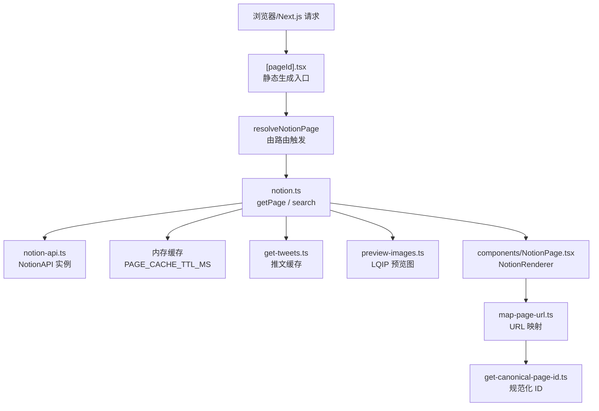
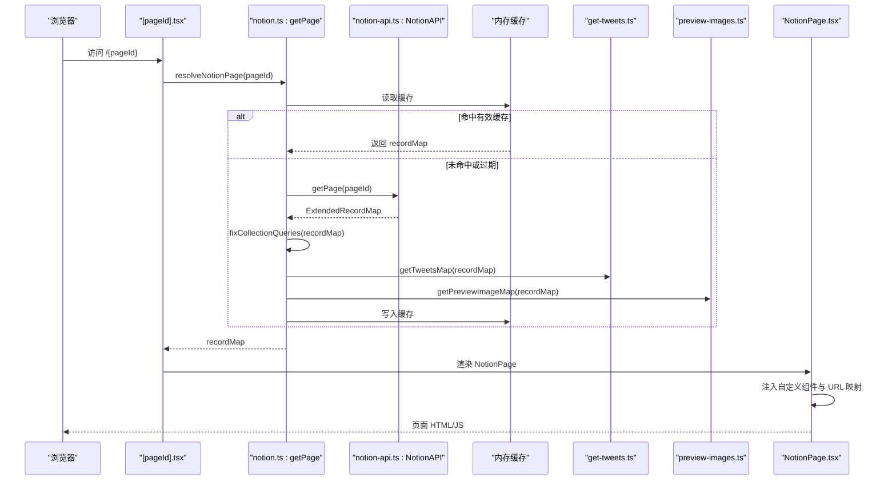
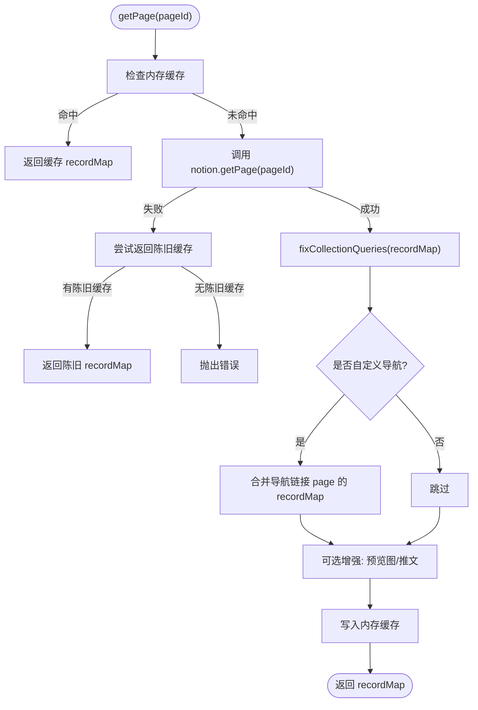
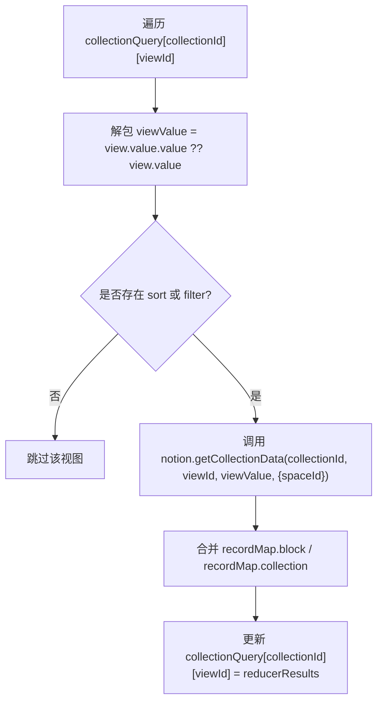
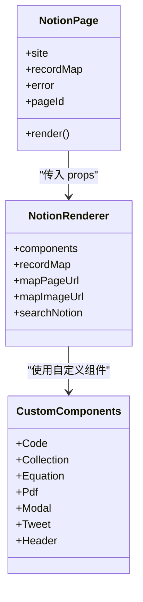
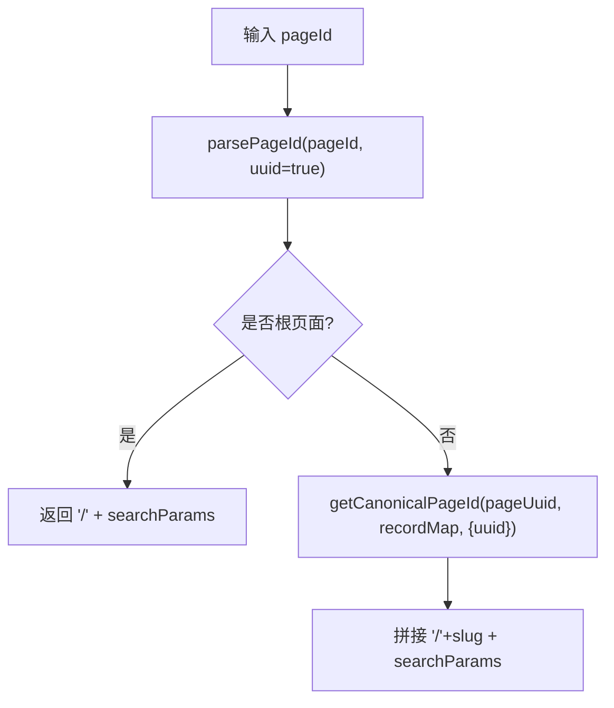
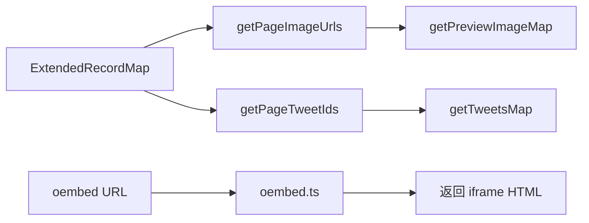
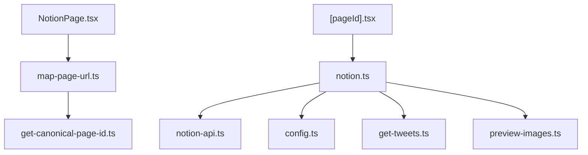

# Notion 集成

<cite>
**本文引用的文件**   
- [lib/notion-api.ts](file://lib/notion-api.ts)
- [lib/notion.ts](file://lib/notion.ts)
- [components/NotionPage.tsx](file://components/NotionPage.tsx)
- [lib/map-page-url.ts](file://lib/map-page-url.ts)
- [lib/get-canonical-page-id.ts](file://lib/get-canonical-page-id.ts)
- [lib/types.ts](file://lib/types.ts)
- [lib/config.ts](file://lib/config.ts)
- [lib/get-tweets.ts](file://lib/get-tweets.ts)
- [lib/preview-images.ts](file://lib/preview-images.ts)
- [lib/oembed.ts](file://lib/oembed.ts)
- [pages/[pageId].tsx](file://pages/[pageId].tsx)
</cite>

## 目录
1. [简介](#简介)
2. [项目结构](#项目结构)
3. [核心组件](#核心组件)
4. [架构总览](#架构总览)
5. [详细组件分析](#详细组件分析)
6. [依赖关系分析](#依赖关系分析)
7. [性能与缓存](#性能与缓存)
8. [错误处理与重试](#错误处理与重试)
9. [扩展自定义内容类型](#扩展自定义内容类型)
10. [故障排查](#故障排查)
11. [结论](#结论)

## 简介
本文件面向需要在 Next.js 站点中深度集成 Notion 的开发者，系统性说明：
- 如何初始化并调用 Notion API 客户端
- 页面数据获取、RecordMap 数据处理与缓存策略
- 页面解析、URL 映射与规范化
- 不同类型内容块、媒体资源与嵌入内容的处理方式
- 错误处理、重试机制与速率限制应对
- 如何扩展自定义 Notion 内容类型

该文档既提供高层架构视图，也深入到关键实现细节，帮助你在不直接粘贴代码的前提下理解并复用这些模式。

## 项目结构
本项目围绕 Notion 数据流组织为“API 客户端 → 数据装配与缓存 → 渲染与展示”三层：
- API 客户端层：封装 Notion API 调用、重试与超时配置
- 数据装配层：拉取 RecordMap、修正集合查询、补充推文与预览图
- 渲染层：基于 react-notion-x 渲染页面，注入自定义组件与 URL 映射

图表来源
- [pages/[pageId].tsx:8-23](file://pages/[pageId].tsx#L8-L23)
- [lib/notion.ts:161-214](file://lib/notion.ts#L161-L214)
- [lib/notion-api.ts:1-20](file://lib/notion-api.ts#L1-L20)
- [components/NotionPage.tsx:319-340](file://components/NotionPage.tsx#L319-L340)
- [lib/map-page-url.ts:12-39](file://lib/map-page-url.ts#L12-L39)
- [lib/get-canonical-page-id.ts:9-29](file://lib/get-canonical-page-id.ts#L9-L29)

章节来源
- [pages/[pageId].tsx:8-31](file://pages/[pageId].tsx#L8-L31)
- [lib/notion.ts:19-214](file://lib/notion.ts#L19-L214)
- [lib/notion-api.ts:1-20](file://lib/notion-api.ts#L1-L20)
- [components/NotionPage.tsx:196-340](file://components/NotionPage.tsx#L196-L340)

## 核心组件
- Notion API 客户端：集中管理认证、基础地址、重试策略与超时
- 页面数据服务：负责拉取 RecordMap、修正集合排序过滤、合并导航页数据、注入推文与预览图
- 页面渲染器：将 RecordMap 渲染为 UI，注入自定义组件、图片与链接映射
- URL 映射工具：根据站点配置与 Notion 元数据生成友好 URL 与 canonical URL
- 辅助能力：oEmbed 支持、搜索、站点配置等

章节来源
- [lib/notion-api.ts:1-20](file://lib/notion-api.ts#L1-L20)
- [lib/notion.ts:19-214](file://lib/notion.ts#L19-L214)
- [components/NotionPage.tsx:196-340](file://components/NotionPage.tsx#L196-L340)
- [lib/map-page-url.ts:12-39](file://lib/map-page-url.ts#L12-L39)
- [lib/get-canonical-page-id.ts:9-29](file://lib/get-canonical-page-id.ts#L9-L29)

## 架构总览
下图展示了从页面请求到最终渲染的关键路径，以及各模块的职责边界。

图表来源
- [pages/[pageId].tsx:8-23](file://pages/[pageId].tsx#L8-L23)
- [lib/notion.ts:161-214](file://lib/notion.ts#L161-L214)
- [lib/notion-api.ts:1-20](file://lib/notion-api.ts#L1-L20)
- [components/NotionPage.tsx:319-340](file://components/NotionPage.tsx#L319-L340)

## 详细组件分析

### Notion API 客户端
- 使用 notion-client 提供的 NotionAPI 类创建统一客户端
- 通过环境变量注入基础地址与令牌
- 基于 ofetchOptions 配置自动重试、状态码白名单与超时
- 设置 User-Agent 以兼容服务端代理或 CDN 策略

关键点
- 重试次数与延迟：避免瞬时失败导致页面崩溃
- 超时时间：防止长尾请求阻塞构建或请求链路
- 可插拔的基础地址：便于本地开发或代理场景

章节来源
- [lib/notion-api.ts:1-20](file://lib/notion-api.ts#L1-L20)

### 页面数据服务（RecordMap 获取与增强）
职责
- 优先返回内存缓存中的 recordMap
- 失败时回退到陈旧缓存，保证可用性
- 非默认导航模式下预取导航链接页面的 block/collection 信息并合并
- 修正集合视图的排序与过滤（修复双层嵌套 value 导致的 query2 丢失问题）
- 可选注入预览图 LQIP 与推文数据
- 写回缓存供后续请求使用

图表来源
- [lib/notion.ts:38-55](file://lib/notion.ts#L38-L55)
- [lib/notion.ts:95-159](file://lib/notion.ts#L95-L159)
- [lib/notion.ts:161-214](file://lib/notion.ts#L161-L214)

章节来源
- [lib/notion.ts:19-214](file://lib/notion.ts#L19-L214)

#### 集合查询修正逻辑
背景
- 通过代理返回的 collection_view 存在双层嵌套 value，导致 notion-client 读取过浅，query2（排序/过滤）丢失
- 需要重新发起 getCollectionData 并使用正确的 viewValue，再合并结果

流程要点
- 遍历 collection_query 下的每个 collectionId/viewId
- 正确解包 view.value.value 或 fallback 到 view.value
- 仅当存在 sort/filter 时才重查
- 合并返回的 block/collection 与 reducerResults

图表来源
- [lib/notion.ts:95-159](file://lib/notion.ts#L95-L159)

章节来源
- [lib/notion.ts:95-159](file://lib/notion.ts#L95-L159)

### 页面渲染器（NotionPage）
职责
- 接收 server-side 生成的 recordMap 并渲染
- 注入自定义组件：Code、Collection、Equation、Pdf、Modal、Tweet、Header
- 重写属性渲染：最后编辑时间、发布日期、作者文本样式
- 动态加载第三方组件，减少首屏体积
- 控制目录显示、侧边栏、页脚评论等

图表来源
- [components/NotionPage.tsx:196-209](file://components/NotionPage.tsx#L196-L209)
- [components/NotionPage.tsx:319-340](file://components/NotionPage.tsx#L319-L340)

章节来源
- [components/NotionPage.tsx:196-340](file://components/NotionPage.tsx#L196-L340)

### URL 映射与规范化
职责
- 将 Notion pageId 映射为友好的站点 URL
- 根页面映射为站点根路径
- 支持在开发环境包含 UUID 以便调试
- 支持通过 inversePageUrlOverrides 覆盖特定 pageId 的 URL

图表来源
- [lib/map-page-url.ts:12-39](file://lib/map-page-url.ts#L12-L39)
- [lib/get-canonical-page-id.ts:9-29](file://lib/get-canonical-page-id.ts#L9-L29)

章节来源
- [lib/map-page-url.ts:12-39](file://lib/map-page-url.ts#L12-L39)
- [lib/get-canonical-page-id.ts:9-29](file://lib/get-canonical-page-id.ts#L9-L29)

### 媒体资源与嵌入内容
- 预览图（LQIO/LQIP）：扫描页面图片与默认图标/封面，生成宽高与 Base64 低质量占位图，缓存至 Redis
- 推文：提取页面内推文 ID，并发抓取并缓存；渲染时使用 react-tweet 的 EmbeddedTweet
- oEmbed：根据 URL 解析 pageId，组装嵌入 HTML 与尺寸，支持 dark 模式与 lite 模式

图表来源
- [lib/preview-images.ts:33-57](file://lib/preview-images.ts#L33-L57)
- [lib/get-tweets.ts:10-28](file://lib/get-tweets.ts#L10-L28)
- [lib/oembed.ts:6-66](file://lib/oembed.ts#L6-L66)

章节来源
- [lib/preview-images.ts:16-102](file://lib/preview-images.ts#L16-L102)
- [lib/get-tweets.ts:1-63](file://lib/get-tweets.ts#L1-L63)
- [lib/oembed.ts:1-67](file://lib/oembed.ts#L1-L67)

## 依赖关系分析
- notion.ts 依赖 notion-api.ts 进行底层 HTTP 调用
- notion.ts 依赖 config.ts 获取站点与导航配置
- notion.ts 依赖 get-tweets.ts 与 preview-images.ts 进行数据增强
- components/NotionPage.tsx 依赖 map-page-url.ts 与 get-canonical-page-id.ts 完成 URL 映射
- pages/[pageId].tsx 作为 Next.js 路由入口，调用 resolveNotionPage 并启用 ISR revalidate

图表来源
- [lib/notion.ts:1-17](file://lib/notion.ts#L1-L17)
- [components/NotionPage.tsx:23-28](file://components/NotionPage.tsx#L23-L28)
- [lib/map-page-url.ts:1-6](file://lib/map-page-url.ts#L1-L6)
- [pages/[pageId].tsx:1-6](file://pages/[pageId].tsx#L1-L6)

章节来源
- [lib/notion.ts:1-17](file://lib/notion.ts#L1-L17)
- [components/NotionPage.tsx:23-28](file://components/NotionPage.tsx#L23-L28)
- [lib/map-page-url.ts:1-6](file://lib/map-page-url.ts#L1-L6)
- [pages/[pageId].tsx:1-6](file://pages/[pageId].tsx#L1-L6)

## 性能与缓存
- 内存缓存（页面级）：对每个 pageId 缓存完整的 ExtendedRecordMap，TTL 较短（秒级），用于吸收突发流量与 Notion 抖动
- 函数级缓存：p-memoize 对导航链接页面、推文、预览图等计算密集型操作进行进程内缓存
- Redis 缓存：推文与预览图在 Redis 中持久化，降低外部依赖压力
- 并发控制：p-map 控制并发度，避免同时过多请求 Notion/Twitter/CDN
- ISR 增量再生：Next.js 路由启用 revalidateSeconds，平衡新鲜度与成本

优化建议
- 合理调整 PAGE_CACHE_TTL_MS 与 revalidateSeconds，结合业务更新频率
- 监控 Redis 命中率与错误日志，必要时降级缓存读写
- 对高延迟的外部依赖（Twitter、图片源站）增加超时与重试上限

章节来源
- [lib/notion.ts:29-55](file://lib/notion.ts#L29-L55)
- [lib/notion.ts:57-81](file://lib/notion.ts#L57-L81)
- [lib/get-tweets.ts:30-63](file://lib/get-tweets.ts#L30-L63)
- [lib/preview-images.ts:59-102](file://lib/preview-images.ts#L59-L102)
- [lib/config.ts:93-98](file://lib/config.ts#L93-L98)
- [pages/[pageId].tsx:8-16](file://pages/[pageId].tsx#L8-L16)

## 错误处理与重试
- 客户端重试：notion-api.ts 配置了 retry、retryStatusCodes 与 timeout，自动重试 408/429/500/502/503/504 等临时错误
- 页面级容错：getPage 捕获异常，若存在陈旧缓存则返回 stale 数据，避免全站 500
- 集合查询修正：对单个视图查询失败仅记录警告，不影响整体渲染
- 推文与预览图：Redis 读写失败均忽略并降级，确保主流程不受影响
- oEmbed：预留错误处理位置，可按需完善

最佳实践
- 保持重试策略保守，避免雪崩
- 对关键路径添加告警与指标采集（如 Notion API 错误率、Redis 错误率）
- 在测试环境中模拟 429/5xx，验证降级与回退行为

章节来源
- [lib/notion-api.ts:3-18](file://lib/notion-api.ts#L3-L18)
- [lib/notion.ts:168-182](file://lib/notion.ts#L168-L182)
- [lib/notion.ts:149-155](file://lib/notion.ts#L149-L155)
- [lib/get-tweets.ts:35-59](file://lib/get-tweets.ts#L35-L59)
- [lib/preview-images.ts:67-98](file://lib/preview-images.ts#L67-L98)
- [lib/oembed.ts:23-25](file://lib/oembed.ts#L23-L25)

## 扩展自定义内容类型
目标
- 在不侵入核心逻辑的前提下，扩展 Notion 内容类型的渲染与数据获取

步骤
1. 定义自定义组件
   - 在 NotionPage.tsx 的 notionRendererComponents 中注册新组件
   - 例如新增一个“视频卡片”组件，替换默认的 Video 渲染

2. 处理数据增强
   - 若需要额外字段，可在 notion.ts 的 getPage 后追加处理逻辑
   - 例如从外部服务拉取视频元数据并注入 recordMap

3. URL 与图片映射
   - 如需自定义图片路径规则，扩展 mapImageUrl 或在 NotionPage 中注入新的 mapImageUrl
   - 如需自定义链接跳转，扩展 mapPageUrl

4. 缓存与性能
   - 对新增的外部数据使用 p-memoize 与 Redis 缓存
   - 控制并发，避免拖慢页面渲染

示例路径参考
- 自定义组件注册点：[components/NotionPage.tsx:196-209](file://components/NotionPage.tsx#L196-L209)
- 数据增强入口：[lib/notion.ts:161-214](file://lib/notion.ts#L161-L214)
- 图片映射：[components/NotionPage.tsx:339-340](file://components/NotionPage.tsx#L339-L340)
- URL 映射：[lib/map-page-url.ts:12-39](file://lib/map-page-url.ts#L12-L39)

章节来源
- [components/NotionPage.tsx:196-209](file://components/NotionPage.tsx#L196-L209)
- [lib/notion.ts:161-214](file://lib/notion.ts#L161-L214)
- [lib/map-page-url.ts:12-39](file://lib/map-page-url.ts#L12-L39)

## 故障排查
常见问题与定位方法
- Notion API 频繁 429/5xx
  - 检查 notion-api.ts 的重试策略与超时
  - 观察控制台警告与日志，确认是否触发陈旧缓存回退
- 集合视图顺序与过滤不一致
  - 确认 fixCollectionQueries 是否正确解包 view.value.value
  - 检查是否启用了代理导致的双层嵌套
- 图片不显示或尺寸塌陷
  - 检查 isPreviewImageSupportEnabled 与 mapImageUrl
  - 查看 Redis 预览图缓存是否可用
- 推文无法加载
  - 检查 Twitter API 限流与 Redis 缓存
  - 关注 get-tweets.ts 的错误日志
- URL 不正确或 canonical 缺失
  - 检查 inversePageUrlOverrides 与 includeNotionIdInUrls
  - 确认 getCanonicalPageId 返回值是否符合预期

章节来源
- [lib/notion-api.ts:3-18](file://lib/notion-api.ts#L3-L18)
- [lib/notion.ts:149-155](file://lib/notion.ts#L149-L155)
- [lib/preview-images.ts:67-98](file://lib/preview-images.ts#L67-L98)
- [lib/get-tweets.ts:35-59](file://lib/get-tweets.ts#L35-L59)
- [lib/map-page-url.ts:12-39](file://lib/map-page-url.ts#L12-L39)
- [lib/get-canonical-page-id.ts:9-29](file://lib/get-canonical-page-id.ts#L9-L29)

## 结论
本集成方案通过分层设计实现了稳定、可扩展的 Notion 数据接入：
- 使用 notion-client 封装底层调用，配合重试与超时提升鲁棒性
- 以内存缓存与 Redis 缓存组合保障性能与可用性
- 通过集合查询修正解决代理场景下的排序/过滤问题
- 借助 react-notion-x 的组件注入机制，灵活扩展内容与交互
- 提供完善的 URL 映射与 canonical 支持，利于 SEO 与用户体验

在实际落地中，建议：
- 根据业务节奏调整缓存 TTL 与 ISR revalidate
- 建立监控与告警，覆盖 Notion API、Redis、外部依赖
- 逐步引入自定义内容类型，保持核心链路简洁稳定