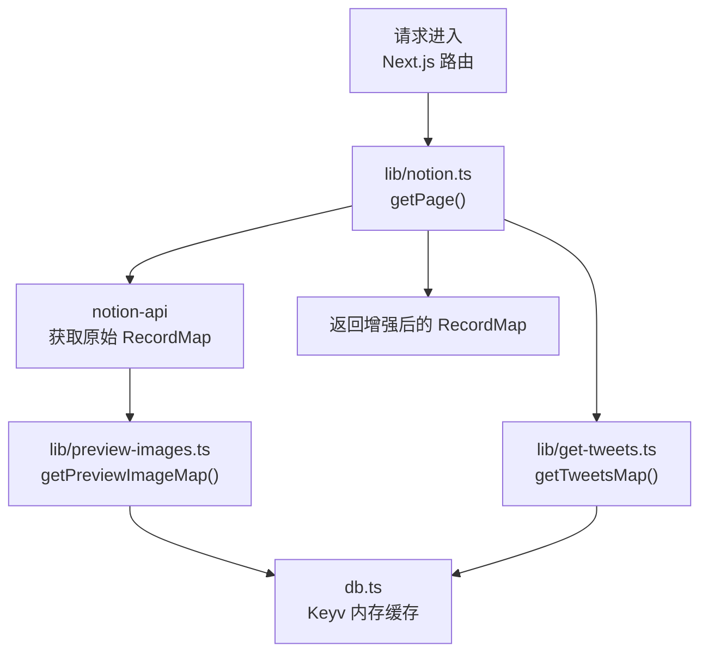
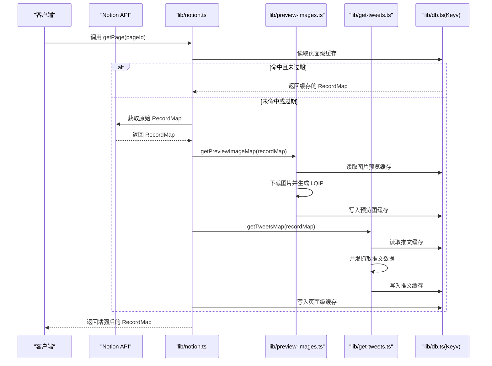
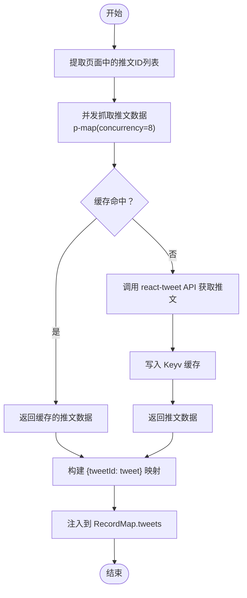
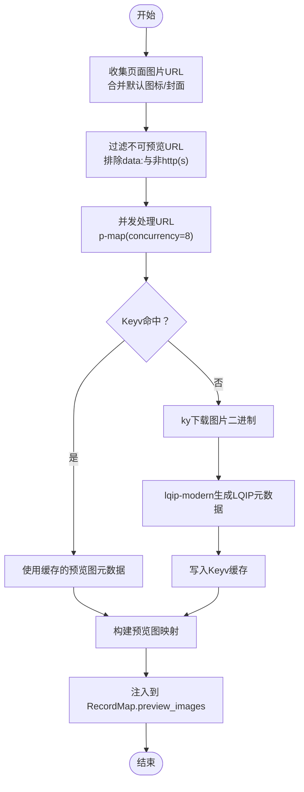
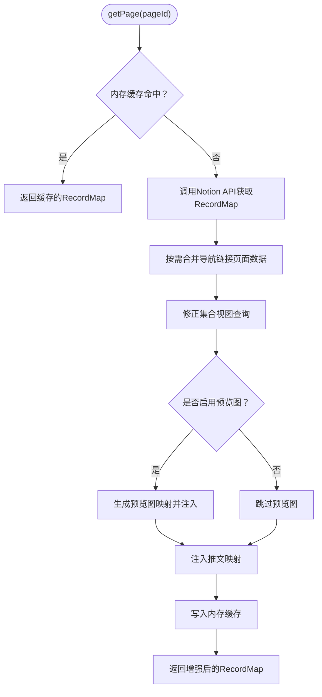
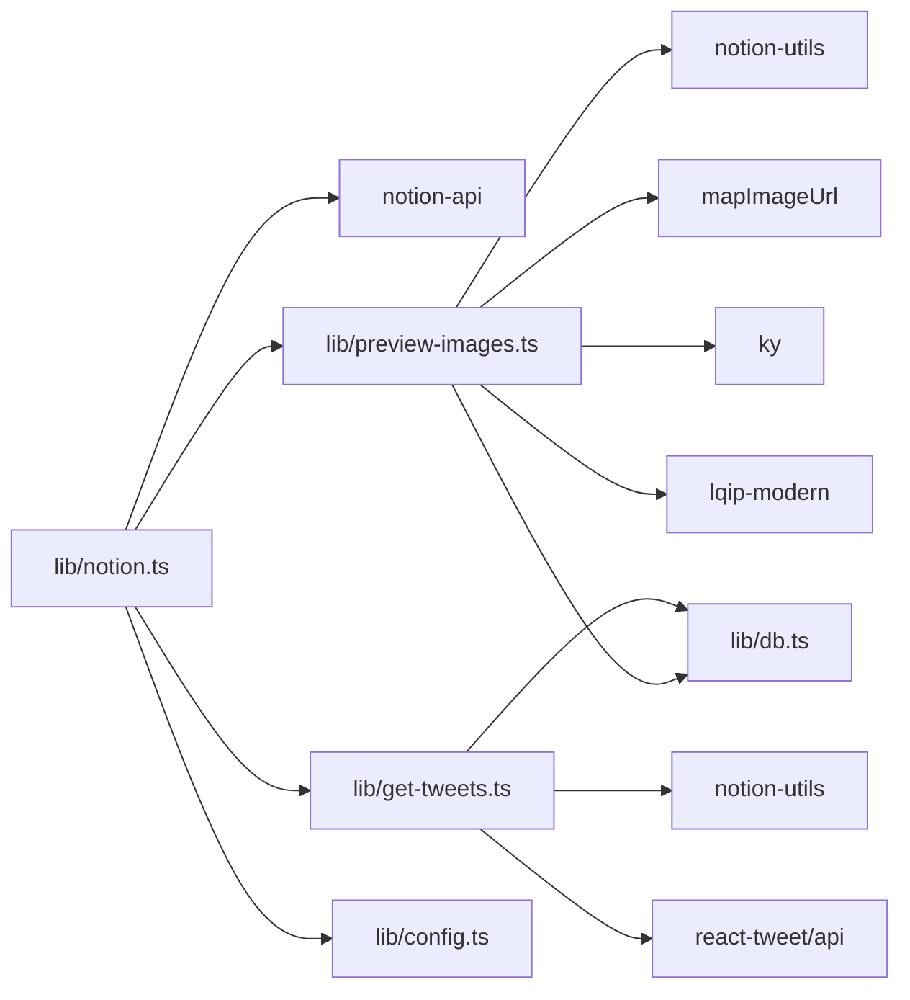

# 内容处理与增强

<cite>
**本文引用的文件**   
- [lib/get-tweets.ts](file://lib/get-tweets.ts)
- [lib/preview-images.ts](file://lib/preview-images.ts)
- [lib/notion.ts](file://lib/notion.ts)
- [lib/types.ts](file://lib/types.ts)
- [lib/config.ts](file://lib/config.ts)
- [lib/db.ts](file://lib/db.ts)
- [pages/api/social-image.tsx](file://pages/api/social-image.tsx)
</cite>

## 目录
1. [引言](#引言)
2. [项目结构](#项目结构)
3. [核心组件](#核心组件)
4. [架构总览](#架构总览)
5. [详细组件分析](#详细组件分析)
6. [依赖关系分析](#依赖关系分析)
7. [性能考量](#性能考量)
8. [故障排查指南](#故障排查指南)
9. [结论](#结论)
10. [附录：扩展指南](#附录扩展指南)

## 引言
本文聚焦于“内容处理与增强”能力，围绕三类关键任务展开：
- 推文嵌入：批量获取推文数据并注入到 RecordMap。
- 预览图片生成：从页面中提取图片、生成低质量占位图（LQIP），为懒加载提供基础。
- 媒体资源处理：统一图片 URL 映射、社交分享图生成等。

重点说明 getTweetsMap 的工作原理、预览图片的生成机制（尺寸优化、懒加载策略、错误处理），以及如何扩展支持其他类型的内容嵌入和自定义处理逻辑。

## 项目结构
本项目采用 Next.js + Notion 的数据流模式：服务端通过 notion-api 拉取页面数据，得到 ExtendedRecordMap；随后在服务器端进行内容增强（推文、预览图等），最终将增强后的 recordMap 返回给前端渲染。

图表来源
- [lib/notion.ts:161-213](file://lib/notion.ts#L161-L213)
- [lib/preview-images.ts:33-57](file://lib/preview-images.ts#L33-L57)
- [lib/get-tweets.ts:10-28](file://lib/get-tweets.ts#L10-L28)
- [lib/db.ts:1-7](file://lib/db.ts#L1-L7)

章节来源
- [lib/notion.ts:1-219](file://lib/notion.ts#L1-L219)
- [lib/preview-images.ts:1-102](file://lib/preview-images.ts#L1-L102)
- [lib/get-tweets.ts:1-63](file://lib/get-tweets.ts#L1-L63)
- [lib/db.ts:1-7](file://lib/db.ts#L1-L7)

## 核心组件
- 推文增强：getTweetsMap 负责扫描页面中的推文 ID，并发抓取推文数据，并通过 Redis/Keyv 缓存结果，最后将 tweets 字段注入到 RecordMap。
- 预览图片增强：getPreviewImageMap 负责收集页面中需要预览的图片 URL，使用 lqip-modern 生成 LQIP 元数据（宽高、Base64 缩略图），并缓存。
- 数据装配：lib/notion.ts 的 getPage 是入口，串联 Notion API、预览图、推文增强，并维护服务器端内存缓存。
- 配置开关：isPreviewImageSupportEnabled 控制是否启用预览图功能。
- 缓存层：db.ts 基于 Keyv 提供进程内缓存，避免重复网络请求与计算。

章节来源
- [lib/get-tweets.ts:10-28](file://lib/get-tweets.ts#L10-L28)
- [lib/preview-images.ts:33-57](file://lib/preview-images.ts#L33-L57)
- [lib/notion.ts:161-213](file://lib/notion.ts#L161-L213)
- [lib/config.ts:68-72](file://lib/config.ts#L68-L72)
- [lib/db.ts:1-7](file://lib/db.ts#L1-L7)

## 架构总览
下图展示了从请求到内容增强的完整流程，包括缓存、并发控制与错误降级。

图表来源
- [lib/notion.ts:161-213](file://lib/notion.ts#L161-L213)
- [lib/preview-images.ts:33-57](file://lib/preview-images.ts#L33-L57)
- [lib/get-tweets.ts:10-28](file://lib/get-tweets.ts#L10-L28)
- [lib/db.ts:1-7](file://lib/db.ts#L1-L7)

## 详细组件分析

### 推文增强：getTweetsMap
- 输入：ExtendedRecordMap
- 输出：向 RecordMap 注入 tweets 字段（键为推文 ID，值为推文数据）
- 关键步骤
  - 从 RecordMap 中提取所有推文 ID。
  - 使用 p-map 并发（concurrency=8）抓取推文数据。
  - 每个推文先查缓存（Keyv），未命中则调用 react-tweet 的 getTweet 接口，再写回缓存。
  - 将 tweets 对象挂载到 RecordMap 上，供前端渲染推文嵌入。

图表来源
- [lib/get-tweets.ts:10-28](file://lib/get-tweets.ts#L10-L28)
- [lib/get-tweets.ts:30-62](file://lib/get-tweets.ts#L30-L62)
- [lib/db.ts:1-7](file://lib/db.ts#L1-L7)

章节来源
- [lib/get-tweets.ts:10-28](file://lib/get-tweets.ts#L10-L28)
- [lib/get-tweets.ts:30-62](file://lib/get-tweets.ts#L30-L62)
- [lib/types.ts:21-23](file://lib/types.ts#L21-L23)

### 预览图片生成：getPreviewImageMap
- 目标：为页面中的图片生成 LQIP（低质量占位图）元数据，用于懒加载与尺寸优化。
- 关键步骤
  - 从 RecordMap 中收集图片 URL，并合并站点默认图标与封面。
  - 过滤不可预览的 URL（如 data: 协议或非 http/https）。
  - 对每个 URL 并发（concurrency=8）执行：
    - 优先从 Keyv 缓存读取预览图元数据。
    - 若未命中，使用 ky 下载图片二进制，再用 lqip-modern 生成 originalWidth、originalHeight、dataURIBase64。
    - 将结果写回 Keyv 缓存。
  - 返回预览图映射，并在 getPage 中注入到 RecordMap.preview_images。

图表来源
- [lib/preview-images.ts:33-57](file://lib/preview-images.ts#L33-L57)
- [lib/preview-images.ts:59-101](file://lib/preview-images.ts#L59-L101)
- [lib/config.ts:59-66](file://lib/config.ts#L59-L66)
- [lib/db.ts:1-7](file://lib/db.ts#L1-L7)

章节来源
- [lib/preview-images.ts:16-31](file://lib/preview-images.ts#L16-L31)
- [lib/preview-images.ts:33-57](file://lib/preview-images.ts#L33-L57)
- [lib/preview-images.ts:59-101](file://lib/preview-images.ts#L59-L101)
- [lib/config.ts:59-66](file://lib/config.ts#L59-L66)

### 数据装配与缓存：lib/notion.ts 的 getPage
- 职责
  - 管理服务器端内存缓存（TTL=60s），实现“stale-while-revalidate”。
  - 按需合并导航链接页面的 RecordMap。
  - 修正集合视图排序与过滤。
  - 条件启用预览图增强。
  - 始终注入推文增强。
- 关键点
  - isPreviewImageSupportEnabled 控制是否生成预览图。
  - 无论预览图是否启用，都会执行 getTweetsMap。
  - 最终将增强后的 RecordMap 写入内存缓存并返回。

图表来源
- [lib/notion.ts:161-213](file://lib/notion.ts#L161-L213)
- [lib/config.ts:68-72](file://lib/config.ts#L68-L72)

章节来源
- [lib/notion.ts:19-55](file://lib/notion.ts#L19-L55)
- [lib/notion.ts:95-159](file://lib/notion.ts#L95-L159)
- [lib/notion.ts:161-213](file://lib/notion.ts#L161-L213)
- [lib/config.ts:68-72](file://lib/config.ts#L68-L72)

### 社交分享图：pages/api/social-image.tsx
- 作用：根据页面信息生成 Open Graph 社交分享图，包含背景图与文本布局。
- 与预览图的关联：虽然不直接使用 LQIP，但体现了媒体资源的统一处理思路（背景图、尺寸适配、样式覆盖）。

章节来源
- [pages/api/social-image.tsx:49-86](file://pages/api/social-image.tsx#L49-L86)

## 依赖关系分析
- lib/notion.ts 依赖：
  - notion-api：获取原始 RecordMap。
  - preview-images：生成预览图映射。
  - get-tweets：注入推文映射。
  - config：读取预览图开关与默认图标/封面。
- lib/preview-images.ts 依赖：
  - notion-utils：提取页面图片 URL。
  - mapImageUrl：统一图片 URL 映射。
  - db：Keyv 缓存。
  - ky/lqip-modern：下载图片与生成 LQIP。
- lib/get-tweets.ts 依赖：
  - notion-utils：提取推文 ID。
  - react-tweet/api：获取推文数据。
  - db：Keyv 缓存。

图表来源
- [lib/notion.ts:1-18](file://lib/notion.ts#L1-L18)
- [lib/preview-images.ts:1-14](file://lib/preview-images.ts#L1-L14)
- [lib/get-tweets.ts:1-8](file://lib/get-tweets.ts#L1-L8)

章节来源
- [lib/notion.ts:1-18](file://lib/notion.ts#L1-L18)
- [lib/preview-images.ts:1-14](file://lib/preview-images.ts#L1-L14)
- [lib/get-tweets.ts:1-8](file://lib/get-tweets.ts#L1-L8)

## 性能考量
- 并发控制
  - 推文抓取与预览图生成均使用 p-map 设置 concurrency=8，平衡吞吐与外部服务压力。
- 多级缓存
  - 服务器端内存缓存（TTL=60s）减少 Notion API 调用。
  - Keyv 进程内缓存降低重复网络请求与 LQIP 计算开销。
- 懒加载与尺寸优化
  - 预览图提供 originalWidth/originalHeight，便于前端 next/image 使用 intrinsic 尺寸，避免布局抖动。
  - LQIP Base64 作为首帧占位，提升感知加载速度。
- 降级策略
  - Notion API 失败时返回 stale 缓存，保证可用性。
  - Redis/Keyv 读写异常被捕获并忽略，继续走网络路径。

[本节为通用性能讨论，不直接分析具体代码行]

## 故障排查指南
- 推文无法显示
  - 检查推文 ID 是否正确提取。
  - 查看 Keyv 缓存是否可用（db.get/set 日志）。
  - 确认 react-tweet API 返回数据是否正常。
- 预览图不生效
  - 确认 isPreviewImageSupportEnabled 已开启。
  - 检查 URL 是否被过滤（非 http/https 或 data:）。
  - 查看 lqip 生成过程与 Keyv 写入日志。
- 页面响应缓慢
  - 评估并发数（concurrency）是否过高导致下游限流。
  - 检查 Keyv 是否频繁失效或容量不足。
  - 考虑增大内存缓存 TTL 或引入外部缓存。

章节来源
- [lib/get-tweets.ts:30-62](file://lib/get-tweets.ts#L30-L62)
- [lib/preview-images.ts:59-101](file://lib/preview-images.ts#L59-L101)
- [lib/notion.ts:161-213](file://lib/notion.ts#L161-L213)

## 结论
本项目通过“推文增强 + 预览图增强”的双通道，显著提升了内容渲染体验与性能。getTweetsMap 以并发抓取与缓存策略保障推文数据的稳定注入；预览图机制通过 LQIP 与尺寸元数据优化了懒加载与布局稳定性。整体架构清晰、可扩展性强，适合进一步扩展更多类型的嵌入内容与自定义处理逻辑。

[本节为总结性内容，不直接分析具体代码行]

## 附录：扩展指南

### 如何扩展支持其他类型的内容嵌入
- 新增一个增强模块（例如 lib/embeds/video.ts），遵循以下模式：
  - 从 RecordMap 中提取待处理的资源标识（如视频 ID）。
  - 使用并发工具（p-map）批量获取第三方 API 数据。
  - 使用 Keyv 缓存结果，避免重复请求。
  - 将结果注入到 RecordMap 的自定义字段（如 recordMap.videos）。
- 在 lib/notion.ts 的 getPage 中调用该增强函数，确保与推文、预览图并行或串行处理。

示例要点
- 并发与缓存：参考 get-tweets.ts 的实现模式。
- 注入位置：参考 getTweetsMap 将 tweets 注入 RecordMap 的方式。
- 开关控制：如需可选增强，可像预览图一样增加配置开关。

章节来源
- [lib/get-tweets.ts:10-28](file://lib/get-tweets.ts#L10-L28)
- [lib/notion.ts:203-208](file://lib/notion.ts#L203-L208)

### 如何自定义预览图处理逻辑
- 替换图片源映射：修改 mapImageUrl 以适配新的 CDN 或签名规则。
- 调整预览图生成：在 createPreviewImage 中替换 lqip 的处理逻辑（例如改为生成不同尺寸的缩略图）。
- 控制开关：通过 isPreviewImageSupportEnabled 控制是否启用预览图增强。

章节来源
- [lib/preview-images.ts:59-101](file://lib/preview-images.ts#L59-L101)
- [lib/config.ts:68-72](file://lib/config.ts#L68-L72)