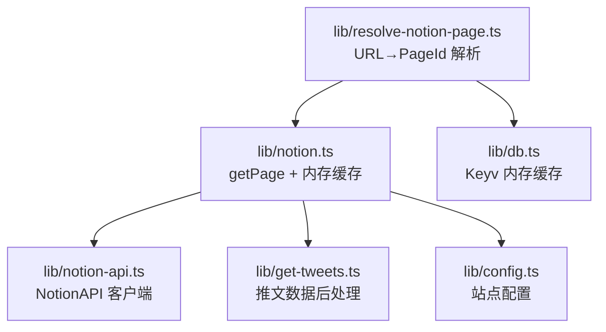
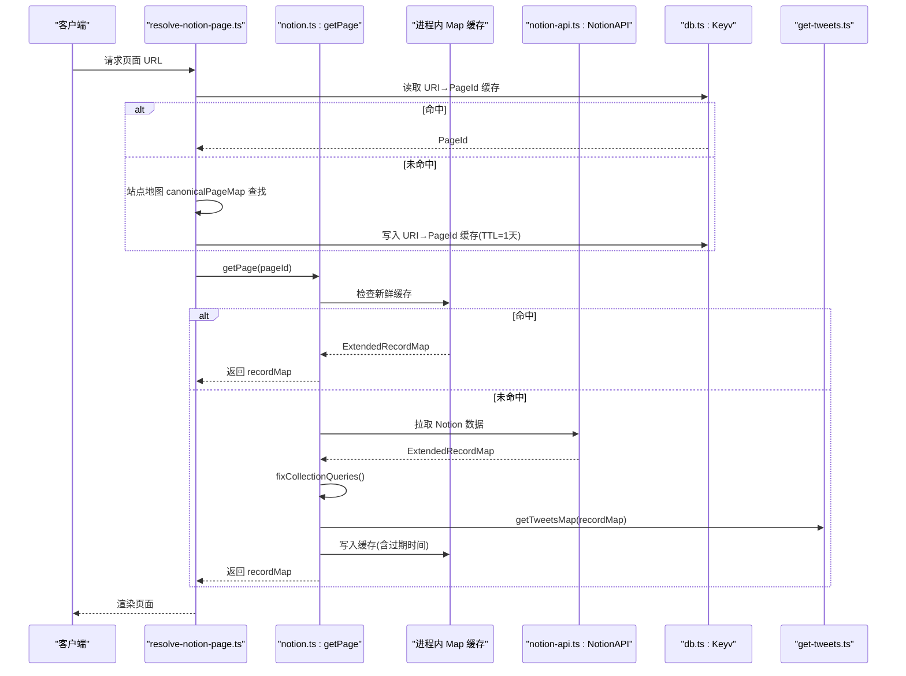
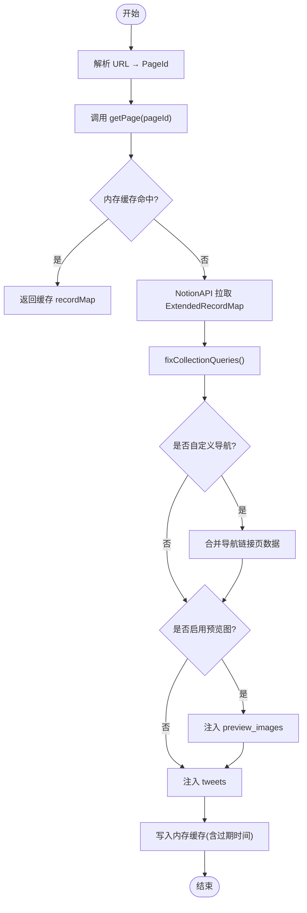
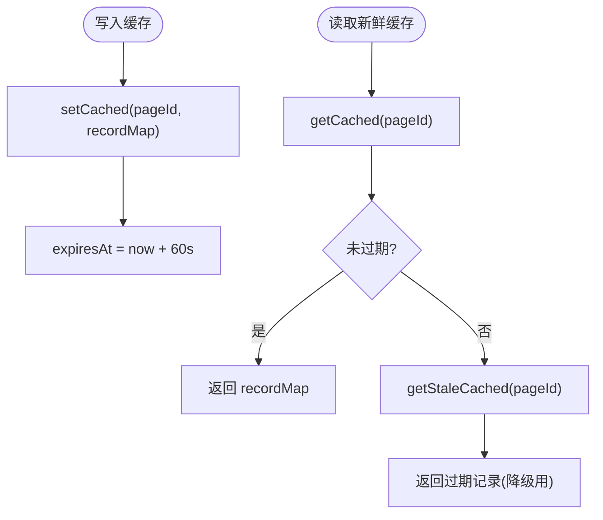
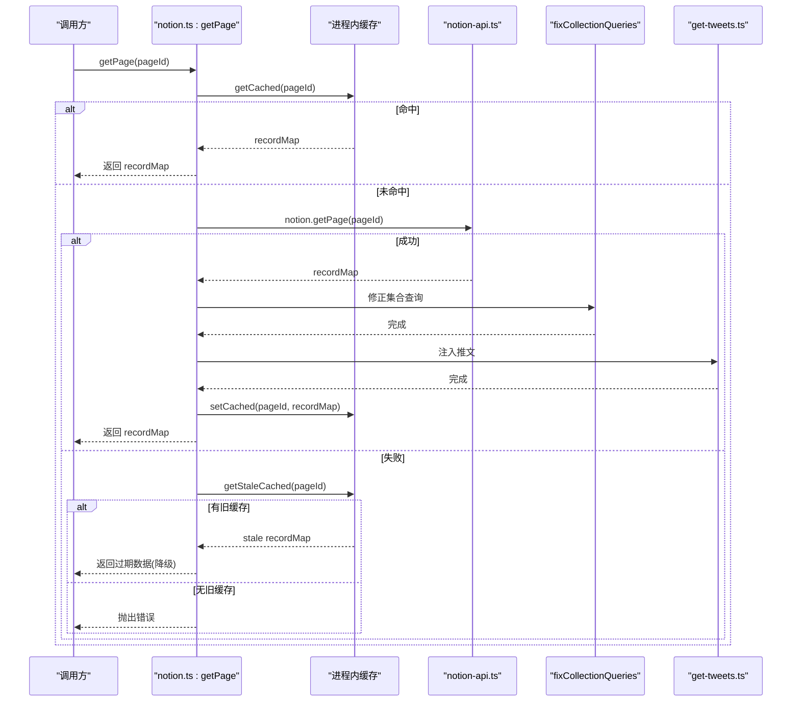
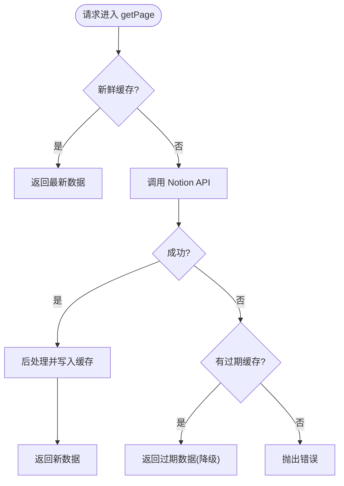
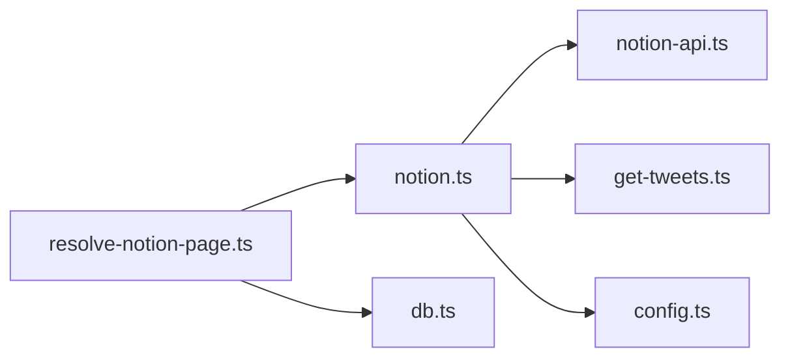

# 数据获取与缓存

<cite>
**本文引用的文件**   
- [lib/notion.ts](file://lib/notion.ts)
- [lib/notion-api.ts](file://lib/notion-api.ts)
- [lib/resolve-notion-page.ts](file://lib/resolve-notion-page.ts)
- [lib/db.ts](file://lib/db.ts)
- [lib/config.ts](file://lib/config.ts)
- [lib/get-tweets.ts](file://lib/get-tweets.ts)
</cite>

## 目录
1. [引言](#引言)
2. [项目结构与职责边界](#项目结构与职责边界)
3. [核心组件总览](#核心组件总览)
4. [架构概览](#架构概览)
5. [ExtendedRecordMap 数据获取流程](#extendedrecordmap-数据获取流程)
6. [内存缓存、TTL 与失效机制](#内存缓存ttl-与失效机制)
7. [getPage 函数完整执行流程](#getpage-函数完整执行流程)
8. [stale-while-revalidate 模式与降级策略](#stale-while-revalidate-模式与降级策略)
9. [依赖关系分析](#依赖关系分析)
10. [性能优化建议与最佳实践](#性能优化建议与最佳实践)
11. [故障排查指南](#故障排查指南)
12. [结论](#结论)

## 引言
本文围绕 Notion 站点的数据获取与缓存机制展开，重点说明 ExtendedRecordMap 的获取路径、内存缓存实现、TTL 策略与失效方式，并详细拆解 getPage 函数的执行流程。同时解释 stale-while-revalidate 模式的落地方式，以及在 Notion API 不可用时的降级策略，最后给出性能优化建议和最佳实践。

## 项目结构与职责边界
- lib/notion.ts：页面级数据获取入口、内存缓存、集合查询修正、预览图与推文后处理。
- lib/notion-api.ts：NotionAPI 客户端实例配置，包含重试、超时与请求头。
- lib/resolve-notion-page.ts：URL 到 Notion PageId 解析、URI-to-PageId 映射缓存、调用 getPage 组装页面属性。
- lib/db.ts：基于 Keyv 的轻量内存缓存，用于 URI-to-PageId 等跨模块共享缓存。
- lib/config.ts：站点配置，包括导航样式、预览图开关、根页面 ID、revalidateSeconds 等。
- lib/get-tweets.ts：推文数据获取与缓存，作为页面数据后处理的一部分。

**图表来源**
- [lib/resolve-notion-page.ts:11-84](file://lib/resolve-notion-page.ts#L11-L84)
- [lib/notion.ts:161-214](file://lib/notion.ts#L161-L214)
- [lib/notion-api.ts:1-20](file://lib/notion-api.ts#L1-L20)
- [lib/db.ts:1-7](file://lib/db.ts#L1-L7)
- [lib/config.ts:68-98](file://lib/config.ts#L68-L98)

**章节来源**
- [lib/notion.ts:1-219](file://lib/notion.ts#L1-L219)
- [lib/notion-api.ts:1-20](file://lib/notion-api.ts#L1-L20)
- [lib/resolve-notion-page.ts:1-85](file://lib/resolve-notion-page.ts#L1-L85)
- [lib/db.ts:1-7](file://lib/db.ts#L1-L7)
- [lib/config.ts:1-224](file://lib/config.ts#L1-L224)
- [lib/get-tweets.ts:1-62](file://lib/get-tweets.ts#L1-L62)

## 核心组件总览
- 页面数据获取与缓存：lib/notion.ts 中的 getPage 负责从 Notion 拉取 ExtendedRecordMap，并在进程内 Map 中按 pageId 缓存，提供 TTL 与过期判断。
- Notion API 客户端：lib/notion-api.ts 封装 NotionAPI，统一重试、超时、User-Agent 等网络参数。
- URL 解析与映射：lib/resolve-notion-page.ts 将用户友好的 URL 解析为 Notion PageId，并使用 lib/db.ts 做 URI-to-PageId 缓存（TTL=1天）。
- 站点配置：lib/config.ts 提供导航样式、预览图开关、根页面 ID、revalidateSeconds 等关键配置。
- 推文数据：lib/get-tweets.ts 在页面数据后处理阶段注入推文信息，自身也使用 Keyv 做 tweet 级别缓存。

**章节来源**
- [lib/notion.ts:19-55](file://lib/notion.ts#L19-L55)
- [lib/notion-api.ts:1-20](file://lib/notion-api.ts#L1-L20)
- [lib/resolve-notion-page.ts:32-65](file://lib/resolve-notion-page.ts#L32-L65)
- [lib/config.ts:68-98](file://lib/config.ts#L68-L98)
- [lib/get-tweets.ts:10-62](file://lib/get-tweets.ts#L10-L62)

## 架构概览
下图展示了从 URL 到页面数据的整体链路，以及缓存与降级策略的位置。

**图表来源**
- [lib/resolve-notion-page.ts:11-84](file://lib/resolve-notion-page.ts#L11-L84)
- [lib/notion.ts:161-214](file://lib/notion.ts#L161-L214)
- [lib/notion-api.ts:1-20](file://lib/notion-api.ts#L1-L20)
- [lib/db.ts:1-7](file://lib/db.ts#L1-L7)
- [lib/get-tweets.ts:10-62](file://lib/get-tweets.ts#L10-L62)

## ExtendedRecordMap 数据获取流程
ExtendedRecordMap 是 Notion 页面的结构化数据模型，包含 block、collection、collection_view、collection_query 等字段。本项目通过以下路径获取并增强该数据结构：

1. URL 解析与 PageId 确定
   - resolve-notion-page.ts 优先尝试直接解析 rawPageId；若失败则检查 pageUrlOverrides/pageUrlAdditions；再尝试 URI-to-PageId 缓存；最终回退到站点地图 canonicalPageMap。
   - 成功得到 PageId 后调用 getPage(pageId)。

2. 页面数据获取与缓存
   - notion.ts 的 getPage 先检查进程内内存缓存；命中则直接返回。
   - 未命中则通过 notion-api.ts 的 NotionAPI 拉取数据。
   - 成功后进行数据后处理：修复集合查询、合并导航链接页数据、可选注入预览图、注入推文数据。
   - 最后写回内存缓存并返回。

3. 数据后处理
   - fixCollectionQueries：针对 collection_view 的双层嵌套结构，重新发起 queryCollection，确保排序与过滤生效，并将结果合并回 recordMap。
   - 导航链接页数据合并：当 navigationStyle 非 default 时，预取导航链接对应页面数据并合并进当前 recordMap。
   - 预览图与推文：根据配置决定是否生成 preview_images，并通过 get-tweets.ts 注入 tweets 映射。

**图表来源**
- [lib/resolve-notion-page.ts:11-84](file://lib/resolve-notion-page.ts#L11-L84)
- [lib/notion.ts:95-214](file://lib/notion.ts#L95-L214)
- [lib/notion-api.ts:1-20](file://lib/notion-api.ts#L1-L20)

**章节来源**
- [lib/resolve-notion-page.ts:11-84](file://lib/resolve-notion-page.ts#L11-L84)
- [lib/notion.ts:95-214](file://lib/notion.ts#L95-L214)

## 内存缓存、TTL 与失效机制
- 进程内内存缓存
  - 使用 Map<string, CacheEntry> 存储每个 pageId 对应的 ExtendedRecordMap 与其过期时间 expiresAt。
  - getCached：若存在且未过期，直接返回；否则返回 null（但保留条目以便后续降级）。
  - getStaleCached：即使已过期也可返回旧数据，用于 Notion API 不可用时的降级。
  - setCached：写入 recordMap 与 expiresAt = Date.now() + PAGE_CACHE_TTL_MS。

- TTL 策略
  - PAGE_CACHE_TTL_MS = 60_000 ms（60秒），兼顾快速传播编辑与吸收流量尖峰或 Notion 抖动。
  - URI-to-PageId 映射缓存：使用 Keyv 存储，TTL=8.64e7 ms（1天），降低频繁 URL 解析开销。

- 失效机制
  - 时间到期：getCached 会判定过期并返回 null，触发下一次真实拉取。
  - 降级可用：getStaleCached 允许在 Notion 不可用时返回过期数据，保证可用性。
  - 外部缓存：Keyv 作为轻量内存缓存，支持 get/set 异常容错，不影响主流程。

**图表来源**
- [lib/notion.ts:29-55](file://lib/notion.ts#L29-L55)
- [lib/resolve-notion-page.ts:32-65](file://lib/resolve-notion-page.ts#L32-L65)
- [lib/db.ts:1-7](file://lib/db.ts#L1-L7)

**章节来源**
- [lib/notion.ts:29-55](file://lib/notion.ts#L29-L55)
- [lib/resolve-notion-page.ts:32-65](file://lib/resolve-notion-page.ts#L32-L65)
- [lib/db.ts:1-7](file://lib/db.ts#L1-L7)

## getPage 函数完整执行流程
getPage 是页面数据获取的核心入口，其执行步骤如下：

1. 检查新鲜缓存
   - 若存在未过期的缓存，直接返回。

2. 调用 Notion API
   - 通过 notion.getPage(pageId) 拉取 ExtendedRecordMap。
   - 若失败，尝试 getStaleCached 返回过期缓存以降级；若无缓存则抛出错误。

3. 导航链接页数据合并
   - 当 navigationStyle !== 'default' 时，预取导航链接对应页面数据并合并到当前 recordMap，确保导航所需块信息完整。

4. 集合查询修正
   - 调用 fixCollectionQueries，重新执行 collection 的排序与过滤，修正因代理双层嵌套导致的查询缺失问题。

5. 预览图与推文注入
   - 若开启 isPreviewImageSupportEnabled，则生成 preview_images 并注入 recordMap。
   - 调用 getTweetsMap 注入 tweets 映射。

6. 写入缓存并返回
   - 将最终 recordMap 写入内存缓存（带过期时间）并返回。

**图表来源**
- [lib/notion.ts:161-214](file://lib/notion.ts#L161-L214)
- [lib/notion-api.ts:1-20](file://lib/notion-api.ts#L1-L20)
- [lib/get-tweets.ts:10-62](file://lib/get-tweets.ts#L10-L62)

**章节来源**
- [lib/notion.ts:161-214](file://lib/notion.ts#L161-L214)

## stale-while-revalidate 模式与降级策略
- 模式说明
  - 新鲜缓存命中：直接返回最新数据，零延迟。
  - 缓存过期但未删除：getCached 返回 null，但 getStaleCached 仍可返回过期数据。
  - Notion API 不可用：getPage 捕获异常后尝试返回过期缓存，避免 5xx 错误，提升可用性。

- 降级策略
  - 若存在过期缓存，返回 stale 数据并记录警告日志。
  - 若无过期缓存，向上抛出错误，交由上层处理（例如 Next.js 错误页）。

- 适用场景
  - Notion 临时抖动或限流：通过过期缓存兜底，保障页面可访问。
  - 高并发场景：60 秒 TTL 有效削峰，减少对外部 API 的压力。

**图表来源**
- [lib/notion.ts:161-214](file://lib/notion.ts#L161-L214)

**章节来源**
- [lib/notion.ts:161-214](file://lib/notion.ts#L161-L214)

## 依赖关系分析
- 模块耦合
  - resolve-notion-page.ts 依赖 notion.ts 的 getPage 与 db.ts 的 Keyv。
  - notion.ts 依赖 notion-api.ts 的 NotionAPI、config.ts 的配置项、get-tweets.ts 的推文注入。
  - get-tweets.ts 依赖 db.ts 的 Keyv 做 tweet 级缓存。

- 外部依赖
  - notion-client 的 NotionAPI：负责与 Notion 服务通信，内置重试与超时。
  - Keyv：轻量内存缓存，用于 URI-to-PageId 与 tweet 缓存。

**图表来源**
- [lib/resolve-notion-page.ts:1-85](file://lib/resolve-notion-page.ts#L1-L85)
- [lib/notion.ts:1-219](file://lib/notion.ts#L1-L219)
- [lib/notion-api.ts:1-20](file://lib/notion-api.ts#L1-L20)
- [lib/db.ts:1-7](file://lib/db.ts#L1-L7)
- [lib/config.ts:1-224](file://lib/config.ts#L1-L224)
- [lib/get-tweets.ts:1-62](file://lib/get-tweets.ts#L1-L62)

**章节来源**
- [lib/resolve-notion-page.ts:1-85](file://lib/resolve-notion-page.ts#L1-L85)
- [lib/notion.ts:1-219](file://lib/notion.ts#L1-L219)
- [lib/notion-api.ts:1-20](file://lib/notion-api.ts#L1-L20)
- [lib/db.ts:1-7](file://lib/db.ts#L1-L7)
- [lib/config.ts:1-224](file://lib/config.ts#L1-L224)
- [lib/get-tweets.ts:1-62](file://lib/get-tweets.ts#L1-L62)

## 性能优化建议与最佳实践
- 合理设置 TTL
  - 页面级缓存 TTL 为 60 秒，适合高频访问与编辑同步；如需更低延迟可考虑缩短，如需更少外部调用可适当延长，但需权衡编辑可见性。
  - URI-to-PageId 映射 TTL 为 1 天，适合低频变更的 URL 映射。

- 控制并发与批处理
  - fixCollectionQueries 使用并发度 3，避免对 Notion 造成过大压力。
  - getNavigationLinkPages 使用并发度 4，预取导航链接页数据，减少首屏阻塞。

- 选择性拉取
  - 导航链接页拉取时关闭 fetchMissingBlocks、fetchCollections、signFileUrls，减少不必要负载。

- 降级与容错
  - Notion API 失败时返回过期缓存，避免 5xx；同时记录警告日志便于监控。
  - Keyv 操作异常被吞掉，不影响主流程，提高鲁棒性。

- 配置驱动
  - 通过 config.ts 的 isPreviewImageSupportEnabled、navigationStyle 等开关控制额外数据处理，按需启用以减少开销。

- ISR 与 revalidateSeconds
  - 站点配置 revalidateSeconds 默认 3600 秒，可减少 Vercel 函数调用频率；结合内存缓存进一步降低后端压力。

[本节为通用指导，不直接分析具体代码文件]

## 故障排查指南
- Notion API 不可用
  - 现象：getPage 抛出异常，但若有过期缓存则返回 stale 数据。
  - 排查：检查 NOTION_API_BASE_URL、NOTION_API_TOKEN 环境变量；查看重试状态码与超时配置。
  - 参考：[lib/notion-api.ts:6-18](file://lib/notion-api.ts#L6-L18)、[lib/notion.ts:168-182](file://lib/notion.ts#L168-L182)

- 集合排序与过滤不一致
  - 现象：集合视图排序或过滤与 Notion 不一致。
  - 原因：代理返回双层嵌套导致 query2 丢失，fixCollectionQueries 会重新查询并合并结果。
  - 排查：确认 viewValue.query2.sort/filter 是否存在；检查 getCollectionData 返回值 reducerResults。
  - 参考：[lib/notion.ts:95-159](file://lib/notion.ts#L95-L159)

- 导航链接页标题或 slug 缺失
  - 现象：自定义导航下某些页面信息不完整。
  - 原因：未预取导航链接页数据或未合并 recordMap。
  - 排查：确认 navigationStyle !== 'default' 且 navigationLinks 配置正确；检查 getNavigationLinkPages 并发与返回。
  - 参考：[lib/notion.ts:57-81](file://lib/notion.ts#L57-L81)、[lib/notion.ts:184-197](file://lib/notion.ts#L184-L197)

- URL 映射缓慢或错误
  - 现象：首次访问慢或 404。
  - 原因：URI-to-PageId 缓存未命中或站点地图解析失败。
  - 排查：检查 db.get/set 是否异常；确认 canonicalPageMap 是否正确构建。
  - 参考：[lib/resolve-notion-page.ts:32-65](file://lib/resolve-notion-page.ts#L32-L65)

**章节来源**
- [lib/notion-api.ts:6-18](file://lib/notion-api.ts#L6-L18)
- [lib/notion.ts:95-159](file://lib/notion.ts#L95-L159)
- [lib/notion.ts:168-182](file://lib/notion.ts#L168-L182)
- [lib/notion.ts:184-197](file://lib/notion.ts#L184-L197)
- [lib/resolve-notion-page.ts:32-65](file://lib/resolve-notion-page.ts#L32-L65)

## 结论
本项目的数据获取与缓存机制以进程内内存缓存为核心，配合 60 秒 TTL 与过期降级策略，在保证编辑可见性的同时显著提升可用性。getPage 函数串联了缓存检查、Notion API 调用、集合查询修正、导航数据合并、预览图与推文注入等步骤，形成稳定高效的数据流水线。通过合理的并发控制、选择性拉取与配置驱动开关，系统在性能与功能之间取得良好平衡。建议在业务增长时持续监控缓存命中率、外部 API 错误率与响应时间，并根据实际流量调整 TTL 与并发参数。