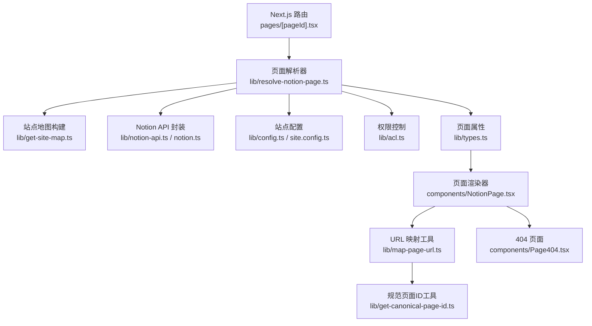
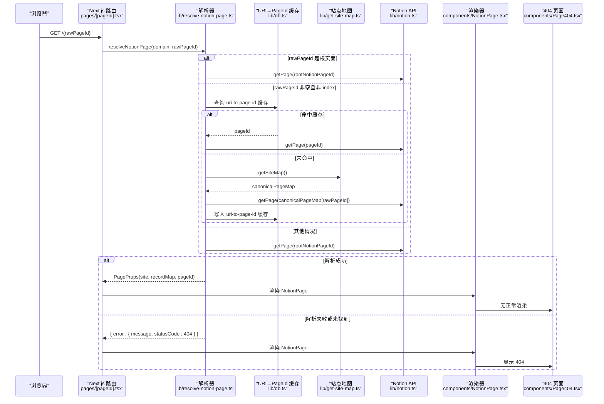
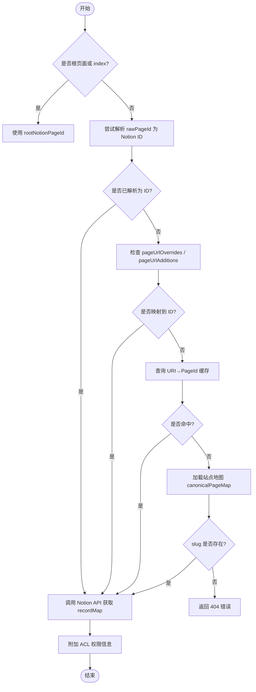
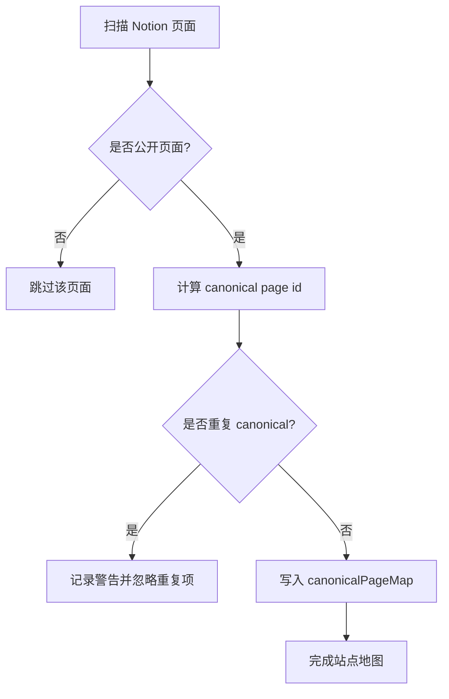
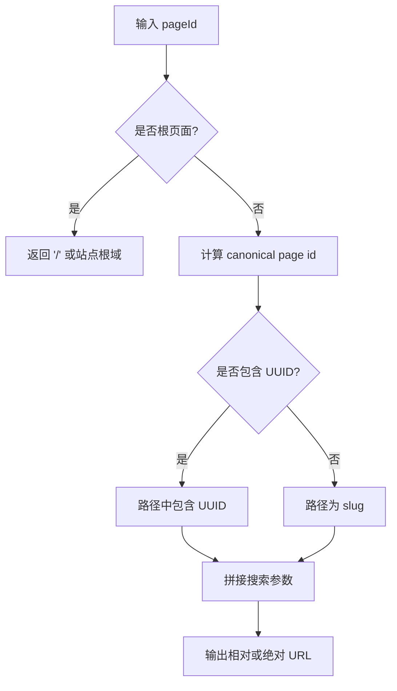
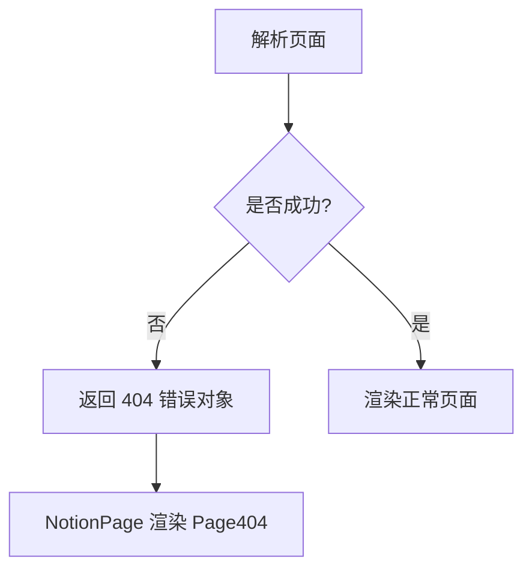
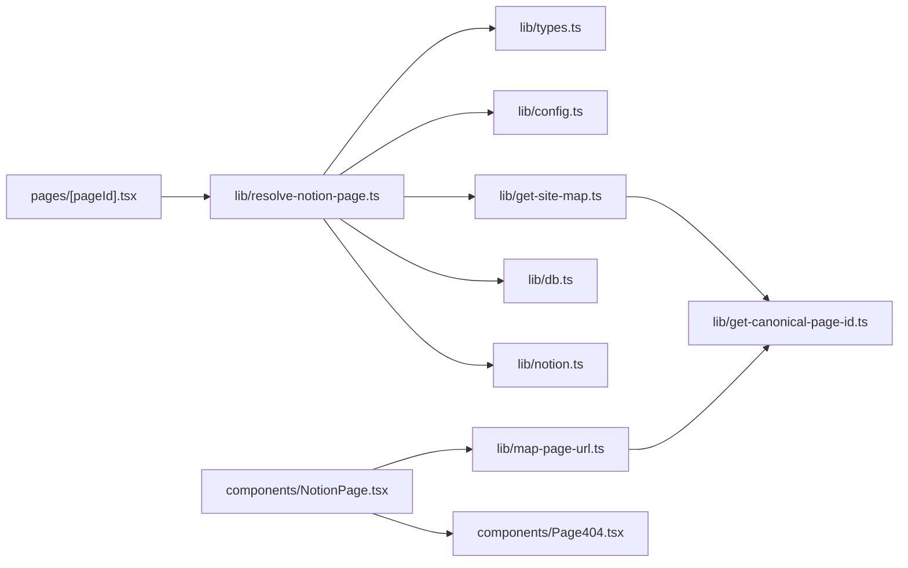

# 页面解析与映射

<cite>
**本文引用的文件**   
- [lib/map-page-url.ts](file://lib/map-page-url.ts)
- [lib/get-canonical-page-id.ts](file://lib/get-canonical-page-id.ts)
- [lib/resolve-notion-page.ts](file://lib/resolve-notion-page.ts)
- [pages/[pageId].tsx](file://pages/[pageId].tsx)
- [lib/types.ts](file://lib/types.ts)
- [site.config.ts](file://site.config.ts)
- [lib/config.ts](file://lib/config.ts)
- [lib/get-site-map.ts](file://lib/get-site-map.ts)
- [components/NotionPage.tsx](file://components/NotionPage.tsx)
- [components/Page404.tsx](file://components/Page404.tsx)
</cite>

## 目录
1. [引言](#引言)
2. [项目结构](#项目结构)
3. [核心组件](#核心组件)
4. [架构总览](#架构总览)
5. [详细组件分析](#详细组件分析)
6. [依赖关系分析](#依赖关系分析)
7. [性能考量](#性能考量)
8. [故障排查指南](#故障排查指南)
9. [结论](#结论)
10. [附录：URL 映射规则与配置方法](#附录url-映射规则与配置方法)

## 引言
本文面向希望理解并自定义“用户友好 URL 路径 → Notion 页面 ID”映射的开发者。文档将系统说明以下主题：
- 如何将 slug、别名等用户友好的 URL 路径解析为 Notion 页面 ID
- canonical page ID 的概念、作用与唯一性保障
- 重定向逻辑与 canonical URL 生成
- 错误处理、404 页面展示与导航链接的统一映射
- 实际的 URL 映射规则与自定义映射的配置方式

## 项目结构
本项目基于 Next.js，采用“路由页 + 工具库 + 站点配置”的分层组织方式：
- 路由层：动态路由 pages/[pageId].tsx 接收任意路径，统一交由解析器处理
- 解析层：lib/resolve-notion-page.ts 负责 URI → Notion PageId 的解析与缓存
- 映射层：lib/get-canonical-page-id.ts 与 lib/map-page-url.ts 负责 canonical page id 与 URL 生成
- 站点地图：lib/get-site-map.ts 构建 canonicalPageMap，用于 slug 到 pageId 的反查
- 渲染层：components/NotionPage.tsx 使用 mapPageUrl 注入到 NotionRenderer，保证站内链接一致
- 配置层：site.config.ts 与 lib/config.ts 提供 pageUrlOverrides、includeNotionIdInUrls 等开关

**图示来源**
- [pages/[pageId].tsx:8-31](file://pages/[pageId].tsx#L8-L31)
- [lib/resolve-notion-page.ts:11-84](file://lib/resolve-notion-page.ts#L11-L84)
- [lib/get-site-map.ts:18-28](file://lib/get-site-map.ts#L18-L28)
- [lib/map-page-url.ts:12-39](file://lib/map-page-url.ts#L12-L39)
- [lib/get-canonical-page-id.ts:9-29](file://lib/get-canonical-page-id.ts#L9-L29)
- [components/NotionPage.tsx:211-356](file://components/NotionPage.tsx#L211-L356)
- [components/Page404.tsx:6-37](file://components/Page404.tsx#L6-L37)

**章节来源**
- [pages/[pageId].tsx:8-31](file://pages/[pageId].tsx#L8-L31)
- [lib/resolve-notion-page.ts:11-84](file://lib/resolve-notion-page.ts#L11-L84)
- [lib/get-site-map.ts:18-28](file://lib/get-site-map.ts#L18-L28)
- [lib/map-page-url.ts:12-39](file://lib/map-page-url.ts#L12-L39)
- [lib/get-canonical-page-id.ts:9-29](file://lib/get-canonical-page-id.ts#L9-L29)
- [components/NotionPage.tsx:211-356](file://components/NotionPage.tsx#L211-L356)
- [components/Page404.tsx:6-37](file://components/Page404.tsx#L6-L37)

## 核心组件
- 页面解析器 resolveNotionPage：根据域名和 rawPageId（即 URL 路径段）解析出最终 Notion pageId 与 recordMap，并返回 PageProps
- 站点地图 getSiteMap：遍历 Notion 空间，生成 pageMap 与 canonicalPageMap，供 slug 反查
- 规范页面ID getCanonicalPageId：计算 canonical page id，支持 inversePageUrlOverrides 覆盖
- URL 映射 mapPageUrl：将 pageId 转换为站点 URL；getCanonicalPageUrl 生成绝对 canonical URL
- 渲染组件 NotionPage：注入 mapPageUrl 到 NotionRenderer，确保站内链接统一；处理 404 分支
- 404 页面 Page404：当解析失败或找不到页面时展示

**章节来源**
- [lib/resolve-notion-page.ts:11-84](file://lib/resolve-notion-page.ts#L11-L84)
- [lib/get-site-map.ts:46-106](file://lib/get-site-map.ts#L46-L106)
- [lib/get-canonical-page-id.ts:9-29](file://lib/get-canonical-page-id.ts#L9-L29)
- [lib/map-page-url.ts:12-43](file://lib/map-page-url.ts#L12-L43)
- [components/NotionPage.tsx:211-356](file://components/NotionPage.tsx#L211-L356)
- [components/Page404.tsx:6-37](file://components/Page404.tsx#L6-L37)

## 架构总览
下图展示了从浏览器请求到页面渲染的完整链路，包括 URL 解析、canonical 生成、缓存与 404 处理。

**图示来源**
- [pages/[pageId].tsx:8-31](file://pages/[pageId].tsx#L8-L31)
- [lib/resolve-notion-page.ts:11-84](file://lib/resolve-notion-page.ts#L11-L84)
- [lib/get-site-map.ts:18-28](file://lib/get-site-map.ts#L18-L28)
- [components/NotionPage.tsx:255-261](file://components/NotionPage.tsx#L255-L261)
- [components/Page404.tsx:6-37](file://components/Page404.tsx#L6-L37)

## 详细组件分析

### 页面解析流程（URI → Notion PageId）
- 入口：pages/[pageId].tsx 的 getStaticProps 获取 rawPageId，调用 resolveNotionPage
- 解析优先级：
  1) 若 rawPageId 为空或等于 'index'，直接取站点根 Notion 页面
  2) 若 rawPageId 可被 parsePageId 解析为 Notion ID，则直接使用
  3) 否则尝试站点配置的 pageUrlOverrides/pageUrlAdditions 进行映射
  4) 再尝试 URI→PageId 缓存
  5) 最后通过站点地图 canonicalPageMap 查找 slug 对应的 pageId
  6) 若仍无法解析，返回 404 错误对象
- 成功后调用 Notion API 获取 recordMap，并附加 ACL 信息

**图示来源**
- [lib/resolve-notion-page.ts:11-84](file://lib/resolve-notion-page.ts#L11-L84)

**章节来源**
- [pages/[pageId].tsx:8-31](file://pages/[pageId].tsx#L8-L31)
- [lib/resolve-notion-page.ts:11-84](file://lib/resolve-notion-page.ts#L11-L84)

### Canonical Page ID 概念与作用
- canonical page id 是页面的“规范路径标识”，用于生成稳定、可读的 URL 路径
- 在站点地图构建阶段，每个公开页面都会计算其 canonical page id，并建立 canonicalPageMap（canonical → pageId）
- 如果同一 canonical 出现多次（例如不同集合中的同名页面），会记录警告并保留首次出现的映射，以保证 URL 唯一性
- 可通过 inversePageUrlOverrides 对特定 pageId 强制指定 canonical 路径，从而覆盖默认生成逻辑

**图示来源**
- [lib/get-site-map.ts:64-100](file://lib/get-site-map.ts#L64-L100)

**章节来源**
- [lib/get-site-map.ts:64-100](file://lib/get-site-map.ts#L64-L100)
- [lib/get-canonical-page-id.ts:9-29](file://lib/get-canonical-page-id.ts#L9-L29)

### URL 映射与重定向逻辑
- mapPageUrl：
  - 若当前 pageId 是站点根页面，返回 '/'
  - 否则返回 `/{canonical}`，其中 canonical 由 getCanonicalPageId 计算
  - 支持 includeNotionIdInUrls 开关：开发环境可包含 UUID，生产环境默认不包含
- getCanonicalPageUrl：
  - 生成绝对 canonical URL，如 https://{domain}/{canonical}
  - 根页面返回 https://{domain}
- 在 NotionPage 中，mapPageUrl 作为 mapPageUrl 参数注入到 NotionRenderer，确保所有内部链接都遵循统一的 canonical 规则

**图示来源**
- [lib/map-page-url.ts:12-43](file://lib/map-page-url.ts#L12-L43)
- [lib/get-canonical-page-id.ts:9-29](file://lib/get-canonical-page-id.ts#L9-L29)
- [components/NotionPage.tsx:225-231](file://components/NotionPage.tsx#L225-L231)

**章节来源**
- [lib/map-page-url.ts:12-43](file://lib/map-page-url.ts#L12-L43)
- [components/NotionPage.tsx:225-231](file://components/NotionPage.tsx#L225-L231)

### 错误处理与 404 页面
- 当 resolveNotionPage 无法解析 rawPageId 时，返回 { error: { message, statusCode: 404 } }
- NotionPage 检测到 error 或必要数据缺失时，渲染 Page404 组件
- Page404 展示通用 404 信息，并在存在 pageId 时提示检查 Notion 页面是否公开

**图示来源**
- [lib/resolve-notion-page.ts:66-74](file://lib/resolve-notion-page.ts#L66-L74)
- [components/NotionPage.tsx:255-261](file://components/NotionPage.tsx#L255-L261)
- [components/Page404.tsx:6-37](file://components/Page404.tsx#L6-L37)

**章节来源**
- [lib/resolve-notion-page.ts:66-74](file://lib/resolve-notion-page.ts#L66-L74)
- [components/NotionPage.tsx:255-261](file://components/NotionPage.tsx#L255-L261)
- [components/Page404.tsx:6-37](file://components/Page404.tsx#L6-L37)

### 导航链接的处理机制
- NotionPage 使用 mapPageUrl 生成站点内链接，确保所有内部跳转均遵循 canonical 规则
- 站点配置 navigationStyle 与 navigationLinks 可用于定制导航样式与链接目标（指向 Notion pageId）
- 这些配置在 lib/config.ts 中导出，供 UI 组件使用

**章节来源**
- [components/NotionPage.tsx:225-231](file://components/NotionPage.tsx#L225-L231)
- [lib/config.ts:80-88](file://lib/config.ts#L80-L88)
- [site.config.ts:63-77](file://site.config.ts#L63-L77)

## 依赖关系分析
- 路由层依赖解析器与类型定义
- 解析器依赖站点地图、配置、数据库缓存与 Notion API
- 站点地图依赖 notion-utils 与 getCanonicalPageId
- 渲染层依赖 mapPageUrl 与 mapImageUrl，并注入 NotionRenderer
- 404 页面依赖 PageHead 与样式模块

**图示来源**
- [pages/[pageId].tsx:8-31](file://pages/[pageId].tsx#L8-L31)
- [lib/resolve-notion-page.ts:11-84](file://lib/resolve-notion-page.ts#L11-L84)
- [lib/get-site-map.ts:18-28](file://lib/get-site-map.ts#L18-L28)
- [lib/map-page-url.ts:12-43](file://lib/map-page-url.ts#L12-L43)
- [components/NotionPage.tsx:211-356](file://components/NotionPage.tsx#L211-L356)
- [components/Page404.tsx:6-37](file://components/Page404.tsx#L6-L37)

**章节来源**
- [lib/resolve-notion-page.ts:11-84](file://lib/resolve-notion-page.ts#L11-L84)
- [lib/get-site-map.ts:18-28](file://lib/get-site-map.ts#L18-L28)
- [lib/map-page-url.ts:12-43](file://lib/map-page-url.ts#L12-L43)
- [components/NotionPage.tsx:211-356](file://components/NotionPage.tsx#L211-L356)

## 性能考量
- 站点地图缓存：getSiteMap 使用 p-memoize 与 ExpiryMap，每 5 分钟刷新一次，避免频繁拉取 Notion 全量数据
- URI→PageId 缓存：resolveNotionPage 使用 db 存储 URI→PageId 映射，TTL 为一天，提升后续访问速度
- ISR 重新验证：revalidateSeconds 控制增量静态再生频率，减少函数调用次数
- 本地开发优化：includeNotionIdInUrls 在开发环境启用 UUID，便于调试与加速

**章节来源**
- [lib/get-site-map.ts:30-34](file://lib/get-site-map.ts#L30-L34)
- [lib/resolve-notion-page.ts:32-42](file://lib/resolve-notion-page.ts#L32-L42)
- [lib/config.ts:93-98](file://lib/config.ts#L93-L98)
- [lib/config.ts:74-78](file://lib/config.ts#L74-L78)

## 故障排查指南
- 404 页面出现：
  - 检查 rawPageId 是否在 canonicalPageMap 中存在
  - 确认 Notion 页面属性 “Public” 是否为 true
  - 检查 pageUrlOverrides/pageUrlAdditions 配置是否正确
  - 查看 URI→PageId 缓存是否过期或异常
- 链接不一致：
  - 确认 includeNotionIdInUrls 设置是否符合预期
  - 检查 inversePageUrlOverrides 是否覆盖了默认 canonical
- 性能问题：
  - 调整 revalidateSeconds 降低函数调用频率
  - 检查站点地图缓存时间是否合理

**章节来源**
- [lib/resolve-notion-page.ts:32-42](file://lib/resolve-notion-page.ts#L32-L42)
- [lib/get-site-map.ts:72-76](file://lib/get-site-map.ts#L72-L76)
- [lib/config.ts:74-78](file://lib/config.ts#L74-L78)
- [lib/config.ts:93-98](file://lib/config.ts#L93-L98)

## 结论
本项目的页面解析与映射体系以 canonical page id 为核心，结合站点地图、配置覆盖与多级缓存，实现了从用户友好 URL 到 Notion 页面 ID 的稳定转换。通过 mapPageUrl 与 getCanonicalPageUrl，全站链接保持一致性与唯一性；配合 404 处理与导航配置，提供了良好的用户体验与可维护性。

## 附录：URL 映射规则与配置方法

### 实际 URL 映射规则
- 根页面：
  - 若 pageId 对应站点根 Notion 页面，URL 为 '/' 或站点根域
- 普通页面：
  - URL 为 `/{canonical}`，canonical 由 getCanonicalPageId 计算
  - 开发环境可包含 UUID（includeNotionIdInUrls=true），生产环境默认不包含
- 绝对 canonical URL：
  - 由 getCanonicalPageUrl 生成，格式为 https://{domain}/{canonical}

**章节来源**
- [lib/map-page-url.ts:12-39](file://lib/map-page-url.ts#L12-L39)
- [lib/get-canonical-page-id.ts:9-29](file://lib/get-canonical-page-id.ts#L9-L29)

### 自定义映射配置方法
- pageUrlOverrides：
  - 将 URL 路径映射到 Notion pageId，覆盖默认 URL 生成
  - 示例：'/foo' → '067dd719a912471ea9a3ac10710e7fdf'
- pageUrlAdditions：
  - 新增额外 URL 路径到 Notion pageId 的映射
- inversePageUrlOverrides：
  - 反向映射：pageId → URL 路径，用于覆盖 canonical 生成
- includeNotionIdInUrls：
  - 控制是否在 URL 中包含 UUID，常用于开发调试

**章节来源**
- [site.config.ts:48-56](file://site.config.ts#L48-L56)
- [lib/config.ts:36-46](file://lib/config.ts#L36-L46)
- [lib/config.ts:74-78](file://lib/config.ts#L74-L78)