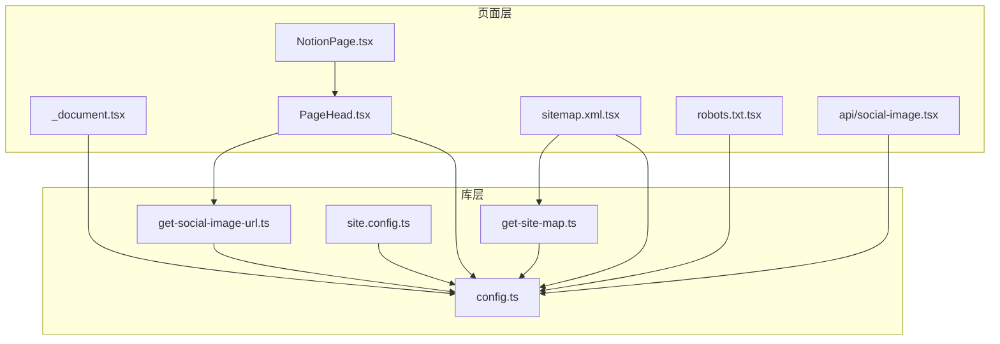
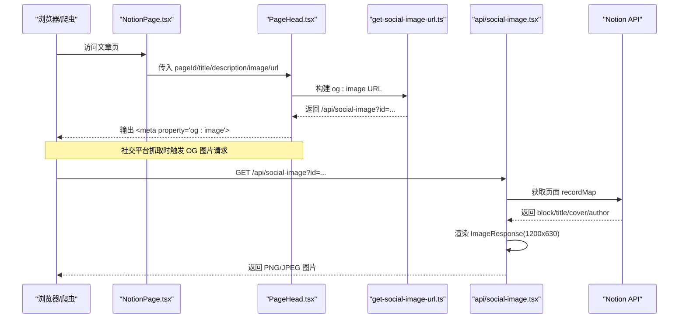
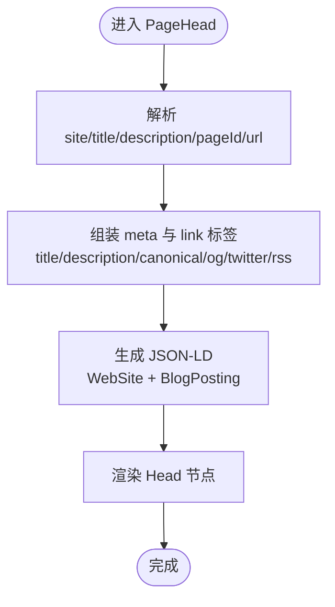
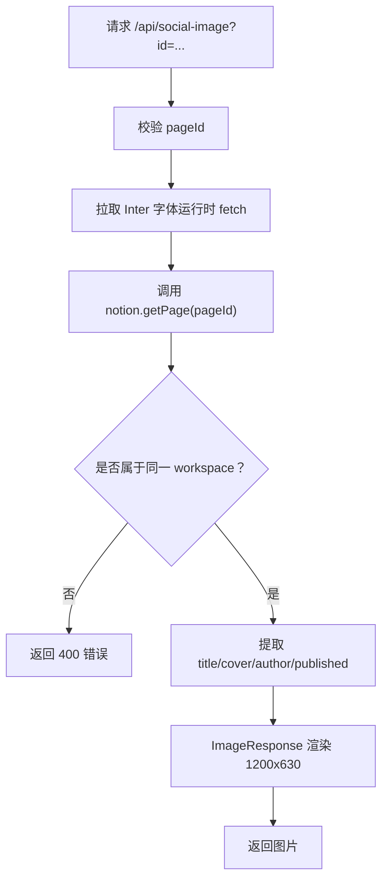
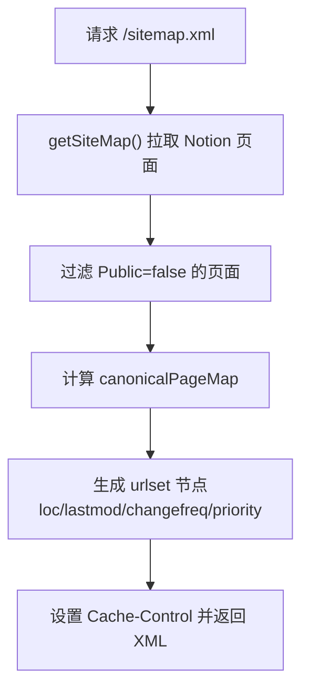
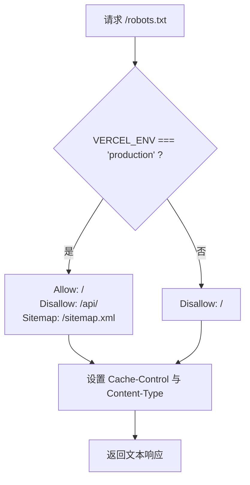
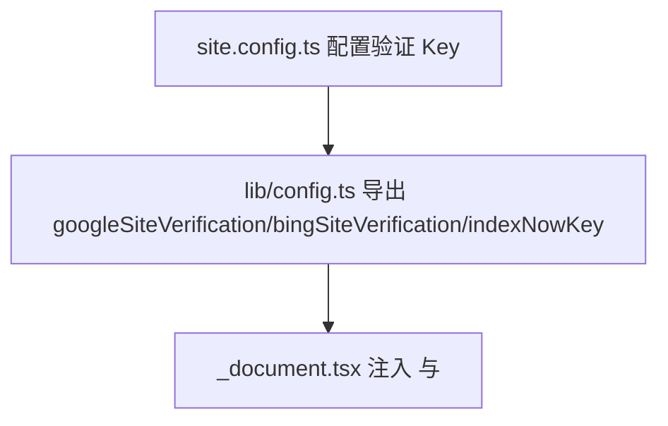
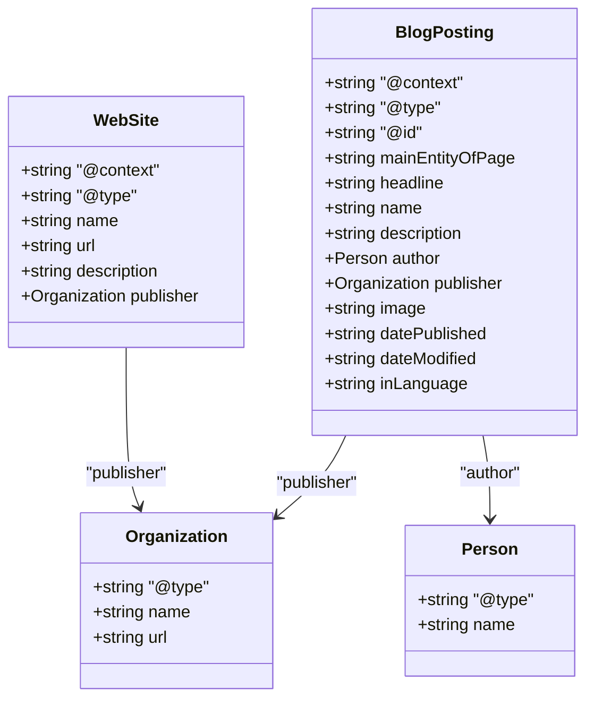
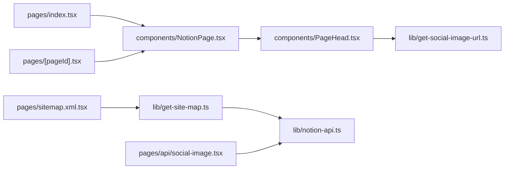

# SEO 与可发现性

<cite>
**本文引用的文件**   
- [pages/_document.tsx](file://pages/_document.tsx)
- [components/PageHead.tsx](file://components/PageHead.tsx)
- [components/NotionPage.tsx](file://components/NotionPage.tsx)
- [pages/sitemap.xml.tsx](file://pages/sitemap.xml.tsx)
- [lib/get-site-map.ts](file://lib/get-site-map.ts)
- [pages/robots.txt.tsx](file://pages/robots.txt.tsx)
- [lib/get-social-image-url.ts](file://lib/get-social-image-url.ts)
- [pages/api/social-image.tsx](file://pages/api/social-image.tsx)
- [site.config.ts](file://site.config.ts)
- [lib/config.ts](file://lib/config.ts)
- [pages/index.tsx](file://pages/index.tsx)
- [pages/[pageId].tsx](file://pages/[pageId].tsx)
</cite>

## 目录
1. [简介](#简介)
2. [项目结构](#项目结构)
3. [核心组件](#核心组件)
4. [架构总览](#架构总览)
5. [详细组件分析](#详细组件分析)
6. [依赖关系分析](#依赖关系分析)
7. [性能与 SEO](#性能与-seo)
8. [故障排查指南](#故障排查指南)
9. [结论](#结论)
10. [附录：SEO 检查清单](#附录seo-检查清单)

## 简介
本文件系统性说明该 Next.js + Notion 博客在搜索引擎优化与网站可发现性方面的实现，包括：
- 元数据管理、Open Graph 与 Twitter Card 标签
- 社交媒体预览图片生成（OG Image）
- 站点地图 sitemap.xml 与 robots.txt
- 搜索引擎验证（Google/Bing）与 IndexNow
- 结构化数据（Schema.org JSON-LD）
- 性能优化对 SEO 的影响
- SEO 监控工具与性能分析方法

## 项目结构
本项目采用 Next.js App Router 的页面路由方式，SEO 相关能力分布在以下位置：
- 全局文档头与搜索引擎验证：pages/_document.tsx
- 页面级元数据与结构化数据：components/PageHead.tsx
- 页面渲染与 SEO 参数注入：components/NotionPage.tsx
- 站点地图：pages/sitemap.xml.tsx 与 lib/get-site-map.ts
- robots.txt：pages/robots.txt.tsx
- OG 图片 API：pages/api/social-image.tsx 与 lib/get-social-image-url.ts
- 站点配置与 SEO 开关：site.config.ts 与 lib/config.ts
- 首页与动态页面入口：pages/index.tsx、pages/[pageId].tsx

**图表来源**
- [pages/_document.tsx:1-101](file://pages/_document.tsx#L1-L101)
- [components/PageHead.tsx:1-188](file://components/PageHead.tsx#L1-L188)
- [components/NotionPage.tsx:1-357](file://components/NotionPage.tsx#L1-L357)
- [pages/sitemap.xml.tsx:1-140](file://pages/sitemap.xml.tsx#L1-L140)
- [lib/get-site-map.ts:1-107](file://lib/get-site-map.ts#L1-L107)
- [pages/robots.txt.tsx:1-49](file://pages/robots.txt.tsx#L1-L49)
- [lib/get-social-image-url.ts:1-17](file://lib/get-social-image-url.ts#L1-L17)
- [pages/api/social-image.tsx:1-313](file://pages/api/social-image.tsx#L1-L313)
- [site.config.ts:1-78](file://site.config.ts#L1-L78)
- [lib/config.ts:1-224](file://lib/config.ts#L1-L224)

**章节来源**
- [pages/_document.tsx:1-101](file://pages/_document.tsx#L1-L101)
- [components/PageHead.tsx:1-188](file://components/PageHead.tsx#L1-L188)
- [components/NotionPage.tsx:1-357](file://components/NotionPage.tsx#L1-L357)
- [pages/sitemap.xml.tsx:1-140](file://pages/sitemap.xml.tsx#L1-L140)
- [lib/get-site-map.ts:1-107](file://lib/get-site-map.ts#L1-L107)
- [pages/robots.txt.tsx:1-49](file://pages/robots.txt.tsx#L1-L49)
- [lib/get-social-image-url.ts:1-17](file://lib/get-social-image-url.ts#L1-L17)
- [pages/api/social-image.tsx:1-313](file://pages/api/social-image.tsx#L1-L313)
- [site.config.ts:1-78](file://site.config.ts#L1-L78)
- [lib/config.ts:1-224](file://lib/config.ts#L1-L224)

## 核心组件
- 全局文档头与搜索引擎验证：负责注入 Google/Bing 站点验证 meta、favicon、manifest、GA 初始化脚本等。
- 页面元数据组件：集中输出 title、description、canonical、Open Graph、Twitter Card、RSS 链接与结构化数据 JSON-LD。
- 页面渲染组件：根据 Notion 内容计算标题、描述、作者、发布时间、修改时间、社交图片，并传递给 PageHead。
- 站点地图：服务端渲染 XML，包含每个页面的 loc、lastmod、changefreq、priority，并对首页做特殊处理。
- robots.txt：生产环境允许抓取根路径并指向 sitemap；非生产环境禁止抓取以避免重复索引。
- OG 图片 API：Edge Runtime 下从 Notion 拉取页面信息，动态生成 1200x630 的预览图。
- 配置中心：统一暴露 host、domain、author、description、语言、验证 key、IndexNow key、Analytics 等。

**章节来源**
- [pages/_document.tsx:1-101](file://pages/_document.tsx#L1-L101)
- [components/PageHead.tsx:1-188](file://components/PageHead.tsx#L1-L188)
- [components/NotionPage.tsx:211-357](file://components/NotionPage.tsx#L211-L357)
- [pages/sitemap.xml.tsx:1-140](file://pages/sitemap.xml.tsx#L1-L140)
- [lib/get-site-map.ts:1-107](file://lib/get-site-map.ts#L1-L107)
- [pages/robots.txt.tsx:1-49](file://pages/robots.txt.tsx#L1-L49)
- [pages/api/social-image.tsx:1-313](file://pages/api/social-image.tsx#L1-L313)
- [lib/get-social-image-url.ts:1-17](file://lib/get-social-image-url.ts#L1-L17)
- [lib/config.ts:107-153](file://lib/config.ts#L107-L153)
- [site.config.ts:1-78](file://site.config.ts#L1-L78)

## 架构总览
下图展示一次“分享文章到社交平台”的完整链路：页面渲染时通过 PageHead 生成 og:image 地址，平台请求 social-image API，API 使用 Edge Runtime 拉取 Notion 数据并返回图片。

**图表来源**
- [components/NotionPage.tsx:273-314](file://components/NotionPage.tsx#L273-L314)
- [components/PageHead.tsx:30-36](file://components/PageHead.tsx#L30-L36)
- [components/PageHead.tsx:153-168](file://components/PageHead.tsx#L153-L168)
- [lib/get-social-image-url.ts:1-17](file://lib/get-social-image-url.ts#L1-L17)
- [pages/api/social-image.tsx:21-49](file://pages/api/social-image.tsx#L21-L49)
- [pages/api/social-image.tsx:173-276](file://pages/api/social-image.tsx#L173-L276)

## 详细组件分析

### 元数据管理与 Open Graph/Twitter 标签
- 标题与描述：优先使用 Notion 页面属性（如 Description），未设置时回退到站点级 description 或 “标题 — 站点名”。
- Canonical 与语言：根据当前页面生成 canonical URL，并设置 og:locale 与 inLanguage。
- Open Graph：输出 og:type、og:title、og:description、og:image、og:url、og:site_name、article:* 字段。
- Twitter Card：当存在图片时使用 summary_large_image，否则 fallback 为 summary。
- RSS：自动注入 application/rss+xml 的 alternate 链接。
- 结构化数据：注入 WebSite 与 BlogPosting（文章页）JSON-LD，包含 publisher、author、image、datePublished、dateModified、inLanguage 等。

**图表来源**
- [components/PageHead.tsx:30-89](file://components/PageHead.tsx#L30-L89)
- [components/PageHead.tsx:91-184](file://components/PageHead.tsx#L91-L184)

**章节来源**
- [components/PageHead.tsx:1-188](file://components/PageHead.tsx#L1-L188)
- [components/NotionPage.tsx:273-314](file://components/NotionPage.tsx#L273-L314)

### 社交媒体预览图片生成（OG Image）
- 图片 URL 构造：通过 getSocialImageUrl(pageId) 拼接 /api/social-image?id=...。
- 图片渲染：Edge Runtime 下动态拉取 Inter 字体，避免打包体积超限；从 Notion 读取 block 的 cover/icon/author/properties，组合成 1200x630 的图片响应。
- 图片容错：若指定图片不可达，则回退到默认封面；对特定图床（如 Unsplash）自动添加尺寸参数以优化加载。

**图表来源**
- [pages/api/social-image.tsx:21-49](file://pages/api/social-image.tsx#L21-L49)
- [pages/api/social-image.tsx:173-276](file://pages/api/social-image.tsx#L173-L276)
- [pages/api/social-image.tsx:293-312](file://pages/api/social-image.tsx#L293-L312)

**章节来源**
- [lib/get-social-image-url.ts:1-17](file://lib/get-social-image-url.ts#L1-L17)
- [pages/api/social-image.tsx:1-313](file://pages/api/social-image.tsx#L1-L313)

### 网站地图生成（sitemap.xml）
- 数据源：getSiteMap() 聚合 Notion 空间内所有公开页面，过滤掉未公开的页面，去重 canonical 路径。
- 缓存策略：使用 p-memoize + ExpiryMap 缓存 5 分钟，减少频繁调用 Notion API。
- XML 构建：按路径排序，首页 lastmod 取最近更新的页面时间；depth<=1 的页面优先级更高、更新频率更高。
- 响应头：Cache-Control 设置为 public, max-age=28800，stale-while-revalidate=28800。

**图表来源**
- [pages/sitemap.xml.tsx:7-32](file://pages/sitemap.xml.tsx#L7-L32)
- [pages/sitemap.xml.tsx:81-134](file://pages/sitemap.xml.tsx#L81-L134)
- [lib/get-site-map.ts:18-34](file://lib/get-site-map.ts#L18-L34)
- [lib/get-site-map.ts:46-106](file://lib/get-site-map.ts#L46-L106)

**章节来源**
- [pages/sitemap.xml.tsx:1-140](file://pages/sitemap.xml.tsx#L1-L140)
- [lib/get-site-map.ts:1-107](file://lib/get-site-map.ts#L1-L107)

### robots.txt 配置
- 生产环境：允许抓取根路径，禁止抓取 /api，声明 Sitemap 地址。
- 非生产环境：全部 Disallow，防止预览部署被索引造成重复内容。
- 缓存策略：CDN 侧 s-maxage=86400，浏览器可重新验证。

**图表来源**
- [pages/robots.txt.tsx:5-39](file://pages/robots.txt.tsx#L5-L39)

**章节来源**
- [pages/robots.txt.tsx:1-49](file://pages/robots.txt.tsx#L1-L49)

### 搜索引擎验证与 IndexNow
- Google/Bing 站点验证：通过 _document.tsx 注入对应 meta 标签，值来自 site.config.ts 与环境变量。
- IndexNow：提供 indexNowKey，并在 public 目录下放置匹配的文件进行验证。

**图表来源**
- [site.config.ts:29-37](file://site.config.ts#L29-L37)
- [lib/config.ts:117-131](file://lib/config.ts#L117-L131)
- [pages/_document.tsx:14-22](file://pages/_document.tsx#L14-L22)

**章节来源**
- [site.config.ts:29-37](file://site.config.ts#L29-L37)
- [lib/config.ts:117-131](file://lib/config.ts#L117-L131)
- [pages/_document.tsx:14-22](file://pages/_document.tsx#L14-L22)

### 结构化数据标记（Schema.org）
- WebSite：包含 name、url、description、publisher。
- BlogPosting：包含 headline/name、description、author、publisher、image、datePublished、dateModified、inLanguage、mainEntityOfPage。
- 注入方式：通过 <script type="application/ld+json"> 输出 JSON-LD。

**图表来源**
- [components/PageHead.tsx:50-89](file://components/PageHead.tsx#L50-L89)
- [components/PageHead.tsx:182-184](file://components/PageHead.tsx#L182-L184)

**章节来源**
- [components/PageHead.tsx:50-89](file://components/PageHead.tsx#L50-L89)
- [components/PageHead.tsx:182-184](file://components/PageHead.tsx#L182-L184)

## 依赖关系分析
- 页面渲染依赖 Notion 数据：NotionPage 从 resolve-notion-page 获取 recordMap，并据此计算 SEO 所需字段。
- 静态生成与增量再生：index.tsx 与 [pageId].tsx 使用 getStaticProps 配合 revalidateSeconds 控制 ISR 刷新频率。
- 站点地图依赖 Notion API：getSiteMap 使用 notion-utils 遍历空间页面，并通过 notion-api 拉取详情。
- OG 图片 API 依赖 Edge Runtime：使用 next/og 的 ImageResponse 渲染图片，避免 Node 端渲染开销。

**图表来源**
- [pages/index.tsx:1-23](file://pages/index.tsx#L1-L23)
- [pages/[pageId].tsx:1-36](file://pages/[pageId].tsx#L1-L36)
- [components/NotionPage.tsx:1-357](file://components/NotionPage.tsx#L1-L357)
- [components/PageHead.tsx:1-188](file://components/PageHead.tsx#L1-L188)
- [lib/get-social-image-url.ts:1-17](file://lib/get-social-image-url.ts#L1-L17)
- [pages/sitemap.xml.tsx:1-140](file://pages/sitemap.xml.tsx#L1-L140)
- [lib/get-site-map.ts:1-107](file://lib/get-site-map.ts#L1-L107)
- [pages/api/social-image.tsx:1-313](file://pages/api/social-image.tsx#L1-L313)

**章节来源**
- [pages/index.tsx:1-23](file://pages/index.tsx#L1-L23)
- [pages/[pageId].tsx:1-36](file://pages/[pageId].tsx#L1-L36)
- [components/NotionPage.tsx:1-357](file://components/NotionPage.tsx#L1-L357)
- [components/PageHead.tsx:1-188](file://components/PageHead.tsx#L1-L188)
- [lib/get-social-image-url.ts:1-17](file://lib/get-social-image-url.ts#L1-L17)
- [pages/sitemap.xml.tsx:1-140](file://pages/sitemap.xml.tsx#L1-L140)
- [lib/get-site-map.ts:1-107](file://lib/get-site-map.ts#L1-L107)
- [pages/api/social-image.tsx:1-313](file://pages/api/social-image.tsx#L1-L313)

## 性能与 SEO
- 预渲染与 ISR：页面通过 getStaticProps 预渲染，revalidateSeconds 控制增量再生频率，平衡新鲜度与函数调用成本。
- 边缘渲染 OG 图片：social-image API 使用 Edge Runtime，降低冷启动延迟，同时避免 Node 端渲染开销。
- 字体按需加载：Edge 函数中运行时 fetch 字体，保持包体小于限制，提升首屏速度。
- 图片优化：OG 图片固定 1200x630，针对特定图床自动添加 w/fit 参数，减少带宽与解码时间。
- 缓存策略：sitemap.xml 与 robots.txt 均设置了合理的 Cache-Control，利于 CDN 缓存与复用。
- 资源最小化：可选组件（代码高亮、集合视图、PDF、Modal 等）采用动态导入，减少首屏体积。

[本节为通用指导，不直接分析具体文件]

## 故障排查指南
- OG 图片 400 错误：检查传入的 pageId 是否有效，以及 Notion 页面是否属于配置的 workspace。
- 图片显示异常：确认 Notion 中的 Social Image 或 page_cover 是否可达；若不可达将回退到默认封面。
- 站点验证失败：核对 site.config.ts 中的 googleSiteVerification/bingSiteVerification 是否与平台一致，并确保 _document.tsx 已注入对应 meta。
- robots 阻止抓取：确认部署环境是否为 production；非生产环境会 Disallow 全部路径。
- sitemap 为空或遗漏页面：检查 Notion 页面是否标记为 Public，以及 getSiteMap 的缓存是否过期（默认 5 分钟）。
- 结构化数据缺失：确认 isBlogPost 判断逻辑与 Notion 页面类型是否正确，确保 BlogPosting 字段齐全。

**章节来源**
- [pages/api/social-image.tsx:27-45](file://pages/api/social-image.tsx#L27-L45)
- [pages/api/social-image.tsx:192-204](file://pages/api/social-image.tsx#L192-L204)
- [pages/robots.txt.tsx:24-37](file://pages/robots.txt.tsx#L24-L37)
- [lib/get-site-map.ts:64-99](file://lib/get-site-map.ts#L64-L99)
- [components/PageHead.tsx:63-89](file://components/PageHead.tsx#L63-L89)

## 结论
该项目通过集中化的元数据组件、Edge 渲染的 OG 图片 API、规范的 sitemap 与 robots 配置，以及完善的搜索引擎验证与结构化数据，构建了完整的 SEO 与可发现性方案。结合 ISR 与缓存策略，在保证内容新鲜度的同时兼顾性能与成本。建议持续监控搜索引擎控制台与性能指标，并根据业务变化调整 revalidateSeconds、OG 图片模板与结构化数据字段。

[本节为总结性内容，不直接分析具体文件]

## 附录：SEO 检查清单
- 元数据
  - [ ] 每个页面有唯一且准确的 title 与 description
  - [ ] canonical URL 正确设置
  - [ ] og:title/og:description/og:image/og:url 完整
  - [ ] twitter:card 与 twitter:image 正确
  - [ ] language/locale 设置合理
- 结构化数据
  - [ ] WebSite 与 BlogPosting JSON-LD 存在且字段完整
- 可发现性
  - [ ] robots.txt 在生产环境允许抓取并声明 sitemap
  - [ ] sitemap.xml 包含所有公开页面，lastmod 准确
  - [ ] Google/Bing 站点验证通过
  - [ ] IndexNow 验证文件存在
- 性能
  - [ ] OG 图片在 Edge 环境下快速返回
  - [ ] 字体按需加载，包体可控
  - [ ] 关键页面启用 ISR，revalidateSeconds 合理
- 监控与分析
  - [ ] Google Analytics 已启用
  - [ ] Vercel Web Analytics/Speed Insights 已启用
  - [ ] 定期查看 Search Console 的覆盖率与性能报告

[本节为通用指导，不直接分析具体文件]