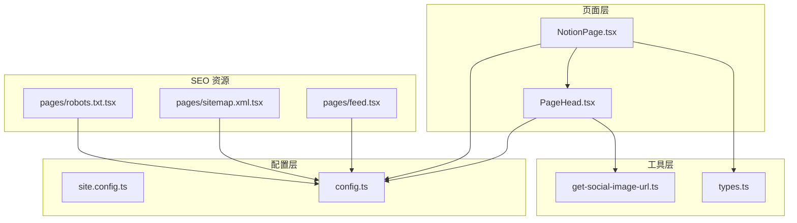
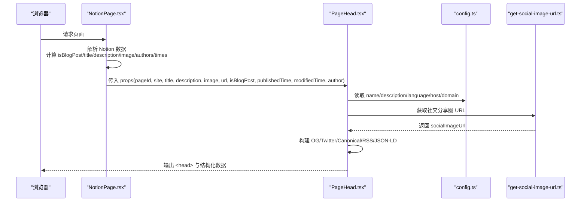
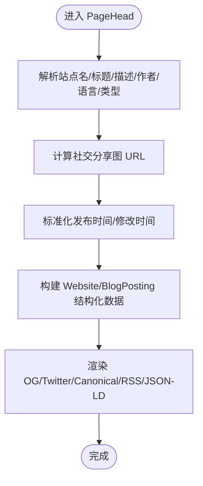
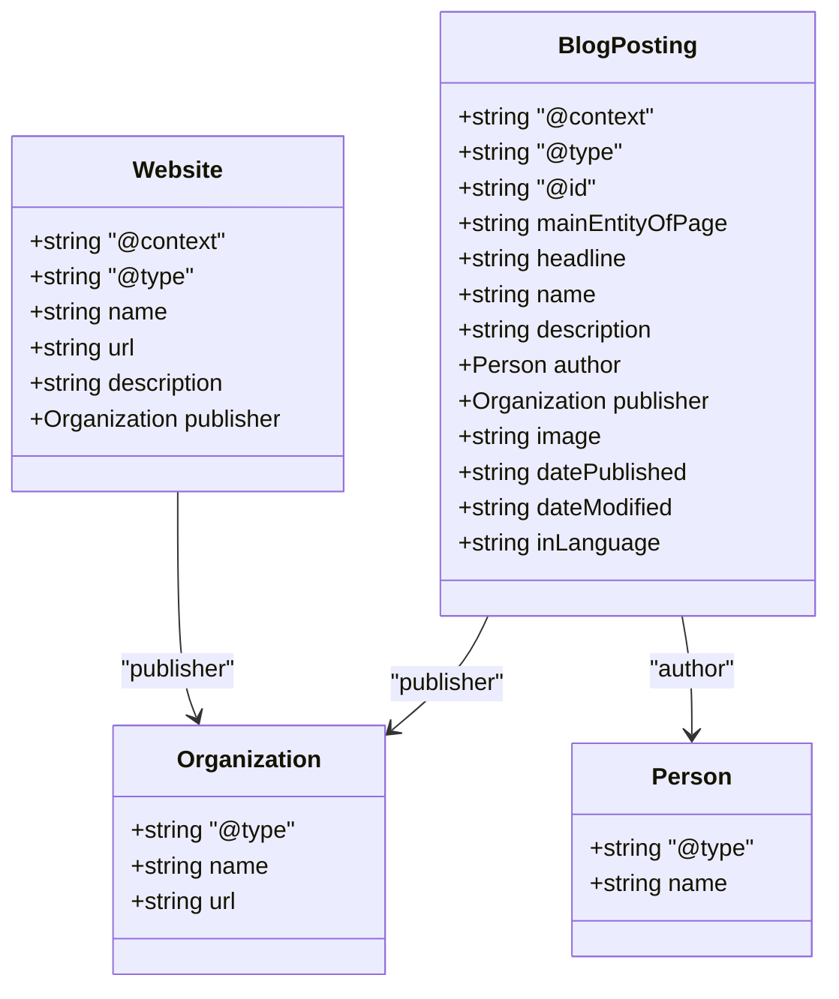
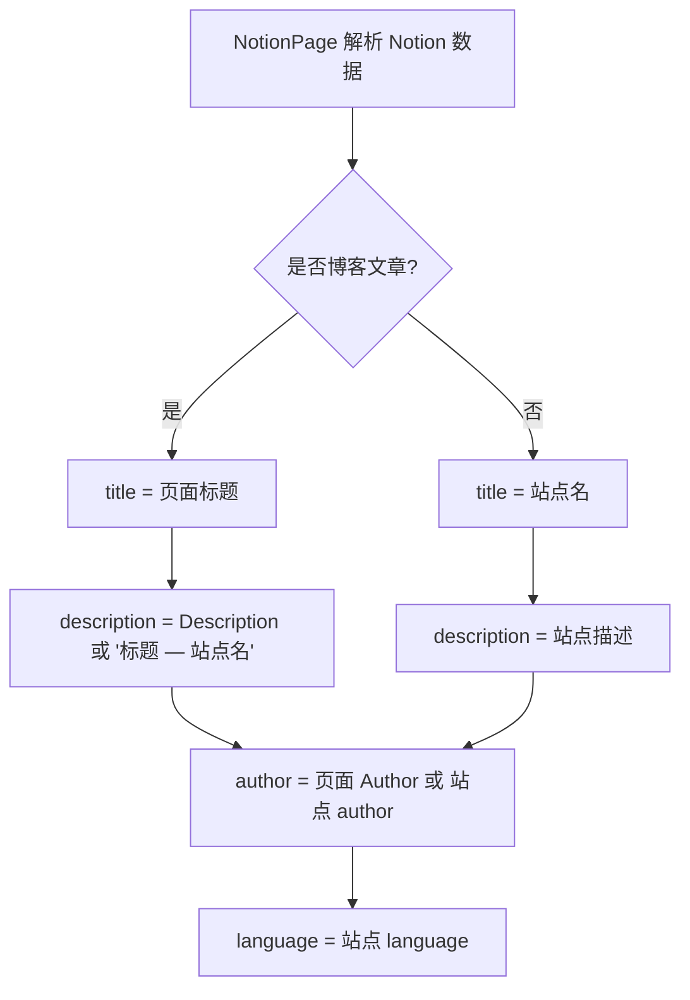
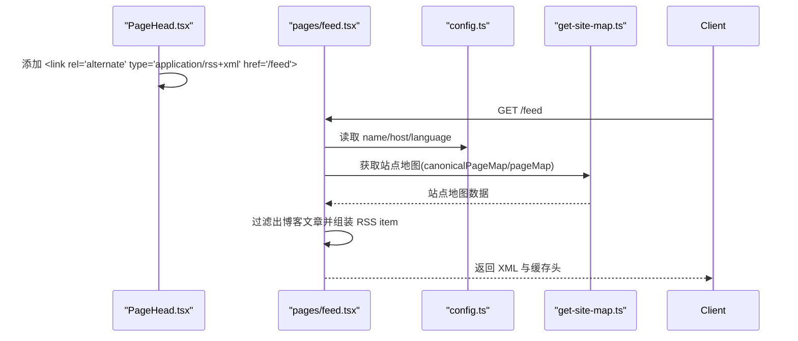
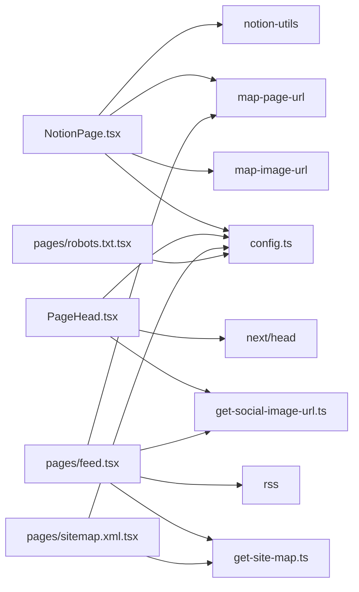

# 元数据管理

<cite>
**本文引用的文件**   
- [PageHead.tsx](file://components/PageHead.tsx)
- [NotionPage.tsx](file://components/NotionPage.tsx)
- [config.ts](file://lib/config.ts)
- [get-social-image-url.ts](file://lib/get-social-image-url.ts)
- [types.ts](file://lib/types.ts)
- [site.config.ts](file://site.config.ts)
- [feed.tsx](file://pages/feed.tsx)
- [sitemap.xml.tsx](file://pages/sitemap.xml.tsx)
- [robots.txt.tsx](file://pages/robots.txt.tsx)
</cite>

## 目录
1. [引言](#引言)
2. [项目结构](#项目结构)
3. [核心组件](#核心组件)
4. [架构总览](#架构总览)
5. [详细组件分析](#详细组件分析)
6. [依赖关系分析](#依赖关系分析)
7. [性能与缓存特性](#性能与缓存特性)
8. [故障排查指南](#故障排查指南)
9. [结论](#结论)
10. [附录：扩展与最佳实践](#附录扩展与最佳实践)

## 引言
本文件聚焦于站点“元数据管理”的实现，围绕 PageHead 组件展开，系统说明 Open Graph、Twitter Card、SEO 基础元数据、结构化数据（Schema.org）的注入方式，以及动态标题、描述、作者信息的处理流程。同时覆盖 RSS Feed、canonical URL、语言设置等关键 SEO 要素的配置方法，并提供自定义元数据的扩展指南与最佳实践。

## 项目结构
本项目采用 Next.js 页面路由与组件化架构，元数据相关逻辑主要分布在以下位置：
- 页面级渲染入口：[NotionPage.tsx](file://components/NotionPage.tsx) 负责从 Notion 数据中抽取标题、描述、图片、发布时间、作者等信息，并传递给 PageHead。
- 元数据生成器：[PageHead.tsx](file://components/PageHead.tsx) 统一输出 HTML head 标签、Open Graph/Twitter 标签、canonical、RSS 链接与 JSON-LD 结构化数据。
- 站点配置：[site.config.ts](file://site.config.ts) 提供站点名称、域名、作者、默认描述等；[config.ts](file://lib/config.ts) 将站点配置与环境变量合并为运行时可用常量。
- 社交图片：[get-social-image-url.ts](file://lib/get-social-image-url.ts) 根据 pageId 构造社交分享图 API 地址。
- SEO 辅助资源：[feed.tsx](file://pages/feed.tsx)、[sitemap.xml.tsx](file://pages/sitemap.xml.tsx)、[robots.txt.tsx](file://pages/robots.txt.tsx) 分别生成 RSS、Sitemap、Robots 文本。

图表来源
- [NotionPage.tsx:211-314](file://components/NotionPage.tsx#L211-L314)
- [PageHead.tsx:7-184](file://components/PageHead.tsx#L7-L184)
- [config.ts:51-113](file://lib/config.ts#L51-L113)
- [get-social-image-url.ts:3-15](file://lib/get-social-image-url.ts#L3-L15)
- [types.ts:14-45](file://lib/types.ts#L14-L45)
- [feed.tsx:17-98](file://pages/feed.tsx#L17-L98)
- [sitemap.xml.tsx:7-31](file://pages/sitemap.xml.tsx#L7-L31)
- [robots.txt.tsx:5-43](file://pages/robots.txt.tsx#L5-L43)

章节来源
- [NotionPage.tsx:211-314](file://components/NotionPage.tsx#L211-L314)
- [PageHead.tsx:7-184](file://components/PageHead.tsx#L7-L184)
- [config.ts:51-113](file://lib/config.ts#L51-L113)
- [get-social-image-url.ts:3-15](file://lib/get-social-image-url.ts#L3-L15)
- [types.ts:14-45](file://lib/types.ts#L14-L45)
- [feed.tsx:17-98](file://pages/feed.tsx#L17-L98)
- [sitemap.xml.tsx:7-31](file://pages/sitemap.xml.tsx#L7-L31)
- [robots.txt.tsx:5-43](file://pages/robots.txt.tsx#L5-L43)

## 核心组件
- PageHead：集中式元数据生成器，负责：
  - 动态标题、描述、作者、语言、类型（website/article）。
  - Open Graph 与 Twitter Card 标签。
  - canonical URL、RSS 订阅链接。
  - JSON-LD 结构化数据（Website、BlogPosting）。
- NotionPage：从 Notion 记录中解析页面属性，决定 isBlogPost、title、description、image、publishedTime、modifiedTime、author，并调用 PageHead。
- config：聚合站点配置与环境变量，提供 host、domain、name、author、description、language 等全局值。
- get-social-image-url：基于 pageId 生成社交分享图 API 地址，供 OG/Twitter 使用。

章节来源
- [PageHead.tsx:7-184](file://components/PageHead.tsx#L7-L184)
- [NotionPage.tsx:211-314](file://components/NotionPage.tsx#L211-L314)
- [config.ts:51-113](file://lib/config.ts#L51-L113)
- [get-social-image-url.ts:3-15](file://lib/get-social-image-url.ts#L3-L15)

## 架构总览
下图展示从页面渲染到元数据输出的完整链路：

图表来源
- [NotionPage.tsx:211-314](file://components/NotionPage.tsx#L211-L314)
- [PageHead.tsx:7-184](file://components/PageHead.tsx#L7-L184)
- [config.ts:51-113](file://lib/config.ts#L51-L113)
- [get-social-image-url.ts:3-15](file://lib/get-social-image-url.ts#L3-L15)

## 详细组件分析

### PageHead 组件实现机制
PageHead 接收来自 NotionPage 的页面级元数据，并结合站点配置生成完整的 SEO 头信息。

- 输入参数
  - site：站点对象（包含 name、domain、description 等）
  - title、description、image、url：页面级元数据
  - isBlogPost：是否为博客文章
  - publishedTime、modifiedTime：时间戳或 ISO 字符串
  - author：作者名

- 关键处理逻辑
  - 站点名、标题、描述、作者、语言、类型推导
  - 社交分享图 URL 优先取 API 生成的地址，否则回退到传入 image
  - 时间字段标准化为 ISO 字符串
  - 构建 Website 与 BlogPosting 两种 Schema.org 结构化数据
  - 输出 OG/Twitter/Canonical/RSS/JSON-LD

图表来源
- [PageHead.tsx:28-89](file://components/PageHead.tsx#L28-L89)
- [PageHead.tsx:91-184](file://components/PageHead.tsx#L91-L184)

章节来源
- [PageHead.tsx:7-184](file://components/PageHead.tsx#L7-L184)

### Open Graph 标签生成
- og:type：根据 isBlogPost 选择 article 或 website
- og:title：优先使用页面 title，否则站点名
- og:description：优先页面 description，否则站点描述
- og:image：优先社交分享图 API 地址，否则传入 image
- og:url：canonical URL
- og:locale：站点语言
- og:site_name：站点名

章节来源
- [PageHead.tsx:126-158](file://components/PageHead.tsx#L126-L158)

### Twitter Card 标签生成
- twitter:card：有图片时 summary_large_image，否则 summary
- twitter:title：同 og:title
- twitter:description：同 og:description
- twitter:image：同 og:image
- twitter:url：同 og:url
- twitter:domain：站点域名

章节来源
- [PageHead.tsx:130-168](file://components/PageHead.tsx#L130-L168)

### SEO 基础元数据
- robots/googlebot/bingbot：允许抓取与预览大图
- author：作者
- viewport/theme-color：移动端适配与主题色
- description：搜索引擎摘要

章节来源
- [PageHead.tsx:93-129](file://components/PageHead.tsx#L93-L129)

### 结构化数据（Schema.org）注入
- Website：站点基本信息、发布者组织、URL、描述
- BlogPosting：当 isBlogPost 为真时注入，包含 headline/name、author、publisher、image、datePublished/dateModified、inLanguage、mainEntityOfPage/@id

图表来源
- [PageHead.tsx:50-84](file://components/PageHead.tsx#L50-L84)

章节来源
- [PageHead.tsx:50-89](file://components/PageHead.tsx#L50-L89)

### 动态标题、描述、作者信息处理流程
- 标题：优先页面标题，否则站点名
- 描述：
  - 博客文章：优先 Notion 的 Description 属性；若未设置则拼接 “标题 — 站点名”，保证每篇文章唯一描述
  - 非文章页：使用站点描述
- 作者：优先页面 Author 属性，否则站点 author
- 语言：站点 language，默认 en

图表来源
- [NotionPage.tsx:263-314](file://components/NotionPage.tsx#L263-L314)
- [PageHead.tsx:28-37](file://components/PageHead.tsx#L28-L37)

章节来源
- [NotionPage.tsx:263-314](file://components/NotionPage.tsx#L263-L314)
- [PageHead.tsx:28-37](file://components/PageHead.tsx#L28-L37)

### RSS Feed 链接与内容生成
- 链接注入：PageHead 在 head 中添加 application/rss+xml 的 alternate 链接，指向 /feed
- 内容生成：pages/feed.tsx 服务端渲染 RSS，遍历站点地图中的博客文章，提取标题、描述、日期、封面图，并设置 TTL 与缓存头

图表来源
- [PageHead.tsx:171-176](file://components/PageHead.tsx#L171-L176)
- [feed.tsx:17-98](file://pages/feed.tsx#L17-L98)
- [config.ts:51-113](file://lib/config.ts#L51-L113)

章节来源
- [PageHead.tsx:171-176](file://components/PageHead.tsx#L171-L176)
- [feed.tsx:17-98](file://pages/feed.tsx#L17-L98)

### Canonical URL 与语言设置
- canonical：由 NotionPage 通过 getCanonicalPageUrl 生成，并在 PageHead 中注入 link rel=canonical 与 og:url/twitter:url
- 语言：config.language 作为 og:locale 与 BlogPosting.inLanguage

章节来源
- [NotionPage.tsx:273-275](file://components/NotionPage.tsx#L273-L275)
- [PageHead.tsx:163-168](file://components/PageHead.tsx#L163-L168)
- [PageHead.tsx:128-128](file://components/PageHead.tsx#L128-L128)
- [PageHead.tsx:83-83](file://components/PageHead.tsx#L83-L83)
- [config.ts:56-56](file://lib/config.ts#L56-L56)

### 社交分享图生成
- 生成策略：优先使用 API 生成的社交图 URL（基于 pageId），否则回退到传入 image
- API 地址：通过 api.getSocialImage 与 host 拼接，pageId 作为查询参数

章节来源
- [PageHead.tsx:33-33](file://components/PageHead.tsx#L33-L33)
- [get-social-image-url.ts:3-15](file://lib/get-social-image-url.ts#L3-L15)
- [config.ts:148-153](file://lib/config.ts#L148-L153)

## 依赖关系分析
- NotionPage 依赖：
  - notion-utils：解析 Notion 块与属性
  - map-page-url：生成 canonical URL
  - map-image-url：规范化图片 URL
  - config：站点配置与运行环境
- PageHead 依赖：
  - next/head：注入 head 标签
  - lib/config：站点常量
  - lib/get-social-image-url：社交分享图 URL
- SEO 资源依赖：
  - feed.tsx：rss 库、get-site-map、map-page-url、get-social-image-url
  - sitemap.xml.tsx：get-site-map、config.host
  - robots.txt.tsx：config.host

图表来源
- [NotionPage.tsx:1-38](file://components/NotionPage.tsx#L1-L38)
- [PageHead.tsx:1-5](file://components/PageHead.tsx#L1-L5)
- [feed.tsx:1-15](file://pages/feed.tsx#L1-L15)
- [sitemap.xml.tsx:1-5](file://pages/sitemap.xml.tsx#L1-L5)
- [robots.txt.tsx:1-4](file://pages/robots.txt.tsx#L1-L4)

章节来源
- [NotionPage.tsx:1-38](file://components/NotionPage.tsx#L1-L38)
- [PageHead.tsx:1-5](file://components/PageHead.tsx#L1-L5)
- [feed.tsx:1-15](file://pages/feed.tsx#L1-L15)
- [sitemap.xml.tsx:1-5](file://pages/sitemap.xml.tsx#L1-L5)
- [robots.txt.tsx:1-4](file://pages/robots.txt.tsx#L1-L4)

## 性能与缓存特性
- RSS Feed：设置 Cache-Control 公共缓存与 stale-while-revalidate，TTL 24 小时
- Sitemap：设置 8 小时缓存与 stale-while-revalidate
- Robots：生产环境 CDN 缓存 1 天，开发环境禁止索引
- ISR：页面 revalidateSeconds 控制增量静态再生频率，减少函数调用

章节来源
- [feed.tsx:26-36](file://pages/feed.tsx#L26-L36)
- [feed.tsx:90-96](file://pages/feed.tsx#L90-L96)
- [sitemap.xml.tsx:20-24](file://pages/sitemap.xml.tsx#L20-L24)
- [robots.txt.tsx:17-21](file://pages/robots.txt.tsx#L17-L21)
- [config.ts:93-98](file://lib/config.ts#L93-L98)

## 故障排查指南
- 社交分享图为空
  - 检查 pageId 是否正确传入 getSocialImageUrl
  - 确认 api.getSocialImage 与 host 配置正确
  - 查看控制台警告日志
- OG/Twitter 标签缺失
  - 确认 isBlogPost 与 title/description/image/url 是否传入
  - 校验 config.name/description/language/host/domain 是否配置
- canonical URL 不正确
  - 检查 getCanonicalPageUrl 的 site 与 recordMap 是否正确
- RSS/Sitemap/Robots 异常
  - 检查站点地图生成与缓存头设置
  - 确认环境变量与部署环境（production vs preview）

章节来源
- [get-social-image-url.ts:3-15](file://lib/get-social-image-url.ts#L3-L15)
- [PageHead.tsx:153-168](file://components/PageHead.tsx#L153-L168)
- [config.ts:51-113](file://lib/config.ts#L51-L113)
- [feed.tsx:17-98](file://pages/feed.tsx#L17-L98)
- [sitemap.xml.tsx:7-31](file://pages/sitemap.xml.tsx#L7-L31)
- [robots.txt.tsx:5-43](file://pages/robots.txt.tsx#L5-L43)

## 结论
PageHead 作为统一的元数据出口，结合 NotionPage 的数据解析与 config 的全局配置，实现了完善的 Open Graph、Twitter Card、SEO 基础标签与 Schema.org 结构化数据注入。配合 RSS、Sitemap、Robots 等 SEO 资源，形成端到端的搜索引擎友好型站点。通过合理的缓存策略与 ISR 配置，兼顾性能与更新时效。

## 附录：扩展与最佳实践
- 自定义元数据扩展
  - 在 PageHead 中新增 meta 标签或 script 节点，遵循现有命名空间与 key 规范
  - 如需扩展结构化数据，可在 structuredData 数组追加新的 @type 对象
- 站点配置建议
  - 在 site.config.ts 完善 name、domain、author、description、language
  - 使用环境变量覆盖敏感或环境相关配置（如验证码、分析 ID）
- 社交分享图优化
  - 确保每个页面都有合适的 Social Image 或封面图
  - 使用 API 生成统一尺寸与质量的分享图
- SEO 最佳实践
  - 保持 title 唯一且具描述性
  - 为每篇文章提供独立的 Description
  - 合理设置 canonical 避免重复内容
  - 维护好 RSS/Sitemap/Robots，提升收录效率

章节来源
- [PageHead.tsx:86-89](file://components/PageHead.tsx#L86-L89)
- [site.config.ts:11-18](file://site.config.ts#L11-L18)
- [config.ts:117-146](file://lib/config.ts#L117-L146)
- [NotionPage.tsx:284-299](file://components/NotionPage.tsx#L284-L299)