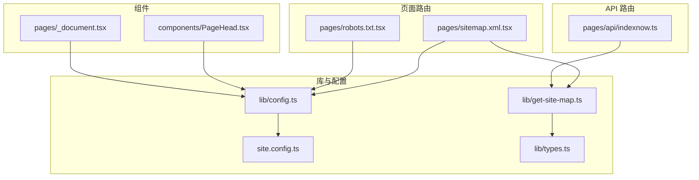
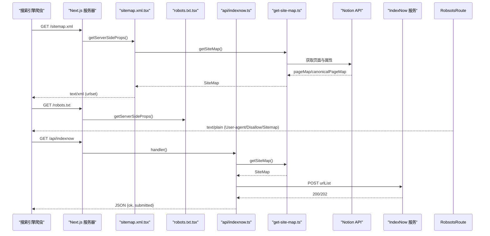
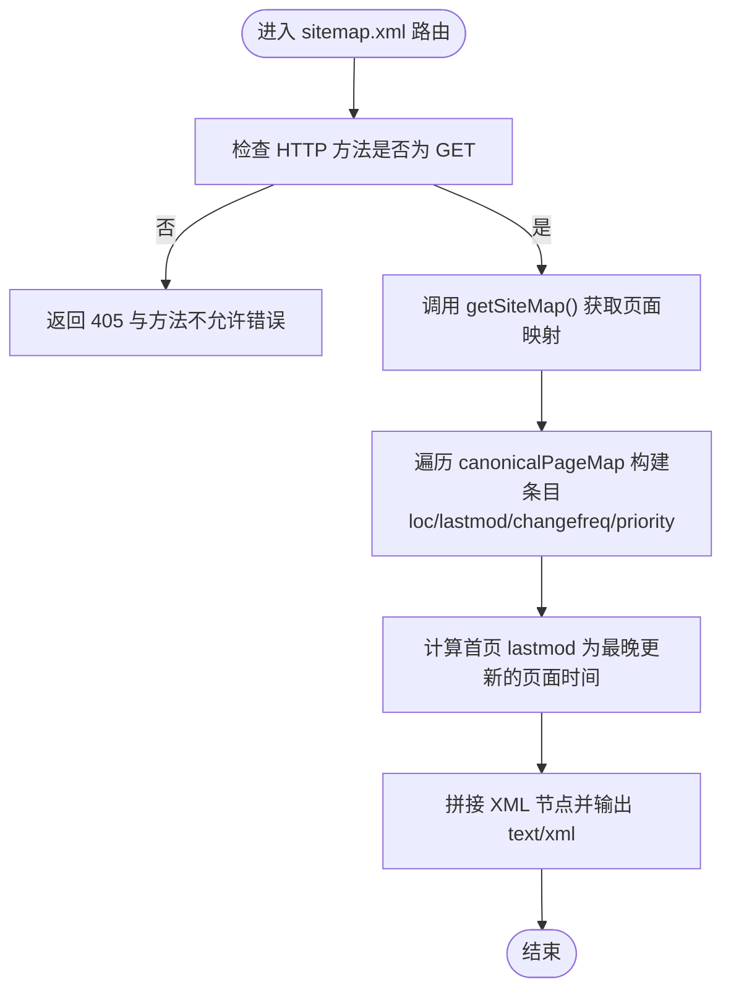
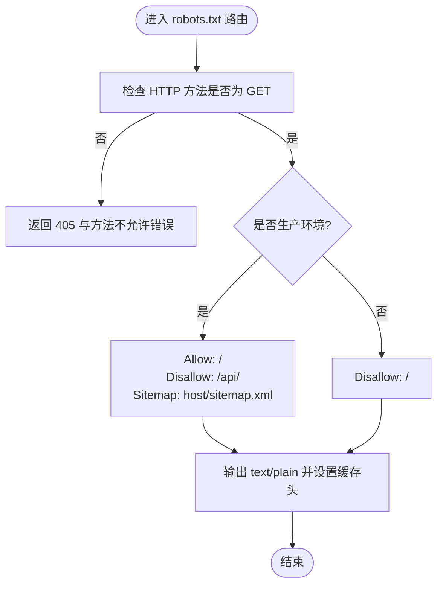
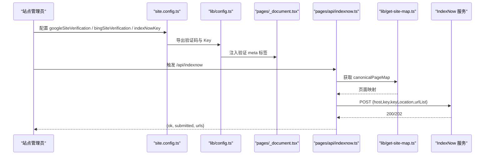
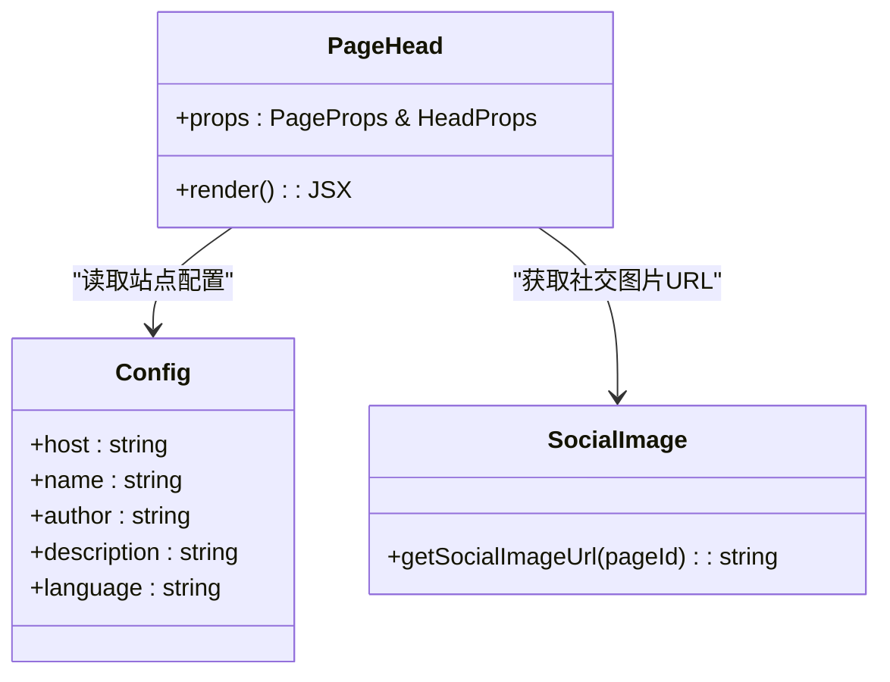
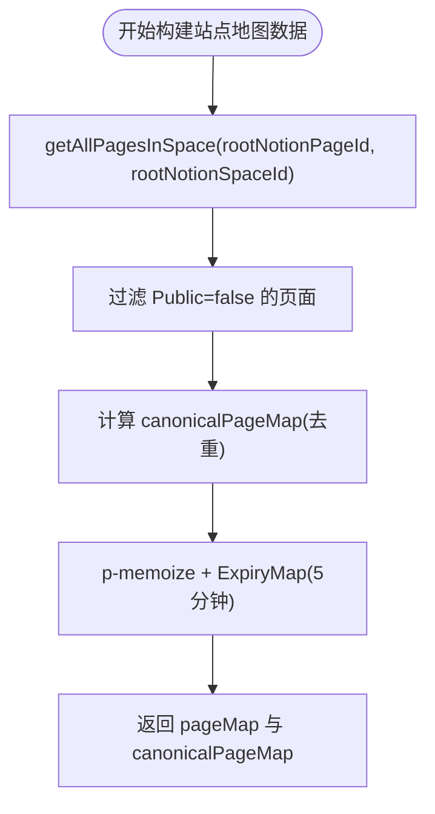
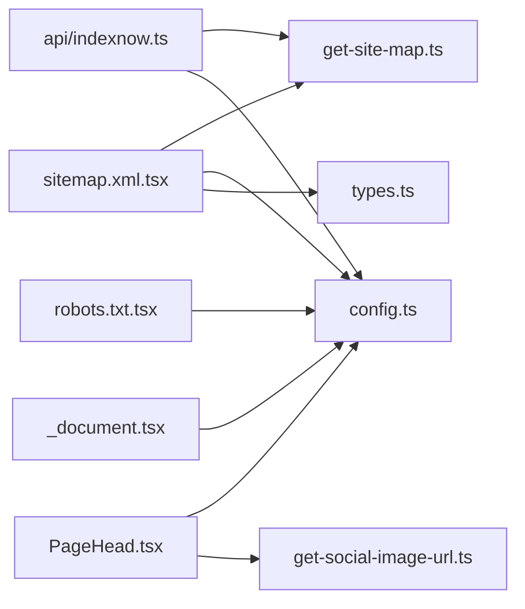

# 搜索引擎优化

<cite>
**本文引用的文件**   
- [sitemap.xml.tsx](file://pages/sitemap.xml.tsx)
- [robots.txt.tsx](file://pages/robots.txt.tsx)
- [get-site-map.ts](file://lib/get-site-map.ts)
- [indexnow.ts](file://pages/api/indexnow.ts)
- [site.config.ts](file://site.config.ts)
- [config.ts](file://lib/config.ts)
- [PageHead.tsx](file://components/PageHead.tsx)
- [_document.tsx](file://pages/_document.tsx)
- [types.ts](file://lib/types.ts)
</cite>

## 目录
1. [简介](#简介)
2. [项目结构](#项目结构)
3. [核心组件](#核心组件)
4. [架构总览](#架构总览)
5. [详细组件分析](#详细组件分析)
6. [依赖关系分析](#依赖关系分析)
7. [性能与 SEO 最佳实践](#性能与-seo-最佳实践)
8. [故障排查指南](#故障排查指南)
9. [结论](#结论)

## 简介
本文件面向搜索引擎优化（SEO）的技术实现，围绕以下目标展开：
- 动态生成站点地图 sitemap.xml，包含页面索引、优先级设置与更新频率控制。
- 自动生成 robots.txt，定义爬虫访问规则与资源排除策略。
- 搜索引擎验证与索引通知机制，包括 Google Search Console、Bing Webmaster Tools 集成以及 IndexNow 即时索引。
- SEO 性能指标监控、页面加载速度优化与移动端适配的最佳实践。
- SEO 审计工具与诊断方法指导。

## 项目结构
本项目基于 Next.js，SEO 相关能力分布在页面路由、API 路由、配置与组件中：
- 页面路由提供动态生成的 sitemap.xml 与 robots.txt。
- API 路由提供 IndexNow 索引通知接口。
- 配置层集中管理站点信息、搜索引擎验证与性能监控开关。
- 组件负责注入结构化数据、元信息与移动端适配标签。

**图表来源** 
- [sitemap.xml.tsx:1-140](file://pages/sitemap.xml.tsx#L1-L140)
- [robots.txt.tsx:1-49](file://pages/robots.txt.tsx#L1-L49)
- [indexnow.ts:1-71](file://pages/api/indexnow.ts#L1-L71)
- [get-site-map.ts:1-107](file://lib/get-site-map.ts#L1-L107)
- [config.ts:1-224](file://lib/config.ts#L1-L224)
- [site.config.ts:1-78](file://site.config.ts#L1-L78)
- [PageHead.tsx:1-188](file://components/PageHead.tsx#L1-L188)
- [_document.tsx:1-25](file://pages/_document.tsx#L1-L25)
- [types.ts:1-78](file://lib/types.ts#L1-L78)

**章节来源**
- [sitemap.xml.tsx:1-140](file://pages/sitemap.xml.tsx#L1-L140)
- [robots.txt.tsx:1-49](file://pages/robots.txt.tsx#L1-L49)
- [indexnow.ts:1-71](file://pages/api/indexnow.ts#L1-L71)
- [get-site-map.ts:1-107](file://lib/get-site-map.ts#L1-L107)
- [config.ts:1-224](file://lib/config.ts#L1-L224)
- [site.config.ts:1-78](file://site.config.ts#L1-L78)
- [PageHead.tsx:1-188](file://components/PageHead.tsx#L1-L188)
- [_document.tsx:1-25](file://pages/_document.tsx#L1-L25)
- [types.ts:1-78](file://lib/types.ts#L1-L78)

## 核心组件
- 站点地图生成器：根据 Notion 内容构建 canonical 页面映射，输出 XML 格式的 urlset，并设置 lastmod、changefreq、priority。
- robots 生成器：按环境区分生产与预览部署的爬取规则，并在生产环境声明 sitemap 地址。
- IndexNow 通知接口：聚合站点 URL 列表并提交至 IndexNow 服务，加速 Bing/Yandex 收录。
- 站点配置与验证：集中管理域名、描述、搜索引擎验证码、IndexNow Key、分析与性能监控开关。
- 页面头部组件：注入 meta、Open Graph、Twitter Card、结构化数据与移动端适配标签。

**章节来源**
- [sitemap.xml.tsx:1-140](file://pages/sitemap.xml.tsx#L1-L140)
- [robots.txt.tsx:1-49](file://pages/robots.txt.tsx#L1-L49)
- [indexnow.ts:1-71](file://pages/api/indexnow.ts#L1-L71)
- [config.ts:1-224](file://lib/config.ts#L1-L224)
- [PageHead.tsx:1-188](file://components/PageHead.tsx#L1-L188)

## 架构总览
下图展示从请求到响应的主要流程，涵盖 sitemap 生成、robots 生成与 IndexNow 提交。

**图表来源**
- [sitemap.xml.tsx:7-32](file://pages/sitemap.xml.tsx#L7-L32)
- [robots.txt.tsx:5-43](file://pages/robots.txt.tsx#L5-L43)
- [indexnow.ts:15-70](file://pages/api/indexnow.ts#L15-L70)
- [get-site-map.ts:18-28](file://lib/get-site-map.ts#L18-L28)

## 详细组件分析

### 站点地图（sitemap.xml）动态生成
- 入口：Next.js 服务端渲染页面处理函数在收到 GET 请求时生成站点地图。
- 缓存策略：对响应设置 Cache-Control，允许 CDN 与浏览器缓存，减少重复计算。
- 数据来源：调用 getSiteMap 获取 Notion 空间中的页面集合，过滤“公开”页面，生成 canonical 路径映射。
- 优先级与更新频率：
  - 首页 priority=1.0，changefreq=daily。
  - 其他页面根据路径深度设置 priority（浅层级更高）与 changefreq（浅层级更频繁）。
- 最后修改时间：优先使用 Notion 页面的 last_edited_time，回退到 created_time；首页 lastmod 取所有页面中最晚的更新时间，以提示站点整体内容新鲜度。
- 输出格式：标准 sitemap XML，包含 loc、lastmod、changefreq、priority。

**图表来源**
- [sitemap.xml.tsx:7-32](file://pages/sitemap.xml.tsx#L7-L32)
- [sitemap.xml.tsx:67-79](file://pages/sitemap.xml.tsx#L67-L79)
- [sitemap.xml.tsx:81-135](file://pages/sitemap.xml.tsx#L81-L135)

**章节来源**
- [sitemap.xml.tsx:7-32](file://pages/sitemap.xml.tsx#L7-L32)
- [sitemap.xml.tsx:67-79](file://pages/sitemap.xml.tsx#L67-L79)
- [sitemap.xml.tsx:81-135](file://pages/sitemap.xml.tsx#L81-L135)

### robots.txt 自动生成逻辑
- 入口：Next.js 服务端渲染页面处理函数在收到 GET 请求时生成 robots 文本。
- 环境区分：
  - 生产环境：允许根路径，禁止 /api/，并声明 sitemap 地址。
  - 非生产环境：禁止所有路径，避免预览部署被索引导致重复内容。
- 缓存策略：CDN 缓存一天，同时允许浏览器重新验证。
- 内容类型：text/plain; charset=utf-8。

**图表来源**
- [robots.txt.tsx:5-43](file://pages/robots.txt.tsx#L5-L43)

**章节来源**
- [robots.txt.tsx:5-43](file://pages/robots.txt.tsx#L5-L43)

### 搜索引擎验证与索引通知
- 站点验证：
  - Google Search Console：通过 site.config.ts 配置 googleSiteVerification，由 lib/config.ts 暴露并在 pages/_document.tsx 注入 <meta name="google-site-verification">。
  - Bing Webmaster Tools：通过 site.config.ts 配置 bingSiteVerification，由 lib/config.ts 暴露并在 pages/_document.tsx 注入 <meta name="msvalidate.01">。
- IndexNow 即时索引：
  - 配置 indexNowKey 于 site.config.ts，对应 public/<key>.txt 验证文件需存在。
  - API 路由 /api/indexnow 聚合站点 URL 列表（首页 + canonical 页面），POST 至 https://api.indexnow.org/indexnow。
  - 成功状态码为 200 或 202，接口返回提交数量与状态。

**图表来源**
- [site.config.ts:29-37](file://site.config.ts#L29-L37)
- [config.ts:117-131](file://lib/config.ts#L117-L131)
- [_document.tsx:1-25](file://pages/_document.tsx#L1-L25)
- [indexnow.ts:15-70](file://pages/api/indexnow.ts#L15-L70)
- [get-site-map.ts:18-28](file://lib/get-site-map.ts#L18-L28)

**章节来源**
- [site.config.ts:29-37](file://site.config.ts#L29-L37)
- [config.ts:117-131](file://lib/config.ts#L117-L131)
- [_document.tsx:1-25](file://pages/_document.tsx#L1-L25)
- [indexnow.ts:15-70](file://pages/api/indexnow.ts#L15-L70)

### 页面元信息与结构化数据
- 元信息：
  - viewport 与移动端适配标签确保移动设备正确缩放与全屏体验。
  - robots 与 googlebot/bingbot 指令允许抓取与大图预览。
  - Open Graph 与 Twitter Card 提供社交分享摘要与图片。
  - canonical link 与 og:url/twitter:url 避免重复内容。
- 结构化数据：
  - WebSite Schema 描述站点名称、URL、描述与发布者。
  - BlogPosting Schema（文章页）包含标题、作者、发布时间、修改时间与语言。
- RSS：
  - 提供 alternate RSS 链接，便于订阅与索引。

**图表来源**
- [PageHead.tsx:1-188](file://components/PageHead.tsx#L1-L188)
- [config.ts:52-56](file://lib/config.ts#L52-L56)

**章节来源**
- [PageHead.tsx:91-184](file://components/PageHead.tsx#L91-L184)
- [config.ts:52-56](file://lib/config.ts#L52-L56)

### 站点地图数据源与去重逻辑
- 数据源：
  - 通过 notion-utils 的 getAllPagesInSpace 获取 Notion 空间内页面。
  - 使用 notion-api 封装 getPage，带超时配置。
- 去重与公开性：
  - 过滤 Public 属性为 false 的页面。
  - 将多个 Notion ID 映射到统一 canonical 路径，避免重复索引。
- 缓存：
  - 使用 p-memoize 与 ExpiryMap 缓存 5 分钟，平衡实时性与性能。

**图表来源**
- [get-site-map.ts:46-106](file://lib/get-site-map.ts#L46-L106)

**章节来源**
- [get-site-map.ts:18-28](file://lib/get-site-map.ts#L18-L28)
- [get-site-map.ts:46-106](file://lib/get-site-map.ts#L46-L106)

## 依赖关系分析
- sitemap.xml.tsx 依赖：
  - lib/get-site-map.ts：获取页面映射。
  - lib/config.ts：host 等站点基础信息。
  - lib/types.ts：SiteMap 类型定义。
- robots.txt.tsx 依赖：
  - lib/config.ts：host 与 VERCEL_ENV 判断。
- api/indexnow.ts 依赖：
  - lib/get-site-map.ts：canonicalPageMap。
  - lib/config.ts：domain、host、indexNowKey。
- components/PageHead.tsx 依赖：
  - lib/config.ts：站点基础信息与验证码。
  - lib/get-social-image-url.ts：社交图片 URL。
- pages/_document.tsx 依赖：
  - lib/config.ts：bingSiteVerification、googleSiteVerification。

**图表来源**
- [sitemap.xml.tsx:1-140](file://pages/sitemap.xml.tsx#L1-L140)
- [robots.txt.tsx:1-49](file://pages/robots.txt.tsx#L1-L49)
- [indexnow.ts:1-71](file://pages/api/indexnow.ts#L1-L71)
- [get-site-map.ts:1-107](file://lib/get-site-map.ts#L1-L107)
- [config.ts:1-224](file://lib/config.ts#L1-L224)
- [PageHead.tsx:1-188](file://components/PageHead.tsx#L1-L188)
- [_document.tsx:1-25](file://pages/_document.tsx#L1-L25)
- [types.ts:1-78](file://lib/types.ts#L1-L78)

**章节来源**
- [sitemap.xml.tsx:1-140](file://pages/sitemap.xml.tsx#L1-L140)
- [robots.txt.tsx:1-49](file://pages/robots.txt.tsx#L1-L49)
- [indexnow.ts:1-71](file://pages/api/indexnow.ts#L1-L71)
- [get-site-map.ts:1-107](file://lib/get-site-map.ts#L1-L107)
- [config.ts:1-224](file://lib/config.ts#L1-L224)
- [PageHead.tsx:1-188](file://components/PageHead.tsx#L1-L188)
- [_document.tsx:1-25](file://pages/_document.tsx#L1-L25)
- [types.ts:1-78](file://lib/types.ts#L1-L78)

## 性能与 SEO 最佳实践
- 页面加载速度优化
  - 启用 Vercel Speed Insights 与 Vercel Analytics，监控性能指标与用户行为。
  - 合理设置 ISR revalidateSeconds，降低函数调用频率，提升缓存命中率。
  - 使用 LQIP 预览图（isPreviewImageSupportEnabled）改善首屏视觉体验。
- 移动端适配
  - 通过 viewport 与移动端专用 meta 标签确保跨设备兼容。
  - 主题色与状态栏样式适配深色/浅色模式。
- SEO 元信息与结构化数据
  - 保持 title、description、canonical、OG/Twitter 卡片一致且准确。
  - 使用 WebSite 与 BlogPosting 结构化数据增强搜索结果展示。
- 索引与抓取
  - 在生产环境允许抓取并声明 sitemap；在非生产环境禁止抓取以避免重复内容。
  - 配置 IndexNow Key 并定期触发 /api/indexnow，加速新内容与更新内容的收录。

[本节为通用指导，不直接分析具体文件]

## 故障排查指南
- sitemap.xml 无法生成或内容为空
  - 检查 Notion 页面 Public 属性是否正确设置。
  - 确认 rootNotionPageId 与 rootNotionSpaceId 配置有效。
  - 查看控制台日志是否存在“Error loading page”或重复 canonical id 警告。
- robots.txt 未生效或被错误屏蔽
  - 确认运行环境是否为 production（VERCEL_ENV）。
  - 检查是否误将 /api/ 排除导致 API 不可用。
- IndexNow 提交失败
  - 确认 indexNowKey 已配置且 public/<key>.txt 文件存在。
  - 检查 /api/indexnow 返回的状态码与错误消息。
- 搜索引擎验证失败
  - 核对 googleSiteVerification 与 bingSiteVerification 是否与平台提供的值一致。
  - 确认 _document.tsx 已注入相应 meta 标签。
- 性能问题
  - 调整 revalidateSeconds 以降低函数调用频率。
  - 开启 Vercel Speed Insights 与 Clarity，定位慢页面与交互瓶颈。

**章节来源**
- [get-site-map.ts:64-90](file://lib/get-site-map.ts#L64-L90)
- [robots.txt.tsx:24-37](file://pages/robots.txt.tsx#L24-L37)
- [indexnow.ts:23-27](file://pages/api/indexnow.ts#L23-L27)
- [config.ts:117-131](file://lib/config.ts#L117-L131)
- [_document.tsx:14-20](file://pages/_document.tsx#L14-L20)
- [site.config.ts:58-61](file://site.config.ts#L58-L61)

## 结论
本项目通过 Next.js 的服务端渲染与 API 路由实现了完整的 SEO 技术栈：
- 动态 sitemap.xml 提供准确的页面索引、优先级与更新频率。
- robots.txt 按环境控制爬虫访问，避免重复内容。
- 搜索引擎验证与 IndexNow 即时索引确保快速收录与稳定可见性。
- 结构化数据与移动端适配提升搜索展示质量与用户体验。
- 性能监控与分析工具帮助持续优化加载速度与稳定性。

建议在生产环境中：
- 校验并维护站点验证与 IndexNow Key。
- 定期触发 /api/indexnow 以保持索引时效。
- 关注 Vercel Speed Insights 与 Clarity 数据，持续优化关键页面性能。

[本节为总结性内容，不直接分析具体文件]