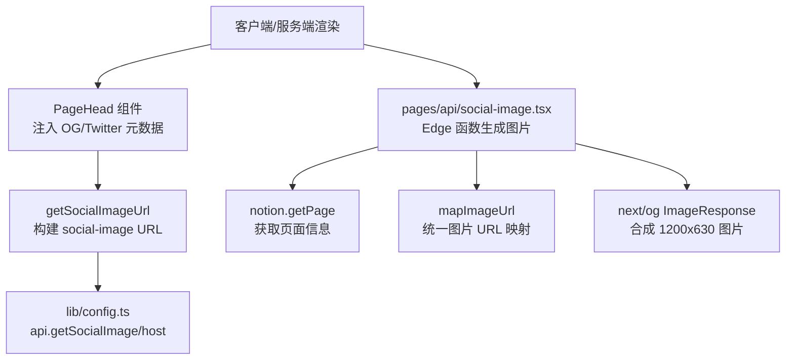
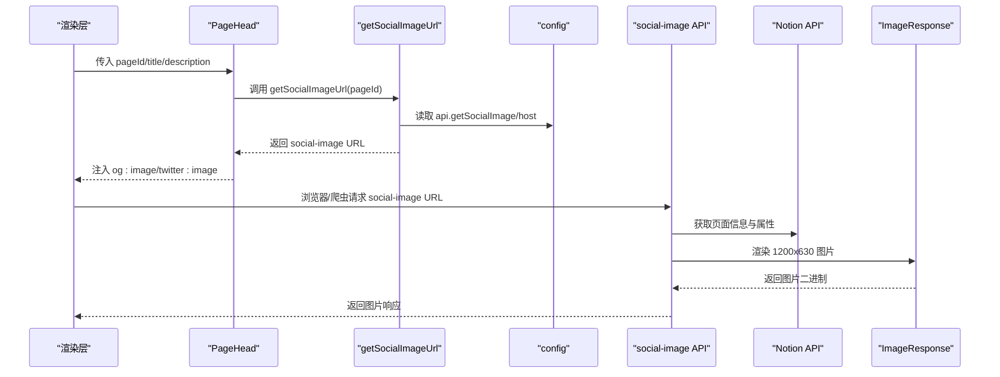
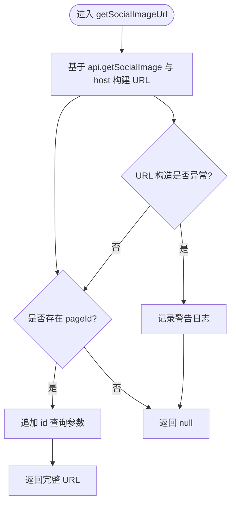
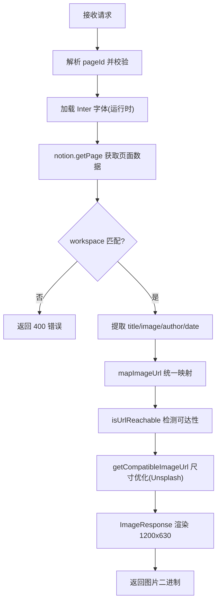
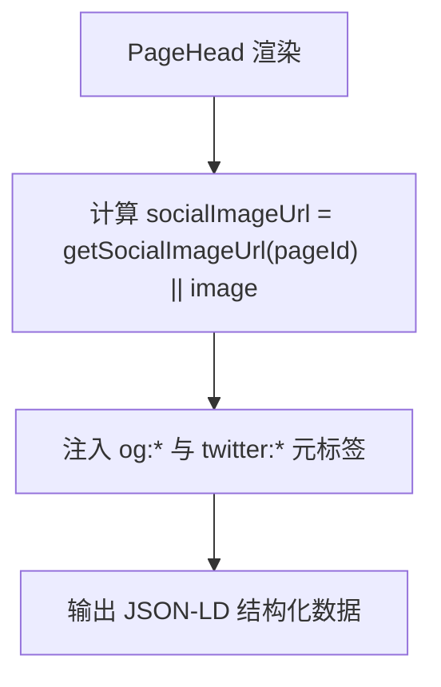
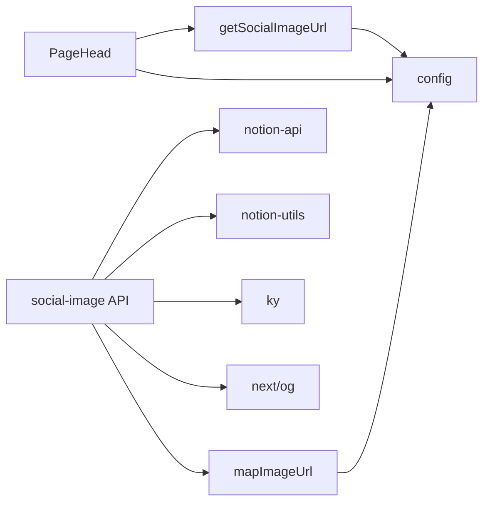

# 社交媒体优化

<cite>
**本文引用的文件**   
- [lib/get-social-image-url.ts](file://lib/get-social-image-url.ts)
- [pages/api/social-image.tsx](file://pages/api/social-image.tsx)
- [components/PageHead.tsx](file://components/PageHead.tsx)
- [lib/config.ts](file://lib/config.ts)
- [lib/map-image-url.ts](file://lib/map-image-url.ts)
- [lib/preview-images.ts](file://lib/preview-images.ts)
</cite>

## 目录
1. [简介](#简介)
2. [项目结构](#项目结构)
3. [核心组件](#核心组件)
4. [架构总览](#架构总览)
5. [详细组件分析](#详细组件分析)
6. [依赖关系分析](#依赖关系分析)
7. [性能与缓存](#性能与缓存)
8. [平台适配与规范](#平台适配与规范)
9. [测试与验证](#测试与验证)
10. [故障排查](#故障排查)
11. [结论](#结论)

## 简介
本文件聚焦于 Next.js + Notion 站点中的“社交媒体预览图片”生成与管理机制，重点说明：
- getSocialImageUrl 函数的 URL 构建逻辑与使用方式
- social-image API 端点的渲染流程、图像来源、尺寸与字体处理
- 不同社交平台（Facebook、Twitter、LinkedIn）的预览规范适配
- 自定义预览图片配置、默认图片回退与错误降级策略
- 分享效果测试方法与优化工具建议

## 项目结构
与社交媒体预览相关的代码主要分布在以下位置：
- lib/get-social-image-url.ts：用于在客户端或服务端构造社交预览图 URL
- pages/api/social-image.tsx：Edge 运行时下的 OG 图片生成接口
- components/PageHead.tsx：注入 Open Graph / Twitter Card 等元信息
- lib/config.ts：站点与 API 基础地址配置
- lib/map-image-url.ts：Notion 图片 URL 映射与默认图处理
- lib/preview-images.ts：页面内图片 LQIP 预览图缓存（与 OG 图生成解耦）

图表来源
- [components/PageHead.tsx:30-36](file://components/PageHead.tsx#L30-L36)
- [lib/get-social-image-url.ts:3-15](file://lib/get-social-image-url.ts#L3-L15)
- [lib/config.ts:148-153](file://lib/config.ts#L148-L153)
- [pages/api/social-image.tsx:21-49](file://pages/api/social-image.tsx#L21-L49)
- [lib/map-image-url.ts:6-12](file://lib/map-image-url.ts#L6-L12)

章节来源
- [lib/get-social-image-url.ts:1-17](file://lib/get-social-image-url.ts#L1-L17)
- [pages/api/social-image.tsx:1-313](file://pages/api/social-image.tsx#L1-L313)
- [components/PageHead.tsx:1-188](file://components/PageHead.tsx#L1-L188)
- [lib/config.ts:148-153](file://lib/config.ts#L148-L153)
- [lib/map-image-url.ts:1-13](file://lib/map-image-url.ts#L1-L13)

## 核心组件
- getSocialImageUrl：根据 pageId 拼接 social-image API 的 URL；若参数无效则返回 null，供上层回退到静态 image。
- social-image API：Edge 运行时下从 Notion 拉取页面信息，动态渲染 1200x630 的 OG 图片，包含标题、作者头像、封面图与日期/作者信息。
- PageHead：注入 og:image、twitter:image 等元标签，并设置 twitter:card=summary_large_image。
- mapImageUrl：对 Notion 图片进行标准化映射，保留默认图标识以便后续回退。
- preview-images：页面内容图片的 LQIP 预览图缓存（与 OG 图生成无直接耦合）。

章节来源
- [lib/get-social-image-url.ts:3-15](file://lib/get-social-image-url.ts#L3-L15)
- [pages/api/social-image.tsx:21-170](file://pages/api/social-image.tsx#L21-L170)
- [components/PageHead.tsx:30-36](file://components/PageHead.tsx#L30-L36)
- [lib/map-image-url.ts:6-12](file://lib/map-image-url.ts#L6-L12)
- [lib/preview-images.ts:33-57](file://lib/preview-images.ts#L33-L57)

## 架构总览
下图展示了从页面渲染到社交分享预览图的完整链路：

图表来源
- [components/PageHead.tsx:30-36](file://components/PageHead.tsx#L30-L36)
- [lib/get-social-image-url.ts:3-15](file://lib/get-social-image-url.ts#L3-L15)
- [lib/config.ts:148-153](file://lib/config.ts#L148-L153)
- [pages/api/social-image.tsx:21-49](file://pages/api/social-image.tsx#L21-L49)
- [pages/api/social-image.tsx:158-170](file://pages/api/social-image.tsx#L158-L170)

## 详细组件分析

### getSocialImageUrl 实现原理
- 功能：将 pageId 作为查询参数拼接到 social-image API 的基础 URL 上，形成可被浏览器或爬虫访问的图片链接。
- URL 构建：
  - 基础路径来自 config.api.getSocialImage
  - host 来自 config.host（开发为 localhost，生产为域名）
  - 当存在 pageId 时，追加 id 查询参数
- 容错：URL 构造异常时记录警告日志并返回 null，避免崩溃。
- 缓存策略：该函数本身不做缓存，仅负责 URL 拼装；实际图片由 Edge 函数按需生成。

图表来源
- [lib/get-social-image-url.ts:3-15](file://lib/get-social-image-url.ts#L3-L15)
- [lib/config.ts:148-153](file://lib/config.ts#L148-L153)

章节来源
- [lib/get-social-image-url.ts:1-17](file://lib/get-social-image-url.ts#L1-L17)
- [lib/config.ts:148-153](file://lib/config.ts#L148-L153)

### social-image API 渲染流程
- 运行环境：Edge 运行时，保持轻量与快速冷启动。
- 输入解析：
  - 从请求 URL 中解析 pageId，未提供时使用根 Notion 页 ID
  - 校验 pageId 合法性，非法则返回 400
- 字体加载：
  - 运行时通过 fetch 获取 Inter SemiBold 字体缓冲，避免打包体积超限
- 页面信息获取：
  - 调用 notion.getPage 获取 recordMap
  - 校验 workspace 归属，跨工作区拒绝
  - 提取标题、封面图、作者头像、作者名、发布日期等
- 图片处理：
  - 优先使用页面“Social Image”属性或 page_cover
  - 若不可达，回退到 defaultPageCover
  - 对 Unsplash 图片自动添加 w=1200&fit=max 以优化尺寸
  - 作者头像同理，优先 blockIcon，否则回退 defaultPageIcon
- 图片合成：
  - 使用 next/og 的 ImageResponse 渲染 1200x630 图片
  - 背景图覆盖、圆角边框、居中标题与副标题、作者头像圆形叠加
- 输出：返回 PNG 图片二进制

图表来源
- [pages/api/social-image.tsx:21-49](file://pages/api/social-image.tsx#L21-L49)
- [pages/api/social-image.tsx:173-276](file://pages/api/social-image.tsx#L173-L276)
- [pages/api/social-image.tsx:278-312](file://pages/api/social-image.tsx#L278-L312)
- [lib/map-image-url.ts:6-12](file://lib/map-image-url.ts#L6-L12)

章节来源
- [pages/api/social-image.tsx:1-313](file://pages/api/social-image.tsx#L1-L313)
- [lib/map-image-url.ts:1-13](file://lib/map-image-url.ts#L1-L13)

### PageHead 元数据注入
- 计算 socialImageUrl：优先使用 getSocialImageUrl(pageId)，否则回退到传入的 image
- 注入 OG/Twitter 元数据：
  - og:title、og:description、og:image、og:url
  - twitter:title、twitter:description、twitter:image、twitter:card=summary_large_image
- 结构化数据：输出 Schema.org WebSite/BlogPosting JSON-LD

图表来源
- [components/PageHead.tsx:30-36](file://components/PageHead.tsx#L30-L36)
- [components/PageHead.tsx:153-161](file://components/PageHead.tsx#L153-L161)
- [components/PageHead.tsx:178-184](file://components/PageHead.tsx#L178-L184)

章节来源
- [components/PageHead.tsx:1-188](file://components/PageHead.tsx#L1-L188)

### 图片映射与默认图处理
- mapImageUrl：
  - 若 URL 等于默认封面或图标，原样返回，便于后端识别并做回退
  - 其他 URL 交由 notion-utils 的 defaultMapImageUrl 处理
- 默认值：
  - defaultPageCover/defaultPageIcon 来自站点配置
  - defaultPageCoverPosition 控制封面裁剪位置

章节来源
- [lib/map-image-url.ts:1-13](file://lib/map-image-url.ts#L1-L13)
- [lib/config.ts:58-66](file://lib/config.ts#L58-L66)

## 依赖关系分析
- getSocialImageUrl 依赖 config 提供的 api.getSocialImage 与 host
- social-image API 依赖 notion-api、notion-utils、ky、next/og
- PageHead 依赖 getSocialImageUrl 与 config
- mapImageUrl 依赖 notion-utils 与 config 默认值

图表来源
- [lib/get-social-image-url.ts:1-1](file://lib/get-social-image-url.ts#L1-L1)
- [components/PageHead.tsx:1-5](file://components/PageHead.tsx#L1-L5)
- [pages/api/social-image.tsx:1-17](file://pages/api/social-image.tsx#L1-L17)
- [lib/map-image-url.ts:1-4](file://lib/map-image-url.ts#L1-L4)

章节来源
- [lib/get-social-image-url.ts:1-17](file://lib/get-social-image-url.ts#L1-L17)
- [components/PageHead.tsx:1-188](file://components/PageHead.tsx#L1-L188)
- [pages/api/social-image.tsx:1-313](file://pages/api/social-image.tsx#L1-L313)
- [lib/map-image-url.ts:1-13](file://lib/map-image-url.ts#L1-L13)

## 性能与缓存
- Edge 运行时：social-image API 使用 Edge 运行时，减少冷启动时间，适合高频缩略图生成。
- 字体加载：运行时 fetch 字体，避免打包体积超过限制。
- 图片可达性检测：使用 HEAD 请求判断远程图片是否可达，失败则回退默认图。
- 图片尺寸优化：对 Unsplash 图片自动追加 w=1200&fit=max，降低带宽与渲染成本。
- 并发拉取：封面图与作者头像并行获取，缩短首帧时间。
- 页面内图片预览（LQIP）：preview-images 模块对页面内图片生成低质量占位图并缓存，与 OG 图生成解耦，提升列表页体验。

章节来源
- [pages/api/social-image.tsx:19-38](file://pages/api/social-image.tsx#L19-L38)
- [pages/api/social-image.tsx:230-233](file://pages/api/social-image.tsx#L230-L233)
- [pages/api/social-image.tsx:278-312](file://pages/api/social-image.tsx#L278-L312)
- [lib/preview-images.ts:33-57](file://lib/preview-images.ts#L33-L57)
- [lib/preview-images.ts:59-101](file://lib/preview-images.ts#L59-L101)

## 平台适配与规范
- Facebook（Open Graph）：
  - 要求 og:image 至少 1200x630，当前 social-image API 输出 1200x630，符合推荐尺寸
  - 建议 og:title、og:description、og:url 齐全
- Twitter（Card）：
  - 使用 summary_large_image 卡片类型，需设置 twitter:image 与 twitter:card
  - 同样推荐 1200x630 尺寸
- LinkedIn：
  - 遵循 Open Graph 规范，复用 og:image 等字段
- 通用最佳实践：
  - 确保图片可公开访问且无跨域限制
  - 提供合适的 alt 文本（在 HTML 中），OG 图片无需 alt
  - 避免在图片中包含过多文字，保证小屏可读性

章节来源
- [components/PageHead.tsx:153-161](file://components/PageHead.tsx#L153-L161)
- [pages/api/social-image.tsx:158-170](file://pages/api/social-image.tsx#L158-L170)

## 测试与验证
- 本地调试
  - 启动开发服务器后，访问 /social-image?id={pageId} 查看生成的图片
  - 检查浏览器网络面板确认请求头与响应体为图片
- 在线工具
  - Facebook Sharing Debugger：验证 og:* 元数据与预览图
  - Twitter Card Validator：验证 twitter:card 与图片
  - LinkedIn Post Inspector：验证 LinkedIn 抓取结果
- 自动化测试建议
  - 单元测试：校验 getSocialImageUrl 在不同 pageId 下的 URL 拼接正确性
  - 集成测试：mock notion.getPage 返回不同场景数据，断言 social-image API 返回状态码与图片尺寸
  - 回归测试：对比默认图与自定义图的回退逻辑

章节来源
- [lib/get-social-image-url.ts:3-15](file://lib/get-social-image-url.ts#L3-L15)
- [pages/api/social-image.tsx:21-49](file://pages/api/social-image.tsx#L21-L49)

## 故障排查
- 返回 400 Invalid notion page id
  - 原因：请求未携带有效 pageId 或格式不正确
  - 解决：确保前端传递正确的 Notion 页面 ID
- 跨工作区拒绝
  - 原因：页面所属 workspace 与 rootNotionSpaceId 不一致
  - 解决：检查 site.config 中 rootNotionSpaceId 配置
- 图片不可达导致回退默认图
  - 原因：远程图片无法访问或 CORS 限制
  - 解决：确保图片 URL 可公开访问，或使用站内资源
- Unsplash 图片尺寸问题
  - 现象：图片过大或模糊
  - 解决：系统已自动追加 w=1200&fit=max，如仍异常请检查上游 URL 参数
- 字体加载失败
  - 现象：标题字体显示异常
  - 解决：确认 public/fonts/inter-semibold.ttf 存在并可访问

章节来源
- [pages/api/social-image.tsx:27-44](file://pages/api/social-image.tsx#L27-L44)
- [pages/api/social-image.tsx:192-204](file://pages/api/social-image.tsx#L192-L204)
- [pages/api/social-image.tsx:278-312](file://pages/api/social-image.tsx#L278-L312)

## 结论
本项目通过 getSocialImageUrl 与 social-image API 的组合，实现了按页面动态生成高质量社交预览图的能力。Edge 运行时与图片可达性检测、Unsplash 尺寸优化共同保障了性能与稳定性。PageHead 统一注入 OG/Twitter 元数据，满足主流社交平台规范。配合 preview-images 的 LQIP 缓存机制，整体在用户体验与性能之间取得良好平衡。建议在发布前使用各平台官方调试工具进行验证，并根据业务需求扩展默认图与样式。