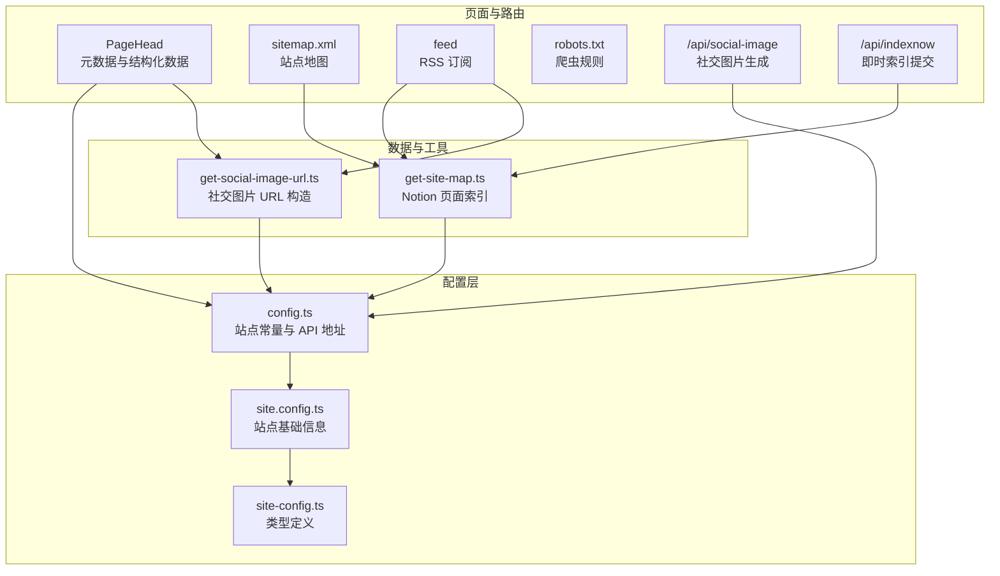
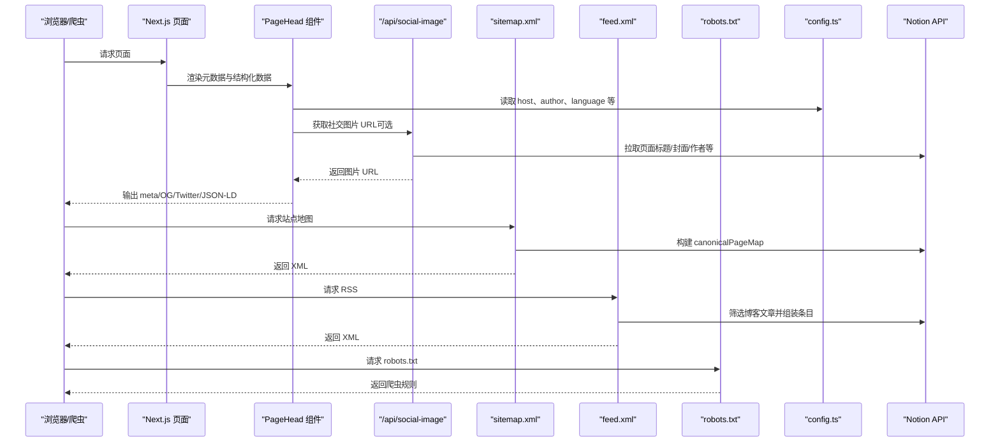
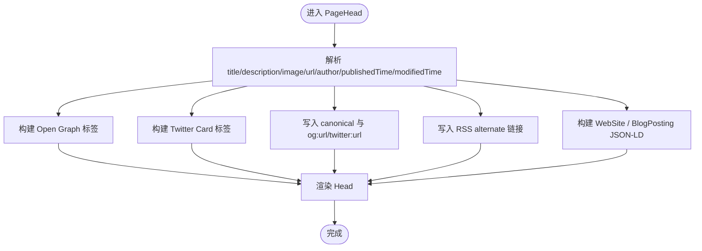
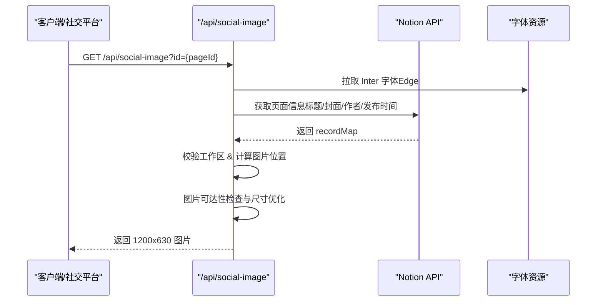
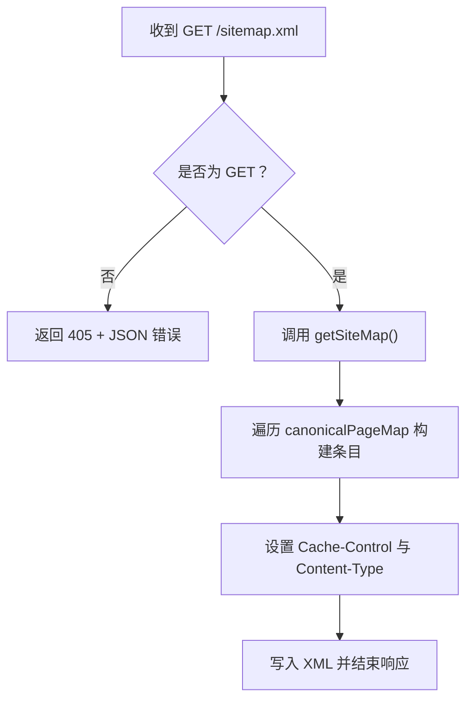
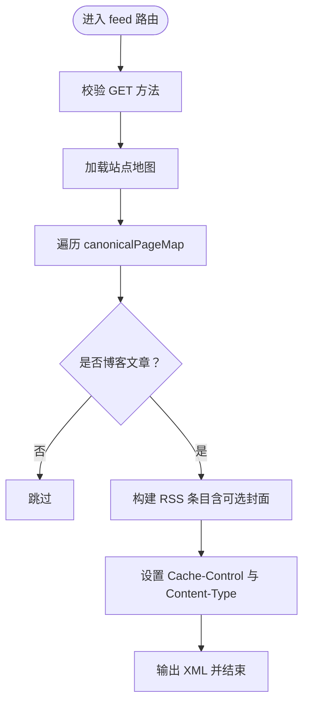
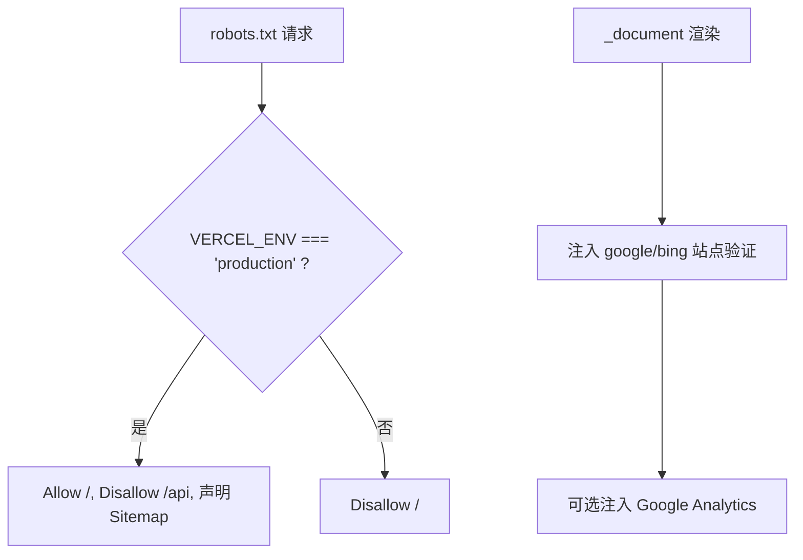
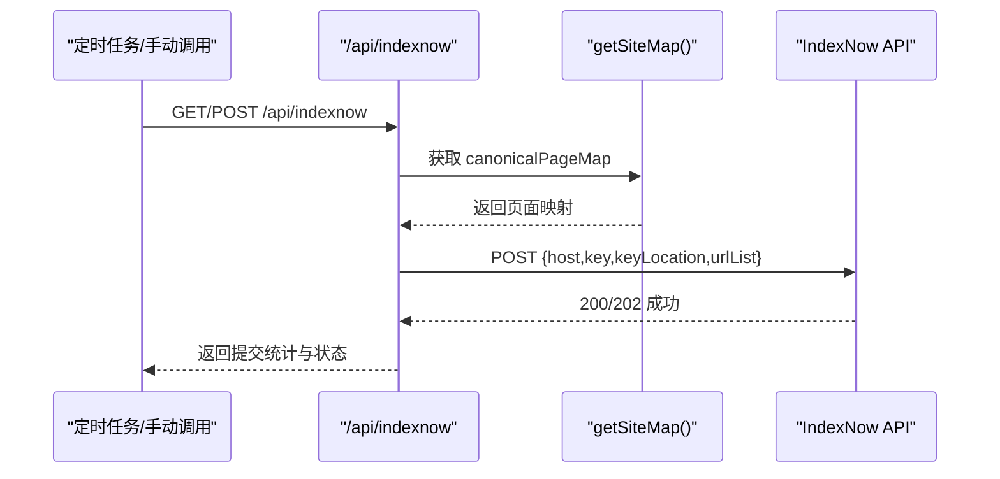
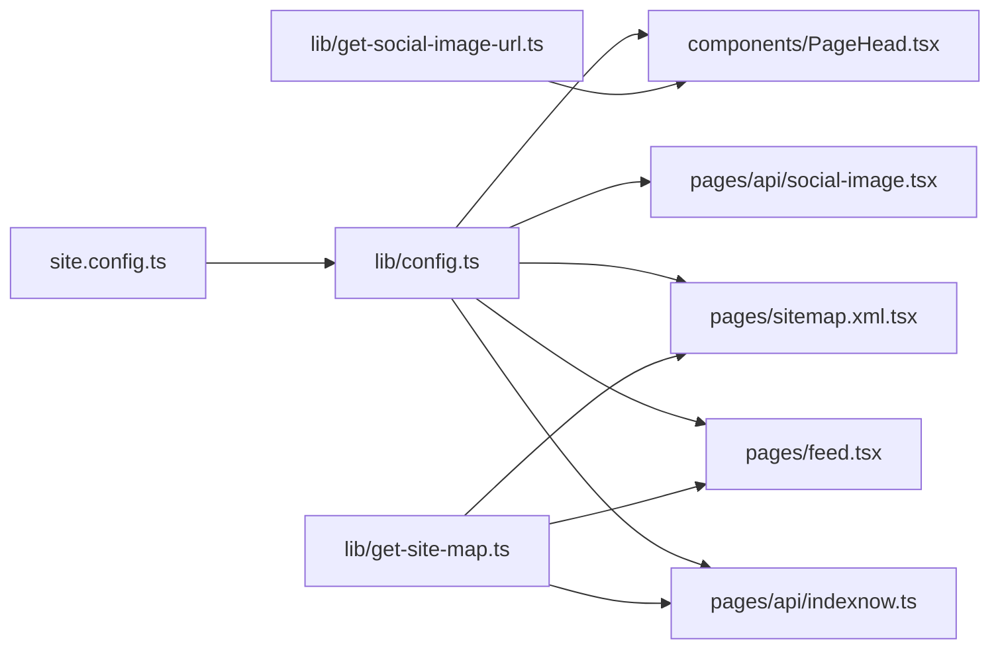

# SEO 优化

<cite>
**本文引用的文件**   
- [components/PageHead.tsx](file://components/PageHead.tsx)
- [lib/config.ts](file://lib/config.ts)
- [lib/site-config.ts](file://lib/site-config.ts)
- [lib/get-site-map.ts](file://lib/get-site-map.ts)
- [lib/get-social-image-url.ts](file://lib/get-social-image-url.ts)
- [pages/sitemap.xml.tsx](file://pages/sitemap.xml.tsx)
- [pages/feed.tsx](file://pages/feed.tsx)
- [pages/robots.txt.tsx](file://pages/robots.txt.tsx)
- [pages/api/social-image.tsx](file://pages/api/social-image.tsx)
- [pages/api/indexnow.ts](file://pages/api/indexnow.ts)
- [pages/_document.tsx](file://pages/_document.tsx)
- [site.config.ts](file://site.config.ts)
</cite>

## 目录
1. [简介](#简介)
2. [项目结构](#项目结构)
3. [核心组件](#核心组件)
4. [架构总览](#架构总览)
5. [详细组件分析](#详细组件分析)
6. [依赖关系分析](#依赖关系分析)
7. [性能与监控建议](#性能与监控建议)
8. [故障排查指南](#故障排查指南)
9. [结论](#结论)
10. [附录：SEO 最佳实践清单](#附录seo-最佳实践清单)

## 简介
本仓库为基于 Next.js 的 Notion 博客站点模板，内置完善的搜索引擎优化能力。本文系统性说明以下能力：
- 元数据管理、Open Graph 标签、Twitter Card 支持
- 结构化数据（Schema.org）实现
- 社交媒体图片生成 API 的工作原理与使用方法
- 站点地图与 RSS 订阅功能
- 搜索引擎验证与即时索引（IndexNow）
- 性能与监控配置建议

## 项目结构
与 SEO 相关的代码主要分布在以下位置：
- 页面头部与元数据：components/PageHead.tsx
- 站点全局配置：lib/config.ts、site.config.ts、lib/site-config.ts
- 站点地图与 RSS：pages/sitemap.xml.tsx、pages/feed.tsx、lib/get-site-map.ts
- 社交媒体图片：pages/api/social-image.tsx、lib/get-social-image-url.ts
- 爬虫控制与验证：pages/robots.txt.tsx、pages/_document.tsx
- 即时索引：pages/api/indexnow.ts

**图表来源**
- [components/PageHead.tsx:1-188](file://components/PageHead.tsx#L1-L188)
- [lib/config.ts:145-150](file://lib/config.ts#L145-L150)
- [lib/get-site-map.ts:1-105](file://lib/get-site-map.ts#L1-L105)
- [lib/get-social-image-url.ts:1-17](file://lib/get-social-image-url.ts#L1-L17)
- [pages/sitemap.xml.tsx:1-140](file://pages/sitemap.xml.tsx#L1-L140)
- [pages/feed.tsx:1-104](file://pages/feed.tsx#L1-L104)
- [pages/api/social-image.tsx:1-313](file://pages/api/social-image.tsx#L1-L313)
- [pages/api/indexnow.ts:1-71](file://pages/api/indexnow.ts#L1-L71)

**章节来源**
- [components/PageHead.tsx:1-188](file://components/PageHead.tsx#L1-L188)
- [lib/config.ts:1-221](file://lib/config.ts#L1-L221)
- [lib/get-site-map.ts:1-105](file://lib/get-site-map.ts#L1-L105)
- [lib/get-social-image-url.ts:1-17](file://lib/get-social-image-url.ts#L1-L17)
- [pages/sitemap.xml.tsx:1-140](file://pages/sitemap.xml.tsx#L1-L140)
- [pages/feed.tsx:1-104](file://pages/feed.tsx#L1-L104)
- [pages/robots.txt.tsx:1-49](file://pages/robots.txt.tsx#L1-L49)
- [pages/api/social-image.tsx:1-313](file://pages/api/social-image.tsx#L1-L313)
- [pages/api/indexnow.ts:1-71](file://pages/api/indexnow.ts#L1-L71)
- [pages/_document.tsx:1-101](file://pages/_document.tsx#L1-L101)
- [site.config.ts:1-77](file://site.config.ts#L1-L77)

## 核心组件
- 元数据与结构化数据：通过 PageHead 组件统一注入 meta、OG/Twitter 标签、canonical、RSS 链接与 JSON-LD 结构化数据。
- 站点地图：服务端渲染 sitemap.xml，包含所有公开页面的 loc、lastmod、changefreq、priority。
- RSS 订阅：服务端渲染 feed.xml，仅收录博客文章条目，并可选附带封面图。
- 社交图片 API：Edge Runtime 下根据 Notion 页面动态生成 1200x630 分享图，供 OG/Twitter 使用。
- 爬虫控制与验证：robots.txt 控制抓取；_document.tsx 注入 Google/Bing 站点验证。
- 即时索引：IndexNow 接口批量提交站点 URL，加速 Bing/Yandex 收录。

**章节来源**
- [components/PageHead.tsx:1-188](file://components/PageHead.tsx#L1-L188)
- [pages/sitemap.xml.tsx:1-140](file://pages/sitemap.xml.tsx#L1-L140)
- [pages/feed.tsx:1-104](file://pages/feed.tsx#L1-L104)
- [pages/api/social-image.tsx:1-313](file://pages/api/social-image.tsx#L1-L313)
- [pages/robots.txt.tsx:1-49](file://pages/robots.txt.tsx#L1-L49)
- [pages/_document.tsx:1-101](file://pages/_document.tsx#L1-L101)
- [pages/api/indexnow.ts:1-71](file://pages/api/indexnow.ts#L1-L71)

## 架构总览
下图展示从页面渲染到搜索引擎可见性的关键链路：

**图表来源**
- [components/PageHead.tsx:1-188](file://components/PageHead.tsx#L1-L188)
- [lib/config.ts:107-150](file://lib/config.ts#L107-L150)
- [pages/api/social-image.tsx:1-313](file://pages/api/social-image.tsx#L1-L313)
- [pages/sitemap.xml.tsx:1-140](file://pages/sitemap.xml.tsx#L1-L140)
- [pages/feed.tsx:1-104](file://pages/feed.tsx#L1-L104)
- [pages/robots.txt.tsx:1-49](file://pages/robots.txt.tsx#L1-L49)

## 详细组件分析

### 元数据管理与结构化数据（PageHead）
- 负责注入：
  - 字符集、视口、移动端适配、主题色
  - robots/googlebot/bingbot 指令
  - author、og:title/description/image/url/type/locale/site_name、twitter:title/description/image/card/url/domain
  - article:* 时间字段（published/modified/author）
  - canonical 链接
  - RSS 订阅链接
  - JSON-LD 结构化数据（WebSite、BlogPosting）
- 逻辑要点：
  - 标题与描述优先使用页面传入值，否则回退站点配置
  - 社交图片优先使用 getSocialImageUrl(pageId)，否则使用传入 image
  - 若存在图片则启用 summary_large_image，否则 fallback 为 summary
  - 语言默认 en，可被站点配置覆盖
  - BlogPosting 仅在 isBlogPost 为真时注入

**图表来源**
- [components/PageHead.tsx:27-184](file://components/PageHead.tsx#L27-L184)

**章节来源**
- [components/PageHead.tsx:1-188](file://components/PageHead.tsx#L1-L188)

### 社交媒体图片生成 API（/api/social-image）
- 运行环境：Edge Runtime，避免打包字体导致体积过大
- 输入参数：id（Notion 页面 ID），默认回退至根页面
- 处理流程：
  - 校验 pageId
  - 运行时拉取 Inter 字体（保持 Edge 函数体积限制）
  - 调用 Notion API 获取页面信息（标题、封面、作者头像、发布时间等）
  - 校验工作区一致性（防止跨空间页面）
  - 兼容图片可达性检测与尺寸优化（如 Unsplash 添加 w=1200&fit=max）
  - 使用 next/og 的 ImageResponse 渲染 1200x630 图片
- 错误处理：
  - 无效 pageId 返回 400
  - 跨工作区返回 400
  - 其他异常按 Notion 返回状态码透传

**图表来源**
- [pages/api/social-image.tsx:19-170](file://pages/api/social-image.tsx#L19-L170)
- [pages/api/social-image.tsx:173-313](file://pages/api/social-image.tsx#L173-L313)

**章节来源**
- [pages/api/social-image.tsx:1-313](file://pages/api/social-image.tsx#L1-L313)

### 站点地图（sitemap.xml）
- 服务端渲染，GET 方法校验
- 缓存策略：public, max-age=28800, stale-while-revalidate=28800（8 小时）
- 内容生成：
  - 首页 lastmod 取最近修改过的页面时间
  - 各页面 lastmod 取自 Notion 块的 last_edited_time 或 created_time
  - priority/changefreq 依据路径深度计算
- 输出：标准 sitemap XML

**图表来源**
- [pages/sitemap.xml.tsx:7-32](file://pages/sitemap.xml.tsx#L7-L32)
- [pages/sitemap.xml.tsx:81-134](file://pages/sitemap.xml.tsx#L81-L134)

**章节来源**
- [pages/sitemap.xml.tsx:1-140](file://pages/sitemap.xml.tsx#L1-L140)
- [lib/get-site-map.ts:1-105](file://lib/get-site-map.ts#L1-L105)

### RSS 订阅（feed.xml）
- 服务端渲染，GET 方法校验
- 仅收录博客文章（父级为根 Notion 页面且类型为 collection 的 page）
- 条目字段：title、url、date、description、enclosure（可选封面图）
- 缓存策略：24 小时 TTL

**图表来源**
- [pages/feed.tsx:17-36](file://pages/feed.tsx#L17-L36)
- [pages/feed.tsx:38-86](file://pages/feed.tsx#L38-L86)
- [pages/feed.tsx:88-96](file://pages/feed.tsx#L88-L96)

**章节来源**
- [pages/feed.tsx:1-104](file://pages/feed.tsx#L1-L104)

### 爬虫控制与站点验证（robots.txt 与 _document）
- robots.txt：
  - 生产环境允许抓取根路径，禁止 /api
  - 非生产环境全部 Disallow，避免预览部署重复收录
  - 声明 Sitemap 地址
- _document.tsx：
  - 注入 Google/Bing 站点验证 meta
  - 注入 favicon、manifest、Google Analytics 脚本（可选）

**图表来源**
- [pages/robots.txt.tsx:5-37](file://pages/robots.txt.tsx#L5-L37)
- [pages/_document.tsx:13-49](file://pages/_document.tsx#L13-L49)

**章节来源**
- [pages/robots.txt.tsx:1-49](file://pages/robots.txt.tsx#L1-L49)
- [pages/_document.tsx:1-101](file://pages/_document.tsx#L1-L101)

### 即时索引（IndexNow）
- 目的：将站点 URL 列表提交给 IndexNow，加速 Bing/Yandex 收录
- 触发方式：Vercel Cron 自动执行，也可手动 GET/POST 调用
- 流程：
  - 校验 indexNowKey 是否存在
  - 获取站点地图，收集首页与所有 canonical 页面 URL
  - 向 https://api.indexnow.org/indexnow 提交 payload
  - 返回提交结果与状态码

**图表来源**
- [pages/api/indexnow.ts:15-65](file://pages/api/indexnow.ts#L15-L65)

**章节来源**
- [pages/api/indexnow.ts:1-71](file://pages/api/indexnow.ts#L1-L71)

## 依赖关系分析
- config.ts 提供站点常量与 API 基址，被 PageHead、social-image、sitemap、feed、indexnow 等多处引用
- get-site-map.ts 封装 Notion 页面索引，被 sitemap、feed、indexnow 复用
- get-social-image-url.ts 仅负责拼接 social-image API 地址，被 PageHead 使用
- site.config.ts 提供站点基础信息与 SEO 相关开关（站点验证、IndexNow key、Analytics 等）

**图表来源**
- [lib/config.ts:107-150](file://lib/config.ts#L107-L150)
- [lib/get-site-map.ts:1-105](file://lib/get-site-map.ts#L1-L105)
- [lib/get-social-image-url.ts:1-17](file://lib/get-social-image-url.ts#L1-L17)
- [components/PageHead.tsx:1-188](file://components/PageHead.tsx#L1-L188)
- [pages/sitemap.xml.tsx:1-140](file://pages/sitemap.xml.tsx#L1-L140)
- [pages/feed.tsx:1-104](file://pages/feed.tsx#L1-L104)
- [pages/api/social-image.tsx:1-313](file://pages/api/social-image.tsx#L1-L313)
- [pages/api/indexnow.ts:1-71](file://pages/api/indexnow.ts#L1-L71)

**章节来源**
- [lib/config.ts:1-221](file://lib/config.ts#L1-L221)
- [lib/get-site-map.ts:1-105](file://lib/get-site-map.ts#L1-L105)
- [lib/get-social-image-url.ts:1-17](file://lib/get-social-image-url.ts#L1-L17)

## 性能与监控建议
- ISR 与缓存
  - 站点地图与 RSS 均设置了合理的 Cache-Control，减少频繁刷新 Notion 数据
  - get-site-map 内部对 getAllPages 做了 p-memoize 缓存（5 分钟），平衡新鲜度与调用成本
- 社交图片生成
  - 使用 Edge Runtime 降低冷启动延迟
  - 字体按需拉取，避免包体过大
  - 图片可达性检测与尺寸优化，提升首屏与分享体验
- 分析与速度洞察
  - 可通过 site.config.ts 开启 Vercel Analytics 与 Speed Insights
  - 可配置 Google Analytics 4 与 Microsoft Clarity
- 建议
  - 合理设置 revalidateSeconds，降低函数调用频率
  - 在 CDN 层缓存静态资源（favicon、manifest、字体）
  - 监控社交图片 API 的失败率与响应时间

**章节来源**
- [lib/get-site-map.ts:29-32](file://lib/get-site-map.ts#L29-L32)
- [pages/api/social-image.tsx:19-39](file://pages/api/social-image.tsx#L19-L39)
- [site.config.ts:38-45](file://site.config.ts#L38-L45)
- [lib/config.ts:130-143](file://lib/config.ts#L130-L143)

## 故障排查指南
- 社交图片不显示
  - 检查 pageId 是否有效
  - 确认 Notion 页面“Social Image”属性或封面图可用
  - 查看 get-social-image-url 是否正确拼接 API 地址
  - 检查 Edge 函数日志中字体拉取与图片可达性检测结果
- 站点地图为空或缺少页面
  - 确认 Notion 页面 Public 属性为 true
  - 检查 rootNotionPageId 与 rootNotionSpaceId 配置
  - 查看 get-site-map 的缓存与重试逻辑
- RSS 无条目
  - 确认页面属于博客集合（父级为根 Notion 页面且类型为 collection）
  - 检查 Description/Published/Last Updated 属性是否存在
- robots 阻止抓取
  - 非生产环境会 Disallow 全站，请确认部署环境为 production
- 搜索引擎未收录
  - 确认 robots.txt 已正确声明 Sitemap
  - 配置 Google/Bing 站点验证
  - 启用 IndexNow 并提交 URL 列表

**章节来源**
- [pages/api/social-image.tsx:27-45](file://pages/api/social-image.tsx#L27-L45)
- [lib/get-site-map.ts:62-98](file://lib/get-site-map.ts#L62-L98)
- [pages/feed.tsx:47-54](file://pages/feed.tsx#L47-L54)
- [pages/robots.txt.tsx:24-37](file://pages/robots.txt.tsx#L24-L37)
- [pages/_document.tsx:13-22](file://pages/_document.tsx#L13-L22)

## 结论
本项目以最小化配置实现了完整的 SEO 能力：规范的元数据与结构化数据、稳定的站点地图与 RSS、高性能的社交图片生成、可控的爬虫策略以及即时索引支持。配合合理的缓存与分析配置，可在保证内容新鲜度的同时，获得良好的搜索引擎可见性与用户体验。

## 附录：SEO 最佳实践清单
- 元数据
  - 每个页面设置唯一 title、description、canonical
  - 使用 og:title/description/image/url、twitter:title/description/image/card
  - 指定 language 与 author
- 结构化数据
  - 网站级 WebSite 与文章级 BlogPosting
- 社交分享
  - 为每篇文章设置 Social Image，确保 1200x630 比例
  - 使用摘要大图模式（summary_large_image）
- 站点地图与 RSS
  - 定期更新 sitemap.xml，包含 lastmod
  - 提供 feed.xml，仅收录高质量内容
- 爬虫控制
  - 生产环境允许抓取，预览环境屏蔽
  - 声明 Sitemap 地址
- 验证与索引
  - 配置 Google/Bing 站点验证
  - 启用 IndexNow 并提交 URL 列表
- 性能与监控
  - 合理使用 ISR 与缓存
  - 开启 Vercel Analytics/Speed Insights
  - 监控社交图片 API 的性能与错误率