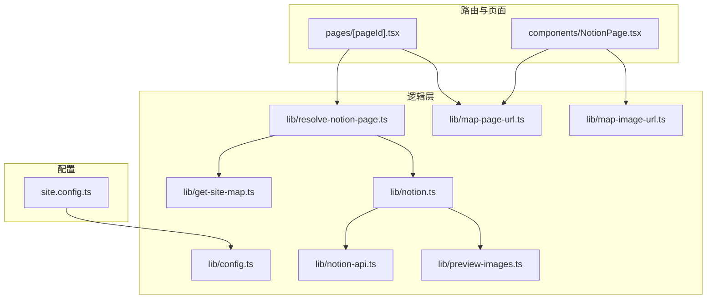
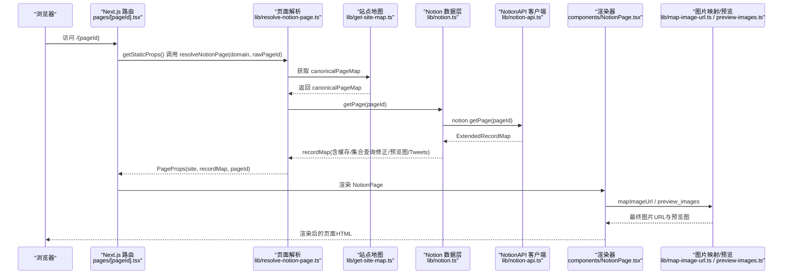
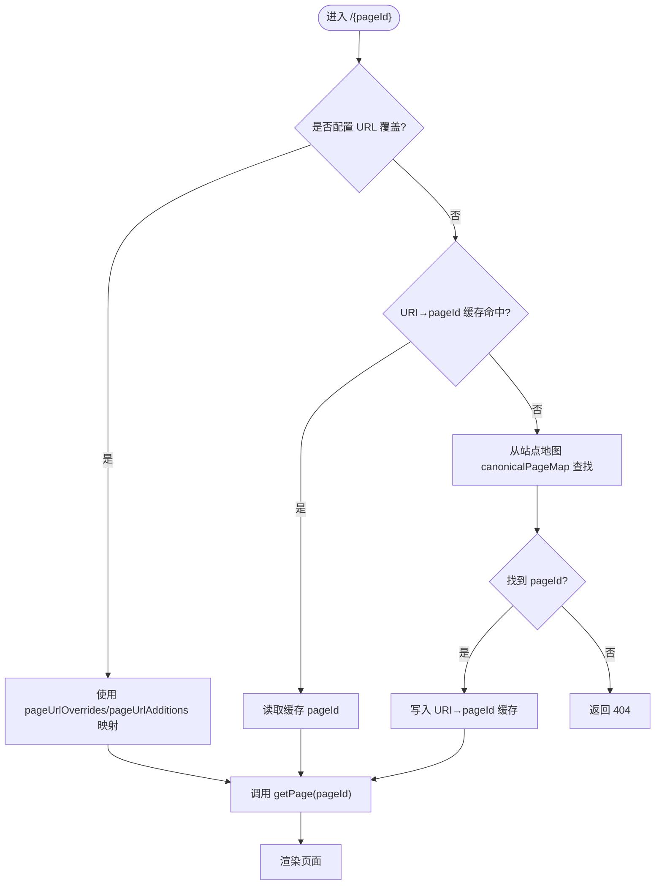
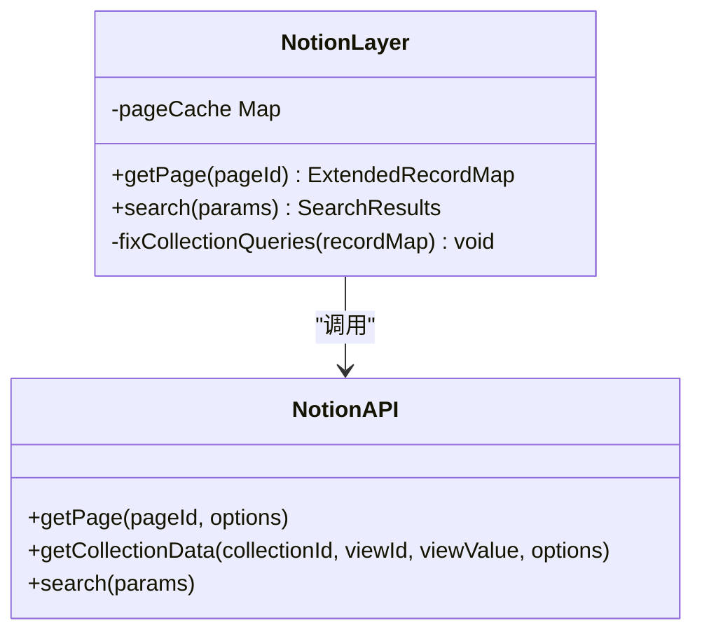
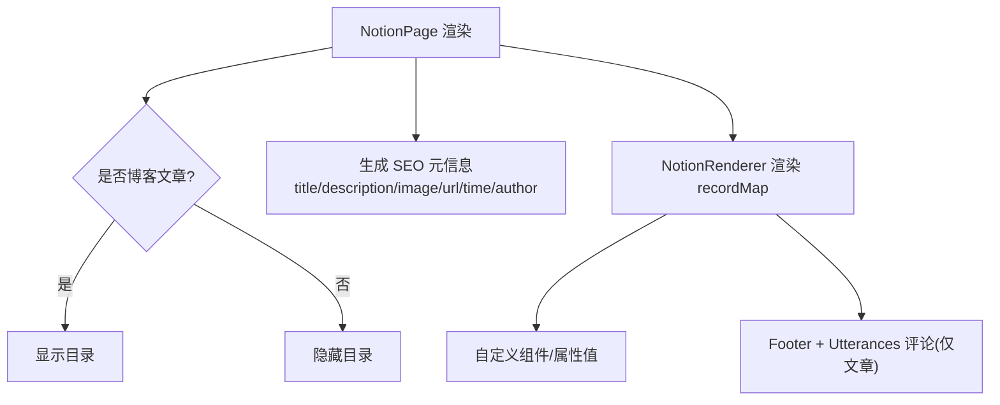
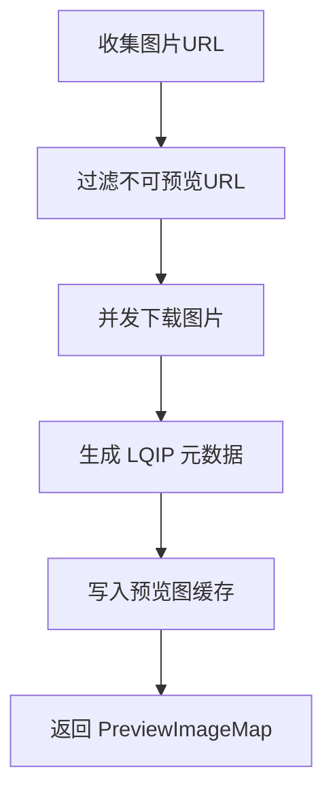
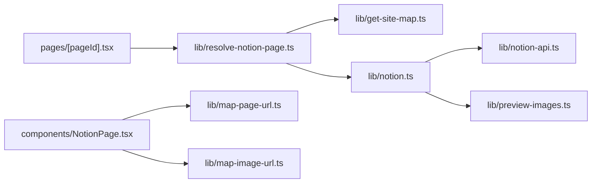

# 内容管理

<cite>
**本文引用的文件**   
- [site.config.ts](file://site.config.ts)
- [lib/config.ts](file://lib/config.ts)
- [lib/site-config.ts](file://lib/site-config.ts)
- [lib/types.ts](file://lib/types.ts)
- [lib/notion-api.ts](file://lib/notion-api.ts)
- [lib/notion.ts](file://lib/notion.ts)
- [lib/resolve-notion-page.ts](file://lib/resolve-notion-page.ts)
- [pages/[pageId].tsx](file://pages/[pageId].tsx)
- [components/NotionPage.tsx](file://components/NotionPage.tsx)
- [lib/map-page-url.ts](file://lib/map-page-url.ts)
- [lib/get-site-map.ts](file://lib/get-site-map.ts)
- [lib/map-image-url.ts](file://lib/map-image-url.ts)
- [lib/preview-images.ts](file://lib/preview-images.ts)
</cite>

## 目录
1. [简介](#简介)
2. [项目结构](#项目结构)
3. [核心组件](#核心组件)
4. [架构总览](#架构总览)
5. [详细组件分析](#详细组件分析)
6. [依赖关系分析](#依赖关系分析)
7. [性能与缓存策略](#性能与缓存策略)
8. [故障排查指南](#故障排查指南)
9. [结论](#结论)
10. [附录：页面模板与最佳实践](#附录页面模板与最佳实践)

## 简介
本仓库是一个基于 Next.js 的 Notion 内容管理系统。它将 Notion 页面转换为网站内容，提供动态路由、URL 解析、媒体资源处理、搜索与 SEO 能力，并通过 ISR（增量静态再生）实现内容更新与版本管理。本文从系统架构、数据流、渲染逻辑、缓存策略到模板建议进行系统化说明，帮助读者理解“如何将 Notion 页面映射为网站页面”，并掌握生产环境下的优化与排错方法。

## 项目结构
该项目的关键目录与职责如下：
- pages：Next.js 路由入口，负责动态路由与 SSR/SSG 构建期数据获取
- components：前端 UI 组件，封装 Notion 渲染、头部、侧边栏、评论等
- lib：业务逻辑层，包含配置、Notion API 封装、页面解析、站点地图、图片映射、预览图等
- site.config.ts：站点级配置入口，集中定义根页面、域名、SEO、导航、ISR 间隔等

图表来源
- [pages/[pageId].tsx:9-52](file://pages/[pageId].tsx#L9-L52)
- [components/NotionPage.tsx:196-355](file://components/NotionPage.tsx#L196-L355)
- [lib/resolve-notion-page.ts:11-84](file://lib/resolve-notion-page.ts#L11-L84)
- [lib/notion.ts:161-214](file://lib/notion.ts#L161-L214)
- [lib/notion-api.ts:1-21](file://lib/notion-api.ts#L1-L21)
- [lib/get-site-map.ts:17-105](file://lib/get-site-map.ts#L17-L105)
- [lib/map-page-url.ts:12-43](file://lib/map-page-url.ts#L12-L43)
- [lib/map-image-url.ts:6-12](file://lib/map-image-url.ts#L6-L12)
- [lib/preview-images.ts:30-99](file://lib/preview-images.ts#L30-L99)
- [lib/config.ts:23-95](file://lib/config.ts#L23-L95)
- [site.config.ts:1-77](file://site.config.ts#L1-L77)

章节来源
- [site.config.ts:1-77](file://site.config.ts#L1-L77)
- [lib/config.ts:23-95](file://lib/config.ts#L23-L95)

## 核心组件
- 动态路由与构建期路径生成：[pages/[pageId].tsx](file://pages/[pageId].tsx#L9-L52)
- Notion 数据获取与缓存：[lib/notion.ts:161-214](file://lib/notion.ts#L161-L214)、[lib/notion-api.ts:1-21](file://lib/notion-api.ts#L1-L21)
- URL 解析与规范化：[lib/resolve-notion-page.ts:11-84](file://lib/resolve-notion-page.ts#L11-L84)、[lib/map-page-url.ts:12-43](file://lib/map-page-url.ts#L12-L43)
- 站点地图与公开页过滤：[lib/get-site-map.ts:17-105](file://lib/get-site-map.ts#L17-L105)
- 媒体资源映射与预览图：[lib/map-image-url.ts:6-12](file://lib/map-image-url.ts#L6-L12)、[lib/preview-images.ts:30-99](file://lib/preview-images.ts#L30-L99)
- 站点配置与运行时常量：[lib/config.ts:23-95](file://lib/config.ts#L23-L95)、[site.config.ts:1-77](file://site.config.ts#L1-L77)

章节来源
- [pages/[pageId].tsx:9-52](file://pages/[pageId].tsx#L9-L52)
- [lib/notion.ts:161-214](file://lib/notion.ts#L161-L214)
- [lib/notion-api.ts:1-21](file://lib/notion-api.ts#L1-L21)
- [lib/resolve-notion-page.ts:11-84](file://lib/resolve-notion-page.ts#L11-L84)
- [lib/map-page-url.ts:12-43](file://lib/map-page-url.ts#L12-L43)
- [lib/get-site-map.ts:17-105](file://lib/get-site-map.ts#L17-L105)
- [lib/map-image-url.ts:6-12](file://lib/map-image-url.ts#L6-L12)
- [lib/preview-images.ts:30-99](file://lib/preview-images.ts#L30-L99)
- [lib/config.ts:23-95](file://lib/config.ts#L23-L95)
- [site.config.ts:1-77](file://site.config.ts#L1-L77)

## 架构总览
下图展示了从请求到渲染的关键流程：Next.js 动态路由接收 pageId，调用 resolveNotionPage 解析 Notion ID 与 recordMap，再通过 NotionPage 组件渲染 Notion 内容，期间涉及 URL 映射、图片处理、预览图生成与缓存。

图表来源
- [pages/[pageId].tsx:9-52](file://pages/[pageId].tsx#L9-L52)
- [lib/resolve-notion-page.ts:11-84](file://lib/resolve-notion-page.ts#L11-L84)
- [lib/get-site-map.ts:17-105](file://lib/get-site-map.ts#L17-L105)
- [lib/notion.ts:161-214](file://lib/notion.ts#L161-L214)
- [lib/notion-api.ts:1-21](file://lib/notion-api.ts#L1-L21)
- [components/NotionPage.tsx:196-355](file://components/NotionPage.tsx#L196-L355)
- [lib/map-image-url.ts:6-12](file://lib/map-image-url.ts#L6-L12)
- [lib/preview-images.ts:30-99](file://lib/preview-images.ts#L30-L99)

## 详细组件分析

### 动态路由与 URL 解析
- 动态路由文件：[pages/[pageId].tsx](file://pages/[pageId].tsx#L9-L52)
  - getStaticPaths：在构建期通过站点地图 canonicalPageMap 与 URL 覆盖表生成所有可构建的路径；开发模式 fallback=true 以按需构建。
  - getStaticProps：调用 resolveNotionPage 获取 props，并设置 revalidateSeconds 控制 ISR 刷新频率。
- URL 解析与映射：
  - [lib/resolve-notion-page.ts:11-84](file://lib/resolve-notion-page.ts#L11-L84)：将 rawPageId 解析为 Notion pageId，优先使用 pageUrlOverrides/pageUrlAdditions，否则查站点地图 canonicalPageMap；若仍找不到则返回 404。同时维护 URI-to-pageId 缓存（db）。
  - [lib/map-page-url.ts:12-43](file://lib/map-page-url.ts#L12-L43)：根据 rootNotionPageId 与 canonicalPageId 生成相对 URL 与绝对 canonical URL，支持是否包含 UUID 的开发开关。

图表来源
- [lib/resolve-notion-page.ts:11-84](file://lib/resolve-notion-page.ts#L11-L84)
- [lib/map-page-url.ts:12-43](file://lib/map-page-url.ts#L12-L43)
- [lib/get-site-map.ts:62-98](file://lib/get-site-map.ts#L62-L98)

章节来源
- [pages/[pageId].tsx:9-52](file://pages/[pageId].tsx#L9-L52)
- [lib/resolve-notion-page.ts:11-84](file://lib/resolve-notion-page.ts#L11-L84)
- [lib/map-page-url.ts:12-43](file://lib/map-page-url.ts#L12-L43)

### Notion 数据获取与缓存
- NotionAPI 客户端：[lib/notion-api.ts:1-21](file://lib/notion-api.ts#L1-L21)
  - 封装 notion-client，配置重试策略、超时、User-Agent 等，提升稳定性。
- 页面数据获取与缓存：[lib/notion.ts:161-214](file://lib/notion.ts#L161-L214)
  - 内存缓存：按 pageId 缓存 ExtendedRecordMap，TTL 60s，用于吸收突发流量与 Notion 抖动。
  - 降级策略：当 Notion 不可用时，回退到过期缓存，避免全站 500。
  - 集合查询修正：对 collection_view 的 query2（排序/过滤）进行二次查询并合并结果，确保与 Notion 视图一致。
  - 预览图与 Tweets：可选地注入 preview_images 与 tweets 数据。

图表来源
- [lib/notion-api.ts:1-21](file://lib/notion-api.ts#L1-L21)
- [lib/notion.ts:161-214](file://lib/notion.ts#L161-L214)

章节来源
- [lib/notion-api.ts:1-21](file://lib/notion-api.ts#L1-L21)
- [lib/notion.ts:161-214](file://lib/notion.ts#L161-L214)

### 页面渲染与字段映射
- 渲染入口：[components/NotionPage.tsx:196-355](file://components/NotionPage.tsx#L196-L355)
  - 使用 react-notion-x 的 NotionRenderer 渲染 recordMap。
  - 自定义组件：Code、Collection、Equation、Pdf、Modal、Tweet、Header 等。
  - 属性值定制：propertyLastEditedTimeValue、propertyTextValue、propertyDateValue，用于在页面头展示作者、发布日期、最后编辑时间等。
  - SEO 元信息：Title、Description、Social Image、Canonical URL、发布时间、修改时间、作者等由 Notion 页面属性决定。
  - 博客文章识别：当 block.parent_table === 'collection' 时视为博客文章，启用目录与评论。

图表来源
- [components/NotionPage.tsx:196-355](file://components/NotionPage.tsx#L196-L355)

章节来源
- [components/NotionPage.tsx:196-355](file://components/NotionPage.tsx#L196-L355)

### 媒体资源处理与预览图
- 图片映射：[lib/map-image-url.ts:6-12](file://lib/map-image-url.ts#L6-L12)
  - 统一处理默认封面/图标与 Notion 图片 URL，必要时走 notion-utils 的默认映射。
- 预览图生成：[lib/preview-images.ts:30-99](file://lib/preview-images.ts#L30-L99)
  - 提取页面中所有图片 URL，并发抓取并生成 LQIP（低质量占位图），缓存至 db。
  - 过滤 data URL、attachment 等不可预览链接。

图表来源
- [lib/preview-images.ts:30-99](file://lib/preview-images.ts#L30-L99)
- [lib/map-image-url.ts:6-12](file://lib/map-image-url.ts#L6-L12)

章节来源
- [lib/map-image-url.ts:6-12](file://lib/map-image-url.ts#L6-L12)
- [lib/preview-images.ts:30-99](file://lib/preview-images.ts#L30-L99)

### 站点地图与公开页过滤
- 站点地图生成：[lib/get-site-map.ts:17-105](file://lib/get-site-map.ts#L17-L105)
  - 遍历空间内所有页面，过滤 Public=false 的页面，生成 canonicalPageMap（canonicalSlug → pageId）。
  - 使用 p-memoize 缓存 5 分钟，平衡新鲜度与性能。
  - 去重 canonicalPageId，避免重复映射。

章节来源
- [lib/get-site-map.ts:17-105](file://lib/get-site-map.ts#L17-L105)

### 配置与运行时常量
- 站点配置入口：[site.config.ts:1-77](file://site.config.ts#L1-L77)
  - 定义 rootNotionPageId、domain、SEO、导航、ISR 间隔、预览图开关等。
- 运行时配置聚合：[lib/config.ts:23-95](file://lib/config.ts#L23-L95)
  - 解析 site.config.ts 与环境变量，导出 name、domain、revalidateSeconds、isSearchEnabled、includeNotionIdInUrls 等。
  - 校验 pageUrlOverrides/pageUrlAdditions 格式，生成 inversePageUrlOverrides。

章节来源
- [site.config.ts:1-77](file://site.config.ts#L1-L77)
- [lib/config.ts:23-95](file://lib/config.ts#L23-L95)

## 依赖关系分析
- 模块耦合：
  - pages/[pageId].tsx 依赖 resolve-notion-page、get-site-map、config、types。
  - resolve-notion-page 依赖 config、acl、db、get-site-map、notion。
  - notion 依赖 notion-api、config、get-tweets、preview-images。
  - NotionPage 组件依赖 map-page-url、map-image-url、search-notion、use-dark-mode 等。
- 外部依赖：
  - notion-client：Notion API 客户端
  - notion-utils：工具函数（parsePageId、getBlockValue、getPageProperty 等）
  - react-notion-x：Notion 渲染引擎
  - lqip-modern：预览图生成
  - p-map/p-memoize：并发与缓存

图表来源
- [pages/[pageId].tsx:9-52](file://pages/[pageId].tsx#L9-L52)
- [lib/resolve-notion-page.ts:11-84](file://lib/resolve-notion-page.ts#L11-L84)
- [lib/get-site-map.ts:17-105](file://lib/get-site-map.ts#L17-L105)
- [lib/notion.ts:161-214](file://lib/notion.ts#L161-L214)
- [lib/notion-api.ts:1-21](file://lib/notion-api.ts#L1-L21)
- [lib/preview-images.ts:30-99](file://lib/preview-images.ts#L30-L99)
- [components/NotionPage.tsx:196-355](file://components/NotionPage.tsx#L196-L355)
- [lib/map-page-url.ts:12-43](file://lib/map-page-url.ts#L12-L43)
- [lib/map-image-url.ts:6-12](file://lib/map-image-url.ts#L6-L12)

章节来源
- [pages/[pageId].tsx:9-52](file://pages/[pageId].tsx#L9-L52)
- [lib/resolve-notion-page.ts:11-84](file://lib/resolve-notion-page.ts#L11-L84)
- [lib/get-site-map.ts:17-105](file://lib/get-site-map.ts#L17-L105)
- [lib/notion.ts:161-214](file://lib/notion.ts#L161-L214)
- [lib/notion-api.ts:1-21](file://lib/notion-api.ts#L1-L21)
- [lib/preview-images.ts:30-99](file://lib/preview-images.ts#L30-L99)
- [components/NotionPage.tsx:196-355](file://components/NotionPage.tsx#L196-L355)
- [lib/map-page-url.ts:12-43](file://lib/map-page-url.ts#L12-L43)
- [lib/map-image-url.ts:6-12](file://lib/map-image-url.ts#L6-L12)

## 性能与缓存策略
- 页面级 ISR：
  - 通过 revalidateSeconds 控制增量静态再生频率，减少函数调用次数，适合低频更新的内容站点。
- 内存缓存（Notion 数据）：
  - 每个 pageId 的 ExtendedRecordMap 在进程内缓存 60s，降低 Notion API 压力，并提供 stale-while-revalidate 降级。
- 站点地图缓存：
  - getAllPages 使用 p-memoize 缓存 5 分钟，保证新页面快速上线的同时避免频繁全量扫描。
- 预览图缓存：
  - LQIP 结果持久化到 db，避免重复计算。
- 并发优化：
  - 预览图生成、集合查询修正均使用并发限制，提高吞吐。

章节来源
- [lib/notion.ts:29-55](file://lib/notion.ts#L29-L55)
- [lib/get-site-map.ts:29-32](file://lib/get-site-map.ts#L29-L32)
- [lib/preview-images.ts:40-51](file://lib/preview-images.ts#L40-L51)
- [pages/[pageId].tsx:17-17](file://pages/[pageId].tsx#L17-L17)

## 故障排查指南
- Notion API 不稳定或超时：
  - 检查 notion-api.ts 的重试与超时配置，确认环境变量 NOTION_API_TOKEN 与 NOTION_API_BASE_URL 是否正确。
  - 观察日志中的 “NotionAPI fixCollectionQueries error” 与 “getPage failed for ... serving stale cache”。
- 页面 404：
  - 确认 Notion 页面 Public 属性为 true；检查 pageUrlOverrides/pageUrlAdditions 映射是否正确；查看 canonicalPageMap 是否包含目标 slug。
- 图片不显示或预览图缺失：
  - 检查 mapImageUrl 与 preview-images 的过滤规则，确认图片 URL 非 data/attachment 且为 http(s)。
- 集合视图排序/过滤不一致：
  - 确认 fixCollectionQueries 已执行；检查 Notion 视图的 query2 是否定义了 sort/filter。

章节来源
- [lib/notion-api.ts:1-21](file://lib/notion-api.ts#L1-L21)
- [lib/notion.ts:149-155](file://lib/notion.ts#L149-L155)
- [lib/notion.ts:170-182](file://lib/notion.ts#L170-L182)
- [lib/get-site-map.ts:70-74](file://lib/get-site-map.ts#L70-L74)
- [lib/preview-images.ts:16-28](file://lib/preview-images.ts#L16-L28)

## 结论
本项目通过 Next.js 的动态路由与 ISR，结合 Notion 的 recordMap 模型，实现了从 Notion 页面到网站内容的稳定转换。其核心优势包括：
- 清晰的 URL 解析与映射机制，支持覆盖与添加自定义路径
- 健壮的 Notion 数据获取与缓存策略，具备降级与并发优化
- 完善的媒体资源处理与预览图生成，提升首屏体验
- 灵活的站点配置与 SEO 元信息映射，便于多场景部署

在生产环境中，建议合理设置 revalidateSeconds、开启预览图、使用 URL 覆盖表管理重要页面，并通过 Public 属性控制可见性。

## 附录：页面模板与最佳实践

### 页面结构映射
- 根页面：rootNotionPageId 对应站点首页
- 普通页面：通过 canonicalPageId 映射为友好 URL
- 博客文章：block.parent_table === 'collection' 的文章类型，自动启用目录与评论

章节来源
- [components/NotionPage.tsx:238-242](file://components/NotionPage.tsx#L238-L242)

### 字段定义与 SEO
- 推荐页面属性：
  - Title：页面标题
  - Description：文章描述（未设置时使用 “标题 — 站点名”）
  - Social Image：社交分享图（未设置时使用 page_cover 或默认封面）
  - Published：发布日期（用于 SEO 与页面头）
  - Last Edited：最后编辑时间
  - Author：作者
  - Public：是否公开（影响站点地图收录）

章节来源
- [components/NotionPage.tsx:277-313](file://components/NotionPage.tsx#L277-L313)
- [lib/get-site-map.ts:70-74](file://lib/get-site-map.ts#L70-L74)

### 媒体资源处理
- 图片：
  - 使用 mapImageUrl 统一处理默认封面/图标与 Notion 图片 URL
  - 可选开启 isPreviewImageSupportEnabled 以生成 LQIP 预览图
- 附件与外链：
  - 预览图生成会过滤 data URL 与 attachment URL，避免无效请求

章节来源
- [lib/map-image-url.ts:6-12](file://lib/map-image-url.ts#L6-L12)
- [lib/preview-images.ts:16-28](file://lib/preview-images.ts#L16-L28)

### 动态路由与 URL 解析
- 动态路由：pages/[pageId].tsx
- URL 覆盖：pageUrlOverrides/pageUrlAdditions
- Canonical URL：getCanonicalPageUrl 生成绝对地址

章节来源
- [pages/[pageId].tsx:27-52](file://pages/[pageId].tsx#L27-L52)
- [lib/map-page-url.ts:27-43](file://lib/map-page-url.ts#L27-L43)

### 内容更新与版本管理
- 增量静态再生：revalidateSeconds 控制刷新频率
- 站点地图缓存：5 分钟缓存，兼顾新鲜度与性能
- 页面数据缓存：60s 内存缓存，提供降级回退

章节来源
- [lib/config.ts:93-95](file://lib/config.ts#L93-L95)
- [lib/get-site-map.ts:29-32](file://lib/get-site-map.ts#L29-L32)
- [lib/notion.ts:29-55](file://lib/notion.ts#L29-L55)