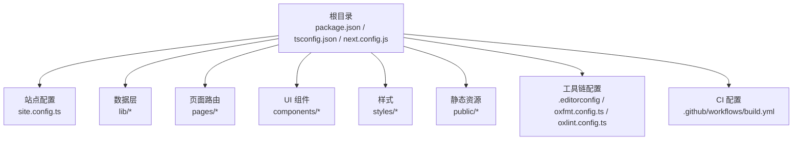
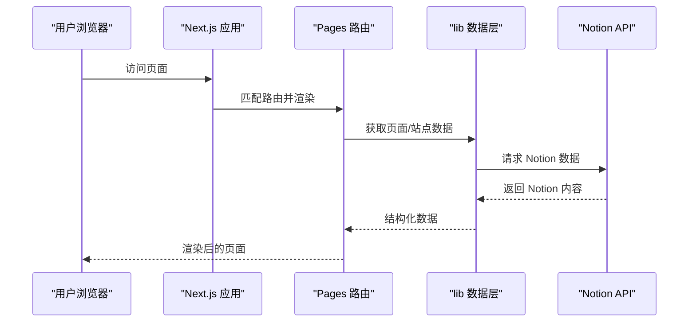
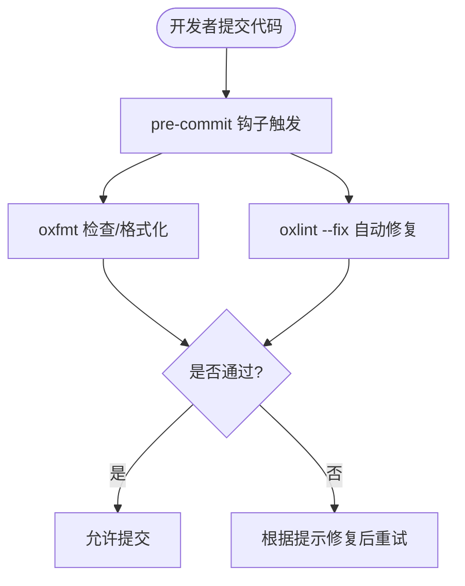
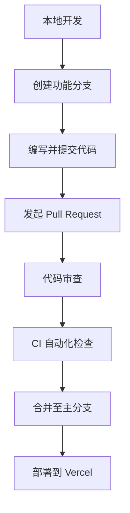
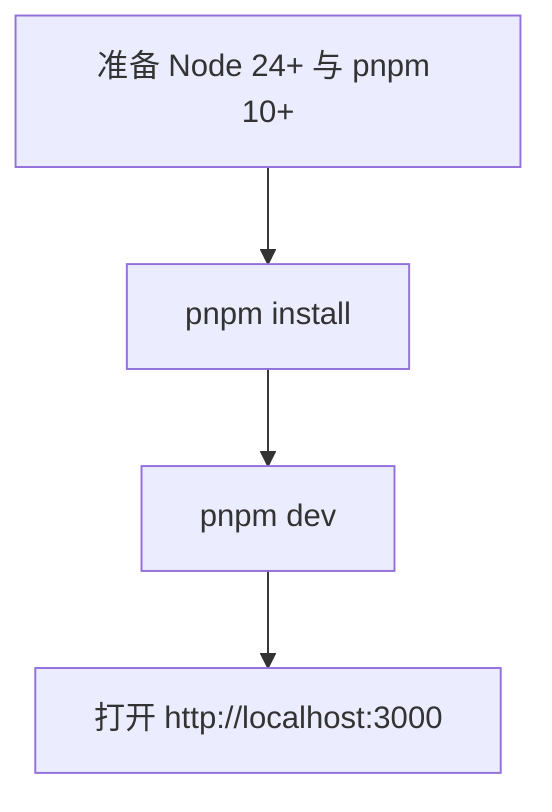
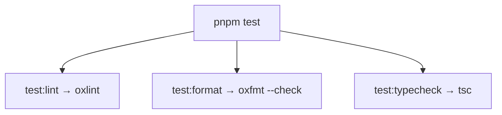
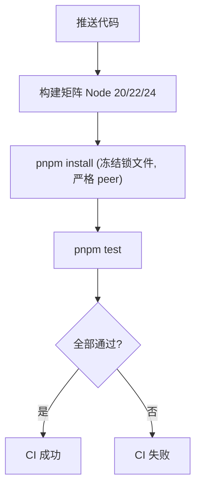
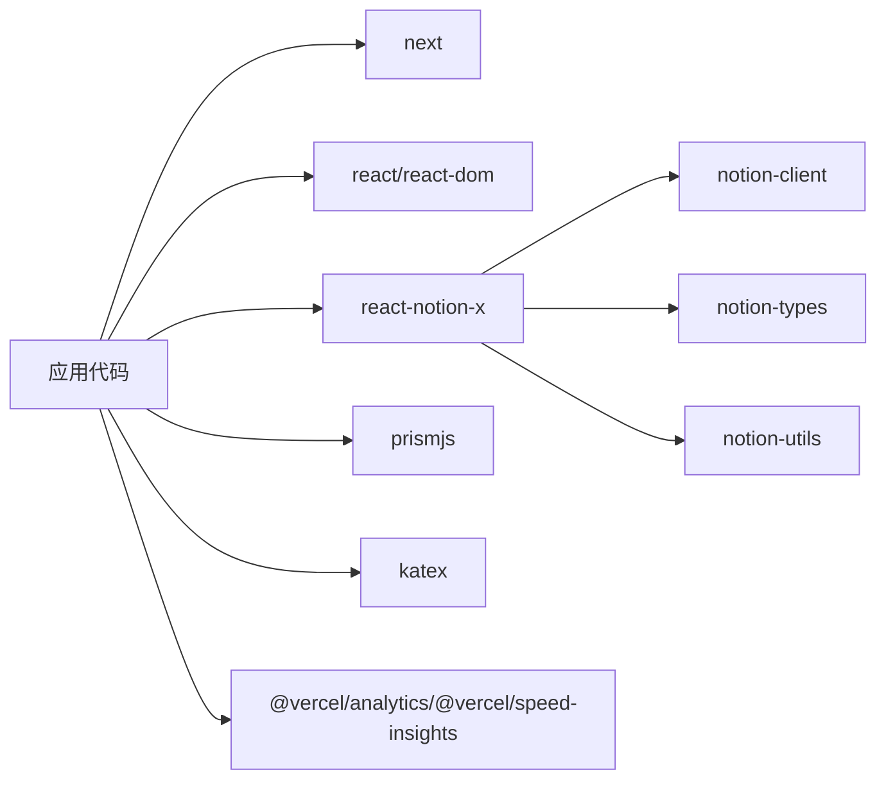
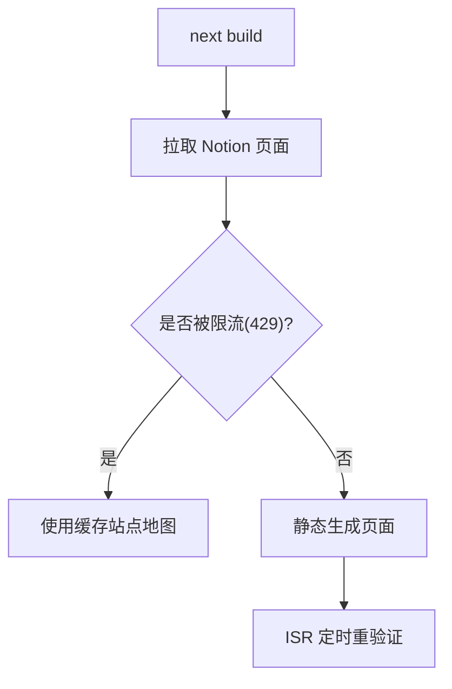

# 开发指南

<cite>
**本文引用的文件**   
- [package.json](file://package.json)
- [readme.md](file://readme.md)
- [contributing.md](file://contributing.md)
- [.editorconfig](file://.editorconfig)
- [oxfmt.config.ts](file://oxfmt.config.ts)
- [oxlint.config.ts](file://oxlint.config.ts)
- [.github/workflows/build.yml](file://.github/workflows/build.yml)
- [.github/pull_request_template.md](file://.github/pull_request_template.md)
- [.github/issue_template.md](file://.github/issue_template.md)
</cite>

## 目录
1. [简介](#简介)
2. [项目结构](#项目结构)
3. [核心组件与职责](#核心组件与职责)
4. [架构总览](#架构总览)
5. [详细组件分析](#详细组件分析)
6. [依赖关系分析](#依赖关系分析)
7. [性能考量](#性能考量)
8. [故障排查指南](#故障排查指南)
9. [结论](#结论)
10. [附录](#附录)

## 简介
本开发指南面向新贡献者与维护者，系统化说明项目的开发规范、代码质量保障、Git 工作流、提交规范、代码审查流程、调试技巧、测试方法与性能分析方法。本项目基于 Next.js 与 react-notion-x 构建 Notion 驱动的个人博客，采用 TypeScript、oxlint、oxfmt 进行类型检查与代码风格治理，并通过 GitHub Actions 在 CI 中执行质量门禁。

## 项目结构
仓库采用分层组织：站点配置、数据层（lib）、页面路由（pages）、UI 组件（components）、样式（styles）与静态资源（public）。根目录包含包管理、工具链配置与文档。

**图表来源**
- [package.json:1-94](file://package.json#L1-L94)
- [readme.md:81-92](file://readme.md#L81-L92)

**章节来源**
- [readme.md:81-92](file://readme.md#L81-L92)

## 核心组件与职责
- 站点配置：集中管理站点元信息、Notion 根页面、SEO、预览图、分析、索引等开关与参数。
- 数据层：封装 Notion API 调用、页面解析、站点地图、搜索、图片映射、URL 映射、ACL 等。
- 页面路由：Next.js Pages Router 入口、动态页面、API 接口、Feed、Sitemap、Robots、错误页等。
- UI 组件：Notion 内容渲染、页面头部、SEO Head、搜索弹窗、页脚等。
- 样式：全局样式、Notion 主题覆盖、代码高亮主题。
- 工具链：编辑器基础规则、格式化与 Lint 配置、TypeScript 编译选项。
- CI：多 Node 版本矩阵校验与测试。

**章节来源**
- [readme.md:32-48](file://readme.md#L32-L48)
- [readme.md:81-92](file://readme.md#L81-L92)

## 架构总览
下图展示从浏览器到 Notion 的数据流与关键模块交互：

该流程体现 Next.js 作为前端框架承载 Pages 路由，通过 lib 数据层与 Notion API 交互，最终将内容渲染为静态或增量静态再生成的页面。

**图表来源**
- [readme.md:81-92](file://readme.md#L81-L92)

## 详细组件分析

### 代码风格与质量工具
- 编辑器基础规则：统一字符集、缩进、换行、尾随空格与末尾换行。
- 格式化：使用 oxfmt，忽略生成物与第三方目录，避免对非源码进行格式化。
- Lint：使用 oxlint，结合 tsc 进行类型感知检查；针对 React Compiler 未启用的场景关闭部分优化提示规则。
- 提交钩子：pre-commit 通过 simple-git-hooks + lint-staged 对暂存区的 TS/TSX 文件运行格式化和自动修复。

**图表来源**
- [package.json:73-81](file://package.json#L73-L81)
- [oxfmt.config.ts:1-22](file://oxfmt.config.ts#L1-L22)
- [oxlint.config.ts:1-16](file://oxlint.config.ts#L1-L16)
- [.editorconfig:1-8](file://.editorconfig#L1-L8)

**章节来源**
- [.editorconfig:1-8](file://.editorconfig#L1-L8)
- [oxfmt.config.ts:1-22](file://oxfmt.config.ts#L1-L22)
- [oxlint.config.ts:1-16](file://oxlint.config.ts#L1-L16)
- [package.json:73-81](file://package.json#L73-L81)

### Git 工作流与提交规范
- 分支策略：建议以功能/修复为单位创建分支，合并回主分支前确保本地测试通过。
- 提交信息：建议遵循约定式提交（如 feat/fix/docs/style/refactor/test/chore），保持语义清晰。
- 预提交检查：pre-commit 钩子会阻止不符合规范的提交。
- Pull Request：使用模板描述变更与关联的 Notion 测试页面 ID，便于复现与调试。
- Issue：使用模板描述问题背景与复现步骤，并提供 Notion 测试页面 ID。

**图表来源**
- [.github/pull_request_template.md:1-16](file://.github/pull_request_template.md#L1-L16)
- [.github/issue_template.md:1-16](file://.github/issue_template.md#L1-L16)
- [package.json:73-81](file://package.json#L73-L81)

**章节来源**
- [.github/pull_request_template.md:1-16](file://.github/pull_request_template.md#L1-L16)
- [.github/issue_template.md:1-16](file://.github/issue_template.md#L1-L16)
- [package.json:73-81](file://package.json#L73-L81)

### 环境设置与快速开始
- 前置条件：Node.js 24+ 与 pnpm 10+。
- 安装依赖：pnpm install。
- 启动开发服务器：pnpm dev。
- 环境变量：所有环境变量可选，可在 .env.example 参考；本地无需 .env 亦可运行。

**图表来源**
- [readme.md:19-30](file://readme.md#L19-L30)
- [package.json:82-85](file://package.json#L82-L85)

**章节来源**
- [readme.md:19-30](file://readme.md#L19-L30)
- [package.json:82-85](file://package.json#L82-L85)

### 脚本与任务
- 开发：pnpm dev（Next.js 开发服务器，启用 Turbopack）。
- 构建：pnpm build（生产构建）。
- 启动服务：pnpm start（生产模式）。
- 质量检查：pnpm test（并行执行 lint/format/typecheck）。
- 部署：pnpm deploy（Vercel 部署）。
- 依赖链接：pnpm deps:link / deps:unlink（用于本地联调 react-notion-x）。
- 依赖升级：pnpm deps:upgrade（升级 notion-* 相关包）。

**图表来源**
- [package.json:10-26](file://package.json#L10-L26)
- [readme.md:50-70](file://readme.md#L50-L70)

**章节来源**
- [package.json:10-26](file://package.json#L10-L26)
- [readme.md:50-70](file://readme.md#L50-L70)

### 持续集成（CI）
- 触发时机：push 事件。
- 矩阵策略：在 Node 20/22/24 上并行执行安装与测试。
- 缓存：启用 pnpm 缓存加速安装。
- 命令：pnpm install --frozen-lockfile --strict-peer-dependencies 与 pnpm test。
- Redis 缓存：示例注释展示了如何接入 Redis 密钥（需自行开启）。

**图表来源**
- [.github/workflows/build.yml:1-35](file://.github/workflows/build.yml#L1-L35)

**章节来源**
- [.github/workflows/build.yml:1-35](file://.github/workflows/build.yml#L1-L35)

## 依赖关系分析
- 运行时依赖：Next.js、React、react-notion-x、notion-client/types/utils、Prism、KaTeX、分析 SDK 等。
- 开发依赖：oxlint、oxfmt、typescript、@types/*、npm-run-all2 等。
- 包管理器：pnpm，锁定版本与仅构建必要依赖以提升稳定性与速度。
- 引擎要求：Node 24，packageManager 指定 pnpm 版本。

**图表来源**
- [package.json:27-67](file://package.json#L27-L67)

**章节来源**
- [package.json:27-67](file://package.json#L27-L67)

## 性能考量
- 构建期：每次构建会从 Notion 拉取公开页面并静态生成；若遭遇限流（HTTP 429），应用回退到缓存的站点地图。
- ISR：支持增量静态再生成，可通过 revalidateSeconds 控制刷新频率。
- 预览图：可启用 LQIP 模糊哈希预览图，Redis 可选用于持久化缓存。
- 分析：支持 Vercel Analytics 与 Speed Insights，以及 Fathom、PostHog 等第三方分析。
- 构建优化：Turbopack 加速开发体验；生产构建由 Next.js 优化。

**图表来源**
- [readme.md:94-96](file://readme.md#L94-L96)
- [readme.md:32-48](file://readme.md#L32-L48)

**章节来源**
- [readme.md:94-96](file://readme.md#L94-L96)
- [readme.md:32-48](file://readme.md#L32-L48)

## 故障排查指南
- 本地热重载异常：重启一个或多个 pnpm dev 进程；必要时清理 .next 缓存后重试。
- 联调 react-notion-x：先本地构建 react-notion-x，再使用 pnpm deps:link 链接本地依赖，双端分别运行 dev。
- 构建失败：确认 Node 与 pnpm 版本满足要求；检查 CI 矩阵日志；必要时清理缓存并重试。
- 预览图不显示：检查 isPreviewImageSupportEnabled 与 Redis 配置（如需持久化）。
- 分析数据缺失：核对对应分析服务的密钥与环境变量配置。

**章节来源**
- [contributing.md:52-71](file://contributing.md#L52-L71)
- [readme.md:32-48](file://readme.md#L32-L48)

## 结论
本项目通过严格的工具链与 CI 保障代码质量与一致性，配合清晰的贡献流程与模板，降低协作成本。新贡献者可依据本指南快速搭建环境、理解架构、遵循规范并高效参与开发与维护。

## 附录

### 常用命令速查
- 开发：pnpm dev
- 构建：pnpm build
- 启动：pnpm start
- 测试：pnpm test
- 部署：pnpm deploy
- 依赖链接：pnpm deps:link / deps:unlink
- 依赖升级：pnpm deps:upgrade

**章节来源**
- [readme.md:50-60](file://readme.md#L50-L60)

### 环境变量与站点配置要点
- rootNotionPageId：必填，站点根 Notion 页面 ID。
- SEO 与社交分享：name/domain/author/description。
- 预览图：isPreviewImageSupportEnabled（可选 Redis 持久化）。
- 分析：googleAnalyticsId/clarityId/isVercelAnalyticsEnabled/isVercelSpeedInsightsEnabled。
- 搜索引擎验证与即时索引：bingSiteVerification/googleSiteVerification/indexNowKey。
- ISR 重验证间隔：revalidateSeconds（默认 3600，示例设为 86400）。
- 导航：navigationStyle/navigationLinks/pageUrlOverrides。

**章节来源**
- [readme.md:32-48](file://readme.md#L32-L48)