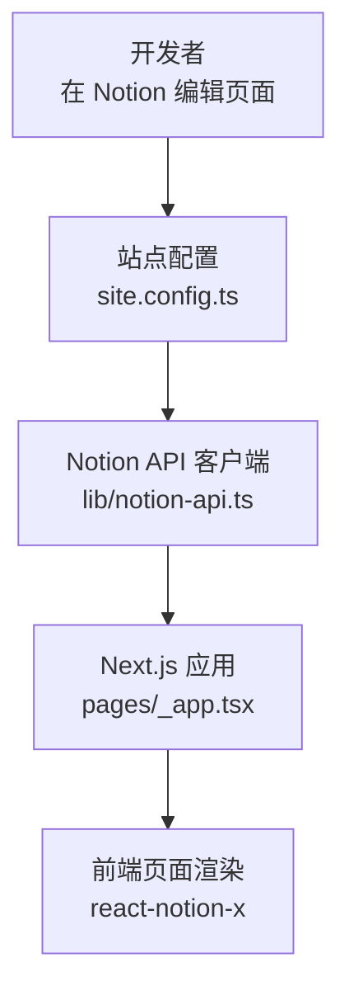

# 快速开始

<cite>
**本文引用的文件**   
- [readme.md](file://readme.md)
- [site.config.ts](file://site.config.ts)
- [lib/site-config.ts](file://lib/site-config.ts)
- [lib/notion-api.ts](file://lib/notion-api.ts)
- [package.json](file://package.json)
- [next.config.js](file://next.config.js)
- [pages/_app.tsx](file://pages/_app.tsx)
</cite>

## 目录
1. [简介](#简介)
2. [环境要求](#环境要求)
3. [安装与本地开发](#安装与本地开发)
4. [站点配置：site.config.ts](#站点配置siteconfigts)
5. [环境变量与 .env.example](#环境变量与-envexample)
6. [构建、预览与部署](#构建预览与部署)
7. [常见问题与故障排除](#常见问题与故障排除)
8. [架构概览（面向新手）](#架构概览面向新手)
9. [结论](#结论)

## 简介
本项目是一个基于 Next.js 和 Notion 的个人博客模板。页面内容在 Notion 中编辑，通过 react-notion-x 渲染为静态化站点，并支持增量静态再生（ISR）。你可以快速克隆仓库、配置根页面 ID，并在本地运行看到第一个页面。

## 环境要求
- Node.js 24+
- pnpm 10+

说明：
- 项目通过 engines 字段锁定 Node 版本，并通过 packageManager 字段锁定 pnpm 版本，确保团队与 CI 环境一致。
- 推荐直接使用系统安装的 Node 24 与 pnpm 10，或使用 nvm/corepack 管理版本。

章节来源
- [readme.md:19-21](file://readme.md#L19-L21)
- [package.json:82-85](file://package.json#L82-L85)

## 安装与本地开发
步骤如下：
1. 克隆仓库到本地。
2. 进入项目根目录。
3. 安装依赖：pnpm install
4. 启动开发服务器：pnpm dev
5. 打开浏览器访问 http://localhost:3000 查看站点。

注意：
- 首次运行无需 .env 文件，所有环境变量均为可选。
- 开发服务器使用 Turbopack，启动速度更快。

章节来源
- [readme.md:21-30](file://readme.md#L21-L30)
- [package.json:10-14](file://package.json#L10-L14)

## 站点配置：site.config.ts
站点的所有全局设置集中在 site.config.ts。你需要至少完成以下关键配置：

必填项
- rootNotionPageId：站点根页面的 Notion 页面 ID。这是最重要的配置，决定了首页内容与站点结构。

常用可选项
- name / domain / author：站点名称、域名、作者信息。
- description：SEO 描述与 Open Graph 摘要。
- defaultPageIcon / defaultPageCover / defaultPageCoverPosition：全站默认图标与封面图。
- isPreviewImageSupportEnabled：是否启用低质量图片占位（LQIP）预览图。
- googleSiteVerification / bingSiteVerification / indexNowKey：搜索引擎验证与即时索引。
- googleAnalyticsId / clarityId / isVercelAnalyticsEnabled / isVercelSpeedInsightsEnabled：分析与性能监控。
- pageUrlOverrides：将 Notion 页面 ID 映射到自定义 URL 路径。
- navigationStyle / navigationLinks：导航样式与自定义导航链接。
- revalidateSeconds：ISR 重新验证间隔（秒），默认 3600；示例设置为 86400（每天一次）。

如何获取 rootNotionPageId
- 在 Notion 中打开你的“主页”或“站点入口”页面。
- 复制该页面的 URL，提取其中的页面 ID（一串十六进制字符串）。
- 将该 ID 填入 site.config.ts 的 rootNotionPageId。

重要提醒
- 请确保 Notion 页面已设置为“公开分享”，否则站点无法读取内容。

章节来源
- [readme.md:32-48](file://readme.md#L32-L48)
- [site.config.ts:1-78](file://site.config.ts#L1-L78)
- [lib/site-config.ts:3-45](file://lib/site-config.ts#L3-L45)

## 环境变量与 .env.example
项目支持多种可选的环境变量，用于分析、搜索、Twitter 嵌入、Redis 缓存等。虽然不强制提供 .env 文件也能运行，但建议根据需求创建 .env 文件并参考 .env.example 进行配置。

常见环境变量类别
- 分析与埋点：Fathom、PostHog、Google Analytics、Microsoft Clarity、Vercel Analytics/Speed Insights。
- Twitter 嵌入：Twitter Token（加速推文渲染）。
- Redis：用于持久化预览图片（LQIP）。
- Notion API：NOTION_API_BASE_URL、NOTION_API_TOKEN（用于自定义 API 地址与认证）。

如何使用
- 在项目根目录创建 .env 文件。
- 将需要的键值对从 .env.example 复制到 .env，并按需填写真实值。
- 重启开发服务器使环境变量生效。

说明
- 若未配置某些变量，对应功能会降级或禁用，不影响基本站点运行。

章节来源
- [readme.md:30-48](file://readme.md#L30-L48)
- [lib/notion-api.ts:1-20](file://lib/notion-api.ts#L1-L20)
- [pages/_app.tsx:17-87](file://pages/_app.tsx#L17-L87)

## 构建、预览与部署
常用脚本
- pnpm build：生产构建（Next.js）。
- pnpm start：在生产模式下启动服务。
- pnpm deploy：部署到 Vercel（可加 --prod）。

构建与部署要点
- 构建时会抓取所有公开页面进行静态生成；若 Notion 限流（HTTP 429），站点会回退到缓存的站点地图。
- 部署平台推荐使用 Vercel，Node 与 pnpm 版本已在 package.json 中固定。

章节来源
- [readme.md:50-60](file://readme.md#L50-L60)
- [readme.md:94-96](file://readme.md#L94-L96)
- [package.json:10-14](file://package.json#L10-L14)

## 常见问题与故障排除
- 本地无法加载 Notion 内容
  - 检查 rootNotionPageId 是否正确。
  - 确认 Notion 页面已“公开分享”。
  - 若使用私有工作区，考虑配置 rootNotionSpaceId（可选）。

- 构建时出现 Notion 限流（HTTP 429）
  - 构建过程会尝试重试；如仍失败，站点会回退到缓存的站点地图。
  - 可调整 ISR 重新验证间隔（revalidateSeconds）以减少频繁请求。

- 图片无法显示或优化失败
  - next.config.js 已允许 Notion CDN 与部分外部主机；如需新增外链图片源，可在 images.remotePatterns 中添加。
  - 如遇第三方外链图片被拦截，检查域名是否在 remotePatterns 中。

- 分析工具未生效
  - 检查相关环境变量是否配置正确（如 Google Analytics、Clarity、Fathom、PostHog）。
  - 确认 isVercelAnalyticsEnabled / isVercelSpeedInsightsEnabled 开关状态。

- 开发服务器启动失败
  - 确认 Node 与 pnpm 版本满足要求（Node 24+、pnpm 10+）。
  - 清理依赖后重装：删除 node_modules 与 pnpm-lock.yaml，再执行 pnpm install。

章节来源
- [readme.md:32-48](file://readme.md#L32-L48)
- [readme.md:94-96](file://readme.md#L94-L96)
- [next.config.js:6-24](file://next.config.js#L6-L24)
- [lib/notion-api.ts:1-20](file://lib/notion-api.ts#L1-L20)
- [pages/_app.tsx:17-87](file://pages/_app.tsx#L17-L87)

## 架构概览（面向新手）
下图展示了新手视角下的核心流程：你在 Notion 编辑内容，站点通过 Notion API 拉取数据，再由 React 组件渲染为页面。

图示来源
- [site.config.ts:1-78](file://site.config.ts#L1-L78)
- [lib/notion-api.ts:1-20](file://lib/notion-api.ts#L1-L20)
- [pages/_app.tsx:1-14](file://pages/_app.tsx#L1-L14)

## 结论
按照本指南完成环境准备、安装依赖、配置 rootNotionPageId 与必要的 .env 变量后，即可在本地运行并看到由 Notion 驱动的站点首页。后续可根据需要开启分析、SEO 验证、预览图等高级功能。若遇到问题，优先检查 Notion 页面公开状态与 rootNotionPageId 配置，其次排查环境变量与构建日志。