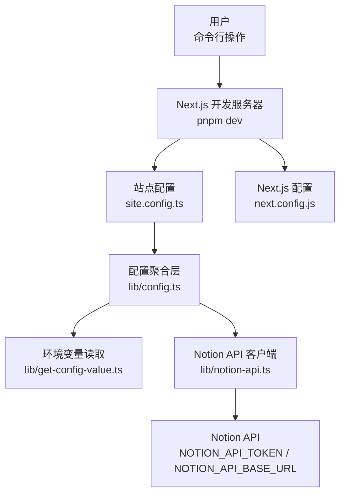

# 快速开始

<cite>
**本文引用的文件**   
- [package.json](file://package.json)
- [site.config.ts](file://site.config.ts)
- [lib/config.ts](file://lib/config.ts)
- [lib/get-config-value.ts](file://lib/get-config-value.ts)
- [lib/notion-api.ts](file://lib/notion-api.ts)
- [next.config.js](file://next.config.js)
</cite>

## 目录
1. [简介](#简介)
2. [环境要求](#环境要求)
3. [安装依赖](#安装依赖)
4. [初始配置](#初始配置)
5. [运行开发服务器](#运行开发服务器)
6. [构建与部署](#构建与部署)
7. [常见问题排查](#常见问题排查)
8. [架构概览（帮助理解）](#架构概览帮助理解)

## 简介
本指南帮助你从零开始搭建并运行 nextjs-notion-starter-kit。你将完成以下目标：
- 准备 Node.js 环境
- 安装项目依赖
- 配置 Notion API 密钥
- 设置站点基础信息
- 启动开发服务器并预览站点

## 环境要求
- Node.js 版本：24（由包管理器与引擎声明约束）
- 包管理器：pnpm（推荐，与仓库一致）

说明：
- 项目的 engines 字段指定了 Node.js 版本为 24，确保使用匹配的版本可避免兼容性问题。
- pnpm 是仓库默认使用的包管理器，脚本与锁文件均基于 pnpm。

章节来源
- [package.json:10-12](file://package.json#L10-L12)
- [package.json:9](file://package.json#L9)

## 安装依赖
在仓库根目录执行以下命令：

- 安装依赖
  - pnpm install

提示：
- 若首次安装较慢，请保持网络稳定；pnpm 会复用缓存以加速后续安装。
- 如需使用系统 npm/yarn，建议切换到 pnpm 以获得与仓库一致的体验。

章节来源
- [package.json:14-18](file://package.json#L14-L18)

## 初始配置
本项目通过“站点配置文件 + 环境变量”的方式管理配置。你需要完成两部分：Notion API 认证与站点基础信息。

### 1) 配置 Notion API 密钥
- 创建或编辑 .env 文件（位于仓库根目录）
- 添加以下变量：
  - NOTION_API_TOKEN=你的内部集成令牌
  - NOTION_API_BASE_URL=可选，自定义 Notion API 基础地址（一般留空即可）

说明：
- 应用会在运行时读取这两个环境变量，用于初始化 NotionAPI 客户端。
- 如果你仅使用官方 Notion API，可不设置 NOTION_API_BASE_URL。

章节来源
- [lib/notion-api.ts:6-19](file://lib/notion-api.ts#L6-L19)

### 2) 设置站点配置
- 打开 site.config.ts
- 至少确认以下必填项：
  - rootNotionPageId：你的根页面 ID（必须）
  - name、domain、author：站点名称、域名、作者（必须）
- 可选配置包括：
  - description：站点描述
  - defaultPageIcon/defaultPageCover：全站默认图标/封面
  - isPreviewImageSupportEnabled：是否启用 LQIP 预览图
  - googleSiteVerification/bingSiteVerification/indexNowKey：搜索引擎验证
  - googleAnalyticsId/clarityId/isVercelAnalyticsEnabled/isVercelSpeedInsightsEnabled：分析统计
  - pageUrlOverrides/pageUrlAdditions：URL 映射覆盖
  - revalidateSeconds：ISR 重新验证间隔（秒）
  - navigationStyle/navigationLinks：导航样式与链接

说明：
- 站点配置会被 lib/config.ts 统一读取和校验，缺失必填项将抛出错误。
- 部分配置支持通过环境变量覆盖（例如 Google/Bing 站点验证、IndexNow Key、Google Analytics ID）。

章节来源
- [site.config.ts:1-77](file://site.config.ts#L1-L77)
- [lib/config.ts:23-30](file://lib/config.ts#L23-L30)
- [lib/config.ts:51-95](file://lib/config.ts#L51-L95)
- [lib/config.ts:114-143](file://lib/config.ts#L114-L143)
- [lib/get-config-value.ts:27-48](file://lib/get-config-value.ts#L27-L48)

## 运行开发服务器
- 启动开发模式
  - pnpm dev

预期行为：
- Next.js 开发服务器启动，默认监听本地端口（可通过 PORT 环境变量调整）。
- 浏览器访问 http://localhost:3000 即可预览站点。

说明：
- 开发模式下，包含 Notion ID 的 URL 片段可能默认开启，便于调试。
- 若需要修改端口，可在 .env 中设置 PORT。

章节来源
- [lib/config.ts:106-110](file://lib/config.ts#L106-L110)
- [lib/config.ts:74-78](file://lib/config.ts#L74-L78)
- [package.json:15](file://package.json#L15)

## 构建与部署
- 构建生产包
  - pnpm build
- 启动生产服务
  - pnpm start
- 部署到 Vercel（可选）
  - pnpm deploy

说明：
- 构建时 Next.js 会根据 next.config.js 中的图片远程源白名单进行优化。
- 部署到 Vercel 后，建议在平台的环境变量面板中配置 NOTION_API_TOKEN 等敏感信息。

章节来源
- [package.json:16-18](file://package.json#L16-L18)
- [next.config.js:6-18](file://next.config.js#L6-L18)

## 常见问题排查
- 启动时报错：缺少 rootNotionPageId
  - 现象：启动阶段抛出配置错误，提示 rootNotionPageId 无效或缺失。
  - 解决：在 site.config.ts 中填写有效的 Notion 根页面 ID。
  - 参考路径：[lib/config.ts:23-30](file://lib/config.ts#L23-L30)

- 启动时报错：缺少必需的站点配置项
  - 现象：提示缺少 name/domain/author 等必填配置。
  - 解决：在 site.config.ts 中补全必填字段。
  - 参考路径：[lib/get-config-value.ts:40-48](file://lib/get-config-value.ts#L40-L48)

- Notion 内容无法加载或频繁超时
  - 现象：页面空白或请求失败。
  - 排查：
    - 检查 .env 中的 NOTION_API_TOKEN 是否正确。
    - 如使用自定义 API 地址，确认 NOTION_API_BASE_URL 有效。
    - 检查 Notion 页面权限（是否为公开或已授权集成访问）。
  - 参考路径：[lib/notion-api.ts:6-19](file://lib/notion-api.ts#L6-L19)

- 图片资源加载失败
  - 现象：Notion 或外部图片无法显示。
  - 排查：确认 next.config.js 中的 remotePatterns 包含对应域名。
  - 参考路径：[next.config.js:6-18](file://next.config.js#L6-L18)

- 端口冲突
  - 现象：开发服务器启动失败，提示端口被占用。
  - 解决：在 .env 中设置 PORT 为其他可用端口，或关闭占用进程。
  - 参考路径：[lib/config.ts:106-110](file://lib/config.ts#L106-L110)

## 架构概览（帮助理解）
下图展示了快速开始涉及的核心模块关系与数据流向，帮助你理解配置与环境变量的作用范围。

图示来源
- [package.json:14-18](file://package.json#L14-L18)
- [site.config.ts:1-77](file://site.config.ts#L1-L77)
- [lib/config.ts:1-221](file://lib/config.ts#L1-L221)
- [lib/get-config-value.ts:1-73](file://lib/get-config-value.ts#L1-L73)
- [lib/notion-api.ts:1-20](file://lib/notion-api.ts#L1-L20)
- [next.config.js:1-36](file://next.config.js#L1-L36)