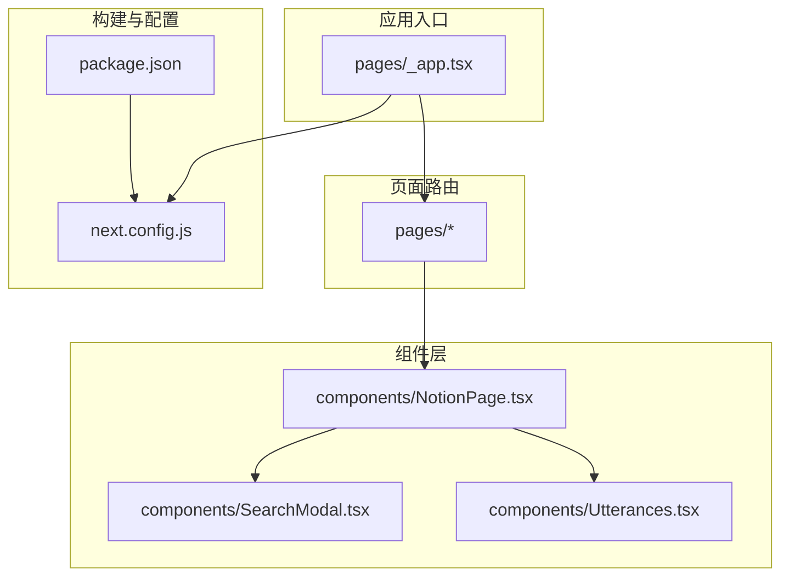
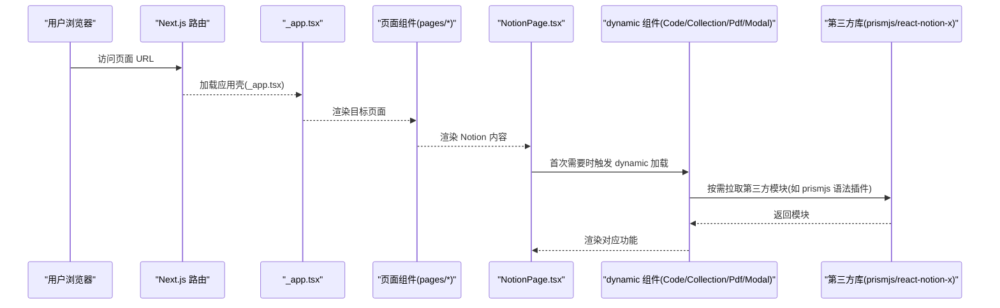
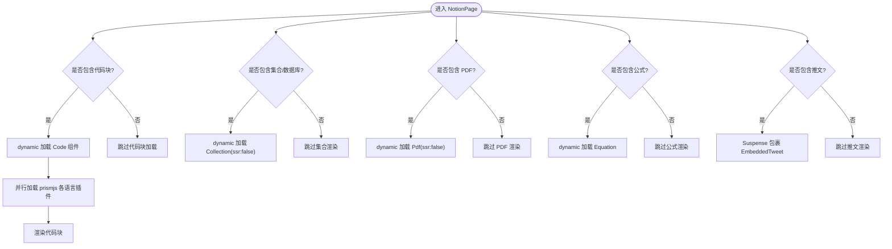
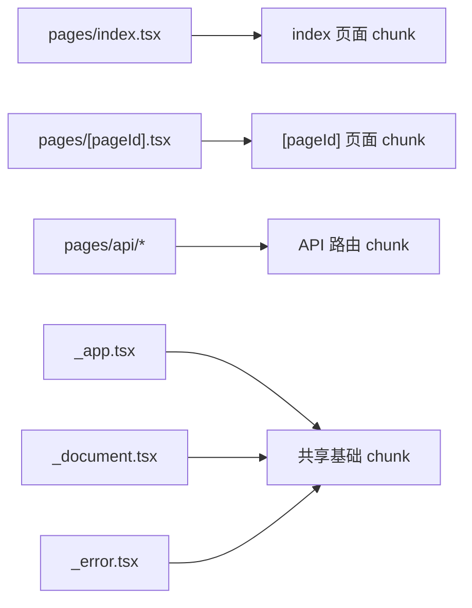
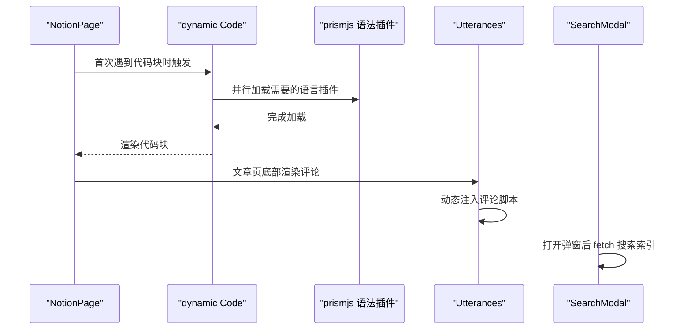
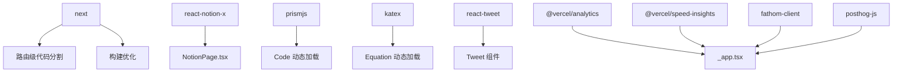

# 代码分割

<cite>
**本文引用的文件**   
- [next.config.js](file://next.config.js)
- [package.json](file://package.json)
- [components/NotionPage.tsx](file://components/NotionPage.tsx)
- [components/SearchModal.tsx](file://components/SearchModal.tsx)
- [components/Utterances.tsx](file://components/Utterances.tsx)
- [pages/_app.tsx](file://pages/_app.tsx)
</cite>

## 目录
1. [简介](#简介)
2. [项目结构](#项目结构)
3. [核心组件](#核心组件)
4. [架构总览](#架构总览)
5. [详细组件分析](#详细组件分析)
6. [依赖关系分析](#依赖关系分析)
7. [性能与体积优化](#性能与体积优化)
8. [故障排查指南](#故障排查指南)
9. [结论](#结论)

## 简介
本文围绕 Next.js 的自动代码分割机制，结合本仓库的实际实现，系统说明以下主题：
- 组件级代码分割：使用 next/dynamic 将重型或可选组件拆分为独立 chunk。
- 路由级代码分割：Next.js 基于 pages 目录的路由自动按页面拆分 bundle。
- 第三方库按需加载：对大型第三方库（如 react-notion-x、prismjs）进行动态导入与按需语法加载。
- Bundle 大小分析与性能指标监控：在项目中集成 @vercel/analytics 与 @vercel/speed-insights，并给出分析建议。
- 优化建议：从构建配置、资源策略到运行时加载顺序的综合优化方案。

## 项目结构
本项目采用 Next.js 标准结构，关键目录与职责如下：
- components：可复用 UI 与业务组件，包含大量通过 dynamic 引入的重型组件。
- pages：路由入口，Next.js 会据此自动生成路由级代码分割。
- lib：工具函数、配置与数据访问逻辑。
- styles：全局样式与主题。
- next.config.js：Next.js 构建与运行时配置。
- package.json：依赖与脚本定义。

图表来源
- [pages/_app.tsx:1-91](file://pages/_app.tsx#L1-L91)
- [components/NotionPage.tsx:1-356](file://components/NotionPage.tsx#L1-L356)
- [components/SearchModal.tsx:1-254](file://components/SearchModal.tsx#L1-L254)
- [components/Utterances.tsx:1-32](file://components/Utterances.tsx#L1-L32)
- [next.config.js:1-36](file://next.config.js#L1-L36)
- [package.json:1-93](file://package.json#L1-L93)

章节来源
- [next.config.js:1-36](file://next.config.js#L1-L36)
- [package.json:1-93](file://package.json#L1-L93)

## 核心组件
- NotionPage：内容渲染主容器，集中使用 next/dynamic 对重型/可选组件进行懒加载，包括代码高亮、集合视图、公式、PDF、弹窗等；同时注入 Tweet 组件并使用 Suspense 包裹。
- SearchModal：搜索弹窗，事件驱动加载搜索索引，避免首屏阻塞。
- Utterances：评论组件，通过动态注入外部脚本实现按需加载。
- _app.tsx：应用根组件，集成 Vercel Analytics、Speed Insights、Fathom、PostHog、Clarity 等分析与埋点 SDK，并按开关条件启用。

章节来源
- [components/NotionPage.tsx:1-356](file://components/NotionPage.tsx#L1-L356)
- [components/SearchModal.tsx:1-254](file://components/SearchModal.tsx#L1-L254)
- [components/Utterances.tsx:1-32](file://components/Utterances.tsx#L1-L32)
- [pages/_app.tsx:1-91](file://pages/_app.tsx#L1-L91)

## 架构总览
下图展示“用户请求 → 路由 → 页面 → 组件 → 第三方库”的代码分割与加载链路，体现 Next.js 自动路由分割与手动 dynamic 分割的结合。

图表来源
- [pages/_app.tsx:1-91](file://pages/_app.tsx#L1-L91)
- [components/NotionPage.tsx:40-142](file://components/NotionPage.tsx#L40-L142)

## 详细组件分析

### 组件级代码分割：NotionPage 中的 dynamic 使用
NotionPage 通过 next/dynamic 将多个重型或可选能力拆分为独立 chunk，并在需要时才加载：
- Code：动态加载 react-notion-x 的代码块组件，并在其内部并行按需加载多种 prismjs 语法插件，显著减少首包体积。
- Collection、Pdf、Modal：设置 ssr: false，仅在客户端渲染，避免服务端/客户端水合差异。
- Equation：按需加载公式渲染。
- Tweet：使用 React.Suspense 包裹，提供骨架占位，提升感知性能。

图表来源
- [components/NotionPage.tsx:40-142](file://components/NotionPage.tsx#L40-L142)
- [components/NotionPage.tsx:144-153](file://components/NotionPage.tsx#L144-L153)

章节来源
- [components/NotionPage.tsx:40-142](file://components/NotionPage.tsx#L40-L142)
- [components/NotionPage.tsx:144-153](file://components/NotionPage.tsx#L144-L153)

### 路由级代码分割：Next.js 自动拆分
Next.js 根据 pages 目录自动生成路由，并为每个页面生成独立的 JS 包。例如：
- pages/index.tsx
- pages/[pageId].tsx
- pages/api/*
- pages/_app.tsx、_document.tsx、_error.tsx

这意味着不同页面的公共代码会被提取为共享 chunk，非当前路由的代码不会在首屏加载，从而降低初始 bundle 体积。

图表来源
- [package.json:14-29](file://package.json#L14-L29)

章节来源
- [package.json:14-29](file://package.json#L14-L29)

### 第三方库的按需加载
- react-notion-x 子模块：通过 dynamic 按需加载 code/collection/equation/pdf/modal 等子模块，避免一次性引入全部功能。
- prismjs 语法插件：在 Code 组件内使用 Promise.allSettled 并行按需加载所需语言插件，进一步细化分包粒度。
- Utterances 评论：通过动态创建 script 标签加载外部评论服务，避免首屏阻塞。
- 搜索索引：SearchModal 在打开时再 fetch 搜索索引，属于事件驱动的按需数据加载。

图表来源
- [components/NotionPage.tsx:43-111](file://components/NotionPage.tsx#L43-L111)
- [components/Utterances.tsx:1-32](file://components/Utterances.tsx#L1-L32)
- [components/SearchModal.tsx:80-106](file://components/SearchModal.tsx#L80-L106)

章节来源
- [components/NotionPage.tsx:43-111](file://components/NotionPage.tsx#L43-L111)
- [components/Utterances.tsx:1-32](file://components/Utterances.tsx#L1-L32)
- [components/SearchModal.tsx:80-106](file://components/SearchModal.tsx#L80-L106)

## 依赖关系分析
- 构建与运行依赖：
  - next：核心框架，提供路由级代码分割与构建优化。
  - react-notion-x、notion-client、notion-types、notion-utils：Notion 内容渲染与数据处理。
  - react-tweet：推文嵌入。
  - katex、prismjs：公式与代码高亮（按需加载）。
  - @vercel/analytics、@vercel/speed-insights：性能与流量分析。
  - fathom-client、posthog-js、react-use 等：分析与交互辅助。
- 构建配置：
  - next.config.images.remotePatterns：允许远程图片域名，配合 next/image 优化。
  - transpilePackages：对特定包进行转译，确保兼容性。

图表来源
- [package.json:30-56](file://package.json#L30-L56)
- [next.config.js:4-18](file://next.config.js#L4-L18)
- [components/NotionPage.tsx:1-356](file://components/NotionPage.tsx#L1-L356)
- [pages/_app.tsx:1-91](file://pages/_app.tsx#L1-L91)

章节来源
- [package.json:30-56](file://package.json#L30-L56)
- [next.config.js:4-18](file://next.config.js#L4-L18)

## 性能与体积优化

### Bundle 大小分析与监控
- 内置分析：
  - 运行 npm run build 后，Next.js 会在控制台输出各 chunk 的大小信息，便于定位大包。
  - 可在 next.config.js 中开启 webpack 分析插件（如 webpack-bundle-analyzer）以可视化依赖树。
- 运行时指标：
  - @vercel/speed-insights：在 _app.tsx 中条件启用，采集 Core Web Vitals 等性能指标。
  - @vercel/analytics：在 _app.tsx 中条件启用，统计页面访问与交互。
  - Fathom、PostHog、Clarity：在 _app.tsx 中初始化，用于行为分析与热图。

章节来源
- [package.json:14-29](file://package.json#L14-L29)
- [pages/_app.tsx:17-87](file://pages/_app.tsx#L17-L87)

### 优化建议
- 继续推进组件级懒加载：
  - 将更多重型组件（如图表、地图、富文本扩展）用 dynamic 包裹，并提供合适的 fallback。
  - 对仅客户端使用的组件统一设置 ssr: false，避免不必要的服务端渲染与水合开销。
- 精细化第三方库按需加载：
  - 保持 prismjs 语法插件按需加载，并根据站点实际语言种类裁剪列表，减少冗余。
  - 对 react-notion-x 的子模块按需引入，避免全量打包。
- 资源与缓存优化：
  - 利用 next.config.images.remotePatterns 与 next/image 优化图片体积与传输格式（已启用 avif/webp）。
  - 对静态资源（字体、图标）使用 CDN 与长期缓存策略。
- 构建优化：
  - 使用 tree shaking 与 sideEffects 标记，减少无用代码。
  - 谨慎使用全局 CSS 与第三方样式，优先按需引入。
- 运行时体验优化：
  - 对异步数据加载使用 Suspense 与骨架屏，提升感知性能。
  - 对长任务进行分片或延迟执行，避免阻塞主线程。

[本节为通用指导，不直接分析具体文件]

## 故障排查指南
- 水合不一致：
  - 现象：Collection、Pdf、Modal 等组件出现 SSR/CSR 不一致警告。
  - 处理：确保这些组件使用 dynamic 且 ssr: false，或在客户端安全地初始化。
- 第三方脚本冲突：
  - 现象：Utterances 评论在不同主题切换时未正确刷新。
  - 处理：在 theme 变化时清理旧 DOM 并重新注入脚本（已在 Utterances 中实现）。
- 性能指标异常：
  - 现象：CLS/LCP 指标波动较大。
  - 处理：检查大图片、第三方脚本加载时机，必要时改用 afterInteractive 或 lazy 策略。
- 分析 SDK 未上报：
  - 现象：Vercel Analytics/Speed Insights 无数据。
  - 处理：确认环境变量开关已启用，且在 _app.tsx 中正确挂载组件。

章节来源
- [components/NotionPage.tsx:114-142](file://components/NotionPage.tsx#L114-L142)
- [components/Utterances.tsx:1-32](file://components/Utterances.tsx#L1-L32)
- [pages/_app.tsx:17-87](file://pages/_app.tsx#L17-L87)

## 结论
本项目充分利用了 Next.js 的自动路由级代码分割，并通过 next/dynamic 实现了精细化的组件级与第三方库按需加载。结合 Vercel Analytics 与 Speed Insights 等工具，形成了完整的性能监控与分析闭环。建议在后续迭代中持续精简依赖、细化分包粒度，并结合业务场景优化资源加载顺序与缓存策略，以获得更优的首屏性能与用户体验。

[本节为总结性内容，不直接分析具体文件]