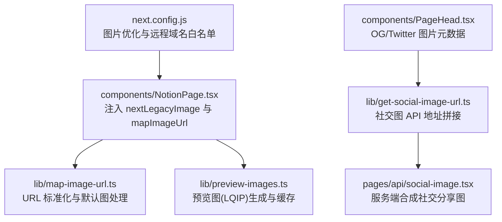
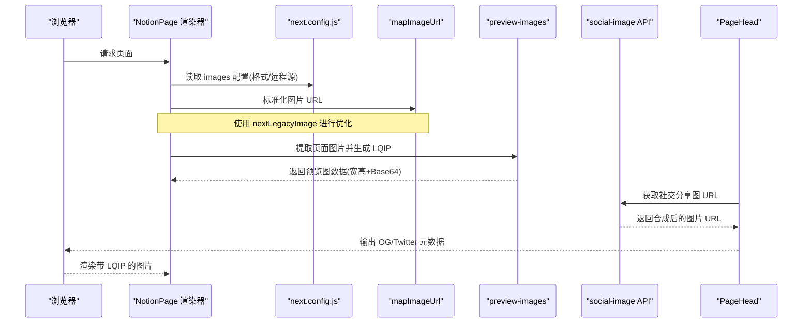
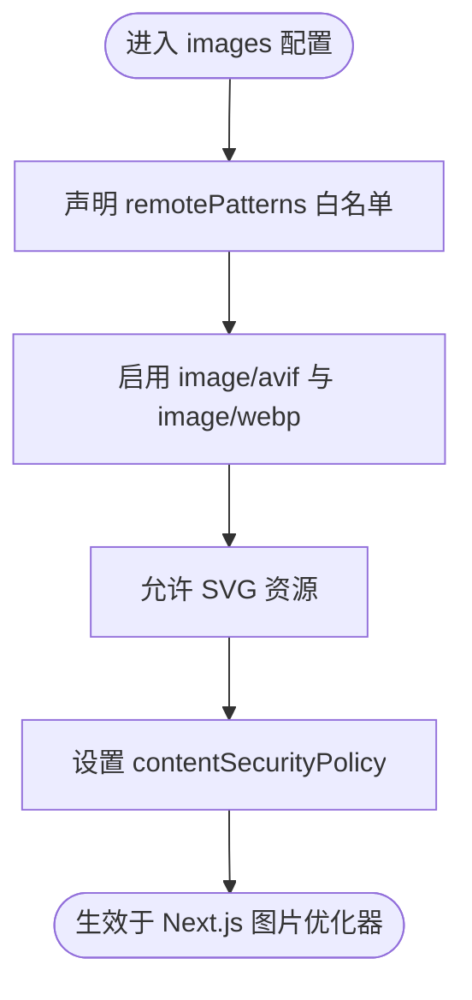
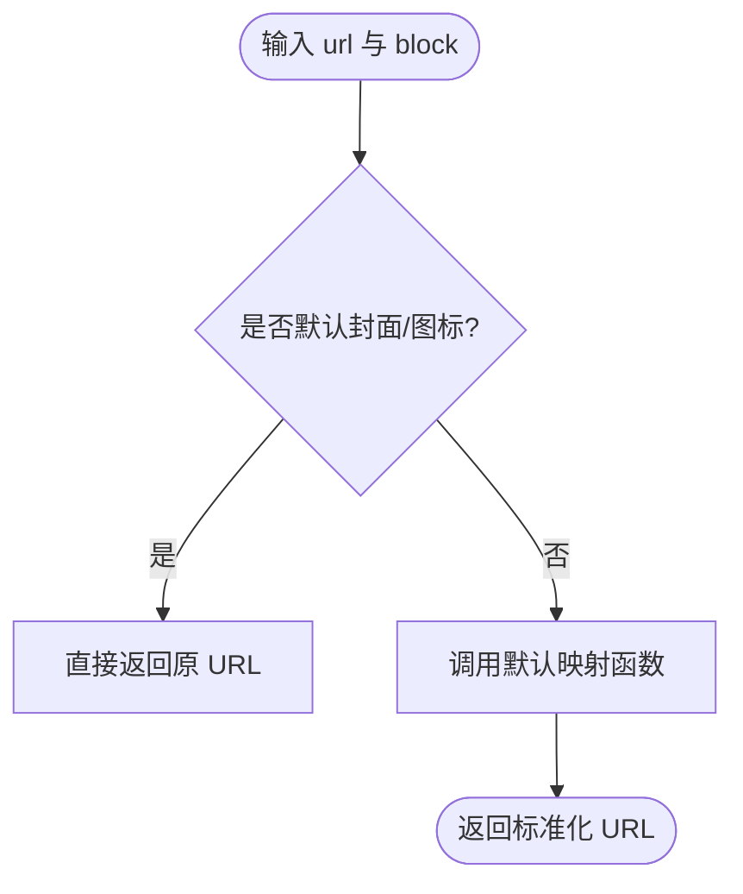
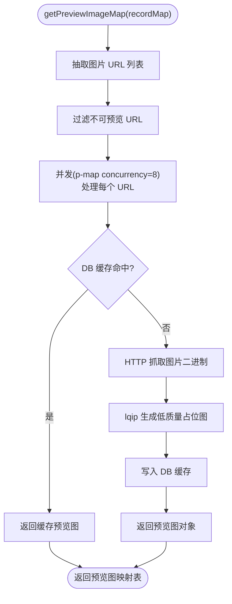
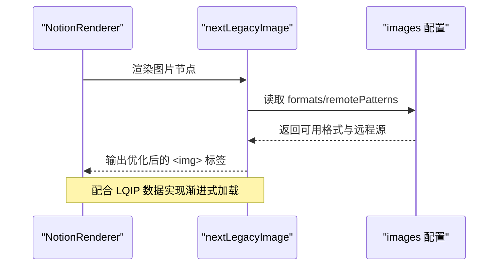
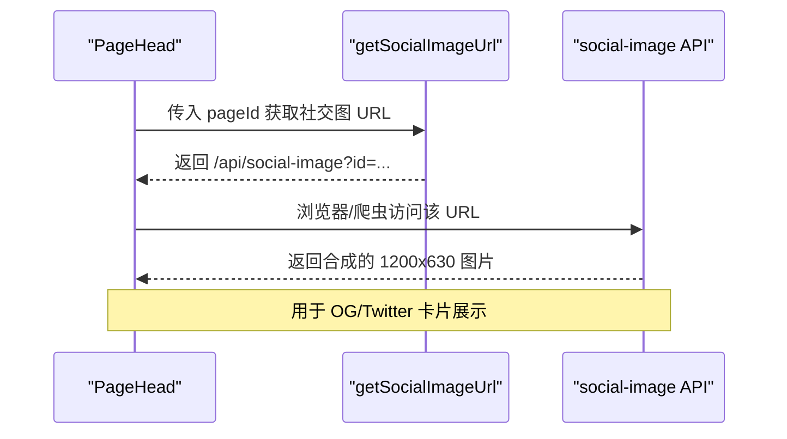
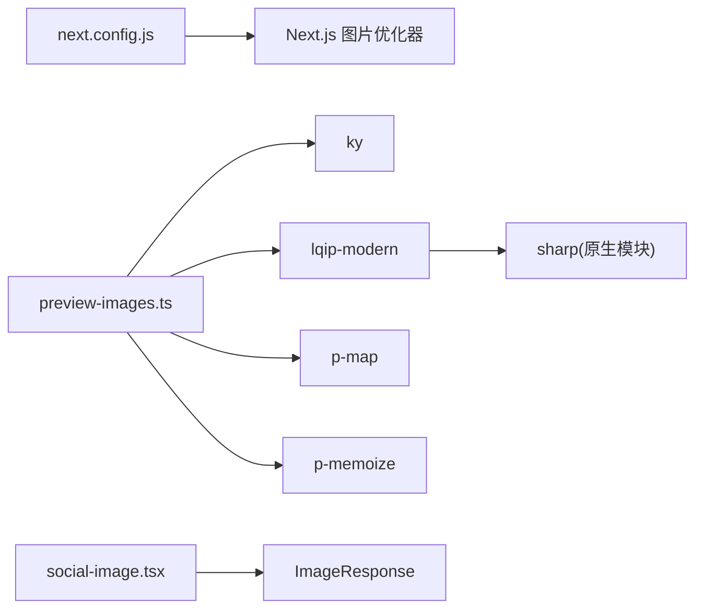

# 图片优化

<cite>
**本文引用的文件**   
- [next.config.js](file://next.config.js)
- [lib/map-image-url.ts](file://lib/map-image-url.ts)
- [lib/preview-images.ts](file://lib/preview-images.ts)
- [components/NotionPage.tsx](file://components/NotionPage.tsx)
- [components/PageHead.tsx](file://components/PageHead.tsx)
- [pages/api/social-image.tsx](file://pages/api/social-image.tsx)
- [lib/get-social-image-url.ts](file://lib/get-social-image-url.ts)
- [pnpm-lock.yaml](file://pnpm-lock.yaml)
</cite>

## 目录
1. [简介](#简介)
2. [项目结构](#项目结构)
3. [核心组件](#核心组件)
4. [架构总览](#架构总览)
5. [详细组件分析](#详细组件分析)
6. [依赖关系分析](#依赖关系分析)
7. [性能与优化建议](#性能与优化建议)
8. [故障排查指南](#故障排查指南)
9. [结论](#结论)

## 简介
本文件围绕“图片懒加载、预览图生成和资源优化”展开，结合仓库中的实现，系统说明：
- 图片格式选择（WebP/AVIF）与尺寸优化策略
- CDN 配置与远程图片白名单
- 响应式图片与低质量占位图（LQIP）方案
- 社交分享图生成与缓存
- 性能监控与常见问题处理

## 项目结构
本项目在 Next.js 基础上，通过内置的 Image 优化能力与自定义逻辑，完成图片资源的统一处理。关键路径包括：
- 构建期与运行时图片优化配置：next.config.js
- Notion 图片 URL 映射：lib/map-image-url.ts
- 预览图（LQIP）生成与缓存：lib/preview-images.ts
- 页面渲染与图片注入：components/NotionPage.tsx
- 社交分享图元数据与动态图生成：components/PageHead.tsx、pages/api/social-image.tsx、lib/get-social-image-url.ts

**图示来源**
- [next.config.js:6-18](file://next.config.js#L6-L18)
- [components/NotionPage.tsx:196-209](file://components/NotionPage.tsx#L196-L209)
- [lib/map-image-url.ts:6-12](file://lib/map-image-url.ts#L6-L12)
- [lib/preview-images.ts:30-54](file://lib/preview-images.ts#L30-L54)
- [components/PageHead.tsx:30-35](file://components/PageHead.tsx#L30-L35)
- [lib/get-social-image-url.ts:3-16](file://lib/get-social-image-url.ts#L3-L16)
- [pages/api/social-image.tsx:49-84](file://pages/api/social-image.tsx#L49-L84)

**章节来源**
- [next.config.js:1-35](file://next.config.js#L1-L35)
- [components/NotionPage.tsx:1-356](file://components/NotionPage.tsx#L1-L356)

## 核心组件
- 图片优化与远程源白名单：通过 next.config.js 启用 AVIF/WebP 自动转换，并声明允许的远程主机名，确保外部图片可被 Next.js 优化器处理。
- 图片 URL 映射：mapImageUrl 对 Notion 提供的图片进行标准化，保留默认封面/图标，其余走默认映射逻辑。
- 预览图（LQIP）：从页面内容中提取所有图片 URL，并发抓取并生成低质量占位图，结果写入数据库缓存，供渲染时快速展示。
- 社交分享图：根据页面信息在服务端合成 1200x630 的图片，用于 OG/Twitter 卡片展示。

**章节来源**
- [next.config.js:6-18](file://next.config.js#L6-L18)
- [lib/map-image-url.ts:6-12](file://lib/map-image-url.ts#L6-L12)
- [lib/preview-images.ts:30-98](file://lib/preview-images.ts#L30-L98)
- [pages/api/social-image.tsx:49-84](file://pages/api/social-image.tsx#L49-L84)

## 架构总览
下图展示了图片从“来源 URL”到“浏览器最终呈现”的关键流程，包括格式选择、预览图生成、社交图生成等。

**图示来源**
- [components/NotionPage.tsx:196-209](file://components/NotionPage.tsx#L196-L209)
- [next.config.js:6-18](file://next.config.js#L6-L18)
- [lib/map-image-url.ts:6-12](file://lib/map-image-url.ts#L6-L12)
- [lib/preview-images.ts:30-98](file://lib/preview-images.ts#L30-L98)
- [components/PageHead.tsx:30-35](file://components/PageHead.tsx#L30-L35)
- [lib/get-social-image-url.ts:3-16](file://lib/get-social-image-url.ts#L3-L16)
- [pages/api/social-image.tsx:49-84](file://pages/api/social-image.tsx#L49-L84)

## 详细组件分析

### 图片格式选择与 CDN 配置
- 支持的现代格式：AVIF 与 WebP，由 Next.js 根据浏览器支持自动选择最优格式。
- 远程图片白名单：仅允许配置的域名（如 notion.so、unsplash、Twitter、AWS S3），未在白名单的图片不会被优化。
- SVG 支持：显式开启以允许 SVG 资源参与优化流程。
- CSP：为图片相关资源设置严格的内容安全策略。

**图示来源**
- [next.config.js:6-18](file://next.config.js#L6-L18)

**章节来源**
- [next.config.js:6-18](file://next.config.js#L6-L18)

### 图片 URL 映射与默认图处理
- 对 Notion 提供的图片 URL 进行标准化，避免重复或无效路径。
- 对默认页面封面与图标进行特殊处理，直接返回原值，不参与额外转换。
- 其他图片交由默认映射函数处理，保证兼容性。

**图示来源**
- [lib/map-image-url.ts:6-12](file://lib/map-image-url.ts#L6-L12)

**章节来源**
- [lib/map-image-url.ts:1-13](file://lib/map-image-url.ts#L1-L13)

### 预览图（LQIP）生成与缓存
- 从页面 recordMap 中抽取所有图片 URL，过滤 data URL、image/ 路径与 attachment 链接。
- 并发抓取图片二进制，使用 lqip-modern 生成低质量占位图（包含原始宽高与 Base64）。
- 将结果写入数据库缓存，后续命中则直接返回，减少重复计算。
- 使用 p-memoize 对单张图片生成过程做内存级去重，避免同一请求内重复处理。

**图示来源**
- [lib/preview-images.ts:30-98](file://lib/preview-images.ts#L30-L98)

**章节来源**
- [lib/preview-images.ts:1-99](file://lib/preview-images.ts#L1-L99)
- [pnpm-lock.yaml:1827-1829](file://pnpm-lock.yaml#L1827-L1829)
- [pnpm-lock.yaml:5006-5030](file://pnpm-lock.yaml#L5006-L5030)

### 响应式图片与懒加载
- 渲染层使用 next/legacy/image 作为 Notion 渲染器的图片组件，继承 Next.js 的图片优化能力（自动尺寸、格式选择、懒加载）。
- 通过 previewImages 参数将 LQIP 数据传递给渲染器，实现“先显示模糊缩略图，再加载高清大图”的体验。
- 当前代码未直接使用 srcSet/sizes 属性；响应式行为主要由 next/legacy/image 内部处理。

**图示来源**
- [components/NotionPage.tsx:196-209](file://components/NotionPage.tsx#L196-L209)
- [next.config.js:6-18](file://next.config.js#L6-L18)

**章节来源**
- [components/NotionPage.tsx:196-209](file://components/NotionPage.tsx#L196-L209)

### 社交分享图生成与元数据
- 页面头部通过 getSocialImageUrl 拼接社交图 API 地址，并在 PageHead 中输出 og:image/twitter:image。
- social-image API 基于页面信息（封面图、作者头像等）在服务端合成 1200x630 的图片，适配社交平台展示规范。
- 针对特定图片源（如 unsplash），会追加宽度与裁剪参数以保证最佳显示效果。

**图示来源**
- [components/PageHead.tsx:30-35](file://components/PageHead.tsx#L30-L35)
- [lib/get-social-image-url.ts:3-16](file://lib/get-social-image-url.ts#L3-L16)
- [pages/api/social-image.tsx:49-84](file://pages/api/social-image.tsx#L49-L84)
- [pages/api/social-image.tsx:293-312](file://pages/api/social-image.tsx#L293-L312)

**章节来源**
- [components/PageHead.tsx:1-188](file://components/PageHead.tsx#L1-L188)
- [lib/get-social-image-url.ts:1-16](file://lib/get-social-image-url.ts#L1-L16)
- [pages/api/social-image.tsx:49-84](file://pages/api/social-image.tsx#L49-L84)
- [pages/api/social-image.tsx:293-312](file://pages/api/social-image.tsx#L293-L312)

## 依赖关系分析
- 图片优化依赖 Next.js 的 images 配置，启用 AVIF/WebP 与远程源白名单。
- 预览图生成依赖 ky（网络请求）、lqip-modern（低质量占位图生成，底层依赖 sharp）、p-map（并发控制）、p-memoize（函数级缓存）。
- 社交图生成依赖 Next.js 的 ImageResponse 与字体资源。

**图示来源**
- [next.config.js:6-18](file://next.config.js#L6-L18)
- [lib/preview-images.ts:1-14](file://lib/preview-images.ts#L1-L14)
- [pnpm-lock.yaml:1827-1829](file://pnpm-lock.yaml#L1827-L1829)
- [pnpm-lock.yaml:5006-5030](file://pnpm-lock.yaml#L5006-L5030)
- [pages/api/social-image.tsx:49-84](file://pages/api/social-image.tsx#L49-L84)

**章节来源**
- [pnpm-lock.yaml:1827-1829](file://pnpm-lock.yaml#L1827-L1829)
- [pnpm-lock.yaml:5006-5030](file://pnpm-lock.yaml#L5006-L5030)

## 性能与优化建议
- 格式选择
  - 已启用 AVIF/WebP，优先使用现代格式以获得更小体积与更快加载。
  - 建议在 CDN 层也开启同类型转码，进一步降低回源压力。
- 尺寸优化
  - 对于社交分享图，已在 API 侧固定 1200x630，符合主流平台要求。
  - 对于正文图片，建议使用 next/legacy/image 的尺寸优化能力，避免过大原图直出。
- CDN 配置
  - 远程源白名单需与实际使用的图片服务保持一致，避免优化失败。
  - 建议在 CDN 上开启缓存与压缩，并对静态图片设置长期缓存头。
- 响应式图片
  - 当前通过 next/legacy/image 提供基础响应式能力；如需更精细控制，可在业务层引入 srcSet/sizes。
- 懒加载
  - next/legacy/image 默认懒加载；若需要更细粒度控制，可在上层组件按需加载。
- 预览图（LQIP）
  - 已实现并发抓取与缓存，建议在生产环境使用持久化存储（如 Redis）替代本地 DB，提升稳定性与扩展性。
- 性能监控
  - 建议在关键路径添加指标上报（如 LCP、FCP、INP），并结合 CDN 日志分析热点图片命中率与带宽占用。

[本节为通用指导，不直接分析具体文件]

## 故障排查指南
- 远程图片无法优化
  - 检查 next.config.js 的 remotePatterns 是否包含对应主机名。
  - 确认图片协议为 https，且未被 CSP 拦截。
- 预览图生成失败
  - 检查网络请求（ky）是否可达目标图片 URL。
  - 查看 lqip 生成的日志，确认二进制数据有效。
  - 校验数据库缓存读写是否正常，必要时降级为内存缓存。
- 社交分享图异常
  - 检查 getSocialImageUrl 生成的 URL 是否正确。
  - 验证 social-image API 是否能正常访问封面图与作者头像。
  - 针对特定图片源（如 unsplash），确认是否已附加必要的查询参数。

**章节来源**
- [next.config.js:6-18](file://next.config.js#L6-L18)
- [lib/preview-images.ts:64-95](file://lib/preview-images.ts#L64-L95)
- [lib/get-social-image-url.ts:3-16](file://lib/get-social-image-url.ts#L3-L16)
- [pages/api/social-image.tsx:293-312](file://pages/api/social-image.tsx#L293-L312)

## 结论
本项目通过 Next.js 的图片优化能力与自定义逻辑，实现了：
- 自动格式选择（AVIF/WebP）与远程图片白名单管理
- 预览图（LQIP）生成与缓存，提升首屏体验
- 社交分享图服务端合成，满足平台展示规范
- 基于 next/legacy/image 的响应式与懒加载基础能力

建议在生产环境中进一步完善 CDN 缓存策略、监控关键性能指标，并根据业务需求扩展响应式图片控制与预览图存储方案。