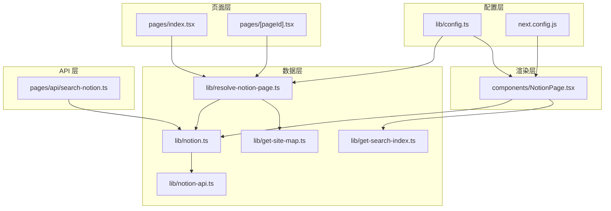
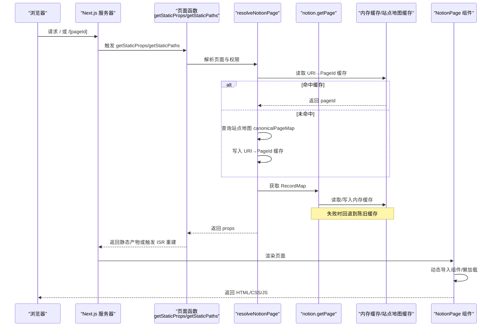
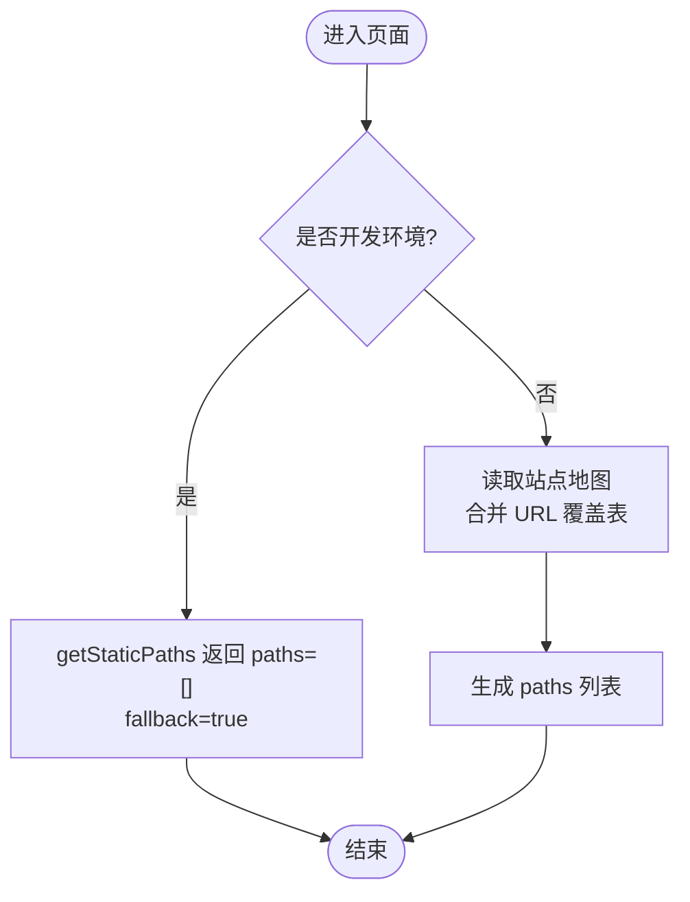
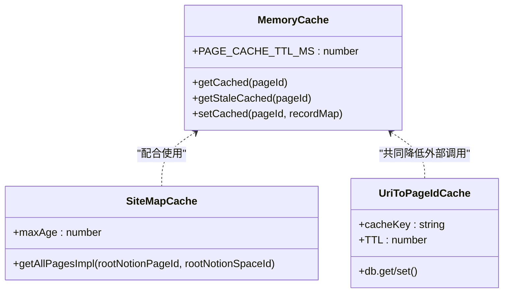
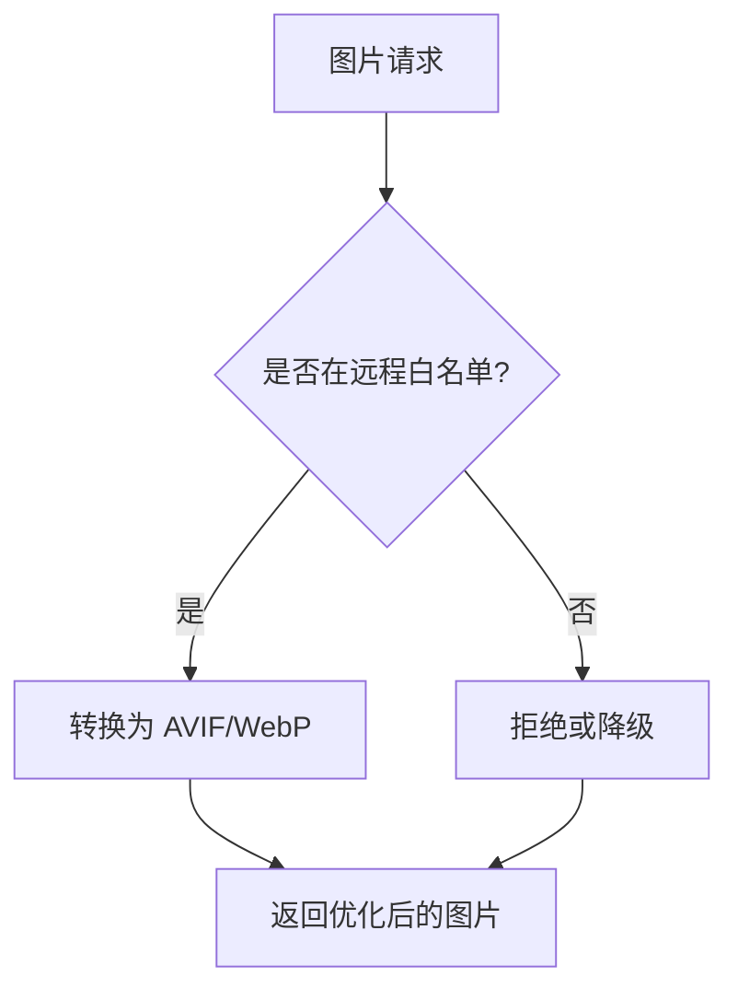
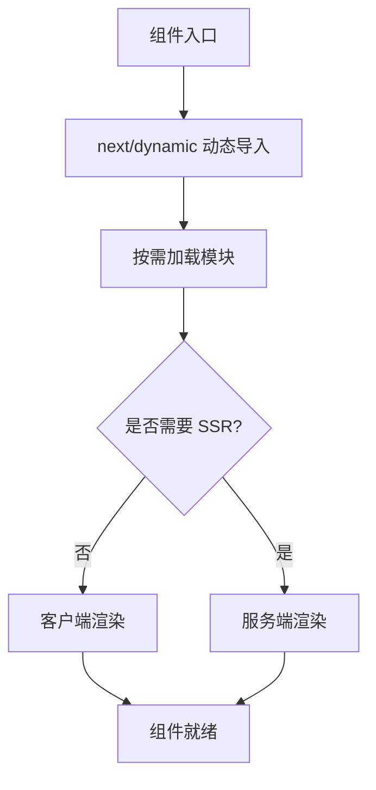
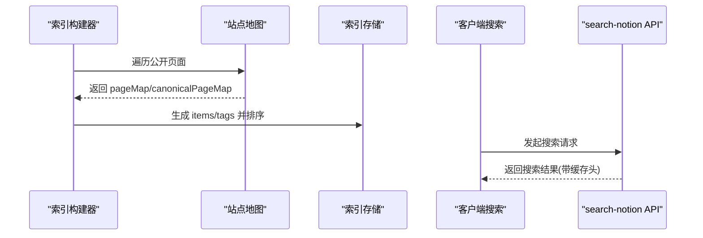
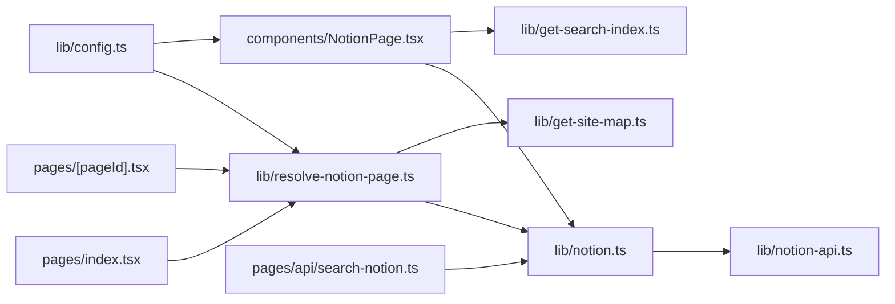

# 性能优化

<cite>
**本文引用的文件**   
- [next.config.js](file://next.config.js)
- [package.json](file://package.json)
- [pages/index.tsx](file://pages/index.tsx)
- [pages/[pageId].tsx](file://pages/[pageId].tsx)
- [lib/config.ts](file://lib/config.ts)
- [lib/resolve-notion-page.ts](file://lib/resolve-notion-page.ts)
- [lib/notion.ts](file://lib/notion.ts)
- [lib/get-site-map.ts](file://lib/get-site-map.ts)
- [components/NotionPage.tsx](file://components/NotionPage.tsx)
- [lib/get-search-index.ts](file://lib/get-search-index.ts)
- [pages/api/search-notion.ts](file://pages/api/search-notion.ts)
- [lib/notion-api.ts](file://lib/notion-api.ts)
</cite>

## 目录
1. [简介](#简介)
2. [项目结构](#项目结构)
3. [核心组件](#核心组件)
4. [架构总览](#架构总览)
5. [详细组件分析](#详细组件分析)
6. [依赖关系分析](#依赖关系分析)
7. [性能考量与优化策略](#性能考量与优化策略)
8. [故障排查指南](#故障排查指南)
9. [结论](#结论)

## 简介
本文围绕 Next.js + Notion 站点在静态化、增量静态再生成（ISR）、缓存、图片处理、代码分割、资源预加载、监控指标以及生产环境优化等方面，系统化梳理项目的性能优化策略与实现方法。重点解释：
- 静态站点生成与 ISR 的工作流程
- 服务端内存缓存、站点地图缓存、URI 到页面 ID 缓存
- 图片懒加载、现代格式与占位图
- 动态导入与按需加载的代码分割
- 搜索索引的构建与客户端即时搜索
- 性能监控工具与关键指标分析方法
- 生产环境的优化建议与常见问题解决方案

## 项目结构
本项目采用 Next.js App Router 之外的 Pages Router 组织方式，核心性能相关逻辑分布在以下位置：
- 页面层：首页与动态文章页使用 getStaticProps 与 getStaticPaths 进行 SSG/ISR
- 数据层：解析 Notion 数据、站点地图、搜索索引
- 渲染层：通过 react-notion-x 渲染内容，并进行动态导入与组件拆分
- 配置层：Next.js 图像优化、远程域名白名单、CSP 等
- API 层：提供搜索接口并设置响应缓存头

图表来源
- [pages/index.tsx:6-10](file://pages/index.tsx#L6-L10)
- [pages/[pageId].tsx:9-52](file://pages/[pageId].tsx#L9-L52)
- [lib/resolve-notion-page.ts:11-84](file://lib/resolve-notion-page.ts#L11-L84)
- [lib/notion.ts:161-213](file://lib/notion.ts#L161-L213)
- [lib/get-site-map.ts:17-32](file://lib/get-site-map.ts#L17-L32)
- [components/NotionPage.tsx:196-355](file://components/NotionPage.tsx#L196-L355)
- [lib/get-search-index.ts:35-94](file://lib/get-search-index.ts#L35-L94)
- [pages/api/search-notion.ts:6-24](file://pages/api/search-notion.ts#L6-L24)
- [lib/config.ts:93-95](file://lib/config.ts#L93-L95)
- [next.config.js:4-18](file://next.config.js#L4-L18)

章节来源
- [pages/index.tsx:1-23](file://pages/index.tsx#L1-L23)
- [pages/[pageId].tsx:1-58](file://pages/[pageId].tsx#L1-L58)
- [lib/config.ts:1-221](file://lib/config.ts#L1-L221)
- [next.config.js:1-36](file://next.config.js#L1-L36)

## 核心组件
- 静态生成与 ISR
  - 首页与动态文章页通过 getStaticProps 返回 revalidate 字段，启用 ISR 增量更新
  - 动态路由通过 getStaticPaths 预生成所有公开页面路径，fallback 为 true 以支持首次访问按需生成
- 数据获取与缓存
  - 服务端内存缓存 Notion RecordMap，TTL 短周期以降低延迟同时保持新鲜度
  - 站点地图缓存每 5 分钟刷新，避免频繁调用 Notion API
  - URI 到页面 ID 映射缓存一天，加速友好 URL 解析
- 图片优化
  - 启用 AVIF/WebP 现代格式，远程域名白名单，CSP 限制脚本执行
- 代码分割与懒加载
  - 使用 next/dynamic 对代码高亮、集合视图、PDF、模态框等进行动态导入
  - 部分组件禁用 SSR，避免水合不一致
- 搜索与索引
  - 构建轻量级搜索索引，按更新时间排序，支持标签过滤
  - 搜索 API 设置 Cache-Control 头，启用 CDN/浏览器缓存

章节来源
- [pages/index.tsx:6-10](file://pages/index.tsx#L6-L10)
- [pages/[pageId].tsx:27-52](file://pages/[pageId].tsx#L27-L52)
- [lib/notion.ts:29-55](file://lib/notion.ts#L29-L55)
- [lib/get-site-map.ts:29-32](file://lib/get-site-map.ts#L29-L32)
- [lib/resolve-notion-page.ts:32-65](file://lib/resolve-notion-page.ts#L32-L65)
- [next.config.js:6-18](file://next.config.js#L6-L18)
- [components/NotionPage.tsx:43-142](file://components/NotionPage.tsx#L43-L142)
- [lib/get-search-index.ts:35-94](file://lib/get-search-index.ts#L35-L94)
- [pages/api/search-notion.ts:20-24](file://pages/api/search-notion.ts#L20-L24)

## 架构总览
下图展示从请求到渲染的关键路径，包括 SSG/ISR、缓存、Notion API 调用与前端渲染。

图表来源
- [pages/index.tsx:6-10](file://pages/index.tsx#L6-L10)
- [pages/[pageId].tsx:9-52](file://pages/[pageId].tsx#L9-L52)
- [lib/resolve-notion-page.ts:11-84](file://lib/resolve-notion-page.ts#L11-L84)
- [lib/notion.ts:161-213](file://lib/notion.ts#L161-L213)
- [components/NotionPage.tsx:196-355](file://components/NotionPage.tsx#L196-L355)

## 详细组件分析

### 静态站点生成与增量静态再生成（SSG/ISR）
- 首页与动态文章页均通过 getStaticProps 返回 revalidate 秒数，开启 ISR
- 动态路由 getStaticPaths 根据站点地图与 URL 覆盖表生成所有公开页面路径，fallback 为 true
- 开发环境下 getStaticPaths 返回空路径，按需生成；生产环境预生成全部路径

图表来源
- [pages/[pageId].tsx:27-52](file://pages/[pageId].tsx#L27-L52)

章节来源
- [pages/index.tsx:6-10](file://pages/index.tsx#L6-L10)
- [pages/[pageId].tsx:9-52](file://pages/[pageId].tsx#L9-L52)
- [lib/config.ts:93-95](file://lib/config.ts#L93-L95)

### 缓存机制
- 服务端内存缓存
  - 针对每个 pageId 缓存 ExtendedRecordMap，TTL 60 秒
  - 当 Notion API 不可用时，返回陈旧缓存以保证可用性
- 站点地图缓存
  - getAllPagesInSpace 结果通过 p-memoize 缓存，每 5 分钟重新抓取
- URI 到页面 ID 缓存
  - 将友好 URL 映射到 Notion pageId，缓存一天，减少重复解析

图表来源
- [lib/notion.ts:29-55](file://lib/notion.ts#L29-L55)
- [lib/get-site-map.ts:29-32](file://lib/get-site-map.ts#L29-L32)
- [lib/resolve-notion-page.ts:32-65](file://lib/resolve-notion-page.ts#L32-L65)

章节来源
- [lib/notion.ts:161-213](file://lib/notion.ts#L161-L213)
- [lib/get-site-map.ts:17-32](file://lib/get-site-map.ts#L17-L32)
- [lib/resolve-notion-page.ts:32-65](file://lib/resolve-notion-page.ts#L32-L65)

### 图片懒加载与现代格式
- 启用 AVIF/WebP 自动转换，提升图片加载效率
- 远程域名白名单允许 Notion、Unsplash、Twitter 等域名的图片
- CSP 限制脚本执行，提高安全性
- 组件中使用 next/legacy/image 并通过 mapImageUrl 统一处理图片地址

图表来源
- [next.config.js:6-18](file://next.config.js#L6-L18)
- [components/NotionPage.tsx:196-209](file://components/NotionPage.tsx#L196-L209)

章节来源
- [next.config.js:6-18](file://next.config.js#L6-L18)
- [components/NotionPage.tsx:196-209](file://components/NotionPage.tsx#L196-L209)

### 代码分割与按需加载
- 使用 next/dynamic 对代码高亮、集合视图、PDF、模态框等组件进行动态导入
- 集合视图、PDF、模态框禁用 SSR，避免水合不一致
- 代码高亮按需加载 Prism 语法插件，减少首屏体积

图表来源
- [components/NotionPage.tsx:43-142](file://components/NotionPage.tsx#L43-L142)

章节来源
- [components/NotionPage.tsx:43-142](file://components/NotionPage.tsx#L43-L142)

### 搜索索引与即时搜索
- 构建轻量级搜索索引，包含标题、URL、标签、描述、最后更新时间
- 索引按最后更新时间排序，便于优先展示最新内容
- 搜索 API 设置 Cache-Control 头，启用 CDN/浏览器缓存，降低后端压力

图表来源
- [lib/get-search-index.ts:35-94](file://lib/get-search-index.ts#L35-L94)
- [pages/api/search-notion.ts:20-24](file://pages/api/search-notion.ts#L20-L24)

章节来源
- [lib/get-search-index.ts:35-94](file://lib/get-search-index.ts#L35-L94)
- [pages/api/search-notion.ts:6-24](file://pages/api/search-notion.ts#L6-L24)

### 资源预加载与元信息优化
- 通过 PageHead 组件设置 canonical URL、社交图片、描述、作者、发布时间等元信息
- 博客文章优先使用 Notion 页面的 Description 作为 meta description，确保 SEO 差异化
- 使用 mapImageUrl 统一处理图片地址，结合 next/legacy/image 进行懒加载与优化

章节来源
- [components/NotionPage.tsx:273-314](file://components/NotionPage.tsx#L273-L314)
- [components/NotionPage.tsx:196-209](file://components/NotionPage.tsx#L196-L209)

## 依赖关系分析
- 页面层依赖 resolve-notion-page 获取数据与权限
- resolve-notion-page 依赖 notion 获取 RecordMap，依赖 get-site-map 构建站点地图
- notion 封装 notion-client 的 NotionAPI，具备重试与超时配置
- NotionPage 组件依赖 config 与 search-notion 提供 UI 行为与搜索能力
- get-search-index 依赖 get-site-map 构建索引

图表来源
- [pages/index.tsx:1-23](file://pages/index.tsx#L1-L23)
- [pages/[pageId].tsx:1-58](file://pages/[pageId].tsx#L1-L58)
- [lib/resolve-notion-page.ts:1-84](file://lib/resolve-notion-page.ts#L1-L84)
- [lib/notion.ts:1-219](file://lib/notion.ts#L1-L219)
- [lib/get-site-map.ts:1-105](file://lib/get-site-map.ts#L1-L105)
- [components/NotionPage.tsx:1-356](file://components/NotionPage.tsx#L1-L356)
- [lib/get-search-index.ts:1-95](file://lib/get-search-index.ts#L1-L95)
- [pages/api/search-notion.ts:1-26](file://pages/api/search-notion.ts#L1-L26)
- [lib/config.ts:1-221](file://lib/config.ts#L1-L221)

章节来源
- [lib/notion-api.ts:1-21](file://lib/notion-api.ts#L1-L21)
- [lib/config.ts:1-221](file://lib/config.ts#L1-L221)

## 性能考量与优化策略

### 静态站点生成与 ISR
- 使用 revalidateSeconds 控制 ISR 重建频率，默认 3600 秒，可减少函数调用次数
- 开发环境使用 fallback:true 按需生成，生产环境预生成所有公开页面路径
- 建议在流量高峰前主动触发 ISR 重建，保证内容新鲜度

章节来源
- [lib/config.ts:93-95](file://lib/config.ts#L93-L95)
- [pages/[pageId].tsx:27-52](file://pages/[pageId].tsx#L27-L52)

### 缓存策略
- 服务端内存缓存 Notion RecordMap，TTL 60 秒，吸收突发流量与 Notion 抖动
- 站点地图缓存每 5 分钟刷新，平衡新鲜度与性能
- URI 到页面 ID 缓存一天，减少友好 URL 解析开销
- 搜索 API 设置 Cache-Control 头，启用 CDN/浏览器缓存

章节来源
- [lib/notion.ts:29-55](file://lib/notion.ts#L29-L55)
- [lib/get-site-map.ts:29-32](file://lib/get-site-map.ts#L29-L32)
- [lib/resolve-notion-page.ts:32-65](file://lib/resolve-notion-page.ts#L32-L65)
- [pages/api/search-notion.ts:20-24](file://pages/api/search-notion.ts#L20-L24)

### 图片优化
- 启用 AVIF/WebP 自动转换，减少带宽占用
- 远程域名白名单限制可优化图片的来源，防止滥用
- CSP 限制脚本执行，提高安全性
- 使用 next/legacy/image 与 mapImageUrl 统一处理图片懒加载与尺寸优化

章节来源
- [next.config.js:6-18](file://next.config.js#L6-L18)
- [components/NotionPage.tsx:196-209](file://components/NotionPage.tsx#L196-L209)

### 代码分割与按需加载
- 动态导入代码高亮、集合视图、PDF、模态框等重型组件
- 禁用 SSR 的组件避免水合不一致，提升稳定性
- 按需加载 Prism 语法插件，减少首屏体积

章节来源
- [components/NotionPage.tsx:43-142](file://components/NotionPage.tsx#L43-L142)

### 搜索与索引
- 构建轻量级搜索索引，按更新时间排序，支持标签过滤
- 搜索 API 设置缓存头，降低后端压力

章节来源
- [lib/get-search-index.ts:35-94](file://lib/get-search-index.ts#L35-L94)
- [pages/api/search-notion.ts:20-24](file://pages/api/search-notion.ts#L20-L24)

### 监控与指标
- 集成 Vercel Analytics 与 Speed Insights，用于性能监控与用户体验分析
- PostHog 与 Fathom 可选接入，用于事件追踪与分析
- 建议在关键页面埋点记录 LCP、FID、CLS 等核心 Web 指标

章节来源
- [lib/config.ts:135-143](file://lib/config.ts#L135-L143)
- [package.json:33-34](file://package.json#L33-L34)

### 生产环境优化建议
- 调整 revalidateSeconds 以平衡新鲜度与成本
- 合理设置站点地图缓存 TTL，避免频繁调用 Notion API
- 启用 CDN 缓存搜索 API 响应，提升全局性能
- 限制远程图片域名，避免不必要的优化请求
- 在生产环境关闭调试日志，减少 I/O 开销

章节来源
- [lib/config.ts:93-95](file://lib/config.ts#L93-L95)
- [lib/get-site-map.ts:29-32](file://lib/get-site-map.ts#L29-L32)
- [pages/api/search-notion.ts:20-24](file://pages/api/search-notion.ts#L20-L24)
- [next.config.js:6-18](file://next.config.js#L6-L18)

## 故障排查指南
- Notion API 不稳定导致页面报错
  - 现象：getPage 抛出异常，页面返回 500
  - 处理：若存在陈旧缓存则返回 stale 数据，否则抛出错误
  - 建议：检查 NOTION_API_TOKEN 与网络连通性，观察重试与超时配置
- 站点地图为空或页面缺失
  - 现象：canonicalPageMap 缺少预期页面
  - 处理：检查 Public 属性与站点地图缓存 TTL
  - 建议：手动触发站点地图重建，确认 getAllPagesInSpace 返回值
- 搜索无结果或结果不准确
  - 现象：客户端搜索无法匹配关键词
  - 处理：检查搜索索引构建过程与标签规范化
  - 建议：验证 Tags 属性格式，确认索引排序与去重逻辑
- 图片不显示或格式不正确
  - 现象：远程图片未加载或格式非 AVIF/WebP
  - 处理：检查远程域名白名单与 CSP 配置
  - 建议：确认 mapImageUrl 与 next/legacy/image 的使用是否正确

章节来源
- [lib/notion.ts:168-182](file://lib/notion.ts#L168-L182)
- [lib/get-site-map.ts:62-98](file://lib/get-site-map.ts#L62-L98)
- [lib/get-search-index.ts:25-33](file://lib/get-search-index.ts#L25-L33)
- [next.config.js:6-18](file://next.config.js#L6-L18)
- [components/NotionPage.tsx:196-209](file://components/NotionPage.tsx#L196-L209)

## 结论
本项目通过 SSG/ISR、多层缓存、图片优化、代码分割与搜索索引等手段，构建了高性能的静态站点。生产环境中应重点关注 ISR 频率、缓存 TTL、CDN 缓存与远程图片白名单的配置，并结合监控工具持续优化核心 Web 指标。遇到问题时，优先检查 Notion API 稳定性、站点地图与搜索索引的构建过程，以及图片与 CSP 配置的正确性。