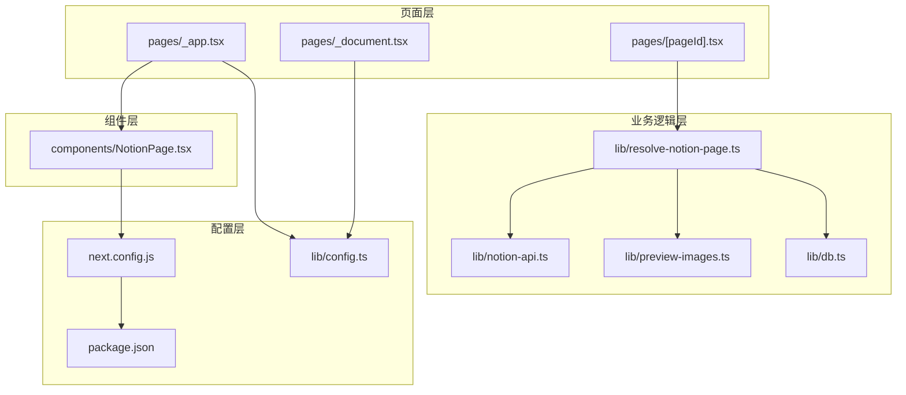
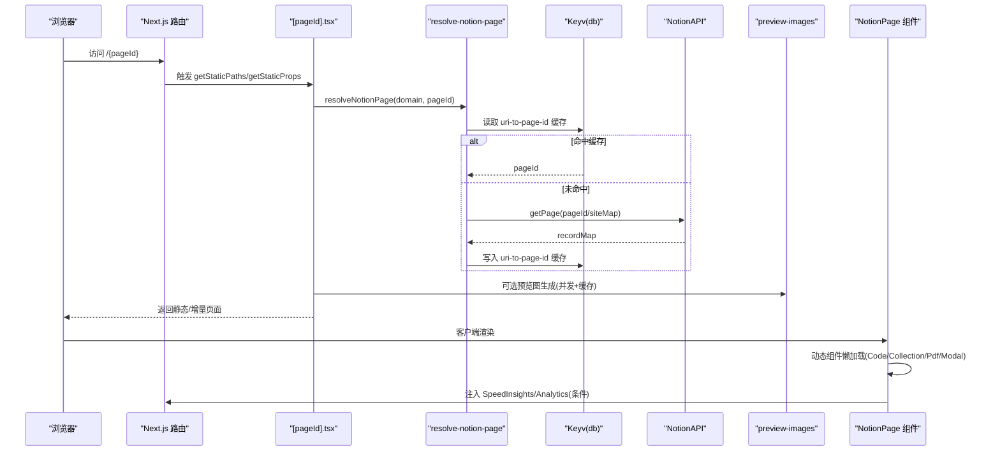
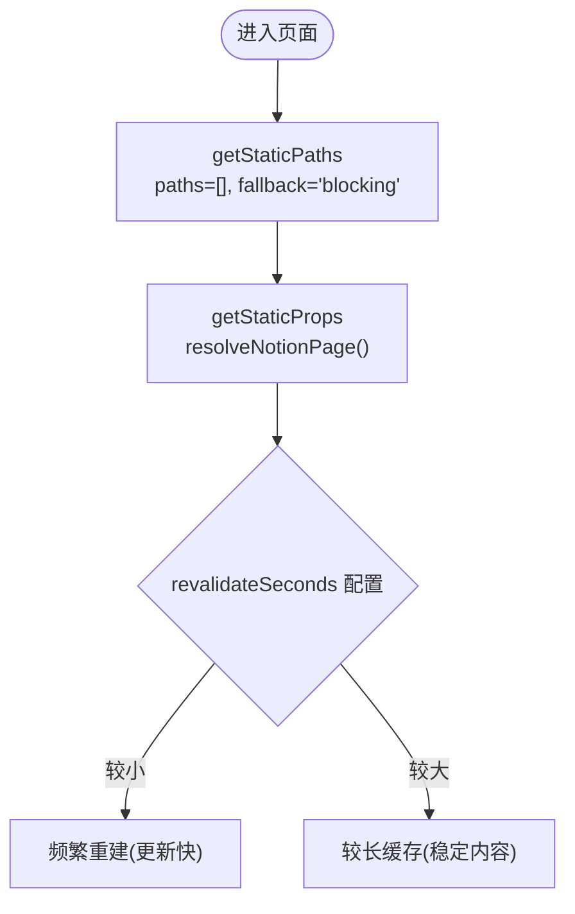
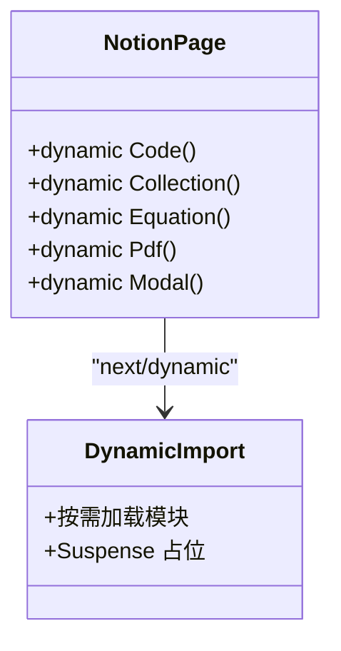
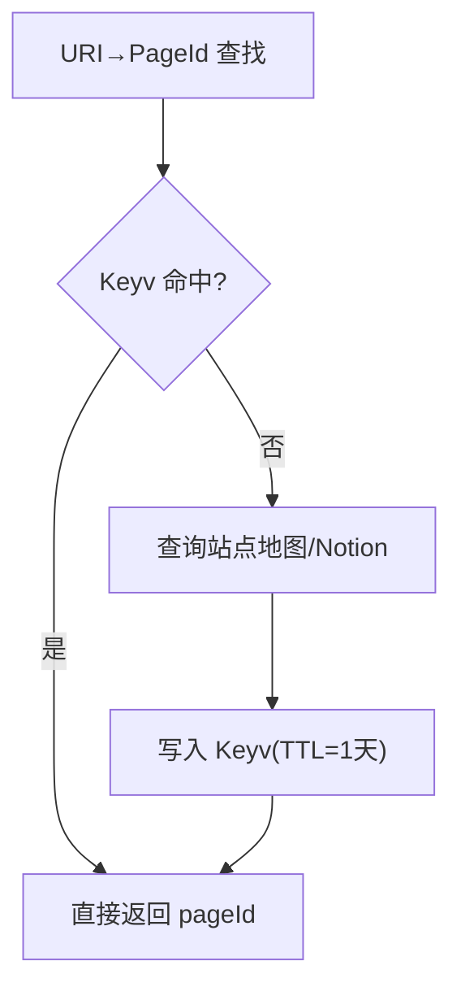
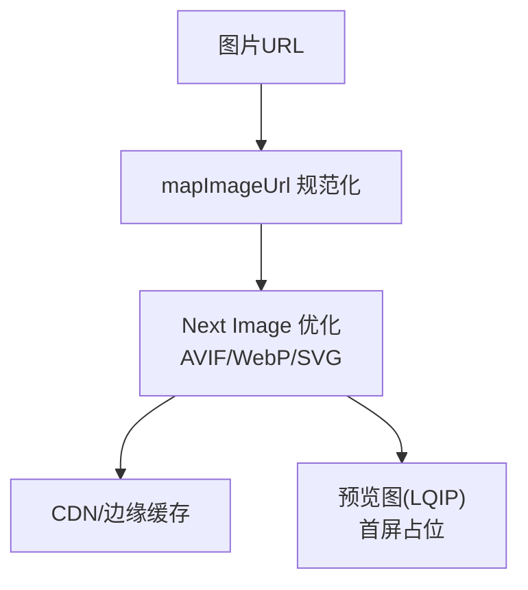
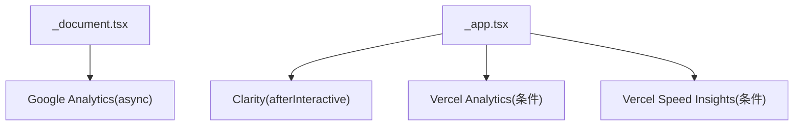
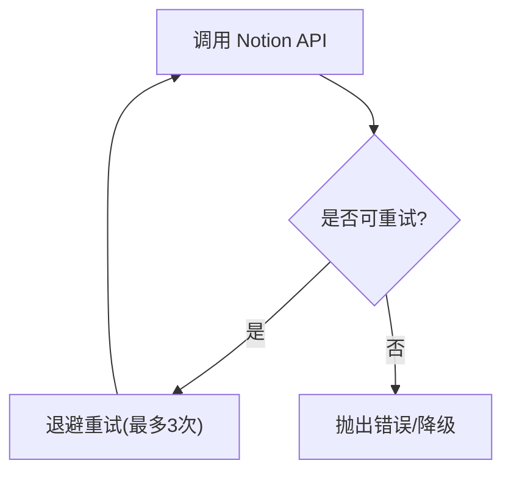
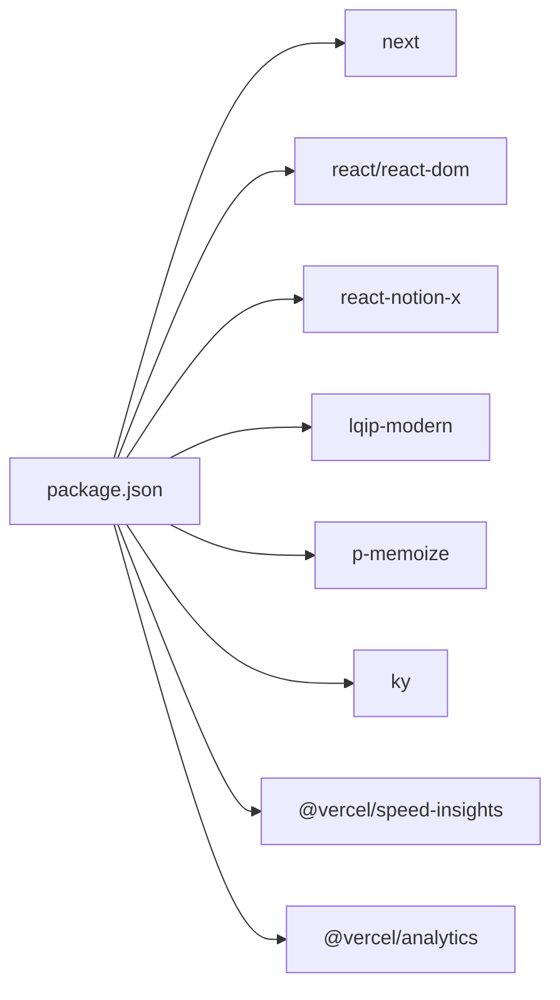

# 性能优化

<cite>
**本文引用的文件**   
- [next.config.js](file://next.config.js)
- [package.json](file://package.json)
- [pages/_app.tsx](file://pages/_app.tsx)
- [pages/_document.tsx](file://pages/_document.tsx)
- [pages/[pageId].tsx](file://pages/[pageId].tsx)
- [lib/config.ts](file://lib/config.ts)
- [lib/notion-api.ts](file://lib/notion-api.ts)
- [lib/resolve-notion-page.ts](file://lib/resolve-notion-page.ts)
- [lib/db.ts](file://lib/db.ts)
- [lib/preview-images.ts](file://lib/preview-images.ts)
- [components/NotionPage.tsx](file://components/NotionPage.tsx)
</cite>

## 目录
1. [简介](#简介)
2. [项目结构](#项目结构)
3. [核心组件](#核心组件)
4. [架构总览](#架构总览)
5. [详细组件分析](#详细组件分析)
6. [依赖关系分析](#依赖关系分析)
7. [性能考量](#性能考量)
8. [故障排查指南](#故障排查指南)
9. [结论](#结论)
10. [附录](#附录)

## 简介
本性能优化文档面向 Next.js + Notion 站点，系统性梳理静态生成、增量静态再生（ISR）、代码分割与懒加载、缓存机制、图片优化、字体与第三方脚本加载策略，并给出性能监控、瓶颈识别与调优建议。文档同时提供可执行的测试方法与基准指标建议，以及不同环境下的差异化调优策略。

## 项目结构
本项目采用 Next.js App Shell 与页面级数据获取的组合：
- 页面层：动态路由页通过 getStaticProps/getStaticPaths 实现 ISR；根布局与文档负责全局样式、分析与监控注入。
- 业务逻辑层：解析 Notion 页面、站点地图、搜索索引、预览图生成等。
- 配置层：站点配置、环境变量、Next.js 构建与运行时行为。
- 组件层：按需动态导入重型或可选组件，减少首屏体积。

图表来源
- [pages/_app.tsx:1-91](file://pages/_app.tsx#L1-L91)
- [pages/_document.tsx:1-101](file://pages/_document.tsx#L1-L101)
- [pages/[pageId].tsx:1-35](file://pages/[pageId].tsx#L1-L35)
- [lib/resolve-notion-page.ts:1-85](file://lib/resolve-notion-page.ts#L1-L85)
- [lib/notion-api.ts:1-20](file://lib/notion-api.ts#L1-L20)
- [lib/preview-images.ts:43-101](file://lib/preview-images.ts#L43-L101)
- [lib/db.ts:1-7](file://lib/db.ts#L1-L7)
- [lib/config.ts:1-224](file://lib/config.ts#L1-L224)
- [next.config.js:1-43](file://next.config.js#L1-L43)
- [package.json:1-94](file://package.json#L1-L94)

章节来源
- [pages/_app.tsx:1-91](file://pages/_app.tsx#L1-L91)
- [pages/_document.tsx:1-101](file://pages/_document.tsx#L1-L101)
- [pages/[pageId].tsx:1-35](file://pages/[pageId].tsx#L1-L35)
- [lib/resolve-notion-page.ts:1-85](file://lib/resolve-notion-page.ts#L1-L85)
- [lib/notion-api.ts:1-20](file://lib/notion-api.ts#L1-L20)
- [lib/preview-images.ts:43-101](file://lib/preview-images.ts#L43-L101)
- [lib/db.ts:1-7](file://lib/db.ts#L1-L7)
- [lib/config.ts:1-224](file://lib/config.ts#L1-L224)
- [next.config.js:1-43](file://next.config.js#L1-L43)
- [package.json:1-94](file://package.json#L1-L94)

## 核心组件
- 动态路由与 ISR：[pages/[pageId].tsx](file://pages/[pageId].tsx#L1-L35) 使用 getStaticProps 配合 revalidate 实现增量静态再生；getStaticPaths 返回空路径并在非开发环境启用 blocking fallback，提升首次访问体验。
- 站点配置与开关：[lib/config.ts:1-224](file://lib/config.ts#L1-L224) 暴露 revalidateSeconds、isVercelAnalyticsEnabled、isVercelSpeedInsightsEnabled 等关键开关，控制 ISR 刷新频率与分析/监控的启用。
- 外部 API 调用与重试：[lib/notion-api.ts:1-20](file://lib/notion-api.ts#L1-L20) 基于 notion-client 封装，配置自动重试与超时，避免瞬时错误导致页面失败。
- 内存缓存：[lib/db.ts:1-7](file://lib/db.ts#L1-L7) 使用 Keyv 提供进程内缓存，用于 URI→PageId 映射与预览图缓存。
- 预览图与 LQIP：[lib/preview-images.ts:43-101](file://lib/preview-images.ts#L43-L101) 并发处理图片，生成低质量占位图并缓存，降低首屏大图阻塞。
- 组件懒加载与代码分割：[components/NotionPage.tsx:1-357](file://components/NotionPage.tsx#L1-L357) 大量使用 next/dynamic 对 Code、Collection、Equation、Pdf、Modal 等进行延迟加载，并按需引入 Prism 语法插件。
- 构建与图片优化：[next.config.js:1-43](file://next.config.js#L1-L43) 开启 AVIF/WebP、远程图片白名单、SVG 支持，并设置静态生成超时。

章节来源
- [pages/[pageId].tsx:1-35](file://pages/[pageId].tsx#L1-L35)
- [lib/config.ts:90-153](file://lib/config.ts#L90-L153)
- [lib/notion-api.ts:1-20](file://lib/notion-api.ts#L1-L20)
- [lib/db.ts:1-7](file://lib/db.ts#L1-L7)
- [lib/preview-images.ts:43-101](file://lib/preview-images.ts#L43-L101)
- [components/NotionPage.tsx:43-142](file://components/NotionPage.tsx#L43-L142)
- [next.config.js:1-43](file://next.config.js#L1-L43)

## 架构总览
下图展示从请求到渲染的关键路径，包括 ISR、缓存、懒加载与监控注入。

图表来源
- [pages/[pageId].tsx:8-31](file://pages/[pageId].tsx#L8-L31)
- [lib/resolve-notion-page.ts:11-84](file://lib/resolve-notion-page.ts#L11-L84)
- [lib/db.ts:1-7](file://lib/db.ts#L1-L7)
- [lib/notion-api.ts:1-20](file://lib/notion-api.ts#L1-L20)
- [lib/preview-images.ts:43-101](file://lib/preview-images.ts#L43-L101)
- [components/NotionPage.tsx:43-142](file://components/NotionPage.tsx#L43-L142)
- [pages/_app.tsx:41-90](file://pages/_app.tsx#L41-L90)

## 详细组件分析

### 静态生成与增量静态再生（SSG + ISR）
- 动态路由页通过 getStaticProps 返回 props 与 revalidate 秒数，实现增量静态再生，减少函数调用频率，提高缓存命中率。
- getStaticPaths 返回空路径，并在生产环境使用 blocking fallback，保证首次访问时按需提供内容，后续走缓存。

图表来源
- [pages/[pageId].tsx:8-31](file://pages/[pageId].tsx#L8-L31)
- [lib/config.ts:93-98](file://lib/config.ts#L93-L98)

章节来源
- [pages/[pageId].tsx:8-31](file://pages/[pageId].tsx#L8-L31)
- [lib/config.ts:93-98](file://lib/config.ts#L93-L98)

### 代码分割与懒加载
- 使用 next/dynamic 将重型或可选组件（Code、Collection、Equation、Pdf、Modal）延迟加载，显著降低首屏包体。
- Code 组件在动态加载后并行引入多种 Prism 语法插件，按需渲染代码块，避免一次性加载全部语言。
- Collection、Pdf、Modal 禁用 SSR，避免服务端/客户端水合差异导致的额外重渲染。

图表来源
- [components/NotionPage.tsx:43-142](file://components/NotionPage.tsx#L43-L142)

章节来源
- [components/NotionPage.tsx:43-142](file://components/NotionPage.tsx#L43-L142)

### 缓存机制
- URI→PageId 映射缓存：在 resolve-notion-page 中，使用 Keyv 进程内缓存，TTL 为一天，减少重复解析与 Notion API 调用。
- 预览图缓存：preview-images 对每个 URL 生成 LQIP 并缓存，避免重复图像处理。
- 并发控制：预览图生成使用 p-map 限制并发度，平衡吞吐与资源占用。

图表来源
- [lib/resolve-notion-page.ts:32-65](file://lib/resolve-notion-page.ts#L32-L65)
- [lib/db.ts:1-7](file://lib/db.ts#L1-L7)

章节来源
- [lib/resolve-notion-page.ts:32-65](file://lib/resolve-notion-page.ts#L32-L65)
- [lib/db.ts:1-7](file://lib/db.ts#L1-L7)
- [lib/preview-images.ts:43-101](file://lib/preview-images.ts#L43-L101)

### 图片优化
- 构建期：next.config.js 启用 AVIF/WebP 格式、允许 SVG、配置远程图片域名白名单，确保图片在传输与解码阶段更高效。
- 运行期：NotionPage 使用 next/image 作为 nextImage 适配器，结合 mapImageUrl 统一处理图片地址，便于 CDN 与优化器生效。
- 预览图：LQIP 预生成，首屏快速呈现模糊占位图，随后替换高清图，改善感知性能。

图表来源
- [next.config.js:6-24](file://next.config.js#L6-L24)
- [components/NotionPage.tsx:196-209](file://components/NotionPage.tsx#L196-L209)
- [lib/preview-images.ts:43-101](file://lib/preview-images.ts#L43-L101)

章节来源
- [next.config.js:6-24](file://next.config.js#L6-L24)
- [components/NotionPage.tsx:196-209](file://components/NotionPage.tsx#L196-L209)
- [lib/preview-images.ts:43-101](file://lib/preview-images.ts#L43-L101)

### 字体与第三方脚本加载优化
- 字体：public/fonts 目录预留字体资源，可在 _document.tsx 中通过 link 标签引入，建议使用 preload 与 font-display: swap 策略以减少 FOIT/FOUT。
- 第三方脚本：_app.tsx 使用 Next Script 以 afterInteractive 策略加载 Microsoft Clarity，减少对首屏阻塞；Google Analytics 在 _document.tsx 中以 async 方式注入。
- 分析与监控：根据配置开关决定是否注入 Vercel Analytics 与 Speed Insights，避免不必要的开销。

图表来源
- [pages/_document.tsx:32-49](file://pages/_document.tsx#L32-L49)
- [pages/_app.tsx:70-90](file://pages/_app.tsx#L70-L90)
- [lib/config.ts:138-146](file://lib/config.ts#L138-L146)

章节来源
- [pages/_document.tsx:32-49](file://pages/_document.tsx#L32-L49)
- [pages/_app.tsx:70-90](file://pages/_app.tsx#L70-L90)
- [lib/config.ts:138-146](file://lib/config.ts#L138-L146)

### 外部 API 容错与稳定性
- notion-api 配置自动重试与超时，针对 408/429/500/502/503/504 等状态码进行重试，提升页面可用性。
- 在 resolve-notion-page 中对缓存读写异常进行捕获与告警，避免单点失败影响整体流程。

图表来源
- [lib/notion-api.ts:6-19](file://lib/notion-api.ts#L6-L19)
- [lib/resolve-notion-page.ts:36-41](file://lib/resolve-notion-page.ts#L36-L41)

章节来源
- [lib/notion-api.ts:6-19](file://lib/notion-api.ts#L6-L19)
- [lib/resolve-notion-page.ts:36-41](file://lib/resolve-notion-page.ts#L36-L41)

## 依赖关系分析
- 构建与运行时依赖：Next.js 版本与 React 19 组合，配合 react-notion-x 生态；性能相关依赖包括 @vercel/speed-insights、@vercel/analytics、lqip-modern、p-memoize、ky 等。
- 关键依赖职责：
  - lqip-modern：生成低质量占位图，加速首屏。
  - p-memoize：对预览图生成进行去抖/缓存，避免重复计算。
  - ky：网络请求工具，配合 notion-api 的重试与超时。

图表来源
- [package.json:27-53](file://package.json#L27-L53)

章节来源
- [package.json:27-53](file://package.json#L27-L53)

## 性能考量
- 静态生成与 ISR
  - 合理设置 revalidateSeconds：内容更新频繁则缩短间隔，稳定内容则增大间隔以降低函数调用成本。
  - 使用 blocking fallback：在生产环境首次访问时按需生成，避免长时间等待。
- 代码分割与懒加载
  - 将重型组件与可选功能（代码高亮、PDF、集合视图、公式、弹窗）延迟加载，显著降低首屏体积。
  - 按需引入 Prism 语法插件，避免全量加载。
- 缓存策略
  - URI→PageId 映射缓存与预览图缓存结合，减少外部依赖与 CPU 消耗。
  - 考虑将 Keyv 后端替换为 Redis（生产环境），提升跨实例共享能力。
- 图片优化
  - 启用 AVIF/WebP，合理使用 next/image 与 mapImageUrl，确保 CDN 与优化器生效。
  - 使用 LQIP 提升首屏感知速度。
- 第三方脚本
  - 使用 afterInteractive 与 async 策略加载分析/监控脚本，避免阻塞首屏。
  - 根据环境开关控制分析/监控注入，减少不必要开销。
- 外部 API 稳定性
  - 配置重试与超时，避免瞬时错误导致页面失败。
  - 对缓存读写异常进行容错，保障主流程稳定。

[本节为通用指导，不直接分析具体文件]

## 故障排查指南
- 页面构建失败或超时
  - 检查 staticPageGenerationTimeout 与 revalidateSeconds 配置是否合理。
  - 查看 Notion API 重试与超时配置，确认网络与鉴权正确。
- 缓存未命中或异常
  - 检查 Keyv 初始化与读写异常日志，必要时切换持久化存储。
- 图片加载缓慢
  - 确认 remotePatterns 包含所有图片来源域名。
  - 检查 LQIP 生成是否成功，关注 preview-images 日志。
- 第三方脚本阻塞
  - 确认 Script 的 strategy 与 async 属性是否正确设置。
  - 根据 isVercelAnalyticsEnabled/isVercelSpeedInsightsEnabled 开关控制注入。

章节来源
- [next.config.js:4-24](file://next.config.js#L4-L24)
- [lib/notion-api.ts:6-19](file://lib/notion-api.ts#L6-L19)
- [lib/resolve-notion-page.ts:36-41](file://lib/resolve-notion-page.ts#L36-L41)
- [lib/preview-images.ts:77-98](file://lib/preview-images.ts#L77-L98)
- [pages/_app.tsx:70-90](file://pages/_app.tsx#L70-L90)

## 结论
本项目通过 SSG+ISR、动态组件懒加载、图片优化与 LQIP、进程内缓存与外部 API 容错、以及第三方脚本的非阻塞加载，构建了高性能的 Notion 站点。建议在生产环境中进一步评估缓存后端升级、CDN 策略与监控埋点的精细化配置，持续优化首屏与交互性能。

[本节为总结性内容，不直接分析具体文件]

## 附录

### 性能测试方法与基准指标
- 本地基准
  - 使用 Lighthouse 或 WebPageTest 对首页与典型文章页进行测试，记录 FCP、LCP、CLS、TTI、Total Blocking Time。
  - 对比不同 revalidateSeconds 下的构建时间与函数调用次数。
- 线上监控
  - 启用 Vercel Speed Insights 与 Google Analytics，观察真实用户性能分布。
  - 使用 PostHog/Fathom 进行事件追踪，定位慢页面与慢组件。
- 压测与回归
  - 使用 k6 或 Artillery 模拟并发访问，验证 ISR 与缓存命中率。
  - 在 CI 中加入 Lighthouse CI，设定阈值防止性能回退。

[本节为通用指导，不直接分析具体文件]

### 不同环境的调优策略
- 开发环境
  - 开启 includeNotionIdInUrls 以便调试；适当缩短 revalidateSeconds 以快速验证变更。
  - 保留更多日志输出，便于定位问题。
- 生产环境
  - 关闭非必要分析/监控注入，减少开销。
  - 调整 revalidateSeconds 与 staticPageGenerationTimeout，平衡新鲜度与构建成本。
  - 评估将 Keyv 后端迁移至 Redis，提升缓存共享与扩展性。

章节来源
- [lib/config.ts:74-78](file://lib/config.ts#L74-L78)
- [lib/config.ts:93-98](file://lib/config.ts#L93-L98)
- [lib/config.ts:138-146](file://lib/config.ts#L138-L146)
- [next.config.js:4-24](file://next.config.js#L4-L24)