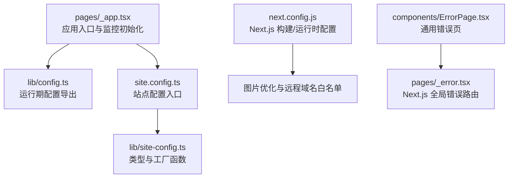
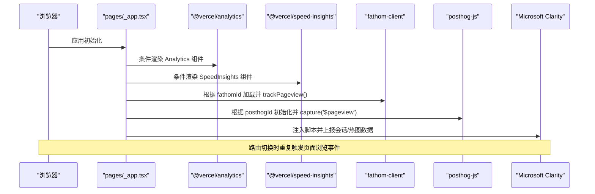
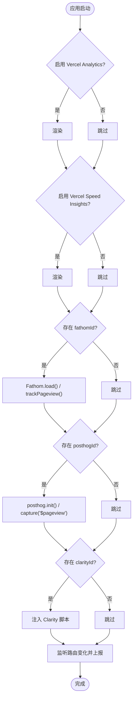
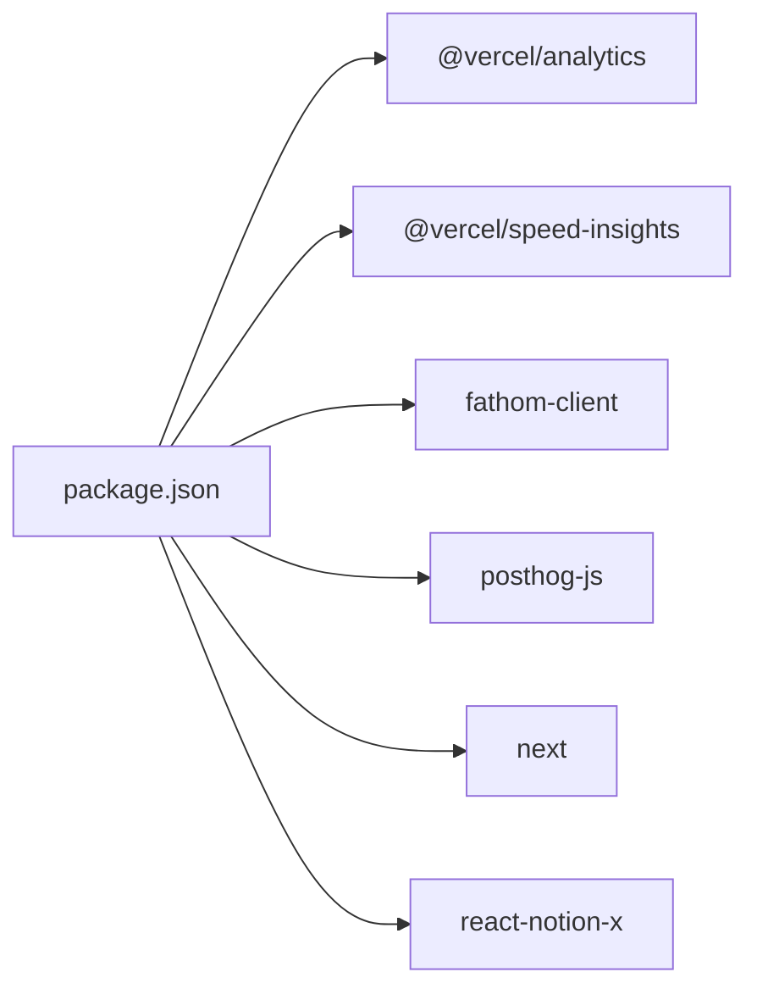

# 性能监控

<cite>
**本文引用的文件**   
- [package.json](file://package.json)
- [next.config.js](file://next.config.js)
- [pages/_app.tsx](file://pages/_app.tsx)
- [lib/config.ts](file://lib/config.ts)
- [site.config.ts](file://site.config.ts)
- [lib/site-config.ts](file://lib/site-config.ts)
- [components/ErrorPage.tsx](file://components/ErrorPage.tsx)
- [pages/_error.tsx](file://pages/_error.tsx)
</cite>

## 目录
1. [简介](#简介)
2. [项目结构](#项目结构)
3. [核心组件](#核心组件)
4. [架构总览](#架构总览)
5. [详细组件分析](#详细组件分析)
6. [依赖关系分析](#依赖关系分析)
7. [性能考量与优化建议](#性能考量与优化建议)
8. [故障诊断指南](#故障诊断指南)
9. [结论](#结论)
10. [附录：配置清单与最佳实践](#附录配置清单与最佳实践)

## 简介
本文件面向“性能监控”主题，结合仓库现有实现，系统说明如何在本 Next.js + Notion 站点中启用并配置性能与错误监控、Web Vitals 指标采集、第三方分析服务集成，以及如何在此基础上扩展基准测试、A/B 测试与实时监控仪表板。文档同时提供可操作的排错步骤与优化建议，帮助读者快速落地并持续改进站点性能。

## 项目结构
本项目采用 Next.js App Shell 模式，应用级入口在 pages/_app.tsx，集中初始化分析与性能采集；站点级配置集中在 site.config.ts 与 lib/config.ts；运行时行为由 next.config.js 控制。

图表来源
- [pages/_app.tsx:17-87](file://pages/_app.tsx#L17-L87)
- [lib/config.ts:130-172](file://lib/config.ts#L130-L172)
- [site.config.ts:38-45](file://site.config.ts#L38-L45)
- [lib/site-config.ts:28-33](file://lib/site-config.ts#L28-L33)
- [next.config.js:6-18](file://next.config.js#L6-L18)
- [components/ErrorPage.tsx:4-21](file://components/ErrorPage.tsx#L4-L21)
- [pages/_error.tsx:1](file://pages/_error.tsx#L1)

章节来源
- [pages/_app.tsx:17-87](file://pages/_app.tsx#L17-L87)
- [lib/config.ts:130-172](file://lib/config.ts#L130-L172)
- [site.config.ts:38-45](file://site.config.ts#L38-L45)
- [lib/site-config.ts:28-33](file://lib/site-config.ts#L28-L33)
- [next.config.js:6-18](file://next.config.js#L6-L18)
- [components/ErrorPage.tsx:4-21](file://components/ErrorPage.tsx#L4-L21)
- [pages/_error.tsx:1](file://pages/_error.tsx#L1)

## 核心组件
- 应用级监控初始化：在 pages/_app.tsx 中统一加载 Vercel Analytics、Vercel Speed Insights、Fathom、PostHog、Microsoft Clarity，并在路由变化时上报页面浏览事件。
- 站点配置：site.config.ts 暴露是否启用 Vercel Analytics/Speed Insights、Clarity ID、Google Analytics ID 等开关与标识；lib/config.ts 将这些值以常量形式导出供运行时使用。
- 构建与资源优化：next.config.js 配置了图片格式与远程域名白名单，有助于减少首屏资源体积与跨域请求失败风险。
- 错误处理：components/ErrorPage.tsx 提供统一的错误展示 UI，并由 pages/_error.tsx 作为 Next.js 全局错误路由挂载。

章节来源
- [pages/_app.tsx:17-87](file://pages/_app.tsx#L17-L87)
- [site.config.ts:38-45](file://site.config.ts#L38-L45)
- [lib/config.ts:130-172](file://lib/config.ts#L130-L172)
- [next.config.js:6-18](file://next.config.js#L6-L18)
- [components/ErrorPage.tsx:4-21](file://components/ErrorPage.tsx#L4-L21)
- [pages/_error.tsx:1](file://pages/_error.tsx#L1)

## 架构总览
下图展示了前端应用启动后，各监控与分析 SDK 的加载与数据上报路径。

图表来源
- [pages/_app.tsx:17-87](file://pages/_app.tsx#L17-L87)
- [lib/config.ts:130-172](file://lib/config.ts#L130-L172)

## 详细组件分析

### 应用级监控初始化（pages/_app.tsx）
- 功能要点
  - 条件启用 Vercel Analytics 与 Speed Insights，分别用于 Web 分析与性能指标采集。
  - 条件初始化 Fathom 与 PostHog，并在路由变化时上报页面浏览事件。
  - 通过 Script 注入 Microsoft Clarity 脚本，收集用户交互热图与会话回放。
- 关键流程
  - 首次加载：根据配置决定是否加载各 SDK。
  - 路由切换：监听 routeChangeComplete 事件，触发各分析工具上报。
- 注意事项
  - 仅在客户端执行初始化逻辑，避免在服务端调用浏览器 API。
  - 所有 SDK 均按开关控制，便于在不同环境灵活启用。

图表来源
- [pages/_app.tsx:44-68](file://pages/_app.tsx#L44-L68)
- [pages/_app.tsx:70-87](file://pages/_app.tsx#L70-L87)

章节来源
- [pages/_app.tsx:17-87](file://pages/_app.tsx#L17-L87)

### 站点配置与运行期导出（site.config.ts 与 lib/config.ts）
- 功能要点
  - site.config.ts 定义站点元信息与可选的分析开关（如 Google Analytics、Vercel Analytics/Speed Insights、Clarity）。
  - lib/config.ts 将上述配置解析为运行时常量，并提供环境变量覆盖能力（例如 NEXT_PUBLIC_* 变量）。
- 关键配置项
  - isVercelAnalyticsEnabled、isVercelSpeedInsightsEnabled：控制对应 SDK 是否启用。
  - googleAnalyticsId、clarityId：对应第三方服务的标识。
  - fathomId、posthogId：从环境变量读取，用于初始化 Fathom 与 PostHog。
- 设计原则
  - 配置与代码解耦，支持不同环境差异化启用。
  - 对敏感或环境相关值使用环境变量，避免硬编码。

章节来源
- [site.config.ts:38-45](file://site.config.ts#L38-L45)
- [lib/site-config.ts:28-33](file://lib/site-config.ts#L28-L33)
- [lib/config.ts:130-172](file://lib/config.ts#L130-L172)

### 构建与资源优化（next.config.js）
- 功能要点
  - 配置 images.remotePatterns 允许特定远程域名，避免图片加载失败。
  - 指定 images.formats 优先使用 AVIF/WebP，减小图片体积。
  - 设置 contentSecurityPolicy 限制脚本执行，提升安全性。
- 影响
  - 降低首屏资源大小，提高 LCP/CLS 等 Web Vitals 指标表现。
  - 减少因跨域或 CSP 导致的资源加载失败。

章节来源
- [next.config.js:6-18](file://next.config.js#L6-L18)

### 错误处理与错误页（components/ErrorPage.tsx 与 pages/_error.tsx）
- 功能要点
  - components/ErrorPage.tsx 提供统一的错误展示 UI，包含状态码与提示文案。
  - pages/_error.tsx 将 ErrorPage 作为默认导出，接入 Next.js 全局错误路由。
- 扩展建议
  - 可在错误页中集成错误上报（如 Sentry、PostHog 自定义事件），以便追踪线上异常。
  - 结合性能监控 SDK，记录错误发生时的性能快照（如 Navigation Timing、Resource Timing）。

章节来源
- [components/ErrorPage.tsx:4-21](file://components/ErrorPage.tsx#L4-L21)
- [pages/_error.tsx:1](file://pages/_error.tsx#L1)

## 依赖关系分析
- 运行时依赖
  - @vercel/analytics：Web 流量与基础指标分析。
  - @vercel/speed-insights：Web Vitals 与性能指标采集。
  - fathom-client：隐私友好的网站分析。
  - posthog-js：产品分析与会话追踪。
  - react-notion-x、notion-client 等：Notion 内容渲染与数据获取（非性能监控直接相关）。
- 构建依赖
  - next：框架核心。
  - typescript、eslint、prettier：开发与质量保障。

图表来源
- [package.json:30-55](file://package.json#L30-L55)

章节来源
- [package.json:30-55](file://package.json#L30-L55)

## 性能考量与优化建议
- Web Vitals 指标采集
  - 已启用 @vercel/speed-insights，自动采集 LCP、FID、CLS、INP 等指标并上报至 Vercel。
  - 建议在关键页面增加自定义性能埋点（如首字节时间、API 耗时），结合 PostHog/Fathom 进行关联分析。
- 资源加载优化
  - 使用 images.formats 与 remotePatterns 确保图片高效加载与正确跨域。
  - 按需加载第三方脚本（当前已通过条件渲染与 afterInteractive 策略注入 Clarity）。
- 缓存与 ISR
  - 通过 revalidateSeconds 控制 ISR 刷新频率，平衡内容新鲜度与函数调用成本。
- 安全与稳定性
  - 利用 CSP 限制脚本执行，降低 XSS 风险。
  - 在错误页中集成错误上报，配合性能监控形成闭环。

[本节为通用指导，不直接分析具体文件]

## 故障诊断指南
- 现象：未看到 Vercel Analytics/Speed Insights 数据
  - 检查 site.config.ts 中的 isVercelAnalyticsEnabled/isVercelSpeedInsightsEnabled 是否为 true。
  - 确认 pages/_app.tsx 是否正确渲染对应组件。
- 现象：Fathom/PostHog 无页面浏览事件
  - 检查环境变量 NEXT_PUBLIC_FATHOM_ID/NEXT_PUBLIC_POSTHOG_ID 是否配置。
  - 确认 lib/config.ts 导出的 fathomId/posthogId 非空。
- 现象：Clarity 无热图/会话数据
  - 检查 clarityId 是否配置且非空。
  - 确认 Script 注入成功且未被 CSP 拦截。
- 现象：图片加载失败
  - 检查 next.config.js 中 images.remotePatterns 是否包含目标域名。
  - 确认图片 URL 协议与域名匹配。
- 现象：错误页未显示预期信息
  - 检查 pages/_error.tsx 是否正确导出 ErrorPage。
  - 确认 components/ErrorPage.tsx 的状态码与文案逻辑符合预期。

章节来源
- [site.config.ts:38-45](file://site.config.ts#L38-L45)
- [pages/_app.tsx:70-87](file://pages/_app.tsx#L70-L87)
- [lib/config.ts:162-172](file://lib/config.ts#L162-L172)
- [next.config.js:6-18](file://next.config.js#L6-L18)
- [components/ErrorPage.tsx:4-21](file://components/ErrorPage.tsx#L4-L21)
- [pages/_error.tsx:1](file://pages/_error.tsx#L1)

## 结论
本项目已在应用层集成了多套性能与分析 SDK，并通过站点配置与环境变量实现了灵活的开关控制。借助 Vercel Speed Insights 可自动采集 Web Vitals，结合 Fathom、PostHog、Clarity 可获得更丰富的用户行为与性能数据。在此基础上，可按需扩展基准测试、A/B 测试与实时仪表板，形成完整的性能监控与优化闭环。

[本节为总结性内容，不直接分析具体文件]

## 附录：配置清单与最佳实践
- 启用与关闭
  - 在 site.config.ts 中设置 isVercelAnalyticsEnabled、isVercelSpeedInsightsEnabled 为 true/false 以启用/禁用对应 SDK。
  - 配置 googleAnalyticsId、clarityId 以启用 GA4 与 Clarity。
- 环境变量
  - NEXT_PUBLIC_FATHOM_ID、NEXT_PUBLIC_POSTHOG_ID：用于初始化 Fathom 与 PostHog。
- 图片与远程域名
  - 在 next.config.js 中维护 images.remotePatterns，确保图片可正常加载。
- 错误上报扩展
  - 在 pages/_error.tsx 或 ErrorPage 中集成错误上报 SDK（如 Sentry），并结合性能监控 SDK 记录上下文。
- 性能基准与 A/B 测试
  - 基准测试：可使用 Lighthouse CI、WebPageTest 或 Vercel 的性能报告进行自动化回归。
  - A/B 测试：可基于 PostHog 或自建实验平台，对关键页面进行分组对比，观察 Web Vitals 与转化率变化。
- 实时监控仪表板
  - Vercel Analytics/Speed Insights：内置可视化面板，适合快速查看趋势与异常。
  - PostHog：可创建自定义仪表盘，聚合页面浏览、性能事件与错误事件。
  - Clarity：提供会话回放与热图，辅助定位交互问题。

[本节为通用指导，不直接分析具体文件]