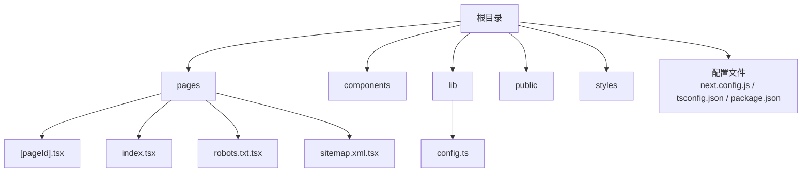
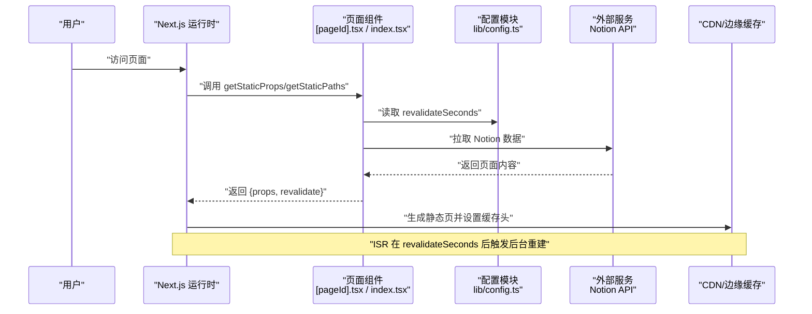
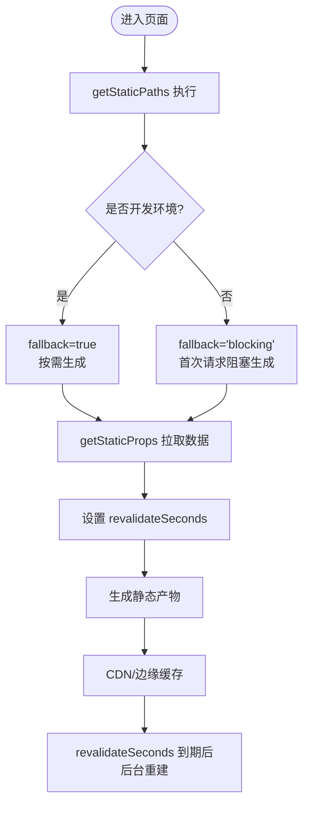
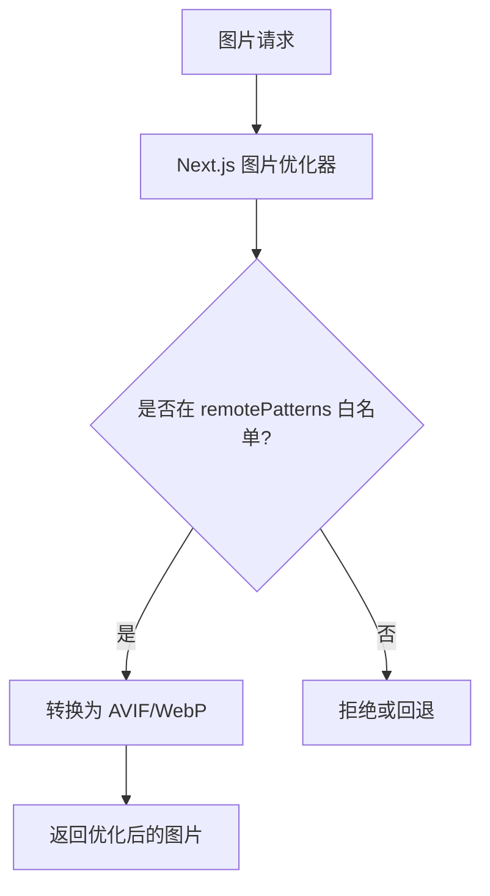
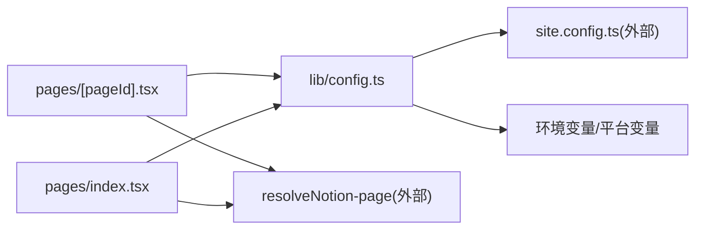

# 构建优化

<cite>
**本文引用的文件**   
- [next.config.js](file://next.config.js)
- [package.json](file://package.json)
- [tsconfig.json](file://tsconfig.json)
- [pages/[pageId].tsx](file://pages/[pageId].tsx)
- [pages/index.tsx](file://pages/index.tsx)
- [lib/config.ts](file://lib/config.ts)
- [pages/robots.txt.tsx](file://pages/robots.txt.tsx)
- [pages/sitemap.xml.tsx](file://pages/sitemap.xml.tsx)
- [pages/_app.tsx](file://pages/_app.tsx)
- [oxlint.config.ts](file://oxlint.config.ts)
</cite>

## 目录
1. [简介](#简介)
2. [项目结构](#项目结构)
3. [核心组件](#核心组件)
4. [架构总览](#架构总览)
5. [详细组件分析](#详细组件分析)
6. [依赖关系分析](#依赖关系分析)
7. [性能考量](#性能考量)
8. [故障排查指南](#故障排查指南)
9. [结论](#结论)
10. [附录](#附录)

## 简介
本文件面向 Next.js 项目的构建优化，覆盖以下主题：
- 静态站点生成（SSG）与增量静态再生（ISR）的配置与实践
- 代码分割、Tree Shaking、压缩等构建期优化
- TypeScript 编译优化与路径别名
- 依赖管理与包管理器优化
- 构建性能监控与基准测试方法

本项目基于 Next.js 16，采用 ESM、TypeScript、pnpm 工作区与 Vercel 部署。构建配置集中在 next.config.js、tsconfig.json 与 package.json；SSG/ISR 逻辑分布在页面文件中，并通过 lib/config.ts 暴露 revalidateSeconds 控制 ISR 刷新频率。

## 项目结构
该仓库采用按功能域组织的目录结构：
- pages：路由与页面逻辑，包含 SSG/ISR 入口
- components：可复用 UI 组件
- lib：业务工具与配置聚合
- public：静态资源
- styles：全局样式与主题
- 根级配置文件：next.config.js、tsconfig.json、package.json、vercel.json

图表来源
- [next.config.js:1-43](file://next.config.js#L1-L43)
- [package.json:1-94](file://package.json#L1-L94)
- [tsconfig.json:1-13](file://tsconfig.json#L1-L13)

章节来源
- [next.config.js:1-43](file://next.config.js#L1-L43)
- [package.json:1-94](file://package.json#L1-L94)
- [tsconfig.json:1-13](file://tsconfig.json#L1-L13)

## 核心组件
- 构建配置中心：next.config.js
  - 图片优化器 remotePatterns、formats、dangerouslyAllowSVG、CSP
  - transpilePackages 用于第三方库转译
  - staticPageGenerationTimeout 控制 SSG 超时
- 类型与路径：tsconfig.json
  - 继承 @fisch0920/config/tsconfig-react
  - 定义路径别名 @/components、@/lib、@/styles
- 脚本与依赖：package.json
  - build/dev/start 脚本
  - pnpm 仅安装必要原生依赖 onlyBuiltDependencies
  - engines 指定 Node 版本
- ISR 开关与时长：lib/config.ts
  - revalidateSeconds 默认 3600 秒，可通过 site.config.ts 覆盖
- 页面级 SSG/ISR：pages/[pageId].tsx、pages/index.tsx
  - getStaticProps 返回 props 与 revalidate
  - getStaticPaths 在开发时启用 fallback:true，生产使用 blocking

章节来源
- [next.config.js:1-43](file://next.config.js#L1-L43)
- [tsconfig.json:1-13](file://tsconfig.json#L1-L13)
- [package.json:1-94](file://package.json#L1-L94)
- [lib/config.ts:90-100](file://lib/config.ts#L90-L100)
- [pages/[pageId].tsx:1-36](file://pages/[pageId].tsx#L1-L36)
- [pages/index.tsx:1-23](file://pages/index.tsx#L1-L23)

## 架构总览
下图展示从请求到构建产物的关键路径，包括 SSG/ISR 的触发点与缓存策略。

图表来源
- [pages/[pageId].tsx:8-30](file://pages/[pageId].tsx#L8-L30)
- [pages/index.tsx:6-17](file://pages/index.tsx#L6-L17)
- [lib/config.ts:90-100](file://lib/config.ts#L90-L100)

## 详细组件分析

### 静态站点生成（SSG）与增量静态再生（ISR）
- 动态页面 [pageId].tsx
  - getStaticProps 中通过 resolveNotionPage 获取数据，返回 revalidateSeconds 以启用 ISR
  - getStaticPaths 返回空 paths，配合 fallback 模式：
    - 开发环境：fallback:true，按需生成
    - 生产环境：fallback:'blocking'，首次请求阻塞生成
- 首页 index.tsx
  - getStaticProps 直接渲染根页面，同样返回 revalidateSeconds
- 配置项 revalidateSeconds
  - 默认 3600 秒，可在 site.config.ts 调整以减少函数调用次数

图表来源
- [pages/[pageId].tsx:8-30](file://pages/[pageId].tsx#L8-L30)
- [pages/index.tsx:6-17](file://pages/index.tsx#L6-L17)
- [lib/config.ts:90-100](file://lib/config.ts#L90-L100)

章节来源
- [pages/[pageId].tsx:1-36](file://pages/[pageId].tsx#L1-L36)
- [pages/index.tsx:1-23](file://pages/index.tsx#L1-L23)
- [lib/config.ts:90-100](file://lib/config.ts#L90-L100)

### 图片优化与远程源白名单
- next.config.images.remotePatterns
  - 允许 notion 相关域名、AWS、Unsplash、Twitter 等
  - 同时放行任意 https 主机名以兼容 Notion 嵌入的外部图片
- formats 支持 AVIF/WebP，提升加载效率
- dangerouslyAllowSVG 开启 SVG 优化
- contentSecurityPolicy 限制脚本执行，增强安全

图表来源
- [next.config.js:6-25](file://next.config.js#L6-L25)

章节来源
- [next.config.js:6-25](file://next.config.js#L6-L25)

### 代码分割与 Tree Shaking
- Next.js 默认对客户端代码进行自动代码分割，按路由与组件边界拆分
- 未使用的导出将被 Tree Shaking 移除
- 第三方库如 react-tweet 通过 transpilePackages 转译，避免打包器无法处理的语法导致无法被正确摇树
- 建议：
  - 避免在顶层引入重型库，按需 import
  - 将大型组件拆分为子组件，利用 React.lazy/Suspense（如需）
  - 谨慎使用动态 require/import，确保能被分析

章节来源
- [next.config.js:40-42](file://next.config.js#L40-L42)

### 压缩与输出优化
- Next.js 在生产构建中默认启用 JS/CSS 压缩与最小化
- 图片优化器会产出更小的 AVIF/WebP 变体
- 建议：
  - 保持 images.formats 为 AVIF/WebP
  - 避免内联大体积脚本，优先使用外部脚本与 defer/async
  - 合理使用字体与图标，减少首屏体积

章节来源
- [next.config.js:6-25](file://next.config.js#L6-L25)

### TypeScript 编译优化
- 继承 @fisch0920/config/tsconfig-react，获得现代化 TS 基线
- 路径别名 @/components、@/lib、@/styles 提升可读性与构建解析速度
- include 明确包含 .ts/.tsx 与配置文件，exclude node_modules 避免扫描
- 建议：
  - 保持 strict 模式开启（由基线提供）
  - 使用路径别名替代相对路径，减少解析开销
  - 将重型类型定义放在独立模块，按需导入

章节来源
- [tsconfig.json:1-13](file://tsconfig.json#L1-L13)

### 依赖管理优化
- package.json
  - scripts 提供 dev/build/start/deploy/test 等命令
  - engines 锁定 Node 版本，保证构建一致性
  - pnpm.onlyBuiltDependencies 仅安装必要的原生依赖，减少构建时间
  - overrides 统一 keyv 版本，避免冲突
- 建议：
  - 使用 pnpm workspace 与 lockfile 锁定依赖
  - 定期运行 deps:upgrade 更新依赖
  - 分离 devDependencies 与 dependencies，减小生产包体积

章节来源
- [package.json:1-94](file://package.json#L1-L94)

### 构建时分析与质量保障
- oxlint.config.ts 关闭部分 React Compiler 提示规则，避免误报影响构建流程
- 建议：
  - 在 CI 中运行 lint/format/typecheck
  - 结合 Next.js 内置分析插件（如 next/bundle-analyzer）进行产物分析

章节来源
- [oxlint.config.ts:1-15](file://oxlint.config.ts#L1-L15)

## 依赖关系分析
下图展示页面与配置之间的依赖关系，以及 ISR 的关键参数来源。

图表来源
- [pages/[pageId].tsx:1-36](file://pages/[pageId].tsx#L1-L36)
- [pages/index.tsx:1-23](file://pages/index.tsx#L1-L23)
- [lib/config.ts:1-100](file://lib/config.ts#L1-L100)

章节来源
- [pages/[pageId].tsx:1-36](file://pages/[pageId].tsx#L1-L36)
- [pages/index.tsx:1-23](file://pages/index.tsx#L1-L23)
- [lib/config.ts:1-100](file://lib/config.ts#L1-L100)

## 性能考量
- SSG/ISR
  - 合理设置 revalidateSeconds，平衡新鲜度与函数调用成本
  - 开发时使用 fallback:true 加速迭代；生产使用 blocking 保证首次命中
- 图片优化
  - 启用 AVIF/WebP，减少带宽
  - 严格 remotePatterns，避免不必要的优化失败
- 代码分割与 Tree Shaking
  - 避免在公共模块引入重型依赖
  - 使用条件导入与懒加载降低首屏体积
- TypeScript
  - 使用路径别名，减少解析深度
  - 保持类型定义精简，避免循环依赖
- 依赖管理
  - 使用 pnpm.onlyBuiltDependencies 减少构建耗时
  - 锁定 Node 版本，避免环境差异导致的构建波动

## 故障排查指南
- SSG 构建超时
  - 现象：构建阶段长时间等待或失败
  - 处理：调整 staticPageGenerationTimeout，检查外部 API 响应时间与重试策略
  - 参考：[next.config.js:5](file://next.config.js#L5)
- ISR 未生效
  - 现象：页面不随 revalidateSeconds 刷新
  - 处理：确认 getStaticProps 返回了 revalidate，且部署平台支持 ISR
  - 参考：[pages/[pageId].tsx:16](file://pages/[pageId].tsx#L16)、[pages/index.tsx:10](file://pages/index.tsx#L10)
- 图片优化失败
  - 现象：图片无法加载或显示占位图
  - 处理：检查 remotePatterns 是否包含目标域名，确认 HTTPS 与 CORS
  - 参考：[next.config.js:6-25](file://next.config.js#L6-L25)
- 类型检查失败
  - 现象：tsc 报错或 IDE 提示异常
  - 处理：检查 tsconfig.include/exclude，确认路径别名与依赖类型声明
  - 参考：[tsconfig.json:1-13](file://tsconfig.json#L1-L13)
- 构建缓慢
  - 现象：本地或 CI 构建时间长
  - 处理：启用 pnpm.onlyBuiltDependencies，清理 node_modules，减少无关依赖
  - 参考：[package.json:86-92](file://package.json#L86-L92)

章节来源
- [next.config.js:5-25](file://next.config.js#L5-L25)
- [pages/[pageId].tsx:8-17](file://pages/[pageId].tsx#L8-L17)
- [pages/index.tsx:6-17](file://pages/index.tsx#L6-L17)
- [tsconfig.json:1-13](file://tsconfig.json#L1-L13)
- [package.json:86-92](file://package.json#L86-L92)

## 结论
本项目通过 Next.js 的 SSG/ISR、图片优化器与 TypeScript 路径别名，构建了高效、可维护的前端工程。建议在后续迭代中：
- 持续优化 revalidateSeconds 与 CDN 缓存策略
- 引入构建产物分析工具，定位大包与热路径
- 保持依赖精简与版本锁定，提升构建稳定性与速度

## 附录

### 构建与基准测试方法
- 本地构建基准
  - 使用 time next build 统计构建耗时
  - 多次运行取平均值，排除冷启动影响
- 产物体积分析
  - 集成 next/bundle-analyzer，分析各 chunk 大小与依赖占比
  - 关注 vendor 与第三方库体积变化
- 运行时性能指标
  - 使用 Vercel Speed Insights 与 Web Vitals 监控 LCP、CLS、INP
  - 结合 PostHog/Fathom 进行用户行为分析
- 缓存与 ISR 验证
  - 通过浏览器开发者工具的 Network 面板观察缓存头与重验证行为
  - 修改 Notion 内容后，验证 revalidateSeconds 是否触发后台重建

章节来源
- [package.json:10-26](file://package.json#L10-L26)
- [pages/_app.tsx:70-90](file://pages/_app.tsx#L70-L90)
- [lib/config.ts:133-146](file://lib/config.ts#L133-L146)