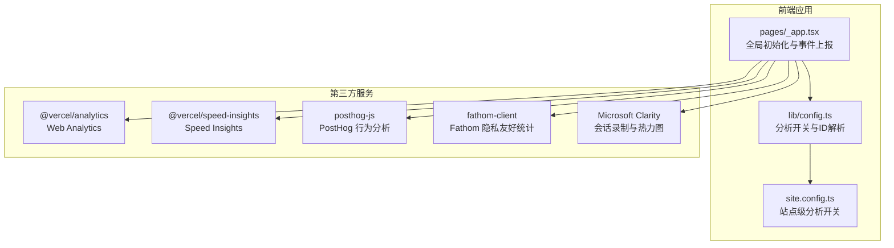
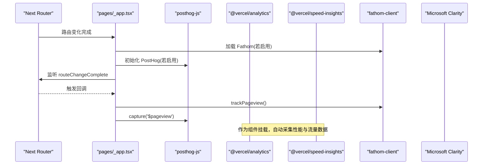
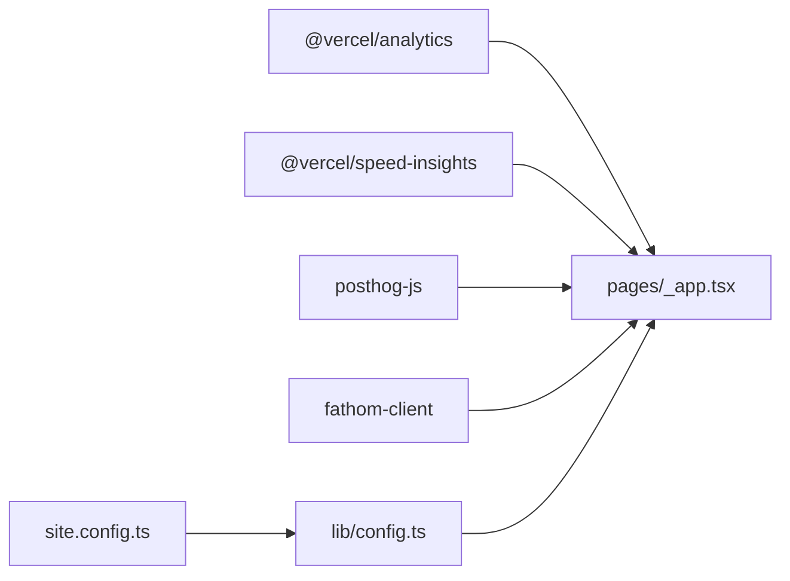

# 监控与分析

<cite>
**本文引用的文件**   
- [package.json](file://package.json)
- [next.config.js](file://next.config.js)
- [site.config.ts](file://site.config.ts)
- [lib/config.ts](file://lib/config.ts)
- [lib/site-config.ts](file://lib/site-config.ts)
- [pages/_app.tsx](file://pages/_app.tsx)
- [components/ErrorPage.tsx](file://components/ErrorPage.tsx)
- [pages/_error.tsx](file://pages/_error.tsx)
- [vercel.json](file://vercel.json)
</cite>

## 目录
1. [简介](#简介)
2. [项目结构](#项目结构)
3. [核心组件](#核心组件)
4. [架构总览](#架构总览)
5. [详细组件分析](#详细组件分析)
6. [依赖关系分析](#依赖关系分析)
7. [性能指标与关键 KPI](#性能指标与关键-kpi)
8. [错误监控与用户行为分析](#错误监控与用户行为分析)
9. [性能瓶颈识别与优化建议](#性能瓶颈识别与优化建议)
10. [故障排查指南](#故障排查指南)
11. [结论](#结论)

## 简介
本文件面向“监控与分析”主题，系统性说明本项目中性能监控与分析工具的配置、集成方式与使用要点。重点覆盖：
- Vercel Analytics 与 Speed Insights 的启用与数据维度
- PostHog 的用户行为采集与事件上报
- Fathom 与 Microsoft Clarity 的辅助观测
- 关键性能指标（KPI）定义与监控方法
- 错误监控、用户行为分析与性能瓶颈识别
- 性能报告解读与优化建议

## 项目结构
本项目为 Next.js + Notion 博客站点模板，监控与分析能力通过以下层次实现：
- 应用入口层：在根布局中统一注入分析脚本与 SDK
- 配置层：集中管理各分析工具的开关与 ID/密钥
- 运行时层：路由变化时触发页面浏览事件上报
- 平台层：Vercel 提供 Web Analytics 与 Speed Insights 的数据面板

图表来源
- [pages/_app.tsx:17-87](file://pages/_app.tsx#L17-L87)
- [lib/config.ts:133-175](file://lib/config.ts#L133-L175)
- [site.config.ts:39-46](file://site.config.ts#L39-L46)

章节来源
- [pages/_app.tsx:17-87](file://pages/_app.tsx#L17-L87)
- [lib/config.ts:133-175](file://lib/config.ts#L133-L175)
- [site.config.ts:39-46](file://site.config.ts#L39-L46)

## 核心组件
- 应用入口与事件上报：在根布局中统一初始化并监听路由变化，触发页面浏览事件上报。
- 配置中心：从站点配置与环境变量解析各分析工具的 ID 与开关。
- 站点配置：提供是否启用 Vercel Analytics、Speed Insights、Clarity 等开关。

章节来源
- [pages/_app.tsx:17-87](file://pages/_app.tsx#L17-L87)
- [lib/config.ts:133-175](file://lib/config.ts#L133-L175)
- [site.config.ts:39-46](file://site.config.ts#L39-L46)

## 架构总览
下图展示分析工具在运行时的调用链路与数据流向。

图表来源
- [pages/_app.tsx:44-68](file://pages/_app.tsx#L44-L68)
- [pages/_app.tsx:70-87](file://pages/_app.tsx#L70-L87)

## 详细组件分析

### Vercel Analytics 与 Speed Insights
- 启用方式：通过站点配置开关控制，默认开启。
- 数据维度：
  - Web Analytics：页面访问、来源、设备、地域等基础流量指标
  - Speed Insights：Core Web Vitals（LCP、CLS、INP）、首字节时间、资源加载耗时等性能指标
- 集成位置：根布局中以组件形式挂载，无需额外代码即可采集。

章节来源
- [site.config.ts:44-46](file://site.config.ts#L44-L46)
- [lib/config.ts:138-146](file://lib/config.ts#L138-L146)
- [pages/_app.tsx:70-74](file://pages/_app.tsx#L70-L74)

### PostHog 行为分析
- 启用方式：通过环境变量注入 Project ID，并在客户端初始化。
- 事件采集：
  - 页面浏览：$pageview
  - 可扩展自定义事件：如搜索、点击、表单提交等
- 配置项：API Host 指向官方地址，可在后续扩展 cookieless、disable_session 等选项。

章节来源
- [lib/config.ts:172-175](file://lib/config.ts#L172-L175)
- [pages/_app.tsx:50-60](file://pages/_app.tsx#L50-L60)

### Fathom 隐私友好统计
- 启用方式：通过环境变量注入 ID，开发环境默认不加载。
- 事件采集：页面浏览
- 适用场景：对隐私敏感的场景，轻量无追踪脚本。

章节来源
- [lib/config.ts:165-170](file://lib/config.ts#L165-L170)
- [pages/_app.tsx:44-57](file://pages/_app.tsx#L44-L57)

### Microsoft Clarity 会话录制与热力图
- 启用方式：通过站点配置注入项目 ID，以异步脚本方式加载。
- 能力：会话回放、热力图、滚动轨迹、崩溃快照等。
- 注意：属于重功能，建议在需要深度诊断时启用。

章节来源
- [site.config.ts:42-43](file://site.config.ts#L42-L43)
- [pages/_app.tsx:75-87](file://pages/_app.tsx#L75-L87)

### 错误监控
- 当前实现：使用 Next.js 内置错误页渲染错误状态码，未接入外部错误上报服务。
- 建议增强：
  - 接入 Sentry/Raven 或 Vercel Error Monitoring
  - 在前端捕获未处理异常与 Promise 拒绝
  - 在服务端 API 层记录结构化日志并关联请求 ID

章节来源
- [components/ErrorPage.tsx:1-23](file://components/ErrorPage.tsx#L1-L23)
- [pages/_error.tsx:1-2](file://pages/_error.tsx#L1-L2)

## 依赖关系分析
- 包依赖：
  - @vercel/analytics、@vercel/speed-insights：用于 Web Analytics 与性能指标采集
  - posthog-js：用于行为分析与事件上报
  - fathom-client：用于隐私友好的页面浏览统计
- 配置依赖：
  - site.config.ts：站点级开关与 ID
  - lib/config.ts：将站点配置与环境变量合并，暴露给客户端

图表来源
- [package.json:27-52](file://package.json#L27-L52)
- [pages/_app.tsx:17-23](file://pages/_app.tsx#L17-L23)
- [lib/config.ts:133-175](file://lib/config.ts#L133-L175)
- [site.config.ts:39-46](file://site.config.ts#L39-L46)

章节来源
- [package.json:27-52](file://package.json#L27-L52)
- [pages/_app.tsx:17-23](file://pages/_app.tsx#L17-L23)
- [lib/config.ts:133-175](file://lib/config.ts#L133-L175)
- [site.config.ts:39-46](file://site.config.ts#L39-L46)

## 性能指标与关键 KPI
- 推荐 KPI 列表
  - 核心 Web Vitals：LCP、CLS、INP
  - 首字节时间（TTFB）
  - 页面可见时间（FCP/LCP）
  - 交互延迟（INP）
  - 累积布局偏移（CLS）
  - 资源体积与数量（JS/CSS/图片）
  - 缓存命中率与回源率（CDN/ISR）
  - 错误率（前端异常、API 失败）
  - 转化率（目标页面到达率、搜索使用率）
- 数据来源
  - Vercel Web Analytics：流量、来源、设备、地域
  - Vercel Speed Insights：CWV、TTFB、资源加载
  - PostHog：用户行为路径、功能使用率、漏斗转化
  - Clarity：会话回放、热力图、崩溃快照
- 监控方法
  - 在 Vercel 控制台查看 Web Analytics 与 Speed Insights 面板
  - 在 PostHog 创建 Funnel、Retention、Cohort 等分析视图
  - 在 Clarity 查看会话回放与热点区域
  - 结合服务端日志与错误监控平台进行问题定位

[本节为通用指导，不直接分析具体文件]

## 错误监控与用户行为分析

### 错误监控现状与建议
- 现状：仅渲染错误状态码，未接入外部错误上报。
- 建议：
  - 接入错误监控平台（Sentry/Vercel Error Monitoring）
  - 在 _app.tsx 中捕获未处理异常与 Promise 拒绝
  - 在 API 层统一错误响应格式并记录结构化日志

章节来源
- [components/ErrorPage.tsx:1-23](file://components/ErrorPage.tsx#L1-L23)
- [pages/_error.tsx:1-2](file://pages/_error.tsx#L1-L2)

### 用户行为分析
- 已实现：
  - 页面浏览事件：PostHog $pageview
  - 路由变化时触发上报
- 可扩展：
  - 搜索行为：记录查询词、结果点击
  - 内容消费：文章阅读时长、滚动深度
  - 转化漏斗：首页 -> 详情页 -> 订阅/分享

章节来源
- [pages/_app.tsx:44-68](file://pages/_app.tsx#L44-L68)
- [lib/config.ts:172-175](file://lib/config.ts#L172-L175)

## 性能瓶颈识别与优化建议

### 图像与静态资源
- 现状：允许大量远程图片域名，包含任意 https 通配符，可能引入不可控资源。
- 建议：
  - 收紧 remotePatterns，仅允许必要域名
  - 使用 AVIF/WebP 并限制最大尺寸
  - 对大图启用懒加载与占位图（LQIP）

章节来源
- [next.config.js:6-24](file://next.config.js#L6-L24)

### ISR 与函数调用
- 现状：revalidateSeconds 可调节，默认值影响 Vercel 函数调用频率。
- 建议：
  - 根据更新频率调整 revalidateSeconds，平衡新鲜度与成本
  - 对高频接口增加缓存头与边缘缓存策略

章节来源
- [site.config.ts:58-61](file://site.config.ts#L58-L61)
- [lib/config.ts:93-98](file://lib/config.ts#L93-L98)

### 分析脚本加载
- 现状：Clarity 使用 afterInteractive 策略，降低阻塞；其他 SDK 按需初始化。
- 建议：
  - 保持按需初始化，避免不必要的 SDK 体积
  - 对非关键分析脚本使用动态 import 或延迟加载

章节来源
- [pages/_app.tsx:75-87](file://pages/_app.tsx#L75-L87)

### 定时任务与索引
- 现状：通过 Vercel Cron 定时调用 IndexNow 接口推送站点 URL。
- 建议：
  - 监控 Cron 执行成功率与延迟
  - 对失败重试与告警进行增强

章节来源
- [vercel.json:1-9](file://vercel.json#L1-L9)

## 故障排查指南
- Vercel Analytics/SI 无数据
  - 检查站点配置开关是否启用
  - 确认浏览器控制台未拦截相关脚本
  - 验证部署环境与域名是否正确
- PostHog 无事件
  - 检查 NEXT_PUBLIC_POSTHOG_ID 环境变量是否设置
  - 确认 posthog.init 是否成功执行
  - 在 PostHog 控制台查看实时事件流
- Clarity 无会话
  - 检查 clarityId 是否配置
  - 确认 Script 注入是否成功
- 图像加载失败
  - 检查 next.config.js 中的 remotePatterns 是否包含对应域名
  - 确认图片 CDN 返回状态码与跨域策略

章节来源
- [site.config.ts:39-46](file://site.config.ts#L39-L46)
- [lib/config.ts:133-175](file://lib/config.ts#L133-L175)
- [pages/_app.tsx:44-87](file://pages/_app.tsx#L44-L87)
- [next.config.js:6-24](file://next.config.js#L6-L24)

## 结论
本项目已集成多套分析与性能监控工具，形成“流量+性能+行为+会话”的全链路观测体系。通过合理配置开关与 ID，可以在不影响用户体验的前提下获取关键指标。建议逐步完善错误监控与自定义行为事件，持续优化图像与缓存策略，并结合 Vercel 控制台与第三方平台进行定期复盘与调优。