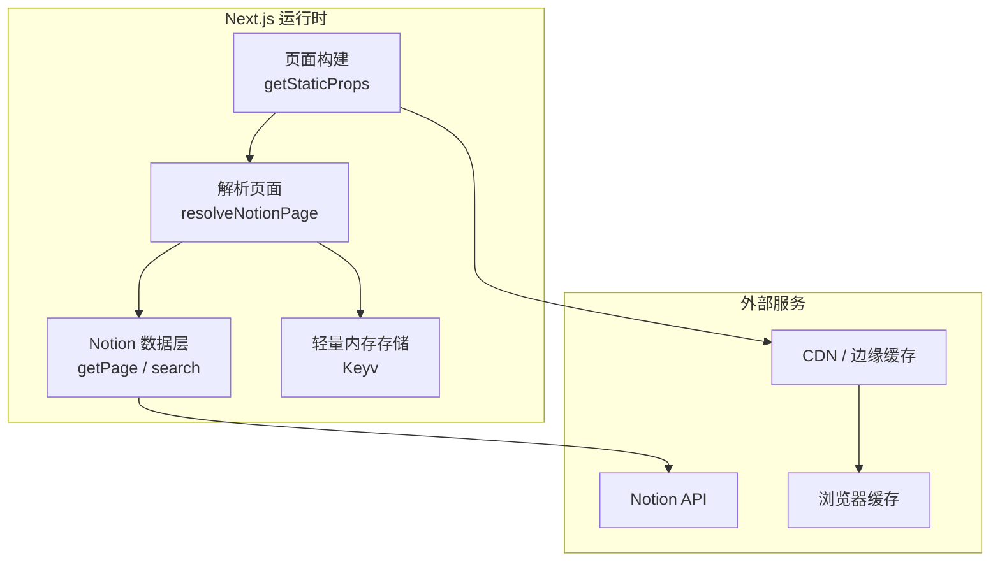
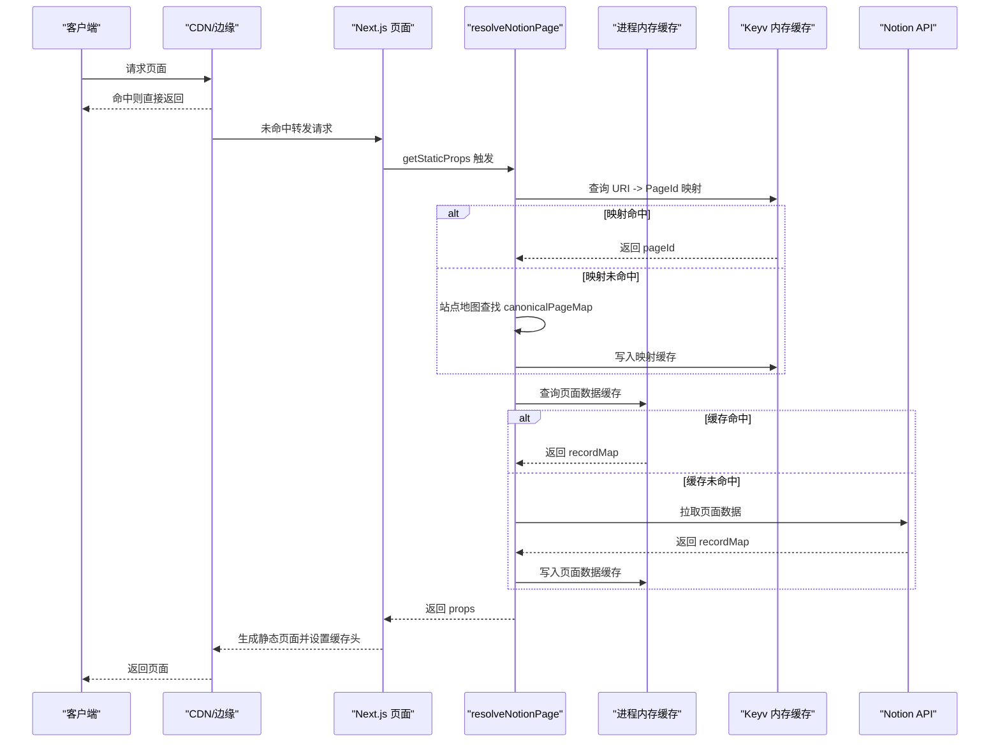
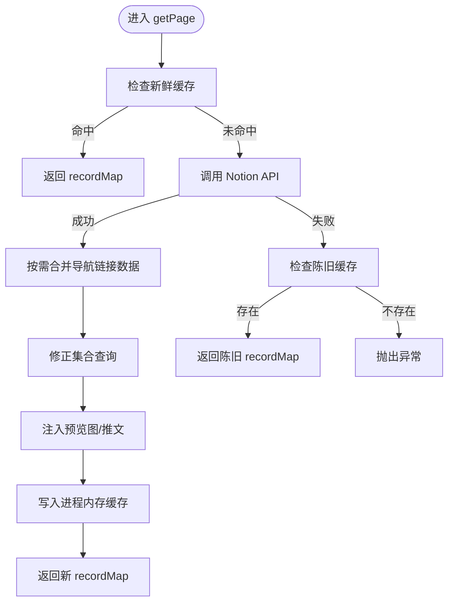
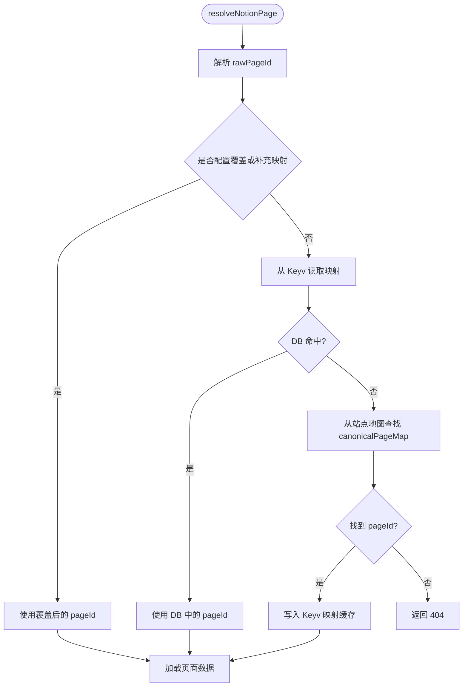
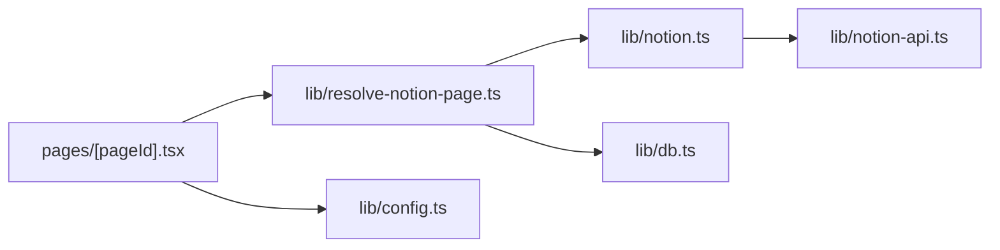

# 缓存策略

<cite>
**本文引用的文件**   
- [lib/notion-api.ts](file://lib/notion-api.ts)
- [lib/notion.ts](file://lib/notion.ts)
- [lib/resolve-notion-page.ts](file://lib/resolve-notion-page.ts)
- [lib/db.ts](file://lib/db.ts)
- [lib/config.ts](file://lib/config.ts)
- [pages/[pageId].tsx](file://pages/[pageId].tsx)
- [pages/robots.txt.tsx](file://pages/robots.txt.tsx)
- [pages/api/search-index.ts](file://pages/api/search-index.ts)
- [pages/api/search-notion.ts](file://pages/api/search-notion.ts)
- [pages/feed.tsx](file://pages/feed.tsx)
- [pages/sitemap.xml.tsx](file://pages/sitemap.xml.tsx)
- [next.config.js](file://next.config.js)
- [site.config.ts](file://site.config.ts)
</cite>

## 目录
1. [简介](#简介)
2. [项目结构与缓存边界](#项目结构与缓存边界)
3. [核心组件与职责](#核心组件与职责)
4. [架构总览](#架构总览)
5. [详细组件分析](#详细组件分析)
6. [依赖关系分析](#依赖关系分析)
7. [性能与命中率优化](#性能与命中率优化)
8. [故障排查与监控](#故障排查与监控)
9. [结论](#结论)

## 简介
本缓存策略文档围绕多级缓存机制展开，覆盖以下层次：
- 内存缓存：服务器进程内对页面数据、导航链接数据的短期缓存。
- 浏览器缓存：通过 HTTP 响应头控制浏览器与 CDN 的缓存行为。
- CDN 缓存：利用 s-maxage 与 stale-while-revalidate 等头部在边缘层缓存静态或半静态资源。
- Notion API 请求缓存：通过客户端重试、超时与“陈旧回退”提升稳定性。
- 页面数据缓存：ExtendedRecordMap 的 TTL 缓存与增量静态再生（ISR）。
- 导航链接缓存：对导航所需页面的预取与合并。
- 失效机制与 TTL：按不同资源类型设置过期时间，平衡新鲜度与性能。
- 命中率优化与监控：并发控制、最小化网络调用、可观测性与调试方法。

## 项目结构与缓存边界
该仓库采用 Next.js 应用结构，缓存相关逻辑主要分布在服务端工具库与页面构建阶段：
- lib 层负责数据获取、缓存封装与配置。
- pages 层负责路由、构建期数据获取以及对外暴露的 API 端点。
- next.config.js 配置图片优化与远程域名白名单，间接影响图片缓存路径与命中。

图表来源
- [pages/[pageId].tsx:8-16](file://pages/[pageId].tsx#L8-L16)
- [lib/resolve-notion-page.ts:11-84](file://lib/resolve-notion-page.ts#L11-L84)
- [lib/notion.ts:161-214](file://lib/notion.ts#L161-L214)
- [lib/db.ts:1-7](file://lib/db.ts#L1-L7)

章节来源
- [pages/[pageId].tsx:8-16](file://pages/[pageId].tsx#L8-L16)
- [lib/resolve-notion-page.ts:11-84](file://lib/resolve-notion-page.ts#L11-L84)
- [lib/notion.ts:161-214](file://lib/notion.ts#L161-L214)
- [lib/db.ts:1-7](file://lib/db.ts#L1-L7)

## 核心组件与职责
- Notion API 客户端封装：统一配置基础地址、认证令牌、重试策略与超时，屏蔽底层网络抖动。
- 页面数据缓存：基于进程内 Map 的 TTL 缓存，提供“新鲜命中”和“陈旧回退”。
- URI 到 PageId 映射缓存：使用 Keyv 内存缓存，减少站点地图查找与解析开销。
- 导航链接缓存：对导航所需页面进行并发预取并合并到当前页 recordMap。
- ISR 与 CDN 缓存：通过 revalidateSeconds 与响应头控制增量静态再生与边缘缓存。
- 图片与静态资源：通过 next.config.js 允许远程图片域名，配合 CDN 加速。

章节来源
- [lib/notion-api.ts:1-20](file://lib/notion-api.ts#L1-L20)
- [lib/notion.ts:19-55](file://lib/notion.ts#L19-L55)
- [lib/resolve-notion-page.ts:32-65](file://lib/resolve-notion-page.ts#L32-L65)
- [lib/notion.ts:57-81](file://lib/notion.ts#L57-L81)
- [lib/config.ts:93-98](file://lib/config.ts#L93-L98)
- [next.config.js:6-24](file://next.config.js#L6-L24)

## 架构总览
下图展示从页面请求到最终渲染的多级缓存流程，包括浏览器、CDN、Next.js ISR、服务器内存缓存与 Notion API。

图表来源
- [pages/[pageId].tsx:8-16](file://pages/[pageId].tsx#L8-L16)
- [lib/resolve-notion-page.ts:32-65](file://lib/resolve-notion-page.ts#L32-L65)
- [lib/notion.ts:161-214](file://lib/notion.ts#L161-L214)
- [lib/db.ts:1-7](file://lib/db.ts#L1-L7)

## 详细组件分析

### Notion API 请求缓存与容错
- 客户端封装：
  - 基础地址与认证令牌来自环境变量。
  - 自动重试：针对 408、429、500、502、503、504 等临时错误进行最多 3 次重试，间隔 500ms。
  - 超时：单次请求 30 秒，避免长时间阻塞。
  - User-Agent：模拟常见浏览器 UA，降低被上游限流概率。
- 作用：
  - 提高面对 Notion API 抖动时的可用性。
  - 为上层“陈旧回退”提供稳定输入。

章节来源
- [lib/notion-api.ts:1-20](file://lib/notion-api.ts#L1-L20)

### 页面数据缓存（ExtendedRecordMap）
- 缓存位置：服务器进程内 Map。
- 数据结构：每个 pageId 对应一个条目，包含 recordMap 与 expiresAt。
- TTL：默认 60 秒，兼顾编辑传播速度与抗突发流量。
- 读取策略：
  - 优先返回新鲜缓存。
  - 若 Notion API 失败，尝试返回陈旧缓存，保证站点可用。
- 写入策略：
  - 成功拉取后写入缓存，供后续请求复用。
- 附加处理：
  - 根据导航样式决定是否预取导航链接页面并合并到 recordMap。
  - 修正集合视图排序与过滤，确保与 Notion 所见一致。
  - 可选地注入预览图与推文信息。

图表来源
- [lib/notion.ts:161-214](file://lib/notion.ts#L161-L214)
- [lib/notion.ts:57-81](file://lib/notion.ts#L57-L81)
- [lib/notion.ts:95-159](file://lib/notion.ts#L95-L159)

章节来源
- [lib/notion.ts:19-55](file://lib/notion.ts#L19-L55)
- [lib/notion.ts:161-214](file://lib/notion.ts#L161-L214)

### URI 到 PageId 映射缓存
- 目的：将用户友好的 URL 映射到 Notion PageId，减少站点地图查找与解析成本。
- 存储：Keyv 内存缓存，键形如 uri-to-page-id:domain:environment:rawPageId。
- TTL：约一天（毫秒级常量），兼顾快速命中与重命名感知。
- 行为：
  - 首次访问时写入映射缓存。
  - 404 场景不缓存，避免污染缓存空间。

图表来源
- [lib/resolve-notion-page.ts:18-75](file://lib/resolve-notion-page.ts#L18-L75)
- [lib/db.ts:1-7](file://lib/db.ts#L1-L7)

章节来源
- [lib/resolve-notion-page.ts:18-75](file://lib/resolve-notion-page.ts#L18-L75)
- [lib/db.ts:1-7](file://lib/db.ts#L1-L7)

### 导航链接缓存
- 触发条件：当导航样式非默认且配置了导航链接时。
- 预取策略：
  - 提取所有导航链接对应的 pageId。
  - 并发拉取这些页面的最小块数据（减少不必要字段）。
  - 将结果合并到当前页 recordMap，使导航标题、slug 等信息完整。
- 缓存方式：
  - 使用 p-memoize 对导航链接页面列表拉取进行函数级缓存，避免重复计算。
  - 并发限制为 4，防止对 Notion API 造成过大压力。

章节来源
- [lib/notion.ts:57-81](file://lib/notion.ts#L57-L81)
- [lib/notion.ts:184-197](file://lib/notion.ts#L184-L197)

### 浏览器缓存与 CDN 缓存
- robots.txt：
  - 设置 public、s-maxage=86400、stale-while-revalidate=86400，让 CDN 缓存一天，同时允许浏览器重新验证。
- 搜索索引 API：
  - 设置 public、s-maxage=300、max-age=300、stale-while-revalidate=3600，适合频繁更新的索引数据。
- 搜索接口：
  - 设置 public、s-maxage=60、max-age=60、stale-while-revalidate=60，适合短时效的搜索结果。
- RSS 订阅源：
  - 动态计算 TTL，并以 max-age 与 stale-while-revalidate 控制 CDN 与浏览器缓存。
- Sitemap：
  - 设置 max-age=28800、stale-while-revalidate=28800，适合站点地图的更新频率。

章节来源
- [pages/robots.txt.tsx:17-21](file://pages/robots.txt.tsx#L17-L21)
- [pages/api/search-index.ts:14-14](file://pages/api/search-index.ts#L14-L14)
- [pages/api/search-notion.ts:22-22](file://pages/api/search-notion.ts#L22-L22)
- [pages/feed.tsx:92-92](file://pages/feed.tsx#L92-L92)
- [pages/sitemap.xml.tsx:23-23](file://pages/sitemap.xml.tsx#L23-L23)

### 增量静态再生（ISR）与页面缓存
- 页面构建：
  - getStaticProps 中返回 revalidateSeconds，控制 Next.js 的 ISR 再生周期。
  - 默认值由 site.config.ts 设置为 86400 秒（一天），可降低函数调用次数。
- 作用：
  - 在 ISR 窗口内，页面以静态形式返回，命中 CDN 与浏览器缓存。
  - 超过窗口后，后台触发重建，边缘节点逐步刷新。

章节来源
- [pages/[pageId].tsx:8-16](file://pages/[pageId].tsx#L8-L16)
- [lib/config.ts:93-98](file://lib/config.ts#L93-L98)
- [site.config.ts:58-61](file://site.config.ts#L58-L61)

### 图片与静态资源缓存
- next.config.js 允许大量远程图片域名，包括 Notion 的图片 CDN 与第三方托管。
- 启用 AVIF/WebP 格式优化，有助于减小体积与提升缓存命中率。
- 安全策略：
  - 禁用脚本执行，减少 XSS 风险。
  - 严格 CSP 限制资源来源。

章节来源
- [next.config.js:6-24](file://next.config.js#L6-L24)

## 依赖关系分析
- 模块耦合：
  - resolve-notion-page 依赖 notion.getPage 与 db 缓存。
  - notion.ts 依赖 notion-api 客户端与配置项（导航样式、预览图等）。
  - pages/[pageId].tsx 依赖 config.revalidateSeconds 与 resolve-notion-page。
- 外部依赖：
  - notio-client 提供 Notion API 客户端。
  - p-memoize 用于导航链接预取的函数级缓存。
  - Keyv 提供轻量内存缓存。
- 潜在循环依赖：
  - 当前实现未见明显循环依赖；各模块职责清晰。

图表来源
- [pages/[pageId].tsx:8-16](file://pages/[pageId].tsx#L8-L16)
- [lib/resolve-notion-page.ts:11-84](file://lib/resolve-notion-page.ts#L11-L84)
- [lib/notion.ts:161-214](file://lib/notion.ts#L161-L214)
- [lib/notion-api.ts:1-20](file://lib/notion-api.ts#L1-L20)
- [lib/db.ts:1-7](file://lib/db.ts#L1-L7)
- [lib/config.ts:93-98](file://lib/config.ts#L93-L98)

章节来源
- [pages/[pageId].tsx:8-16](file://pages/[pageId].tsx#L8-L16)
- [lib/resolve-notion-page.ts:11-84](file://lib/resolve-notion-page.ts#L11-L84)
- [lib/notion.ts:161-214](file://lib/notion.ts#L161-L214)
- [lib/notion-api.ts:1-20](file://lib/notion-api.ts#L1-L20)
- [lib/db.ts:1-7](file://lib/db.ts#L1-L7)
- [lib/config.ts:93-98](file://lib/config.ts#L93-L98)

## 性能与命中率优化
- 并发控制：
  - 导航链接页面预取并发为 4，集合查询修复并发为 3，避免对 Notion API 造成过载。
- 最小化网络调用：
  - 导航链接只拉取必要字段（chunkLimit=1，关闭多余选项）。
  - 仅在需要时修正集合查询，避免无谓的网络往返。
- TTL 分层：
  - 页面数据缓存 60 秒，快速吸收突发流量与 Notion 抖动。
  - URI 映射缓存约一天，减少站点地图查找。
  - ISR 默认一天，降低函数调用与边缘刷新频率。
- 陈旧回退：
  - Notion API 失败时返回陈旧缓存，保障站点可用性。
- 浏览器与 CDN：
  - 针对不同资源设置合适的 s-maxage 与 stale-while-revalidate，提升边缘命中率。
- 图片优化：
  - 启用 AVIF/WebP，减少带宽占用，提升缓存效率。

[本节为通用性能建议，无需具体文件引用]

## 故障排查与监控
- 日志与告警：
  - Notion API 失败时输出警告日志，便于定位问题。
  - Keyv 读写异常时输出警告日志，便于排查缓存层问题。
- 常见问题：
  - Notion API 限流或超时：检查重试策略与超时配置，必要时调整业务侧并发。
  - 导航链接未显示标题或 slug：确认导航样式与链接配置，检查合并逻辑是否生效。
  - 集合排序/过滤不一致：检查集合视图 query2 是否存在 sort/filter，确认修复逻辑是否触发。
  - 图片无法加载：检查 next.config.js 远程域名白名单与安全策略。
- 监控指标建议：
  - 页面数据缓存命中率（新鲜命中/陈旧回退/未命中）。
  - URI 映射缓存命中率。
  - Notion API 请求成功率与平均延迟。
  - CDN 命中率与边缘回源率。
  - ISR 重建频率与耗时。

章节来源
- [lib/notion.ts:149-155](file://lib/notion.ts#L149-L155)
- [lib/notion.ts:170-181](file://lib/notion.ts#L170-L181)
- [lib/resolve-notion-page.ts:36-41](file://lib/resolve-notion-page.ts#L36-L41)
- [lib/resolve-notion-page.ts:59-64](file://lib/resolve-notion-page.ts#L59-L64)
- [next.config.js:6-24](file://next.config.js#L6-L24)

## 结论
本项目通过多层缓存体系实现了高可用与高性能：
- 服务器内存缓存与 Keyv 内存缓存分别承担页面数据与 URI 映射的快速存取。
- ISR 与 CDN 缓存共同提升静态资源的分发效率。
- Notion API 客户端的重试与超时策略增强稳定性，陈旧回退保障可用性。
- 合理的 TTL 与并发控制平衡了新鲜度与性能。
- 通过日志与可观测性建议，便于持续优化与排障。

[本节为总结性内容，无需具体文件引用]