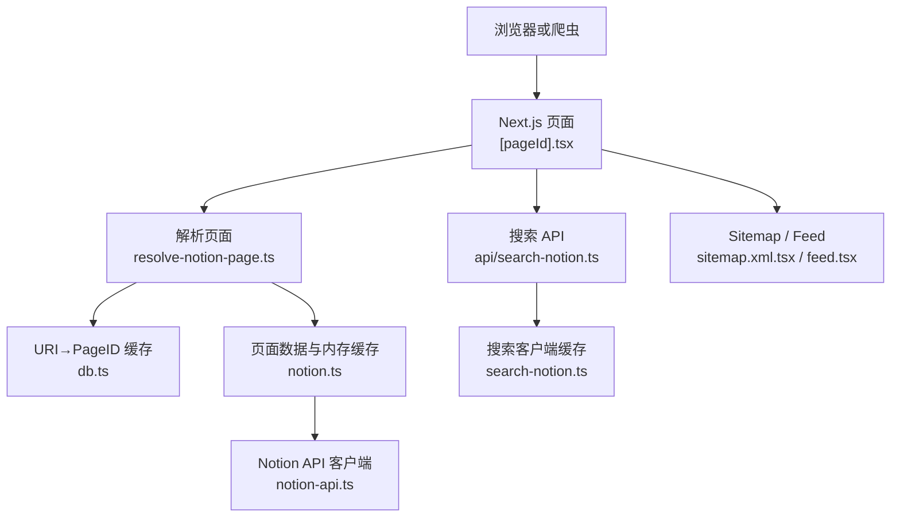
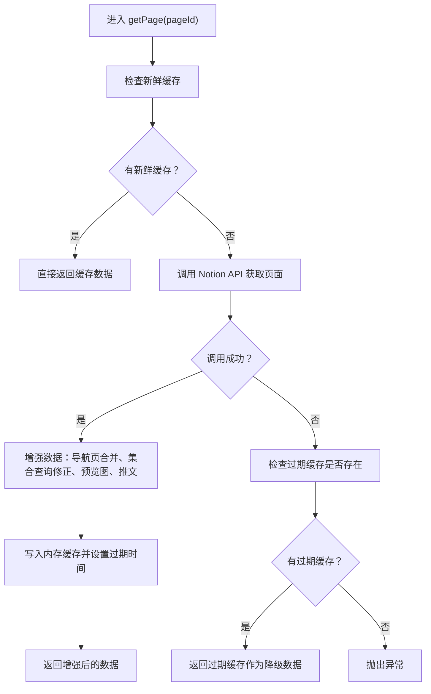
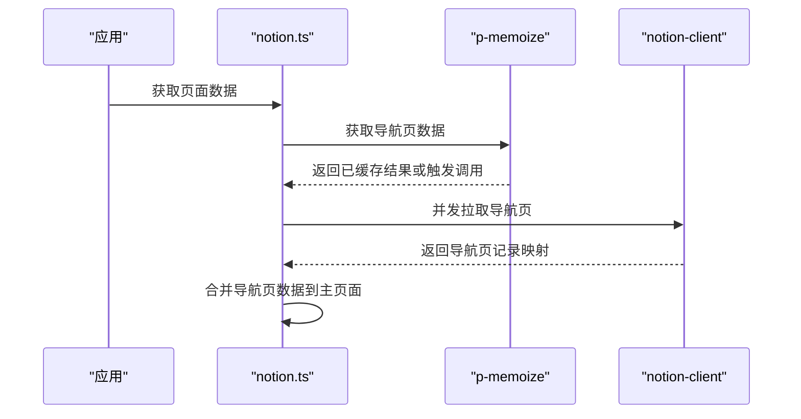
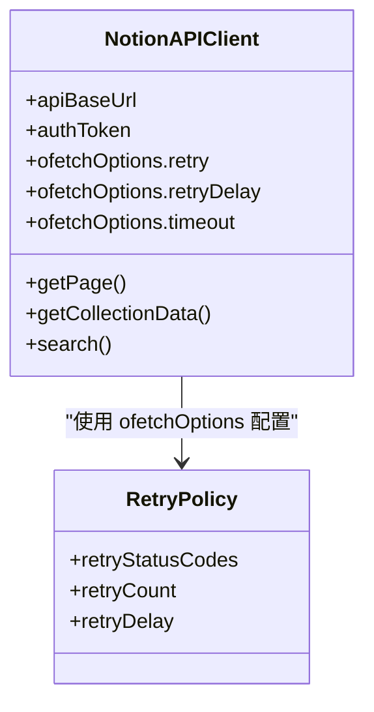
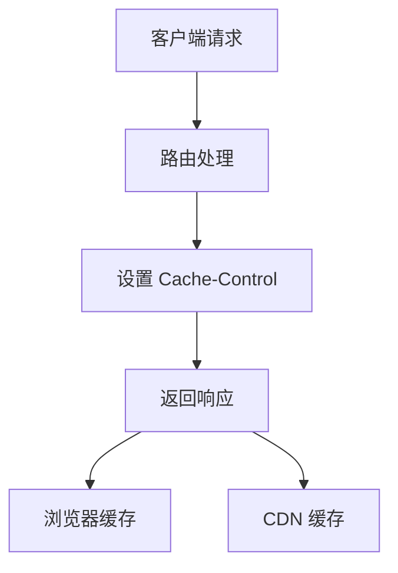
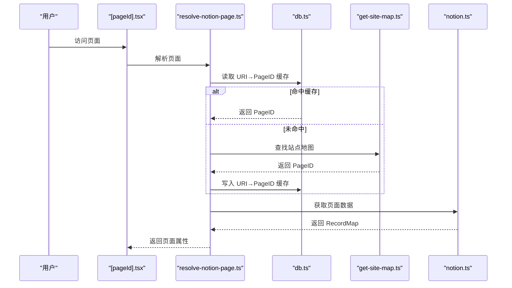
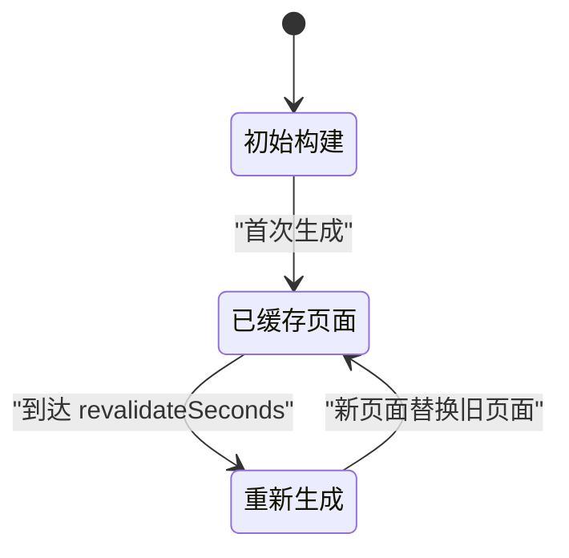
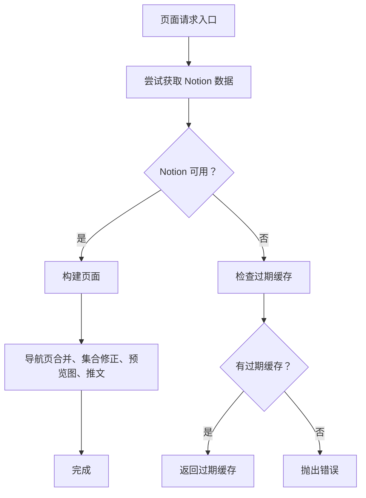
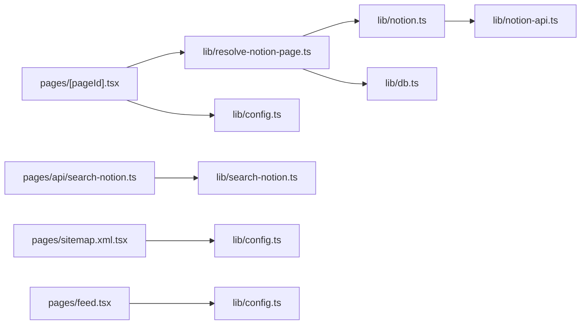

# 缓存策略

<cite>
**本文引用的文件**   
- [lib/notion.ts](file://lib/notion.ts)
- [lib/notion-api.ts](file://lib/notion-api.ts)
- [lib/resolve-notion-page.ts](file://lib/resolve-notion-page.ts)
- [pages/[pageId].tsx](file://pages/[pageId].tsx)
- [lib/db.ts](file://lib/db.ts)
- [lib/config.ts](file://lib/config.ts)
- [pages/api/search-notion.ts](file://pages/api/search-notion.ts)
- [lib/search-notion.ts](file://lib/search-notion.ts)
- [pages/sitemap.xml.tsx](file://pages/sitemap.xml.tsx)
- [pages/feed.tsx](file://pages/feed.tsx)
</cite>

## 目录
1. [引言](#引言)
2. [项目结构与缓存定位](#项目结构与缓存定位)
3. [多级缓存总览](#多级缓存总览)
4. [内存缓存：页面数据与导航页](#内存缓存页面数据与导航页)
5. [Notion API 层缓存与容错](#notion-api-层缓存与容错)
6. [浏览器与 CDN 缓存控制](#浏览器与-cdn-缓存控制)
7. [缓存失效、TTL 与更新机制](#缓存失效ttl-与更新机制)
8. [性能调优建议](#性能调优建议)
9. [故障恢复与降级策略](#故障恢复与降级策略)
10. [依赖关系图](#依赖关系图)
11. [结论](#结论)

## 引言
本项目的缓存体系围绕“三级缓存”展开：  
- 第一级：服务器进程内内存缓存，用于快速返回已组装好的 Notion 页面数据。  
- 第二级：Notion API 调用层，通过客户端库的重试、超时和并发控制提升稳定性。  
- 第三级：浏览器与 CDN 侧的 HTTP 缓存控制，通过 `Cache-Control` 头降低重复请求压力。  

此外，项目还使用轻量内存键值存储作为 URI 到 Notion Page ID 映射的短期缓存，并结合 Next.js ISR（增量静态再生）实现站点级缓存更新。

## 项目结构与缓存定位
本项目采用 Next.js 结构，缓存逻辑主要分布在以下位置：
- 页面数据获取与内存缓存：`lib/notion.ts`
- Notion API 客户端配置与重试：`lib/notion-api.ts`
- 页面解析与 URI 到 Page ID 映射缓存：`lib/resolve-notion-page.ts`
- 动态页面构建与 ISR revalidate：`pages/[pageId].tsx`
- 轻量内存键值存储：`lib/db.ts`
- 全局配置与 ISR 间隔：`lib/config.ts`
- 搜索接口与浏览器/CDN 缓存头：`pages/api/search-notion.ts`、`lib/search-notion.ts`
- Sitemap、Feed 等资源的缓存头：`pages/sitemap.xml.tsx`、`pages/feed.tsx`

**图表来源**
- [pages/[pageId].tsx:9-25](file://pages/[pageId].tsx#L9-L25)
- [lib/resolve-notion-page.ts:11-84](file://lib/resolve-notion-page.ts#L11-L84)
- [lib/notion.ts:161-214](file://lib/notion.ts#L161-L214)
- [lib/notion-api.ts:6-19](file://lib/notion-api.ts#L6-L19)
- [lib/db.ts:1-7](file://lib/db.ts#L1-L7)
- [pages/api/search-notion.ts:6-25](file://pages/api/search-notion.ts#L6-L25)
- [lib/search-notion.ts:1-10](file://lib/search-notion.ts#L1-L10)
- [pages/sitemap.xml.tsx:7-32](file://pages/sitemap.xml.tsx#L7-L32)
- [pages/feed.tsx:88-96](file://pages/feed.tsx#L88-L96)

**章节来源**
- [pages/[pageId].tsx:9-25](file://pages/[pageId].tsx#L9-L25)
- [lib/resolve-notion-page.ts:11-84](file://lib/resolve-notion-page.ts#L11-L84)
- [lib/notion.ts:161-214](file://lib/notion.ts#L161-L214)
- [lib/notion-api.ts:6-19](file://lib/notion-api.ts#L6-L19)
- [lib/db.ts:1-7](file://lib/db.ts#L1-L7)
- [pages/api/search-notion.ts:6-25](file://pages/api/search-notion.ts#L6-L25)
- [lib/search-notion.ts:1-10](file://lib/search-notion.ts#L1-L10)
- [pages/sitemap.xml.tsx:7-32](file://pages/sitemap.xml.tsx#L7-L32)
- [pages/feed.tsx:88-96](file://pages/feed.tsx#L88-L96)

## 多级缓存总览
| 层级 | 作用范围 | 主要职责 | TTL 或失效策略 | 典型场景 |
|---|---|---|---|---|
| 浏览器与 CDN | 用户浏览器、边缘节点 | 控制静态资源与 API 响应在客户端与 CDN 的缓存时间 | 通过 `Cache-Control` 设置 `max-age`、`stale-while-revalidate` | 搜索接口、Sitemap、Feed |
| 服务器内存缓存 | Node.js 进程内 | 缓存已组装的 Notion 页面数据，避免频繁访问 Notion | 固定 TTL（秒级），过期后仍可用作降级回退 | 高频页面访问、流量突发 |
| Notion API 层 | 外部服务调用 | 重试、超时、并发控制，提高稳定性 | 按错误码重试，不直接缓存业务数据 | Notion 网络抖动、限流 |
| URI 到 Page ID 映射缓存 | 进程内轻量键值存储 | 将友好 URL 映射为 Notion Page ID | 天级 TTL，适合路径变更频率较低的场景 | 首次访问或路径变更后 |
| Next.js ISR | 站点构建产物 | 定时重新生成页面，保证内容更新 | 由 `revalidateSeconds` 控制 | 全站内容定期刷新 |

**章节来源**
- [lib/notion.ts:19-55](file://lib/notion.ts#L19-L55)
- [lib/resolve-notion-page.ts:32-65](file://lib/resolve-notion-page.ts#L32-L65)
- [lib/notion-api.ts:3-19](file://lib/notion-api.ts#L3-L19)
- [lib/config.ts:93-95](file://lib/config.ts#L93-L95)
- [pages/api/search-notion.ts:20-24](file://pages/api/search-notion.ts#L20-L24)
- [pages/sitemap.xml.tsx:20-24](file://pages/sitemap.xml.tsx#L20-L24)
- [pages/feed.tsx:90-93](file://pages/feed.tsx#L90-L93)

## 内存缓存：页面数据与导航页
### 页面数据内存缓存
- 使用进程内 `Map` 保存每个页面的完整记录映射。
- 每条缓存包含数据对象与过期时间戳。
- 读取时先判断是否过期；过期条目不再作为新鲜缓存返回，但仍保留用于降级。
- 写入时在成功获取并增强页面数据后设置 TTL。

**图表来源**
- [lib/notion.ts:38-55](file://lib/notion.ts#L38-L55)
- [lib/notion.ts:161-214](file://lib/notion.ts#L161-L214)

**章节来源**
- [lib/notion.ts:19-55](file://lib/notion.ts#L19-L55)
- [lib/notion.ts:161-214](file://lib/notion.ts#L161-L214)

### 导航页数据缓存
- 导航链接对应的页面数据通过函数级记忆化缓存，减少重复请求。
- 并发拉取多个导航页，并在需要时合并到当前页面数据中。

**图表来源**
- [lib/notion.ts:57-81](file://lib/notion.ts#L57-L81)
- [lib/notion.ts:184-197](file://lib/notion.ts#L184-L197)

**章节来源**
- [lib/notion.ts:57-81](file://lib/notion.ts#L57-L81)
- [lib/notion.ts:184-197](file://lib/notion.ts#L184-L197)

## Notion API 层缓存与容错
Notion API 层并不直接缓存业务数据，而是通过客户端库的配置提升稳定性：
- 自动重试：对特定状态码进行有限次数重试。
- 重试延迟：避免瞬时拥塞导致雪崩。
- 超时控制：防止长时间阻塞。
- 并发控制：在导航页拉取、集合查询修正中使用并发限制。

**图表来源**
- [lib/notion-api.ts:6-19](file://lib/notion-api.ts#L6-L19)

**章节来源**
- [lib/notion-api.ts:3-19](file://lib/notion-api.ts#L3-L19)
- [lib/notion.ts:111-158](file://lib/notion.ts#L111-L158)

## 浏览器与 CDN 缓存控制
项目在不同接口和资源上设置了不同的 `Cache-Control` 头，以平衡新鲜度与性能：
- 搜索接口：短 TTL，允许 CDN 与浏览器缓存，同时支持 stale-while-revalidate。
- Sitemap：较长 TTL，适合低频变化的站点地图。
- Feed：根据计算出的 TTL 设置缓存头。

**图表来源**
- [pages/api/search-notion.ts:20-24](file://pages/api/search-notion.ts#L20-L24)
- [pages/sitemap.xml.tsx:20-24](file://pages/sitemap.xml.tsx#L20-L24)
- [pages/feed.tsx:90-93](file://pages/feed.tsx#L90-L93)

**章节来源**
- [pages/api/search-notion.ts:20-24](file://pages/api/search-notion.ts#L20-L24)
- [pages/sitemap.xml.tsx:20-24](file://pages/sitemap.xml.tsx#L20-L24)
- [pages/feed.tsx:90-93](file://pages/feed.tsx#L90-L93)

## 缓存失效、TTL 与更新机制
### 页面数据 TTL 与失效
- 页面数据内存缓存 TTL 为秒级，确保编辑能快速传播，同时吸收突发流量。
- 过期后不再作为新鲜缓存返回，但可用作降级回退。

**章节来源**
- [lib/notion.ts:29-55](file://lib/notion.ts#L29-L55)
- [lib/notion.ts:161-214](file://lib/notion.ts#L161-L214)

### URI 到 Page ID 映射缓存
- 使用轻量内存键值存储，TTL 为天级，适合路径映射变化不频繁的场景。
- 当 URI 无法直接解析为 Page ID 时，尝试从站点地图查找并写入映射缓存。

**图表来源**
- [lib/resolve-notion-page.ts:32-65](file://lib/resolve-notion-page.ts#L32-L65)
- [lib/db.ts:1-7](file://lib/db.ts#L1-L7)

**章节来源**
- [lib/resolve-notion-page.ts:32-65](file://lib/resolve-notion-page.ts#L32-L65)
- [lib/db.ts:1-7](file://lib/db.ts#L1-L7)

### Next.js ISR 更新机制
- 动态页面导出 `revalidate`，由 Next.js 在后台按配置间隔重新生成页面。
- 该机制与服务器内存缓存互补：ISR 负责站点级更新，内存缓存负责请求级加速。

**图表来源**
- [pages/[pageId].tsx:9-17](file://pages/[pageId].tsx#L9-L17)
- [lib/config.ts:93-95](file://lib/config.ts#L93-L95)

**章节来源**
- [pages/[pageId].tsx:9-17](file://pages/[pageId].tsx#L9-L17)
- [lib/config.ts:93-95](file://lib/config.ts#L93-L95)

## 性能调优建议
- 合理调整页面内存缓存 TTL：若内容更新频率低，可适当延长；若要求强实时，应缩短。
- 控制导航页并发数：在高并发环境下适当降低并发，避免对 Notion API 造成压力。
- 优化集合查询修正：仅对有排序或过滤的视图执行二次查询，减少不必要开销。
- 调整搜索接口缓存 TTL：根据搜索热点与数据更新频率设置合适的 `max-age` 与 `stale-while-revalidate`。
- 使用 CDN 缓存静态资源：Sitemap、Feed 等资源适合较长的 CDN 缓存时间。
- 监控 Notion API 错误率：结合重试策略观察 429、5xx 错误，必要时调整重试次数与延迟。

[本节为通用性能指导，不直接分析具体代码文件]

## 故障恢复与降级策略
- Notion API 不可用时，优先返回过期缓存，避免页面直接报错。
- 导航页拉取失败时，不影响主页面渲染，仅可能缺少部分导航信息。
- 集合查询修正失败时，记录警告日志，继续渲染默认顺序的数据。
- URI 到 Page ID 映射缓存读写失败时，降级到站点地图查找，不影响整体流程。

**图表来源**
- [lib/notion.ts:161-214](file://lib/notion.ts#L161-L214)
- [lib/notion.ts:111-158](file://lib/notion.ts#L111-L158)
- [lib/resolve-notion-page.ts:36-65](file://lib/resolve-notion-page.ts#L36-L65)

**章节来源**
- [lib/notion.ts:161-214](file://lib/notion.ts#L161-L214)
- [lib/notion.ts:111-158](file://lib/notion.ts#L111-L158)
- [lib/resolve-notion-page.ts:36-65](file://lib/resolve-notion-page.ts#L36-L65)

## 依赖关系图

**图表来源**
- [pages/[pageId].tsx:9-25](file://pages/[pageId].tsx#L9-L25)
- [lib/resolve-notion-page.ts:11-84](file://lib/resolve-notion-page.ts#L11-L84)
- [lib/notion.ts:161-214](file://lib/notion.ts#L161-L214)
- [lib/notion-api.ts:6-19](file://lib/notion-api.ts#L6-L19)
- [lib/db.ts:1-7](file://lib/db.ts#L1-L7)
- [lib/config.ts:93-95](file://lib/config.ts#L93-L95)
- [pages/api/search-notion.ts:6-25](file://pages/api/search-notion.ts#L6-L25)
- [lib/search-notion.ts:1-10](file://lib/search-notion.ts#L1-L10)
- [pages/sitemap.xml.tsx:7-32](file://pages/sitemap.xml.tsx#L7-L32)
- [pages/feed.tsx:88-96](file://pages/feed.tsx#L88-L96)

## 结论
该项目通过多层缓存实现了高可用与高性能：
- 服务器内存缓存提供毫秒级响应，并具备过期降级能力。
- Notion API 层通过重试与超时控制提升稳定性。
- 浏览器与 CDN 缓存通过合理的 `Cache-Control` 头降低重复请求。
- URI 到 Page ID 映射缓存与 Next.js ISR 共同保障内容更新的及时性与一致性。

在实际部署中，建议根据内容更新频率、流量特征与 Notion API 稳定性，持续调整各层 TTL 与并发参数，并配合监控与日志定位瓶颈与异常。