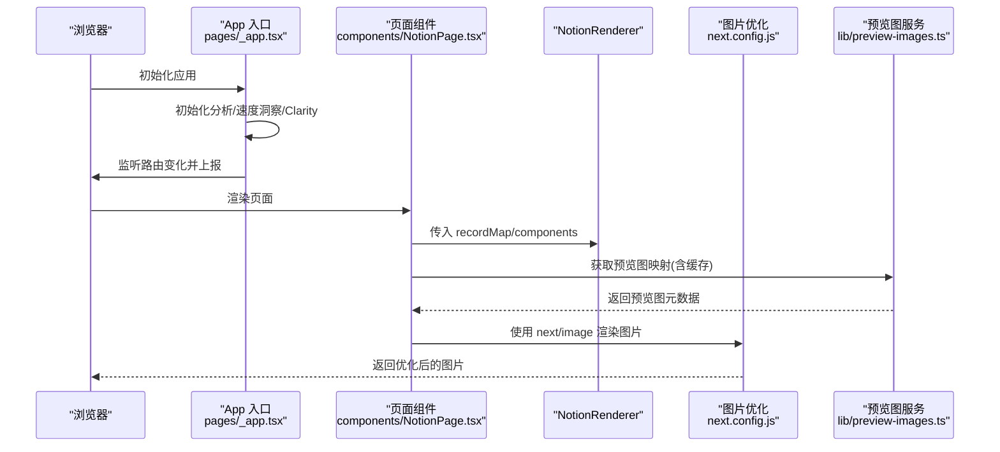
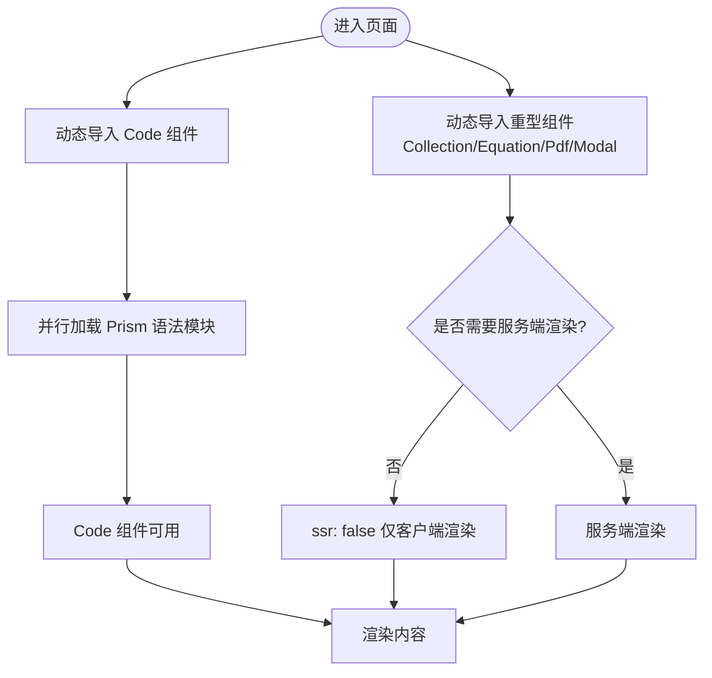
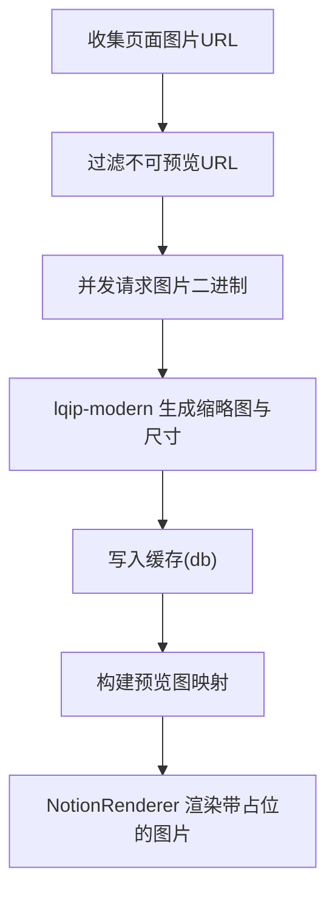
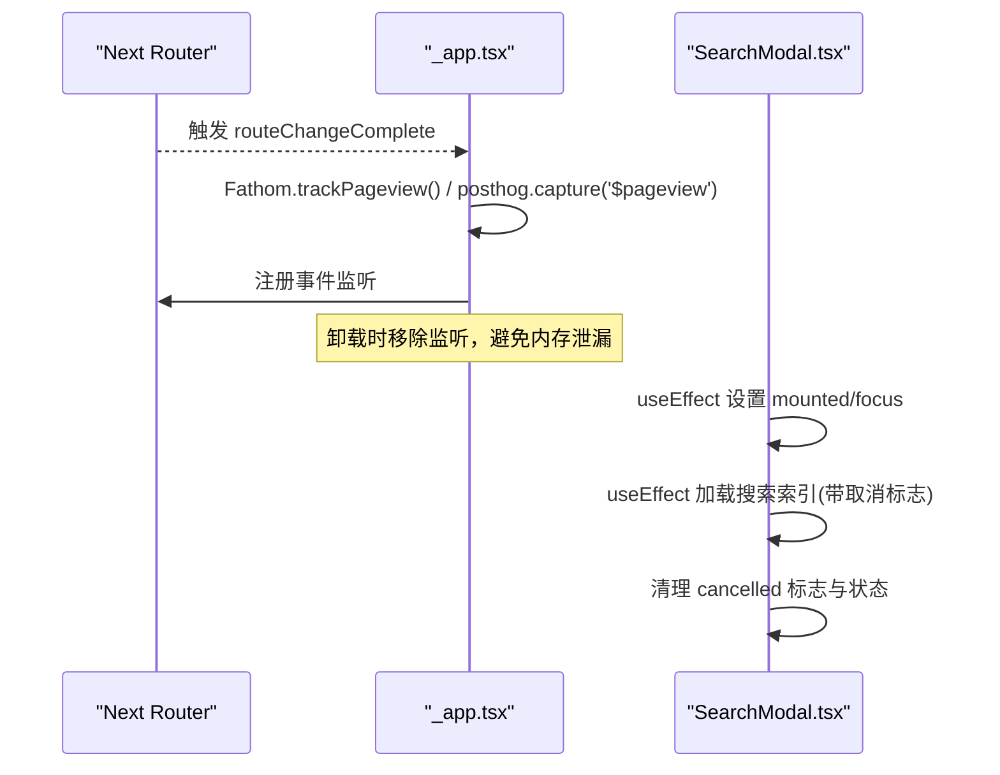
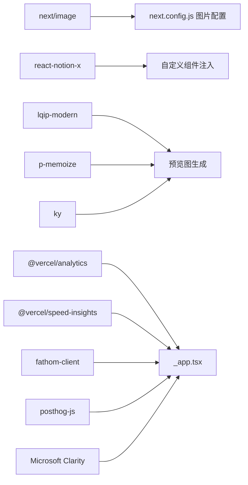

# 运行时优化

<cite>
**本文引用的文件**   
- [package.json](file://package.json)
- [next.config.js](file://next.config.js)
- [pages/_app.tsx](file://pages/_app.tsx)
- [components/NotionPage.tsx](file://components/NotionPage.tsx)
- [lib/config.ts](file://lib/config.ts)
- [lib/map-image-url.ts](file://lib/map-image-url.ts)
- [lib/preview-images.ts](file://lib/preview-images.ts)
- [lib/notion-api.ts](file://lib/notion-api.ts)
- [components/PageHead.tsx](file://components/PageHead.tsx)
- [components/SearchModal.tsx](file://components/SearchModal.tsx)
</cite>

## 目录
1. [简介](#简介)
2. [项目结构](#项目结构)
3. [核心组件](#核心组件)
4. [架构总览](#架构总览)
5. [详细组件分析](#详细组件分析)
6. [依赖关系分析](#依赖关系分析)
7. [性能考量与优化策略](#性能考量与优化策略)
8. [故障排查指南](#故障排查指南)
9. [结论](#结论)

## 简介
本文件聚焦于应用运行时的性能优化，覆盖懒加载、动态导入、组件按需加载、图片懒加载与低质量占位图（LQIP）、字体与资源预取、内存管理、事件监听优化、渲染性能优化，以及运行时性能监控与调试工具的使用。文档基于仓库现有实现进行解读，并给出可操作的优化建议与可视化流程图。

## 项目结构
本项目采用 Next.js + React 的站点架构，核心优化点分布在以下位置：
- 构建与运行时配置：next.config.js
- 全局应用入口与监控集成：pages/_app.tsx
- 页面渲染与组件懒加载：components/NotionPage.tsx
- 图片映射与预览图生成：lib/map-image-url.ts、lib/preview-images.ts
- 站点配置与开关：lib/config.ts
- SEO 与结构化数据：components/PageHead.tsx
- 搜索弹窗与事件处理：components/SearchModal.tsx
- Notion API 客户端与重试策略：lib/notion-api.ts

```mermaid
graph TB
subgraph "应用入口"
APP["pages/_app.tsx"]
end
subgraph "页面与组件"
NP["components/NotionPage.tsx"]
PH["components/PageHead.tsx"]
SM["components/SearchModal.tsx"]
end
subgraph "运行时库"
CFG["lib/config.ts"]
MIU["lib/map-image-url.ts"]
PI["lib/preview-images.ts"]
NA["lib/notion-api.ts"]
end
subgraph "构建配置"
NC["next.config.js"]
end
APP --> NP
NP --> PH
NP --> SM
NP --> PI
NP --> MIU
APP --> CFG
NP --> CFG
PI --> CFG
PI --> MIU
NA --> CFG
NC --> APP
```

图表来源
- [pages/_app.tsx:1-91](file://pages/_app.tsx#L1-L91)
- [components/NotionPage.tsx:1-357](file://components/NotionPage.tsx#L1-L357)
- [components/PageHead.tsx:1-188](file://components/PageHead.tsx#L1-L188)
- [components/SearchModal.tsx:1-254](file://components/SearchModal.tsx#L1-L254)
- [lib/config.ts:1-224](file://lib/config.ts#L1-L224)
- [lib/map-image-url.ts:1-13](file://lib/map-image-url.ts#L1-L13)
- [lib/preview-images.ts:1-102](file://lib/preview-images.ts#L1-L102)
- [lib/notion-api.ts:1-20](file://lib/notion-api.ts#L1-L20)
- [next.config.js:1-43](file://next.config.js#L1-L43)

章节来源
- [next.config.js:1-43](file://next.config.js#L1-L43)
- [pages/_app.tsx:1-91](file://pages/_app.tsx#L1-L91)

## 核心组件
- 应用入口与监控集成：在应用初始化时注入分析、速度洞察与第三方脚本，并在路由变化时上报页面浏览事件，同时正确解绑事件监听，避免内存泄漏。
- 页面渲染与按需加载：通过 next/dynamic 对重型或可选组件进行动态导入；对集合、PDF、模态框等组件禁用服务端渲染以避免水合不一致；代码高亮语法按需异步加载。
- 图片与预览图：使用 next/image 并通过自定义 mapImageUrl 适配默认图标与封面；在服务端为页面内图片生成 LQIP 预览图，降低首屏抖动与布局偏移。
- 站点配置与开关：集中管理是否启用预览图、搜索、Vercel Analytics/Speed Insights、Clarity 等运行时特性。
- 搜索弹窗：仅在用户触发时加载索引，使用 createPortal 挂载到 body，键盘交互与状态更新均做防抖与清理。

章节来源
- [pages/_app.tsx:17-90](file://pages/_app.tsx#L17-L90)
- [components/NotionPage.tsx:43-142](file://components/NotionPage.tsx#L43-L142)
- [lib/preview-images.ts:33-57](file://lib/preview-images.ts#L33-L57)
- [lib/config.ts:68-146](file://lib/config.ts#L68-L146)
- [components/SearchModal.tsx:57-106](file://components/SearchModal.tsx#L57-L106)

## 架构总览
下图展示了从应用启动到页面渲染的关键路径，包括监控注入、组件懒加载、图片优化与预览图生成。

图表来源
- [pages/_app.tsx:41-90](file://pages/_app.tsx#L41-L90)
- [components/NotionPage.tsx:196-353](file://components/NotionPage.tsx#L196-L353)
- [lib/preview-images.ts:33-57](file://lib/preview-images.ts#L33-L57)
- [next.config.js:6-25](file://next.config.js#L6-L25)

## 详细组件分析

### 懒加载与动态导入
- 代码高亮语法按需加载：在动态导入 Code 组件后，再并行异步加载多种 Prism 语法模块，减少初始包体积。
- 重型组件按需加载：Collection、Equation、Pdf、Modal 等通过 dynamic 引入，部分组件设置 ssr: false 避免水合差异。
- 搜索结果与评论等重型逻辑延迟执行：SearchModal 仅在打开时拉取索引；Utterances 作为评论区按需挂载。

图表来源
- [components/NotionPage.tsx:43-142](file://components/NotionPage.tsx#L43-L142)

章节来源
- [components/NotionPage.tsx:43-142](file://components/NotionPage.tsx#L43-L142)

### 图片懒加载与 LQIP 预览图
- 图片映射：mapImageUrl 将默认封面/图标保留原 URL，其他图片交由 notion-utils 默认映射，配合 next/image 自动优化。
- 预览图生成：getPreviewImageMap 收集页面中所有图片 URL，并发请求并生成 LQIP 元数据（宽高、Base64 缩略图），结果写入本地缓存 db，后续复用。
- 渲染流程：NotionRenderer 接收 previewImages 与 mapImageUrl，结合 next/image 实现懒加载与占位图，提升首屏体验并减少布局抖动。

图表来源
- [lib/preview-images.ts:33-57](file://lib/preview-images.ts#L33-L57)
- [lib/preview-images.ts:59-102](file://lib/preview-images.ts#L59-L102)
- [lib/map-image-url.ts:6-12](file://lib/map-image-url.ts#L6-L12)
- [components/NotionPage.tsx:319-340](file://components/NotionPage.tsx#L319-L340)

章节来源
- [lib/map-image-url.ts:1-13](file://lib/map-image-url.ts#L1-L13)
- [lib/preview-images.ts:1-102](file://lib/preview-images.ts#L1-L102)
- [components/NotionPage.tsx:319-340](file://components/NotionPage.tsx#L319-L340)

### 字体与资源预取
- 样式与主题：在 _app.tsx 中全局引入 katex、prismjs 主题与 react-notion-x 样式，确保关键视觉资源尽早加载。
- 第三方脚本：Clarity 脚本以 afterInteractive 策略注入，避免阻塞首屏；Vercel Analytics 与 SpeedInsights 按需启用。
- 资源预取建议：对于高频访问的静态资源（如字体、图标）可使用 rel="preload"/rel="prefetch" 在 Head 中声明，以减少网络往返。

章节来源
- [pages/_app.tsx:1-14](file://pages/_app.tsx#L1-L14)
- [pages/_app.tsx:70-90](file://pages/_app.tsx#L70-L90)
- [components/PageHead.tsx:91-184](file://components/PageHead.tsx#L91-L184)

### 内存管理与事件监听优化
- 路由事件监听：在 _app.tsx 中注册 routeChangeComplete 回调，并在卸载时移除监听，防止内存泄漏。
- 搜索弹窗：SearchModal 使用 createPortal 挂载至 document.body，并在 useEffect 中清理取消标志与焦点状态，避免重复渲染与无效计算。
- 调试对象：在 NotionPage 中将 pageId、recordMap、block 挂到 window，便于运行时调试，但应限制在开发环境。

图表来源
- [pages/_app.tsx:44-68](file://pages/_app.tsx#L44-L68)
- [components/SearchModal.tsx:69-106](file://components/SearchModal.tsx#L69-L106)
- [components/NotionPage.tsx:265-271](file://components/NotionPage.tsx#L265-L271)

章节来源
- [pages/_app.tsx:44-68](file://pages/_app.tsx#L44-L68)
- [components/SearchModal.tsx:69-106](file://components/SearchModal.tsx#L69-L106)
- [components/NotionPage.tsx:265-271](file://components/NotionPage.tsx#L265-L271)

### 渲染性能优化
- 组件拆分与按需加载：将重型组件与可选功能拆分为动态模块，减少主包体积与首次渲染时间。
- 服务端渲染与水合一致性：对可能产生差异的组件（如 Collection、Pdf、Modal）设置 ssr: false，避免不必要的重渲染。
- 图片优化：启用 AVIF/WebP 格式，允许 SVG，并严格配置 remotePatterns，确保外部图片安全且可被优化器处理。
- 条件渲染：根据 lite 模式与 darkMode 切换 BodyClassName，减少无关 DOM 与样式开销。

章节来源
- [components/NotionPage.tsx:114-142](file://components/NotionPage.tsx#L114-L142)
- [components/NotionPage.tsx:319-340](file://components/NotionPage.tsx#L319-L340)
- [next.config.js:6-25](file://next.config.js#L6-L25)

## 依赖关系分析
- 构建与运行时依赖：
  - next/image 与 next.config.js 的图片优化配置共同决定最终输出的图片格式与远程域名白名单。
  - react-notion-x 提供 NotionRenderer 与第三方组件扩展点，项目通过 components 属性注入自定义实现。
  - lqip-modern 用于生成 LQIP 缩略图，p-memoize 用于函数级缓存，ky 用于网络请求。
- 监控与分析依赖：
  - @vercel/analytics、@vercel/speed-insights 提供运行时性能指标。
  - fathom-client、posthog-js、clarity 用于页面行为与用户体验分析。

图表来源
- [next.config.js:6-25](file://next.config.js#L6-L25)
- [components/NotionPage.tsx:196-209](file://components/NotionPage.tsx#L196-L209)
- [lib/preview-images.ts:1-102](file://lib/preview-images.ts#L1-L102)
- [pages/_app.tsx:17-90](file://pages/_app.tsx#L17-L90)

章节来源
- [package.json:27-52](file://package.json#L27-L52)
- [next.config.js:6-25](file://next.config.js#L6-L25)
- [lib/preview-images.ts:1-102](file://lib/preview-images.ts#L1-L102)
- [pages/_app.tsx:17-90](file://pages/_app.tsx#L17-L90)

## 性能考量与优化策略

### 懒加载与动态导入
- 对重型组件使用 next/dynamic，必要时设置 ssr: false 避免水合不一致。
- 对可选功能（如代码高亮语法）在组件加载后再按需引入，显著降低初始包大小。
- 对非关键 UI（如评论、弹窗）延迟加载，仅在用户交互时触发。

章节来源
- [components/NotionPage.tsx:43-142](file://components/NotionPage.tsx#L43-L142)
- [components/SearchModal.tsx:57-106](file://components/SearchModal.tsx#L57-L106)

### 图片懒加载与 LQIP
- 使用 next/image 并结合 mapImageUrl 统一处理默认封面/图标与外部图片。
- 在服务端生成 LQIP 预览图，提供宽高与 Base64 缩略图，减少布局抖动与 CLS。
- 控制并发与缓存：并发请求预览图，并将结果持久化到本地缓存，避免重复计算。

章节来源
- [lib/map-image-url.ts:1-13](file://lib/map-image-url.ts#L1-L13)
- [lib/preview-images.ts:33-102](file://lib/preview-images.ts#L33-L102)
- [components/NotionPage.tsx:319-340](file://components/NotionPage.tsx#L319-L340)

### 字体与资源预取
- 在 _app.tsx 中全局引入必要样式与主题，确保关键视觉资源尽早加载。
- 使用 Script strategy='afterInteractive' 注入第三方脚本，避免阻塞首屏。
- 建议在 Head 中对高频资源添加 rel="preload"/rel="prefetch"，提升后续导航性能。

章节来源
- [pages/_app.tsx:1-14](file://pages/_app.tsx#L1-L14)
- [pages/_app.tsx:70-90](file://pages/_app.tsx#L70-L90)
- [components/PageHead.tsx:91-184](file://components/PageHead.tsx#L91-L184)

### 内存管理与事件监听优化
- 在路由变化时上报分析事件，并确保在卸载时移除监听，避免内存泄漏。
- 搜索弹窗使用 createPortal 与 useEffect 清理机制，保证 DOM 与状态的一致性。
- 在开发环境下将关键对象挂到 window，便于调试，生产环境关闭。

章节来源
- [pages/_app.tsx:44-68](file://pages/_app.tsx#L44-L68)
- [components/SearchModal.tsx:69-106](file://components/SearchModal.tsx#L69-L106)
- [components/NotionPage.tsx:265-271](file://components/NotionPage.tsx#L265-L271)

### 渲染性能优化
- 组件拆分与按需加载，减少主包体积与首次渲染时间。
- 对易产生水合差异的组件禁用 SSR，确保一致性与性能。
- 启用 AVIF/WebP 图片格式，严格配置 remotePatterns，确保外部图片可被优化器处理。

章节来源
- [components/NotionPage.tsx:114-142](file://components/NotionPage.tsx#L114-L142)
- [next.config.js:6-25](file://next.config.js#L6-L25)

### 运行时性能监控与调试工具
- Vercel Analytics 与 Speed Insights：在 _app.tsx 中按需启用，提供页面级性能指标。
- Fathom 与 PostHog：在路由变化时上报页面浏览事件，辅助分析用户行为。
- Microsoft Clarity：以 afterInteractive 策略注入，记录会话回放与热区。
- 调试对象：在 NotionPage 中将 pageId、recordMap、block 暴露到 window，便于控制台快速定位问题。

章节来源
- [pages/_app.tsx:17-90](file://pages/_app.tsx#L17-L90)
- [components/NotionPage.tsx:265-271](file://components/NotionPage.tsx#L265-L271)

## 故障排查指南
- 图片无法显示或布局异常：
  - 检查 next.config.js 中的 remotePatterns 是否包含图片域名。
  - 确认 mapImageUrl 是否正确处理默认封面/图标。
  - 查看预览图生成日志，确认 LQIP 是否成功生成并缓存。
- 第三方脚本未加载：
  - 检查 _app.tsx 中 Script 的 strategy 是否为 afterInteractive。
  - 确认对应 ID 是否在 config 中启用。
- 路由事件未上报或内存泄漏：
  - 确认 router.events.on 与 off 成对出现。
  - 检查 SearchModal 的取消标志与状态清理逻辑。

章节来源
- [next.config.js:6-25](file://next.config.js#L6-L25)
- [lib/map-image-url.ts:6-12](file://lib/map-image-url.ts#L6-L12)
- [lib/preview-images.ts:77-98](file://lib/preview-images.ts#L77-L98)
- [pages/_app.tsx:44-68](file://pages/_app.tsx#L44-L68)
- [components/SearchModal.tsx:81-106](file://components/SearchModal.tsx#L81-L106)

## 结论
本项目在运行时优化方面采用了成熟的策略：通过动态导入与按需加载减少初始包体积，利用 next/image 与 LQIP 提升图片加载体验，借助分析工具与速度洞察进行运行时监控，同时在事件监听与内存管理方面做了良好实践。在此基础上，可进一步引入资源预取、更细粒度的组件拆分与更严格的错误边界，持续优化首屏性能与整体用户体验。