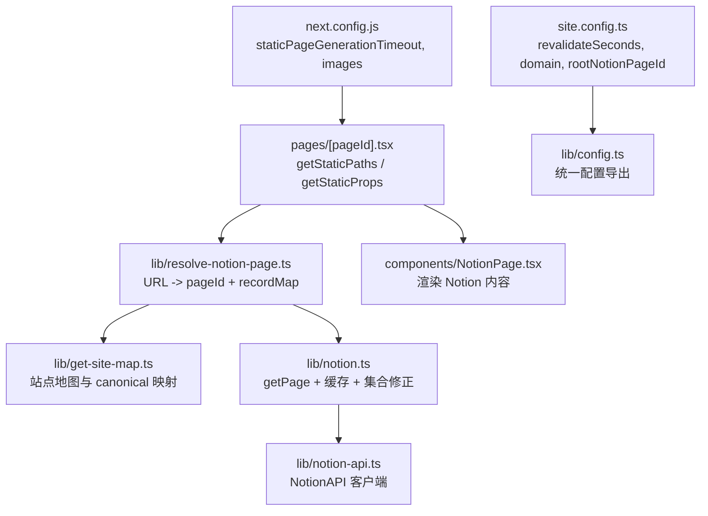
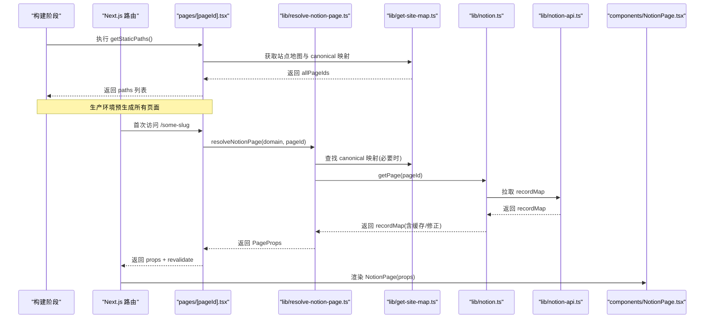
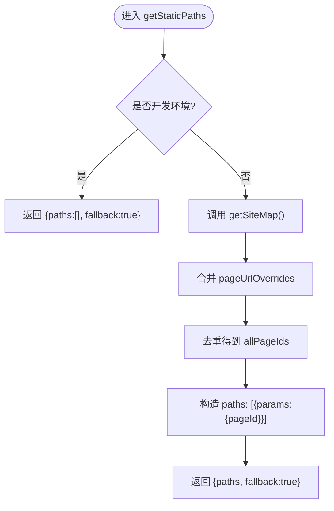
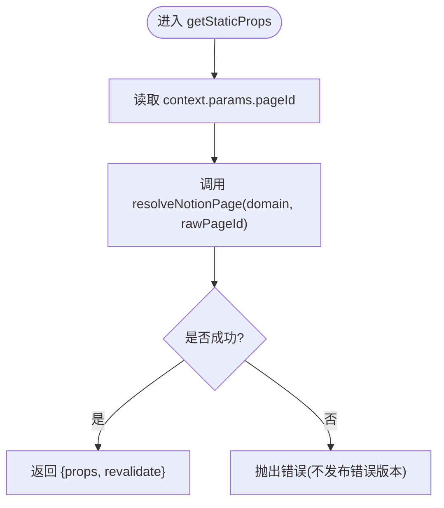
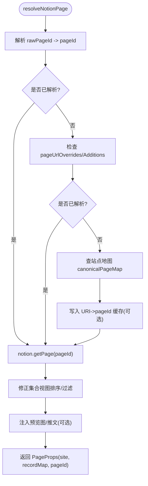
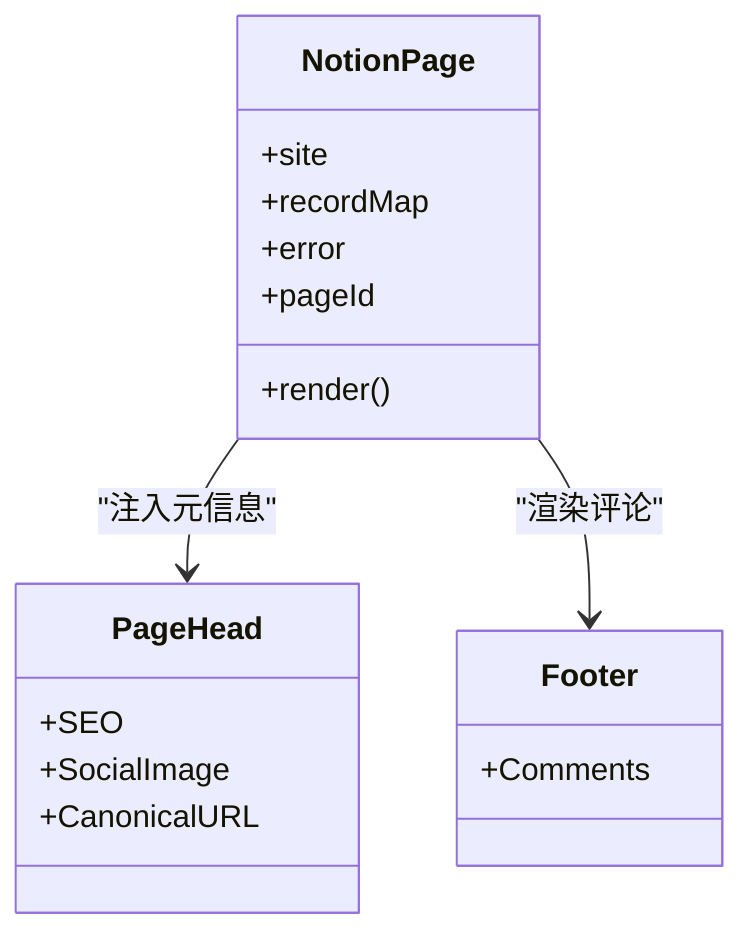
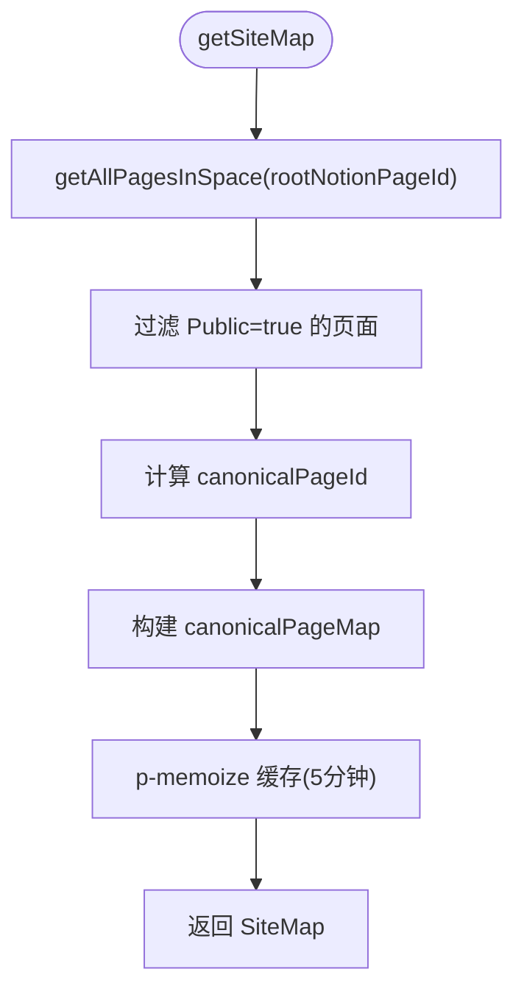
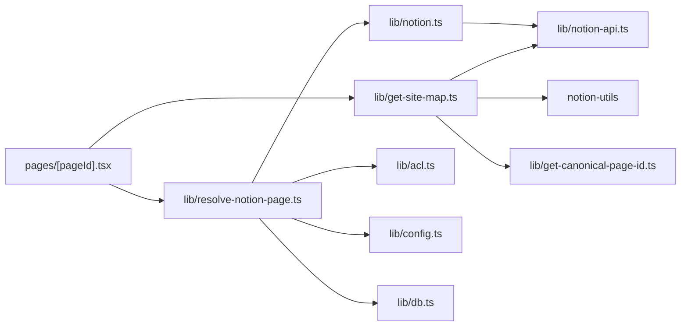

# 静态站点生成

<cite>
**本文引用的文件**   
- [pages/[pageId].tsx](file://pages/[pageId].tsx)
- [lib/resolve-notion-page.ts](file://lib/resolve-notion-page.ts)
- [lib/get-site-map.ts](file://lib/get-site-map.ts)
- [lib/notion.ts](file://lib/notion.ts)
- [lib/notion-api.ts](file://lib/notion-api.ts)
- [components/NotionPage.tsx](file://components/NotionPage.tsx)
- [lib/config.ts](file://lib/config.ts)
- [site.config.ts](file://site.config.ts)
- [next.config.js](file://next.config.js)
</cite>

## 目录
1. [简介](#简介)
2. [项目结构](#项目结构)
3. [核心组件](#核心组件)
4. [架构总览](#架构总览)
5. [详细组件分析](#详细组件分析)
6. [依赖关系分析](#依赖关系分析)
7. [性能与优化](#性能与优化)
8. [故障排查](#故障排查)
9. [结论](#结论)

## 简介
本仓库是一个基于 Next.js 的 Notion 博客/知识库站点模板，采用静态站点生成（SSG）策略将 Notion 页面内容预渲染为静态 HTML。其关键机制包括：
- 使用 getStaticPaths 在构建期收集所有可公开访问的页面路径；
- 使用 getStaticProps 在构建期或增量再生成（ISR）时拉取 Notion 数据并渲染页面；
- 通过 Notion API 获取页面记录、集合视图、图片等数据，并在服务端进行缓存与修正；
- 支持 ISR 增量静态再生成，按配置周期性地重新生成页面以降低函数调用成本；
- 提供 SEO、社交分享图、搜索、评论等增强能力。

## 项目结构
该项目的 SSG 相关逻辑主要分布在以下位置：
- pages/[pageId].tsx：动态路由页，定义 getStaticPaths 与 getStaticProps，负责触发 Notion 数据解析与返回 props；
- lib/resolve-notion-page.ts：根据 URL 解析出 Notion pageId，并加载 recordMap；
- lib/get-site-map.ts：遍历 Notion 空间，生成站点地图与 canonical 映射；
- lib/notion.ts：封装 Notion 数据获取、内存缓存、集合查询修正、预览图等处理；
- lib/notion-api.ts：初始化 NotionAPI 客户端，配置重试、超时、UA 等；
- components/NotionPage.tsx：渲染 Notion 内容，注入 SEO、主题、侧边栏、评论等；
- lib/config.ts 与 site.config.ts：站点级配置，包含 ISR revalidateSeconds、域名、根页面 ID 等；
- next.config.js：Next.js 构建与运行时配置，如静态页面超时、图片远程来源、格式等。

图表来源
- [pages/[pageId].tsx:9-53](file://pages/[pageId].tsx#L9-L53)
- [lib/resolve-notion-page.ts:11-84](file://lib/resolve-notion-page.ts#L11-L84)
- [lib/get-site-map.ts:17-104](file://lib/get-site-map.ts#L17-L104)
- [lib/notion.ts:161-214](file://lib/notion.ts#L161-L214)
- [lib/notion-api.ts:6-19](file://lib/notion-api.ts#L6-L19)
- [components/NotionPage.tsx:211-355](file://components/NotionPage.tsx#L211-L355)
- [site.config.ts:3-76](file://site.config.ts#L3-L76)
- [lib/config.ts:93-95](file://lib/config.ts#L93-L95)
- [next.config.js:4-18](file://next.config.js#L4-L18)

章节来源
- [pages/[pageId].tsx:9-53](file://pages/[pageId].tsx#L9-L53)
- [lib/resolve-notion-page.ts:11-84](file://lib/resolve-notion-page.ts#L11-L84)
- [lib/get-site-map.ts:17-104](file://lib/get-site-map.ts#L17-L104)
- [lib/notion.ts:161-214](file://lib/notion.ts#L161-L214)
- [lib/notion-api.ts:6-19](file://lib/notion-api.ts#L6-L19)
- [components/NotionPage.tsx:211-355](file://components/NotionPage.tsx#L211-L355)
- [site.config.ts:3-76](file://site.config.ts#L3-L76)
- [lib/config.ts:93-95](file://lib/config.ts#L93-L95)
- [next.config.js:4-18](file://next.config.js#L4-L18)

## 核心组件
- 动态路由页 pages/[pageId].tsx
  - getStaticPaths：在开发环境返回 fallback:true 以按需生成；在生产环境通过 getSiteMap 收集所有 canonical 页面 ID，并结合 pageUrlOverrides 合并，生成 paths 列表。
  - getStaticProps：根据 context.params.pageId 调用 resolveNotionPage 获取 props，并通过 revalidate 开启 ISR。
- 页面解析器 lib/resolve-notion-page.ts
  - 将 URL 解析为 Notion pageId，优先尝试直接解析，否则回退到 pageUrlOverrides/pageUrlAdditions，再回退到站点地图 canonical 映射；必要时写入 URI->pageId 缓存。
  - 最终返回 PageProps（site、recordMap、pageId），并附加 ACL 权限信息。
- 站点地图 lib/get-site-map.ts
  - 使用 notion-utils 遍历 Notion 空间，过滤“Public”属性为 true 的页面，生成 canonicalPageMap 与 pageMap，并对站点地图结果做短期缓存。
- Notion 数据层 lib/notion.ts
  - getPage：从 Notion 拉取 recordMap，内置 60 秒内存缓存；若 Notion 不可用则降级返回过期缓存；对导航链接页面进行合并；修正集合视图排序/过滤；可选注入预览图与推文数据。
- Notion API 客户端 lib/notion-api.ts
  - 初始化 NotionAPI，配置重试次数、状态码、超时、User-Agent 等，提高稳定性。
- 渲染组件 components/NotionPage.tsx
  - 接收 server-side 注入的 recordMap，渲染 Notion 内容，注入 SEO、社交分享图、暗色模式、评论等。
- 配置 lib/config.ts 与 site.config.ts
  - 集中管理站点元信息、域名、根页面 ID、是否启用预览图、ISR revalidateSeconds、导航样式等。

章节来源
- [pages/[pageId].tsx:9-53](file://pages/[pageId].tsx#L9-L53)
- [lib/resolve-notion-page.ts:11-84](file://lib/resolve-notion-page.ts#L11-L84)
- [lib/get-site-map.ts:17-104](file://lib/get-site-map.ts#L17-L104)
- [lib/notion.ts:161-214](file://lib/notion.ts#L161-L214)
- [lib/notion-api.ts:6-19](file://lib/notion-api.ts#L6-L19)
- [components/NotionPage.tsx:211-355](file://components/NotionPage.tsx#L211-L355)
- [lib/config.ts:93-95](file://lib/config.ts#L93-L95)
- [site.config.ts:3-76](file://site.config.ts#L3-L76)

## 架构总览
下图展示了 SSG 请求在构建期与运行期的整体流程，包括 getStaticPaths、getStaticProps、Notion 数据获取、缓存与渲染。

图表来源
- [pages/[pageId].tsx:9-53](file://pages/[pageId].tsx#L9-L53)
- [lib/resolve-notion-page.ts:11-84](file://lib/resolve-notion-page.ts#L11-L84)
- [lib/get-site-map.ts:17-104](file://lib/get-site-map.ts#L17-L104)
- [lib/notion.ts:161-214](file://lib/notion.ts#L161-L214)
- [lib/notion-api.ts:6-19](file://lib/notion-api.ts#L6-L19)
- [components/NotionPage.tsx:211-355](file://components/NotionPage.tsx#L211-L355)

## 详细组件分析

### getStaticPaths 的实现与行为
- 开发环境：返回空 paths 与 fallback:true，实现按需生成，提升本地开发体验。
- 生产环境：
  - 调用 getSiteMap 获取 canonicalPageMap；
  - 合并 pageUrlOverrides 中定义的自定义 URL 映射；
  - 去重后生成 paths，每个 path 对应一个 params.pageId；
  - 设置 fallback:true，未预生成的路径会在首次访问时按需生成。

图表来源
- [pages/[pageId].tsx:27-53](file://pages/[pageId].tsx#L27-L53)
- [lib/get-site-map.ts:17-104](file://lib/get-site-map.ts#L17-L104)

章节来源
- [pages/[pageId].tsx:27-53](file://pages/[pageId].tsx#L27-L53)
- [lib/get-site-map.ts:17-104](file://lib/get-site-map.ts#L17-L104)

### getStaticProps 的工作机制与 ISR
- 从 context.params.pageId 读取原始路径；
- 调用 resolveNotionPage 获取 props；
- 返回 props 与 revalidate 字段，开启 ISR；
- 若发生错误，抛出异常，明确告知 Next.js 增量 SSG 失败，避免发布错误版本。

图表来源
- [pages/[pageId].tsx:9-25](file://pages/[pageId].tsx#L9-L25)
- [lib/resolve-notion-page.ts:11-84](file://lib/resolve-notion-page.ts#L11-L84)

章节来源
- [pages/[pageId].tsx:9-25](file://pages/[pageId].tsx#L9-L25)
- [lib/resolve-notion-page.ts:11-84](file://lib/resolve-notion-page.ts#L11-L84)

### Notion 页面解析与数据获取
- resolve-notion-page.ts：
  - 优先解析 rawPageId 为 Notion pageId；
  - 若失败，检查 pageUrlOverrides/pageUrlAdditions；
  - 再次失败，查站点地图 canonicalPageMap；
  - 命中后将 URI->pageId 写入缓存（TTL 一天）；
  - 最终调用 notion.getPage 获取 recordMap，并附加 ACL。
- notion.ts：
  - 维护 60 秒内存缓存，降低重复请求；
  - Notion 不可用时返回过期缓存作为降级；
  - 合并导航链接页面的 recordMap；
  - 修正集合视图的排序与过滤；
  - 可选注入预览图与推文数据。
- notion-api.ts：
  - 配置重试、超时、UA，提升稳定性。

图表来源
- [lib/resolve-notion-page.ts:11-84](file://lib/resolve-notion-page.ts#L11-L84)
- [lib/notion.ts:161-214](file://lib/notion.ts#L161-L214)
- [lib/notion-api.ts:6-19](file://lib/notion-api.ts#L6-L19)

章节来源
- [lib/resolve-notion-page.ts:11-84](file://lib/resolve-notion-page.ts#L11-L84)
- [lib/notion.ts:161-214](file://lib/notion.ts#L161-L214)
- [lib/notion-api.ts:6-19](file://lib/notion-api.ts#L6-L19)

### 渲染层：NotionPage 组件
- 接收 server-side 注入的 site、recordMap、error、pageId；
- 根据 block 类型判断是否为博客文章，决定是否显示目录；
- 注入 SEO、社交分享图、canonical URL、发布时间、作者等；
- 使用 react-notion-x 渲染 Notion 内容，并注入自定义组件（代码高亮、集合、公式、PDF、弹窗、推文等）；
- 支持 lite 模式与暗色模式。

图表来源
- [components/NotionPage.tsx:211-355](file://components/NotionPage.tsx#L211-L355)

章节来源
- [components/NotionPage.tsx:211-355](file://components/NotionPage.tsx#L211-L355)

### 站点地图与 canonical 映射
- getSiteMap 遍历 Notion 空间，过滤 Public=true 的页面；
- 计算 canonicalPageId，建立 canonicalPageMap；
- 对站点地图结果进行 p-memoize 缓存（5 分钟），平衡新鲜度与性能。

图表来源
- [lib/get-site-map.ts:17-104](file://lib/get-site-map.ts#L17-L104)

章节来源
- [lib/get-site-map.ts:17-104](file://lib/get-site-map.ts#L17-L104)

## 依赖关系分析
- pages/[pageId].tsx 依赖：
  - lib/config（domain、isDev、pageUrlOverrides、revalidateSeconds）；
  - lib/get-site-map（站点地图）；
  - lib/resolve-notion-page（页面解析）。
- lib/resolve-notion-page.ts 依赖：
  - lib/acl（权限控制）；
  - lib/config（站点配置）；
  - lib/db（URI->pageId 缓存）；
  - lib/get-site-map（站点地图）；
  - lib/notion（getPage）。
- lib/notion.ts 依赖：
  - lib/config（导航样式、预览图开关）；
  - lib/get-tweets（推文数据）；
  - lib/preview-images（预览图）；
  - lib/notion-api（NotionAPI 客户端）。
- lib/get-site-map.ts 依赖：
  - notion-utils（遍历空间、块值、属性）；
  - lib/config（rootNotionPageId、includeNotionIdInUrls）；
  - lib/get-canonical-page-id（canonical 计算）；
  - lib/notion-api（NotionAPI）。

图表来源
- [pages/[pageId].tsx:1-7](file://pages/[pageId].tsx#L1-L7)
- [lib/resolve-notion-page.ts:1-10](file://lib/resolve-notion-page.ts#L1-L10)
- [lib/get-site-map.ts:1-13](file://lib/get-site-map.ts#L1-L13)
- [lib/notion.ts:1-17](file://lib/notion.ts#L1-L17)
- [lib/notion-api.ts:1-1](file://lib/notion-api.ts#L1-L1)

章节来源
- [pages/[pageId].tsx:1-7](file://pages/[pageId].tsx#L1-L7)
- [lib/resolve-notion-page.ts:1-10](file://lib/resolve-notion-page.ts#L1-L10)
- [lib/get-site-map.ts:1-13](file://lib/get-site-map.ts#L1-L13)
- [lib/notion.ts:1-17](file://lib/notion.ts#L1-L17)
- [lib/notion-api.ts:1-1](file://lib/notion-api.ts#L1-L1)

## 性能与优化
- 构建期优化
  - staticPageGenerationTimeout：延长静态页面生成超时，避免大型站点构建超时。
  - images.remotePatterns：限制允许的远程图片域名，减少无效请求。
  - images.formats：启用 AVIF/WebP，减小图片体积。
- 运行期优化
  - ISR revalidateSeconds：通过 site.config.ts 配置 revalidateSeconds（默认 3600，示例为 86400），降低 Vercel 函数调用频率。
  - 内存缓存：lib/notion.ts 内建 60 秒内存缓存，降低 Notion API 压力。
  - 站点地图缓存：lib/get-site-map.ts 对站点地图结果进行 5 分钟缓存。
  - 客户端懒加载：components/NotionPage.tsx 使用 dynamic 导入代码高亮、集合、公式、PDF、弹窗等组件，减少首屏体积。
  - 按需生成：getStaticPaths 在开发环境返回 fallback:true，生产环境也保留 fallback:true，未预生成的页面按需生成。

建议
- 合理设置 revalidateSeconds：高频更新内容可降低间隔，低频内容可提高间隔以减少函数调用。
- 控制 Notion 页面规模：大集合/数据库建议分页或使用更轻量的视图。
- 图片优化：尽量使用合适的尺寸与格式，利用 Next.js Image 优化。
- 监控与日志：关注 Notion API 错误与超时，结合重试与降级策略。

章节来源
- [next.config.js:4-18](file://next.config.js#L4-L18)
- [site.config.ts:57-60](file://site.config.ts#L57-L60)
- [lib/notion.ts:29-55](file://lib/notion.ts#L29-L55)
- [lib/get-site-map.ts:29-32](file://lib/get-site-map.ts#L29-L32)
- [components/NotionPage.tsx:43-142](file://components/NotionPage.tsx#L43-L142)
- [pages/[pageId].tsx:27-53](file://pages/[pageId].tsx#L27-L53)

## 故障排查
- Notion API 不稳定
  - 现象：页面构建或运行时出现 429/5xx 错误。
  - 处理：lib/notion-api.ts 已配置重试与超时；lib/notion.ts 在 Notion 不可用时返回过期缓存，保证站点可用。
- 集合视图排序/过滤不一致
  - 现象：前端展示顺序与 Notion 不一致。
  - 处理：lib/notion.ts 中的 fixCollectionQueries 会重新执行 collection_query，应用正确的 sort/filter。
- 404 页面
  - 现象：访问不存在的路径。
  - 处理：lib/resolve-notion-page.ts 在未找到 pageId 时返回 error 对象，components/NotionPage.tsx 渲染 404 页面。
- 构建超时
  - 现象：静态页面生成超时。
  - 处理：next.config.js 中 staticPageGenerationTimeout 已设置为 300 秒，可根据站点规模调整。

章节来源
- [lib/notion-api.ts:6-19](file://lib/notion-api.ts#L6-L19)
- [lib/notion.ts:161-214](file://lib/notion.ts#L161-L214)
- [lib/resolve-notion-page.ts:66-74](file://lib/resolve-notion-page.ts#L66-L74)
- [components/NotionPage.tsx:255-261](file://components/NotionPage.tsx#L255-L261)
- [next.config.js:4-6](file://next.config.js#L4-L6)

## 结论
本项目通过 Next.js 的 SSG 与 ISR 机制，将 Notion 内容高效地预渲染为静态页面，同时兼顾了性能与可维护性：
- getStaticPaths 在构建期收集页面路径，生产环境预生成，开发环境按需生成；
- getStaticProps 在构建期或 ISR 时拉取 Notion 数据，返回 props 与 revalidate；
- Notion 数据层具备内存缓存、集合修正、预览图与推文注入等能力；
- 配置集中在 site.config.ts 与 lib/config.ts，便于统一管理；
- 通过合理的 revalidateSeconds、图片优化与组件懒加载，达到良好的性能表现。