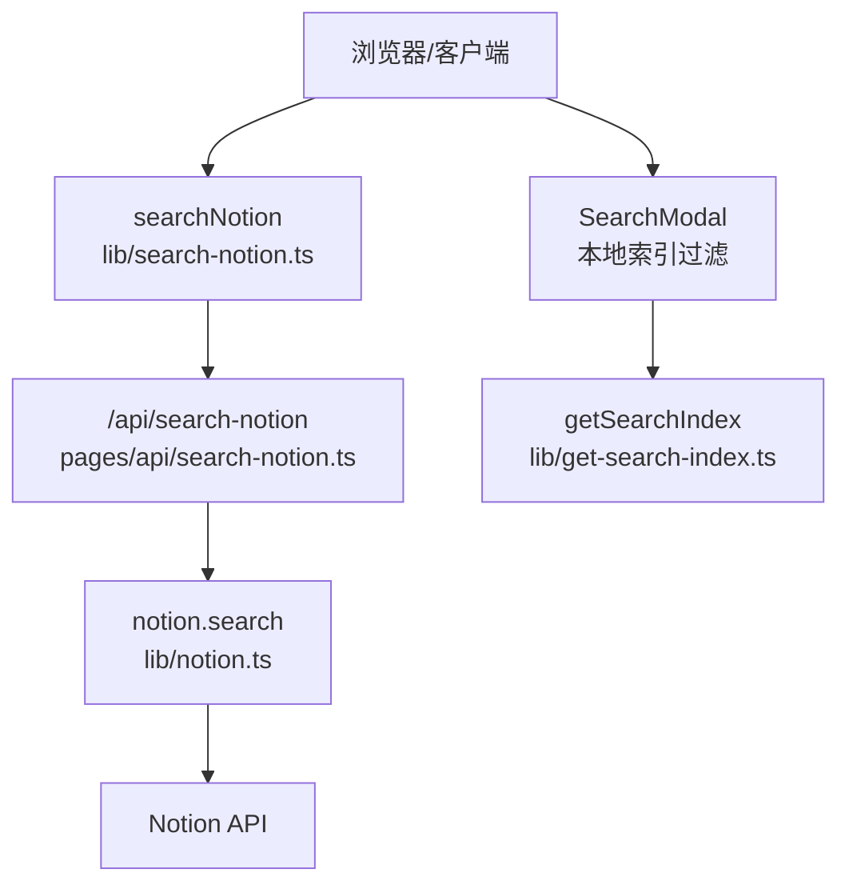
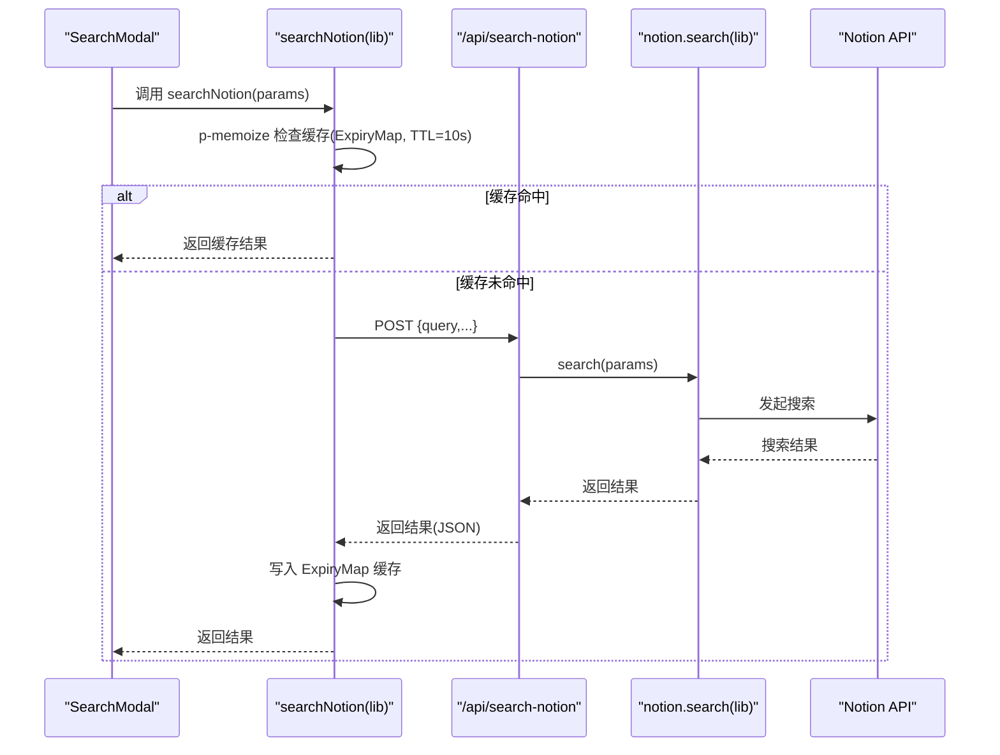
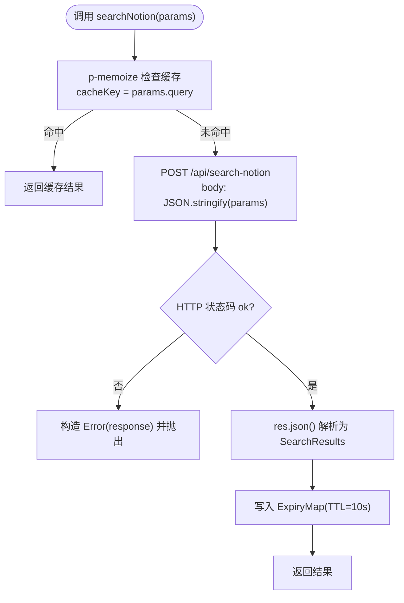
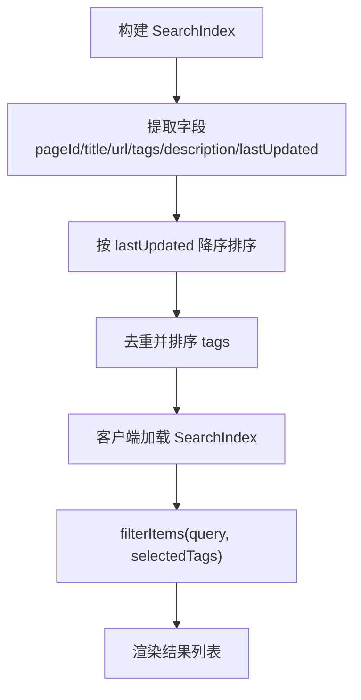
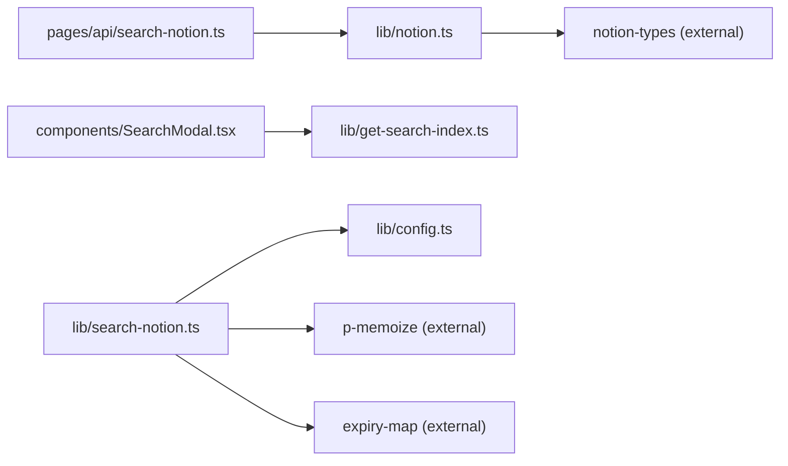

# 客户端搜索算法

<cite>
**本文引用的文件**   
- [lib/search-notion.ts](file://lib/search-notion.ts)
- [pages/api/search-notion.ts](file://pages/api/search-notion.ts)
- [lib/notion.ts](file://lib/notion.ts)
- [lib/config.ts](file://lib/config.ts)
- [lib/get-search-index.ts](file://lib/get-search-index.ts)
- [components/SearchModal.tsx](file://components/SearchModal.tsx)
</cite>

## 目录
1. [引言](#引言)
2. [项目结构](#项目结构)
3. [核心组件](#核心组件)
4. [架构总览](#架构总览)
5. [详细组件分析](#详细组件分析)
6. [依赖关系分析](#依赖关系分析)
7. [性能与优化建议](#性能与优化建议)
8. [故障排查指南](#故障排查指南)
9. [结论](#结论)
10. [附录：类型与接口说明](#附录类型与接口说明)

## 引言
本文聚焦于本仓库的“客户端搜索”能力，重点解析以下方面：
- searchNotion 函数的调用流程、参数处理与返回格式
- 搜索缓存机制（ExpiryMap）的工作原理与配置项
- 搜索结果排序、过滤与分页逻辑
- 搜索性能优化建议与自定义搜索算法的实现方法

本项目提供两套搜索路径：
- 实时搜索：前端通过 searchNotion 调用后端 API，再由后端调用 Notion Search API 返回结果。
- 本地索引搜索：构建站点级轻量搜索索引，在客户端进行即时过滤与排序，适合快速体验与离线场景。

## 项目结构
围绕搜索功能的关键文件分布如下：
- lib/search-notion.ts：封装对 /api/search-notion 的调用，并基于 p-memoize + ExpiryMap 实现请求级缓存
- pages/api/search-notion.ts：Next.js API 路由，接收查询参数并转发到 notion.search
- lib/notion.ts：对外暴露 notion.search 入口，实际由 notion-types 提供的 NotionAPI 实例执行
- lib/config.ts：集中定义 api 基础路径与站点配置
- lib/get-search-index.ts：生成可缓存的站点搜索索引（标题、URL、标签、描述等）
- components/SearchModal.tsx：客户端搜索弹窗，支持本地索引过滤、标签筛选与键盘导航

图表来源
- [lib/search-notion.ts:7-32](file://lib/search-notion.ts#L7-L32)
- [pages/api/search-notion.ts:6-24](file://pages/api/search-notion.ts#L6-L24)
- [lib/notion.ts:216-218](file://lib/notion.ts#L216-L218)
- [lib/get-search-index.ts:35-93](file://lib/get-search-index.ts#L35-L93)
- [components/SearchModal.tsx:29-50](file://components/SearchModal.tsx#L29-L50)

章节来源
- [lib/search-notion.ts:1-39](file://lib/search-notion.ts#L1-L39)
- [pages/api/search-notion.ts:1-25](file://pages/api/search-notion.ts#L1-L25)
- [lib/notion.ts:1-219](file://lib/notion.ts#L1-L219)
- [lib/config.ts:145-150](file://lib/config.ts#L145-L150)
- [lib/get-search-index.ts:1-94](file://lib/get-search-index.ts#L1-L94)
- [components/SearchModal.tsx:1-253](file://components/SearchModal.tsx#L1-L253)

## 核心组件
- searchNotion（lib/search-notion.ts）
  - 使用 p-memoize 包装底层 fetch 调用，以 query 作为缓存键
  - 使用 ExpiryMap(10_000) 作为内存缓存，TTL 为 10 秒
  - 将请求体序列化为 JSON，设置 content-type 为 application/json
  - 非 2xx 响应会转换为错误对象并抛出
- API 路由（pages/api/search-notion.ts）
  - 仅接受 POST 请求
  - 从 req.body 读取 SearchParams
  - 调用 notion.search 并将结果返回
  - 设置 Cache-Control 头用于 CDN/边缘缓存
- notion.search（lib/notion.ts）
  - 直接委托给 notion-types 的 notion.search
  - 不在此层做额外过滤或排序
- 本地索引（lib/get-search-index.ts）
  - 遍历站点地图中的公开页面，提取标题、URL、标签、描述、更新时间
  - 按 lastUpdated 降序排序
  - 去重并排序 tags
- 搜索弹窗（components/SearchModal.tsx）
  - 加载 SearchIndex
  - 支持多标签 AND 过滤
  - 支持关键词匹配 title/description/tags
  - 支持键盘导航与跳转

章节来源
- [lib/search-notion.ts:7-32](file://lib/search-notion.ts#L7-L32)
- [pages/api/search-notion.ts:6-24](file://pages/api/search-notion.ts#L6-L24)
- [lib/notion.ts:216-218](file://lib/notion.ts#L216-L218)
- [lib/get-search-index.ts:35-93](file://lib/get-search-index.ts#L35-L93)
- [components/SearchModal.tsx:29-50](file://components/SearchModal.tsx#L29-L50)

## 架构总览
下图展示了“实时搜索”的端到端调用链，以及“本地索引搜索”的数据流。

图表来源
- [lib/search-notion.ts:7-32](file://lib/search-notion.ts#L7-L32)
- [pages/api/search-notion.ts:6-24](file://pages/api/search-notion.ts#L6-L24)
- [lib/notion.ts:216-218](file://lib/notion.ts#L216-L218)

## 详细组件分析

### searchNotion 函数：调用流程、参数与返回
- 调用入口
  - 导出 searchNotion，内部是 p-memoize(searchNotionImpl, {...})
  - cacheKey 取 args[0]?.query，即根据 query 字段作为缓存键
  - cache 使用 new ExpiryMap(10_000)，单位毫秒，表示缓存有效期 10 秒
- 参数处理
  - 入参类型为 types.SearchParams，具体字段由 notion-types 定义
  - 请求体为 JSON.stringify(params)，Content-Type 为 application/json
- 返回格式
  - 返回 Promise<types.SearchResults>，由 Notion API 返回的结构决定
  - 非 2xx 响应会被转换为 Error 并附带 response 属性
- 网络层
  - 使用原生 fetch，未使用 ky（ky 示例被注释）

图表来源
- [lib/search-notion.ts:7-32](file://lib/search-notion.ts#L7-L32)

章节来源
- [lib/search-notion.ts:1-39](file://lib/search-notion.ts#L1-L39)

### 搜索缓存机制（ExpiryMap）工作原理与配置
- 缓存库
  - 使用 expiry-map 提供的 ExpiryMap，构造函数传入过期时间（毫秒）
- 当前配置
  - 在 searchNotion 中创建 new ExpiryMap(10_000)，即 10 秒过期
- 行为特征
  - 相同 query 的请求在 10 秒内直接返回缓存结果
  - 超过 10 秒后缓存失效，重新发起网络请求
- 扩展建议
  - 可按环境区分 TTL（例如生产环境更长）
  - 可结合请求参数其他字段（如 filters、sort）细化 cacheKey

章节来源
- [lib/search-notion.ts:1-10](file://lib/search-notion.ts#L1-L10)

### API 路由：参数校验与响应头
- 方法限制
  - 仅允许 POST，否则返回 405
- 参数读取
  - 从 req.body 获取 SearchParams
- 结果返回
  - 调用 notion.search 并返回其结果
- 缓存头
  - 设置 Cache-Control: public, s-maxage=60, max-age=60, stale-while-revalidate=60
  - 有利于 CDN/边缘节点缓存搜索结果，降低后端压力

章节来源
- [pages/api/search-notion.ts:6-24](file://pages/api/search-notion.ts#L6-L24)

### 后端搜索实现：notion.search
- 实现位置
  - lib/notion.ts 暴露 search(params) -> notion.search(params)
- 职责边界
  - 该层只做透传，不做业务过滤或排序
  - 实际的搜索、排序、分页由 Notion API 完成

章节来源
- [lib/notion.ts:216-218](file://lib/notion.ts#L216-L218)

### 本地索引搜索：排序、过滤与展示
- 索引构建
  - getSearchIndex 遍历站点 map，提取 pageId、title、url、tags、description、lastUpdated
  - 对 items 按 lastUpdated 降序排序
  - 对 tags 去重并按字典序排序
- 客户端过滤
  - filterItems 支持多标签 AND 语义
  - 关键词匹配 title、description、tags 拼接后的字符串
- 展示与交互
  - 支持键盘导航（Esc 关闭、方向键切换高亮）
  - 点击跳转到对应 URL

图表来源
- [lib/get-search-index.ts:35-93](file://lib/get-search-index.ts#L35-L93)
- [components/SearchModal.tsx:29-50](file://components/SearchModal.tsx#L29-L50)

章节来源
- [lib/get-search-index.ts:1-94](file://lib/get-search-index.ts#L1-L94)
- [components/SearchModal.tsx:1-253](file://components/SearchModal.tsx#L1-L253)

## 依赖关系分析
- 模块耦合
  - lib/search-notion.ts 依赖 lib/config.ts 的 api 路径
  - pages/api/search-notion.ts 依赖 lib/notion.ts 的 search 方法
  - components/SearchModal.tsx 依赖 lib/get-search-index.ts 的 SearchIndex
- 外部依赖
  - notion-types 提供 SearchParams、SearchResults 类型与 notion.search 实现
  - p-memoize 提供异步函数记忆化
  - expiry-map 提供带过期的 Map 缓存

图表来源
- [lib/search-notion.ts:1-5](file://lib/search-notion.ts#L1-L5)
- [pages/api/search-notion.ts:3-4](file://pages/api/search-notion.ts#L3-L4)
- [components/SearchModal.tsx:6-7](file://components/SearchModal.tsx#L6-L7)

章节来源
- [lib/search-notion.ts:1-39](file://lib/search-notion.ts#L1-L39)
- [pages/api/search-notion.ts:1-25](file://pages/api/search-notion.ts#L1-L25)
- [lib/notion.ts:1-219](file://lib/notion.ts#L1-L219)
- [lib/get-search-index.ts:1-94](file://lib/get-search-index.ts#L1-L94)
- [components/SearchModal.tsx:1-253](file://components/SearchModal.tsx#L1-L253)

## 性能与优化建议
- 缓存策略
  - 合理调整 ExpiryMap 的 TTL，平衡新鲜度与性能
  - 针对高频 query 可考虑更长的 TTL；低频 query 可缩短 TTL
  - 若需要更细粒度缓存，可将 filters、sort 等纳入 cacheKey
- 请求合并与节流
  - 在输入框 onChange 处增加防抖，减少频繁请求
  - 对同一批次的重复请求进行合并（debounce + dedupe）
- 服务端缓存
  - 利用 API 路由的 Cache-Control 头，配合 CDN 缓存热点查询
  - 可在后端引入 Redis 等分布式缓存，跨实例共享
- 索引优化
  - 增量更新 SearchIndex，避免全量重建
  - 对长文本进行分词与倒排索引，提升本地搜索速度
- 结果集优化
  - 对大结果集采用虚拟滚动，减少 DOM 渲染压力
  - 按需懒加载详情内容，首屏更快

[本节为通用建议，不直接分析具体文件]

## 故障排查指南
- 非 2xx 响应
  - 现象：searchNotion 抛出 Error，且 error.response 包含原始响应
  - 排查：检查 API 路由日志与 Notion API 返回状态码
- 方法不允许
  - 现象：调用 /api/search-notion 返回 405
  - 排查：确保使用 POST 方法，且 body 为 JSON
- 缓存未生效
  - 现象：相同 query 仍多次请求
  - 排查：确认 cacheKey 是否稳定；检查 ExpiryMap TTL 是否过短；确认浏览器/CDN 缓存头是否正确
- 本地索引为空
  - 现象：SearchModal 无结果
  - 排查：检查 getSearchIndex 是否成功构建；确认页面是否为 Public；检查 tags 与 description 是否存在

章节来源
- [lib/search-notion.ts:22-32](file://lib/search-notion.ts#L22-L32)
- [pages/api/search-notion.ts:10-12](file://pages/api/search-notion.ts#L10-L12)
- [lib/get-search-index.ts:53-84](file://lib/get-search-index.ts#L53-L84)

## 结论
- searchNotion 通过 p-memoize + ExpiryMap 实现了轻量级的请求级缓存，显著降低重复查询开销
- API 路由负责参数透传与缓存头设置，后端搜索逻辑交由 Notion API 处理
- 本地索引搜索提供了即时反馈与标签筛选能力，适合快速体验
- 建议在输入层加入防抖、在服务端启用 CDN 缓存，并根据业务需求扩展缓存键与索引结构

[本节为总结性内容，不直接分析具体文件]

## 附录：类型与接口说明
- SearchParams
  - 由 notion-types 定义，作为搜索请求的参数结构
- SearchResults
  - 由 notion-types 定义，作为搜索响应的数据结构
- SearchIndexItem
  - pageId、title、url、tags、description、lastUpdated
- SearchIndex
  - items: SearchIndexItem[]
  - tags: string[]

章节来源
- [lib/notion.ts:1-5](file://lib/notion.ts#L1-L5)
- [lib/get-search-index.ts:11-23](file://lib/get-search-index.ts#L11-L23)