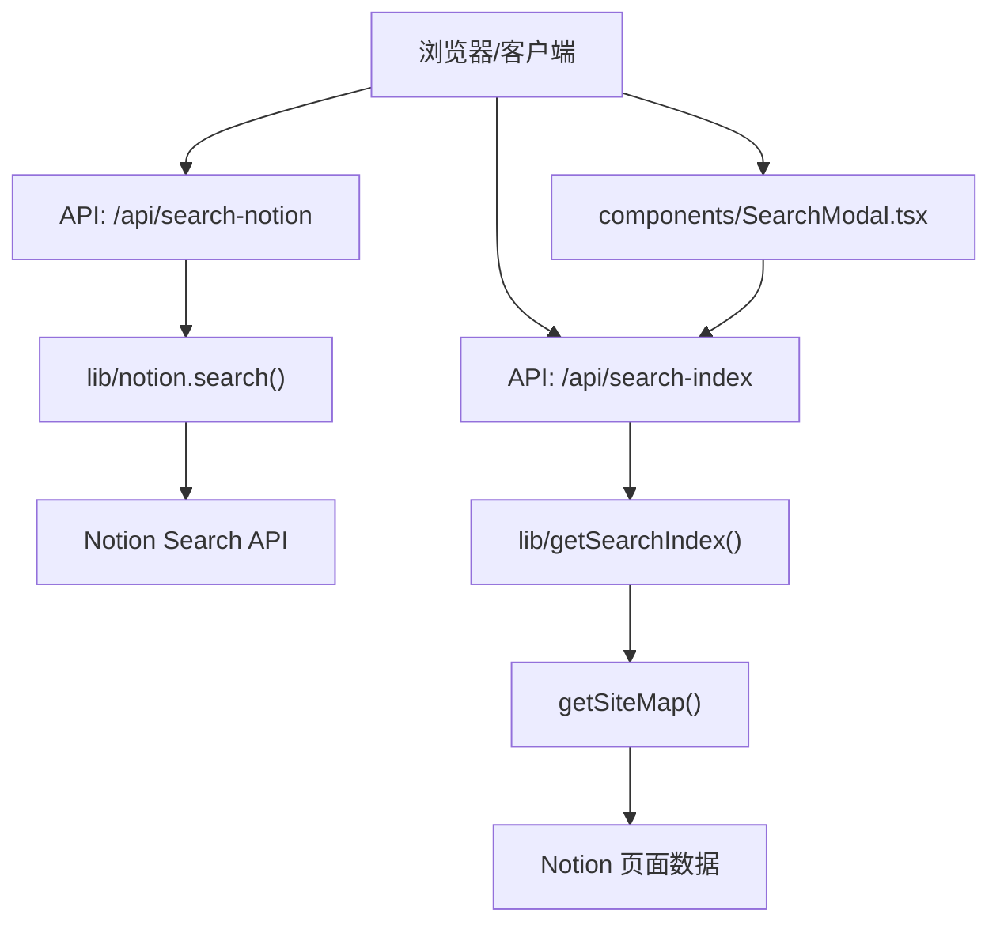
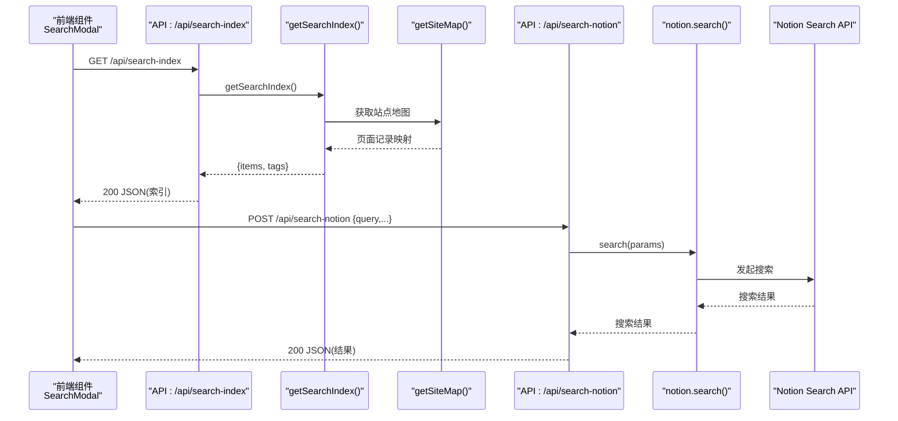
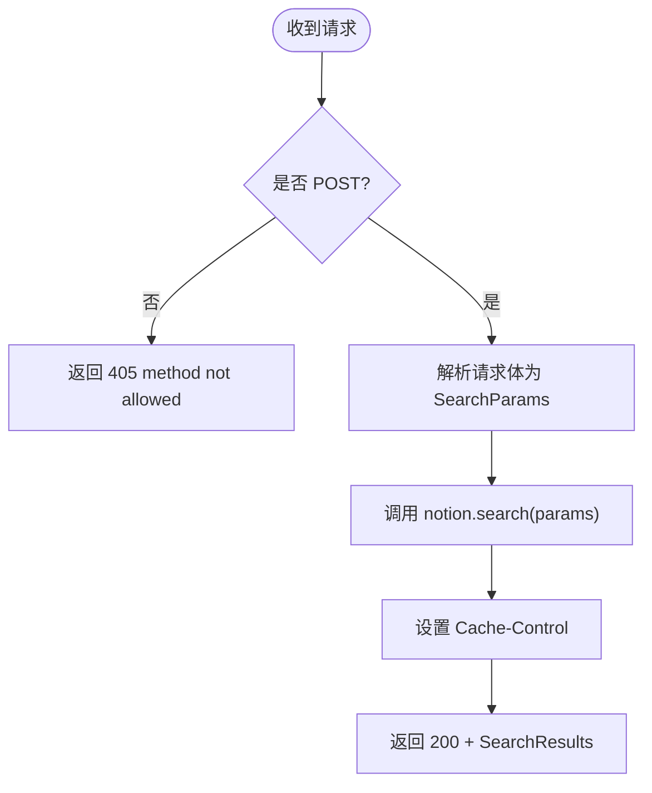
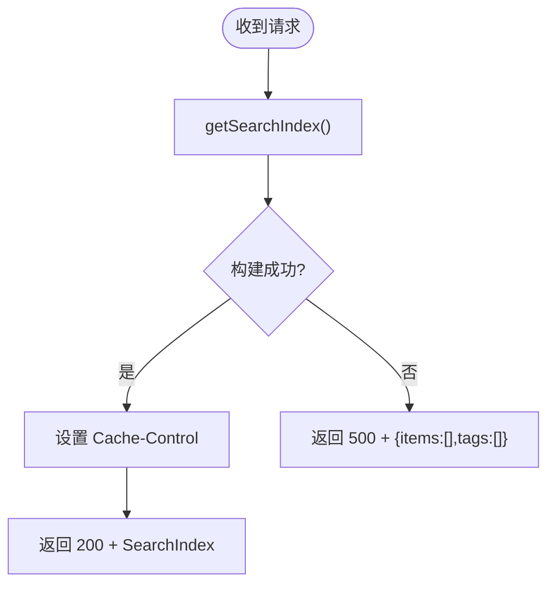
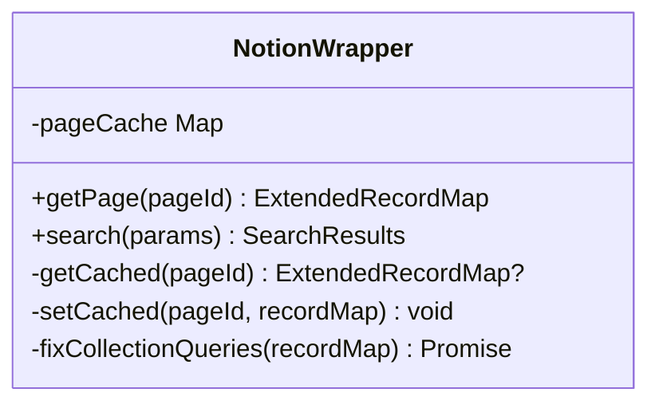
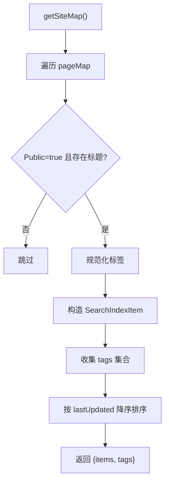
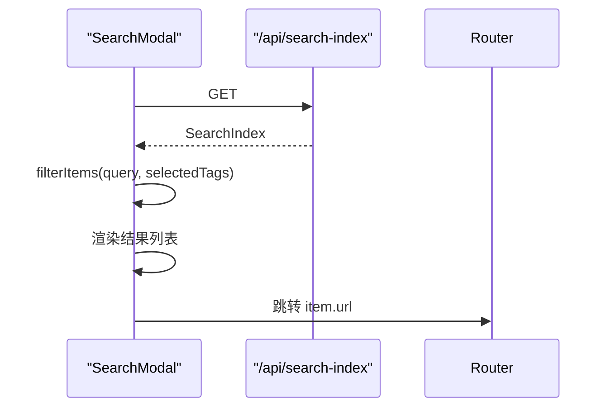
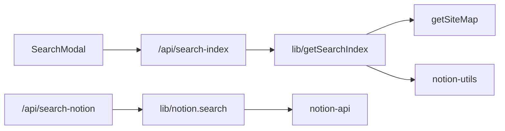

# 搜索 API 端点

<cite>
**本文引用的文件**   
- [pages/api/search-notion.ts](file://pages/api/search-notion.ts)
- [pages/api/search-index.ts](file://pages/api/search-index.ts)
- [lib/notion.ts](file://lib/notion.ts)
- [lib/get-search-index.ts](file://lib/get-search-index.ts)
- [lib/config.ts](file://lib/config.ts)
- [components/SearchModal.tsx](file://components/SearchModal.tsx)
</cite>

## 目录
1. [简介](#简介)
2. [项目结构](#项目结构)
3. [核心组件](#核心组件)
4. [架构总览](#架构总览)
5. [详细组件分析](#详细组件分析)
6. [依赖关系分析](#依赖关系分析)
7. [性能与缓存策略](#性能与缓存策略)
8. [安全、认证与限流](#安全认证与限流)
9. [错误码与异常处理](#错误码与异常处理)
10. [API 使用示例与客户端集成指南](#api-使用示例与客户端集成指南)
11. [调试方法](#调试方法)
12. [版本管理与向后兼容性](#版本管理与向后兼容性)
13. [结论](#结论)

## 简介
本文件为站点“搜索”相关 API 的完整技术文档，覆盖以下范围：
- 搜索查询 API：请求参数、响应格式、错误码定义。
- 搜索索引 API：数据结构、更新机制与缓存策略。
- 安全认证、限流控制与性能优化建议。
- 客户端集成方式、使用示例与调试方法。
- API 版本管理与向后兼容性说明。

该实现基于 Next.js API Routes，提供两类能力：
- 通过后端代理调用 Notion Search API，返回搜索结果。
- 构建并暴露一个轻量级本地搜索索引，用于前端即时搜索与标签过滤。

## 项目结构
与搜索相关的代码主要分布在以下位置：
- pages/api/search-notion.ts：搜索查询 API 路由。
- pages/api/search-index.ts：搜索索引 API 路由。
- lib/notion.ts：封装 Notion 搜索与页面数据获取逻辑，包含服务端内存缓存。
- lib/get-search-index.ts：构建站点级搜索索引（标题、URL、标签、描述等）。
- lib/config.ts：API 基础路径与常量配置。
- components/SearchModal.tsx：前端搜索弹窗，消费 search-index 接口进行本地过滤。

**图表来源**
- [pages/api/search-notion.ts:6-25](file://pages/api/search-notion.ts#L6-L25)
- [pages/api/search-index.ts:5-21](file://pages/api/search-index.ts#L5-L21)
- [lib/notion.ts:216-218](file://lib/notion.ts#L216-L218)
- [lib/get-search-index.ts:44-98](file://lib/get-search-index.ts#L44-L98)
- [components/SearchModal.tsx:80-106](file://components/SearchModal.tsx#L80-L106)

**章节来源**
- [pages/api/search-notion.ts:1-26](file://pages/api/search-notion.ts#L1-L26)
- [pages/api/search-index.ts:1-22](file://pages/api/search-index.ts#L1-L22)
- [lib/notion.ts:1-219](file://lib/notion.ts#L1-L219)
- [lib/get-search-index.ts:1-99](file://lib/get-search-index.ts#L1-L99)
- [lib/config.ts:148-153](file://lib/config.ts#L148-L153)
- [components/SearchModal.tsx:1-254](file://components/SearchModal.tsx#L1-L254)

## 核心组件
- 搜索查询 API（/api/search-notion）
  - 职责：接收前端搜索请求，转发到后端 notion.search，返回搜索结果。
  - 关键行为：仅允许 POST；设置 Cache-Control；透传结果。
- 搜索索引 API（/api/search-index）
  - 职责：生成站点公开页面的轻量搜索索引，供前端本地检索与标签筛选。
  - 关键行为：从站点地图聚合数据；排序与去重；设置更长的缓存时间；失败时返回空结构。
- 后端 Notion 封装（lib/notion.ts）
  - 职责：封装 Notion 页面读取与搜索调用；维护服务端内存缓存；修正集合视图查询。
- 搜索索引构建器（lib/get-search-index.ts）
  - 职责：遍历站点公开页面，提取标题、URL、标签、描述、更新时间，输出统一索引结构。
- 前端搜索弹窗（components/SearchModal.tsx）
  - 职责：加载 search-index，支持关键词与标签过滤，键盘导航与跳转。

**章节来源**
- [pages/api/search-notion.ts:6-25](file://pages/api/search-notion.ts#L6-L25)
- [pages/api/search-index.ts:5-21](file://pages/api/search-index.ts#L5-L21)
- [lib/notion.ts:161-218](file://lib/notion.ts#L161-L218)
- [lib/get-search-index.ts:11-98](file://lib/get-search-index.ts#L11-L98)
- [components/SearchModal.tsx:29-129](file://components/SearchModal.tsx#L29-L129)

## 架构总览
下图展示搜索功能的端到端流程：

**图表来源**
- [components/SearchModal.tsx:80-106](file://components/SearchModal.tsx#L80-L106)
- [pages/api/search-index.ts:5-21](file://pages/api/search-index.ts#L5-L21)
- [lib/get-search-index.ts:44-98](file://lib/get-search-index.ts#L44-L98)
- [pages/api/search-notion.ts:6-25](file://pages/api/search-notion.ts#L6-L25)
- [lib/notion.ts:216-218](file://lib/notion.ts#L216-L218)

## 详细组件分析

### 搜索查询 API：/api/search-notion
- 方法与路径
  - POST /api/search-notion
- 请求体
  - 类型：types.SearchParams（由 Notion 类型定义导出）
  - 字段语义遵循 Notion Search API 规范（如 query、filter、sort 等），具体字段以 Notion 官方为准。
- 成功响应
  - 状态码：200
  - 响应体：types.SearchResults（由 Notion 类型定义导出）
- 错误响应
  - 非 POST 请求：405
  - 其他异常：当前实现未显式捕获，可能返回默认错误或 5xx（取决于底层 fetch 与 Notion 服务状态）
- 缓存头
  - Cache-Control: public, s-maxage=60, max-age=60, stale-while-revalidate=60

**图表来源**
- [pages/api/search-notion.ts:6-25](file://pages/api/search-notion.ts#L6-L25)
- [lib/notion.ts:216-218](file://lib/notion.ts#L216-L218)

**章节来源**
- [pages/api/search-notion.ts:6-25](file://pages/api/search-notion.ts#L6-L25)
- [lib/notion.ts:216-218](file://lib/notion.ts#L216-L218)

### 搜索索引 API：/api/search-index
- 方法与路径
  - GET /api/search-index
- 成功响应
  - 状态码：200
  - 响应体：SearchIndex
    - items: SearchIndexItem[]
      - pageId: string
      - title: string
      - url: string
      - tags: string[]
      - description?: string
      - lastUpdated?: number
    - tags: string[]
- 错误响应
  - 内部异常：返回 500，但响应体仍为 { items: [], tags: [] }，便于前端降级处理
- 缓存头
  - Cache-Control: public, s-maxage=300, max-age=300, stale-while-revalidate=3600

**图表来源**
- [pages/api/search-index.ts:5-21](file://pages/api/search-index.ts#L5-L21)
- [lib/get-search-index.ts:44-98](file://lib/get-search-index.ts#L44-L98)

**章节来源**
- [pages/api/search-index.ts:5-21](file://pages/api/search-index.ts#L5-L21)
- [lib/get-search-index.ts:11-98](file://lib/get-search-index.ts#L11-L98)

### 后端 Notion 封装：lib/notion.ts
- 功能要点
  - getPage：带短期内存缓存（TTL 60s），在 Notion 不可用时回退到陈旧缓存，保障可用性。
  - fixCollectionQueries：修正集合视图的排序与过滤，确保渲染与 Notion 一致。
  - search：直接委托 notion.search，返回 SearchResults。
- 缓存策略
  - 页面级内存缓存 Map，条目包含过期时间戳。
  - 并发限制：集合查询并发度为 3，导航链接页并发度为 4。

**图表来源**
- [lib/notion.ts:19-55](file://lib/notion.ts#L19-L55)
- [lib/notion.ts:95-159](file://lib/notion.ts#L95-L159)
- [lib/notion.ts:161-218](file://lib/notion.ts#L161-L218)

**章节来源**
- [lib/notion.ts:19-55](file://lib/notion.ts#L19-L55)
- [lib/notion.ts:95-159](file://lib/notion.ts#L95-L159)
- [lib/notion.ts:161-218](file://lib/notion.ts#L161-L218)

### 搜索索引构建器：lib/get-search-index.ts
- 功能要点
  - 遍历站点公开页面，跳过标记为非公开的页面。
  - 标准化标签（支持字符串逗号分隔或数组）。
  - 按 lastUpdated 降序排列，提升最近编辑内容可见性。
  - 输出统一 SearchIndex 结构。
- 缓存策略
  - 使用 p-memoize 对 getSearchIndexImpl 进行函数级缓存，避免重复计算。

**图表来源**
- [lib/get-search-index.ts:44-98](file://lib/get-search-index.ts#L44-L98)

**章节来源**
- [lib/get-search-index.ts:11-98](file://lib/get-search-index.ts#L11-L98)

### 前端搜索弹窗：components/SearchModal.tsx
- 功能要点
  - 首次打开时拉取 /api/search-index。
  - 支持关键词匹配（标题、描述、标签）与多标签 AND 过滤。
  - 键盘导航（Esc 关闭、上下键移动、Enter 跳转）。
  - 点击结果项跳转到对应 URL。
- 错误处理
  - 拉取失败时显示错误信息，保持 UI 可用。

**图表来源**
- [components/SearchModal.tsx:80-129](file://components/SearchModal.tsx#L80-L129)
- [components/SearchModal.tsx:131-147](file://components/SearchModal.tsx#L131-L147)

**章节来源**
- [components/SearchModal.tsx:29-129](file://components/SearchModal.tsx#L29-L129)
- [components/SearchModal.tsx:131-147](file://components/SearchModal.tsx#L131-L147)

## 依赖关系分析
- API 层
  - /api/search-notion 依赖 lib/notion.search。
  - /api/search-index 依赖 lib/getSearchIndex。
- 业务层
  - lib/notion 依赖 notion-api 与 notion-utils，负责 Notion 数据访问与缓存。
  - lib/get-search-index 依赖 getSiteMap 与 notion-utils，负责索引构建。
- 前端层
  - components/SearchModal 依赖 lib/config.api 与 lib/get-search-index 的类型定义。

**图表来源**
- [pages/api/search-notion.ts:4-17](file://pages/api/search-notion.ts#L4-L17)
- [pages/api/search-index.ts:3-10](file://pages/api/search-index.ts#L3-L10)
- [lib/notion.ts:1-17](file://lib/notion.ts#L1-L17)
- [lib/get-search-index.ts:1-8](file://lib/get-search-index.ts#L1-L8)
- [components/SearchModal.tsx:6-7](file://components/SearchModal.tsx#L6-L7)

**章节来源**
- [pages/api/search-notion.ts:1-26](file://pages/api/search-notion.ts#L1-L26)
- [pages/api/search-index.ts:1-22](file://pages/api/search-index.ts#L1-L22)
- [lib/notion.ts:1-219](file://lib/notion.ts#L1-L219)
- [lib/get-search-index.ts:1-99](file://lib/get-search-index.ts#L1-L99)
- [components/SearchModal.tsx:1-254](file://components/SearchModal.tsx#L1-L254)

## 性能与缓存策略
- 搜索查询 API（/api/search-notion）
  - 客户端/边缘缓存：Cache-Control 设置为 60 秒，启用 stale-while-revalidate，降低瞬时流量压力。
  - 后端缓存：lib/notion 对页面数据有短期内存缓存（TTL 60s），减少 Notion 调用频率。
- 搜索索引 API（/api/search-index）
  - 客户端/边缘缓存：Cache-Control 设置为 300 秒，stale-while-revalidate 为 3600 秒，适合低频更新的索引数据。
  - 函数级缓存：getSearchIndex 使用 p-memoize 避免重复构建索引。
- 前端本地过滤
  - SearchModal 在内存中对已加载索引进行关键词与标签过滤，避免频繁请求后端。

优化建议
- 针对高频搜索词，可在前端增加短时防抖与本地缓存（例如按 query 缓存最近结果）。
- 若 Notion 搜索成本较高，可考虑在后端引入 Redis 或持久化缓存，按 query 维度缓存结果。
- 对 /api/search-index 的构建过程，可按站点大小增量更新（例如变更触发重建），而非全量重建。

[本节为通用性能建议，不直接分析具体文件]

## 安全、认证与限流
- 认证
  - 当前实现未内置鉴权中间件。搜索查询 API 直接转发至 Notion，依赖 Notion 侧的访问控制。
  - 如需对外暴露，建议在网关层或 Next.js 中间件层增加鉴权（如 JWT、API Key）。
- 限流
  - 当前未实现应用内限流。建议结合部署平台（如 Vercel）或反向代理（如 Nginx、Cloudflare）进行速率限制。
- 输入校验
  - 当前未对 SearchParams 做额外校验。建议在前端与后端均进行最小必要校验，防止恶意 payload。

[本节为通用安全建议，不直接分析具体文件]

## 错误码与异常处理
- /api/search-notion
  - 405：非 POST 请求。
  - 200：成功返回 SearchResults。
  - 其他：未显式捕获，可能返回 5xx（取决于底层 fetch 与 Notion 服务状态）。
- /api/search-index
  - 200：成功返回 SearchIndex。
  - 500：构建失败时返回 { items: [], tags: [] }，便于前端降级。

建议
- 统一错误响应结构，例如 { ok, data, error }，便于前端统一处理。
- 对 Notion 调用增加超时与重试策略，提高鲁棒性。

**章节来源**
- [pages/api/search-notion.ts:10-24](file://pages/api/search-notion.ts#L10-L24)
- [pages/api/search-index.ts:9-20](file://pages/api/search-index.ts#L9-L20)

## API 使用示例与客户端集成指南

### 搜索查询 API：POST /api/search-notion
- 请求
  - 方法：POST
  - 路径：/api/search-notion
  - 头部：Content-Type: application/json
  - 主体：SearchParams（遵循 Notion Search API 规范）
- 响应
  - 状态码：200
  - 主体：SearchResults（遵循 Notion Search API 规范）
- 注意事项
  - 仅支持 POST。
  - 响应带有短时效缓存头，适合高频查询场景。

参考实现路径
- [pages/api/search-notion.ts:6-25](file://pages/api/search-notion.ts#L6-L25)
- [lib/notion.ts:216-218](file://lib/notion.ts#L216-L218)

### 搜索索引 API：GET /api/search-index
- 请求
  - 方法：GET
  - 路径：/api/search-index
- 响应
  - 状态码：200
  - 主体：SearchIndex
    - items: SearchIndexItem[]
      - pageId: string
      - title: string
      - url: string
      - tags: string[]
      - description?: string
      - lastUpdated?: number
    - tags: string[]
- 注意事项
  - 失败时返回 500 但主体为空结构，前端应兼容此降级。

参考实现路径
- [pages/api/search-index.ts:5-21](file://pages/api/search-index.ts#L5-L21)
- [lib/get-search-index.ts:11-98](file://lib/get-search-index.ts#L11-L98)

### 前端集成步骤（SearchModal）
- 步骤
  - 打开弹窗时调用 GET /api/search-index，加载索引。
  - 对用户输入进行本地过滤（关键词 + 标签 AND 语义）。
  - 点击结果项跳转到 item.url。
- 关键点
  - 使用 api.searchIndex 常量（来自 lib/config.ts）。
  - 使用 SearchIndex 与 SearchIndexItem 类型定义。

参考实现路径
- [components/SearchModal.tsx:80-129](file://components/SearchModal.tsx#L80-L129)
- [lib/config.ts:148-153](file://lib/config.ts#L148-L153)

**章节来源**
- [pages/api/search-notion.ts:6-25](file://pages/api/search-notion.ts#L6-L25)
- [pages/api/search-index.ts:5-21](file://pages/api/search-index.ts#L5-L21)
- [components/SearchModal.tsx:80-129](file://components/SearchModal.tsx#L80-L129)
- [lib/config.ts:148-153](file://lib/config.ts#L148-L153)

## 调试方法
- 日志
  - /api/search-notion 会打印请求参数与结果，便于定位问题。
  - /api/search-index 在异常时会打印错误消息。
- 网络面板
  - 观察 Cache-Control 头是否符合预期。
  - 检查 /api/search-index 的 500 降级响应是否为空结构。
- 前端交互
  - 验证 SearchModal 的键盘导航与标签过滤逻辑。
  - 确认跳转 URL 与 SearchIndexItem.url 一致。

**章节来源**
- [pages/api/search-notion.ts:16-18](file://pages/api/search-notion.ts#L16-L18)
- [pages/api/search-index.ts:17-19](file://pages/api/search-index.ts#L17-L19)
- [components/SearchModal.tsx:131-147](file://components/SearchModal.tsx#L131-L147)

## 版本管理与向后兼容性
- 版本管理
  - 当前 API 未显式版本号（如 /api/v1/...），路径固定为 /api/search-notion 与 /api/search-index。
  - 若需演进，建议在路径中引入版本前缀，并在旧版本保留兼容期。
- 向后兼容
  - /api/search-index 在异常时返回空结构，前端已兼容，有助于平滑升级。
  - /api/search-notion 的错误处理较简单，未来建议统一错误结构，同时保持 200 成功响应的数据形状不变。

[本节为通用版本管理建议，不直接分析具体文件]

## 结论
本项目提供了两套互补的搜索能力：
- 通过 /api/search-notion 调用 Notion 搜索，适合需要精确过滤与复杂查询的场景。
- 通过 /api/search-index 提供轻量级本地索引，适合快速关键词与标签过滤的前端体验。

在生产环境中，建议：
- 在网关层增加鉴权与限流。
- 对 Notion 调用增加超时、重试与缓存策略。
- 统一错误响应结构，提升前后端协作效率。
- 逐步引入 API 版本化，确保向后兼容与平滑演进。