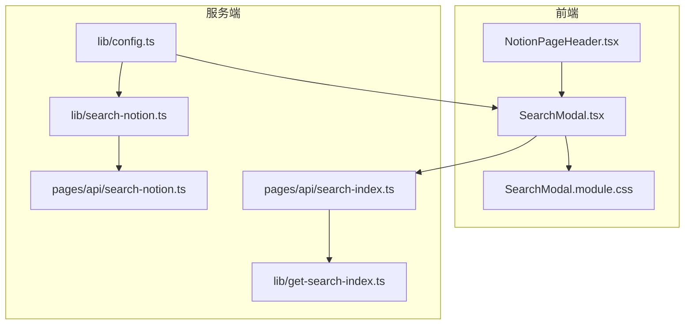
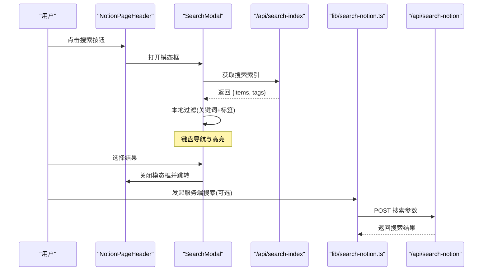
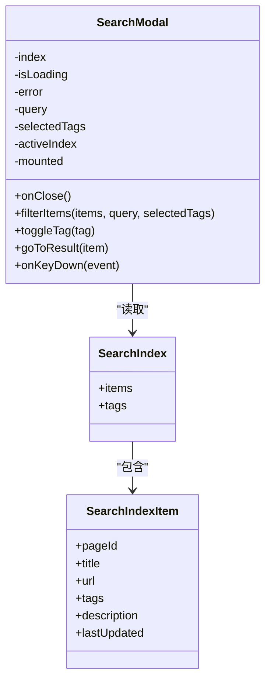
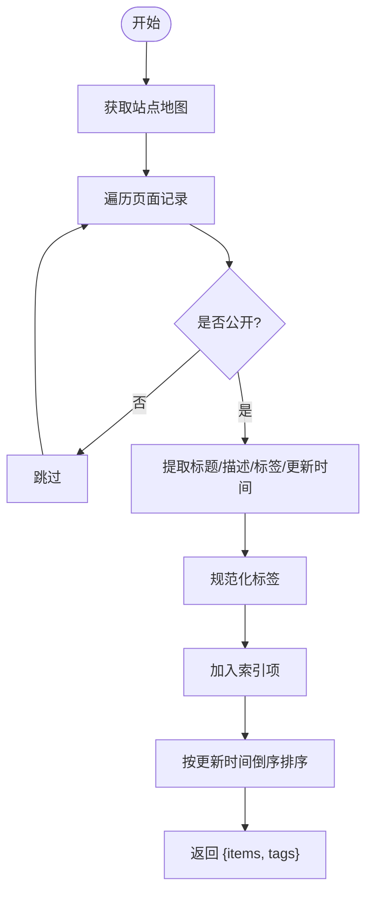
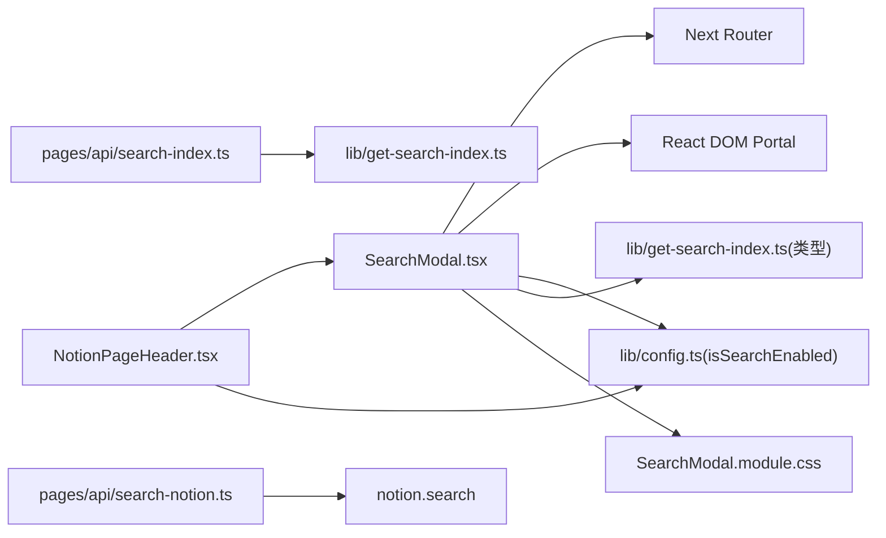

# 搜索 UI 组件

<cite>
**本文引用的文件**   
- [SearchModal.tsx](file://components/SearchModal.tsx)
- [SearchModal.module.css](file://components/SearchModal.module.css)
- [NotionPageHeader.tsx](file://components/NotionPageHeader.tsx)
- [get-search-index.ts](file://lib/get-search-index.ts)
- [search-notion.ts](file://lib/search-notion.ts)
- [search-index.ts](file://pages/api/search-index.ts)
- [search-notion.ts](file://pages/api/search-notion.ts)
- [config.ts](file://lib/config.ts)
</cite>

## 目录
1. [简介](#简介)
2. [项目结构](#项目结构)
3. [核心组件](#核心组件)
4. [架构总览](#架构总览)
5. [详细组件分析](#详细组件分析)
6. [依赖关系分析](#依赖关系分析)
7. [性能与体验优化](#性能与体验优化)
8. [故障排查指南](#故障排查指南)
9. [结论](#结论)
10. [附录：集成与扩展示例](#附录集成与扩展示例)

## 简介
本文件面向开发者，系统化说明“搜索 UI 组件”的实现与使用方法。该组件以模态框形式提供即时客户端搜索、标签过滤、键盘导航与无障碍访问支持；同时提供服务端实时搜索接口作为补充能力。文档涵盖属性接口、事件处理、状态管理、交互流程、响应式与主题适配、国际化建议、样式定制与扩展方式。

## 项目结构
搜索功能由前端组件、样式模块、索引构建逻辑与 API 路由共同组成：
- 前端组件：SearchModal（模态框）、NotionPageHeader（触发入口）
- 样式模块：SearchModal.module.css（CSS Modules）
- 索引构建：get-search-index.ts（生成轻量级搜索索引）
- 服务端 API：pages/api/search-index.ts（提供索引数据）、pages/api/search-notion.ts（调用 Notion 搜索）
- 配置：lib/config.ts（API 地址、开关等）

图表来源
- [NotionPageHeader.tsx:37-76](file://components/NotionPageHeader.tsx#L37-L76)
- [SearchModal.tsx:57-153](file://components/SearchModal.tsx#L57-L153)
- [SearchModal.module.css:12-38](file://components/SearchModal.module.css#L12-L38)
- [search-index.ts:5-21](file://pages/api/search-index.ts#L5-L21)
- [search-notion.ts:6-25](file://pages/api/search-notion.ts#L6-L25)
- [get-search-index.ts:44-98](file://lib/get-search-index.ts#L44-L98)
- [search-notion.ts:7-32](file://lib/search-notion.ts#L7-L32)
- [config.ts:148-153](file://lib/config.ts#L148-L153)

章节来源
- [NotionPageHeader.tsx:37-76](file://components/NotionPageHeader.tsx#L37-L76)
- [SearchModal.tsx:57-153](file://components/SearchModal.tsx#L57-L153)
- [SearchModal.module.css:12-38](file://components/SearchModal.module.css#L12-L38)
- [get-search-index.ts:44-98](file://lib/get-search-index.ts#L44-L98)
- [search-notion.ts:7-32](file://lib/search-notion.ts#L7-L32)
- [search-index.ts:5-21](file://pages/api/search-index.ts#L5-L21)
- [search-notion.ts:6-25](file://pages/api/search-notion.ts#L6-L25)
- [config.ts:148-153](file://lib/config.ts#L148-L153)

## 核心组件
- SearchModal：搜索模态框，负责加载索引、关键词过滤、标签筛选、键盘导航、结果跳转与无障碍语义。
- NotionPageHeader：页面头部组件，包含搜索按钮，控制模态框的显示与隐藏。
- get-search-index：构建站点页面的轻量级搜索索引，包含标题、描述、标签、URL 等字段。
- search-notion（库）：封装对后端搜索接口的调用，带缓存。
- pages/api/search-index.ts：暴露搜索索引数据的 API。
- pages/api/search-notion.ts：转发搜索请求到 Notion 并返回结果。
- lib/config.ts：集中定义 API 地址与站点开关。

章节来源
- [SearchModal.tsx:57-253](file://components/SearchModal.tsx#L57-L253)
- [NotionPageHeader.tsx:37-76](file://components/NotionPageHeader.tsx#L37-L76)
- [get-search-index.ts:11-23](file://lib/get-search-index.ts#L11-L23)
- [search-notion.ts:7-32](file://lib/search-notion.ts#L7-L32)
- [search-index.ts:5-21](file://pages/api/search-index.ts#L5-L21)
- [search-notion.ts:6-25](file://pages/api/search-notion.ts#L6-L25)
- [config.ts:148-153](file://lib/config.ts#L148-L153)

## 架构总览
搜索 UI 采用“客户端索引 + 可选服务端搜索”的双通道架构：
- 客户端索引：SearchModal 在打开时拉取 /api/search-index，获得 items 与 tags，随后在浏览器内完成关键词与标签过滤，实现即时反馈。
- 服务端搜索：通过 lib/search-notion.ts 调用 /api/search-notion，适合复杂查询或需要服务端算力的场景。

图表来源
- [NotionPageHeader.tsx:37-76](file://components/NotionPageHeader.tsx#L37-L76)
- [SearchModal.tsx:80-111](file://components/SearchModal.tsx#L80-L111)
- [search-index.ts:5-21](file://pages/api/search-index.ts#L5-L21)
- [search-notion.ts:7-32](file://lib/search-notion.ts#L7-L32)
- [search-notion.ts:6-25](file://pages/api/search-notion.ts#L6-L25)

## 详细组件分析

### SearchModal 组件
职责
- 渲染模态框与遮罩层，使用 createPortal 挂载至 body。
- 首次打开时从 /api/search-index 拉取索引数据。
- 基于 query 与 selectedTags 进行本地过滤。
- 提供键盘导航（Esc/↑/↓/Enter）与鼠标悬停高亮。
- 无障碍语义：role="dialog"、aria-modal、aria-label、aria-pressed。
- 选中结果后关闭模态框并跳转至目标 URL。

属性接口
- onClose: () => void
  - 用于关闭模态框，通常由父组件控制 isOpen 状态。

内部状态
- index: SearchIndex | null
- isLoading: boolean
- error: string | null
- query: string
- selectedTags: string[]
- activeIndex: number
- mounted: boolean

关键方法
- filterItems(items, query, selectedTags): 本地过滤逻辑
- toggleTag(tag): 切换标签选择
- goToResult(item): 关闭模态框并跳转
- onKeyDown(event): 键盘事件处理

渲染结构
- overlay/modal 容器
- searchHeader：图标、输入框、关闭按钮
- tagsSection：标签筛选区
- results：结果列表（含加载、错误、空结果状态）

图表来源
- [SearchModal.tsx:29-55](file://components/SearchModal.tsx#L29-L55)
- [SearchModal.tsx:57-147](file://components/SearchModal.tsx#L57-L147)
- [get-search-index.ts:11-23](file://lib/get-search-index.ts#L11-L23)

章节来源
- [SearchModal.tsx:57-253](file://components/SearchModal.tsx#L57-L253)

### NotionPageHeader 中的搜索入口
职责
- 提供可聚焦、可键盘触发的搜索按钮。
- 控制 SearchModal 的显示与隐藏。
- 根据 isSearchEnabled 决定是否渲染搜索按钮。

交互要点
- 按钮支持 Enter/Space 触发打开。
- 将 SearchModal 的 onClose 回调传递给父组件以关闭模态框。

章节来源
- [NotionPageHeader.tsx:37-76](file://components/NotionPageHeader.tsx#L37-L76)
- [NotionPageHeader.tsx:121-124](file://components/NotionPageHeader.tsx#L121-L124)

### 搜索索引构建与 API
- get-search-index.ts
  - 遍历站点地图，提取公开页面信息，构建 SearchIndex（items 与 tags）。
  - 对 items 按 lastUpdated 倒序排序，优先展示最近更新的页面。
  - 导出 pMemoize 包装的 getSearchIndex，便于服务端缓存。
- pages/api/search-index.ts
  - 调用 getSearchIndex 并设置缓存头，返回 JSON。
  - 异常时返回空索引，避免前端崩溃。

图表来源
- [get-search-index.ts:44-98](file://lib/get-search-index.ts#L44-L98)

章节来源
- [get-search-index.ts:44-98](file://lib/get-search-index.ts#L44-L98)
- [search-index.ts:5-21](file://pages/api/search-index.ts#L5-L21)

### 服务端搜索接口
- lib/search-notion.ts
  - 封装 fetch 调用，POST 到 /api/search-notion。
  - 使用 p-memoize + ExpiryMap 做短期缓存，减少重复请求。
- pages/api/search-notion.ts
  - 校验 HTTP 方法，解析请求体，调用 notion.search。
  - 设置缓存头，返回搜索结果。

章节来源
- [search-notion.ts:7-32](file://lib/search-notion.ts#L7-L32)
- [search-notion.ts:6-25](file://pages/api/search-notion.ts#L6-L25)

## 依赖关系分析
- SearchModal 依赖：
  - Next Router：用于页面跳转。
  - React DOM Portal：将模态框渲染到 document.body。
  - config.api.searchIndex：索引 API 地址。
  - get-search-index 类型定义：SearchIndex、SearchIndexItem。
  - CSS Modules：样式隔离与主题变量。
- NotionPageHeader 依赖：
  - SearchModal 组件。
  - config.isSearchEnabled：控制搜索入口可见性。
- 服务端 API 依赖：
  - get-search-index：构建索引。
  - notion.search：实际搜索逻辑（外部依赖）。
  - config：统一 API 路径。

图表来源
- [SearchModal.tsx:1-9](file://components/SearchModal.tsx#L1-L9)
- [SearchModal.tsx:57-153](file://components/SearchModal.tsx#L57-L153)
- [NotionPageHeader.tsx:37-76](file://components/NotionPageHeader.tsx#L37-L76)
- [search-index.ts:5-21](file://pages/api/search-index.ts#L5-L21)
- [search-notion.ts:6-25](file://pages/api/search-notion.ts#L6-L25)
- [config.ts:148-153](file://lib/config.ts#L148-L153)

章节来源
- [SearchModal.tsx:1-9](file://components/SearchModal.tsx#L1-L9)
- [SearchModal.tsx:57-153](file://components/SearchModal.tsx#L57-L153)
- [NotionPageHeader.tsx:37-76](file://components/NotionPageHeader.tsx#L37-L76)
- [search-index.ts:5-21](file://pages/api/search-index.ts#L5-L21)
- [search-notion.ts:6-25](file://pages/api/search-notion.ts#L6-L25)
- [config.ts:148-153](file://lib/config.ts#L148-L153)

## 性能与体验优化
- 客户端索引优先：SearchModal 在打开时一次性拉取索引，后续过滤完全在浏览器执行，降低网络开销与延迟。
- 结果计算优化：useMemo 缓存过滤结果，仅在 index/query/tags 变化时重算。
- 输入焦点管理：首次渲染后自动聚焦输入框，提升可用性。
- 防抖与节流：当前未实现输入防抖；若数据量较大，可在 onChange 处引入防抖以减少频繁过滤。
- 列表虚拟化：当结果集很大时，考虑虚拟滚动以提升渲染性能。
- 动画与过渡：当前无显式动画；可通过 CSS Modules 添加淡入/缩放过渡，注意保持无障碍与性能平衡。
- 主题与响应式：
  - 使用 CSS 变量 --bg-color、--fg-color、--fg-color-0 等实现明暗主题适配。
  - modal 最大宽度与高度限制，overlay 使用 backdrop-filter 模糊背景，移动端自适应 padding。
- 无障碍访问：
  - role="dialog"、aria-modal="true"、aria-label 标注。
  - 标签按钮 aria-pressed 表示选中状态。
  - 键盘导航支持 Esc 关闭、↑/↓ 移动高亮、Enter 确认跳转。

章节来源
- [SearchModal.tsx:68-78](file://components/SearchModal.tsx#L68-L78)
- [SearchModal.tsx:108-115](file://components/SearchModal.tsx#L108-L115)
- [SearchModal.tsx:131-147](file://components/SearchModal.tsx#L131-L147)
- [SearchModal.module.css:12-38](file://components/SearchModal.module.css#L12-L38)
- [SearchModal.module.css:122-126](file://components/SearchModal.module.css#L122-L126)

## 故障排查指南
常见问题与定位
- 索引加载失败
  - 现象：显示“Failed to load: ...”。
  - 排查：检查 /api/search-index 是否可达、返回状态码与内容；查看服务器日志。
  - 相关代码：SearchModal 中 fetch api.searchIndex 的错误分支。
- 结果为空
  - 现象：显示“No matching results found”。
  - 排查：确认 get-search-index 是否正确构建 items/tags；检查 Notion 页面是否标记为 Public。
  - 相关代码：get-search-index 的公开页面过滤与标签规范化。
- 标签筛选无效
  - 现象：点击标签后结果不变化。
  - 排查：确认 selectedTags 状态更新与 filterItems 的 AND 语义逻辑。
  - 相关代码：toggleTag 与 filterItems。
- 键盘导航异常
  - 现象：↑/↓/Enter/Esc 无效。
  - 排查：确认 onKeyDown 绑定在 modal 容器上；检查 activeIndex 边界处理。
  - 相关代码：onKeyDown 与 activeIndex 重置逻辑。
- 服务端搜索失败
  - 现象：调用 /api/search-notion 报错。
  - 排查：检查 HTTP 方法是否为 POST；验证请求体结构与 notion.search 返回值。
  - 相关代码：lib/search-notion.ts 与 pages/api/search-notion.ts。

章节来源
- [SearchModal.tsx:80-106](file://components/SearchModal.tsx#L80-L106)
- [SearchModal.tsx:131-147](file://components/SearchModal.tsx#L131-L147)
- [get-search-index.ts:57-68](file://lib/get-search-index.ts#L57-L68)
- [search-notion.ts:7-32](file://lib/search-notion.ts#L7-L32)
- [search-notion.ts:6-25](file://pages/api/search-notion.ts#L6-L25)

## 结论
SearchModal 提供了开箱即用的客户端搜索体验，结合轻量级索引与标签筛选，满足大多数博客/文档站点的搜索需求。配合 NotionPageHeader 的入口与全局开关，易于集成与扩展。对于更复杂的搜索场景，可通过 lib/search-notion.ts 与服务端 API 协同工作。组件具备良好的无障碍支持与主题适配能力，可按需进行样式定制与交互增强。

## 附录：集成与扩展示例

### 基本集成步骤
- 在页面头部组件中引入 SearchButton 或直接复用 NotionPageHeader。
- 确保 isSearchEnabled 为 true，以便显示搜索入口。
- 部署后端 API：/api/search-index 与 /api/search-notion。
- 验证索引构建：访问 /api/search-index 确认返回 {items, tags}。

章节来源
- [NotionPageHeader.tsx:121-124](file://components/NotionPageHeader.tsx#L121-L124)
- [config.ts:90-92](file://lib/config.ts#L90-L92)
- [search-index.ts:5-21](file://pages/api/search-index.ts#L5-L21)

### 自定义样式与主题
- 通过 CSS Modules 覆盖类名，或使用 CSS 变量调整颜色与尺寸。
- 推荐变量：--bg-color、--fg-color、--fg-color-0。
- 可为 tagActive、resultItemActive 等状态类增加过渡效果。

章节来源
- [SearchModal.module.css:25-38](file://components/SearchModal.module.css#L25-L38)
- [SearchModal.module.css:122-126](file://components/SearchModal.module.css#L122-L126)

### 国际化建议
- 当前占位文本与提示文案硬编码在组件中。
- 建议将“搜索关键词”“加载中”“未找到匹配结果”等文案抽离为 i18n 键值，并在组件中引用。
- 标签“Filter by tag”也可替换为多语言版本。

章节来源
- [SearchModal.tsx:168-183](file://components/SearchModal.tsx#L168-L183)
- [SearchModal.tsx:208-215](file://components/SearchModal.tsx#L208-L215)

### 扩展点与最佳实践
- 输入防抖：在 onChange 中引入防抖，减少高频过滤。
- 结果高亮：对匹配的关键词进行高亮显示（需在前端对 title/description 进行片段匹配与包裹）。
- 分页/虚拟化：大数据量时使用虚拟列表。
- 搜索历史：在 localStorage 中保存最近搜索词，并提供快速选择。
- 组合查询：支持布尔表达式或分词权重排序（需服务端支持）。

[本节为概念性指导，不直接分析具体文件]