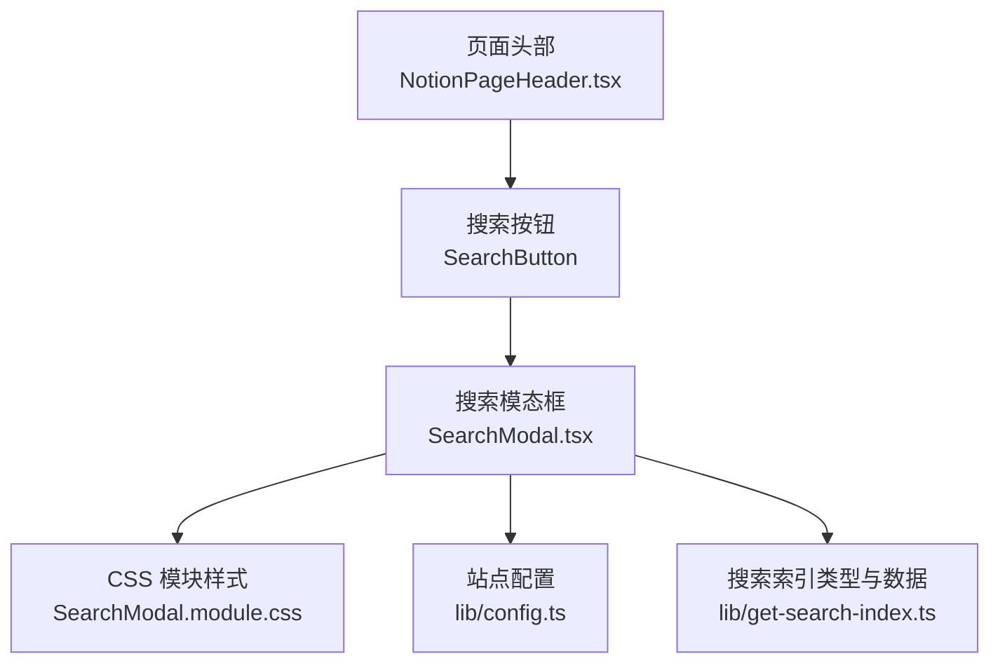
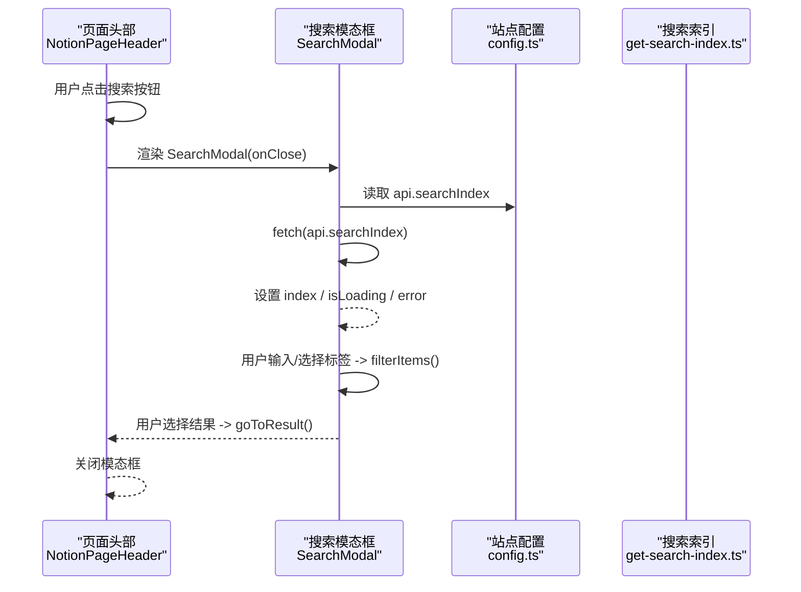
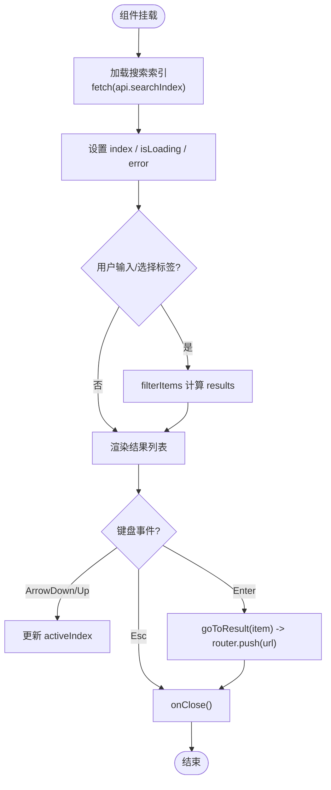
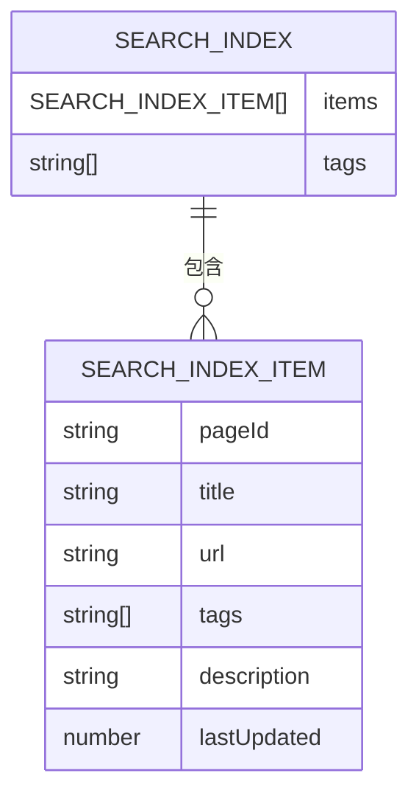
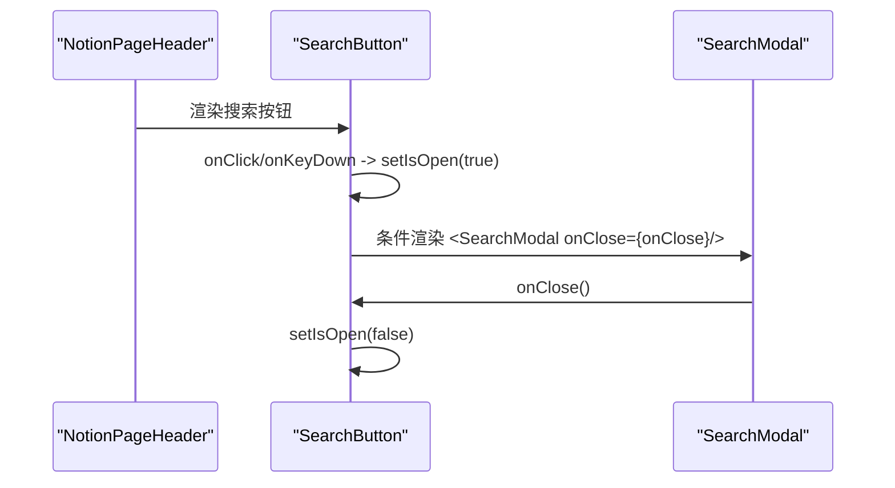
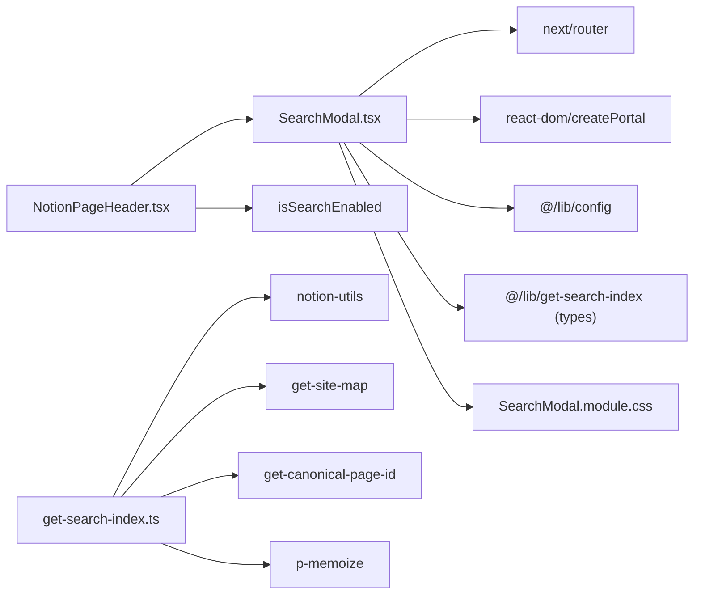

# 搜索 UI 组件

<cite>
**本文引用的文件**   
- [components/SearchModal.tsx](file://components/SearchModal.tsx)
- [components/SearchModal.module.css](file://components/SearchModal.module.css)
- [components/NotionPageHeader.tsx](file://components/NotionPageHeader.tsx)
- [lib/get-search-index.ts](file://lib/get-search-index.ts)
- [lib/config.ts](file://lib/config.ts)
</cite>

## 目录
1. [简介](#简介)
2. [项目结构](#项目结构)
3. [核心组件](#核心组件)
4. [架构总览](#架构总览)
5. [详细组件分析](#详细组件分析)
6. [依赖关系分析](#依赖关系分析)
7. [性能与可访问性](#性能与可访问性)
8. [样式定制与主题适配](#样式定制与主题适配)
9. [扩展指南与自定义结果展示](#扩展指南与自定义结果展示)
10. [故障排查](#故障排查)
11. [结论](#结论)

## 简介
SearchModal 是一个基于 React 的搜索模态框组件，提供关键词搜索、标签筛选、键盘导航和焦点管理等功能。它通过客户端本地索引进行即时过滤，避免每次按键都请求后端，从而获得流畅的交互体验。该组件由页面头部触发，支持打开/关闭控制、Esc 关闭、上下键切换高亮项、回车跳转目标页面等常见交互模式。

## 项目结构
SearchModal 相关代码主要分布在以下位置：
- 组件实现与样式：components/SearchModal.tsx、components/SearchModal.module.css
- 入口集成：components/NotionPageHeader.tsx（负责开关状态与渲染）
- 搜索索引构建：lib/get-search-index.ts（生成 items 与 tags）
- API 地址与站点配置：lib/config.ts（暴露 api.searchIndex 等）

图表来源
- [components/NotionPageHeader.tsx:37-79](file://components/NotionPageHeader.tsx#L37-L79)
- [components/SearchModal.tsx:57-153](file://components/SearchModal.tsx#L57-L153)
- [components/SearchModal.module.css:12-38](file://components/SearchModal.module.css#L12-L38)
- [lib/config.ts:145-150](file://lib/config.ts#L145-L150)
- [lib/get-search-index.ts:11-23](file://lib/get-search-index.ts#L11-L23)

章节来源
- [components/SearchModal.tsx:1-254](file://components/SearchModal.tsx#L1-L254)
- [components/SearchModal.module.css:1-182](file://components/SearchModal.module.css#L1-L182)
- [components/NotionPageHeader.tsx:1-133](file://components/NotionPageHeader.tsx#L1-L133)
- [lib/get-search-index.ts:1-95](file://lib/get-search-index.ts#L1-L95)
- [lib/config.ts:145-150](file://lib/config.ts#L145-L150)

## 核心组件
- SearchModal：对外暴露 onClose 回调作为唯一 props，用于关闭模态框；内部维护查询词、选中标签、当前高亮项索引、加载状态与错误信息。
- NotionPageHeader：包含 SearchButton，负责打开/关闭 SearchModal，并注入 onClose 回调。
- get-search-index：定义 SearchIndexItem 与 SearchIndex 数据结构，并在服务端构建轻量级索引，供前端使用。
- config：提供 api.searchIndex 接口地址以及 isSearchEnabled 开关。

章节来源
- [components/SearchModal.tsx:57-129](file://components/SearchModal.tsx#L57-L129)
- [components/NotionPageHeader.tsx:37-79](file://components/NotionPageHeader.tsx#L37-L79)
- [lib/get-search-index.ts:11-23](file://lib/get-search-index.ts#L11-L23)
- [lib/config.ts:90-91](file://lib/config.ts#L90-L91)
- [lib/config.ts:145-150](file://lib/config.ts#L145-L150)

## 架构总览
SearchModal 的工作流如下：
- 用户点击头部搜索按钮，NotionPageHeader 设置 isOpen 为 true，渲染 SearchModal。
- SearchModal 在首次挂载时通过 fetch(api.searchIndex) 拉取搜索索引，缓存到组件状态。
- 用户在输入框输入关键词或选择标签，组件在客户端对索引进行过滤，计算 results。
- 用户通过键盘上下键移动高亮项，回车跳转到对应页面，同时关闭模态框。
- 点击遮罩层或按 Esc 关闭模态框。

图表来源
- [components/NotionPageHeader.tsx:37-79](file://components/NotionPageHeader.tsx#L37-L79)
- [components/SearchModal.tsx:80-111](file://components/SearchModal.tsx#L80-L111)
- [components/SearchModal.tsx:123-147](file://components/SearchModal.tsx#L123-L147)
- [lib/config.ts:145-150](file://lib/config.ts#L145-L150)
- [lib/get-search-index.ts:35-93](file://lib/get-search-index.ts#L35-L93)

## 详细组件分析

### SearchModal 组件
- Props
  - onClose: () => void，用于关闭模态框。
- 状态字段
  - index: SearchIndex | null，搜索索引数据。
  - isLoading: boolean，是否正在加载索引。
  - error: string | null，加载失败时的错误信息。
  - query: string，用户输入的关键词。
  - selectedTags: string[]，选中的标签集合。
  - activeIndex: number，当前高亮结果的索引。
  - mounted: boolean，是否已挂载到 DOM（用于 SSR 安全）。
  - inputRef: Ref<HTMLInputElement>，聚焦输入框。
- 关键逻辑
  - 客户端过滤：filterItems(items, query, selectedTags)，先按标签 AND 语义过滤，再按关键词匹配标题、描述与标签。
  - 键盘事件：Esc 关闭；ArrowDown/ArrowUp 调整 activeIndex；Enter 跳转并关闭。
  - 结果跳转：goToResult(item) 调用 router.push(item.url) 并关闭模态框。
  - 自动聚焦：mounted 后聚焦输入框，提升可访问性与可用性。
  - 索引加载：useEffect 中 fetch(api.searchIndex)，处理成功/失败状态，取消未完成的请求。
  - 渲染结构：overlay + modal，包含搜索头、标签区、结果列表；使用 createPortal 挂载到 document.body。

图表来源
- [components/SearchModal.tsx:80-111](file://components/SearchModal.tsx#L80-L111)
- [components/SearchModal.tsx:131-147](file://components/SearchModal.tsx#L131-L147)
- [components/SearchModal.tsx:123-129](file://components/SearchModal.tsx#L123-L129)
- [components/SearchModal.tsx:153-252](file://components/SearchModal.tsx#L153-L252)

章节来源
- [components/SearchModal.tsx:29-55](file://components/SearchModal.tsx#L29-L55)
- [components/SearchModal.tsx:57-153](file://components/SearchModal.tsx#L57-L153)
- [components/SearchModal.tsx:153-252](file://components/SearchModal.tsx#L153-L252)

### 搜索结果数据结构
- SearchIndexItem
  - pageId: string
  - title: string
  - url: string
  - tags: string[]
  - description?: string
  - lastUpdated?: number
- SearchIndex
  - items: SearchIndexItem[]
  - tags: string[]

图表来源
- [lib/get-search-index.ts:11-23](file://lib/get-search-index.ts#L11-L23)

章节来源
- [lib/get-search-index.ts:11-23](file://lib/get-search-index.ts#L11-L23)

### 头部集成与打开/关闭机制
- NotionPageHeader 中的 SearchButton 维护 isOpen 状态，点击按钮设置 isOpen=true，条件渲染 SearchModal。
- onClose 回调将 isOpen 设为 false，从而卸载 SearchModal。
- 按钮具备 role="button"、tabIndex=0、aria-label 与键盘 Enter/Space 触发，保证可访问性。

图表来源
- [components/NotionPageHeader.tsx:37-79](file://components/NotionPageHeader.tsx#L37-L79)

章节来源
- [components/NotionPageHeader.tsx:37-79](file://components/NotionPageHeader.tsx#L37-L79)

## 依赖关系分析
- SearchModal 依赖：
  - next/router：用于页面跳转。
  - react-dom/createPortal：将模态框内容挂载到 body。
  - @/lib/config：获取 api.searchIndex 地址。
  - @/lib/get-search-index：导入 SearchIndex 与 SearchIndexItem 类型。
  - CSS 模块：SearchModal.module.css。
- NotionPageHeader 依赖：
  - SearchModal 组件与 CSS 模块样式类 searchButton。
  - 站点配置 isSearchEnabled 决定是否显示搜索按钮。
- get-search-index 依赖：
  - notion-utils、notion-types：解析 Notion 页面属性与块。
  - get-site-map、get-canonical-page-id：构建站点地图与规范化 URL。
  - p-memoize：对索引构建函数做缓存。

图表来源
- [components/SearchModal.tsx:1-9](file://components/SearchModal.tsx#L1-L9)
- [components/NotionPageHeader.tsx:6-13](file://components/NotionPageHeader.tsx#L6-L13)
- [lib/get-search-index.ts:1-8](file://lib/get-search-index.ts#L1-L8)
- [lib/config.ts:90-91](file://lib/config.ts#L90-L91)

章节来源
- [components/SearchModal.tsx:1-9](file://components/SearchModal.tsx#L1-L9)
- [components/NotionPageHeader.tsx:6-13](file://components/NotionPageHeader.tsx#L6-L13)
- [lib/get-search-index.ts:1-8](file://lib/get-search-index.ts#L1-L8)
- [lib/config.ts:90-91](file://lib/config.ts#L90-L91)

## 性能与可访问性
- 性能
  - 客户端过滤：filterItems 在内存中对索引进行过滤，避免频繁网络请求。
  - 索引缓存：getSearchIndex 使用 p-memoize 缓存构建结果，减少重复计算。
  - 结果计算优化：useMemo 缓存 results，仅在 index/query/tags 变化时重算。
  - 请求取消：useEffect 返回清理函数，防止组件卸载后仍更新状态。
- 可访问性
  - overlay 设置 role="dialog"、aria-modal="true"、aria-label="Search"。
  - 输入框 aria-label="Search keywords"。
  - 标签按钮 aria-pressed 表示选中状态。
  - 搜索按钮 role="button"、tabIndex=0、aria-label="搜索"，支持键盘 Enter/Space 触发。
  - 自动聚焦：mounted 后聚焦输入框，便于键盘操作。

章节来源
- [components/SearchModal.tsx:108-115](file://components/SearchModal.tsx#L108-L115)
- [components/SearchModal.tsx:80-106](file://components/SearchModal.tsx#L80-L106)
- [components/SearchModal.tsx:153-176](file://components/SearchModal.tsx#L153-L176)
- [components/NotionPageHeader.tsx:45-61](file://components/NotionPageHeader.tsx#L45-L61)
- [lib/get-search-index.ts:35-38](file://lib/get-search-index.ts#L35-L38)

## 样式定制与主题适配
- 主题变量
  - --bg-color：背景色，默认 #fff。
  - --fg-color：前景色，默认 rgb(55, 53, 47)。
  - --fg-color-0：边框/分隔线颜色，默认 rgba(55, 53, 47, 0.09)。
  - --fg-color-3：占位符颜色，默认 rgba(55, 53, 47, 0.4)。
- 响应式布局
  - overlay 使用 inset: 0 全屏覆盖，padding-top 10vh 使弹窗顶部留白。
  - modal 最大宽度 640px，高度 max-height: 80vh，滚动区域 results 独立滚动。
- 交互样式
  - tagActive 选中标签高亮（蓝色背景与白色文字）。
  - resultItem:hover 与 .resultItemActive 高亮背景。
  - closeButton 悬停提高不透明度。
- 定制建议
  - 通过 CSS 变量覆盖主题色，适配深色模式。
  - 调整 .modal 的 border-radius、box-shadow 以匹配品牌风格。
  - 修改 .tagActive 的颜色以统一设计系统。
  - 调整 .results 的 padding 与行高，优化长列表阅读体验。

章节来源
- [components/SearchModal.module.css:12-38](file://components/SearchModal.module.css#L12-L38)
- [components/SearchModal.module.css:85-126](file://components/SearchModal.module.css#L85-L126)
- [components/SearchModal.module.css:128-174](file://components/SearchModal.module.css#L128-L174)

## 扩展指南与自定义结果展示
- 扩展点
  - 自定义过滤逻辑：替换或增强 filterItems，例如增加模糊匹配、权重排序、分页加载。
  - 自定义结果渲染：替换 results.map 中的 a 节点，添加图片、摘要截断、时间戳等。
  - 自定义标签筛选：扩展 selectedTags 的状态管理与 UI，支持分组、多选限制等。
  - 自定义键盘行为：在 onKeyDown 中添加更多快捷键（如 Ctrl+F 快速聚焦）。
  - 自定义跳转行为：在 goToResult 中记录埋点、打开新窗口或执行其他业务逻辑。
- 示例思路
  - 在结果项中加入缩略图：从 SearchIndexItem 扩展字段，并在渲染时展示。
  - 增加“最近编辑”排序：利用 lastUpdated 字段进行排序或展示更新时间。
  - 支持多语言：根据 locale 动态切换 placeholder、提示文案与标签名称。
  - 接入后端实时搜索：当本地索引为空或需要更精确匹配时，调用 api.searchNotion 并合并结果。

章节来源
- [components/SearchModal.tsx:29-55](file://components/SearchModal.tsx#L29-L55)
- [components/SearchModal.tsx:208-247](file://components/SearchModal.tsx#L208-L247)
- [lib/get-search-index.ts:77-84](file://lib/get-search-index.ts#L77-L84)

## 故障排查
- 无法加载搜索索引
  - 检查 api.searchIndex 是否正确配置（lib/config.ts）。
  - 确认后端 /api/search-index 接口可用且返回正确的 JSON。
  - 查看 error 状态与控制台日志，定位网络或解析错误。
- 无搜索结果
  - 检查 query 是否为空或大小写问题（filterItems 会 trim 并转小写）。
  - 检查 selectedTags 是否与索引中的 tags 完全匹配（区分大小写前会统一转小写比较）。
  - 确认 Notion 页面的 Public 属性与 Tags/Description 属性是否正确设置。
- 键盘导航异常
  - 确保 modal 容器接收 onKeyDown 事件，且没有阻止默认行为。
  - 检查 activeIndex 边界处理（Math.min/Math.max）是否正确。
- 样式错乱
  - 检查 CSS 变量是否被正确注入（--bg-color、--fg-color 等）。
  - 确认 dark mode 切换后变量值是否更新。

章节来源
- [components/SearchModal.tsx:80-106](file://components/SearchModal.tsx#L80-L106)
- [components/SearchModal.tsx:131-147](file://components/SearchModal.tsx#L131-L147)
- [lib/config.ts:145-150](file://lib/config.ts#L145-L150)

## 结论
SearchModal 提供了开箱即用的搜索模态框能力，结合客户端索引与标签筛选，实现了高性能、可访问且易于定制的搜索体验。通过清晰的 props 接口与完善的键盘交互，开发者可以快速集成并扩展其功能，满足多样化的业务需求。配合 CSS 变量与模块化样式，组件能够灵活适配不同主题与响应式场景。