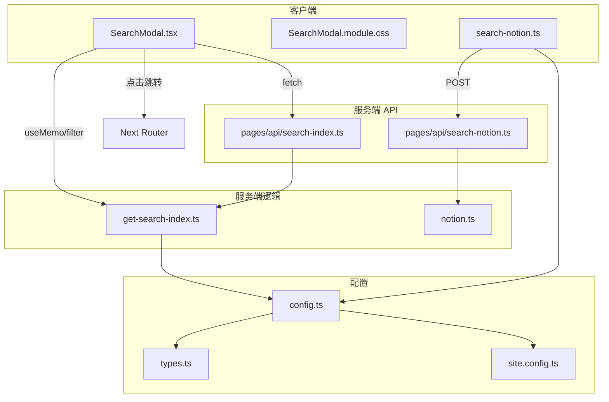
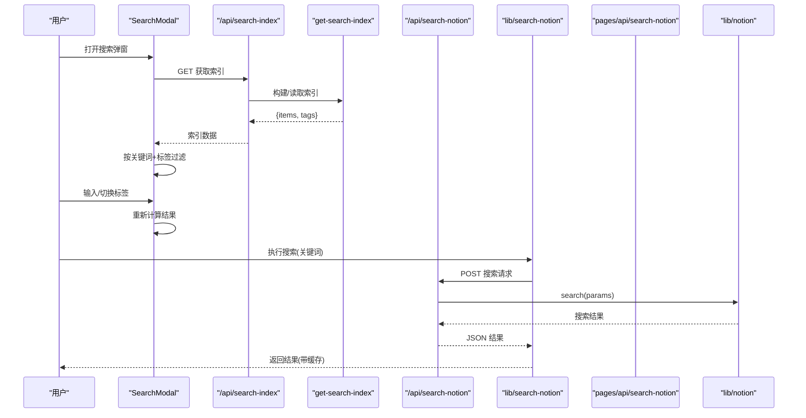
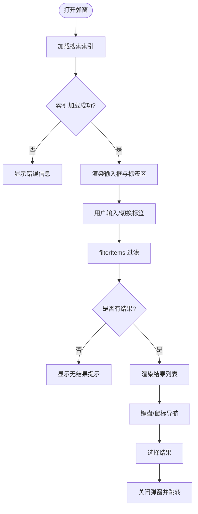
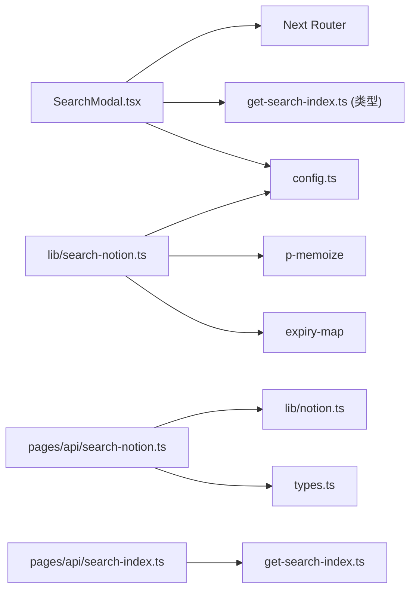

# 搜索功能

<cite>
**本文引用的文件**   
- [SearchModal.tsx](file://components/SearchModal.tsx)
- [SearchModal.module.css](file://components/SearchModal.module.css)
- [get-search-index.ts](file://lib/get-search-index.ts)
- [search-notion.ts](file://lib/search-notion.ts)
- [notion.ts](file://lib/notion.ts)
- [config.ts](file://lib/config.ts)
- [types.ts](file://lib/types.ts)
- [search-index.ts](file://pages/api/search-index.ts)
- [search-notion.ts](file://pages/api/search-notion.ts)
- [site.config.ts](file://site.config.ts)
</cite>

## 目录
1. [简介](#简介)
2. [项目结构](#项目结构)
3. [核心组件](#核心组件)
4. [架构总览](#架构总览)
5. [详细组件分析](#详细组件分析)
6. [依赖关系分析](#依赖关系分析)
7. [性能与优化](#性能与优化)
8. [故障排除](#故障排除)
9. [结论](#结论)

## 简介
本项目的全文搜索能力由两条路径组成：
- 客户端本地索引搜索：构建站点公开页面的轻量级索引，在浏览器端进行关键词匹配与标签过滤，提供即时、低延迟的搜索体验。
- 服务端 Notion 搜索：通过 API 调用 Notion Search API，返回搜索结果，并在客户端进行短期缓存，减少重复请求。

此外，SearchModal 组件封装了完整的搜索交互，包括输入、键盘导航、标签筛选、结果展示与跳转。

## 项目结构
搜索相关代码分布在以下位置：
- 客户端 UI：components/SearchModal.tsx 与样式 components/SearchModal.module.css
- 客户端搜索库：lib/search-notion.ts（封装 Notion 搜索请求）
- 服务端 API：pages/api/search-notion.ts、pages/api/search-index.ts
- 索引构建逻辑：lib/get-search-index.ts
- 配置与类型：lib/config.ts、lib/types.ts、site.config.ts

图表来源
- [SearchModal.tsx:57-150](file://components/SearchModal.tsx#L57-L150)
- [search-notion.ts:7-39](file://lib/search-notion.ts#L7-L39)
- [search-index.ts:5-21](file://pages/api/search-index.ts#L5-L21)
- [search-notion.ts:6-25](file://pages/api/search-notion.ts#L6-L25)
- [get-search-index.ts:38-94](file://lib/get-search-index.ts#L38-L94)
- [config.ts:145-150](file://lib/config.ts#L145-L150)

章节来源
- [SearchModal.tsx:1-254](file://components/SearchModal.tsx#L1-L254)
- [search-notion.ts:1-40](file://lib/search-notion.ts#L1-L40)
- [search-index.ts:1-22](file://pages/api/search-index.ts#L1-L22)
- [search-notion.ts:1-26](file://pages/api/search-notion.ts#L1-L26)
- [get-search-index.ts:1-95](file://lib/get-search-index.ts#L1-L95)
- [config.ts:145-150](file://lib/config.ts#L145-L150)

## 核心组件
- SearchModal：负责搜索弹窗的渲染、状态管理、键盘交互、标签筛选、结果列表展示与路由跳转。
- get-search-index：遍历站点地图，提取公开页面标题、描述、标签、更新时间等，生成轻量级可缓存的搜索索引。
- search-notion（客户端）：封装对 /api/search-notion 的请求，使用带过期时间的内存缓存避免频繁请求。
- pages/api/search-notion：接收搜索参数，转发到 Notion 搜索实现并返回结果。
- pages/api/search-index：暴露搜索索引接口，供客户端加载。

章节来源
- [SearchModal.tsx:29-150](file://components/SearchModal.tsx#L29-L150)
- [get-search-index.ts:11-94](file://lib/get-search-index.ts#L11-L94)
- [search-notion.ts:7-39](file://lib/search-notion.ts#L7-L39)
- [search-notion.ts:6-25](file://pages/api/search-notion.ts#L6-L25)
- [search-index.ts:5-21](file://pages/api/search-index.ts#L5-L21)

## 架构总览
搜索流程分为两条主线：

1) 客户端本地索引搜索
- 首次打开弹窗时，从 /api/search-index 拉取索引数据。
- 在客户端根据关键词与选中标签进行过滤，实时渲染结果。
- 用户选择结果后跳转到对应 URL。

2) 服务端 Notion 搜索
- 客户端调用 lib/search-notion.ts，向 /api/search-notion 发起 POST 请求。
- 服务端 pages/api/search-notion.ts 调用 lib/notion.ts 中的 search 方法，最终委托 notion.search。
- 响应被客户端 p-memoize + ExpiryMap 缓存 10 秒，降低重复请求压力。

图表来源
- [SearchModal.tsx:80-111](file://components/SearchModal.tsx#L80-L111)
- [search-index.ts:5-21](file://pages/api/search-index.ts#L5-L21)
- [get-search-index.ts:38-94](file://lib/get-search-index.ts#L38-L94)
- [search-notion.ts:7-39](file://lib/search-notion.ts#L7-L39)
- [search-notion.ts:6-25](file://pages/api/search-notion.ts#L6-L25)
- [notion.ts:216-218](file://lib/notion.ts#L216-L218)

## 详细组件分析

### SearchModal 组件
职责与行为
- 生命周期与挂载：使用 createPortal 将弹窗挂载到 document.body，避免 SSR 环境访问 document 的问题；首次渲染聚焦输入框。
- 索引加载：组件挂载时一次性 fetch /api/search-index，失败时记录错误信息并停止加载。
- 过滤算法：filterItems 函数先处理标签（AND 语义），再对标题、描述、标签拼接后的字符串进行包含匹配。
- 键盘导航：支持 Esc 关闭、上下箭头移动高亮项、Enter 跳转。
- 结果展示：显示标题、描述与标签；空结果或错误时给出提示。
- 跳转：选择结果后关闭弹窗并调用 Next Router 跳转。

关键数据结构
- SearchIndexItem：pageId、title、url、tags、description、lastUpdated
- SearchIndex：items、tags

交互流程图

图表来源
- [SearchModal.tsx:68-111](file://components/SearchModal.tsx#L68-L111)
- [SearchModal.tsx:131-147](file://components/SearchModal.tsx#L131-L147)
- [SearchModal.tsx:153-252](file://components/SearchModal.tsx#L153-L252)

章节来源
- [SearchModal.tsx:1-254](file://components/SearchModal.tsx#L1-L254)
- [SearchModal.module.css:1-182](file://components/SearchModal.module.css#L1-L182)

### 搜索索引构建（get-search-index）
目标
- 为所有公开页面构建轻量级索引，用于客户端即时搜索与标签筛选。

构建步骤
- 获取站点地图（getSiteMap）。
- 遍历 pageMap，跳过非公开页面。
- 提取标题、URL、标签、描述、最后更新时间。
- 收集所有标签去重排序。
- 按 lastUpdated 降序排列，最近更新的页面优先。

复杂度
- 时间复杂度：O(N log N)，N 为公开页面数量，主要开销来自排序。
- 空间复杂度：O(N)，存储 items 与 tags。

章节来源
- [get-search-index.ts:35-94](file://lib/get-search-index.ts#L35-L94)

### 客户端搜索库（lib/search-notion）
职责
- 封装对 /api/search-notion 的 POST 请求。
- 使用 p-memoize 与 ExpiryMap 做 10 秒过期缓存，键为 query。
- 非 2xx 响应转换为错误对象，便于上层捕获。

章节来源
- [search-notion.ts:1-40](file://lib/search-notion.ts#L1-L40)

### 服务端搜索 API（pages/api/search-notion）
职责
- 校验 HTTP 方法，仅允许 POST。
- 解析请求体为 SearchParams。
- 调用 lib/notion.ts 的 search 方法。
- 设置 Cache-Control 头，启用 CDN/边缘缓存策略。

章节来源
- [search-notion.ts:1-26](file://pages/api/search-notion.ts#L1-L26)
- [notion.ts:216-218](file://lib/notion.ts#L216-L218)

### 服务端索引 API（pages/api/search-index）
职责
- 调用 getSearchIndex 构建索引。
- 设置 Cache-Control 头，启用 ISR 风格的缓存与 stale-while-revalidate。
- 异常时返回空索引，避免前端崩溃。

章节来源
- [search-index.ts:1-22](file://pages/api/search-index.ts#L1-L22)
- [get-search-index.ts:38-94](file://lib/get-search-index.ts#L38-L94)

### 配置与类型
- config.ts：定义 api 路径（searchNotion、searchIndex）、域名、环境变量覆盖、是否启用搜索等。
- types.ts：导出 notion-types 的类型，如 ExtendedRecordMap、SearchParams、SearchResults。
- site.config.ts：站点基础配置，例如 rootNotionPageId、revalidateSeconds 等。

章节来源
- [config.ts:90-95](file://lib/config.ts#L90-L95)
- [config.ts:145-150](file://lib/config.ts#L145-L150)
- [types.ts:1-78](file://lib/types.ts#L1-L78)
- [site.config.ts:1-77](file://site.config.ts#L1-L77)

## 依赖关系分析
- SearchModal 依赖：
  - @/lib/config（api 地址）
  - @/lib/get-search-index（类型 SearchIndex、SearchIndexItem）
  - Next Router（跳转）
  - React DOM（createPortal）
- lib/search-notion 依赖：
  - expiry-map（带过期时间的 Map）
  - p-memoize（函数级缓存）
  - @/lib/config（api 地址）
- pages/api/search-notion 依赖：
  - lib/types（SearchParams、SearchResults）
  - lib/notion（search 方法）
- pages/api/search-index 依赖：
  - lib/get-search-index（getSearchIndex）

图表来源
- [SearchModal.tsx:1-8](file://components/SearchModal.tsx#L1-L8)
- [search-notion.ts:1-5](file://lib/search-notion.ts#L1-L5)
- [search-notion.ts:6-25](file://pages/api/search-notion.ts#L6-L25)
- [search-index.ts:1-4](file://pages/api/search-index.ts#L1-L4)

章节来源
- [SearchModal.tsx:1-8](file://components/SearchModal.tsx#L1-L8)
- [search-notion.ts:1-5](file://lib/search-notion.ts#L1-L5)
- [search-notion.ts:1-4](file://pages/api/search-notion.ts#L1-L4)
- [search-index.ts:1-4](file://pages/api/search-index.ts#L1-L4)

## 性能与优化
- 客户端索引搜索
  - 优点：零网络延迟、支持标签 AND 过滤、适合高频交互。
  - 优化建议：
    - 控制索引体积：仅包含必要字段（title、description、tags、url）。
    - 分页或懒加载：当站点规模较大时，可按标签或字母分段加载。
    - 防抖输入：对高频输入做 debounce，减少不必要的过滤计算。
- 服务端 Notion 搜索
  - 客户端缓存：p-memoize + ExpiryMap 10 秒缓存，显著降低重复请求。
  - 服务端缓存：API 层设置 Cache-Control，配合 Vercel/CDN 缓存。
  - 并发与限流：Notion API 有速率限制，建议在服务端加队列或退避重试。
- 索引构建
  - 使用 p-memoize 缓存 getSearchIndex，避免每次请求都重建。
  - 合理设置 revalidateSeconds，平衡新鲜度与函数调用成本。
- 渲染性能
  - 结果列表虚拟化：当结果较多时使用虚拟滚动。
  - 避免重排：标签按钮与结果项使用稳定的 key。

[本节为通用指导，不直接分析具体文件]

## 故障排除
常见问题与定位思路
- 弹窗无法打开或报错
  - 检查 createPortal 是否在客户端执行（组件已用 mounted 标志规避 SSR）。
  - 确认 index 加载失败时的 error 状态是否正确显示。
- 搜索结果为空
  - 检查 /api/search-index 是否正常返回 {items, tags}。
  - 确认页面是否为公开（Public 属性），否则会被跳过。
  - 检查标题、描述、标签是否为空。
- 标签筛选无效
  - 确认 normalizeTags 能正确解析逗号分隔或数组形式的标签。
  - 检查 selectedTags 与 item.tags 的大小写一致性（组件内统一转小写比较）。
- Notion 搜索失败
  - 查看 /api/search-notion 日志，确认请求方法与请求体格式。
  - 检查 Notion API Key 与权限配置。
  - 关注客户端缓存是否导致旧结果未刷新（ExpiryMap 过期时间）。

章节来源
- [SearchModal.tsx:68-111](file://components/SearchModal.tsx#L68-L111)
- [get-search-index.ts:45-84](file://lib/get-search-index.ts#L45-L84)
- [search-notion.ts:12-39](file://lib/search-notion.ts#L12-L39)
- [search-notion.ts:6-25](file://pages/api/search-notion.ts#L6-L25)

## 结论
本项目实现了“客户端本地索引 + 服务端 Notion 搜索”的双通道搜索方案：
- 本地索引提供即时、低延迟的搜索体验，适合日常浏览与快速定位。
- Notion 搜索作为补充，确保内容检索的权威性与完整性。
- SearchModal 组件提供了完整的交互闭环，包括输入、键盘导航、标签筛选与结果跳转。
- 通过多级缓存（客户端函数缓存、服务端 API 缓存、ISR 风格缓存）有效降低后端压力，提升整体性能。

[本节为总结性内容，不直接分析具体文件]