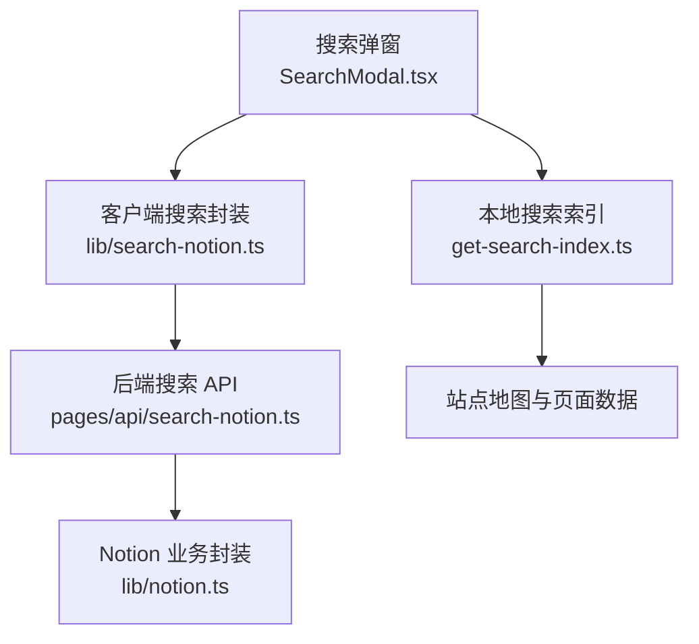
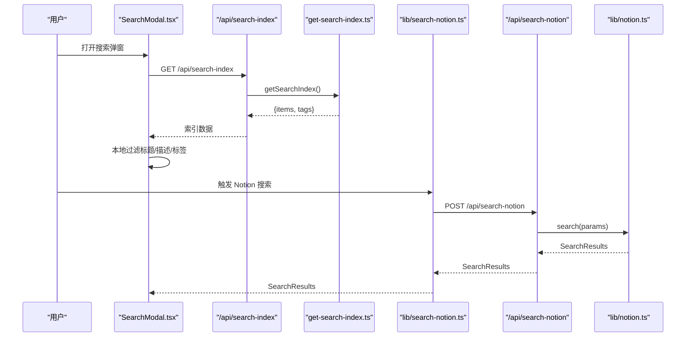
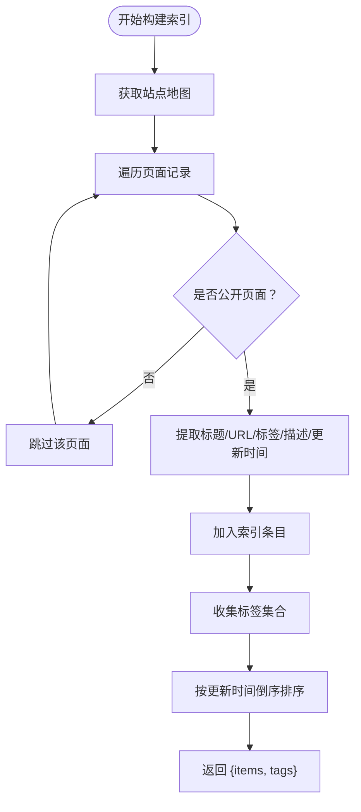
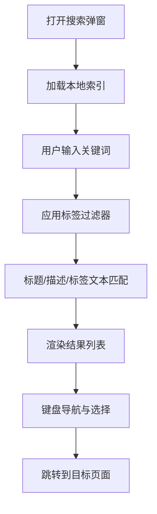
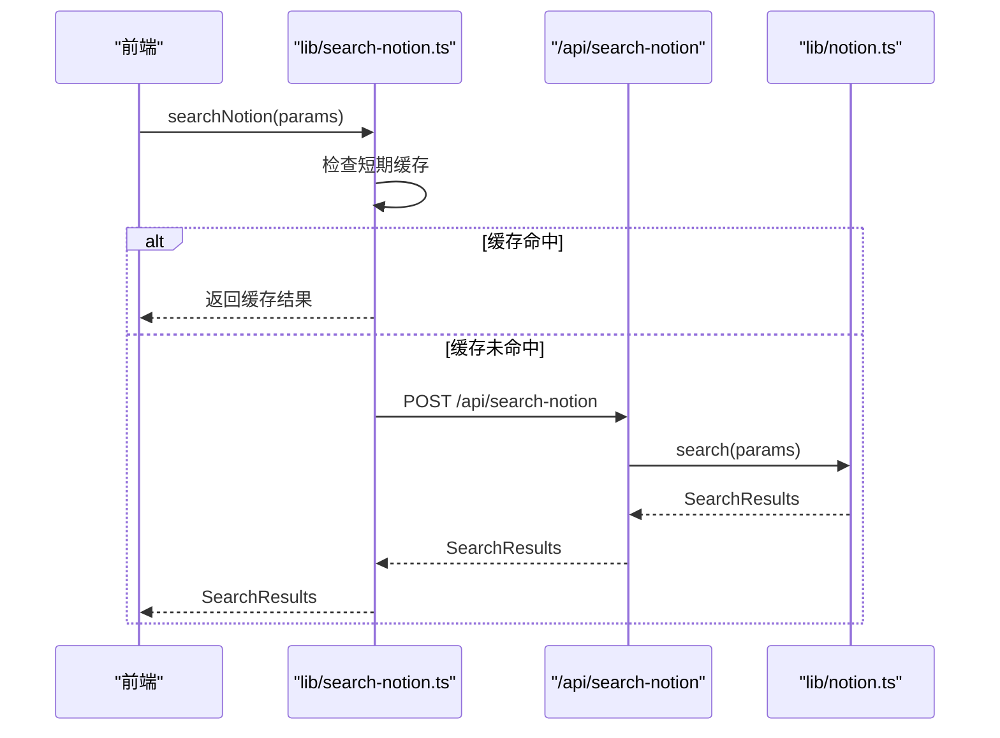
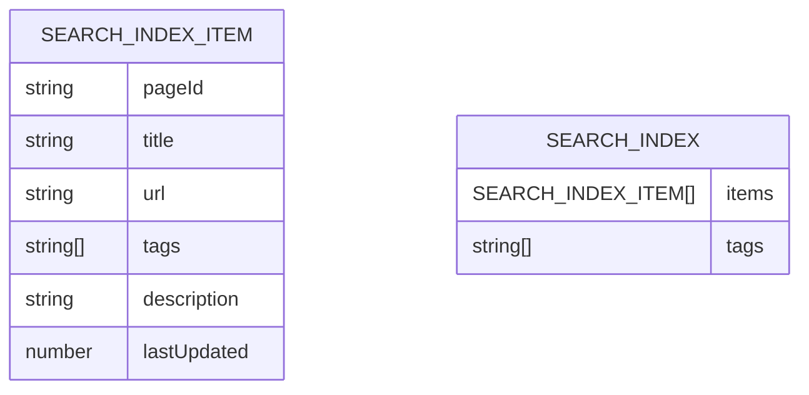
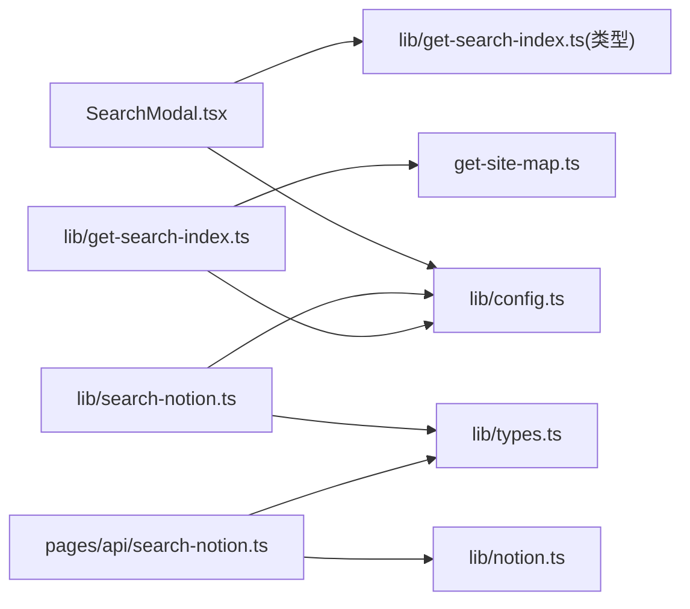
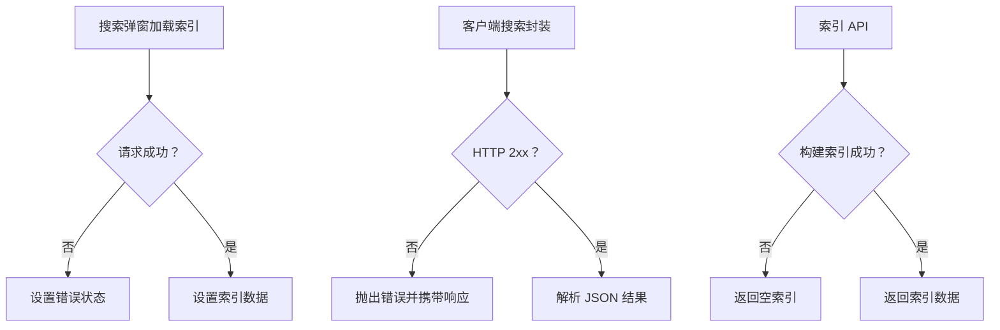

# 搜索功能

<cite>
**本文引用的文件**   
- [SearchModal.tsx](file://components/SearchModal.tsx)
- [SearchModal.module.css](file://components/SearchModal.module.css)
- [search-notion.ts（客户端库）](file://lib/search-notion.ts)
- [search-notion.ts（API 路由）](file://pages/api/search-notion.ts)
- [get-search-index.ts](file://lib/get-search-index.ts)
- [search-index.ts（API 路由）](file://pages/api/search-index.ts)
- [notion.ts](file://lib/notion.ts)
- [config.ts](file://lib/config.ts)
- [types.ts](file://lib/types.ts)
</cite>

## 目录
1. [简介](#简介)
2. [项目结构与搜索相关入口](#项目结构与搜索相关入口)
3. [核心组件与职责](#核心组件与职责)
4. [架构总览](#架构总览)
5. [详细组件分析](#详细组件分析)
6. [依赖关系分析](#依赖关系分析)
7. [性能优化与缓存策略](#性能优化与缓存策略)
8. [错误处理与容错](#错误处理与容错)
9. [配置项与扩展方式](#配置项与扩展方式)
10. [故障排查指南](#故障排查指南)
11. [结论](#结论)

## 简介
本文件面向“全文搜索”能力，覆盖以下方面：
- 搜索算法与索引构建原理
- 实时搜索 UI 的实现机制
- 搜索 API 端点设计与请求响应格式
- 性能优化、缓存策略与错误处理
- 如何自定义搜索结果展示、添加过滤器、实现高级搜索

该项目的搜索由两条路径组成：
- 基于本地预构建索引的“即时前端搜索”，适合标题、描述、标签等轻量检索。
- 基于 Notion 的“后端全文搜索”，通过 API 调用 Notion Search 接口进行更深入的文本匹配。

## 项目结构与搜索相关入口
搜索相关的代码分布在以下位置：
- 前端交互层：`components/SearchModal.tsx` 提供搜索弹窗、输入、标签过滤、结果渲染与键盘导航。
- 本地索引构建：`lib/get-search-index.ts` 从站点地图和 Notion 页面数据中抽取标题、描述、标签等信息，生成可被前端直接消费的轻量索引。
- 后端搜索代理：`pages/api/search-notion.ts` 接收前端请求并转发到 Notion 搜索接口。
- 客户端搜索封装：`lib/search-notion.ts` 对 Notion 搜索 API 进行封装并带短期内存缓存。
- 全局配置：`lib/config.ts` 暴露 API 地址、是否启用搜索等配置。
- 样式：`components/SearchModal.module.css` 定义搜索弹窗的视觉样式。

**图表来源**
- [SearchModal.tsx:1-254](file://components/SearchModal.tsx#L1-L254)
- [get-search-index.ts:1-99](file://lib/get-search-index.ts#L1-L99)
- [search-notion.ts（客户端库）:1-40](file://lib/search-notion.ts#L1-L40)
- [search-notion.ts（API 路由）:1-26](file://pages/api/search-notion.ts#L1-L26)
- [notion.ts:1-219](file://lib/notion.ts#L1-L219)

**章节来源**
- [SearchModal.tsx:1-254](file://components/SearchModal.tsx#L1-L254)
- [get-search-index.ts:1-99](file://lib/get-search-index.ts#L1-L99)
- [search-notion.ts（客户端库）:1-40](file://lib/search-notion.ts#L1-L40)
- [search-notion.ts（API 路由）:1-26](file://pages/api/search-notion.ts#L1-L26)
- [notion.ts:1-219](file://lib/notion.ts#L1-L219)
- [config.ts:148-153](file://lib/config.ts#L148-L153)

## 核心组件与职责
- 搜索弹窗组件 `SearchModal`
  - 负责加载本地搜索索引、用户输入监听、标签筛选、结果列表渲染、键盘导航与跳转。
- 本地索引构建器 `getSearchIndex`
  - 遍历站点中的公开页面，提取标题、URL、标签、描述、更新时间等字段，生成轻量级索引结构。
- 客户端搜索封装 `searchNotion`
  - 将搜索参数以 POST 形式发送到 `/api/search-notion`，并对相同查询做短期内存缓存。
- 后端搜索 API `pages/api/search-notion.ts`
  - 校验 HTTP 方法、解析请求体、调用 `lib/notion.search`，设置缓存头并返回结果。
- Notion 业务封装 `lib/notion.ts`
  - 提供 `search` 方法，实际委托给底层 Notion API。
- 全局配置 `lib/config.ts`
  - 提供 API 基础路径、搜索开关、revalidate 时间等配置。

**章节来源**
- [SearchModal.tsx:29-127](file://components/SearchModal.tsx#L29-L127)
- [get-search-index.ts:11-99](file://lib/get-search-index.ts#L11-L99)
- [search-notion.ts（客户端库）:1-40](file://lib/search-notion.ts#L1-L40)
- [search-notion.ts（API 路由）:1-26](file://pages/api/search-notion.ts#L1-L26)
- [notion.ts:216-218](file://lib/notion.ts#L216-L218)
- [config.ts:90-98](file://lib/config.ts#L90-L98)
- [config.ts:148-153](file://lib/config.ts#L148-L153)

## 架构总览
搜索系统包含两条主要链路：

1. 本地索引搜索链路
   - 前端打开搜索弹窗时，向 `/api/search-index` 拉取已构建好的索引。
   - 在浏览器中对标题、描述、标签进行字符串匹配，并结合标签过滤器快速筛选。
   - 点击结果后跳转到对应页面 URL。

2. Notion 全文搜索链路
   - 前端通过 `lib/search-notion.ts` 发起 POST 请求到 `/api/search-notion`。
   - 后端路由调用 `lib/notion.ts` 的 `search` 方法，最终访问 Notion 搜索接口。
   - 返回搜索结果供上层使用。

**图表来源**
- [SearchModal.tsx:80-111](file://components/SearchModal.tsx#L80-L111)
- [search-index.ts（API 路由）:1-22](file://pages/api/search-index.ts#L1-L22)
- [get-search-index.ts:44-99](file://lib/get-search-index.ts#L44-L99)
- [search-notion.ts（客户端库）:7-32](file://lib/search-notion.ts#L7-L32)
- [search-notion.ts（API 路由）:6-24](file://pages/api/search-notion.ts#L6-L24)
- [notion.ts:216-218](file://lib/notion.ts#L216-L218)

## 详细组件分析

### 本地搜索索引构建
本地索引用于“即时前端搜索”，避免每次按键都请求 Notion。其构建过程如下：
- 从站点地图获取所有页面的 recordMap。
- 跳过非公开页面。
- 提取标题、URL、标签、描述、最后更新时间。
- 按更新时间倒序排序，保证最近编辑的页面优先。
- 收集所有唯一标签，供前端过滤使用。

**图表来源**
- [get-search-index.ts:44-99](file://lib/get-search-index.ts#L44-L99)

**章节来源**
- [get-search-index.ts:11-99](file://lib/get-search-index.ts#L11-L99)

### 实时搜索 UI 与过滤逻辑
搜索弹窗在客户端完成大部分过滤工作：
- 首次打开时加载 `/api/search-index` 返回的索引。
- 对用户输入的关键词进行小写化与去空白处理。
- 支持“标签必须全部包含”的 AND 语义过滤。
- 将标题、描述、标签拼接为一段文本进行子串匹配。
- 支持键盘导航：Esc 关闭、上下箭头切换高亮、Enter 跳转。
- 点击结果后跳转到结果的 URL。

**图表来源**
- [SearchModal.tsx:80-127](file://components/SearchModal.tsx#L80-L127)
- [SearchModal.tsx:131-147](file://components/SearchModal.tsx#L131-L147)
- [SearchModal.tsx:153-252](file://components/SearchModal.tsx#L153-L252)

**章节来源**
- [SearchModal.tsx:29-55](file://components/SearchModal.tsx#L29-L55)
- [SearchModal.tsx:80-127](file://components/SearchModal.tsx#L80-L127)
- [SearchModal.tsx:131-147](file://components/SearchModal.tsx#L131-L147)
- [SearchModal.tsx:153-252](file://components/SearchModal.tsx#L153-L252)

### Notion 全文搜索 API 流程
当需要调用 Notion 的搜索能力时，前端通过客户端封装发送 POST 请求：
- 客户端封装 `searchNotion` 使用 `p-memoize` 与 `expiry-map` 对相同查询做短期缓存。
- 后端路由 `/api/search-notion` 校验方法、解析请求体、调用 `lib/notion.search`。
- 后端设置缓存头，允许 CDN 或浏览器缓存一段时间。
- 返回搜索结果。

**图表来源**
- [search-notion.ts（客户端库）:7-32](file://lib/search-notion.ts#L7-L32)
- [search-notion.ts（API 路由）:6-24](file://pages/api/search-notion.ts#L6-L24)
- [notion.ts:216-218](file://lib/notion.ts#L216-L218)

**章节来源**
- [search-notion.ts（客户端库）:1-40](file://lib/search-notion.ts#L1-L40)
- [search-notion.ts（API 路由）:1-26](file://pages/api/search-notion.ts#L1-L26)
- [notion.ts:216-218](file://lib/notion.ts#L216-L218)

### 搜索数据结构与类型
本地索引的结构包括：
- `items`: 每个条目的 `pageId`、`title`、`url`、`tags`、可选 `description`、可选 `lastUpdated`。
- `tags`: 所有唯一标签的数组。

Notion 搜索的请求与响应类型来自 `notion-types`，并通过 `lib/types.ts` 重新导出。

**图表来源**
- [get-search-index.ts:11-23](file://lib/get-search-index.ts#L11-L23)
- [types.ts:1-78](file://lib/types.ts#L1-L78)

**章节来源**
- [get-search-index.ts:11-23](file://lib/get-search-index.ts#L11-L23)
- [types.ts:1-78](file://lib/types.ts#L1-L78)

## 依赖关系分析
搜索相关模块之间的依赖关系如下：
- `SearchModal` 依赖 `lib/config` 提供的 API 地址，以及 `lib/get-search-index` 的类型定义。
- `lib/search-notion` 依赖 `lib/config` 的 API 地址与 `lib/types` 的类型。
- `pages/api/search-notion` 依赖 `lib/types` 与 `lib/notion`。
- `lib/get-search-index` 依赖 `lib/config`、`lib/get-canonical-page-id`、`lib/get-site-map`。
- `lib/notion` 依赖底层 Notion API 与站点配置。

**图表来源**
- [SearchModal.tsx:1-8](file://components/SearchModal.tsx#L1-L8)
- [search-notion.ts（客户端库）:1-5](file://lib/search-notion.ts#L1-L5)
- [search-notion.ts（API 路由）:1-4](file://pages/api/search-notion.ts#L1-L4)
- [get-search-index.ts:1-7](file://lib/get-search-index.ts#L1-L7)
- [notion.ts:1-17](file://lib/notion.ts#L1-L17)
- [config.ts:148-153](file://lib/config.ts#L148-L153)

**章节来源**
- [SearchModal.tsx:1-8](file://components/SearchModal.tsx#L1-L8)
- [search-notion.ts（客户端库）:1-5](file://lib/search-notion.ts#L1-L5)
- [search-notion.ts（API 路由）:1-4](file://pages/api/search-notion.ts#L1-L4)
- [get-search-index.ts:1-7](file://lib/get-search-index.ts#L1-L7)
- [notion.ts:1-17](file://lib/notion.ts#L1-L17)
- [config.ts:148-153](file://lib/config.ts#L148-L153)

## 性能优化与缓存策略
- 本地索引缓存
  - `getSearchIndex` 使用 `p-memoize` 对索引构建结果进行函数级缓存，减少重复构建成本。
  - `/api/search-index` 返回的响应带有缓存头，允许 CDN 与浏览器缓存较长时间。
- Notion 搜索短期缓存
  - `searchNotion` 使用 `p-memoize` 与 `expiry-map` 对相同查询进行短时间内存缓存，降低频繁请求压力。
- 页面数据缓存
  - `lib/notion.ts` 维护服务器端内存缓存，TTL 较短，用于吸收流量峰值与 Notion 抖动。
- 后端缓存头
  - `/api/search-notion` 设置 `Cache-Control`，允许公共缓存与 stale-while-revalidate。

建议的性能调优方向：
- 调整 `expiry-map` 的过期时间，平衡实时性与缓存命中率。
- 根据站点规模调整 `getSearchIndex` 的重验证间隔与缓存策略。
- 对高频查询增加更长的短期缓存时间。
- 在部署环境开启 CDN 缓存 `/api/search-index` 与 `/api/search-notion`。

**章节来源**
- [get-search-index.ts:42-42](file://lib/get-search-index.ts#L42-L42)
- [search-index.ts（API 路由）:12-15](file://pages/api/search-index.ts#L12-L15)
- [search-notion.ts（客户端库）:7-10](file://lib/search-notion.ts#L7-L10)
- [notion.ts:19-55](file://lib/notion.ts#L19-L55)
- [search-notion.ts（API 路由）:20-23](file://pages/api/search-notion.ts#L20-L23)

## 错误处理与容错
- 搜索弹窗错误状态
  - 加载索引失败时显示错误信息，并停止加载状态。
- 客户端搜索封装错误转换
  - 将非 2xx 响应转换为错误对象，并附带原始响应。
- 后端搜索 API 错误
  - 非 POST 请求返回 405。
  - 其他异常由上层处理，当前路由未捕获具体错误。
- 索引 API 错误
  - 捕获异常并返回空索引 `{items: [], tags: []}`，避免前端崩溃。
- Notion 页面数据容错
  - 当 Notion 不可用时，尝试返回旧缓存数据，保持站点可用。

**图表来源**
- [SearchModal.tsx:84-98](file://components/SearchModal.tsx#L84-L98)
- [search-notion.ts（客户端库）:22-32](file://lib/search-notion.ts#L22-L32)
- [search-notion.ts（API 路由）:10-11](file://pages/api/search-notion.ts#L10-L11)
- [search-index.ts（API 路由）:9-20](file://pages/api/search-index.ts#L9-L20)
- [notion.ts:168-182](file://lib/notion.ts#L168-L182)

**章节来源**
- [SearchModal.tsx:84-98](file://components/SearchModal.tsx#L84-L98)
- [search-notion.ts（客户端库）:22-32](file://lib/search-notion.ts#L22-L32)
- [search-notion.ts（API 路由）:10-11](file://pages/api/search-notion.ts#L10-L11)
- [search-index.ts（API 路由）:9-20](file://pages/api/search-index.ts#L9-L20)
- [notion.ts:168-182](file://lib/notion.ts#L168-L182)

## 配置项与扩展方式
- 是否启用搜索
  - `isSearchEnabled` 控制是否启用站点搜索。
- API 地址
  - `api.searchNotion` 与 `api.searchIndex` 分别指向 Notion 搜索与本地索引 API。
- Revalidate 时间
  - `revalidateSeconds` 控制 ISR 重验证间隔，影响函数调用频率与缓存新鲜度。
- URL 是否包含 Notion ID
  - `includeNotionIdInUrls` 影响生成的页面 URL 与索引 URL。

扩展建议：
- 自定义搜索结果展示
  - 修改 `SearchModal.tsx` 的结果渲染部分，增加更多字段（如封面图、作者、摘要长度控制）。
- 添加搜索过滤器
  - 在 `filterItems` 中扩展过滤条件，例如按日期范围、作者、分类等。
- 实现高级搜索
  - 在前端表单中收集更多参数，并通过 `lib/search-notion.ts` 发送给后端；在后端路由中解析并传递给 `lib/notion.search`。
- 调整缓存策略
  - 调整 `expiry-map` 过期时间与 `Cache-Control` 头部，以适应不同环境的性能需求。

**章节来源**
- [config.ts:90-98](file://lib/config.ts#L90-L98)
- [config.ts:74-78](file://lib/config.ts#L74-L78)
- [config.ts:148-153](file://lib/config.ts#L148-L153)
- [SearchModal.tsx:29-55](file://components/SearchModal.tsx#L29-L55)
- [search-notion.ts（客户端库）:12-32](file://lib/search-notion.ts#L12-L32)
- [search-notion.ts（API 路由）:14-18](file://pages/api/search-notion.ts#L14-L18)

## 故障排查指南
常见问题与定位方法：
- 搜索弹窗无法加载索引
  - 检查 `/api/search-index` 是否返回正常数据，查看控制台错误信息。
  - 确认 `lib/get-search-index.ts` 是否正确读取站点地图与页面属性。
- 本地搜索无结果
  - 检查关键词是否为小写匹配，确认标题、描述、标签是否包含关键词。
  - 检查标签过滤器是否过于严格导致结果为空。
- Notion 搜索无响应或报错
  - 检查 `lib/search-notion.ts` 的短期缓存是否命中。
  - 检查 `/api/search-notion` 是否接受 POST 请求并正确转发。
  - 检查 `lib/notion.ts` 的 `search` 方法与底层 Notion API 是否正常。
- 搜索结果不更新
  - 检查索引缓存与 CDN 缓存是否生效，必要时调整 `Cache-Control` 与 revalidate 时间。
  - 检查 Notion 页面是否标记为公开，非公开页面不会进入本地索引。

**章节来源**
- [SearchModal.tsx:84-98](file://components/SearchModal.tsx#L84-L98)
- [SearchModal.tsx:29-55](file://components/SearchModal.tsx#L29-L55)
- [search-notion.ts（客户端库）:22-32](file://lib/search-notion.ts#L22-L32)
- [search-notion.ts（API 路由）:10-18](file://pages/api/search-notion.ts#L10-L18)
- [get-search-index.ts:57-60](file://lib/get-search-index.ts#L57-L60)

## 结论
该项目的搜索功能采用“本地索引 + Notion 全文搜索”的双轨设计：
- 本地索引提供即时、低延迟的前端搜索体验，适合标题、描述、标签等轻量检索。
- Notion 全文搜索提供更深层次的文本匹配能力，适合复杂查询场景。
通过合理的缓存策略、错误处理与可扩展的 UI 与过滤逻辑，系统能够在不同规模与环境下提供良好的搜索体验。后续可根据站点需求进一步扩展过滤器、结果展示与高级搜索参数。