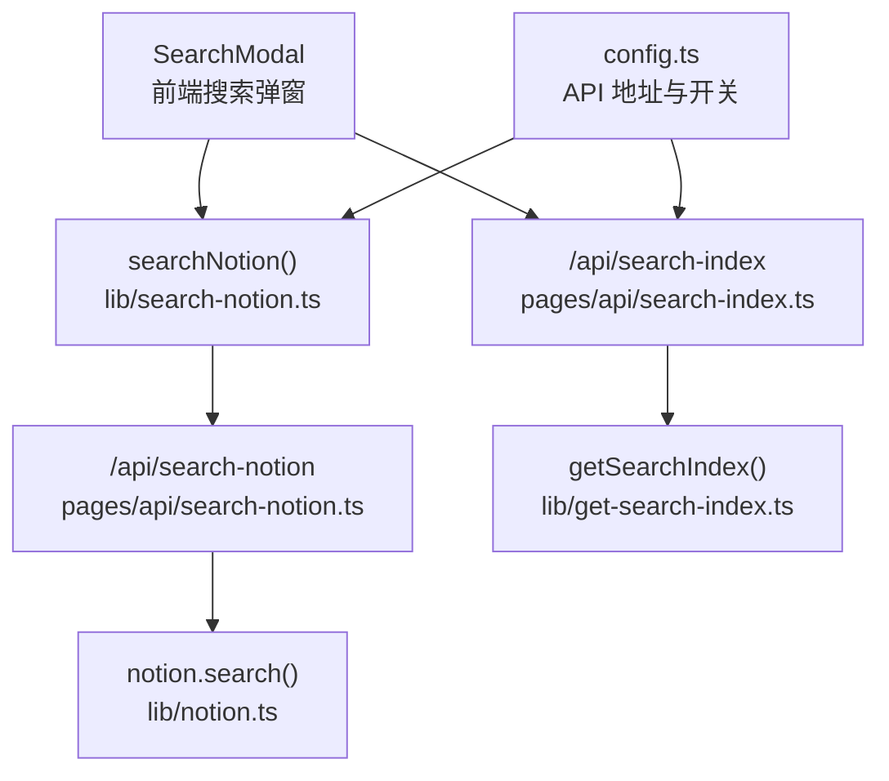
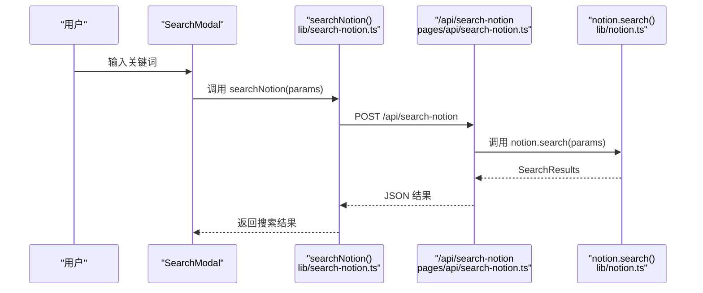
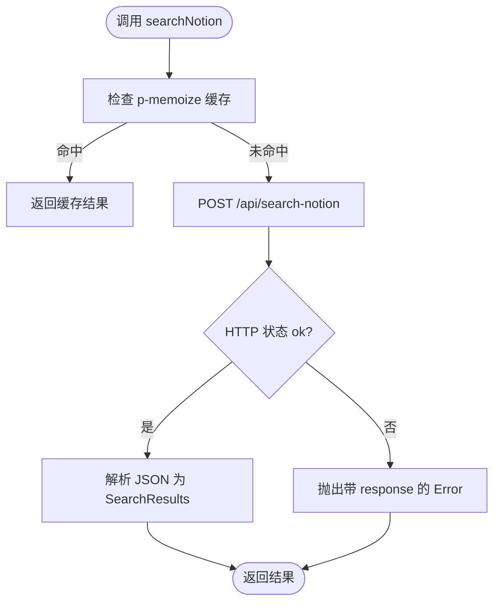
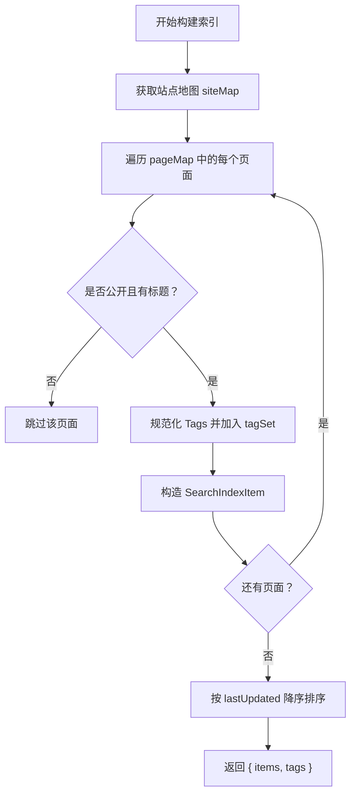
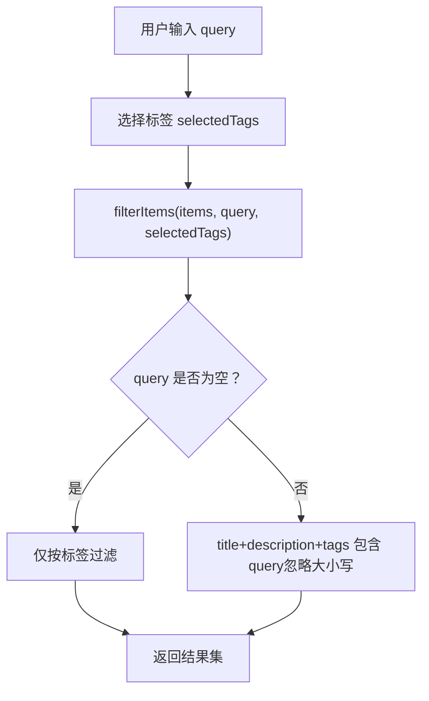
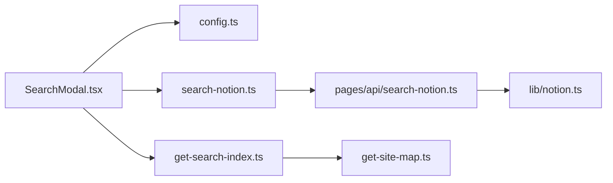

# 搜索算法实现

<cite>
**本文引用的文件**   
- [lib/search-notion.ts](file://lib/search-notion.ts)
- [lib/get-search-index.ts](file://lib/get-search-index.ts)
- [pages/api/search-notion.ts](file://pages/api/search-notion.ts)
- [pages/api/search-index.ts](file://pages/api/search-index.ts)
- [components/SearchModal.tsx](file://components/SearchModal.tsx)
- [lib/notion.ts](file://lib/notion.ts)
- [lib/config.ts](file://lib/config.ts)
- [lib/types.ts](file://lib/types.ts)
</cite>

## 目录
1. [引言](#引言)
2. [项目结构](#项目结构)
3. [核心组件](#核心组件)
4. [架构总览](#架构总览)
5. [详细组件分析](#详细组件分析)
6. [依赖关系分析](#依赖关系分析)
7. [性能与缓存](#性能与缓存)
8. [错误处理与容错](#错误处理与容错)
9. [扩展与自定义](#扩展与自定义)
10. [结论](#结论)

## 引言
本文件面向“全文搜索”的实现，围绕以下目标展开：
- 说明全文搜索的核心算法逻辑：客户端索引过滤、服务端 Notion 搜索调用。
- 解释关键词提取与相关性排序机制（当前实现以标签过滤和简单包含匹配为主）。
- 梳理搜索索引的数据结构设计、构建过程与更新策略。
- 说明中文分词、大小写不敏感、模糊匹配等高级功能的现状与扩展建议。
- 提供搜索性能优化、缓存策略与错误处理机制的说明。
- 给出自定义搜索算法的扩展方法与配置选项。

## 项目结构
本项目采用 Next.js 前后端一体化结构，搜索相关代码主要分布在以下位置：
- 前端交互与本地过滤：components/SearchModal.tsx
- 客户端搜索 API 封装：lib/search-notion.ts
- 服务端搜索路由：pages/api/search-notion.ts
- 搜索索引构建与导出：lib/get-search-index.ts
- 搜索索引 API 路由：pages/api/search-index.ts
- Notion 数据访问与页面缓存：lib/notion.ts
- 站点配置与 API 地址：lib/config.ts
- 类型定义：lib/types.ts

**图表来源**
- [components/SearchModal.tsx:29-55](file://components/SearchModal.tsx#L29-L55)
- [lib/search-notion.ts:7-39](file://lib/search-notion.ts#L7-L39)
- [pages/api/search-notion.ts:6-25](file://pages/api/search-notion.ts#L6-L25)
- [lib/notion.ts:216-218](file://lib/notion.ts#L216-L218)
- [lib/get-search-index.ts:44-98](file://lib/get-search-index.ts#L44-L98)
- [pages/api/search-index.ts:5-21](file://pages/api/search-index.ts#L5-L21)
- [lib/config.ts:148-153](file://lib/config.ts#L148-L153)

**章节来源**
- [components/SearchModal.tsx:1-254](file://components/SearchModal.tsx#L1-L254)
- [lib/search-notion.ts:1-40](file://lib/search-notion.ts#L1-L40)
- [pages/api/search-notion.ts:1-26](file://pages/api/search-notion.ts#L1-L26)
- [lib/get-search-index.ts:1-99](file://lib/get-search-index.ts#L1-L99)
- [pages/api/search-index.ts:1-22](file://pages/api/search-index.ts#L1-L22)
- [lib/notion.ts:1-219](file://lib/notion.ts#L1-L219)
- [lib/config.ts:1-224](file://lib/config.ts#L1-L224)
- [lib/types.ts:1-78](file://lib/types.ts#L1-L78)

## 核心组件
- 客户端搜索封装：对 /api/search-notion 发起 POST 请求，并带有结果缓存。
- 服务端搜索路由：校验方法、透传参数到 notion.search()，设置响应缓存头。
- 搜索索引构建器：遍历站点地图中的公开页面，抽取标题、描述、标签、更新时间等，生成轻量级索引。
- 搜索索引 API：对外暴露已构建好的索引，供前端加载。
- 搜索弹窗组件：加载索引、支持标签筛选与关键词包含匹配、键盘导航与跳转。

**章节来源**
- [lib/search-notion.ts:7-39](file://lib/search-notion.ts#L7-L39)
- [pages/api/search-notion.ts:6-25](file://pages/api/search-notion.ts#L6-L25)
- [lib/get-search-index.ts:11-23](file://lib/get-search-index.ts#L11-L23)
- [lib/get-search-index.ts:44-98](file://lib/get-search-index.ts#L44-L98)
- [pages/api/search-index.ts:5-21](file://pages/api/search-index.ts#L5-L21)
- [components/SearchModal.tsx:29-55](file://components/SearchModal.tsx#L29-L55)

## 架构总览
搜索流程分为两条路径：
- 实时搜索路径：前端调用 searchNotion() -> 后端 /api/search-notion -> notion.search() -> 返回搜索结果。
- 客户端索引搜索路径：前端加载 /api/search-index -> 使用 filterItems() 进行本地过滤与排序。

**图表来源**
- [lib/search-notion.ts:7-39](file://lib/search-notion.ts#L7-L39)
- [pages/api/search-notion.ts:6-25](file://pages/api/search-notion.ts#L6-L25)
- [lib/notion.ts:216-218](file://lib/notion.ts#L216-L218)

## 详细组件分析

### 客户端搜索封装（lib/search-notion.ts）
- 功能要点
  - 使用 p-memoize 对 searchNotionImpl 做函数级缓存，缓存键基于查询字符串。
  - 使用 ExpiryMap 作为过期缓存，避免重复请求。
  - 通过 fetch 向 /api/search-notion 发送 POST 请求，携带 SearchParams。
  - 非 2xx 响应转换为 Error，并附带 response 对象以便上层处理。
- 复杂度与性能
  - 时间复杂度 O(1) 查找缓存；网络请求为 I/O 操作。
  - 空间复杂度取决于缓存条目数量。
- 错误处理
  - 将 HTTP 错误包装为 Error，便于上层捕获与展示。

**图表来源**
- [lib/search-notion.ts:7-39](file://lib/search-notion.ts#L7-L39)

**章节来源**
- [lib/search-notion.ts:1-40](file://lib/search-notion.ts#L1-L40)

### 服务端搜索路由（pages/api/search-notion.ts）
- 功能要点
  - 仅允许 POST 方法，否则返回 405。
  - 从请求体中读取 SearchParams，调用 lib/notion.ts 的 search()。
  - 设置响应缓存头，启用 CDN/浏览器缓存。
- 性能与缓存
  - 通过 Cache-Control 控制 s-maxage 与 max-age，减少重复计算与上游压力。

**章节来源**
- [pages/api/search-notion.ts:1-26](file://pages/api/search-notion.ts#L1-L26)

### Notion 搜索入口（lib/notion.ts）
- 功能要点
  - 提供 search(params) 直接委托 notion.search(params)。
  - 同时维护页面级内存缓存（getPage），用于页面渲染时的快速访问与降级。
- 设计模式
  - 分层封装：上层只关心业务参数与结果，底层对接 Notion API。

**章节来源**
- [lib/notion.ts:216-218](file://lib/notion.ts#L216-L218)

### 搜索索引构建器（lib/get-search-index.ts）
- 数据结构
  - SearchIndexItem：包含 pageId、title、url、tags、description、lastUpdated。
  - SearchIndex：包含 items 数组与 tags 去重列表。
- 构建流程
  - 获取站点地图（siteMap.pageMap）。
  - 遍历每个页面的 recordMap，跳过非公开或无标题的页面。
  - 规范化 Tags（支持逗号分隔字符串或数组），收集所有标签。
  - 按 lastUpdated 降序排序，保证最近更新的页面优先。
  - 返回 { items, tags }。
- 缓存
  - 使用 p-memoize 包裹 getSearchIndexImpl，避免重复构建。

**图表来源**
- [lib/get-search-index.ts:44-98](file://lib/get-search-index.ts#L44-L98)

**章节来源**
- [lib/get-search-index.ts:1-99](file://lib/get-search-index.ts#L1-L99)

### 搜索索引 API（pages/api/search-index.ts）
- 功能要点
  - 调用 getSearchIndex() 获取索引，设置缓存头后返回 JSON。
  - 捕获异常，返回空索引，避免前端崩溃。
- 错误处理
  - 统一返回 { items: [], tags: [] }，前端可据此显示“加载失败”。

**章节来源**
- [pages/api/search-index.ts:1-22](file://pages/api/search-index.ts#L1-L22)

### 搜索弹窗组件（components/SearchModal.tsx）
- 功能要点
  - 加载 /api/search-index，维护 index、isLoading、error 状态。
  - 提供 filterItems(items, query, selectedTags) 进行本地过滤：
    - 标签筛选：AND 语义，必须包含所有选中标签。
    - 关键词匹配：将 title、description、tags 拼接后转小写，判断是否包含 query（小写）。
  - 键盘导航：Esc 关闭，上下箭头切换高亮项，Enter 跳转。
  - 点击结果项跳转到 item.url。
- 用户体验
  - 首次打开自动聚焦输入框。
  - 根据 results.length 显示不同状态文案。

**图表来源**
- [components/SearchModal.tsx:29-55](file://components/SearchModal.tsx#L29-L55)

**章节来源**
- [components/SearchModal.tsx:1-254](file://components/SearchModal.tsx#L1-L254)

## 依赖关系分析
- 组件层
  - SearchModal 依赖 config.api.searchIndex 与 config.api.searchNotion。
- 服务层
  - pages/api/search-notion 依赖 lib/notion.search。
  - pages/api/search-index 依赖 lib/get-search-index。
- 工具层
  - lib/get-search-index 依赖 notion-utils 提供的 getBlockTitle、getBlockValue、getPageProperty。
  - lib/notion 依赖 notion-api 与 notion-types。

**图表来源**
- [components/SearchModal.tsx:6-7](file://components/SearchModal.tsx#L6-L7)
- [lib/search-notion.ts:4-5](file://lib/search-notion.ts#L4-L5)
- [pages/api/search-notion.ts:3-4](file://pages/api/search-notion.ts#L3-L4)
- [lib/get-search-index.ts:1-7](file://lib/get-search-index.ts#L1-L7)

**章节来源**
- [components/SearchModal.tsx:1-254](file://components/SearchModal.tsx#L1-L254)
- [lib/search-notion.ts:1-40](file://lib/search-notion.ts#L1-L40)
- [pages/api/search-notion.ts:1-26](file://pages/api/search-notion.ts#L1-L26)
- [lib/get-search-index.ts:1-99](file://lib/get-search-index.ts#L1-L99)

## 性能与缓存
- 客户端缓存
  - searchNotion 使用 p-memoize + ExpiryMap，基于 query 缓存结果，TTL 较短，适合高频查询场景。
- 服务端缓存
  - /api/search-notion 设置 Cache-Control，启用 s-maxage 与 max-age，利于 CDN 与浏览器缓存。
  - /api/search-index 设置更长的缓存时间，降低索引构建频率。
- 页面级缓存
  - lib/notion.ts 维护内存级 pageCache，TTL 60s，支持 stale-while-revalidate 模式，提升页面渲染性能与鲁棒性。
- 索引构建优化
  - getSearchIndex 使用 p-memoize 缓存构建结果，避免重复扫描站点地图。

优化建议
- 对长尾查询增加更细粒度的缓存键（如包含 selectedTags 的序列化键）。
- 在大规模内容下考虑分页或增量索引更新。
- 对热门标签与关键词做热点预热。

**章节来源**
- [lib/search-notion.ts:7-10](file://lib/search-notion.ts#L7-L10)
- [pages/api/search-notion.ts:20-24](file://pages/api/search-notion.ts#L20-L24)
- [pages/api/search-index.ts:12-16](file://pages/api/search-index.ts#L12-L16)
- [lib/notion.ts:29-55](file://lib/notion.ts#L29-L55)
- [lib/get-search-index.ts:42](file://lib/get-search-index.ts#L42)

## 错误处理与容错
- 客户端搜索
  - 当 /api/search-notion 返回非 2xx，searchNotion 抛出 Error，并附带 response 对象。
- 索引加载
  - SearchModal 在加载索引时捕获异常，设置 error 状态，并在 UI 上提示“Failed to load: ...”。
- 索引 API
  - /api/search-index 捕获异常，返回空索引，避免前端崩溃。
- 页面级容错
  - lib/notion.ts 在 getPage 失败时尝试返回过期缓存，确保站点可用性。

建议
- 对网络错误与业务错误进行分类处理，提供更友好的用户提示。
- 对频繁失败的接口增加重试与退避策略。

**章节来源**
- [lib/search-notion.ts:22-31](file://lib/search-notion.ts#L22-L31)
- [components/SearchModal.tsx:81-106](file://components/SearchModal.tsx#L81-L106)
- [pages/api/search-index.ts:9-20](file://pages/api/search-index.ts#L9-L20)
- [lib/notion.ts:168-182](file://lib/notion.ts#L168-L182)

## 扩展与自定义

### 文本匹配算法
- 当前实现
  - 客户端 filterItems 使用 includes 进行子串匹配，忽略大小写。
  - 服务端搜索由 notion.search 负责，具体算法由 Notion 提供。
- 扩展方向
  - 引入分词库（如针对中文的分词器），将 query 与文档内容切分为词元后再匹配。
  - 支持编辑距离（Levenshtein）或近似匹配（如 fuzzy-search）以提升容错能力。
  - 对多字段加权评分（标题 > 描述 > 标签），实现相关性排序。

### 关键词提取
- 当前实现
  - 标签来自 Notion 页面属性“Tags”，支持逗号分隔字符串或数组。
- 扩展方向
  - 自动从标题与正文中提取关键词（TF-IDF 或 TextRank）。
  - 对英文进行词干提取，对中文进行分词与停用词过滤。

### 相关性排序机制
- 当前实现
  - 索引构建时对 items 按 lastUpdated 降序排序。
  - 客户端过滤后保持原顺序。
- 扩展方向
  - 基于匹配度打分（字段权重、位置权重、频次权重）。
  - 结合用户行为（点击率、停留时长）进行个性化排序。

### 中文分词
- 现状
  - 当前未内置中文分词逻辑，仅做子串匹配。
- 建议
  - 引入中文分词库（如 jieba 或同构方案），在服务端或客户端预处理 query 与文档。
  - 对分词结果建立倒排索引，提升检索效率。

### 大小写不敏感搜索
- 现状
  - 客户端 filterItems 已将 query 与 haystack 转为小写进行比较。
- 建议
  - 服务端 notion.search 若支持，也可开启大小写不敏感匹配。

### 模糊匹配
- 现状
  - 当前为精确子串匹配。
- 建议
  - 引入模糊匹配库，支持拼写纠错与近似匹配。
  - 对高频查询进行预计算与缓存。

### 搜索索引的数据结构与更新策略
- 数据结构
  - SearchIndexItem：pageId、title、url、tags、description、lastUpdated。
  - SearchIndex：items 数组与 tags 去重列表。
- 构建策略
  - 全量构建：每次重新扫描站点地图，适用于中小规模内容。
  - 增量更新：监听 Notion 变更事件，仅更新受影响页面。
- 更新触发
  - 可通过 ISR revalidateSeconds 控制缓存失效周期。
  - 可在后台任务中定期重建索引。

### 自定义搜索算法的扩展方法
- 替换客户端过滤逻辑
  - 在 SearchModal 中重写 filterItems，接入自定义匹配与排序算法。
- 替换服务端搜索实现
  - 在 pages/api/search-notion.ts 中替换 notion.search 的调用，接入自建搜索引擎（如 Elasticsearch、Meilisearch）。
- 扩展索引构建
  - 在 get-search-index.ts 中增强字段抽取与权重计算，输出更丰富的索引结构。

### 配置选项
- 搜索开关
  - isSearchEnabled：控制是否启用搜索功能。
- API 地址
  - api.searchNotion、api.searchIndex：由 config.ts 统一管理。
- URL 策略
  - includeNotionIdInUrls：影响索引中 url 的生成方式。

**章节来源**
- [components/SearchModal.tsx:29-55](file://components/SearchModal.tsx#L29-L55)
- [lib/get-search-index.ts:25-37](file://lib/get-search-index.ts#L25-L37)
- [lib/get-search-index.ts:81-97](file://lib/get-search-index.ts#L81-L97)
- [lib/config.ts:74-78](file://lib/config.ts#L74-L78)
- [lib/config.ts:90-98](file://lib/config.ts#L90-L98)
- [lib/config.ts:148-153](file://lib/config.ts#L148-L153)

## 结论
本项目实现了两条搜索路径：
- 实时搜索：通过 /api/search-notion 调用 Notion 搜索，具备客户端与服务器端缓存。
- 客户端索引搜索：通过 /api/search-index 获取轻量索引，在前端进行标签筛选与关键词包含匹配。

当前实现简洁高效，适合中小规模内容。如需更强的中文分词、模糊匹配与相关性排序，可在客户端 filterItems 与服务端搜索路由中进行扩展，并结合倒排索引与评分模型进一步提升体验与性能。