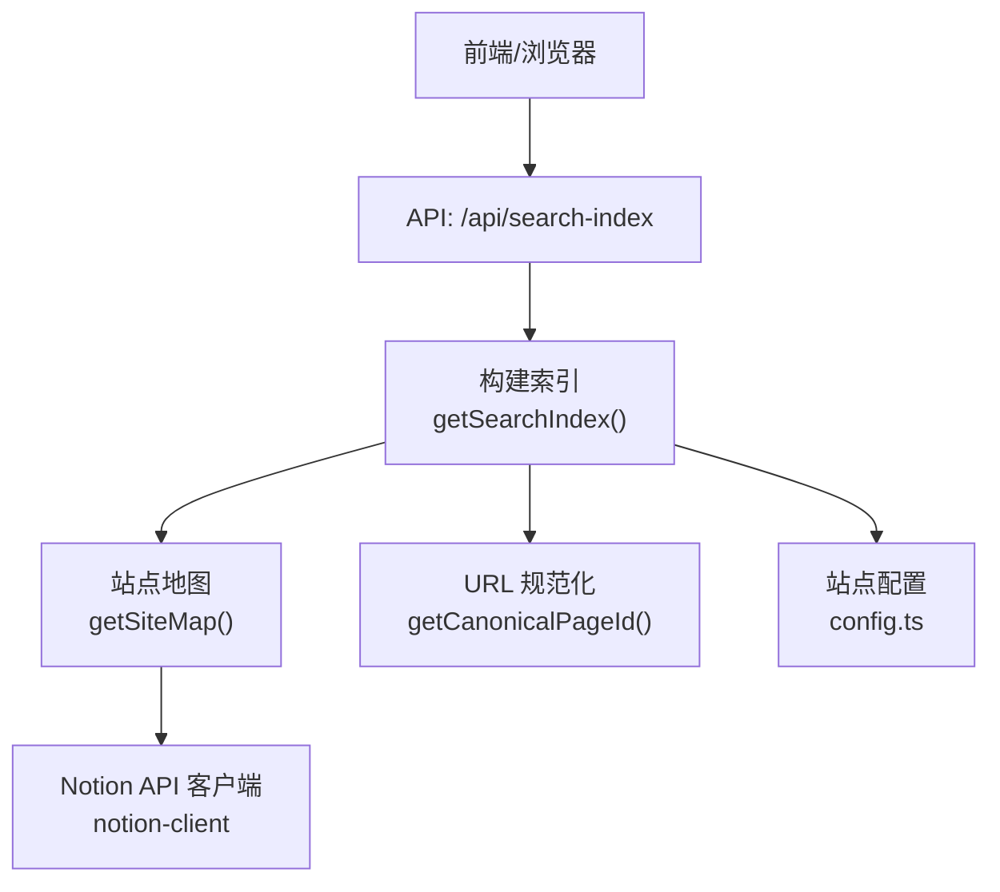
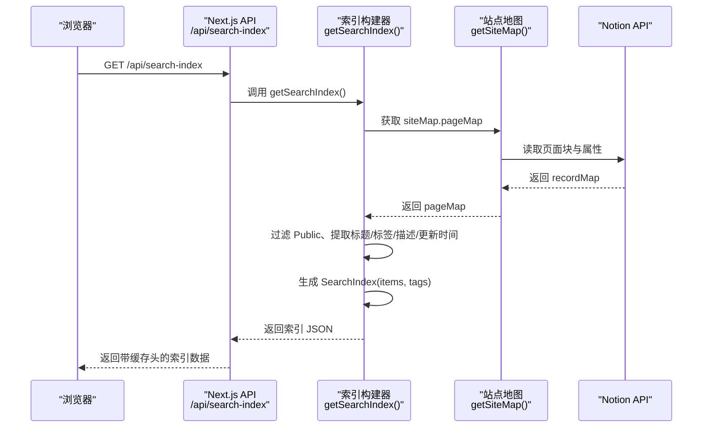
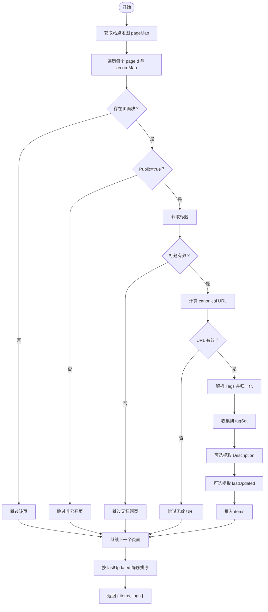
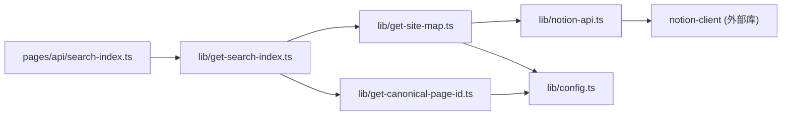

# 搜索索引构建

<cite>
**本文引用的文件**   
- [lib/get-search-index.ts](file://lib/get-search-index.ts)
- [pages/api/search-index.ts](file://pages/api/search-index.ts)
- [lib/get-site-map.ts](file://lib/get-site-map.ts)
- [lib/notion-api.ts](file://lib/notion-api.ts)
- [lib/notion.ts](file://lib/notion.ts)
- [lib/config.ts](file://lib/config.ts)
- [lib/get-canonical-page-id.ts](file://lib/get-canonical-page-id.ts)
- [site.config.ts](file://site.config.ts)
</cite>

## 目录
1. [引言](#引言)
2. [项目结构](#项目结构)
3. [核心组件](#核心组件)
4. [架构总览](#架构总览)
5. [详细组件分析](#详细组件分析)
6. [依赖关系分析](#依赖关系分析)
7. [性能与缓存策略](#性能与缓存策略)
8. [索引更新机制与增量优化](#索引更新机制与增量优化)
9. [自定义索引字段配置](#自定义索引字段配置)
10. [故障排除指南](#故障排除指南)
11. [结论](#结论)

## 引言
本文聚焦“搜索索引”的构建过程与运行机制，重点说明 get-search-index.ts 如何从 Notion API 获取内容并生成可搜索的索引数据。文档涵盖：
- 索引数据结构、字段映射与过滤规则
- 缓存策略与性能优化技巧
- 索引更新机制（含增量视角）
- 自定义索引字段的配置方法
- 常见问题排查思路

## 项目结构
搜索索引相关代码主要分布在以下位置：
- 服务端 API：pages/api/search-index.ts
- 索引构建逻辑：lib/get-search-index.ts
- 站点地图与页面枚举：lib/get-site-map.ts
- Notion 客户端封装：lib/notion-api.ts、lib/notion.ts
- 站点与全局配置：lib/config.ts、site.config.ts
- URL 规范化：lib/get-canonical-page-id.ts

**图表来源**
- [pages/api/search-index.ts:5-20](file://pages/api/search-index.ts#L5-L20)
- [lib/get-search-index.ts:35-94](file://lib/get-search-index.ts#L35-L94)
- [lib/get-site-map.ts:17-27](file://lib/get-site-map.ts#L17-L27)
- [lib/notion-api.ts:1-19](file://lib/notion-api.ts#L1-L19)
- [lib/get-canonical-page-id.ts:9-29](file://lib/get-canonical-page-id.ts#L9-L29)
- [lib/config.ts:74-78](file://lib/config.ts#L74-L78)

**章节来源**
- [pages/api/search-index.ts:1-22](file://pages/api/search-index.ts#L1-L22)
- [lib/get-search-index.ts:1-95](file://lib/get-search-index.ts#L1-L95)
- [lib/get-site-map.ts:1-105](file://lib/get-site-map.ts#L1-L105)
- [lib/notion-api.ts:1-21](file://lib/notion-api.ts#L1-L21)
- [lib/notion.ts:1-219](file://lib/notion.ts#L1-L219)
- [lib/config.ts:1-221](file://lib/config.ts#L1-L221)
- [lib/get-canonical-page-id.ts:1-30](file://lib/get-canonical-page-id.ts#L1-L30)
- [site.config.ts:1-77](file://site.config.ts#L1-L77)

## 核心组件
- 搜索索引构建器：负责遍历公开页面、提取标题/标签/描述/更新时间等字段，生成轻量级索引对象。
- 站点地图生成器：基于根页面扫描整个空间，返回 pageMap 与 canonicalPageMap。
- Notion API 客户端：封装 notion-client，提供重试、超时、UA 等网络参数。
- 页面缓存层：对已解析的 ExtendedRecordMap 进行短期内存缓存，提升容错与性能。
- URL 规范化：根据是否包含 Notion ID 或 URL 覆盖表，计算最终 canonical URL。

关键职责边界清晰，耦合点集中在：
- get-search-index.ts 依赖 get-site-map.ts 提供的 pageMap
- get-site-map.ts 依赖 notion-api.ts 调用 Notion
- get-search-index.ts 使用 config.ts 中的 includeNotionIdInUrls 控制 URL 行为
- get-canonical-page-id.ts 使用 inversePageUrlOverrides 做 URL 重写

**章节来源**
- [lib/get-search-index.ts:11-23](file://lib/get-search-index.ts#L11-L23)
- [lib/get-site-map.ts:17-27](file://lib/get-site-map.ts#L17-L27)
- [lib/notion-api.ts:1-19](file://lib/notion-api.ts#L1-L19)
- [lib/notion.ts:19-55](file://lib/notion.ts#L19-L55)
- [lib/get-canonical-page-id.ts:9-29](file://lib/get-canonical-page-id.ts#L9-L29)
- [lib/config.ts:74-78](file://lib/config.ts#L74-L78)

## 架构总览
下图展示一次搜索索引请求的端到端流程：

**图表来源**
- [pages/api/search-index.ts:5-20](file://pages/api/search-index.ts#L5-L20)
- [lib/get-search-index.ts:35-94](file://lib/get-search-index.ts#L35-L94)
- [lib/get-site-map.ts:17-27](file://lib/get-site-map.ts#L17-L27)
- [lib/notion-api.ts:1-19](file://lib/notion-api.ts#L1-L19)

## 详细组件分析

### 搜索索引构建器：get-search-index.ts
- 目标：为所有公开页面生成轻量级、可缓存的索引，用于前端即时搜索与标签过滤。
- 输入：站点地图 pageMap（由 getSiteMap 提供）。
- 输出：SearchIndex 对象，包含 items 数组与 tags 去重列表。

核心处理步骤：
1. 获取站点地图 pageMap。
2. 遍历每个 pageId 对应的 recordMap。
3. 跳过非公开页面（Public=false）。
4. 提取标题（getBlockTitle），若为空则跳过。
5. 计算 canonical URL（getCanonicalPageId），若为空则跳过。
6. 解析 Tags 字段，标准化为字符串数组，并收集到 tagSet。
7. 可选提取 Description 与 lastUpdated（last_edited_time）。
8. 将条目加入 items，并按 lastUpdated 降序排序。
9. 返回 { items, tags }。

字段映射与规则：
- pageId：原始 Notion 页面 ID。
- title：页面标题。
- url：以 /{canonicalPageId} 形式生成的路径。
- tags：来自 Notion 页面属性“Tags”，支持逗号分隔或数组；空值会被过滤。
- description：来自 Notion 页面属性“Description”，可为空。
- lastUpdated：来自 block.last_edited_time，用于排序。

**图表来源**
- [lib/get-search-index.ts:35-94](file://lib/get-search-index.ts#L35-L94)

**章节来源**
- [lib/get-search-index.ts:11-23](file://lib/get-search-index.ts#L11-L23)
- [lib/get-search-index.ts:25-33](file://lib/get-search-index.ts#L25-L33)
- [lib/get-search-index.ts:35-94](file://lib/get-search-index.ts#L35-L94)

### 站点地图生成器：get-site-map.ts
- 作用：从 rootNotionPageId 开始递归扫描空间，返回 pageMap 与 canonicalPageMap。
- 缓存：getAllPages 使用 p-memoize 缓存，默认每 5 分钟刷新，避免频繁拉取。
- 过滤：仅保留 Public=true 的页面，并生成 canonicalPageMap 去重。

关键点：
- getAllPagesInSpace 通过 notion.getPage 获取各页面的 recordMap。
- 对重复 canonicalPageId 发出警告并忽略重复项。
- 返回的 pageMap 供索引构建器遍历。

**章节来源**
- [lib/get-site-map.ts:17-27](file://lib/get-site-map.ts#L17-L27)
- [lib/get-site-map.ts:29-32](file://lib/get-site-map.ts#L29-L32)
- [lib/get-site-map.ts:44-104](file://lib/get-site-map.ts#L44-L104)

### Notion API 客户端与页面缓存：notion-api.ts、notion.ts
- notion-api.ts：封装 notion-client，设置重试策略、超时、UA 等，增强稳定性。
- notion.ts：
  - 维护进程内内存缓存 pageCache，TTL=60s，用于 getPage 的短期缓存与降级回退。
  - 对 collection view 的查询进行修正，确保排序与过滤生效。
  - 在导航样式非 default 时合并导航链接页面的 recordMap。
  - 可选注入预览图与推文信息。

注意：搜索索引构建不直接调用 notion.ts 的 getPage，而是通过 getSiteMap 间接拉取页面数据。但 notion.ts 的缓存与重试机制提升了整体健壮性。

**章节来源**
- [lib/notion-api.ts:1-19](file://lib/notion-api.ts#L1-L19)
- [lib/notion.ts:19-55](file://lib/notion.ts#L19-L55)
- [lib/notion.ts:95-159](file://lib/notion.ts#L95-L159)
- [lib/notion.ts:161-214](file://lib/notion.ts#L161-L214)

### URL 规范化：get-canonical-page-id.ts
- 优先使用 inversePageUrlOverrides 中配置的 URL 覆盖。
- 否则调用 notion-utils 的 getCanonicalPageId，并根据 includeNotionIdInUrls 决定是否包含 Notion ID。

**章节来源**
- [lib/get-canonical-page-id.ts:9-29](file://lib/get-canonical-page-id.ts#L9-L29)
- [lib/config.ts:74-78](file://lib/config.ts#L74-L78)

### API 暴露层：pages/api/search-index.ts
- 调用 getSearchIndex 并返回 JSON。
- 设置响应头 Cache-Control：public, s-maxage=300, max-age=300, stale-while-revalidate=3600。
- 异常时返回空索引 { items: [], tags: [] } 并记录错误日志。

**章节来源**
- [pages/api/search-index.ts:5-20](file://pages/api/search-index.ts#L5-L20)

## 依赖关系分析

**图表来源**
- [pages/api/search-index.ts:3-10](file://pages/api/search-index.ts#L3-L10)
- [lib/get-search-index.ts:5-7](file://lib/get-search-index.ts#L5-L7)
- [lib/get-site-map.ts:10-13](file://lib/get-site-map.ts#L10-L13)
- [lib/get-canonical-page-id.ts:7-29](file://lib/get-canonical-page-id.ts#L7-L29)
- [lib/notion-api.ts:1-19](file://lib/notion-api.ts#L1-L19)

**章节来源**
- [pages/api/search-index.ts:1-22](file://pages/api/search-index.ts#L1-L22)
- [lib/get-search-index.ts:1-95](file://lib/get-search-index.ts#L1-L95)
- [lib/get-site-map.ts:1-105](file://lib/get-site-map.ts#L1-L105)
- [lib/notion-api.ts:1-21](file://lib/notion-api.ts#L1-L21)
- [lib/get-canonical-page-id.ts:1-30](file://lib/get-canonical-page-id.ts#L1-L30)
- [lib/config.ts:1-221](file://lib/config.ts#L1-L221)

## 性能与缓存策略
- 索引构建缓存：getSearchIndex 使用 p-memoize 包裹实现函数，避免重复构建。
- 站点地图缓存：getAllPages 使用 p-memoize，默认每 5 分钟重新抓取，平衡新鲜度与性能。
- 页面数据缓存：notion.ts 维护进程内 pageCache，TTL=60s，失败时回退到过期缓存，提高可用性。
- API 响应缓存：/api/search-index 设置 Cache-Control，CDN/边缘节点可缓存 5 分钟，并在后台静默更新。
- 并发与重试：notion-api.ts 配置重试次数、状态码与超时，降低瞬时错误的失败率。

建议：
- 在高频访问场景下，适当增大站点地图缓存时间（例如 10 分钟）以减少 Notion 调用。
- 若站点规模较大，考虑分页或按需加载部分页面，减少一次性构建开销。
- 监控 CDN 命中率与后端函数执行时长，评估缓存有效性。

**章节来源**
- [lib/get-search-index.ts:38-38](file://lib/get-search-index.ts#L38-L38)
- [lib/get-site-map.ts:29-32](file://lib/get-site-map.ts#L29-L32)
- [lib/notion.ts:29-55](file://lib/notion.ts#L29-L55)
- [pages/api/search-index.ts:12-15](file://pages/api/search-index.ts#L12-L15)
- [lib/notion-api.ts:9-13](file://lib/notion-api.ts#L9-L13)

## 索引更新机制与增量优化
当前实现采用全量构建 + 多级缓存的方式：
- 每次构建会遍历 pageMap 中的所有公开页面，生成完整 items 列表。
- 站点地图缓存每 5 分钟刷新，因此新页面会在 5 分钟内被纳入索引。
- 索引构建结果本身也被 p-memoize 缓存，避免重复计算。
- API 层设置 Cache-Control，使 CDN/边缘缓存 5 分钟，同时允许 stale-while-revalidate 延长可见性。

增量优化建议：
- 引入变更事件或 Webhook（如 Notion Webhooks 或自建监听器），当特定页面属性（Public、Tags、Description）变化时触发局部重建。
- 为每个 item 增加版本号或 lastUpdated 哈希，前端比较差异后只更新变更条目。
- 将 tags 集合独立缓存，仅在标签变化时重建标签索引。
- 对大型站点，可按空间或目录分片构建索引，并行生成后合并。

**章节来源**
- [lib/get-site-map.ts:29-32](file://lib/get-site-map.ts#L29-L32)
- [lib/get-search-index.ts:38-38](file://lib/get-search-index.ts#L38-L38)
- [pages/api/search-index.ts:12-15](file://pages/api/search-index.ts#L12-L15)

## 自定义索引字段配置
如需扩展索引字段，可在 get-search-index.ts 中新增字段提取逻辑，并通过 Notion 页面属性进行配置。常见做法：
- 在 Notion 页面中添加新的属性（例如 Author、Category、Summary）。
- 在 get-search-index.ts 中使用 getPageProperty 读取这些属性，并写入 SearchIndexItem。
- 若需要在前端展示或过滤，同步更新前端搜索组件的数据模型。

注意事项：
- 保持字段类型一致，必要时进行类型转换与校验。
- 对可能缺失的属性提供默认值或空值处理。
- 若字段影响排序或过滤，需同步调整排序与过滤逻辑。

示例路径参考：
- 字段提取与归一化：[lib/get-search-index.ts:25-33](file://lib/get-search-index.ts#L25-L33)
- 页面属性读取：[lib/get-search-index.ts:64-75](file://lib/get-search-index.ts#L64-L75)

**章节来源**
- [lib/get-search-index.ts:25-33](file://lib/get-search-index.ts#L25-L33)
- [lib/get-search-index.ts:64-75](file://lib/get-search-index.ts#L64-L75)

## 故障排除指南
常见问题与定位要点：
- 索引为空或缺少页面：
  - 检查 Notion 页面是否标记为 Public=false，此类页面会被跳过。
  - 确认页面标题是否为空，无标题的页面会被跳过。
  - 检查 URL 规范化是否返回有效 canonicalPageId。
- 标签未生效：
  - 确认 Notion 页面属性“Tags”是否存在且格式正确（逗号分隔或数组）。
  - 检查 normalizeTags 是否正确过滤空值。
- 索引更新延迟：
  - 查看站点地图缓存时间（默认 5 分钟），必要时调整。
  - 检查 API 层 Cache-Control 设置，确认 CDN/边缘缓存命中情况。
- Notion API 不稳定：
  - 查看 notion-api.ts 的重试与超时配置，确保网络异常时有足够容错。
  - 关注 notion.ts 的页面缓存与降级逻辑，确认是否在 Notion 不可用时回退到旧数据。

定位工具与建议：
- 在开发环境开启日志，观察 getSiteMap 与 getSearchIndex 的执行耗时与错误堆栈。
- 使用浏览器开发者工具检查 /api/search-index 的响应头与缓存命中情况。
- 对 Notion 页面属性进行最小化测试，逐步验证字段映射与过滤逻辑。

**章节来源**
- [lib/get-search-index.ts:53-62](file://lib/get-search-index.ts#L53-L62)
- [lib/get-search-index.ts:64-75](file://lib/get-search-index.ts#L64-L75)
- [lib/get-site-map.ts:29-32](file://lib/get-site-map.ts#L29-L32)
- [pages/api/search-index.ts:12-19](file://pages/api/search-index.ts#L12-L19)
- [lib/notion-api.ts:9-13](file://lib/notion-api.ts#L9-L13)
- [lib/notion.ts:161-182](file://lib/notion.ts#L161-L182)

## 结论
搜索索引构建通过 get-search-index.ts 与 get-site-map.ts 协作，从 Notion API 拉取公开页面数据，提取标题、标签、描述与更新时间，生成轻量级索引对象。系统采用多层缓存（p-memoize、进程内内存缓存、CDN 缓存）与重试策略，确保在高并发与 Notion 波动场景下的可用性与性能。通过合理配置 Notion 页面属性与站点配置，可实现灵活的字段映射与 URL 行为。对于大规模站点，建议结合变更事件与分片构建进一步优化增量更新效率。