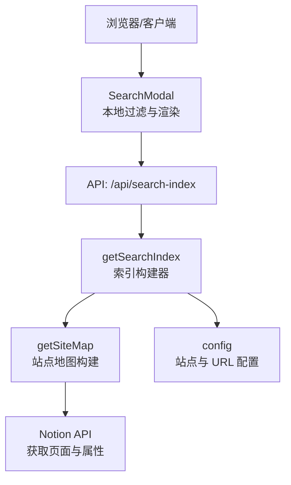
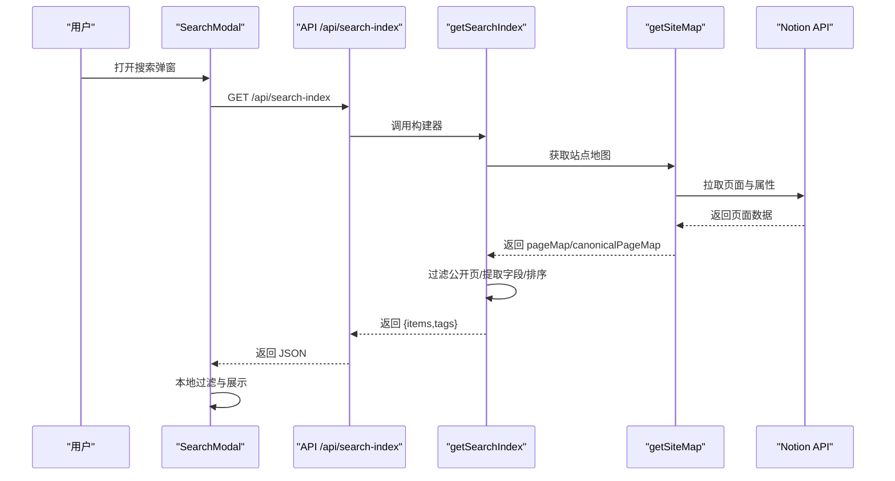
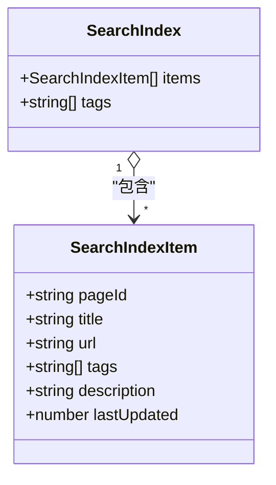
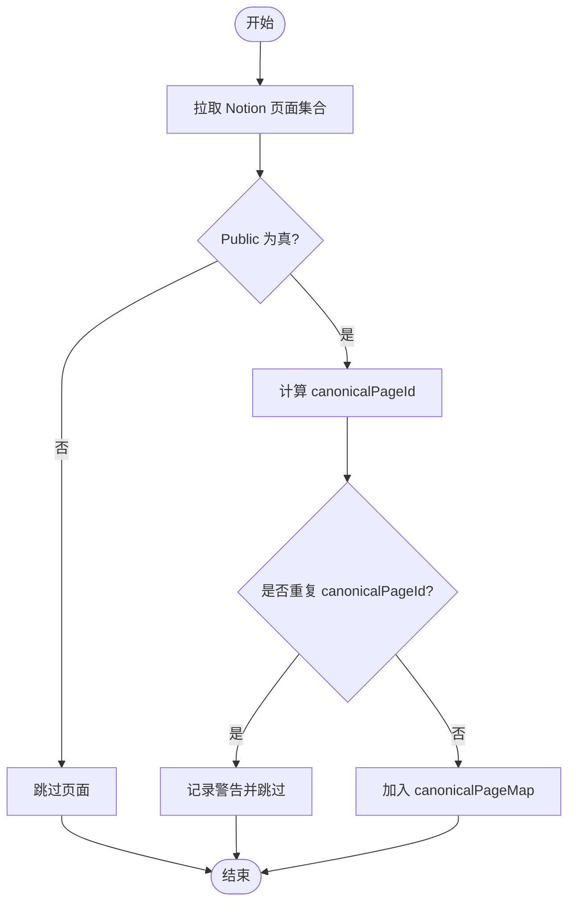
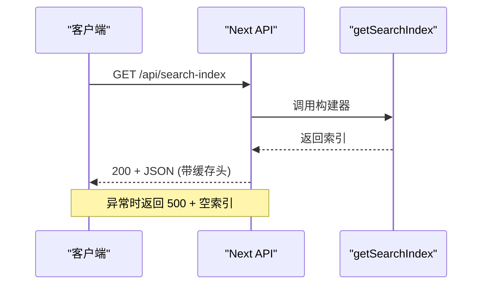
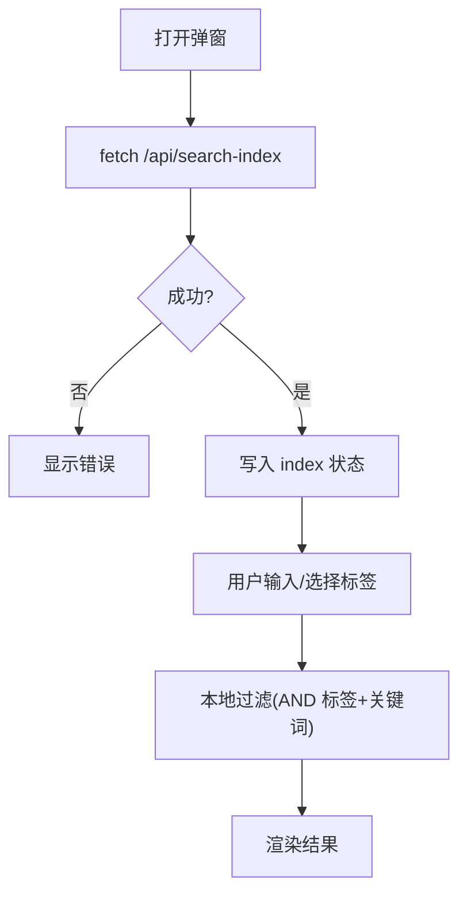
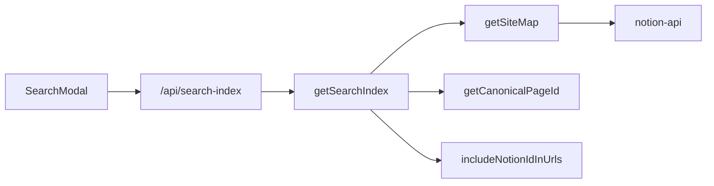
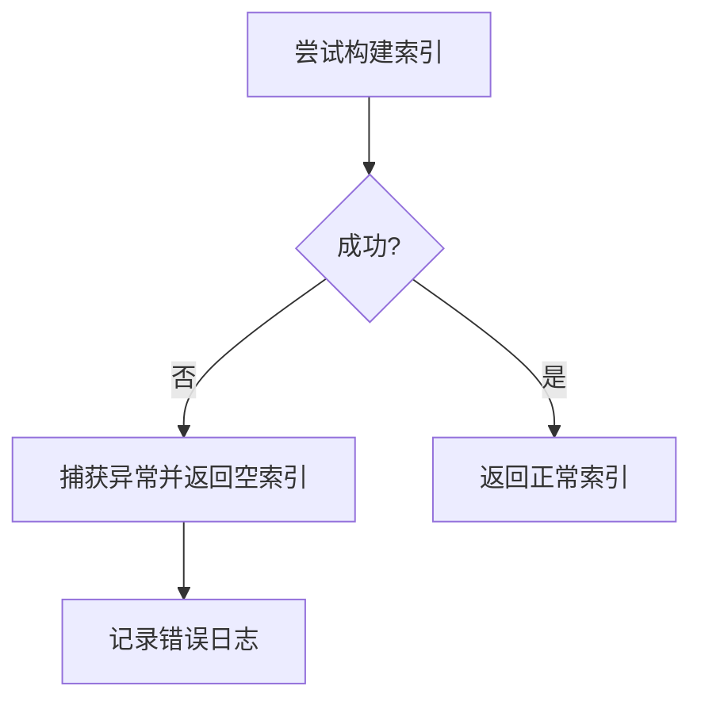
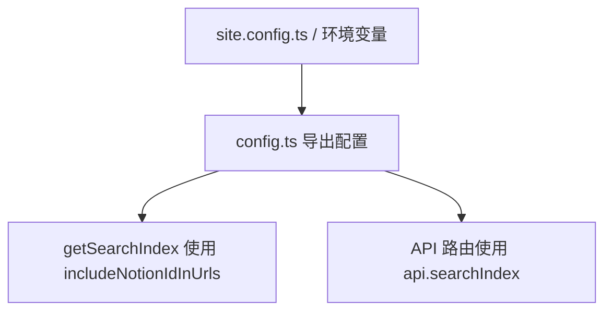

# 搜索索引管理

<cite>
**本文引用的文件**   
- [lib/get-search-index.ts](file://lib/get-search-index.ts)
- [pages/api/search-index.ts](file://pages/api/search-index.ts)
- [lib/get-site-map.ts](file://lib/get-site-map.ts)
- [lib/config.ts](file://lib/config.ts)
- [components/SearchModal.tsx](file://components/SearchModal.tsx)
- [lib/types.ts](file://lib/types.ts)
</cite>

## 目录
1. [简介](#简介)
2. [项目结构](#项目结构)
3. [核心组件](#核心组件)
4. [架构总览](#架构总览)
5. [详细组件分析](#详细组件分析)
6. [依赖关系分析](#依赖关系分析)
7. [性能与缓存优化](#性能与缓存优化)
8. [增量更新与定时刷新](#增量更新与定时刷新)
9. [错误处理与恢复](#错误处理与恢复)
10. [监控、统计与维护](#监控统计与维护)
11. [配置与扩展点](#配置与扩展点)
12. [故障排查指南](#故障排查指南)
13. [结论](#结论)

## 简介
本文件面向“搜索索引”的构建、存储、更新与使用，覆盖以下主题：
- 索引数据结构设计（条目、标签、元数据）
- 字段映射与来源（Notion 页面属性到索引字段）
- 元数据管理（站点信息、URL 规范、可见性控制）
- 增量更新策略与缓存机制（服务端与客户端）
- 生成流程、触发方式与错误恢复
- 监控、统计与维护建议
- 配置项与扩展点（如何自定义索引行为）

该方案通过 Next.js API 路由暴露轻量级搜索索引，前端按需加载并在本地进行过滤与排序，避免每次输入都调用 Notion API。

## 项目结构
搜索相关的关键路径如下：
- 索引构建逻辑：lib/get-search-index.ts
- 站点地图与 Notion 数据拉取：lib/get-site-map.ts
- API 路由输出索引：pages/api/search-index.ts
- 前端搜索弹窗与本地过滤：components/SearchModal.tsx
- 全局配置与 API 地址：lib/config.ts
- 类型定义：lib/types.ts

图表来源
- [components/SearchModal.tsx:80-106](file://components/SearchModal.tsx#L80-L106)
- [pages/api/search-index.ts:5-21](file://pages/api/search-index.ts#L5-L21)
- [lib/get-search-index.ts:44-98](file://lib/get-search-index.ts#L44-L98)
- [lib/get-site-map.ts:18-28](file://lib/get-site-map.ts#L18-L28)
- [lib/config.ts:148-153](file://lib/config.ts#L148-L153)

章节来源
- [lib/get-search-index.ts:1-99](file://lib/get-search-index.ts#L1-L99)
- [pages/api/search-index.ts:1-22](file://pages/api/search-index.ts#L1-L22)
- [lib/get-site-map.ts:1-107](file://lib/get-site-map.ts#L1-L107)
- [lib/config.ts:148-153](file://lib/config.ts#L148-L153)
- [components/SearchModal.tsx:57-106](file://components/SearchModal.tsx#L57-L106)

## 核心组件
- 索引构建器 getSearchIndex：从站点地图中抽取公开页面，规范化标签、描述、更新时间等，生成可缓存的轻量索引。
- 站点地图 getSiteMap：递归遍历 Notion 空间，构建 pageMap 与 canonicalPageMap，并过滤非公开页面。
- API 路由 search-index：对外暴露 JSON 接口，设置 CDN/边缘缓存头，统一错误返回。
- 前端 SearchModal：在客户端加载索引，支持关键词匹配与多标签筛选，按最近更新时间排序。
- 配置 config：提供站点基础信息、API 地址、是否包含 Notion ID 在 URL 中等开关。

章节来源
- [lib/get-search-index.ts:11-23](file://lib/get-search-index.ts#L11-L23)
- [lib/get-site-map.ts:18-28](file://lib/get-site-map.ts#L18-L28)
- [pages/api/search-index.ts:5-21](file://pages/api/search-index.ts#L5-L21)
- [components/SearchModal.tsx:57-106](file://components/SearchModal.tsx#L57-L106)
- [lib/config.ts:74-78](file://lib/config.ts#L74-L78)

## 架构总览
搜索索引的整体流程如下：
- 前端打开搜索弹窗时，请求 /api/search-index。
- API 调用 getSearchIndex，内部复用 p-memoize 缓存。
- getSearchIndex 调用 getSiteMap，后者通过 Notion API 拉取页面集合，并缓存 5 分钟。
- 构建器对每个公开页面提取标题、URL、标签、描述、最后更新时间，并按 lastUpdated 降序排列。
- 返回 { items, tags } 给前端，前端在内存中进行过滤和排序。

图表来源
- [components/SearchModal.tsx:80-106](file://components/SearchModal.tsx#L80-L106)
- [pages/api/search-index.ts:9-16](file://pages/api/search-index.ts#L9-L16)
- [lib/get-search-index.ts:44-98](file://lib/get-search-index.ts#L44-L98)
- [lib/get-site-map.ts:46-106](file://lib/get-site-map.ts#L46-L106)

## 详细组件分析

### 索引数据结构与字段映射
- 索引条目 SearchIndexItem
  - pageId：Notion 页面标识
  - title：页面标题
  - url：规范化后的站点 URL（基于 canonicalPageId）
  - tags：标签数组（来自 Notion 页面的 Tags 属性）
  - description：可选描述（来自 Notion 页面的 Description 属性）
  - lastUpdated：可选时间戳（来自 block.last_edited_time）
- 索引根对象 SearchIndex
  - items：条目数组
  - tags：去重且排序后的标签列表

字段映射说明：
- 标题：由 notion-utils 的 getBlockTitle 解析
- URL：由 getCanonicalPageId 结合 includeNotionIdInUrls 决定
- 标签：getPageProperty('Tags')，支持字符串逗号分隔或数组，自动 trim 并过滤空值
- 描述：getPageProperty('Description')
- 更新时间：block.last_edited_time（数字则保留，否则忽略）

图表来源
- [lib/get-search-index.ts:11-23](file://lib/get-search-index.ts#L11-L23)
- [lib/get-search-index.ts:62-88](file://lib/get-search-index.ts#L62-L88)

章节来源
- [lib/get-search-index.ts:11-23](file://lib/get-search-index.ts#L11-L23)
- [lib/get-search-index.ts:25-37](file://lib/get-search-index.ts#L25-L37)
- [lib/get-search-index.ts:62-88](file://lib/get-search-index.ts#L62-L88)

### 站点地图与可见性控制
- getSiteMap 负责聚合站点信息与页面映射，内部通过 getAllPagesInSpace 拉取 Notion 页面树。
- 仅当页面属性 Public 为真时才纳入索引；默认值为 true。
- 同时生成 canonicalPageMap，将 canonicalPageId 映射回原始 pageId，用于 URL 规范化。

图表来源
- [lib/get-site-map.ts:46-106](file://lib/get-site-map.ts#L46-L106)

章节来源
- [lib/get-site-map.ts:18-28](file://lib/get-site-map.ts#L18-L28)
- [lib/get-site-map.ts:46-106](file://lib/get-site-map.ts#L46-L106)

### API 路由与缓存头
- /api/search-index 返回 JSON，设置 Cache-Control 以启用 CDN/边缘缓存与 stale-while-revalidate。
- 异常时返回空索引 { items: [], tags: [] }，便于前端降级显示。

图表来源
- [pages/api/search-index.ts:9-20](file://pages/api/search-index.ts#L9-L20)

章节来源
- [pages/api/search-index.ts:5-21](file://pages/api/search-index.ts#L5-L21)

### 前端搜索交互与本地过滤
- 首次打开弹窗时发起一次 fetch(api.searchIndex)，成功后缓存于组件状态。
- 支持关键词匹配（标题、描述、标签）与多标签 AND 过滤。
- 结果按 lastUpdated 降序（由后端构建阶段完成），前端无需再次排序。

图表来源
- [components/SearchModal.tsx:80-106](file://components/SearchModal.tsx#L80-L106)
- [components/SearchModal.tsx:29-55](file://components/SearchModal.tsx#L29-L55)

章节来源
- [components/SearchModal.tsx:57-106](file://components/SearchModal.tsx#L57-L106)
- [components/SearchModal.tsx:29-55](file://components/SearchModal.tsx#L29-L55)

## 依赖关系分析
- getSearchIndex 依赖：
  - getSiteMap：站点地图与页面映射
  - getCanonicalPageId：URL 规范化
  - includeNotionIdInUrls：是否包含 Notion ID 在 URL
- getSiteMap 依赖：
  - notion-api：Notion SDK 封装
  - notion-utils：页面遍历与属性读取
  - config：站点根页面 ID、空间 ID、URL 策略
- SearchModal 依赖：
  - api.searchIndex：API 地址
  - SearchIndex 类型定义

图表来源
- [lib/get-search-index.ts:5-7](file://lib/get-search-index.ts#L5-L7)
- [lib/get-site-map.ts:10-14](file://lib/get-site-map.ts#L10-L14)
- [lib/config.ts:74-78](file://lib/config.ts#L74-L78)
- [components/SearchModal.tsx:6-7](file://components/SearchModal.tsx#L6-L7)

章节来源
- [lib/get-search-index.ts:5-7](file://lib/get-search-index.ts#L5-L7)
- [lib/get-site-map.ts:10-14](file://lib/get-site-map.ts#L10-L14)
- [lib/config.ts:74-78](file://lib/config.ts#L74-L78)
- [components/SearchModal.tsx:6-7](file://components/SearchModal.tsx#L6-L7)

## 性能与缓存优化
- 服务端缓存
  - getSearchIndex 使用 p-memoize 对构建过程进行函数级缓存，避免重复计算。
  - getSiteMap 使用 ExpiryMap 缓存 5 分钟，减少频繁访问 Notion API。
- 边缘/CDN 缓存
  - API 响应设置 Cache-Control: public, s-maxage=300, max-age=300, stale-while-revalidate=3600，利于边缘节点缓存与后台刷新。
- 客户端优化
  - 仅在弹窗挂载时拉取一次索引，后续过滤在内存中进行，无额外网络开销。
  - 结果已按 lastUpdated 降序，前端无需二次排序。

章节来源
- [lib/get-search-index.ts:42-42](file://lib/get-search-index.ts#L42-L42)
- [lib/get-site-map.ts:30-34](file://lib/get-site-map.ts#L30-L34)
- [pages/api/search-index.ts:12-15](file://pages/api/search-index.ts#L12-L15)
- [components/SearchModal.tsx:80-106](file://components/SearchModal.tsx#L80-L106)

## 增量更新与定时刷新
- 增量更新
  - 当前实现未显式比较变更，而是周期性重建索引。
  - 通过 getSiteMap 的 5 分钟过期缓存，新页面与属性变化会在下次构建时被纳入。
- 定时刷新
  - 可通过 Vercel Cron 或外部调度任务定期触发 /api/search-index，使 CDN 缓存失效并重建索引。
  - 也可调整 revalidateSeconds（站点级 ISR 配置）影响整体缓存刷新节奏。

章节来源
- [lib/get-site-map.ts:30-34](file://lib/get-site-map.ts#L30-L34)
- [lib/config.ts:93-98](file://lib/config.ts#L93-L98)

## 错误处理与恢复
- API 层
  - 捕获异常并返回 500 与空索引，保证前端可用降级体验。
  - 日志记录错误消息以便排查。
- 站点地图层
  - 若某页面 recordMap 缺失，抛出错误中断构建，确保一致性。
  - 对重复 canonicalPageId 发出警告并跳过，避免覆盖。
- 前端层
  - 拉取失败时显示错误信息，不阻塞其他功能。

图表来源
- [pages/api/search-index.ts:17-20](file://pages/api/search-index.ts#L17-L20)
- [lib/get-site-map.ts:64-70](file://lib/get-site-map.ts#L64-L70)
- [lib/get-site-map.ts:82-91](file://lib/get-site-map.ts#L82-L91)

章节来源
- [pages/api/search-index.ts:17-20](file://pages/api/search-index.ts#L17-L20)
- [lib/get-site-map.ts:64-70](file://lib/get-site-map.ts#L64-L70)
- [lib/get-site-map.ts:82-91](file://lib/get-site-map.ts#L82-L91)

## 监控、统计与维护
- 监控建议
  - 在 API 层增加指标采集（构建耗时、缓存命中率、错误率）。
  - 观察 CDN 缓存命中情况（s-maxage 与 stale-while-revalidate 的效果）。
- 统计维度
  - 索引条目数量、标签分布、平均 lastUpdated 时间。
  - 前端搜索成功率与无结果比例。
- 维护工具
  - 提供手动触发重建的脚本或管理端入口，定期清理无效标签。
  - 校验 Notion 页面属性（Public、Tags、Description）的一致性。

[本节为通用指导，不涉及具体代码文件]

## 配置与扩展点
- 是否包含 Notion ID 在 URL
  - includeNotionIdInUrls 控制 canonicalPageId 生成策略，影响索引中的 url 字段。
- 站点根页面与空间
  - rootNotionPageId 与 rootNotionSpaceId 限定索引范围。
- 搜索开关
  - isSearchEnabled 控制是否启用搜索功能（可在上层 UI 层使用）。
- API 地址
  - api.searchIndex 提供统一的 API 基址，便于前后端解耦。

图表来源
- [lib/config.ts:74-78](file://lib/config.ts#L74-L78)
- [lib/config.ts:23-34](file://lib/config.ts#L23-L34)
- [lib/config.ts:90-98](file://lib/config.ts#L90-L98)
- [lib/config.ts:148-153](file://lib/config.ts#L148-L153)

章节来源
- [lib/config.ts:74-78](file://lib/config.ts#L74-L78)
- [lib/config.ts:23-34](file://lib/config.ts#L23-L34)
- [lib/config.ts:90-98](file://lib/config.ts#L90-L98)
- [lib/config.ts:148-153](file://lib/config.ts#L148-L153)

## 故障排查指南
- 索引为空
  - 检查 Notion 页面 Public 属性是否为真。
  - 确认根页面与空间配置正确。
  - 查看 API 层日志与 CDN 缓存状态。
- 搜索结果不准确
  - 核对 Tags、Description 字段内容与格式。
  - 确认 includeNotionIdInUrls 与 URL 规范化一致。
- 性能问题
  - 评估 getSiteMap 缓存过期时间是否过短。
  - 检查 CDN 缓存命中与 stale-while-revalidate 效果。
  - 关注 Notion API 超时与限流。

章节来源
- [lib/get-site-map.ts:64-70](file://lib/get-site-map.ts#L64-L70)
- [lib/get-site-map.ts:82-91](file://lib/get-site-map.ts#L82-L91)
- [pages/api/search-index.ts:12-15](file://pages/api/search-index.ts#L12-L15)

## 结论
该搜索索引方案通过“服务端轻量构建 + 客户端本地过滤”的模式，在保证实时性的同时显著降低了对 Notion API 的依赖。借助 p-memoize 与 ExpiryMap 的多层缓存，以及 CDN 级别的 Cache-Control 策略，系统在可扩展性与性能之间取得平衡。通过合理的配置与扩展点，团队可以灵活定制索引行为，并结合监控与统计持续优化用户体验。