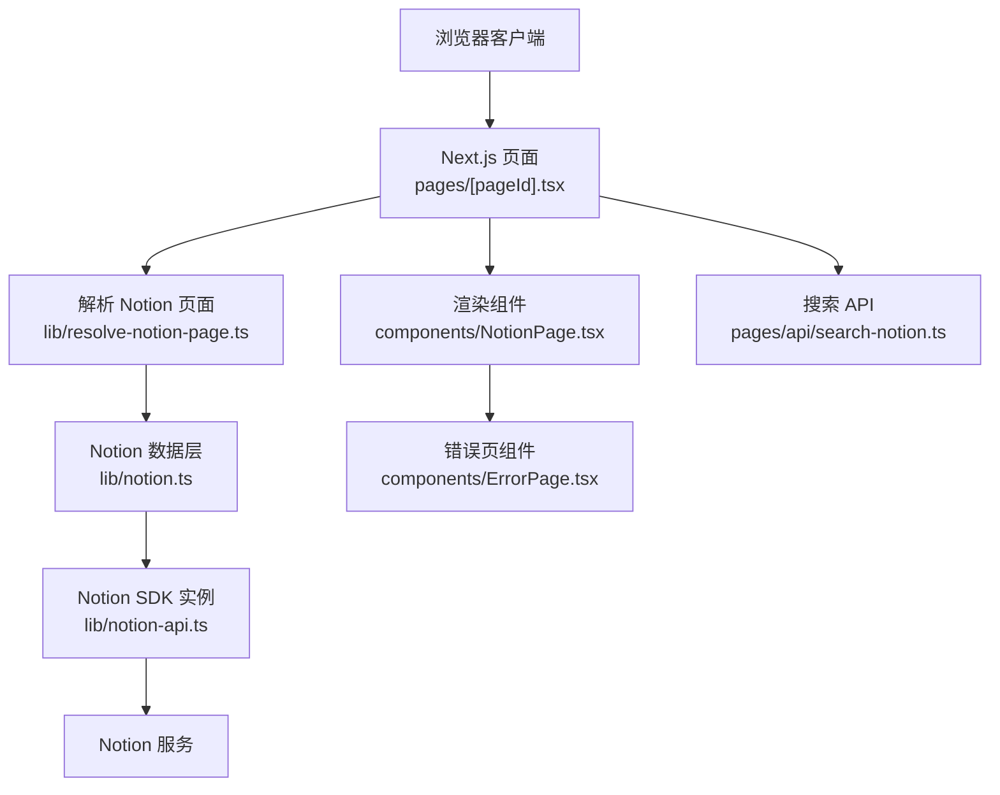
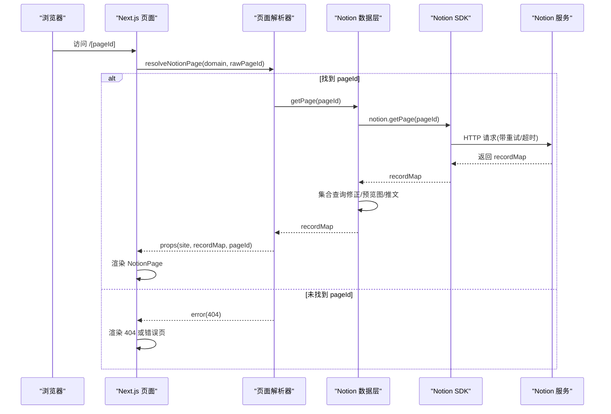
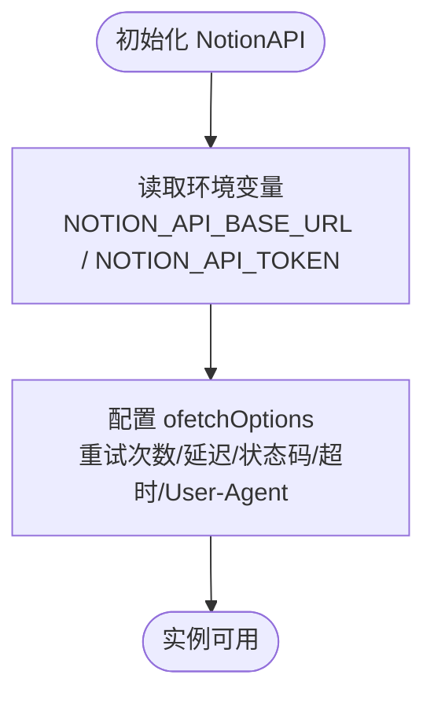
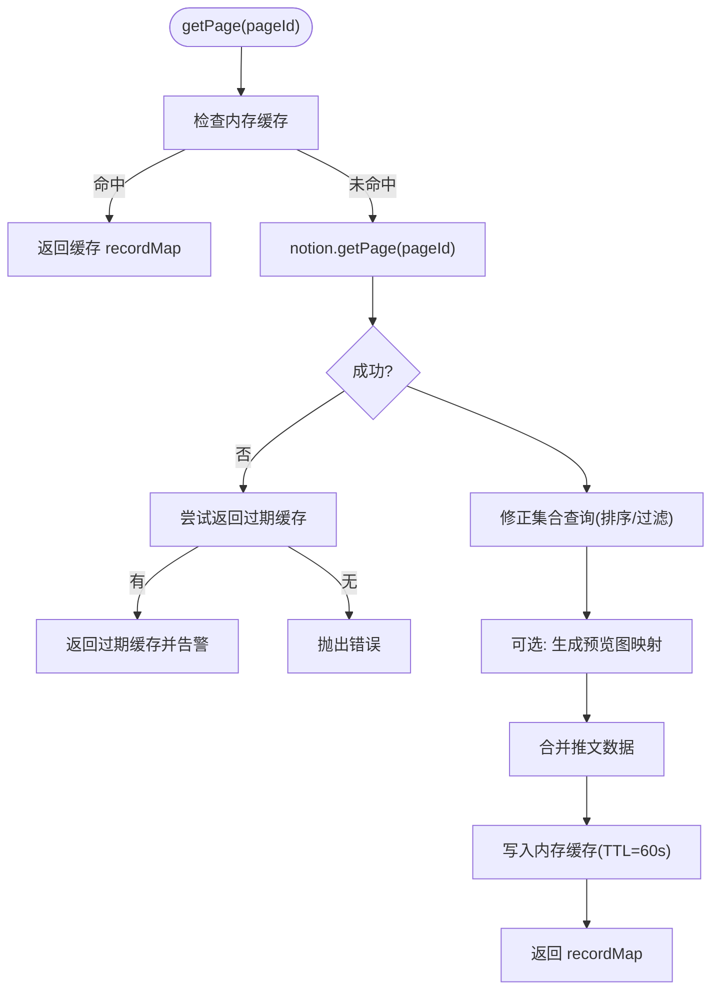
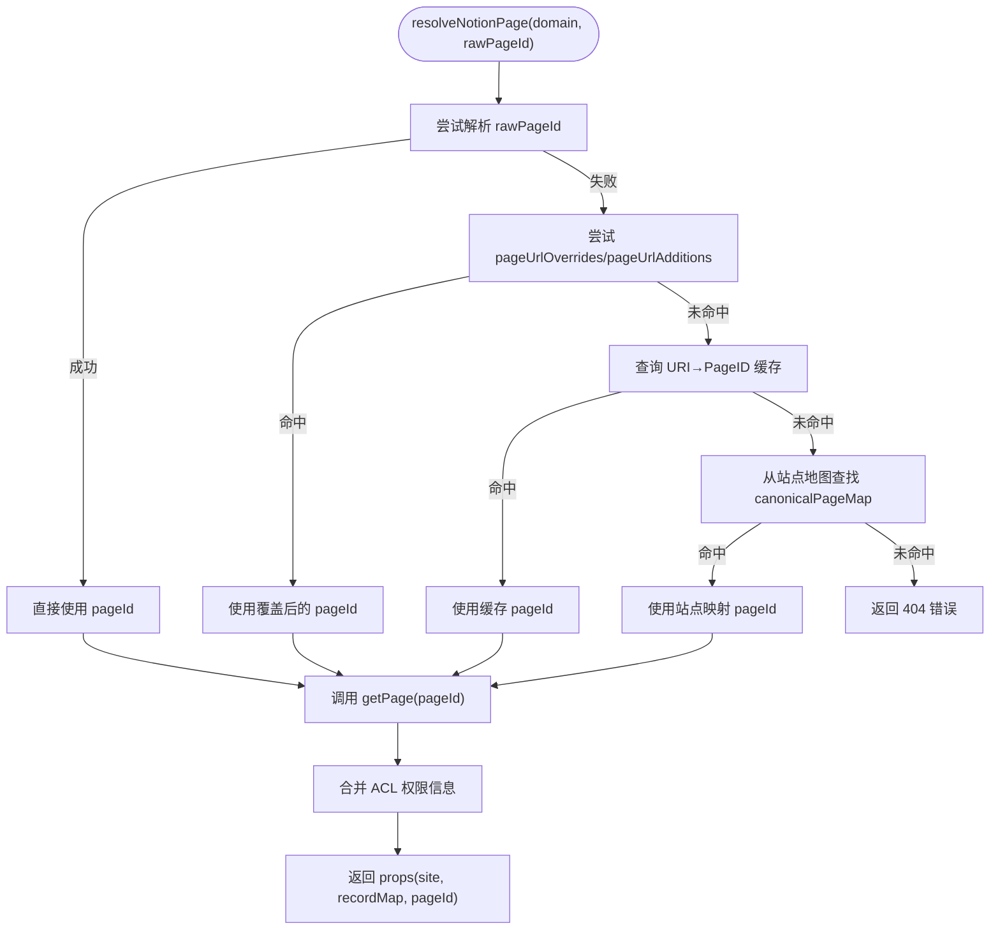
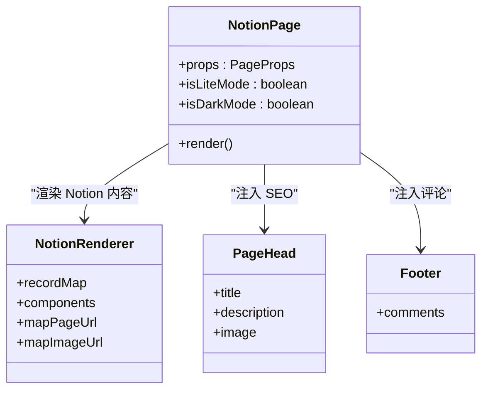
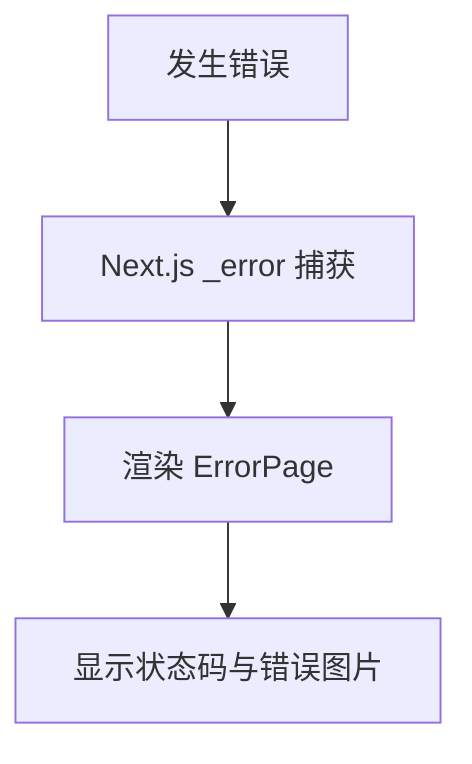
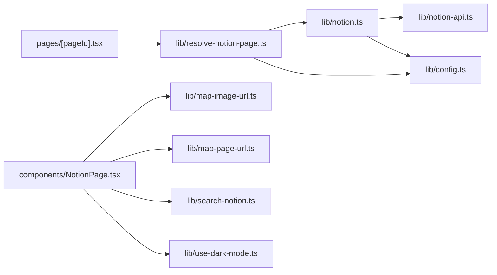

# 故障排除

<cite>
**本文引用的文件**   
- [components/ErrorPage.tsx](file://components/ErrorPage.tsx)
- [lib/notion-api.ts](file://lib/notion-api.ts)
- [lib/notion.ts](file://lib/notion.ts)
- [pages/_error.tsx](file://pages/_error.tsx)
- [site.config.ts](file://site.config.ts)
- [lib/config.ts](file://lib/config.ts)
- [components/NotionPage.tsx](file://components/NotionPage.tsx)
- [pages/[pageId].tsx](file://pages/[pageId].tsx)
- [lib/resolve-notion-page.ts](file://lib/resolve-notion-page.ts)
- [pages/api/search-notion.ts](file://pages/api/search-notion.ts)
- [lib/get-config-value.ts](file://lib/get-config-value.ts)
</cite>

## 目录
1. [简介](#简介)
2. [项目结构](#项目结构)
3. [核心组件](#核心组件)
4. [架构总览](#架构总览)
5. [详细组件分析](#详细组件分析)
6. [依赖关系分析](#依赖关系分析)
7. [性能与缓存特性](#性能与缓存特性)
8. [常见问题与排错指南](#常见问题与排错指南)
9. [调试技巧与日志查看](#调试技巧与日志查看)
10. [错误页面定制与体验优化](#错误页面定制与体验优化)
11. [结论](#结论)

## 简介
本指南面向使用 Next.js + Notion 的站点维护者，聚焦以下问题的诊断与修复：
- Notion API 连接失败、鉴权错误、限流或超时
- 权限配置错误导致内容不可见或渲染异常
- 集合视图排序/过滤不生效、图片加载异常、搜索接口异常
- 错误页展示与用户体验优化
同时提供调试技巧、日志定位方法和性能分析建议。

## 项目结构
本项目采用“功能模块 + 页面路由”的组织方式：
- 页面层：Next.js 动态路由 [pageId] 负责解析 URL 到 Notion Page ID，并调用数据获取逻辑
- 数据层：lib/notion.ts 封装 Notion 数据获取、内存缓存、集合查询修正等
- API 层：pages/api/* 暴露搜索等后端能力
- 组件层：components/* 负责渲染、交互与错误展示
- 配置层：site.config.ts 与 lib/config.ts 集中管理站点与运行时配置

图表来源
- [pages/[pageId].tsx:9-25](file://pages/[pageId].tsx#L9-L25)
- [lib/resolve-notion-page.ts:11-84](file://lib/resolve-notion-page.ts#L11-L84)
- [lib/notion.ts:161-214](file://lib/notion.ts#L161-L214)
- [lib/notion-api.ts:1-21](file://lib/notion-api.ts#L1-L21)
- [components/NotionPage.tsx:211-355](file://components/NotionPage.tsx#L211-L355)
- [components/ErrorPage.tsx:4-22](file://components/ErrorPage.tsx#L4-L22)
- [pages/api/search-notion.ts:6-25](file://pages/api/search-notion.ts#L6-L25)

章节来源
- [pages/[pageId].tsx:9-58](file://pages/[pageId].tsx#L9-L58)
- [lib/resolve-notion-page.ts:11-84](file://lib/resolve-notion-page.ts#L11-L84)
- [lib/notion.ts:161-214](file://lib/notion.ts#L161-L214)
- [lib/notion-api.ts:1-21](file://lib/notion-api.ts#L1-L21)
- [components/NotionPage.tsx:211-355](file://components/NotionPage.tsx#L211-L355)
- [components/ErrorPage.tsx:4-22](file://components/ErrorPage.tsx#L4-L22)
- [pages/api/search-notion.ts:6-25](file://pages/api/search-notion.ts#L6-L25)

## 核心组件
- Notion API 客户端：封装重试、超时、User-Agent 等网络参数，统一访问 Notion
- Notion 数据层：实现页面获取、内存缓存、集合查询修正、预览图与推文增强
- 页面解析器：将 URL 映射为 Notion Page ID，处理覆盖规则与缓存
- 渲染组件：根据 recordMap 渲染 Notion 内容，注入 SEO、主题、评论等
- 错误页：通用错误展示与状态码显示

章节来源
- [lib/notion-api.ts:1-21](file://lib/notion-api.ts#L1-L21)
- [lib/notion.ts:19-214](file://lib/notion.ts#L19-L214)
- [lib/resolve-notion-page.ts:11-84](file://lib/resolve-notion-page.ts#L11-L84)
- [components/NotionPage.tsx:196-355](file://components/NotionPage.tsx#L196-L355)
- [components/ErrorPage.tsx:4-22](file://components/ErrorPage.tsx#L4-L22)

## 架构总览
下图展示了从请求到渲染的关键路径，以及错误分支的处理位置。

图表来源
- [pages/[pageId].tsx:9-25](file://pages/[pageId].tsx#L9-L25)
- [lib/resolve-notion-page.ts:11-84](file://lib/resolve-notion-page.ts#L11-L84)
- [lib/notion.ts:161-214](file://lib/notion.ts#L161-L214)
- [lib/notion-api.ts:1-21](file://lib/notion-api.ts#L1-L21)

## 详细组件分析

### Notion API 客户端（lib/notion-api.ts）
- 作用：创建 NotionAPI 实例，设置基础地址、认证令牌、重试策略、超时和 User-Agent
- 关键点：
  - 自动重试状态码包含 408/429/500/502/503/504，有助于缓解瞬时错误
  - 超时默认 30 秒，避免长时间阻塞
  - 通过环境变量注入 NOTION_API_BASE_URL 与 NOTION_API_TOKEN

图表来源
- [lib/notion-api.ts:1-21](file://lib/notion-api.ts#L1-L21)

章节来源
- [lib/notion-api.ts:1-21](file://lib/notion-api.ts#L1-L21)

### Notion 数据层（lib/notion.ts）
- 作用：封装页面获取、内存缓存、导航链接预取、集合查询修正、预览图与推文增强
- 关键点：
  - 内存缓存 TTL 60 秒，用于吸收突发流量与 Notion 抖动
  - 当 Notion 不可用时，优先返回过期缓存，避免全站 500
  - 对 collection_view 的双层嵌套值进行解包，重新执行 getCollectionData 以应用真实排序/过滤
  - 可选启用预览图与推文数据合并

图表来源
- [lib/notion.ts:29-55](file://lib/notion.ts#L29-L55)
- [lib/notion.ts:95-159](file://lib/notion.ts#L95-L159)
- [lib/notion.ts:161-214](file://lib/notion.ts#L161-L214)

章节来源
- [lib/notion.ts:19-214](file://lib/notion.ts#L19-L214)

### 页面解析器（lib/resolve-notion-page.ts）
- 作用：将 URL 解析为 Notion Page ID，支持 site.config 中的 URL 覆盖与添加映射，URI→PageID 缓存
- 关键点：
  - 若 rawPageId 无法解析，则尝试 pageUrlOverrides/pageUrlAdditions
  - 使用 db 缓存 URI→PageID 映射，TTL 一天
  - 找不到对应页面时返回 404 错误对象

图表来源
- [lib/resolve-notion-page.ts:11-84](file://lib/resolve-notion-page.ts#L11-L84)

章节来源
- [lib/resolve-notion-page.ts:11-84](file://lib/resolve-notion-page.ts#L11-L84)

### 渲染组件（components/NotionPage.tsx）
- 作用：渲染 Notion 内容，注入 SEO、主题、评论、侧边栏等
- 关键点：
  - 在开发环境将 pageId、recordMap、block 挂载到 window 便于调试
  - 根据 block 类型判断是否为博客文章，决定是否显示目录
  - 动态导入代码高亮、PDF、公式、模态框等第三方组件
  - 将 searchNotion 接入搜索能力（受 isSearchEnabled 控制）

图表来源
- [components/NotionPage.tsx:196-355](file://components/NotionPage.tsx#L196-L355)

章节来源
- [components/NotionPage.tsx:196-355](file://components/NotionPage.tsx#L196-L355)

### 错误页（components/ErrorPage.tsx 与 pages/_error.tsx）
- 作用：统一错误展示，显示状态码与错误图片
- 关键点：
  - pages/_error.tsx 导出 ErrorPage 作为默认错误页
  - ErrorPage 接收 statusCode 并渲染标题、状态码与图片

图表来源
- [pages/_error.tsx:1-2](file://pages/_error.tsx#L1-L2)
- [components/ErrorPage.tsx:4-22](file://components/ErrorPage.tsx#L4-L22)

章节来源
- [pages/_error.tsx:1-2](file://pages/_error.tsx#L1-L2)
- [components/ErrorPage.tsx:4-22](file://components/ErrorPage.tsx#L4-L22)

## 依赖关系分析
- 页面路由依赖 resolve-notion-page 与 config
- resolve-notion-page 依赖 notion、acl、db、get-site-map
- notion 依赖 notion-api、config、preview-images、get-tweets
- notion-api 依赖环境变量与 notio-client
- NotionPage 依赖 map-image-url、map-page-url、search-notion、use-dark-mode

图表来源
- [pages/[pageId].tsx:1-58](file://pages/[pageId].tsx#L1-L58)
- [lib/resolve-notion-page.ts:1-84](file://lib/resolve-notion-page.ts#L1-L84)
- [lib/notion.ts:1-214](file://lib/notion.ts#L1-L214)
- [lib/notion-api.ts:1-21](file://lib/notion-api.ts#L1-L21)
- [components/NotionPage.tsx:1-355](file://components/NotionPage.tsx#L1-L355)

章节来源
- [pages/[pageId].tsx:1-58](file://pages/[pageId].tsx#L1-L58)
- [lib/resolve-notion-page.ts:1-84](file://lib/resolve-notion-page.ts#L1-L84)
- [lib/notion.ts:1-214](file://lib/notion.ts#L1-L214)
- [lib/notion-api.ts:1-21](file://lib/notion-api.ts#L1-L21)
- [components/NotionPage.tsx:1-355](file://components/NotionPage.tsx#L1-L355)

## 性能与缓存特性
- 内存缓存：页面 recordMap 缓存 60 秒，减少 Notion 调用频率
- ISR 重验证：站点级 revalidateSeconds 控制静态再生成频率
- 集合查询修正：按需并行执行 getCollectionData，提升排序/过滤准确性
- 搜索接口缓存：返回 Cache-Control 头，启用 CDN/浏览器缓存

章节来源
- [lib/notion.ts:29-55](file://lib/notion.ts#L29-L55)
- [lib/notion.ts:95-159](file://lib/notion.ts#L95-L159)
- [site.config.ts:57-60](file://site.config.ts#L57-L60)
- [pages/api/search-notion.ts:20-24](file://pages/api/search-notion.ts#L20-L24)

## 常见问题与排错指南

### 1. Notion API 连接问题
症状：
- 页面加载缓慢或失败
- 出现 429/503/504 等错误
- 本地或生产环境均无法拉取内容

排查步骤：
- 确认环境变量已正确配置 NOTION_API_BASE_URL 与 NOTION_API_TOKEN
- 检查网络连通性与代理设置
- 观察控制台是否出现重试与超时相关告警
- 临时降低并发或关闭预览图/推文增强以定位瓶颈

解决建议：
- 校验环境变量并在构建/部署平台注入
- 调整重试策略与超时时间（如需）
- 开启站点级缓存与 ISR 以降低峰值压力

章节来源
- [lib/notion-api.ts:1-21](file://lib/notion-api.ts#L1-L21)
- [lib/notion.ts:161-182](file://lib/notion.ts#L161-L182)

### 2. 权限配置错误
症状：
- 页面空白或部分块缺失
- 集合视图数据为空
- 某些资源（图片、附件）无法加载

排查步骤：
- 确认根页面 rootNotionPageId 是否正确
- 检查 Notion 工作区与页面共享权限
- 验证 site.config.ts 中 rootNotionSpaceId 是否限制到单一工作区
- 检查 pageUrlOverrides/pageUrlAdditions 映射是否指向有效页面

解决建议：
- 修正 rootNotionPageId 与空间限制
- 确保目标页面已共享给集成机器人或公开访问
- 清理无效 URL 映射

章节来源
- [site.config.ts:3-9](file://site.config.ts#L3-L9)
- [lib/config.ts:23-34](file://lib/config.ts#L23-L34)
- [lib/resolve-notion-page.ts:18-30](file://lib/resolve-notion-page.ts#L18-L30)

### 3. 内容渲染异常
症状：
- 集合视图顺序与过滤不符合预期
- 代码高亮、PDF、公式等组件未加载
- 图片显示异常或占位图过多

排查步骤：
- 检查集合视图是否定义了排序/过滤；若定义，需触发 getCollectionData 修正
- 确认动态导入的第三方组件是否被正确加载
- 检查图片 URL 映射与域名配置
- 关闭预览图功能以排除 LQIP 影响

解决建议：
- 保持集合视图的 query2 定义，系统会自动修正
- 按需启用/禁用预览图与第三方组件
- 校验域名与跨域策略

章节来源
- [lib/notion.ts:95-159](file://lib/notion.ts#L95-L159)
- [components/NotionPage.tsx:43-142](file://components/NotionPage.tsx#L43-L142)
- [lib/config.ts:68-78](file://lib/config.ts#L68-L78)

### 4. 搜索接口异常
症状：
- 搜索无结果或报错
- 搜索响应慢

排查步骤：
- 检查搜索 API 是否允许 POST 方法
- 查看服务端日志中搜索参数与返回结果
- 确认 isSearchEnabled 配置与前端调用一致

解决建议：
- 修正请求方法与参数结构
- 调整缓存策略与索引更新频率

章节来源
- [pages/api/search-notion.ts:6-25](file://pages/api/search-notion.ts#L6-L25)
- [lib/config.ts:90-95](file://lib/config.ts#L90-L95)

### 5. 404 与页面未找到
症状：
- 访问自定义路径返回 404
- URL 覆盖后仍无法匹配页面

排查步骤：
- 检查 pageUrlOverrides/pageUrlAdditions 映射
- 查看 URI→PageID 缓存是否失效
- 确认站点地图 canonicalPageMap 是否包含该路径

解决建议：
- 修正映射或刷新缓存
- 确保站点地图生成逻辑包含新增路径

章节来源
- [lib/resolve-notion-page.ts:18-74](file://lib/resolve-notion-page.ts#L18-L74)

## 调试技巧与日志查看

### 调试技巧
- 开发模式将 pageId、recordMap、block 挂载到 window，便于在控制台直接查看数据结构
- 使用 lite 模式（URL 参数 lite=true）简化渲染，便于定位样式与布局问题
- 通过 isSearchEnabled 开关快速验证搜索链路

### 日志查看
- 页面构建阶段：关注 getStaticProps 的错误日志与 staticPaths.paths 输出
- 运行时：关注 notion 数据层的警告日志（如 getPage 失败回退、集合查询修正错误）
- API 层：关注搜索接口的入参与出参日志

章节来源
- [components/NotionPage.tsx:265-271](file://components/NotionPage.tsx#L265-L271)
- [pages/[pageId].tsx:14-24](file://pages/[pageId].tsx#L14-L24)
- [lib/notion.ts:149-155](file://lib/notion.ts#L149-L155)
- [pages/api/search-notion.ts:16-18](file://pages/api/search-notion.ts#L16-L18)

## 错误页面定制与体验优化

### 错误页面定制
- 修改 components/ErrorPage.tsx 以自定义标题、状态码展示与图片
- 通过 pages/_error.tsx 替换默认错误页行为

### 用户体验优化
- 合理设置 ISR 重验证间隔，平衡新鲜度与成本
- 启用 Vercel Web Analytics 与 Speed Insights 监控性能
- 使用 Clarity 或 PostHog 进行用户行为分析（需在配置中启用）

章节来源
- [components/ErrorPage.tsx:4-22](file://components/ErrorPage.tsx#L4-L22)
- [pages/_error.tsx:1-2](file://pages/_error.tsx#L1-L2)
- [site.config.ts:38-45](file://site.config.ts#L38-L45)
- [lib/config.ts:130-143](file://lib/config.ts#L130-L143)

## 结论
通过理解 Notion API 客户端、数据层、页面解析器与渲染组件的职责边界，结合环境变量、缓存策略与日志输出，可以快速定位并修复连接、权限、渲染与搜索等问题。建议在上线前完成权限校验、缓存策略调优与错误页定制，以提升稳定性与用户体验。