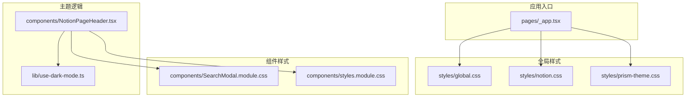
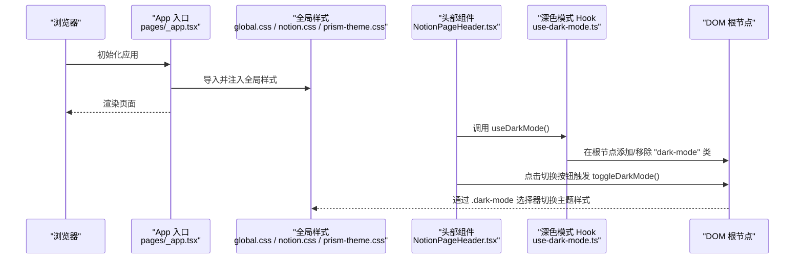
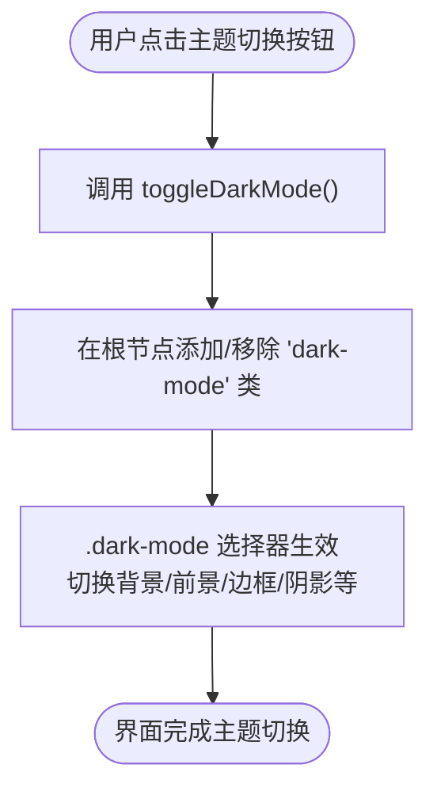
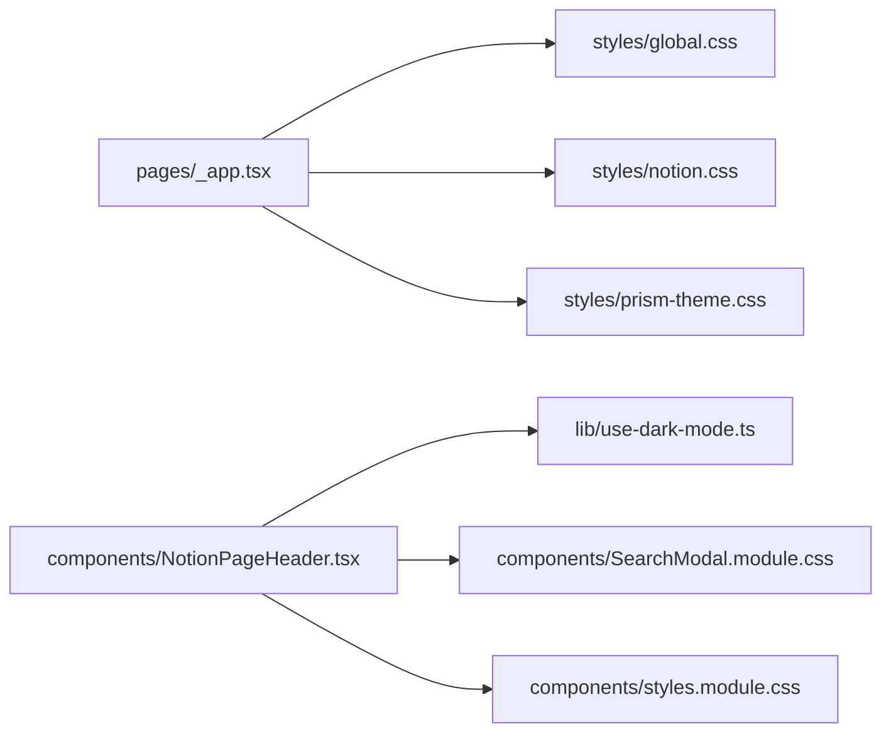

# 样式与主题

<cite>
**本文引用的文件**   
- [pages/_app.tsx](file://pages/_app.tsx)
- [styles/global.css](file://styles/global.css)
- [styles/notion.css](file://styles/notion.css)
- [styles/prism-theme.css](file://styles/prism-theme.css)
- [components/NotionPageHeader.tsx](file://components/NotionPageHeader.tsx)
- [components/SearchModal.module.css](file://components/SearchModal.module.css)
- [components/styles.module.css](file://components/styles.module.css)
- [lib/use-dark-mode.ts](file://lib/use-dark-mode.ts)
- [site.config.ts](file://site.config.ts)
</cite>

## 目录
1. [简介](#简介)
2. [项目结构](#项目结构)
3. [核心组件](#核心组件)
4. [架构总览](#架构总览)
5. [详细组件分析](#详细组件分析)
6. [依赖关系分析](#依赖关系分析)
7. [性能考量](#性能考量)
8. [故障排查指南](#故障排查指南)
9. [结论](#结论)
10. [附录：主题定制与响应式最佳实践](#附录主题定制与响应式最佳实践)

## 简介
本章节说明项目的样式系统与主题定制能力，包括：
- CSS 架构组织与全局样式规范
- Notion 内容渲染的样式覆盖策略
- 深色/浅色模式切换的实现原理与使用方式
- 代码语法高亮与数学公式渲染的配置
- 主题定制指南与响应式设计最佳实践

## 项目结构
样式相关资源集中在 styles 目录，并通过应用入口统一引入；组件级样式采用模块化 CSS。

图表来源
- [pages/_app.tsx:1-14](file://pages/_app.tsx#L1-L14)
- [components/NotionPageHeader.tsx:1-14](file://components/NotionPageHeader.tsx#L1-L14)
- [lib/use-dark-mode.ts:1-11](file://lib/use-dark-mode.ts#L1-L11)

章节来源
- [pages/_app.tsx:1-14](file://pages/_app.tsx#L1-L14)
- [styles/global.css:1-63](file://styles/global.css#L1-L63)
- [styles/notion.css:1-689](file://styles/notion.css#L1-L689)
- [styles/prism-theme.css:1-126](file://styles/prism-theme.css#L1-L126)
- [components/SearchModal.module.css:1-182](file://components/SearchModal.module.css#L1-L182)
- [components/styles.module.css:1-226](file://components/styles.module.css#L1-L226)
- [lib/use-dark-mode.ts:1-11](file://lib/use-dark-mode.ts#L1-L11)
- [components/NotionPageHeader.tsx:1-133](file://components/NotionPageHeader.tsx#L1-L133)

## 核心组件
- 全局样式层：定义基础重置、字体变量、滚动条等通用样式。
- Notion 样式覆盖层：针对 react-notion-x 输出类名进行精细化调整，包含画廊、引用、标题、封面、侧边目录等。
- Prism 代码高亮主题层：对代码块与行内代码进行主题适配，支持深色模式。
- 深色模式 Hook：封装 @fisch0920/use-dark-mode，提供 isDarkMode 与 toggleDarkMode，并在根节点添加 dark-mode 类名。
- 头部组件：集成主题切换按钮与搜索弹窗，使用模块样式与图标。

章节来源
- [styles/global.css:1-63](file://styles/global.css#L1-L63)
- [styles/notion.css:1-689](file://styles/notion.css#L1-L689)
- [styles/prism-theme.css:1-126](file://styles/prism-theme.css#L1-L126)
- [lib/use-dark-mode.ts:1-11](file://lib/use-dark-mode.ts#L1-L11)
- [components/NotionPageHeader.tsx:1-133](file://components/NotionPageHeader.tsx#L1-L133)

## 架构总览
样式加载与主题切换的整体流程如下：

图表来源
- [pages/_app.tsx:1-14](file://pages/_app.tsx#L1-L14)
- [components/NotionPageHeader.tsx:15-35](file://components/NotionPageHeader.tsx#L15-L35)
- [lib/use-dark-mode.ts:1-11](file://lib/use-dark-mode.ts#L1-L11)

## 详细组件分析

### 全局样式与主题变量
- 基础重置：box-sizing、链接默认样式、body/html 边距与溢出控制。
- 字体变量：定义 --notion-font 并应用到 body，确保一致的排版体验。
- 滚动条样式：使用 CSS 伪元素自定义滚动条轨道与滑块颜色，并引用主题变量 --bg-color、--fg-color、--bg-color-1、--fg-color-1。
- 搜索输入框颜色：通过 --fg-color 控制光标与文字颜色一致性。

章节来源
- [styles/global.css:1-63](file://styles/global.css#L1-L63)

### Notion 内容样式覆盖
- 布局与间距：设置 .notion 容器最大宽度、页头高度、页面底部留白与行高。
- 图片与视频：修复 react-notion-x 固定高度导致的裁剪问题，保证宽高比与自适应。
- 画廊网格：根据屏幕尺寸调整列数与间距，保持卡片比例一致。
- 引用与分隔：优化引用样式、水平分割线间距。
- 链接下划线动效：使用背景渐变实现悬停时的下划线动画。
- 彩色背景标签：为多种背景色（红/粉/蓝/紫/绿/黄/橙/棕/灰）提供渐变背景，并在深色模式下禁用高亮。
- 页面封面与头像：圆角、阴影与对齐优化。
- 代码块：统一背景、边框与圆角。
- 文章元信息：左对齐并按“描述 → 标签 → 作者 → 日期”顺序重排。
- 目录侧边栏：在大屏上以可展开的迷你目录展示，悬停或聚焦时展开文本，支持缩进层级与活动项高亮。
- 媒体查询：在小屏隐藏搜索按钮、调整页面内边距，在小屏或低分辨率隐藏目录侧边栏。

章节来源
- [styles/notion.css:10-689](file://styles/notion.css#L10-L689)

### 代码语法高亮主题
- 代码块容器：统一背景、边框、圆角与内边距，深色模式切换背景与边框色。
- 行内代码：区分深浅色模式下的背景与文字色。
- Token 着色：为注释、关键字、字符串、属性、函数、类名等 token 指定语义化颜色，并提供深色模式覆盖。
- 滚动条与装饰：隐藏 pre 滚动条，移除多余装饰伪元素。

章节来源
- [styles/prism-theme.css:1-126](file://styles/prism-theme.css#L1-L126)

### 深色/浅色模式切换机制
- Hook 封装：use-dark-mode 基于 @fisch0920/use-dark-mode，默认关闭深色模式，配置 classNameDark 为 'dark-mode'，暴露 isDarkMode 与 toggleDarkMode。
- 头部按钮：ToggleThemeButton 使用 Hook 状态渲染太阳/月亮图标，点击调用 toggleDarkMode。
- 样式联动：全局样式与组件样式通过 .dark-mode 前缀选择器切换配色与效果。

图表来源
- [lib/use-dark-mode.ts:1-11](file://lib/use-dark-mode.ts#L1-L11)
- [components/NotionPageHeader.tsx:15-35](file://components/NotionPageHeader.tsx#L15-L35)
- [styles/notion.css:401-443](file://styles/notion.css#L401-L443)
- [styles/prism-theme.css:10-35](file://styles/prism-theme.css#L10-L35)

章节来源
- [lib/use-dark-mode.ts:1-11](file://lib/use-dark-mode.ts#L1-L11)
- [components/NotionPageHeader.tsx:15-35](file://components/NotionPageHeader.tsx#L15-L35)

### 搜索弹窗样式
- 遮罩层：全屏半透明背景 + 模糊效果，垂直居中顶部区域。
- 弹窗容器：使用主题变量 --bg-color、--fg-color 控制背景与文字色，限制最大宽度与高度。
- 输入区：无边框透明背景，占满剩余空间，placeholder 使用弱化前景色。
- 标签筛选：圆角胶囊标签，悬停高亮边框，激活态使用强调色。
- 结果列表：悬停高亮背景，标题与描述字号层次分明，标签小字弱显示。
- 状态提示：居中提示文案，降低透明度。

章节来源
- [components/SearchModal.module.css:1-182](file://components/SearchModal.module.css#L1-L182)

### 通用组件样式
- 加载容器：绝对定位居中，使用主题变量 --bg-color 作为背景。
- 旋转图标：CSS 动画实现 spinner。
- 页脚布局：Flex 布局，移动端堆叠并调整顺序。
- 社交与设置图标：统一大小、间距与悬停过渡。
- 页面操作按钮：圆形背景、悬停过渡、点赞/转推等交互反馈。
- GitHub Corner：响应式隐藏与动画，小屏强制动画。

章节来源
- [components/styles.module.css:1-226](file://components/styles.module.css#L1-L226)

## 依赖关系分析
样式与主题的依赖关系如下：

图表来源
- [pages/_app.tsx:1-14](file://pages/_app.tsx#L1-L14)
- [components/NotionPageHeader.tsx:1-14](file://components/NotionPageHeader.tsx#L1-L14)
- [lib/use-dark-mode.ts:1-11](file://lib/use-dark-mode.ts#L1-L11)

章节来源
- [pages/_app.tsx:1-14](file://pages/_app.tsx#L1-L14)
- [components/NotionPageHeader.tsx:1-14](file://components/NotionPageHeader.tsx#L1-L14)

## 性能考量
- 样式体积：仅按需引入必要的全局样式与 Prism 主题，避免冗余。
- 动画与过渡：合理使用 transition 与 prefers-reduced-motion，减少不必要的重绘。
- 媒体查询：在小屏隐藏非关键 UI（如搜索按钮、目录侧边栏），降低渲染压力。
- 滚动条样式：使用轻量伪元素自定义滚动条，避免复杂 JS 计算。

[本节为通用指导，不直接分析具体文件]

## 故障排查指南
- 深色模式无效
  - 检查 use-dark-mode 是否正确导出 isDarkMode 与 toggleDarkMode。
  - 确认根节点是否被添加/移除 'dark-mode' 类。
  - 检查 .dark-mode 选择器是否被其他样式覆盖。
- 代码高亮异常
  - 确认已引入 Prism 主题样式与 prism-theme.css。
  - 检查 token 类名是否与 Prism 输出一致。
- 画廊图片被裁剪
  - 检查 .notion-asset-wrapper-image 与内部 div 的高度是否被强制固定。
- 目录侧边栏未显示
  - 检查媒体查询条件（最小宽度/高度）是否符合当前设备。
- 搜索弹窗样式错乱
  - 检查模块样式是否被全局样式覆盖，必要时提高优先级或使用更具体的选择器。

章节来源
- [lib/use-dark-mode.ts:1-11](file://lib/use-dark-mode.ts#L1-L11)
- [styles/prism-theme.css:1-126](file://styles/prism-theme.css#L1-L126)
- [styles/notion.css:40-61](file://styles/notion.css#L40-L61)
- [styles/notion.css:538-689](file://styles/notion.css#L538-L689)
- [components/SearchModal.module.css:1-182](file://components/SearchModal.module.css#L1-L182)

## 结论
本项目通过分层样式组织与模块化组件样式，实现了清晰的视觉体系与灵活的主题定制能力。深色模式通过 Hook 与 CSS 类名切换实现，代码高亮与数学公式渲染由外部库样式注入，Notion 内容样式在保留原风格的基础上进行了本地化增强。整体方案兼顾可读性、可维护性与性能。

[本节为总结性内容，不直接分析具体文件]

## 附录：主题定制与响应式最佳实践

### 主题定制指南
- 使用 CSS 变量集中管理颜色与尺寸，例如 --bg-color、--fg-color、--notion-max-width。
- 通过 .dark-mode 前缀选择器提供深色模式覆盖，避免重复定义。
- 组件样式优先使用模块样式（module.css），避免污染全局命名空间。
- 对第三方库（react-notion-x、Prism、KaTeX）的样式进行最小化覆盖，保持可升级性。

章节来源
- [styles/global.css:1-63](file://styles/global.css#L1-L63)
- [styles/notion.css:10-689](file://styles/notion.css#L10-L689)
- [styles/prism-theme.css:1-126](file://styles/prism-theme.css#L1-L126)

### 深色/浅色模式使用方法
- 在任意组件中引入 use-dark-mode Hook，获取 isDarkMode 与 toggleDarkMode。
- 将 toggleDarkMode 绑定到用户交互事件（如按钮点击）。
- 通过 .dark-mode 选择器编写主题变体样式。

章节来源
- [lib/use-dark-mode.ts:1-11](file://lib/use-dark-mode.ts#L1-L11)
- [components/NotionPageHeader.tsx:15-35](file://components/NotionPageHeader.tsx#L15-L35)

### 代码语法高亮配置
- 在应用入口引入 Prism 主题样式与 prism-theme.css。
- 如需更换主题，替换 Prism 主题 CSS 路径。
- 通过 prism-theme.css 扩展 token 颜色与容器样式。

章节来源
- [pages/_app.tsx:1-14](file://pages/_app.tsx#L1-L14)
- [styles/prism-theme.css:1-126](file://styles/prism-theme.css#L1-L126)

### 数学公式渲染设置
- 在应用入口引入 KaTeX 样式以支持公式渲染。
- 确保 Notion 页面中的公式块正确渲染。

章节来源
- [pages/_app.tsx:1-4](file://pages/_app.tsx#L1-L4)

### 响应式设计最佳实践
- 使用媒体查询按断点调整布局与可见性（如隐藏搜索按钮、目录侧边栏）。
- 对画廊与封面图使用相对单位与 aspect-ratio，保证多尺寸适配。
- 对小屏设备简化交互（如禁用动画、堆叠布局）。

章节来源
- [styles/notion.css:204-222](file://styles/notion.css#L204-L222)
- [styles/notion.css:538-689](file://styles/notion.css#L538-L689)
- [components/styles.module.css:132-150](file://components/styles.module.css#L132-L150)