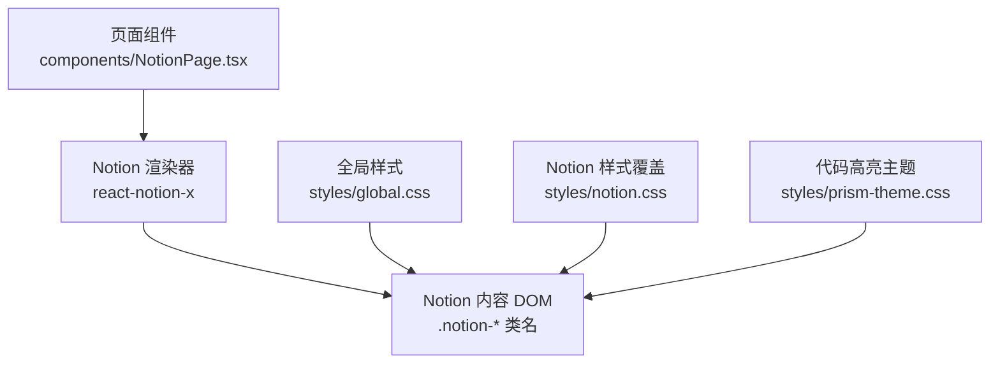
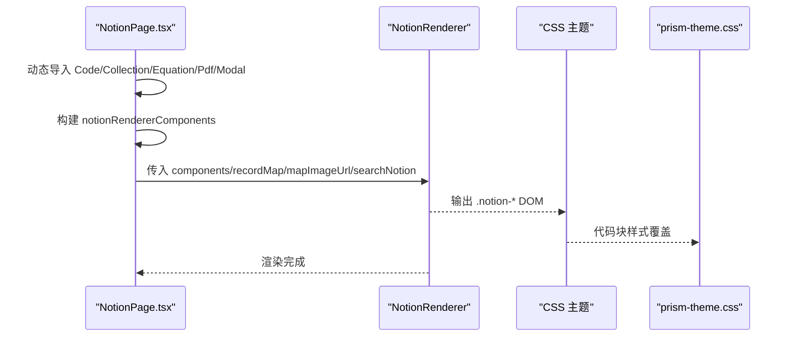
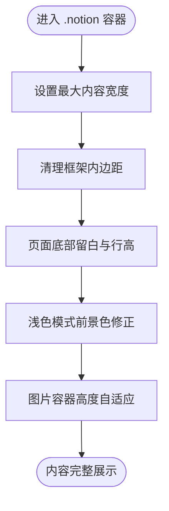
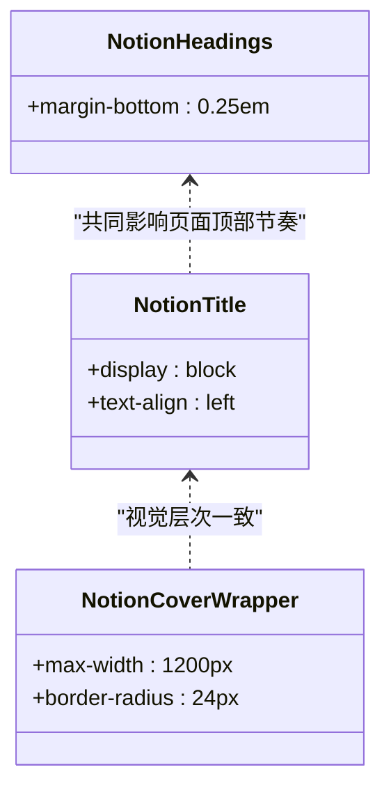
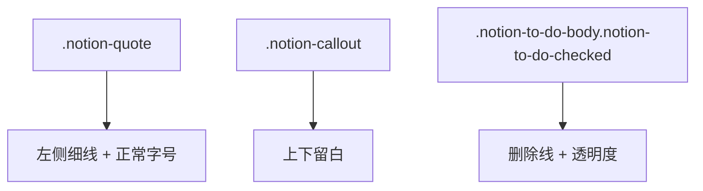
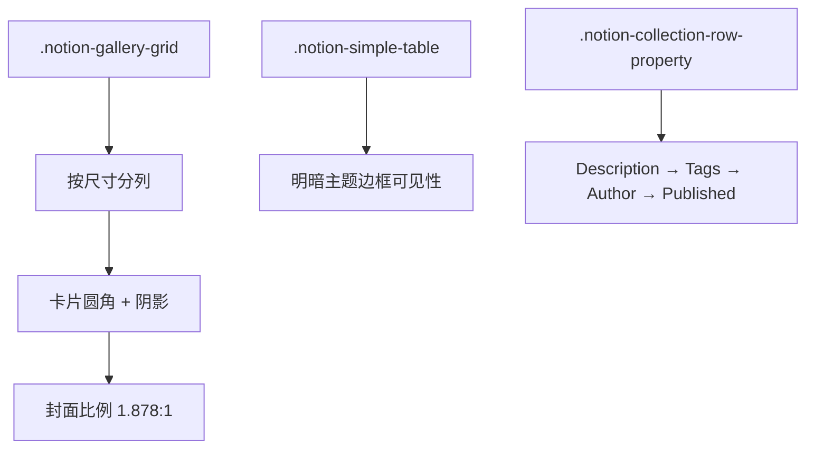
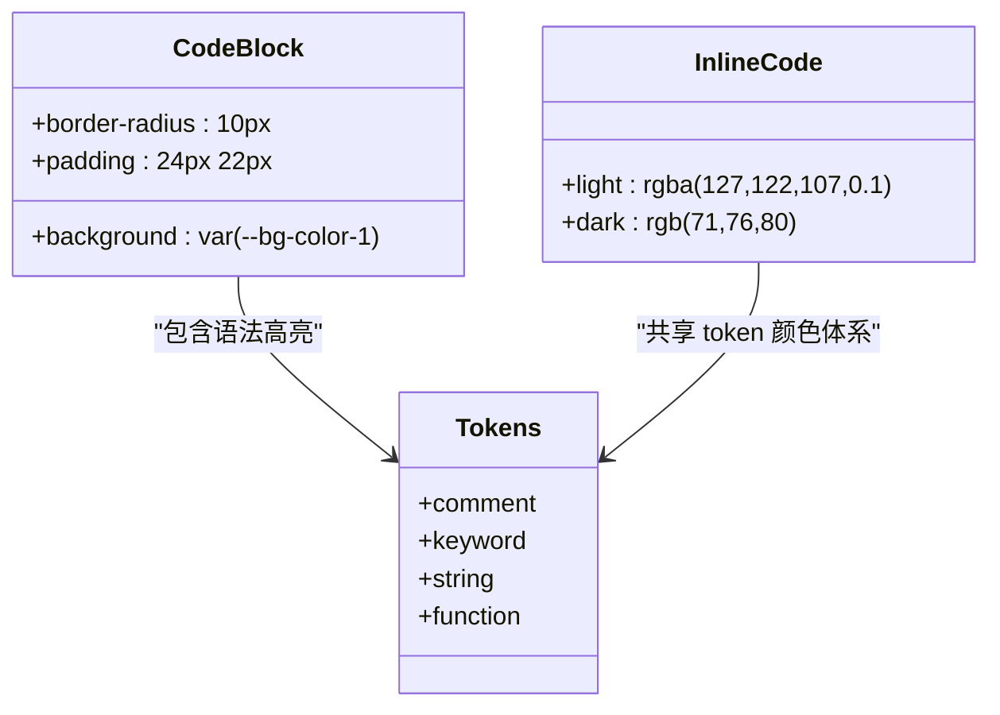
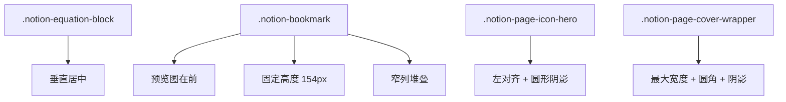
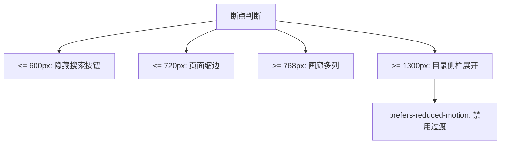

# Notion 内容样式

<cite>
**本文引用的文件**   
- [styles/notion.css](file://styles/notion.css)
- [styles/global.css](file://styles/global.css)
- [styles/prism-theme.css](file://styles/prism-theme.css)
- [components/NotionPage.tsx](file://components/NotionPage.tsx)
</cite>

## 目录
1. [简介](#简介)
2. [项目结构与样式加载关系](#项目结构与样式加载关系)
3. [核心样式定制总览](#核心样式定制总览)
4. [架构与渲染流程](#架构与渲染流程)
5. [块元素与基础排版定制](#块元素与基础排版定制)
6. [标题层级与正文排版](#标题层级与正文排版)
7. [列表、引用与提示块](#列表引用与提示块)
8. [表格与集合卡片](#表格与集合卡片)
9. [代码块高亮与行内代码](#代码块高亮与行内代码)
10. [数学公式与媒体资源适配](#数学公式与媒体资源适配)
11. [响应式断点与移动端优化](#响应式断点与移动端优化)
12. [打印样式与可访问性](#打印样式与可访问性)
13. [常见问题排查](#常见问题排查)
14. [性能优化建议](#性能优化建议)
15. [结论](#结论)

## 简介
本文件系统性说明 `styles/notion.css` 对 Notion 渲染内容的样式定制方案，覆盖块元素、标题层级、列表、表格、引用块、代码高亮、数学公式、媒体资源、响应式断点、移动端优化以及高级主题定制方法。文档同时结合组件层如何注入 Notion 渲染器，帮助你在不破坏原有 Notion 语义的前提下进行可控扩展。

## 项目结构与样式加载关系
本项目中，Notion 内容通过 `react-notion-x` 渲染，站点在页面组件中注入自定义组件、图片映射、搜索能力等；样式方面：
- `styles/global.css` 提供全局字体栈、滚动条、基础重置。
- `styles/notion.css` 针对 `react-notion-x` 输出的 `.notion-*` 类名做站点级覆盖。
- `styles/prism-theme.css` 专门处理代码块和语法高亮的视觉表现，并明确说明其加载顺序晚于 `notion.css`，因此能覆盖默认样式。

**图示来源**  
- [components/NotionPage.tsx:196-209](file://components/NotionPage.tsx#L196-L209)  
- [components/NotionPage.tsx:319-340](file://components/NotionPage.tsx#L319-L340)  
- [styles/notion.css:1-13](file://styles/notion.css#L1-L13)  
- [styles/prism-theme.css:1-14](file://styles/prism-theme.css#L1-L14)

**章节来源**  
- [components/NotionPage.tsx:196-209](file://components/NotionPage.tsx#L196-L209)  
- [components/NotionPage.tsx:319-340](file://components/NotionPage.tsx#L319-L340)  
- [styles/global.css:16-25](file://styles/global.css#L16-L25)  
- [styles/notion.css:1-13](file://styles/notion.css#L1-L13)  
- [styles/prism-theme.css:1-14](file://styles/prism-theme.css#L1-L14)

## 核心样式定制总览
- 根容器变量：定义最大内容宽度、头部高度，便于统一控制布局。
- 页面容器：调整底部留白、行高、浅色模式前景色。
- 资产与图片：修复 react-notion-x v8 的图片裁剪问题，保持原始宽高比。
- 画廊与集合卡片：栅格列数、卡片圆角、阴影、封面比例。
- 引用块：恢复 Notion 原生的左竖线、正常字号与正文字体。
- 标题与分割线：统一 H1-H3 下边距、HR 间距。
- 书签链接：还原 Notion 的预览图位置、固定高度、圆角规则。
- 表格网格：增强边框可见性，区分明暗主题。
- 文章大纲侧栏：大屏悬停展开、小屏隐藏、减少动效。

**章节来源**  
- [styles/notion.css:10-28](file://styles/notion.css#L10-L28)  
- [styles/notion.css:47-60](file://styles/notion.css#L47-L60)  
- [styles/notion.css:72-171](file://styles/notion.css#L72-L171)  
- [styles/notion.css:183-206](file://styles/notion.css#L183-L206)  
- [styles/notion.css:451-578](file://styles/notion.css#L451-L578)  
- [styles/notion.css:644-793](file://styles/notion.css#L644-L793)

## 架构与渲染流程
Notion 页面由 `NotionPage` 组件负责组装：
- 动态导入代码高亮、集合、公式、PDF、弹窗等第三方组件。
- 将 Next.js 的 `Image`、`Link` 替换为 Notion 渲染器的图片与链接实现。
- 根据是否为博客文章决定是否显示目录侧栏。
- 注入深色模式类名、lite 模式类名，驱动 CSS 分支。
- 配置 `NotionRenderer` 的 recordMap、地图映射、搜索、页眉、页脚等。

**图示来源**  
- [components/NotionPage.tsx:43-142](file://components/NotionPage.tsx#L43-L142)  
- [components/NotionPage.tsx:196-209](file://components/NotionPage.tsx#L196-L209)  
- [components/NotionPage.tsx:319-340](file://components/NotionPage.tsx#L319-L340)  
- [styles/prism-theme.css:1-14](file://styles/prism-theme.css#L1-L14)

**章节来源**  
- [components/NotionPage.tsx:43-142](file://components/NotionPage.tsx#L43-L142)  
- [components/NotionPage.tsx:196-209](file://components/NotionPage.tsx#L196-L209)  
- [components/NotionPage.tsx:319-340](file://components/NotionPage.tsx#L319-L340)

## 块元素与基础排版定制
- 根容器 `.notion` 设置 `--notion-max-width` 与 `--notion-header-height`，首页 `.index-page` 扩大最大宽度。
- `.notion-frame` 去除多余内边距，`.notion-page` 增加底部留白与行高。
- 浅色模式前景色被显式设置为接近 Notion 官方值。
- 文本块 `.notion-text` 微调内边距，资产标题居中，资产包裹块上下留白。
- 图片块修复：强制图片容器高度自适应，避免 react-notion-x v8 的固定高度导致裁剪。

**图示来源**  
- [styles/notion.css:10-36](file://styles/notion.css#L10-L36)  
- [styles/notion.css:47-60](file://styles/notion.css#L47-L60)

**章节来源**  
- [styles/notion.css:10-36](file://styles/notion.css#L10-L36)  
- [styles/notion.css:47-60](file://styles/notion.css#L47-L60)

## 标题层级与正文排版
- H1/H2/H3 统一减小下边距，使段落更紧凑。
- 页面标题 `.notion-title` 改为块级左对齐，配合头像左对齐，整体更贴近 Notion 原版。
- 页面封面容器限制最大宽度并添加圆角与阴影，小于特定宽度时移除圆角。

**图示来源**  
- [styles/notion.css:194-198](file://styles/notion.css#L194-L198)  
- [styles/notion.css:234-243](file://styles/notion.css#L234-L243)  
- [styles/notion.css:265-282](file://styles/notion.css#L265-L282)

**章节来源**  
- [styles/notion.css:194-198](file://styles/notion.css#L194-L198)  
- [styles/notion.css:234-243](file://styles/notion.css#L234-L243)  
- [styles/notion.css:265-282](file://styles/notion.css#L265-L282)

## 列表、引用与提示块
- 引用块 `.notion-quote` 使用当前文字颜色绘制左侧细线，字号与行高回归 Notion 原生风格。
- 提示块 `.notion-callout` 调整上下外边距，使其与正文节奏一致。
- 分割线 `.notion-hr` 统一间距。
- 复选框文本在已勾选状态下删除线与半透明，匹配 Notion 行为。

**图示来源**  
- [styles/notion.css:183-206](file://styles/notion.css#L183-L206)  
- [styles/notion.css:559-566](file://styles/notion.css#L559-L566)

**章节来源**  
- [styles/notion.css:183-206](file://styles/notion.css#L183-L206)  
- [styles/notion.css:559-566](file://styles/notion.css#L559-L566)

## 表格与集合卡片
- 简单表格 `.notion-simple-table` 及其单元格边框颜色在明暗主题下分别设置，提升网格可见性。
- 画廊网格 `.notion-gallery-grid`：
  - 移动端单列，桌面端按密度分为两列或三列。
  - 卡片圆角、阴影、封面比例固定为约 1.878:1，保证视觉一致性。
- 集合属性行：隐藏属性标签列，重排 Description → Tags → Author → Published，保持描述换行与字体一致。

**图示来源**  
- [styles/notion.css:72-171](file://styles/notion.css#L72-L171)  
- [styles/notion.css:570-578](file://styles/notion.css#L570-L578)  
- [styles/notion.css:584-639](file://styles/notion.css#L584-L639)

**章节来源**  
- [styles/notion.css:72-171](file://styles/notion.css#L72-L171)  
- [styles/notion.css:570-578](file://styles/notion.css#L570-L578)  
- [styles/notion.css:584-639](file://styles/notion.css#L584-L639)

## 代码块高亮与行内代码
- 代码块容器 `.notion-code` 背景、圆角、内边距、阴影均被覆盖以匹配 Notion 原版。
- 行内代码 `.notion-inline-code` 在明暗主题下分别设置背景与文字色。
- 语法高亮 token 颜色（注释、关键字、字符串、函数等）被统一调整，确保可读性与品牌感。
- 代码块滚动条隐藏，避免干扰阅读。

**图示来源**  
- [styles/prism-theme.css:7-40](file://styles/prism-theme.css#L7-L40)  
- [styles/prism-theme.css:42-106](file://styles/prism-theme.css#L42-L106)  
- [styles/prism-theme.css:107-131](file://styles/prism-theme.css#L107-L131)

**章节来源**  
- [styles/prism-theme.css:7-40](file://styles/prism-theme.css#L7-L40)  
- [styles/prism-theme.css:42-106](file://styles/prism-theme.css#L42-L106)  
- [styles/prism-theme.css:107-131](file://styles/prism-theme.css#L107-L131)

## 数学公式与媒体资源适配
- 数学公式块 `.notion-equation.notion-equation-block` 垂直居中，改善多行公式对齐。
- 书签链接 `.notion-bookmark`：
  - 预览图位于文本之前，固定高度 154px。
  - 窄列模式下堆叠显示，图片全宽且圆角仅出现在上边缘。
  - 标题截断、描述最多两行、链接地址截断。
- 页面图标与封面：
  - 英雄头像左对齐，圆形图标加阴影。
  - 封面容器限制最大宽度并带圆角与阴影，小屏时移除圆角。

**图示来源**  
- [styles/notion.css:451-453](file://styles/notion.css#L451-L453)  
- [styles/notion.css:464-543](file://styles/notion.css#L464-L543)  
- [styles/notion.css:398-406](file://styles/notion.css#L398-L406)  
- [styles/notion.css:265-282](file://styles/notion.css#L265-L282)

**章节来源**  
- [styles/notion.css:451-453](file://styles/notion.css#L451-L453)  
- [styles/notion.css:464-543](file://styles/notion.css#L464-L543)  
- [styles/notion.css:398-406](file://styles/notion.css#L398-L406)  
- [styles/notion.css:265-282](file://styles/notion.css#L265-L282)

## 响应式断点与移动端优化
- 768px 及以上：画廊按密度显示 2 列或 3 列。
- 920px 及以下：首页左右内边距缩小。
- 720px 及以下：普通页面左右内边距缩小。
- 600px 及以下：隐藏搜索按钮。
- 1200px 及以下：封面容器圆角归零。
- 1300px 及以上且高度满足条件：右侧目录侧栏悬停展开，小屏或矮屏隐藏。
- 减少动效偏好：禁用侧栏过渡动画。

**图示来源**  
- [styles/notion.css:82-93](file://styles/notion.css#L82-L93)  
- [styles/notion.css:208-226](file://styles/notion.css#L208-L226)  
- [styles/notion.css:276-282](file://styles/notion.css#L276-L282)  
- [styles/notion.css:644-793](file://styles/notion.css#L644-L793)

**章节来源**  
- [styles/notion.css:82-93](file://styles/notion.css#L82-L93)  
- [styles/notion.css:208-226](file://styles/notion.css#L208-L226)  
- [styles/notion.css:276-282](file://styles/notion.css#L276-L282)  
- [styles/notion.css:644-793](file://styles/notion.css#L644-L793)

## 打印样式与可访问性
- 当前样式文件中未定义专门的 `@media print` 规则。若需要打印优化，可在现有响应式结构基础上追加打印媒体查询，例如：
  - 隐藏交互元素（如侧栏、搜索按钮）。
  - 简化背景与阴影，确保黑白打印可读。
  - 强制链接显示 URL，避免打印后无法定位。
- 可访问性方面：
  - 尊重 `prefers-reduced-motion`，禁用不必要的过渡。
  - 使用语义化类名与对比度合理的颜色，保证明暗主题下的可读性。

[本节为通用指导，不直接分析具体文件]

## 常见问题排查
- 图片被裁剪或比例异常：
  - 检查是否覆盖了图片容器高度；应保留自适应高度与最大高度解除。
  - 参考图片修复相关选择器路径。
- 表格网格线不可见：
  - 确认表格边框颜色在明暗主题下均已设置，避免使用过浅的 alpha 值。
- 书签链接布局错乱：
  - 核对预览图顺序、固定高度、窄列堆叠规则是否与 Notion 原版一致。
- 代码块样式不生效：
  - 确认 prism-theme.css 加载顺序晚于 notion.css，否则会被覆盖。
- 目录侧栏在小屏出现：
  - 检查断点条件，确保小于阈值时隐藏侧栏。

**章节来源**  
- [styles/notion.css:47-60](file://styles/notion.css#L47-L60)  
- [styles/notion.css:570-578](file://styles/notion.css#L570-L578)  
- [styles/notion.css:464-543](file://styles/notion.css#L464-L543)  
- [styles/prism-theme.css:1-14](file://styles/prism-theme.css#L1-L14)  
- [styles/notion.css:782-793](file://styles/notion.css#L782-L793)

## 性能优化建议
- 按需加载第三方组件：
  - 代码高亮、集合、公式、PDF、弹窗均采用动态导入，减少首屏体积。
- 避免过度使用复杂背景与阴影：
  - 大量渐变与阴影会影响滚动性能，尤其在低端设备上。
- 合理使用 `!important`：
  - 仅在必要时使用，避免维护成本上升与样式冲突。
- 利用 CSS 变量：
  - 通过 `--fg-color`、`--bg-color` 等变量统一管理主题，减少重复计算。
- 减少重绘与回流：
  - 避免频繁修改布局属性（如 width、height），优先使用 transform 与 opacity。

**章节来源**  
- [components/NotionPage.tsx:43-142](file://components/NotionPage.tsx#L43-L142)  
- [styles/notion.css:10-28](file://styles/notion.css#L10-L28)  
- [styles/notion.css:398-417](file://styles/notion.css#L398-L417)

## 结论
通过对 `styles/notion.css`、`styles/prism-theme.css` 与 `components/NotionPage.tsx` 的配合，本项目在不破坏 Notion 语义的前提下实现了高度可控的内容样式定制。你可以基于本文档的模块划分，逐步扩展标题、列表、表格、代码、公式与媒体资源的样式，并结合响应式断点与可访问性最佳实践，构建稳定、美观且高性能的 Notion 内容展示层。