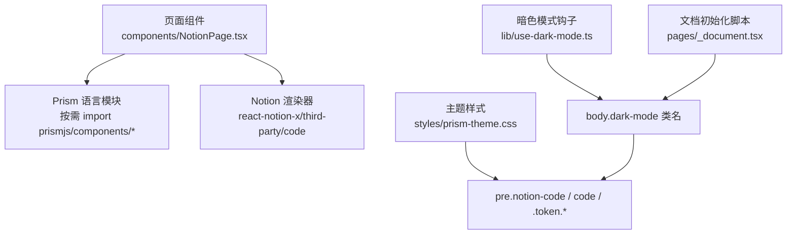
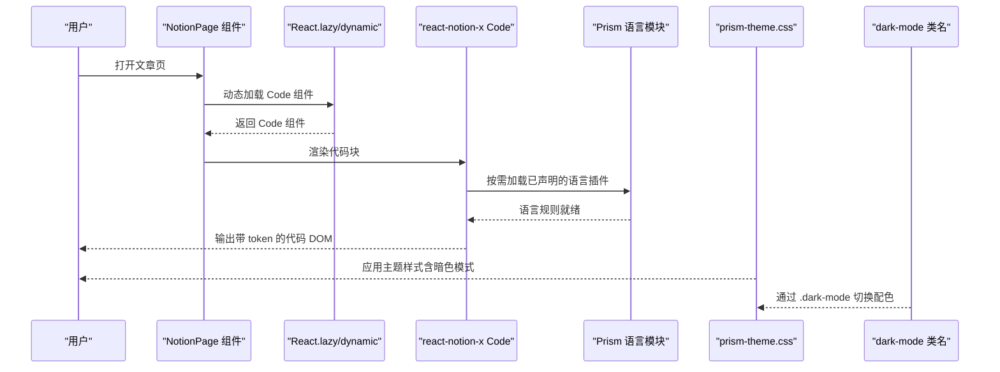
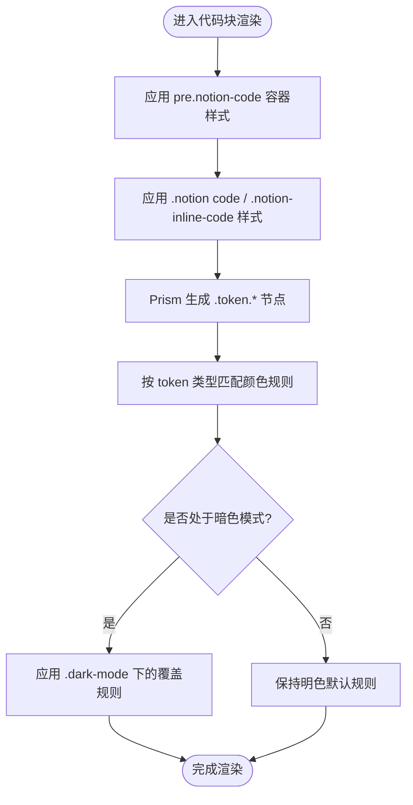
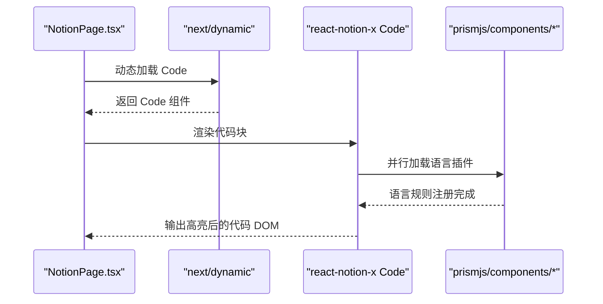
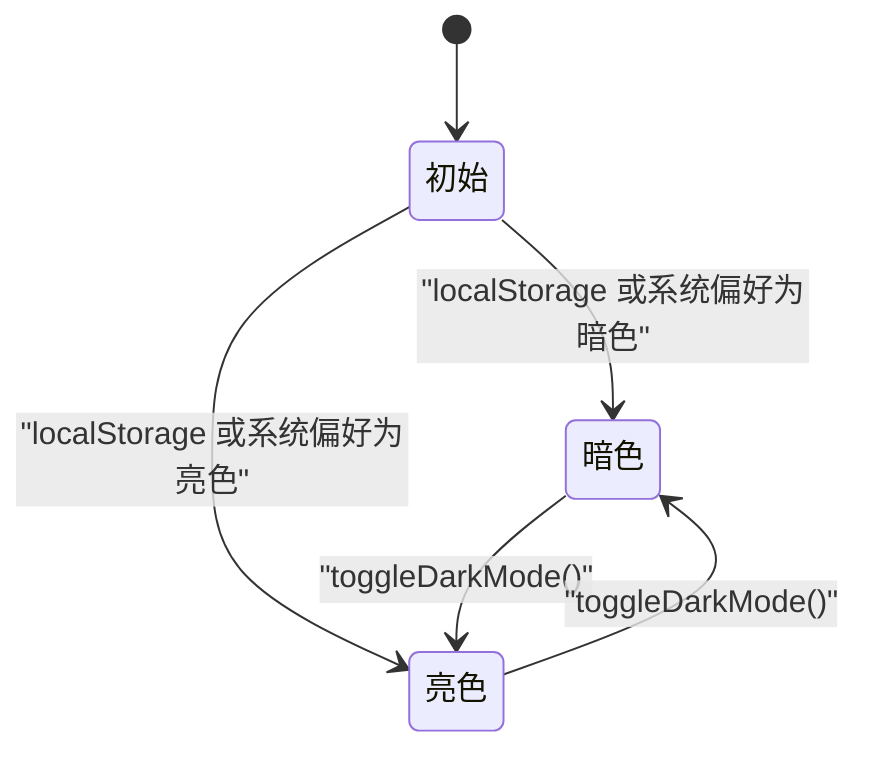
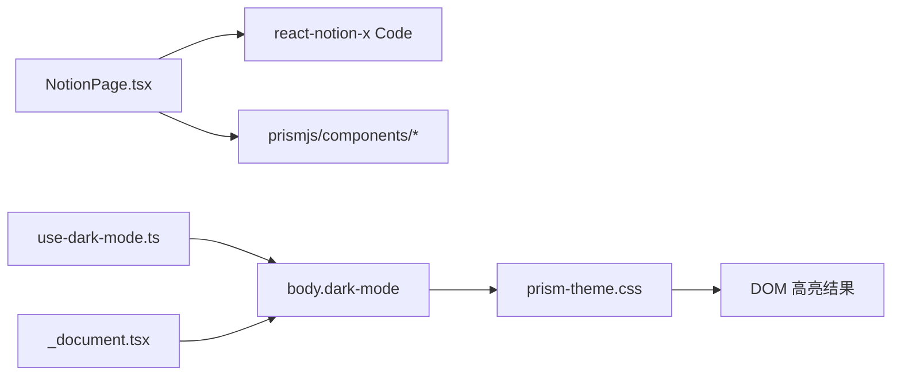

# 代码高亮主题

<cite>
**本文引用的文件**   
- [styles/prism-theme.css](file://styles/prism-theme.css)
- [components/NotionPage.tsx](file://components/NotionPage.tsx)
- [lib/use-dark-mode.ts](file://lib/use-dark-mode.ts)
- [pages/_document.tsx](file://pages/_document.tsx)
</cite>

## 目录
1. [简介](#简介)
2. [项目结构](#项目结构)
3. [核心组件](#核心组件)
4. [架构总览](#架构总览)
5. [详细组件分析](#详细组件分析)
6. [依赖关系分析](#依赖关系分析)
7. [性能与优化](#性能与优化)
8. [故障排查指南](#故障排查指南)
9. [结论](#结论)
10. [附录：主题定制清单](#附录主题定制清单)

## 简介
本文件系统性说明本项目中基于 Prism.js 的代码高亮主题定制方案，覆盖配色方案、关键字与注释样式、字符串格式化、暗色模式适配、响应式布局以及扩展语言支持。主题样式集中在 styles/prism-theme.css，语言加载在 components/NotionPage.tsx 中按需动态引入，暗色模式通过 lib/use-dark-mode.ts 与 pages/_document.tsx 协同实现。

## 项目结构
与代码高亮主题直接相关的文件组织如下：
- 主题样式：styles/prism-theme.css
- 语言加载与渲染集成：components/NotionPage.tsx
- 暗色模式状态与类名注入：lib/use-dark-mode.ts
- 首屏无闪烁的暗色模式初始化脚本：pages/_document.tsx

图表来源
- [components/NotionPage.tsx:43-112](file://components/NotionPage.tsx#L43-L112)
- [styles/prism-theme.css:1-131](file://styles/prism-theme.css#L1-L131)
- [lib/use-dark-mode.ts:1-10](file://lib/use-dark-mode.ts#L1-L10)
- [pages/_document.tsx:52-100](file://pages/_document.tsx#L52-L100)

章节来源
- [components/NotionPage.tsx:43-112](file://components/NotionPage.tsx#L43-L112)
- [styles/prism-theme.css:1-131](file://styles/prism-theme.css#L1-L131)
- [lib/use-dark-mode.ts:1-10](file://lib/use-dark-mode.ts#L1-L10)
- [pages/_document.tsx:52-100](file://pages/_document.tsx#L52-L100)

## 核心组件
- 主题样式（styles/prism-theme.css）
  - 覆盖 Notion 代码块容器 pre.notion-code 的背景、阴影、边框与圆角，使其与 Notion 风格一致。
  - 为 .notion code 与 .notion-inline-code 设置内联代码颜色与背景，区分明暗模式。
  - 定义 .token.* 各类语法元素（注释、关键字、字符串、函数、变量等）的颜色。
  - 隐藏滚动条并清理默认装饰伪元素，保证代码块外观整洁。
- 语言加载（components/NotionPage.tsx）
  - 使用 React.lazy + dynamic 按需加载 react-notion-x/third-party/code。
  - 在 Code 组件首次渲染前，Promise.allSettled 并行加载多种 Prism 语言插件，避免阻塞首屏。
  - 将自定义 Code 组件注入到 notionRendererComponents，供 Notion 渲染器使用。
- 暗色模式（lib/use-dark-mode.ts, pages/_document.tsx）
  - useDarkMode 提供 isDarkMode 与 toggleDarkMode，并在 body 上切换 dark-mode 类名。
  - _document.tsx 内嵌 noflash 脚本，在 JS 执行前根据系统偏好或本地存储设置初始主题，避免闪烁。

章节来源
- [styles/prism-theme.css:1-131](file://styles/prism-theme.css#L1-L131)
- [components/NotionPage.tsx:43-112](file://components/NotionPage.tsx#L43-L112)
- [lib/use-dark-mode.ts:1-10](file://lib/use-dark-mode.ts#L1-L10)
- [pages/_document.tsx:52-100](file://pages/_document.tsx#L52-L100)

## 架构总览
下图展示从页面渲染到代码高亮的完整流程，包括语言按需加载、主题样式应用与暗色模式切换。

图表来源
- [components/NotionPage.tsx:43-112](file://components/NotionPage.tsx#L43-L112)
- [styles/prism-theme.css:1-131](file://styles/prism-theme.css#L1-L131)
- [lib/use-dark-mode.ts:1-10](file://lib/use-dark-mode.ts#L1-L10)

## 详细组件分析

### 主题样式（styles/prism-theme.css）
- 代码块容器 pre.notion-code
  - 背景使用 CSS 变量 --bg-color-1，移除默认渐变与阴影，统一圆角与内边距，确保与 Notion 原生体验一致。
  - 暗色模式下复用同一变量，保持背景一致性。
- 行内代码 .notion code 与 .notion-inline-code
  - 明色模式：浅色背景 + 强调色文本；暗色模式：深色背景 + 高对比度文本。
- 语法 token 分类
  - 注释、CDATA/DOCTYPE/Prolog、标点符号：中性灰调，暗色模式提高亮度。
  - 布尔值、常量、删除标记、数字、属性、符号、标签：绿色系。
  - 属性名、内置类型、字符、插入标记、选择器、字符串：紫色系。
  - CSS/Style 中的字符串、实体、运算符、URL：橙色系。
  - at-rule、属性值、关键字：蓝色系。
  - 类名、函数：粉色系。
  - important、正则、变量：橙色系。
- 基础字体与滚动条
  - 为 code/pre 设置基础文本颜色，暗色模式切换为亮色。
  - 隐藏滚动条，提升视觉整洁度。
- 清理默认装饰
  - 移除左侧边框、阴影与背景，禁用 before/after 伪元素，避免与 Notion 样式冲突。

图表来源
- [styles/prism-theme.css:1-131](file://styles/prism-theme.css#L1-L131)

章节来源
- [styles/prism-theme.css:1-131](file://styles/prism-theme.css#L1-L131)

### 语言加载与按需引入（components/NotionPage.tsx）
- 动态加载 Code 组件
  - 使用 next/dynamic 包裹 react-notion-x/third-party/code，仅在需要时加载。
- 并行加载 Prism 语言插件
  - 在 Code 组件首次渲染前，使用 Promise.allSettled 并行导入多种语言模块，如 HTML、CSS、JS、Python、SQL、YAML 等。
  - 该策略减少首屏体积，同时保证多语言高亮能力。
- 注入自定义组件
  - 将 Code 组件放入 notionRendererComponents，使 Notion 渲染器使用我们的自定义高亮逻辑。

图表来源
- [components/NotionPage.tsx:43-112](file://components/NotionPage.tsx#L43-L112)

章节来源
- [components/NotionPage.tsx:43-112](file://components/NotionPage.tsx#L43-L112)

### 暗色模式适配（lib/use-dark-mode.ts, pages/_document.tsx）
- useDarkMode 钩子
  - 暴露 isDarkMode 与 toggleDarkMode，并在 body 上添加/移除 dark-mode 类名。
- 首屏无闪烁脚本
  - 在 _document.tsx 中内联 noflash 脚本，优先读取 localStorage 或系统 prefers-color-scheme，立即设置 body 类名，避免白屏闪烁。
- 主题样式联动
  - prism-theme.css 通过 .dark-mode 选择器覆盖 token 颜色与背景，确保暗色模式下的可读性与对比度。

图表来源
- [lib/use-dark-mode.ts:1-10](file://lib/use-dark-mode.ts#L1-L10)
- [pages/_document.tsx:52-100](file://pages/_document.tsx#L52-L100)
- [styles/prism-theme.css:16-34](file://styles/prism-theme.css#L16-L34)

章节来源
- [lib/use-dark-mode.ts:1-10](file://lib/use-dark-mode.ts#L1-L10)
- [pages/_document.tsx:52-100](file://pages/_document.tsx#L52-L100)
- [styles/prism-theme.css:16-34](file://styles/prism-theme.css#L16-L34)

## 依赖关系分析
- 组件层
  - NotionPage.tsx 依赖 react-notion-x 的 Code 组件进行代码块渲染。
  - 通过 dynamic 与 Promise.allSettled 管理 Prism 语言模块的按需加载。
- 样式层
  - prism-theme.css 覆盖 Notion 与 Prism 默认样式，提供一致的视觉体验。
  - 通过 .dark-mode 类名与 CSS 变量实现主题切换。
- 运行时
  - use-dark-mode.ts 提供暗色模式状态与切换方法。
  - _document.tsx 提供首屏主题初始化脚本，避免闪烁。

图表来源
- [components/NotionPage.tsx:43-112](file://components/NotionPage.tsx#L43-L112)
- [styles/prism-theme.css:1-131](file://styles/prism-theme.css#L1-L131)
- [lib/use-dark-mode.ts:1-10](file://lib/use-dark-mode.ts#L1-L10)
- [pages/_document.tsx:52-100](file://pages/_document.tsx#L52-L100)

章节来源
- [components/NotionPage.tsx:43-112](file://components/NotionPage.tsx#L43-L112)
- [styles/prism-theme.css:1-131](file://styles/prism-theme.css#L1-L131)
- [lib/use-dark-mode.ts:1-10](file://lib/use-dark-mode.ts#L1-L10)
- [pages/_document.tsx:52-100](file://pages/_document.tsx#L52-L100)

## 性能与优化
- 按需加载语言模块
  - 使用 dynamic 与 Promise.allSettled 并行加载 Prism 语言插件，减少首屏包体，提升加载速度。
- 避免不必要的重绘
  - 隐藏滚动条、移除伪元素与多余边框，降低渲染开销。
- 主题切换无闪烁
  - 通过 _document.tsx 的内联脚本在 JS 执行前设置 body 类名，避免主题闪烁。
- 建议
  - 仅引入实际使用的语言模块，避免冗余。
  - 对长代码块考虑虚拟滚动或分页显示，减少一次性渲染压力。
  - 使用 CSS 变量统一管理主题色，便于维护与扩展。

[本节为通用指导，不直接分析具体文件]

## 故障排查指南
- 代码块背景异常
  - 检查 pre.notion-code 是否被其他样式覆盖；确认使用了 var(--bg-color-1)。
  - 参考：[styles/prism-theme.css:7-14](file://styles/prism-theme.css#L7-L14)
- 暗色模式未生效
  - 确认 body 是否存在 .dark-mode 类名；检查 use-dark-mode.ts 与 _document.tsx 是否正确初始化。
  - 参考：[lib/use-dark-mode.ts:1-10](file://lib/use-dark-mode.ts#L1-L10)、[pages/_document.tsx:52-100](file://pages/_document.tsx#L52-L100)
- 某些语言未高亮
  - 检查对应语言模块是否在 NotionPage.tsx 中按需加载。
  - 参考：[components/NotionPage.tsx:43-112](file://components/NotionPage.tsx#L43-L112)
- 行内代码样式异常
  - 检查 .notion code 与 .notion-inline-code 的选择器优先级与 !important 的使用。
  - 参考：[styles/prism-theme.css:19-40](file://styles/prism-theme.css#L19-L40)
- 滚动条或伪元素干扰
  - 确认 pre 滚动条隐藏与 before/after 伪元素禁用规则生效。
  - 参考：[styles/prism-theme.css:107-130](file://styles/prism-theme.css#L107-L130)

章节来源
- [styles/prism-theme.css:7-14](file://styles/prism-theme.css#L7-L14)
- [styles/prism-theme.css:19-40](file://styles/prism-theme.css#L19-L40)
- [styles/prism-theme.css:107-130](file://styles/prism-theme.css#L107-L130)
- [lib/use-dark-mode.ts:1-10](file://lib/use-dark-mode.ts#L1-L10)
- [pages/_document.tsx:52-100](file://pages/_document.tsx#L52-L100)
- [components/NotionPage.tsx:43-112](file://components/NotionPage.tsx#L43-L112)

## 结论
本项目通过集中化的主题样式与按需加载的语言模块，实现了与 Notion 风格一致的代码高亮体验，并提供了完善的暗色模式适配。通过 CSS 变量与 .dark-mode 类名，主题切换稳定且无闪烁；通过 dynamic 与 Promise.allSettled，语言加载高效且不阻塞首屏。在此基础上，可轻松扩展新语言、调整配色与语法规则，以满足不同场景的定制化需求。

[本节为总结性内容，不直接分析具体文件]

## 附录：主题定制清单
- 自定义配色方案
  - 修改 .token.* 相关规则以调整关键字、注释、字符串、函数等颜色。
  - 参考：[styles/prism-theme.css:42-98](file://styles/prism-theme.css#L42-L98)
- 切换主题
  - 通过 use-dark-mode.ts 提供的 toggleDarkMode 切换 body 的 .dark-mode 类名。
  - 参考：[lib/use-dark-mode.ts:1-10](file://lib/use-dark-mode.ts#L1-L10)
- 添加新语言支持
  - 在 NotionPage.tsx 中按需 import 对应 prismjs/components/* 模块。
  - 参考：[components/NotionPage.tsx:43-112](file://components/NotionPage.tsx#L43-L112)
- 自定义语法规则
  - 在对应语言模块中扩展或替换 Prism 的规则；或通过 CSS 覆盖 .token.* 样式。
  - 参考：[styles/prism-theme.css:42-98](file://styles/prism-theme.css#L42-L98)
- 暗色模式适配
  - 在 .dark-mode 下覆盖 token 颜色与背景，确保对比度与可读性。
  - 参考：[styles/prism-theme.css:16-34](file://styles/prism-theme.css#L16-L34)
- 代码复制功能样式
  - 若使用 react-notion-x 的复制按钮，建议在 prism-theme.css 中为其容器添加样式，确保与主题一致。
  - 当前仓库未包含复制按钮实现，可按需扩展。
- 代码块响应式布局
  - 通过调整 pre.notion-code 的 padding 与 border-radius，适配不同屏幕尺寸。
  - 参考：[styles/prism-theme.css:7-14](file://styles/prism-theme.css#L7-L14)

章节来源
- [styles/prism-theme.css:7-14](file://styles/prism-theme.css#L7-L14)
- [styles/prism-theme.css:16-34](file://styles/prism-theme.css#L16-L34)
- [styles/prism-theme.css:42-98](file://styles/prism-theme.css#L42-L98)
- [lib/use-dark-mode.ts:1-10](file://lib/use-dark-mode.ts#L1-L10)
- [components/NotionPage.tsx:43-112](file://components/NotionPage.tsx#L43-L112)