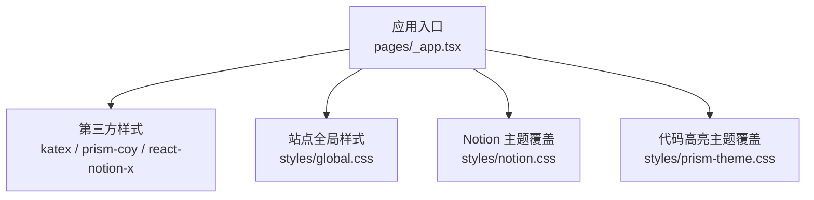
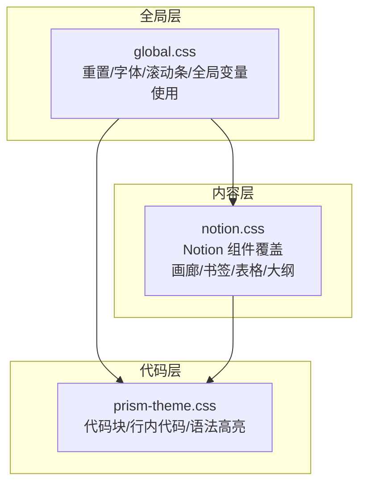
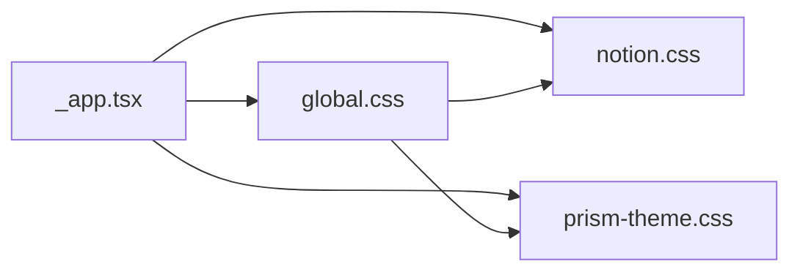

# 全局样式

<cite>
**本文引用的文件**   
- [styles/global.css](file://styles/global.css)
- [styles/notion.css](file://styles/notion.css)
- [styles/prism-theme.css](file://styles/prism-theme.css)
- [pages/_app.tsx](file://pages/_app.tsx)
</cite>

## 目录
1. [简介](#简介)
2. [项目结构与样式加载顺序](#项目结构与样式加载顺序)
3. [核心基础样式](#核心基础样式)
4. [架构总览](#架构总览)
5. [详细组件与规则分析](#详细组件与规则分析)
6. [依赖关系分析](#依赖关系分析)
7. [性能与可访问性考虑](#性能与可访问性考虑)
8. [常见问题排查](#常见问题排查)
9. [结论](#结论)
10. [附录：自定义最佳实践](#附录自定义最佳实践)

## 简介
本文件系统性说明站点的全局样式体系，重点围绕 styles/global.css 的基础设置，包括 CSS 重置、字体栈配置、全局变量使用、滚动条定制、中文字体支持、链接默认行为、文本溢出处理等。同时结合 styles/notion.css 与 styles/prism-theme.css，解释如何覆盖浏览器默认行为、统一全局布局属性，并给出扩展与自定义的最佳实践。

## 项目结构与样式加载顺序
站点在应用入口集中引入样式，确保样式加载顺序可控、优先级清晰：
- 第三方库样式优先（如 KaTeX、Prism、react-notion-x）
- 随后引入站点全局样式 global.css
- 再引入 Notion 主题覆盖 notion.css
- 最后引入代码高亮主题覆盖 prism-theme.css

**图表来源**
- [pages/_app.tsx:1-14](file://pages/_app.tsx#L1-L14)

**章节来源**
- [pages/_app.tsx:1-14](file://pages/_app.tsx#L1-L14)

## 核心基础样式
global.css 承担“最小化重置 + 全局基线”的职责，主要包含：
- 盒模型重置：所有元素采用 border-box
- 链接默认样式：继承颜色、去除下划线
- 根元素边距清零：body/html 的 margin/padding 归零
- 全局字体栈：对齐 Notion 字体族，内置中日韩（CJK）回退字体
- 横向溢出隐藏：避免页面级水平滚动
- 特定组件微调：静态推文引用块、表情图标尺寸、搜索输入前景色
- 滚动条定制：轨道、滑块、圆角与阴影

这些规则为后续 notion.css 与 prism-theme.css 的细化提供稳定基线。

**章节来源**
- [styles/global.css:1-64](file://styles/global.css#L1-L64)

## 架构总览
下图展示全局样式的职责分层与相互关系：

**图表来源**
- [styles/global.css:1-64](file://styles/global.css#L1-L64)
- [styles/notion.css:1-794](file://styles/notion.css#L1-L794)
- [styles/prism-theme.css:1-131](file://styles/prism-theme.css#L1-L131)

## 详细组件与规则分析

### CSS 重置与全局布局
- 盒模型重置：通过通用选择器将 box-sizing 设为 border-box，保证布局计算一致。
- 根元素清理：对 html/body 清除默认外边距和内边距，避免页面出现意外空白。
- 横向溢出控制：body 启用 overflow-x: hidden，防止内容过宽导致水平滚动。
- 链接默认行为：a 标签继承父级颜色并移除默认下划线，便于由上层主题统一控制交互态。

建议：如需恢复某些元素的默认行为，应在更具体的作用域内显式声明，避免污染全局。

**章节来源**
- [styles/global.css:1-14](file://styles/global.css#L1-L14)
- [styles/global.css:5-8](file://styles/global.css#L5-L8)
- [styles/global.css:16-25](file://styles/global.css#L16-L25)

### 字体栈与中文字体支持
- 定义 CSS 变量 --notion-font，聚合系统字体与平台字体，并包含 PingFang SC、Hiragino Sans GB、Microsoft YaHei 等中日韩回退字体。
- body 使用 font-family: var(--notion-font)，确保中文与英文字符渲染一致性。
- 该策略与 Notion 官方字体栈保持一致，减少跨平台字形差异。

注意：若需替换或调整字体优先级，请修改 --notion-font 变量值，并确保目标字体已正确加载。

**章节来源**
- [styles/global.css:16-25](file://styles/global.css#L16-L25)

### 全局变量与主题适配
- 滚动条样式大量使用 CSS 变量：--bg-color、--bg-color-1、--fg-color、--fg-color-1。
- 这些变量通常由上层主题（如 Notion 主题）注入，global.css 仅消费变量，不定义变量本身。
- 优点：切换明暗主题时，滚动条自动跟随主题色，无需额外逻辑。

建议：新增全局视觉变量时，尽量遵循语义命名（如 --bg-color-*、--fg-color-*），并在主题层集中定义。

**章节来源**
- [styles/global.css:45-63](file://styles/global.css#L45-L63)

### 滚动条样式定制
- 轨道背景：使用 --bg-color 作为轨道底色，保持与页面背景一致。
- 滑块样式：圆角、内阴影与滑块底色使用 --fg-color-1，提升对比度与质感。
- 尺寸：宽度与高度较小，避免占用过多可视空间。
- 兼容性：使用 -webkit-scrollbar 前缀以兼容 WebKit/Blink 内核；其他浏览器可通过 scrollbar-width 等属性渐进增强。

提示：代码块区域在 prism-theme.css 中隐藏了滚动条，避免重复滚动条影响阅读体验。

**章节来源**
- [styles/global.css:45-63](file://styles/global.css#L45-L63)
- [styles/prism-theme.css:107-113](file://styles/prism-theme.css#L107-L113)

### 特定组件微调
- 静态推文引用块：重置内外边距，使其与正文对齐。
- 推文表情图标：固定宽高比例，避免破坏行高。
- 搜索输入前景色：使用 --fg-color 变量，确保与主题一致。

这些规则属于局部优化，不影响全局布局。

**章节来源**
- [styles/global.css:27-43](file://styles/global.css#L27-L43)

### 文本溢出与可读性
- 全局层面未强制截断文本，保留自然换行。
- 在 Notion 相关样式中，多处针对标题、描述、链接文本使用 white-space、overflow、text-overflow 组合，实现优雅截断与省略号显示。
- 例如：书签标题、描述、链接文本均设置了合适的溢出处理，保证在小屏或窄列下的可读性。

建议：新增需要截断的文本容器时，优先使用 text-overflow: ellipsis 配合 white-space: nowrap 或 line-clamp 方案。

**章节来源**
- [styles/notion.css:492-524](file://styles/notion.css#L492-L524)

### 链接样式与交互
- 全局 a 标签继承颜色且无下划线，交由上层主题控制悬停态与激活态。
- Notion 内部链接强调标题加粗与下划线，provider 名称使用次要色，符合 Notion 风格。
- 书签链接文本也做了溢出处理，避免长 URL 破坏布局。

建议：如需统一全站链接样式，建议在主题层定义统一的 :hover/:focus 状态，而非在 global.css 中硬编码。

**章节来源**
- [styles/global.css:5-8](file://styles/global.css#L5-L8)
- [styles/notion.css:545-557](file://styles/notion.css#L545-L557)
- [styles/notion.css:513-524](file://styles/notion.css#L513-L524)

### 代码高亮与滚动条
- 代码块背景、边框、圆角与内边距由 prism-theme.css 统一处理，并与 Notion 风格对齐。
- 行内代码与代码块在明暗模式下分别设置不同前景色与背景色。
- 代码块区域隐藏滚动条，避免与页面滚动条冲突。

建议：如需自定义语法高亮配色，请在 prism-theme.css 中覆盖对应 token 类名。

**章节来源**
- [styles/prism-theme.css:1-40](file://styles/prism-theme.css#L1-L40)
- [styles/prism-theme.css:107-113](file://styles/prism-theme.css#L107-L113)

## 依赖关系分析
- global.css 被 _app.tsx 引入，作为站点全局样式基线。
- notion.css 与 prism-theme.css 在 _app.tsx 中按顺序引入，形成“全局 → Notion → 代码高亮”的层级覆盖。
- global.css 中的 CSS 变量由上层主题注入，自身只消费变量，降低耦合。

**图表来源**
- [pages/_app.tsx:1-14](file://pages/_app.tsx#L1-L14)
- [styles/global.css:1-64](file://styles/global.css#L1-L64)
- [styles/notion.css:1-794](file://styles/notion.css#L1-L794)
- [styles/prism-theme.css:1-131](file://styles/prism-theme.css#L1-L131)

**章节来源**
- [pages/_app.tsx:1-14](file://pages/_app.tsx#L1-L14)

## 性能与可访问性考虑
- 滚动条样式使用小尺寸与低对比度阴影，避免过度绘制。
- 字体栈优先使用系统字体，减少网络请求与字体闪烁。
- 文本溢出处理避免长文本撑破布局，提升移动端可读性。
- 代码块隐藏滚动条，减少重复滚动控件带来的交互干扰。
- 建议使用 prefers-reduced-motion 媒体查询禁用不必要的过渡动画（见 notion.css 中对大纲区域的适配）。

[本节为通用指导，不直接分析具体文件]

## 常见问题排查
- 滚动条颜色异常
  - 现象：滚动条颜色与主题不一致。
  - 原因：CSS 变量未定义或主题未生效。
  - 排查：确认 --bg-color、--bg-color-1、--fg-color、--fg-color-1 是否由主题注入。
  - 参考：[styles/global.css:45-63](file://styles/global.css#L45-L63)

- 中文显示字体不正确
  - 现象：中文显示为英文字体或回退字体。
  - 原因：--notion-font 未包含目标中文字体或字体未加载。
  - 排查：检查 --notion-font 变量与字体资源加载。
  - 参考：[styles/global.css:16-25](file://styles/global.css#L16-L25)

- 链接样式不符合预期
  - 现象：链接带下划线或颜色异常。
  - 原因：全局 a 标签样式被上层主题覆盖或组件内联样式优先级更高。
  - 排查：检查 notion.css 与组件样式优先级。
  - 参考：[styles/global.css:5-8](file://styles/global.css#L5-L8)、[styles/notion.css:545-557](file://styles/notion.css#L545-L557)

- 代码块滚动条重复
  - 现象：代码块与页面同时出现滚动条。
  - 原因：未隐藏代码块滚动条。
  - 排查：确认 prism-theme.css 中滚动条隐藏规则生效。
  - 参考：[styles/prism-theme.css:107-113](file://styles/prism-theme.css#L107-L113)

**章节来源**
- [styles/global.css:45-63](file://styles/global.css#L45-L63)
- [styles/global.css:16-25](file://styles/global.css#L16-L25)
- [styles/global.css:5-8](file://styles/global.css#L5-L8)
- [styles/notion.css:545-557](file://styles/notion.css#L545-L557)
- [styles/prism-theme.css:107-113](file://styles/prism-theme.css#L107-L113)

## 结论
global.css 提供了稳定的全局基线：最小化重置、一致的字体栈、主题化的滚动条与必要的组件微调。在此基础上，notion.css 与 prism-theme.css 分别负责内容组件与代码高亮的精细化覆盖。通过合理的样式加载顺序与 CSS 变量机制，站点实现了主题一致性与良好的可维护性。

[本节为总结性内容，不直接分析具体文件]

## 附录：自定义最佳实践
- 修改默认样式
  - 优先通过 CSS 变量调整主题色与间距，避免直接覆盖全局选择器。
  - 对特定组件的覆盖应放在 notion.css 或对应模块样式文件中，保持职责分离。
- 覆盖浏览器默认行为
  - 使用更具体的作用域选择器覆盖默认样式，避免污染全局。
  - 对链接、表单、列表等常见元素，建议在主题层统一规范。
- 设置全局布局属性
  - 使用 CSS 变量管理间距、字号、行高，便于主题切换与响应式适配。
  - 谨慎使用 !important，仅在必要时用于覆盖第三方库强约束。
- 中文字体支持
  - 在 --notion-font 中按优先级添加目标中文字体，确保回退链完整。
  - 预加载关键字体以减少首屏闪烁。
- 链接样式
  - 在全局层保持简洁（继承颜色、无下划线），在主题层定义悬停与焦点态。
  - 对特殊链接（如书签、提及）在 notion.css 中单独规范。
- 文本溢出处理
  - 使用 text-overflow: ellipsis 与 white-space 控制单行截断。
  - 多行截断可使用 line-clamp，并结合 overflow 与 display 属性。
- 滚动条定制
  - 使用 CSS 变量绑定轨道与滑块颜色，确保与主题同步。
  - 在代码块区域隐藏滚动条，避免重复控件。
- 注意事项
  - 保持样式加载顺序：第三方 → 全局 → 主题 → 组件。
  - 避免在 global.css 中定义业务样式，保持其“基线”职责。
  - 关注可访问性：对比度、焦点可见性、减少动效（prefers-reduced-motion）。

[本节为通用指导，不直接分析具体文件]