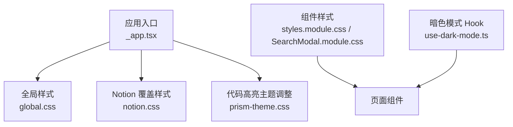
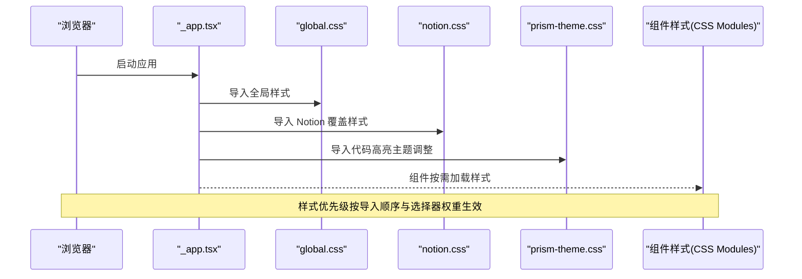
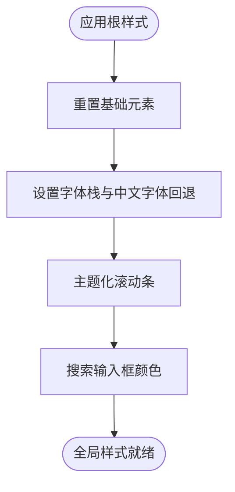
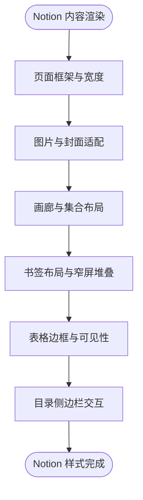
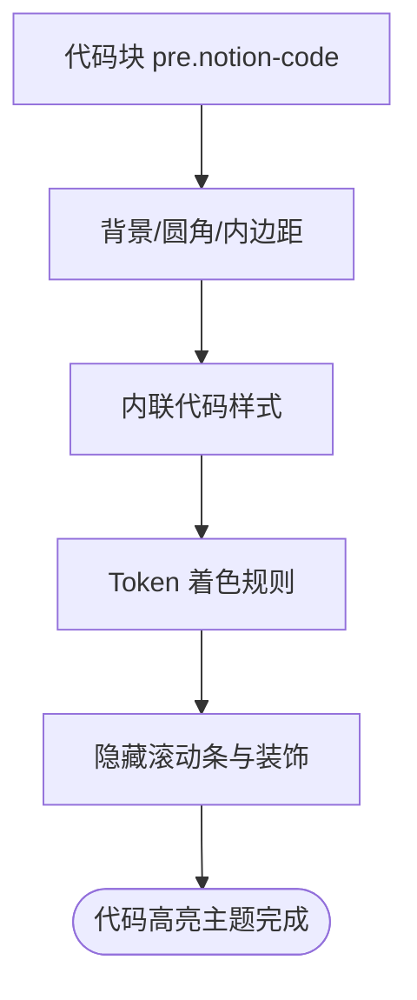
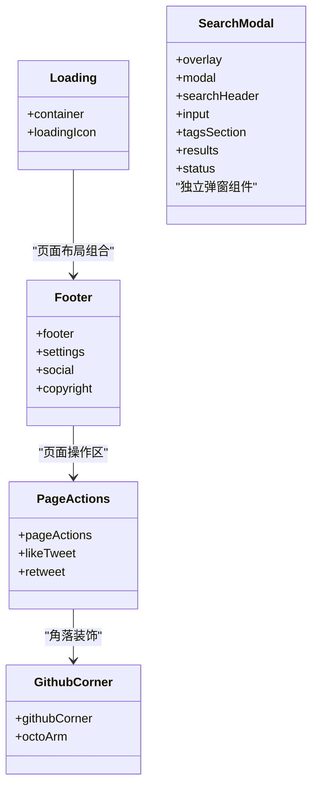
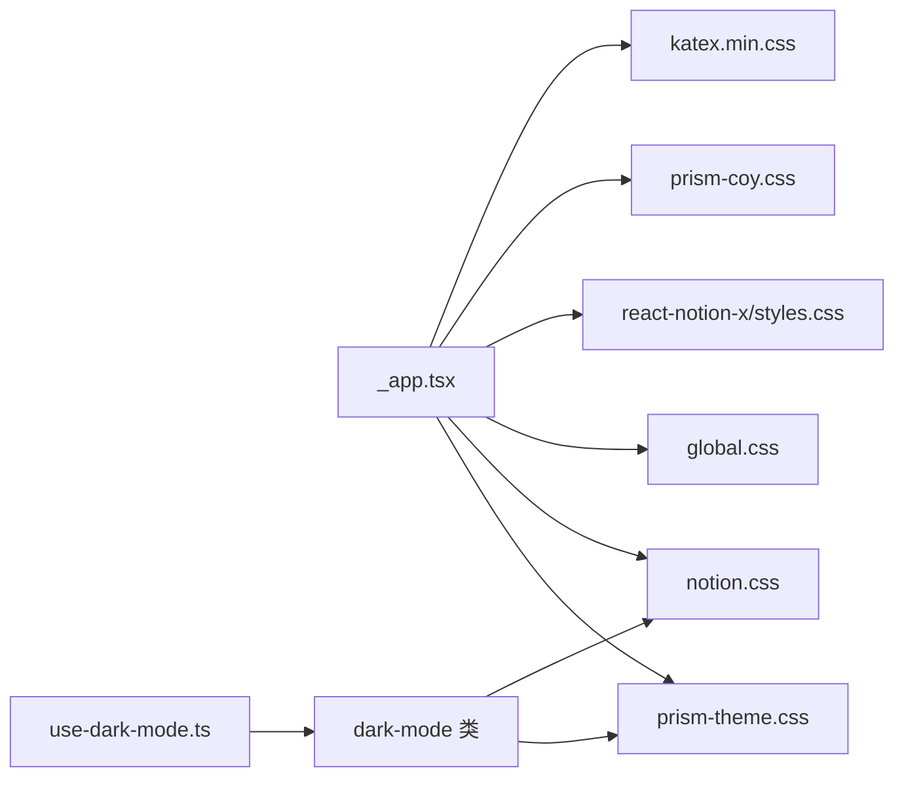
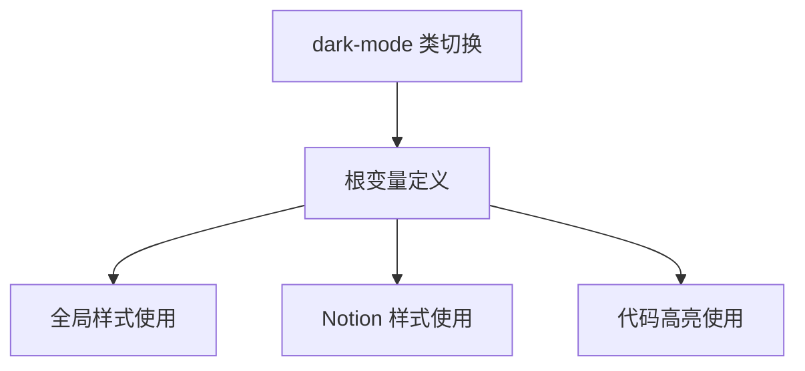
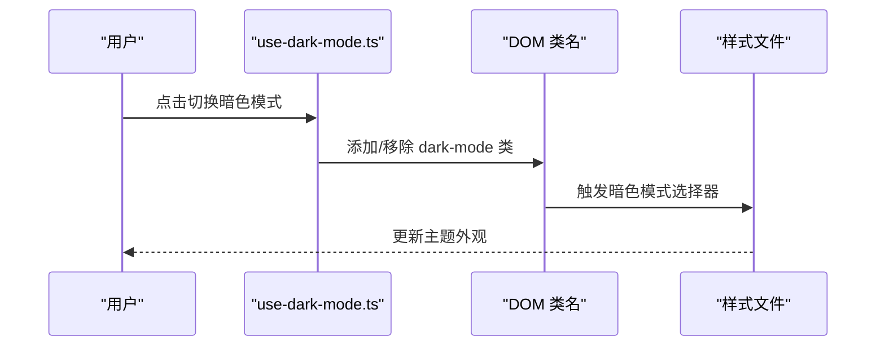

# 样式与主题

<cite>
**本文引用的文件**   
- [pages/_app.tsx](file://pages/_app.tsx)
- [styles/global.css](file://styles/global.css)
- [styles/notion.css](file://styles/notion.css)
- [styles/prism-theme.css](file://styles/prism-theme.css)
- [components/styles.module.css](file://components/styles.module.css)
- [components/SearchModal.module.css](file://components/SearchModal.module.css)
- [lib/use-dark-mode.ts](file://lib/use-dark-mode.ts)
- [site.config.ts](file://site.config.ts)
</cite>

## 目录
1. [简介](#简介)
2. [项目结构](#项目结构)
3. [核心样式模块](#核心样式模块)
4. [架构总览](#架构总览)
5. [详细组件分析](#详细组件分析)
6. [依赖关系分析](#依赖关系分析)
7. [性能与可访问性](#性能与可访问性)
8. [浏览器兼容性处理](#浏览器兼容性处理)
9. [主题定制指南](#主题定制指南)
10. [常见问题排查](#常见问题排查)
11. [结论](#结论)

## 简介
本文件面向希望定制 Notion 内容展示、代码高亮、响应式布局与暗色模式的开发者。文档从全局样式组织、CSS 模块化、主题变量系统出发，逐步深入到具体组件的样式实现，并给出最佳实践、性能优化与兼容性建议。

## 项目结构
项目的样式采用“全局 + 组件级”的分层组织：
- 全局样式入口在应用初始化时统一加载，负责引入第三方库样式、站点基础样式与主题覆盖。
- 针对 Notion 渲染的样式集中在独立文件中，便于在不影响其他模块的前提下进行覆盖。
- 代码高亮主题基于 Prism，并通过额外文件对默认主题进行站点化调整。
- 组件样式使用 CSS Modules，避免类名冲突，适合局部复用与按需加载。

**图表来源**
- [pages/_app.tsx:1-14](file://pages/_app.tsx#L1-L14)
- [styles/global.css:1-64](file://styles/global.css#L1-L64)
- [styles/notion.css:1-794](file://styles/notion.css#L1-L794)
- [styles/prism-theme.css:1-131](file://styles/prism-theme.css#L1-L131)
- [components/styles.module.css:1-226](file://components/styles.module.css#L1-L226)
- [components/SearchModal.module.css:1-182](file://components/SearchModal.module.css#L1-L182)
- [lib/use-dark-mode.ts:1-11](file://lib/use-dark-mode.ts#L1-L11)

**章节来源**
- [pages/_app.tsx:1-14](file://pages/_app.tsx#L1-L14)

## 核心样式模块
- 全局样式（global.css）
  - 重置基础元素盒模型、链接样式、body/html 边距。
  - 定义字体栈以匹配 Notion 的中文字体回退策略。
  - 提供滚动条样式，并使用主题变量控制背景与前景色。
  - 为搜索输入框设置前景色与光标颜色。
- Notion 覆盖样式（notion.css）
  - 覆盖 react-notion-x 生成的 Notion 元素样式，包括页面宽度、行高、画廊网格、引用块、书签、表格、目录侧边栏等。
  - 通过 CSS 变量适配明/暗模式，如 header 毛玻璃效果、表格边框、收藏卡片阴影等。
  - 包含多段媒体查询，适配不同屏幕尺寸下的布局与交互。
- 代码高亮主题（prism-theme.css）
  - 覆盖 Prism Coy 主题的默认外观，使其与 Notion 风格一致。
  - 区分明/暗模式下代码块、内联代码、token 的颜色与背景。
  - 隐藏代码块滚动条，移除多余装饰。
- 组件样式（CSS Modules）
  - 组件级动画与过渡（如加载旋转、GitHub Corner 波浪动画）。
  - 搜索弹窗的遮罩、模态容器、标签、结果项等样式。
  - 响应式布局与悬停交互。

**章节来源**
- [styles/global.css:1-64](file://styles/global.css#L1-L64)
- [styles/notion.css:1-794](file://styles/notion.css#L1-L794)
- [styles/prism-theme.css:1-131](file://styles/prism-theme.css#L1-L131)
- [components/styles.module.css:1-226](file://components/styles.module.css#L1-L226)
- [components/SearchModal.module.css:1-182](file://components/SearchModal.module.css#L1-L182)

## 架构总览
样式加载顺序由应用入口决定，确保全局样式优先于组件样式，同时保证 Notion 与 Prism 的主题覆盖生效。

**图表来源**
- [pages/_app.tsx:1-14](file://pages/_app.tsx#L1-L14)

**章节来源**
- [pages/_app.tsx:1-14](file://pages/_app.tsx#L1-L14)

## 详细组件分析

### 全局样式与主题变量
- 字体与排版
  - 使用系统字体栈并包含中文字体回退，确保中文显示与 Notion 一致。
  - body 溢出横向隐藏，避免水平滚动条。
- 滚动条主题化
  - 滚动条轨道、滑块、轨迹均使用 CSS 变量，便于暗色模式切换。
- 搜索输入框
  - 文本与光标颜色跟随主题变量，保持视觉一致性。

**图表来源**
- [styles/global.css:1-64](file://styles/global.css#L1-L64)

**章节来源**
- [styles/global.css:1-64](file://styles/global.css#L1-L64)

### Notion 内容样式覆盖
- 页面与框架
  - 限制最大宽度、页脚间距、行高，提升可读性。
  - 首页索引页放宽最大宽度以适应更多内容。
- 图片与资源
  - 保留图片原始宽高比，避免裁剪导致内容丢失。
  - 封面图圆角与阴影在不同屏幕下自适应。
- 画廊与集合
  - 根据屏幕尺寸调整列数与间距，保持卡片比例。
  - 标题与属性文本在不同尺寸下字号与行高适配。
- 引用与分隔
  - 引用块左边框颜色随主题变化，行高与内边距更紧凑。
  - 分隔线间距微调。
- 书签
  - 图片与文本布局对齐 Notion 原版，窄屏下堆叠显示。
- 表格
  - 明/暗模式下表格边框颜色增强，提升网格可见性。
- 目录侧边栏
  - 宽屏下收起为窄条，悬停展开显示条目；支持减少动效的可访问性选项。

**图表来源**
- [styles/notion.css:10-794](file://styles/notion.css#L10-L794)

**章节来源**
- [styles/notion.css:10-794](file://styles/notion.css#L10-L794)

### 代码高亮主题
- 代码块
  - 背景色、圆角、内边距与阴影被调整为与 Notion 一致的暖灰风格。
  - 暗色模式下背景色与前景色自动切换。
- 内联代码
  - 明/暗模式下背景与文字颜色分别设置，突出代码片段。
- Token 着色
  - 注释、字符串、关键字、函数等 token 类型分别着色，暗色模式有对应配色。
- 滚动条与装饰
  - 隐藏代码块滚动条，移除多余装饰与左侧边框。

**图表来源**
- [styles/prism-theme.css:1-131](file://styles/prism-theme.css#L1-L131)

**章节来源**
- [styles/prism-theme.css:1-131](file://styles/prism-theme.css#L1-L131)

### 组件样式与动画
- 加载与错误界面
  - 加载图标旋转动画，居中容器与背景色跟随主题变量。
  - 错误图片最大宽度限制。
- 底部区域
  - 社交与设置按钮悬停过渡，移动端纵向排列。
- 页面操作按钮
  - 圆形按钮悬停背景与颜色过渡。
- GitHub Corner
  - 悬停触发波浪动画，小屏下始终播放。
- 搜索弹窗
  - 遮罩与模态容器使用主题变量，标签与结果项具备悬停与激活状态样式。

**图表来源**
- [components/styles.module.css:1-226](file://components/styles.module.css#L1-L226)
- [components/SearchModal.module.css:1-182](file://components/SearchModal.module.css#L1-L182)

**章节来源**
- [components/styles.module.css:1-226](file://components/styles.module.css#L1-L226)
- [components/SearchModal.module.css:1-182](file://components/SearchModal.module.css#L1-L182)

## 依赖关系分析
- 样式导入链
  - _app.tsx 依次导入 Katex、Prism 主题、react-notion-x 核心样式、全局样式、Notion 覆盖样式、Prism 主题调整。
  - 这保证了第三方库样式先于站点自定义样式加载，从而允许后者正确覆盖。
- 组件样式
  - 组件样式通过 CSS Modules 引入，避免全局污染，适合局部复用。
- 暗色模式
  - use-dark-mode.ts 暴露 isDarkMode 与 toggleDarkMode，并在 DOM 上添加 dark-mode 类，供 CSS 选择器驱动主题切换。

**图表来源**
- [pages/_app.tsx:1-14](file://pages/_app.tsx#L1-L14)
- [lib/use-dark-mode.ts:1-11](file://lib/use-dark-mode.ts#L1-L11)

**章节来源**
- [pages/_app.tsx:1-14](file://pages/_app.tsx#L1-L14)
- [lib/use-dark-mode.ts:1-11](file://lib/use-dark-mode.ts#L1-L11)

## 性能与可访问性
- 性能优化
  - 使用 CSS 变量统一管理主题色，减少重复计算与重绘。
  - 合理使用 transition 与 transform，避免触发布局抖动。
  - 媒体查询仅在必要时启用复杂布局，减少不必要的重排。
  - 隐藏滚动条与装饰，降低渲染开销。
- 可访问性
  - 目录侧边栏支持 prefers-reduced-motion，禁用动画以提升可访问性。
  - 搜索输入框与结果项具备清晰的焦点与悬停反馈。
  - 对比度遵循主题变量，确保明/暗模式下的可读性。

[本节为通用指导，不直接分析具体文件]

## 浏览器兼容性处理
- backdrop-filter
  - 头部毛玻璃效果使用 backdrop-filter，Firefox 不支持时使用条件样式回退。
- 滚动条
  - 使用 ::-webkit-scrollbar 伪元素，部分浏览器可能不支持，需渐进增强。
- 媒体查询
  - 使用标准媒体查询语法，兼容现代浏览器。
- 减少动效
  - 使用 prefers-reduced-motion 媒体查询，为需要减少动效的用户禁用过渡。

**章节来源**
- [styles/notion.css:408-424](file://styles/notion.css#L408-L424)
- [styles/notion.css:788-794](file://styles/notion.css#L788-L794)
- [styles/global.css:45-63](file://styles/global.css#L45-L63)

## 主题定制指南

### 主题变量系统
- 关键变量
  - --bg-color、--bg-color-1：背景色与次要背景色。
  - --fg-color、--fg-color-0、--fg-color-1、--fg-color-2、--fg-color-3：前景色及其透明度层级。
  - --select-color-0：选中态主色。
- 作用范围
  - global.css 中滚动条与搜索输入框使用这些变量。
  - notion.css 中多处使用这些变量控制边框、阴影、背景与文字颜色。
  - prism-theme.css 中代码块与 token 颜色也受这些变量影响。
- 扩展建议
  - 在根节点或 .notion 容器上定义新的语义化变量，如 --brand-color、--accent-color，并在相关组件中引用。
  - 通过 dark-mode 类切换变量值，实现完整的暗色模式。

**图表来源**
- [styles/global.css:1-64](file://styles/global.css#L1-L64)
- [styles/notion.css:10-794](file://styles/notion.css#L10-L794)
- [styles/prism-theme.css:1-131](file://styles/prism-theme.css#L1-L131)

**章节来源**
- [styles/global.css:1-64](file://styles/global.css#L1-L64)
- [styles/notion.css:10-794](file://styles/notion.css#L10-L794)
- [styles/prism-theme.css:1-131](file://styles/prism-theme.css#L1-L131)

### 自定义 Notion 内容样式
- 页面布局
  - 调整 .notion-page 的内边距与行高，提升阅读体验。
  - 针对索引页 .index-page 放宽最大宽度。
- 图片与封面
  - 保持图片宽高比，避免裁剪；封面图圆角与阴影在不同屏幕下自适应。
- 画廊与集合
  - 根据屏幕尺寸调整列数与间距；标题与属性文本字号与行高适配。
- 引用与分隔
  - 引用块左边框颜色随主题变化；分隔线间距微调。
- 书签
  - 图片与文本布局对齐 Notion 原版；窄屏下堆叠显示。
- 表格
  - 明/暗模式下表格边框颜色增强，提升网格可见性。
- 目录侧边栏
  - 宽屏下收起为窄条，悬停展开显示条目；支持减少动效的可访问性选项。

**章节来源**
- [styles/notion.css:10-794](file://styles/notion.css#L10-L794)

### 代码高亮主题
- 代码块
  - 调整背景色、圆角、内边距与阴影，使其与 Notion 风格一致。
  - 暗色模式下背景色与前景色自动切换。
- 内联代码
  - 明/暗模式下背景与文字颜色分别设置，突出代码片段。
- Token 着色
  - 注释、字符串、关键字、函数等 token 类型分别着色，暗色模式有对应配色。
- 滚动条与装饰
  - 隐藏代码块滚动条，移除多余装饰与左侧边框。

**章节来源**
- [styles/prism-theme.css:1-131](file://styles/prism-theme.css#L1-L131)

### 响应式设计适配
- 画廊网格
  - 小屏单列，中屏双列，大屏三列；卡片高度由最高卡片驱动。
- 目录侧边栏
  - 宽屏下展开，窄屏下隐藏；悬停展开显示条目。
- 搜索按钮
  - 极小屏隐藏搜索按钮。
- 组件布局
  - 底部区域在小屏下纵向排列；GitHub Corner 在小屏下始终播放动画。

**章节来源**
- [styles/notion.css:72-93](file://styles/notion.css#L72-L93)
- [styles/notion.css:644-794](file://styles/notion.css#L644-L794)
- [styles/notion.css:222-226](file://styles/notion.css#L222-L226)
- [components/styles.module.css:132-150](file://components/styles.module.css#L132-L150)
- [components/styles.module.css:188-221](file://components/styles.module.css#L188-L221)

### 暗色模式实现
- 机制
  - use-dark-mode.ts 在 DOM 上添加 dark-mode 类，切换明/暗模式。
- 覆盖点
  - notion.css 中头部毛玻璃、收藏卡片、书签、表格边框等使用 dark-mode 选择器。
  - prism-theme.css 中代码块、内联代码、token 颜色在暗色模式下切换。
  - global.css 中滚动条与搜索输入框颜色跟随主题变量。

**图表来源**
- [lib/use-dark-mode.ts:1-11](file://lib/use-dark-mode.ts#L1-L11)
- [styles/notion.css:408-424](file://styles/notion.css#L408-L424)
- [styles/prism-theme.css:16-34](file://styles/prism-theme.css#L16-L34)
- [styles/global.css:45-63](file://styles/global.css#L45-L63)

**章节来源**
- [lib/use-dark-mode.ts:1-11](file://lib/use-dark-mode.ts#L1-L11)
- [styles/notion.css:408-424](file://styles/notion.css#L408-L424)
- [styles/prism-theme.css:16-34](file://styles/prism-theme.css#L16-L34)
- [styles/global.css:45-63](file://styles/global.css#L45-L63)

### CSS 动画与过渡效果
- 加载图标
  - 旋转动画，线性无限循环。
- GitHub Corner
  - 悬停触发波浪动画，小屏下始终播放。
- 目录侧边栏
  - 悬停展开时宽度、内边距、背景色、边框、阴影均有过渡。
- 搜索弹窗标签
  - 悬停与激活状态具备背景、颜色、边框过渡。

**章节来源**
- [components/styles.module.css:1-34](file://components/styles.module.css#L1-L34)
- [components/styles.module.css:194-221](file://components/styles.module.css#L194-L221)
- [styles/notion.css:644-794](file://styles/notion.css#L644-L794)
- [components/SearchModal.module.css:104-126](file://components/SearchModal.module.css#L104-L126)

## 常见问题排查
- 主题变量未生效
  - 检查是否在根节点或 .notion 容器上定义了必要的 CSS 变量。
  - 确认 dark-mode 类是否正确添加到 DOM。
- 暗色模式样式错乱
  - 检查 notion.css 与 prism-theme.css 中的 dark-mode 选择器是否覆盖到目标元素。
  - 确认样式导入顺序，确保覆盖样式在第三方样式之后加载。
- 滚动条样式不生效
  - 某些浏览器不支持 ::-webkit-scrollbar，需渐进增强或使用 polyfill。
- 响应式布局异常
  - 检查媒体查询断点是否与预期一致，确认容器宽度与内边距设置。
- 动画卡顿或不流畅
  - 避免在动画中使用会触发布局抖动的属性，优先使用 transform 与 opacity。
  - 使用 prefers-reduced-motion 为用户提供减少动效的选项。

**章节来源**
- [styles/global.css:45-63](file://styles/global.css#L45-L63)
- [styles/notion.css:408-424](file://styles/notion.css#L408-L424)
- [styles/notion.css:788-794](file://styles/notion.css#L788-L794)
- [components/styles.module.css:194-221](file://components/styles.module.css#L194-L221)

## 结论
本项目通过清晰的全局样式分层与 CSS Modules 组件样式，结合主题变量系统与暗色模式钩子，实现了灵活的样式定制与良好的用户体验。开发者可在不破坏现有结构的前提下，轻松扩展主题变量、覆盖 Notion 内容样式、调整代码高亮主题，并根据屏幕尺寸与可访问性需求进行响应式与动效优化。

[本节为总结性内容，不直接分析具体文件]