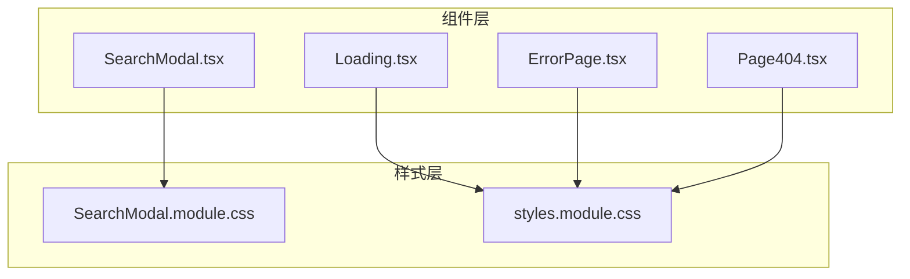
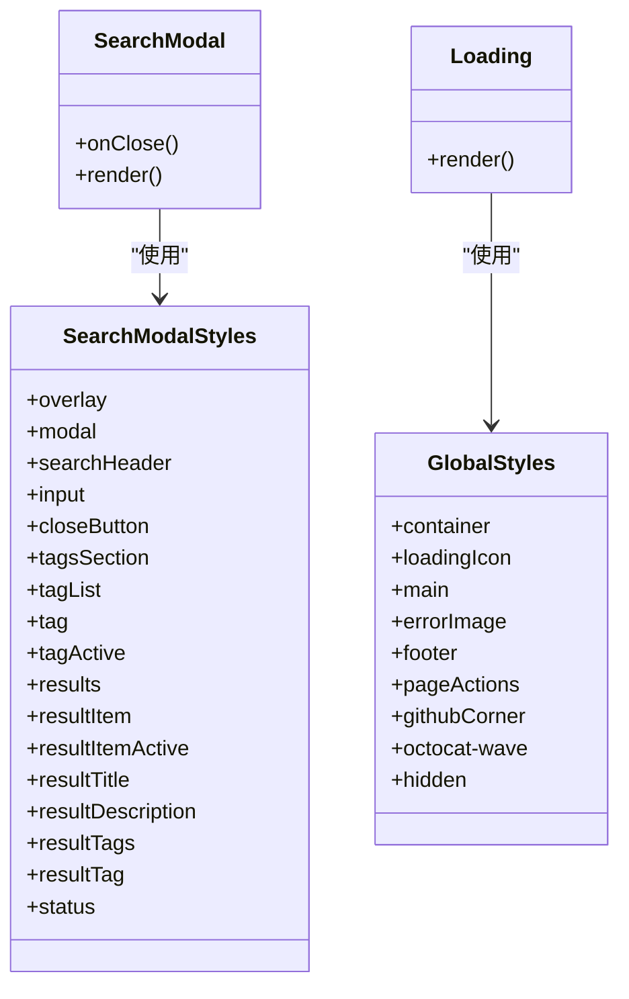
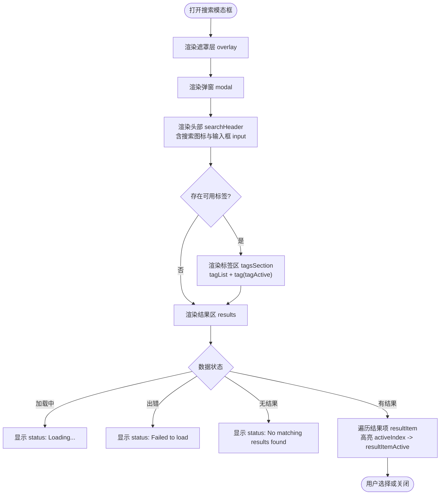
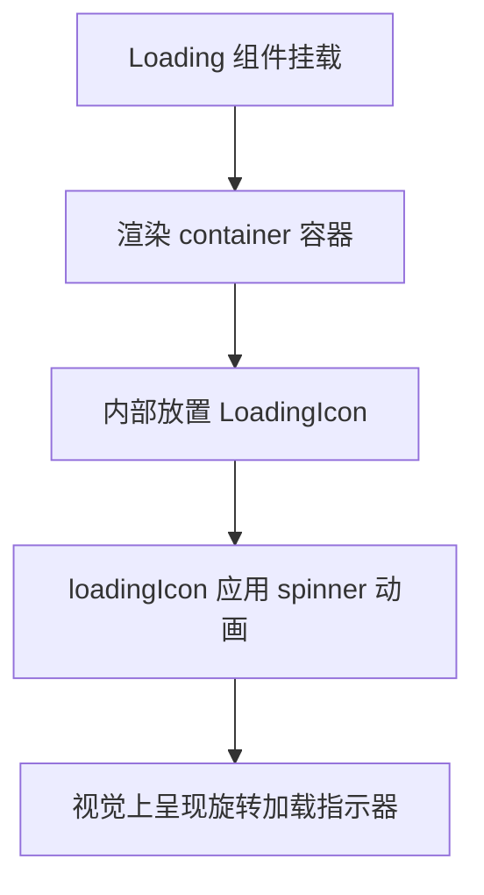
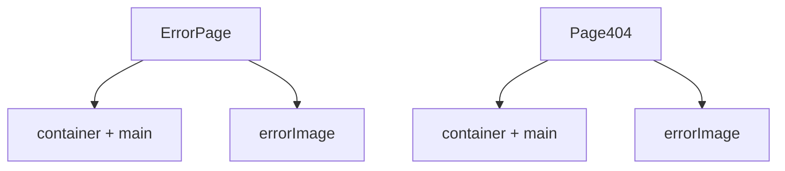
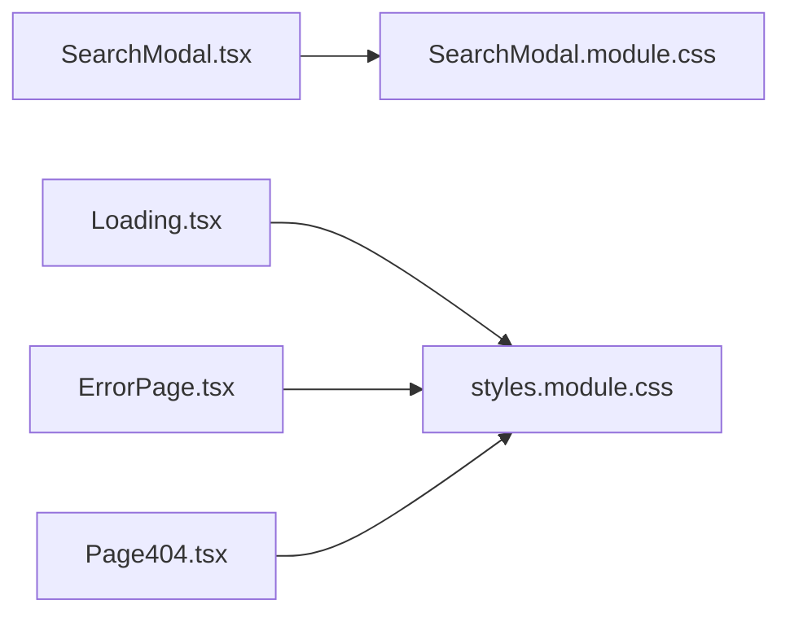

# 组件样式

<cite>
**本文引用的文件**   
- [components/styles.module.css](file://components/styles.module.css)
- [components/SearchModal.module.css](file://components/SearchModal.module.css)
- [components/SearchModal.tsx](file://components/SearchModal.tsx)
- [components/Loading.tsx](file://components/Loading.tsx)
- [components/ErrorPage.tsx](file://components/ErrorPage.tsx)
- [components/Page404.tsx](file://components/Page404.tsx)
</cite>

## 目录
1. [简介](#简介)
2. [项目结构](#项目结构)
3. [核心组件与样式总览](#核心组件与样式总览)
4. [架构总览](#架构总览)
5. [详细组件样式分析](#详细组件样式分析)
6. [依赖关系分析](#依赖关系分析)
7. [性能与可访问性](#性能与可访问性)
8. [故障排查](#故障排查)
9. [结论](#结论)
10. [附录：命名与组织最佳实践](#附录命名与组织最佳实践)

## 简介
本文面向 Next.js + React 项目的模块化样式体系，聚焦 components/styles.module.css 与 components/SearchModal.module.css，系统说明 CSS Modules 的使用方式、组件样式隔离、样式复用模式，并深入解析搜索模态框、加载动画、错误页面等组件的样式实现。文档同时覆盖组件状态样式、交互效果与动画过渡的实现方法，最后给出组件样式的组织规范与命名约定建议。

## 项目结构
本项目采用“按组件拆分样式”的策略：每个需要独立样式的组件拥有自己的 .module.css 文件，通过 import styles from './xxx.module.css' 的方式在组件中使用，从而天然获得类名作用域隔离。全局样式则位于 styles/ 目录下（如 global.css、notion.css、prism-theme.css），与本章节重点无关。

图表来源
- [components/SearchModal.tsx:1-10](file://components/SearchModal.tsx#L1-L10)
- [components/Loading.tsx:1-3](file://components/Loading.tsx#L1-L3)
- [components/ErrorPage.tsx:1-3](file://components/ErrorPage.tsx#L1-L3)
- [components/Page404.tsx:1-4](file://components/Page404.tsx#L1-L4)

章节来源
- [components/SearchModal.tsx:1-10](file://components/SearchModal.tsx#L1-L10)
- [components/Loading.tsx:1-3](file://components/Loading.tsx#L1-L3)
- [components/ErrorPage.tsx:1-3](file://components/ErrorPage.tsx#L1-L3)
- [components/Page404.tsx:1-4](file://components/Page404.tsx#L1-L4)

## 核心组件与样式总览
- SearchModal.tsx 使用 SearchModal.module.css 定义搜索模态框的布局、输入区、标签筛选、结果列表与状态提示等样式。
- Loading.tsx 使用 styles.module.css 中的容器与旋转动画实现加载指示器。
- ErrorPage.tsx 与 Page404.tsx 使用 styles.module.css 中的通用容器、主内容区与图片样式，展示错误信息。

章节来源
- [components/SearchModal.tsx:1-10](file://components/SearchModal.tsx#L1-L10)
- [components/SearchModal.module.css:1-182](file://components/SearchModal.module.css#L1-L182)
- [components/Loading.tsx:1-11](file://components/Loading.tsx#L1-L11)
- [components/ErrorPage.tsx:1-23](file://components/ErrorPage.tsx#L1-L23)
- [components/Page404.tsx:1-38](file://components/Page404.tsx#L1-L38)
- [components/styles.module.css:1-226](file://components/styles.module.css#L1-L226)

## 架构总览
下图展示了组件与其对应样式文件的映射关系，以及关键样式类的职责划分。

图表来源
- [components/SearchModal.tsx:1-10](file://components/SearchModal.tsx#L1-L10)
- [components/SearchModal.module.css:1-182](file://components/SearchModal.module.css#L1-L182)
- [components/Loading.tsx:1-11](file://components/Loading.tsx#L1-L11)
- [components/styles.module.css:1-226](file://components/styles.module.css#L1-L226)

## 详细组件样式分析

### 搜索模态框（SearchModal）
SearchModal 是一个全屏遮罩+居中弹窗的搜索界面，包含以下样式要点：
- 遮罩层 overlay：固定定位、半透明背景、模糊背景、滚动区域适配长列表。
- 弹窗主体 modal：最大宽度、圆角、阴影、垂直滚动限制（max-height）。
- 头部 searchHeader：图标与输入框水平排列，底部边框分隔。
- 输入框 input：无边框、透明背景、继承字体与颜色、占位符颜色。
- 关闭按钮 closeButton：透明背景、边框、悬停透明度变化。
- 标签筛选 tagsSection/tagList/tag：多标签横向换行、选中态 tagActive 高亮、悬停边框色变化。
- 结果列表 results/resultItem/resultTitle/description/tags/tag：条目点击高亮 resultItemActive、描述省略、标签胶囊样式。
- 状态提示 status：统一用于加载中、错误、无结果的提示文本。

图表来源
- [components/SearchModal.tsx:57-254](file://components/SearchModal.tsx#L57-L254)
- [components/SearchModal.module.css:1-182](file://components/SearchModal.module.css#L1-L182)

交互与状态样式说明
- 键盘导航：方向键上下切换 activeIndex，Enter 跳转，Esc 关闭。
- 标签筛选：selectedTags 控制 tagActive 样式，支持多选过滤。
- 结果高亮：activeIndex 对应的 resultItem 应用 resultItemActive 样式。
- 无障碍：dialog/aria-modal/aria-label 等属性提升可访问性。

章节来源
- [components/SearchModal.tsx:57-254](file://components/SearchModal.tsx#L57-L254)
- [components/SearchModal.module.css:1-182](file://components/SearchModal.module.css#L1-L182)

### 加载动画（Loading）
Loading 组件通过 styles.module.css 中的容器与动画实现：
- container：绝对定位铺满父容器，Flex 居中，内边距与字体设置。
- loadingIcon：使用 @keyframes spinner 实现持续旋转动画，尺寸与颜色可控。

图表来源
- [components/Loading.tsx:1-11](file://components/Loading.tsx#L1-L11)
- [components/styles.module.css:1-34](file://components/styles.module.css#L1-L34)

章节来源
- [components/Loading.tsx:1-11](file://components/Loading.tsx#L1-L11)
- [components/styles.module.css:1-34](file://components/styles.module.css#L1-L34)

### 错误页面（ErrorPage 与 Page404）
两个页面均复用 styles.module.css 的通用样式：
- container/main：统一的页面容器与主内容区布局。
- errorImage：错误图自适应宽度与最大宽度限制。
- 其他：页脚、社交链接、GitHub Corner 等通用样式也位于该文件，便于全站复用。

图表来源
- [components/ErrorPage.tsx:1-23](file://components/ErrorPage.tsx#L1-L23)
- [components/Page404.tsx:1-38](file://components/Page404.tsx#L1-L38)
- [components/styles.module.css:7-46](file://components/styles.module.css#L7-L46)

章节来源
- [components/ErrorPage.tsx:1-23](file://components/ErrorPage.tsx#L1-L23)
- [components/Page404.tsx:1-38](file://components/Page404.tsx#L1-L38)
- [components/styles.module.css:7-46](file://components/styles.module.css#L7-L46)

## 依赖关系分析
- SearchModal.tsx 仅依赖 SearchModal.module.css 提供的样式类，并通过 createPortal 将弹窗挂载到 document.body，避免被父级 overflow 影响。
- Loading.tsx、ErrorPage.tsx、Page404.tsx 共同依赖 styles.module.css，形成“共享基础样式”的模式。
- 样式变量（如 --bg-color、--fg-color、--fg-color-0）由外部主题提供，组件样式通过 var() 引用，保证明暗主题一致性。

图表来源
- [components/SearchModal.tsx:1-10](file://components/SearchModal.tsx#L1-L10)
- [components/Loading.tsx:1-3](file://components/Loading.tsx#L1-L3)
- [components/ErrorPage.tsx:1-3](file://components/ErrorPage.tsx#L1-L3)
- [components/Page404.tsx:1-4](file://components/Page404.tsx#L1-L4)

章节来源
- [components/SearchModal.tsx:1-10](file://components/SearchModal.tsx#L1-L10)
- [components/Loading.tsx:1-3](file://components/Loading.tsx#L1-L3)
- [components/ErrorPage.tsx:1-3](file://components/ErrorPage.tsx#L1-L3)
- [components/Page404.tsx:1-4](file://components/Page404.tsx#L1-L4)

## 性能与可访问性
- 性能
  - CSS Modules 自动为类名添加哈希前缀，避免全局污染，减少样式冲突带来的重绘。
  - 动画使用 transform 与 opacity，利于 GPU 加速；spinner 使用线性无限循环，开销低。
  - 搜索结果列表使用 useMemo 计算过滤结果，避免重复渲染。
- 可访问性
  - 搜索模态框使用 role="dialog"、aria-modal="true"、aria-label 等语义化属性。
  - 输入框与关闭按钮具备明确的 aria-label，提升屏幕阅读器体验。
  - 键盘导航支持 Esc 关闭、方向键切换、Enter 确认，符合常见交互预期。

章节来源
- [components/SearchModal.tsx:153-254](file://components/SearchModal.tsx#L153-L254)
- [components/SearchModal.module.css:12-38](file://components/SearchModal.module.css#L12-L38)
- [components/styles.module.css:1-34](file://components/styles.module.css#L1-L34)

## 故障排查
- 搜索索引加载失败
  - 现象：模态框显示“Failed to load: ...”。
  - 原因：fetch(api.searchIndex) 返回非 2xx 或 JSON 解析异常。
  - 处理：检查后端接口可用性、网络权限与 CORS 配置。
- 标签筛选无效
  - 现象：点击标签后结果未变化。
  - 原因：selectedTags 状态未更新或 filterItems 逻辑未生效。
  - 处理：确认 toggleTag 回调与 selectedTags 状态绑定正确。
- 键盘导航不生效
  - 现象：方向键无法切换高亮项。
  - 原因：onKeyDown 未绑定到模态框根节点或事件冒泡被阻止。
  - 处理：确保 onKeyDown 绑定在 modal 容器上且未被 e.stopPropagation 阻断。
- 样式未生效
  - 现象：类名未应用或样式错乱。
  - 原因：未正确导入 .module.css 或使用全局样式覆盖。
  - 处理：确认 import styles from './xxx.module.css'，避免在全局样式中同名覆盖。

章节来源
- [components/SearchModal.tsx:80-106](file://components/SearchModal.tsx#L80-L106)
- [components/SearchModal.tsx:131-147](file://components/SearchModal.tsx#L131-L147)
- [components/SearchModal.module.css:176-182](file://components/SearchModal.module.css#L176-L182)

## 结论
本项目通过 CSS Modules 实现了组件级别的样式隔离与复用，SearchModal.module.css 与 styles.module.css 分别承担“复杂交互组件样式”和“通用基础样式”的职责。结合状态驱动的状态样式、合理的动画与过渡、完善的可访问性与键盘交互，整体样式体系清晰、可扩展性强。建议在新增组件时遵循现有命名与组织规范，优先使用 CSS 变量进行主题适配，保持样式的一致性与可维护性。

## 附录：命名与组织最佳实践
- 文件组织
  - 每个组件尽量拥有独立的 .module.css 文件，避免跨组件样式耦合。
  - 公共样式（容器、通用动画、通用交互）集中放在 styles.module.css 或专门的 shared 模块中。
- 命名约定
  - 使用 BEM 风格或“组件名_块名”风格，如 searchHeader、resultItem、tagActive。
  - 状态类以 Active/Disabled/Hover 等后缀表示，如 tagActive、resultItemActive。
  - 动画类以 animate- 或 keyframe 名称区分，如 spinner、octocat-wave。
- 主题与变量
  - 使用 CSS 变量（--bg-color、--fg-color、--fg-color-0）管理主题色，便于明暗模式切换。
- 交互与可访问性
  - 为可交互元素提供 aria-* 属性与键盘事件支持。
  - 使用 transition 与 transform 优化动画性能，避免 layout thrashing。
- 样式复用
  - 对多处复用的布局（如 container、main、errorImage）抽取为公共样式类。
  - 对相似组件（如 tag、resultTag）提取一致的视觉规范，保持 UI 一致性。